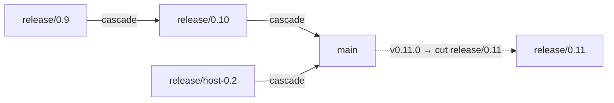

# Developing Althar

How to work in this repository. For what Althar is, see the [README](README.md); for how to propose a change, [CONTRIBUTING.md](CONTRIBUTING.md).

## Set up

You need git, [Bun](https://bun.sh) 1.3.5 and Node 24. The pinned versions are in `.bun-version` and `.node-version`.

```bash
git clone https://github.com/AltharIDE/althar.git && cd althar
```

```bash
bun install --frozen-lockfile
```

Installing also sets up the pre-commit hook (`.vite-hooks/pre-commit`), which formats and lints the files you stage and fixes what it can. Then build the desktop app and open it:

```bash
bun --filter @althar/desktop dev
```

## Commands

From the repository root:

| Command | What it does |
| --- | --- |
| `bun run dev` | The public site, at `http://localhost:5320` |
| `bun --filter @althar/desktop dev` | Builds the desktop app and opens it |
| `bun --filter @althar/ui storybook` | The UI package's Storybook, at `http://localhost:6006` (see [Showing a change works](#showing-a-change-works) for a port of a task's own) |
| `bun --filter @althar/host build` | Builds the standalone Linux host; [setup, operation and tests](apps/host/README.md) |
| `bun run check` | Format, type-aware lint and type checks, in every package |
| `bun run fix` | The same, fixing what can be fixed |
| `bun run test` | Unit and component tests, in every package |
| `bun run verify` | Checks, tests with coverage and builds, in every package |
| `bun run test:e2e` | The end-to-end tests: the desktop app's, which run quietly on a Mac, at most three runs at once on the computer ([apps/desktop](apps/desktop#work-on-it)) |

Each app and package has its own README with its own commands.

The full suites are heavy: the desktop app's end-to-end run takes much of a
Mac for its length. While you work, run what your change touches (the checks
and tests of the packages you changed and of those that build on them, and
the end-to-end specs for what you changed), and leave the rest to CI, which
runs the checks and unit tests your change reaches, and the end-to-end run when
it reaches the app, on the pull request; in the merge queue, what your change and
those that landed beside it could break together; and everything, Windows'
tests, coverage and the packages too, after merge.

## The repository

| Path | What's there |
| --- | --- |
| [`apps/site`](apps/site) | The public site: the developer page, the shifts and the thesis |
| [`apps/report`](apps/report) | `@althar/report`: the Cloudflare Worker that turns a problem reported from the app into a Linear issue |
| [`packages/ui`](packages/ui) | `@althar/ui`, the interface components, with a Storybook |
| [`packages/domain`](packages/domain) | `@althar/domain`: identifiers, vocabularies, lifecycles and commands, as Effect schemas |
| [`packages/persistence-sqlite`](packages/persistence-sqlite) | `@althar/persistence-sqlite`: the local store, its schema ([schema.sql](packages/persistence-sqlite/schema.sql)) and migrations |
| [`packages/provider-adapters`](packages/provider-adapters) | `@althar/provider-adapters`: how Althar talks to agents over ACP, and the agent registry |
| [`packages/skills`](packages/skills) | `@althar/skills`: skill validation, the shared store, adding from GitHub, per-run projection and the repository boundary |
| [`packages/runtime`](packages/runtime) | `@althar/runtime`: the store's one writer, which owns projects, tasks, agent sessions, turns and permissions |
| [`packages/contracts`](packages/contracts) | `@althar/contracts`: the API between the runtime and its clients, and the transport it runs over |
| [`packages/transport-node`](packages/transport-node) | `@althar/transport-node`: authenticated private-socket and SSH clients for the shared API |
| [`packages/testing`](packages/testing) | `@althar/testing`: how the tests run in CI, retried once, with the flaky ones reported and quarantined |
| [`apps/desktop`](apps/desktop) | `@althar/desktop`: the desktop app, Electron with the runtime in a utility process |
| [`apps/host`](apps/host) | `@althar/host`: a persistent Linux home with encrypted secrets and a systemd user service |
| [`apps/cli`](apps/cli) | `@althar/cli`: a command-line client for the runtime, which runs a task with a real agent in a terminal |
| [`brand`](brand) | `@althar/brand`: the mark, lockups, avatars, banners and screenshots, ready to use, and the code that draws them |
| [`docs/architecture`](docs/architecture) | The working architecture: a local-first desktop app, with seams for a later cloud |
| [`docs/decisions`](docs/decisions) | Architecture decisions, one per file |
| [`docs/glossary.md`](docs/glossary.md) | The words the interface uses, beside the words the architecture uses |
| [`docs/open-questions.md`](docs/open-questions.md) | What is not decided yet |
| [`docs/plans`](docs/plans) | Temporary plans, such as the current demo's. Not architecture |
| [`docs/research`](docs/research) | Research behind a decision: how other products do something, from their docs, source and issues |
| [`ARCHITECTURE.md`](ARCHITECTURE.md) | The engineering standards every app and package follows |
| [`THESIS.md`](THESIS.md) | The research hypothesis Althar comes out of |

## Standards

[ARCHITECTURE.md](ARCHITECTURE.md) is the target every app and package moves toward. In short:

- Strict TypeScript for the existing app and home; Rust for the planned worker supervisor and sandbox execution agent, with a Protobuf worker contract ([Foundations](docs/decisions/foundations.md#remote-connections-and-native-workers)). Validate anything untrusted at runtime in either language.
- Tests first for new behaviour, and at least 90% line and branch coverage in each app and package.
- Accessibility to WCAG 2.2 AA from the first implementation.
- A consequential decision amends its area document in [`docs/decisions`](docs/decisions), with a dated Changes entry; undecided proposals stay in `proposed/`. Do not add numbered ADRs. An exception gets an owner and an expiry.

TypeScript runtime-side code is written with Effect 4, with the conventions in
[ADR-009](docs/decisions/foundations.md#effect-on-the-runtime-side); the UI kit never
uses it. The desktop app is MVVM in feature folders
([ADR-010](docs/decisions/foundations.md#the-desktop-apps-layers)).

Each app and package has its own `ARCHITECTURE.md` for what is specific to it. Before naming anything on screen, check [the glossary](docs/glossary.md).

### Background work shares the machine

Althar automatically runs agent process families at background priority and uses CPU weights where delegated Linux groups or Windows jobs permit them; macOS also attempts its background scheduling policy. Native commands from one session share a worker identity, independent of the language or runner. Sustained machine pressure temporarily reduces new autonomous admissions and recovery restores them, without rewriting the agent cap or killing running builds. Missing OS controls keep the normal priority and admission fallback. No project worker flags or extra resource setup are required. [ADR-106](docs/decisions/proposed/106-builds-and-tests-share-a-host-resource-budget.md) describes the platform limits and tests.

### Tests that hold

A test passes or fails for what the code does, not for how fast the machine it runs on is. `@althar/testing` holds what makes that so ([the plan](docs/plans/tests-that-hold.md) says why).

- **A test takes its size's time, never a time of its own.** A package's Vitest config takes `testing('small')` (no processes, files or network) or `testing('medium')` (real git, processes, files, localhost); a test that needs more takes `budget.large` by name. The budgets are scaled for the machine: four times on GitHub's Windows runners, and `ALTHAR_TEST_SCALE=3 bun run test` on a busy Mac. A test that passes is done as soon as it can be, so the budget only bounds how long one that hangs takes to fail.
- **Wait with `until` (Effect) or `waitFor` (promises), never a loop of your own.** Each reads again every 20 ms until its check passes, and gives up only near its test's own time, saying what it last read. A wait takes no time of its own either.
- **One clock.** The runtime and the packages it uses read the time and wait only through Effect's `Clock`, which in production is the system's and in a test is the test's. `lint/clock.js` (`althar/one-clock`) fails on `Date.now()`, `performance.now()`, `new Date()` or `Date()` with no time, `DateTime.nowUnsafe`, `setTimeout` and `setInterval` in their `src`, the fake agent apart. Where only a Node timer will do, outside any effect, the line says why with `// oxlint-disable-next-line althar/one-clock`.
- **What happens on a timer is tested on the test's clock:** `it.effect` with `onTestClock` (`tests/support.ts`), moving the clock with `TestClock.adjust` or `atReset(later())`. A jump fires everything due before it, so jump no further than the test needs. A plain `it(…, () => Effect)` never runs, and under a plain TestClock `until` never returns.
- **A future time is relative to the test's present.** Use `isoAfter(milliseconds)` from `@althar/testing` for a live reset or expiry, and historical dates for fixed-clock examples. The test kit refuses future date literals in test fixtures. For reads days later that must leave background timers alone, `readClock` from `@althar/testing/effect` gives `advance` and `run`; only effects passed to `run` see the moved time. Use `TestClock.adjust` when the timers themselves should fire.
- **Test folders use the same paths as git, and cleanup tolerates Windows.** `realPath` from `@althar/testing` expands an existing path, including a short Windows name; `slashPath` is for output specified with forward slashes. Stop a folder's processes, then remove it with `removeTree` or `removeTreeSync`, which retry transient filesystem errors and still fail if it stays.
- **Hold the fake agent, don't time it.** A test passes `holds: holds()` and opens a marker's hold when it is ready, rather than waiting out the fake's delay: a turn the fake takes a while over (`[lead:slowly]`, `[answers-after:5s]`) goes on when the test opens its marker, and one that works until it is stopped (`[lead:wait]`, `[review:wait]`) never ends by itself, but when its turn is stopped, its session closed or its hold opened. A slow start is held with `beforeNewSession`, and the fake code host's calls with `waitsFor` (in the app, `ALTHAR_FAKE_HELD` holds fake-host calls; `ALTHAR_FAKE_AGENT_HELD` maps agent markers to files from `fileHolds`, whose `waiting(marker)` confirms the agent received the message before a spec queues another).
- **No durations in correctness tests.** A test checks what happened, not how long it took: that the change feed hears a write is shown with its fallback held still, not timed. How fast something is belongs in a package's performance run (`bun run test:performance`: Vitest's benchmarks in `tests/*.bench.ts`, timed with `measure` from `@althar/testing/performance`), which `nightly` runs and reports on its summary, a path over its budget as a warning, gating nothing.
- **End-to-end specs take their size's time too.** `playwright.config.ts` gives each test `budget.large` and each assertion `budget.medium`; `launch()` in `e2e/support.ts` gives the app's actions and its start the same, as Playwright doesn't pass its config's action time to an Electron app. A spec waits for what it looks for (`expect`, `expect.poll`, `locator.waitFor`, `page.waitForFunction`) and never sleeps: before a screenshot it calls `still(page)`, after resizing `sizeWindow`, and where a sleep would show that something doesn't happen, a later event or what the app keeps shows it. A spec times nothing: a screen shown at once is a kept screen shown while the runtime is held (`holdRuntime`).
- **Wait for what ends a step, not what starts it.** What shows as something begins says nothing of when it is over: a round's card shows as the round opens, so a spec that wrote its next message at the card raced the round's end, and the message joined that round instead of opening the next (#445). Wait for what shows once it is done, such as the task reading Ready to accept.
- **A spec presses each system's own keys:** `ControlOrMeta+n`, not `Meta+n`, which on Linux and Windows opens nothing, and the spec waits out its time for what it opened. A spec that means one system names it; `tests/e2eLimits.test.ts` fails one that presses a Mac's key on every system.
- **A dependency's patch is made again from the package itself on every bump** (`bun patch`, in `patches/`), never renamed for the new version. Bun applies a patch at its line numbers without checking the lines around them, so a patch carried over to a version whose lines moved can corrupt it with nothing said: #396 broke Claude Code's adapter that way, and #400 made the patch again from 0.99.0 itself, as #417 did from 0.99.1. The tests that check a patch (`usage.test.ts` in provider-adapters, `package.test.ts` in the desktop app) failing is the patch broken, not a test to quarantine.
- **No test reads this computer's agents, home, documents or PATH.** What a test reads, it makes, in a folder of its own: a test that counted on `~/Documents` failed where there was none (#411). The end-to-end `launch()` gives the app a home of the test's own and a PATH of git, Node, npm and Bun beside the system's own folders (`appPath` in `e2e/support.ts`), and the fake agents' runtime looks for the person's agents on that PATH alone, so `e2e/agents.spec.ts` finds on a Mac with agents installed what it finds on CI.
- **`tests/limits.test.ts` in `@althar/testing` fails on any test, hook or wait given a time of its own,** or a loop that gives up after so many tries. The tests of real agents and real accounts, with their own configs, and a benchmark run by hand are the exceptions it names; `tests/e2eLimits.test.ts` does the same for the end-to-end specs, all but the two that drive real agents, and fails one that imports what Node can't load: the UI kit's components (`@althar/ui`, `@althar/ui/screens`) or the renderer's, which reach CSS, where Playwright loads specs in Node (#217). A subpath that reaches none, as `@althar/ui/device`, is fine.

## The architecture

Start from [the overview](docs/architecture/README.md), then:

1. [Concepts and the project model](docs/architecture/01-concepts-and-project-model.md)
2. [Desktop runtime](docs/architecture/02-desktop-runtime.md)
3. [Agent runtime and auth](docs/architecture/03-agent-runtime-and-auth.md)
4. [Coordinator](docs/architecture/04-coordinator.md)
5. [Workflow engine](docs/architecture/05-workflow-engine.md)
6. [Integrations and skills](docs/architecture/06-integrations-and-skills.md)
7. [Persistence, security and cloud](docs/architecture/07-persistence-security-and-cloud.md)
8. [Precedents and validation](docs/architecture/08-precedents-and-validation.md)

## Showing a change works

A change to what someone sees is shown with screenshots of the states it
changed; a change behind the screen, with the test run or command that shows
it. An agent leading a task in Althar hands them with `finish_step` as
evidence, and lists what it couldn't show as unverified.

There are two ways to screenshot this repository's interface, both headless:

- **A component, in its Storybook story.** Start Storybook on a port of the
  task's own (another worktree may have 6006, with its own code), and shoot the
  story's frame with Playwright, which the desktop app already has:

  ```bash
  cd packages/ui && bunx storybook dev --port 6116 --ci --no-open &
  cd apps/desktop
  bunx playwright screenshot --viewport-size=900,900 --full-page \
    --wait-for-selector "#storybook-root > *" --wait-for-timeout 800 \
    "http://localhost:6116/iframe.html?id=thread-evidence--shown&viewMode=story" test-results/evidence.png
  ```

  The story's id is its title and name in kebab case (`Thread/Evidence`,
  `Shown`); a `play` function runs first, so a story can open what it shows.
  Add a story for a state that has none.

- **The desktop app, with the fake agent.** An end-to-end spec drives the
  built app and saves what it shows with `page.screenshot`, as
  `apps/desktop/e2e/evidence.spec.ts` does; `bun run test:e2e e2e/your.spec.ts`
  builds the app and runs it.

Shoot at 1×, and only what changed where you can. The command above shoots a
story at 1× already, and a story's frame is just the component. In a spec, the
app's window on a Retina Mac shoots at 2× unless told otherwise: pass
`scale: 'css'` to `page.screenshot` and to an element's `screenshot`, and take
one element (`page.getByRole(…).screenshot({ scale: 'css' })`) rather than the
window. An agent reads each shot it looks at into its
context, where it stays: a Retina shot of the whole window costs it as much as
a few thousand words, and one cropped at 1× a tenth of that. Look at each shot
once.

Shots go in `test-results/`, which git ignores. In an agent's sandbox on a
Mac, Chromium and Electron can't start (Chromium exits with `SIGTRAP`), so run
the shooting command outside the sandbox; Storybook itself runs inside it,
since a lead may listen on localhost. A lead in Althar runs `bunx playwright`
and the end-to-end run's own `node scripts/e2e.ts` (in `apps/desktop`)
outside its sandbox from the start (the project's rules, under Sandbox), but
only on a line of their own: change folder in a command of its own first, as
above. Claude Code keeps a line that starts with `bun` in its sandbox
whatever its settings say, so `bun run test:e2e` fails there: run
`node scripts/e2e.ts e2e/your.spec.ts` from `apps/desktop` instead.
On Linux the run takes a display of its own that no one sees, Xvfb where it's
installed and Chromium's headless platform where it isn't, so a lead never
starts a display, such as a nested Xwayland, on the person's desktop
([apps/desktop](apps/desktop#work-on-it)).

## Reviewing on Linux

A Mac can't stand in for every Linux leg; these are run on a real
distribution (the packaged app, not a dev build):

| Leg | How | What it covers |
| --- | --- | --- |
| X11 | `apps/desktop/scripts/x11-smoke.sh` under a real X server and window manager (`DISPLAY=:0 ALTHAR_BIN=/usr/bin/althar`, with `ALTHAR_ARGS=--no-sandbox` where the desktop runs as root) | the window's identity, its own buttons, moving, resizing, maximizing, closing |
| Wayland | run the packaged app on a GNOME or KDE Wayland session | the same through the compositor, and the window's own chrome under it |
| packages | `bun run package` in `apps/desktop`, then install the deb and rpm on their real target distributions (or run the AppImage) | The AppImage build is covered in CI; `.deb` and `.rpm` installation, menu entry, icon and keyring still need later real-desktop checks. Track those follow-ups in `docs/plans/package-linux.md`. |
| Flatpak | `apps/desktop/scripts/flatpak.sh`, then `apps/desktop/scripts/flatpak-smoke.sh` | the sandbox's own environment, the device's own tools, git over SSH (pinned hosts, the person's agent through the device: [ADR-073](docs/decisions/packaging.md#git-over-ssh-in-the-flatpak)), the keyring over the secret service (see [ADR-027](docs/decisions/packaging.md#the-flatpak); the Flatpak is experimental until a task has run under GNOME and KDE) |
| keyring | a GNOME session (gnome-keyring) and a KDE one (KWallet 5.97+) | sealing a sign-in, and reopening it after a restart |

CI runs the end-to-end suite with the fake agent under Xvfb instead; the legs
above are for a real desktop, and what each covers is what the Linux packaging
change promises.


## Changes and CI

Work on a branch and open a pull request to `main`. While you're still pushing to it, open it as a draft, and mark it ready for review (`gh pr ready`) when it's done: a draft runs its checks and unit tests on each push, and the long runs only once it's ready.

On a pull request:

- **Which workflows.** GitHub Actions runs a package's workflow when its files change: `site` for `apps/site` and the UI kit it uses, `report` for `apps/report`, `brand` for the brand pack and what it keeps in step with, `ui` for `packages/ui`, `harness` for `packages/connectors`, `packages/contracts`, `packages/domain`, `packages/persistence-sqlite`, `packages/provider-adapters`, `packages/runtime` and `apps/cli`, and `desktop` for `apps/desktop` and everything it builds on. Every workflow also runs when the root `package.json`, `bun.lock` or `vite.config.ts`, `@althar/testing` or the workflow itself changes, and `ui`, `harness` and `desktop` when the lint rules, the patches or the pinned Bun and Node do.
- **What a change reaches.** `ui`, `harness` and `desktop` run only what a change reaches, which `packages/testing/src/select.ts` works out first and writes on the run's summary: the checks of the packages it changes and of those that build on them, and the unit tests whose imports reach a changed file, in whichever package they are. A file reaches a test through what imports it, a glob that takes it in (`import.meta.glob`), or a path to it written out from where the test is (`new URL('./fakeAgentMain.ts', import.meta.url)`, `join(import.meta.dirname, '../src')`); imports of types alone don't count, since nothing runs them, and the checks read them. A file nothing reaches, such as a script run by its path or a file deleted, stands for its whole package, and so does a package's config, test setup or fixtures. A change that any test may rest on runs everything: the lockfile, the root's `package.json` or `vite.config.ts`, the lint rules, the patches, `@althar/testing`, a workflow. Docs run nothing.
- **The runtime's tests,** the longest, run in parts by file, each its own job (`bun run test --shard=1/4` runs the first of four), as many as they take: up to four for a change most of them reach, one for a change a few reach.
- **Runtime coverage.** A ready pull request that reaches the runtime measures its whole suite in four parts, and `post-merge` measures it again on `main`; the merge queue doesn't. Draft pushes keep the smaller checks and reached tests. Each part retains its test verdict; the separate coverage job validates all four reports, merges their measurements, and reports them on the job summary. Missing or malformed measurements fail coverage. The target remains 90% lines and branches; `packages/runtime/coverage-gate.json` gives the gate a 0.25 percentage point allowance for branch instrumentation variation on an unchanged tree. Below the gate, a pull request fails only where it is also below `main`'s own latest measurement, which `post-merge` keeps (`runtime-coverage-summary`), by more than 0.05 points: a dip on `main` that the pull request didn't make doesn't stop every pull request, and `post-merge` still gates `main` on the gate itself. A failing test is a test failure, even when its coverage measurement passes.
- **Test durations.** The runtime's parts and the desktop end-to-end parts use per-file durations in `packages/testing/durations.json`, with separate Windows and Linux measurements. Slow files are spread between machines; a new file always gets a place, even without a measurement. The assignment changes neither the selected tests nor their isolation, retries or coverage gates. On a ready pull request that runs the runtime's full coverage suite, those tests satisfy its selected-test requirement too: the runtime's checks still run once, and all four coverage parts and the merged coverage gate must pass.
- **The end-to-end run.** `desktop` adds the app's whole end-to-end run, in four parts on machines of their own (`e2e`), when the change reaches the app, so a change that breaks a spec it didn't touch fails on its own pull request. A change to specs alone is left to `stress`, which runs those specs over.
- **Windows.** `windows.yml` runs the affected unit tests on pull requests, including drafts, when runtime, adapter, connector, persistence, skill, CLI or desktop-host code or tests change. Shared test tooling runs the whole Windows set; renderer-only changes and docs run none. The runtime's tests run in up to six parts there, as Windows runs them about half again as slowly as Linux, with 35 minutes each: a pull request waits for them before it can be queued. The existing end-to-end smoke test also runs (`e2e/smoke.spec.ts`: the app starts and makes a project), when what reaches the app is code that behaves differently there: the runtime and the packages it runs, or the desktop app's main process, preload and scripts; not the renderer, the UI kit, copy or docs. Windows' full unit suites and its installer run after merge. To try a change to how Althar is packaged on Windows first, `gh workflow run windows-installer.yml --ref <branch>` builds the installer on `windows-2025`, installs and uninstalls it, and uploads it as the artifact `desktop-windows-installer`.

The agent adapter's contract runs in CI against a scripted fake agent; the real agents run only on demand (`bun run test:agents` in `packages/provider-adapters`, and `e2e/real.spec.ts` in `apps/desktop`), since they need sign-in and cost usage.

Merge through the merge queue: `gh pr merge <number>`, or Merge when ready on GitHub, puts a pull request in it. `main`'s rules require one check, `merge queue`. On a pull request it passes once every one of its own checks has passed on its head: each workflow its files call for (`desktop`, `harness`, `ui`, `windows`, `host`, `worker`, `site`, `brand`, `report`), its stress run, and Windows' smoke test where the desktop plan asks for one (`.github/scripts/queue-gate.py`). Its numbers must be free too (below). So a pull request with a red check can't be queued: fix it and push, or, after re-running a failed job, re-run `merge queue` too. A missing, cancelled or timed-out run is not success; a workflow may be absent only when its own path filters exclude the change.

Two pull requests can each pass and still break `main` together, so the queue checks each one again on `main` as it will be. It builds up to three entries at once, each on `main` and the entries ahead of it. When the build at a group's head passes, the whole group merges, even an entry ahead whose own build failed or hasn't finished: the head's build tested exactly what lands. A pull request goes back to its branch only when its own build fails and no build behind it passes.

The queue doesn't run a pull request's checks over; it runs what its entries could break together (`queue`). For each entry, `.github/scripts/queue-entries.py` reads what its pull request changes, and what landed beneath it since it branched from `main`: `main` since, and the entries ahead. `queuePlan` in `packages/testing/src/select.ts` then picks the unit tests both reach, and the checks of the packages both could change, on Linux, in the workflows the group's paths call for. A test only one of them reaches already passed on that one's pull request, with nothing of the other in its way. If the entries can't be told apart, the queue runs what the whole group changes against `main`, as a pull request would. The end-to-end run, the coverage gates and Windows don't run in the queue: the pull request ran them, and `post-merge` runs them all on `main` before any release can be cut. Each build also reads every entry's own checks again. Merge-group change selection uses the event's immutable base SHA.

Its numbers are its migrations' and ADRs' (`numbers`, on every pull request and group whatever they change): two pull requests that each take 0096 pass alone, so the queue refuses the second, naming the migration to renumber and the number to take, and when a pull request's check runs, it warns of an open one whose added migration or proposal file has the same number ([foundations § Numbers that can't collide](docs/decisions/foundations.md#numbers-that-cant-collide)).

In CI, a test that fails runs once more (`@althar/testing`), so one that fails only now and then doesn't stop a merge. One that passes only then is flaky, and it says so: a warning on the run, and an issue labelled `flaky`, one per test, with a comment for each time it happens again, reopened if it was closed. A retry only lets the change through; the test says nothing reliable until its cause is fixed, so fix it and close its issue from that pull request. Locally nothing is retried, so a flaky test fails where you run it.

While its issue is open, the test is quarantined. It still runs in every job of a pull request, the queue and `post-merge`, but when it fails, on its retry too, its job doesn't fail: the failure goes on its issue, a comment with the run and what it failed with (reopening the issue if it was closed meanwhile), and the job's summary lists the quarantined tests that failed in it, so a red test that didn't block says why. Every other test gates as before. A test enters quarantine when its first flake files its issue, or when someone opens an issue labelled `flaky` with the title CI gives one (`Flaky: <file> › <name>`); it leaves when the issue closes, which "Fixes #n" in the fixing pull request does. Each job reads the open issues as it starts (`.github/actions/flaky/quarantine`), so nothing needs editing either way; a job that can't read them quarantines nothing, and says so. More than ten quarantined at once is a warning on every job's summary: quarantine covers the days between a flake and its fix, and a test in it fails without stopping anything. `stress` and `nightly` don't quarantine. `stress` runs a pull request's changed tests, a fix's among them, so a fix has to hold there before it closes its issue. `nightly` holds up no merge, so quarantine has nothing to unblock there, and a quarantined test that fails twice in a row turns the night red: what it is for. A package that gates on coverage sets `reportOnFailure`, as Vitest otherwise checks coverage only on a run with no failed test.

A pull request's new and changed tests run three times on Linux, with no retry, and its changed end-to-end specs twice (`stress`, once it's ready for review): a few minutes, about as long as the other checks, and the pull request's `merge queue` check waits for it, so it never holds the queue. A race that shows one run in three fails there, on the pull request that brought it, instead of on everyone's after it lands. Every night `nightly` runs `main`'s whole unit suite in a shuffled order, on Linux once and five times over on Windows, and the tests `main` added or changed that day many times over with no retry: twenty times on Linux when a few changed, fewer when many did, ten on Windows, and changed specs up to five times. A race that shows one run in ten is found there, within a day. A test that fails twice in a row there, or in any of its runs over, opens the issue "Nightly tests failed"; the seed in the failing part's log (`--sequence.seed`) runs the same order again.

After merge, `post-merge` runs everything `ui`, `harness` and `desktop` do, in full, on `main`: their checks again, every unit test with the coverage gates, the Storybook build, the desktop app's end-to-end run again, for the release (`e2e`: with the fake agent, under a virtual display, in jobs of their own, so a check or coverage gate that fails doesn't skip them), its Linux packages, and on Windows every unit test, the smoke test and the installer, so a break on Windows shows within the hour of the merge that made it. `site`, `brand` and `report` still run in full on their own. Merges in quick succession share a run. When it fails, an issue titled "Main is red" names the jobs that failed and the merges since the last green run, those that changed what failed first (`.github/scripts/main-red.py`); fix or revert, and it closes itself when `main` is green again. `main` may be red for a while; a release may not: `release` cuts only a commit `post-merge` passed on, Windows included. To run the heavy suites on a branch before merging, `gh workflow run post-merge.yml --ref <branch>`.

## Release branches

`main` is the trunk: all work lands there. Each shipped version gets a release branch, cut from its tag, where its patches are fixed and tagged: `release/0.10` for the desktop app's 0.10.x, `release/host-0.2` for the host's 0.2.x. A fix merged into a release branch cascades on by itself: to the next newer release branch of its line, and from the newest into `main`.



**Cutting a release branch.** Once a minor or major version is tagged on `main` (`v0.11.0`, `host-v0.3.0`; [Cutting a release](apps/desktop/README.md#cutting-a-release) and the host's [Producing a release](apps/host/README.md#producing-a-release)), cut its branch at that tag through the cascade: `gh workflow run cascade.yml -f cut=release/0.11 -f at=v0.11.0` (or `-f cut=release/host-0.3 -f at=host-v0.3.0`), or Actions → cascade → Run workflow. It first disarms every open cascade the new branch reroutes (no auto-merge, out of the merge queue), so none can still land on `main` past the new branch, then makes the branch and makes those cascades again into it. A branch pushed by hand works too, but a cascade already queued for `main` can land there first. From then on, that version's patches are cut there, and `release`/`host-release` refuse a 0.11.x tag that isn't on `release/0.11`. Until a line has its branch, its releases come from `main`. Older lines' branches stay for as long as their patches may be wanted.

**Shipping a patch.** Open the fix's pull request against the release branch (`gh pr create --base release/0.10`), not `main`: it runs the same checks as one to `main`, and its merge runs `post-merge` (and `host`) on the branch. Merge a pull request there that raises the version (`0.10.1`) and adds its release notes, as for any release. Once `post-merge` has passed on it, tag that commit on the release branch (`git tag v0.10.1 origin/release/0.10 && git push origin v0.10.1`) and go on as for any release. A patch to an older line, once a newer one is out, is drafted as not the latest release, so the updater, the site and the Homebrew tap stay on the newest line: publish it with "Set as the latest release" unticked. A fix that `main` needs too is still made on the oldest release branch that needs it: the cascade brings it up.

**The cascade.** Each push to a release branch runs `cascade` (`.github/workflows/cascade.yml`, `.github/scripts/cascade.py`). It merges what landed on the branch since its last cascade into the next branch along, and opens, or brings up to date, one pull request from `cascade/<source>-into-<target>`, such as `cascade/release-0.10-into-main`, which merges by itself once its checks pass: into `main` through the merge queue, and into a release branch, whose rules require no checks, once `merge queue` (which waits for all of a pull request's own checks) has passed on its head. That merge pushes to the target, which cascades on in turn. Cutting a release branch reroutes what was on its way past it: an open cascade from `release/0.10` into `main` is closed and made again into a new `release/0.11`, and every run checks routes again before it merges. A cascade never carries a version: the release branch's patch bump stays its own, and the target keeps its own `version` fields (`package.json`, `app.json`, `bun.lock`), whether it has them or not. Its release notes are carried, so `main` keeps every version's.

- **Where it starts from.** The merge queue squashes, so `main` shares no history with a release branch past where it was cut. Each cascade's commit names the release branch's commit it carries up to, in a `Cascade-from:` trailer, which the squash keeps (the repository squashes with its commits' messages); the next cascade merges from there, so only what landed since is carried. Leave that line in when you edit a cascade's commit.
- **When it conflicts.** The pull request stays open as a draft, its conflicting files named in its description and committed with git's conflict markers. Check out its branch, fix those files, commit and push, then mark it ready for review. Once no conflict markers are left in them, it merges as before (a draft marked ready too soon goes back, saying why), and once it has merged, the cascade carries on whatever landed on the release branch meanwhile. It pushes and deletes its branches with a lease on what it read, so never over a commit of yours, and leaves alone a branch of its with your commits and no open pull request. To run a cascade again by hand: Actions → cascade → Run workflow, with the release branch.
- **Its token.** GitHub starts no workflow for a push or pull request made with a run's own token, so the cascade's pull requests would get no checks and never merge, and the cascade wouldn't go on from the branch it merged into. It pushes and opens them with the repository secret `CASCADE_TOKEN`: a fine-grained token for this repository alone, with Contents, Pull requests and Workflows read and write (a cascade can carry a change to `.github/workflows`), from an account with write access to it. Renew it before it expires; a run without it fails and says so.
- **The release environment.** Its tag rules cover a tag on a release branch as on `main`. To run `release` or `host-release` by hand from a release branch, add the branch rule `release/*` to the `release` environment beside `main`.
