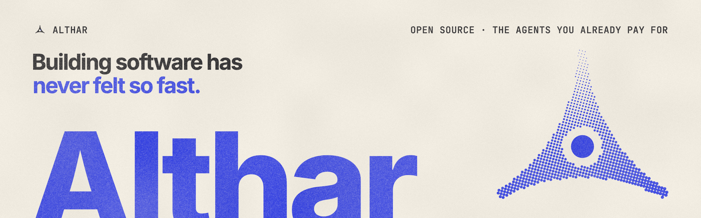
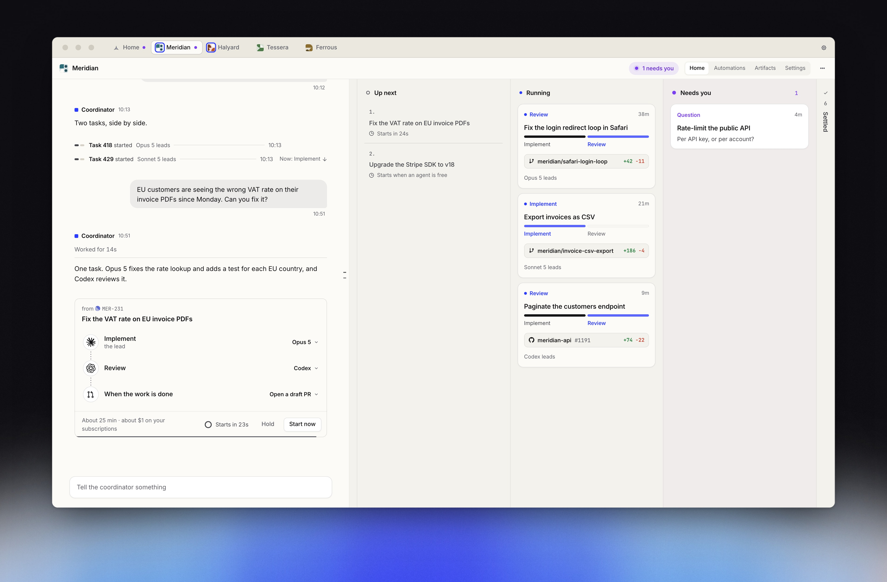
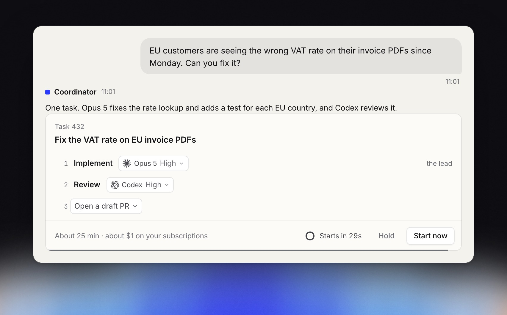
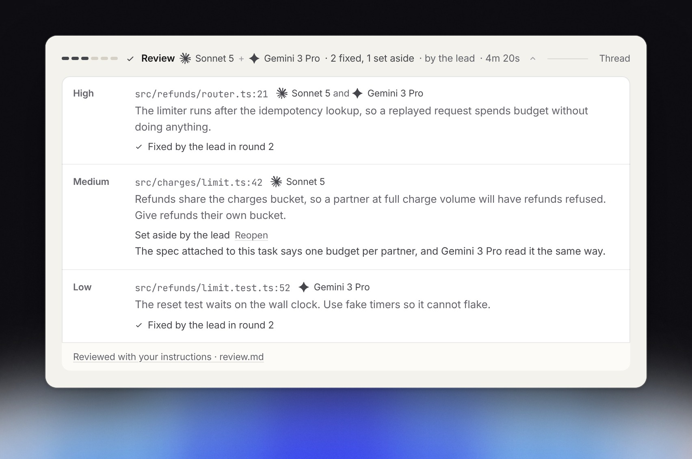
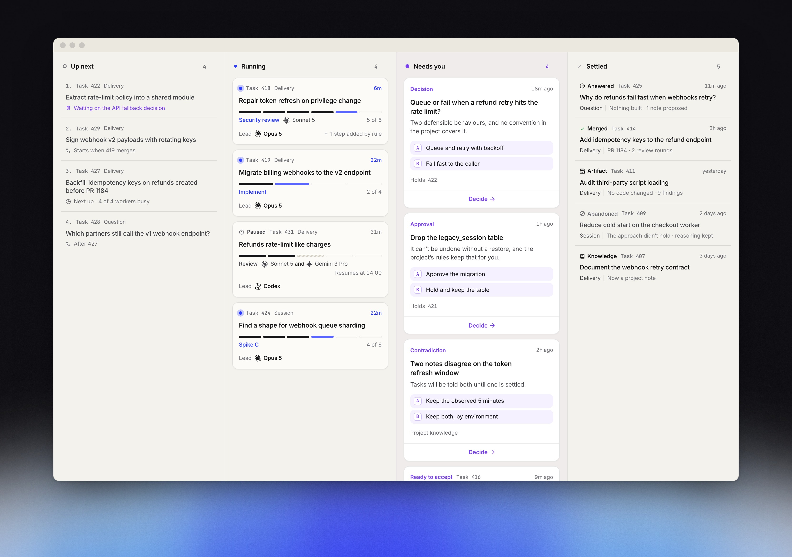
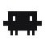
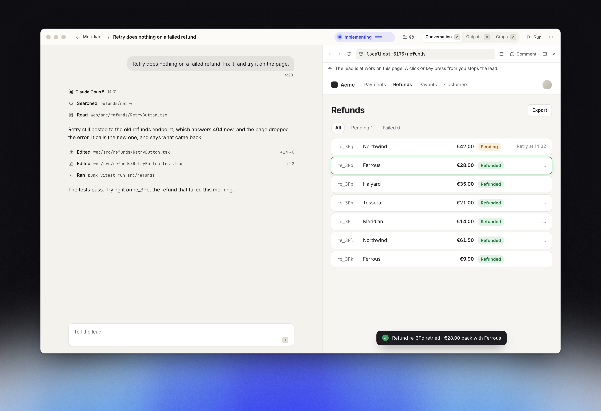
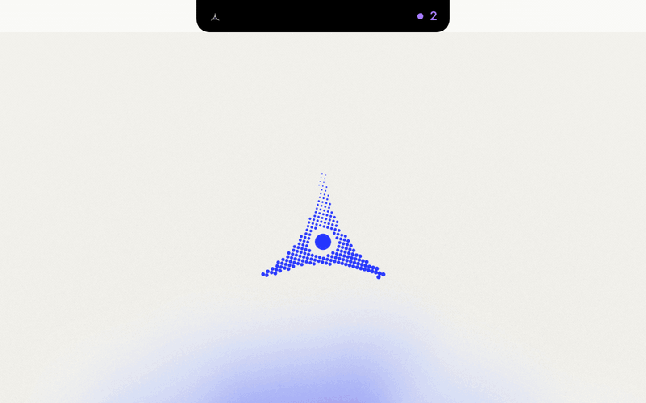
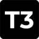
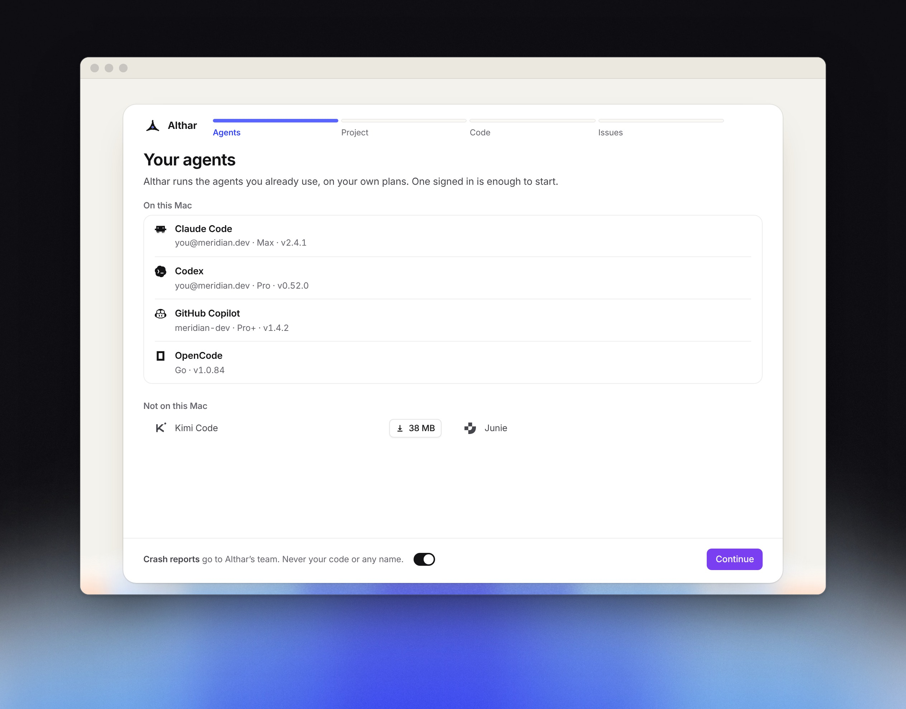

<p>
  <a href="https://althar.ai">
    <picture>
      <source media="(prefers-color-scheme: dark)" srcset="brand/export/banner/readme-header-ink.png" />
      
    </picture>
  </a>
</p>

<p align="center">
  <b>Stop babysitting tabs and terminals.</b><br />
  Tell Althar's coordinator what you want. It puts agents to work, can have a model from another lab review them, and brings you back finished work, with the proof.
</p>

<p align="center">
  <a href="https://github.com/AltharIDE/althar/releases/latest"><b>Download</b></a> ·
  <a href="https://althar.ai"><b>Website</b></a> ·
  <a href="#get-started"><b>Get started</b></a> ·
  <a href="CONTRIBUTING.md"><b>Contributing</b></a>
</p>

<p align="center">
  <sub>Open source · Your own agents and plans · Runs on your computer · macOS, Windows and Linux</sub>
</p>

<br />



## You manage the project. Not the agents.

Stop re-explaining your project every time you start a new chat.

In Althar your work lives in projects, each with one repository or several. Each project has a coordinator, and you tell it what you want as you would a project manager:

- It reads the project's repositories and rules before it plans, and keeps the decisions you make as notes it starts every session with.
- It splits what you ask into tasks, picks an agent and a model to lead each, and runs several side by side.
- You hear from it when something needs you: a question, a permission, or work to accept.



## Review by a model from another lab.

A task's work can be reviewed by a model from another lab you're signed in to: Claude's work checked by GPT, or GPT's by Claude. The lead fixes each finding or sets it aside with its reason.

When the work is done, the task comes to Needs you with its diff, its checks, screenshots of it working and, where it was reviewed, each finding and how it was settled. You decide whether it merges.

Review is optional: pick another reviewer, skip it once, or turn it off.



## One board. No sidebar full of chats.

Up next, running, needs you, settled: every task in the project, whichever lab's agent has it. When one plan runs out of usage, the work moves to another account, on the same thread and the same branch.



## Bring the agents you already pay for.

Althar runs each one under your own sign-in: your Claude plan, your ChatGPT plan, your keys. No new account, no new bill, nothing of ours between you and the model. When one runs out of usage, the next picks up the same thread, on the same branch.

Switch labs whenever you like: your projects, their history and their decisions stay with you, on your computer.

The agents below are built in. Other agents that speak the [Agent Client Protocol](https://agentclientprotocol.com) can join from Settings.

<table>
  <tr>
    <td width="20%" align="center" valign="top">
      <picture>
        <source media="(prefers-color-scheme: dark)" srcset=".github/readme/agents/claude-code-dark.svg" />
        
      </picture><br />
      <b>Claude Code</b><br />
      Claude Pro or Max, or an API key
    </td>
    <td width="20%" align="center" valign="top">
      <picture>
        <source media="(prefers-color-scheme: dark)" srcset=".github/readme/agents/codex-dark.svg" />
        
      </picture><br />
      <b>Codex</b><br />
      ChatGPT Plus, Pro or Business, or an API key
    </td>
    <td width="20%" align="center" valign="top">
      <picture>
        <source media="(prefers-color-scheme: dark)" srcset=".github/readme/agents/copilot-dark.svg" />
        
      </picture><br />
      <b>GitHub Copilot</b><br />
      Copilot Pro, Pro+, Business or Enterprise
    </td>
    <td width="20%" align="center" valign="top">
      <picture>
        <source media="(prefers-color-scheme: dark)" srcset=".github/readme/agents/opencode-dark.svg" />
        
      </picture><br />
      <b>OpenCode</b><br />
      Any API key, or a local model
    </td>
    <td width="20%" align="center" valign="top">
      <picture>
        <source media="(prefers-color-scheme: dark)" srcset=".github/readme/agents/junie-dark.svg" />
        
      </picture><br />
      <b>Junie</b><br />
      JetBrains AI Pro or Ultimate, or a Junie key
    </td>
  </tr>
  <tr>
    <td width="20%" align="center" valign="top">
      <picture>
        <source media="(prefers-color-scheme: dark)" srcset=".github/readme/agents/grok-dark.svg" />
        
      </picture><br />
      <b>Grok Build</b><br />
      SuperGrok or X Premium+, or an xAI key
    </td>
    <td width="20%" align="center" valign="top">
      <picture>
        <source media="(prefers-color-scheme: dark)" srcset=".github/readme/agents/kimi-dark.svg" />
        
      </picture><br />
      <b>Kimi Code</b><br />
      A Kimi Code membership
    </td>
    <td width="20%" align="center" valign="top">
      <picture>
        <source media="(prefers-color-scheme: dark)" srcset=".github/readme/agents/mistral-vibe-dark.svg" />
        
      </picture><br />
      <b>Mistral Vibe</b><br />
      Le Chat Pro or Team, or a Mistral key
    </td>
    <td width="20%" align="center" valign="top">
      <picture>
        <source media="(prefers-color-scheme: dark)" srcset=".github/readme/agents/qwen-code-dark.svg" />
        
      </picture><br />
      <b>Qwen Code</b><br />
      Alibaba Cloud Coding Plan, or any API key
    </td>
    <td width="20%" align="center" valign="top">
      <picture>
        <source media="(prefers-color-scheme: dark)" srcset=".github/readme/agents/antigravity-dark.svg" />
        
      </picture><br />
      <b>Google Antigravity</b><br />
      A Google account, signed in inside Althar
    </td>
  </tr>
  <tr>
    <td colspan="5" align="center" valign="top">
      <picture>
        <source media="(prefers-color-scheme: dark)" srcset=".github/readme/agents/on-the-way-dark.svg" />
        
      </picture><br />
      <b>Other ACP agents</b><br />
      From the ACP registry, such as Cursor, Gemini CLI or Goose, or your own command, once it passes a check that it asks before it acts (<a href="docs/decisions/agents.md#which-agents-join">which, and why</a>)
    </td>
  </tr>
</table>

## And everything around it

- **See it running.** Run the project from the window, with no agent. The page a task builds opens beside it, in a browser session of its own, and the lead tries its work there.
- **Review pull requests.** Paste a pull request's link and ask: a lead reads a copy of it, runs nothing of it, and drafts a review you post in one press.
- **Presets.** Start work as a chat, a prototype, a small change, a full change or a pull request review, and change any part of it later, such as its reviewer or how it ends, by saying so.
- **Canvases.** Leads draw pages, mockups and diagrams; comment on a version, and the next one answers it.
- **Your tracker.** Issues come in from Linear, Jira, Trello or GitHub; pull requests go out to GitHub, GitLab or Bitbucket.
- **Merge line.** Pull requests merge one at a time, in the order you asked, or through the host's own merge queue.
- **Automations.** Work on a schedule, at set times or every hour, such as a review of each new pull request. It runs on your computer while Althar is open, once you turn it on.
- **Asks only before what can't be undone.** Agents work without asking about each command; a force push or a push to the default branch waits for you. Your project's rules can ask about more.
- **Your skills and MCP servers.** Every agent Althar starts gets the skills and MCP servers you set up for your agents.
- **Voice.** Dictate to the coordinator or any task, transcribed on your computer.
- **Always in reach.** Round the notch or in the menu bar on a Mac, in the tray on Windows and Linux: answer a permission or open a pull request without leaving what you're in.

<table>
  <tr>
    <td width="50%" valign="top">
      
    </td>
    <td width="50%" valign="top">
      
    </td>
  </tr>
</table>

## How it compares

<table>
  <tr>
    <th align="left" width="26%">If you use</th>
    <th align="left" width="30%">Such as</th>
    <th align="left" width="44%">Althar is</th>
  </tr>
  <tr>
    <td valign="top">A terminal manager</td>
    <td valign="top">
       cmux<br />
       Claude Squad
    </td>
    <td valign="top">A project you talk to, not a grid of terminals to watch.</td>
  </tr>
  <tr>
    <td valign="top">A chat app for agents</td>
    <td valign="top">
       T3 Code<br />
       Conductor
    </td>
    <td valign="top">A coordinator that splits the work into tasks and hands them out, not chats you start and keep up with yourself.</td>
  </tr>
  <tr>
    <td valign="top">An agent harness or workflow engine</td>
    <td valign="top">
       Archon<br />
      Ruflo
    </td>
    <td valign="top">An app you tell what you want, not workflows or swarms to set up and run yourself.</td>
  </tr>
  <tr>
    <td valign="top">An agent platform in its maker's cloud</td>
    <td valign="top">
      <picture><source media="(prefers-color-scheme: dark)" srcset=".github/readme/compare/amp-dark.svg" /></picture> Amp<br />
      <picture><source media="(prefers-color-scheme: dark)" srcset=".github/readme/compare/devin-dark.svg" /></picture> Devin
    </td>
    <td valign="top">On your computer: your projects and their history stay there, and there's no Althar account.</td>
  </tr>
  <tr>
    <td valign="top">A lab's own app, or one a lab owns</td>
    <td valign="top">
      <picture><source media="(prefers-color-scheme: dark)" srcset=".github/readme/compare/claude-dark.svg" /></picture> Claude app<br />
      <picture><source media="(prefers-color-scheme: dark)" srcset=".github/readme/compare/openai-dark.svg" /></picture> ChatGPT app (Codex)<br />
      <picture><source media="(prefers-color-scheme: dark)" srcset=".github/readme/compare/cursor-dark.svg" /></picture> Cursor (SpaceX)
    </td>
    <td valign="top">Every lab's agents, on the plans you already pay for, one able to review another's work.</td>
  </tr>
  <tr>
    <td valign="top">An AI editor</td>
    <td valign="top">
      <picture><source media="(prefers-color-scheme: dark)" srcset=".github/readme/compare/zed-dark.svg" /></picture> Zed<br />
      <picture><source media="(prefers-color-scheme: dark)" srcset=".github/readme/compare/copilot-dark.svg" /></picture> VS Code with Copilot
    </td>
    <td valign="top">Where you manage the work, not an editor with an agent beside your code.</td>
  </tr>
</table>

## Get started

> [!NOTE]
> **Early-ish.** Althar runs on macOS, Windows and Linux, and is tested most on macOS and Linux. Things will change, and some will break. [Tell us when they do](https://github.com/AltharIDE/althar/issues), or, in the app, Report a problem (in Help on a Mac, or at the foot of the quick settings), which sends what happened with the app's logs, paths and repository names hidden. Crash reports go on their own, masked the same way and never with your code, until you turn them off on the first screen or in Settings.

[Download it](https://github.com/AltharIDE/althar/releases/latest) for your system: a `.dmg` for macOS, the installer for Windows, or an AppImage, `.deb` or `.rpm` for Linux. On a Mac you can use Homebrew instead:

```bash
brew install --cask altharide/tap/althar
```

Open it. The first screen finds the agents on your computer and signs in the ones that aren't yet, each with its own sign-in. Then you pick the repositories your first project works in.



Want a hand getting set up? Book 20 minutes with me: [althar.ai/office-hours](https://althar.ai/office-hours). To build it from source instead, see [DEVELOPMENT.md](DEVELOPMENT.md).

## Learn more

| | |
| --- | --- |
| [Development](DEVELOPMENT.md) | Set up, run, test and change the code |
| [Engineering standards](ARCHITECTURE.md) | What every app and package in the repository holds to |
| [Architecture](docs/architecture/README.md) | How Althar is built: a local-first desktop app, with seams for a later cloud |
| [Decisions](docs/decisions) | What has been decided, and why |
| [Open questions](docs/open-questions.md) | What hasn't been decided yet |
| [Glossary](docs/glossary.md) | The words the interface uses: project, coordinator, task, lead, step |
| [Thesis](THESIS.md) | What happens to software engineering once coding agents are abundant |
| [Components](packages/ui) | The interface, piece by piece, with every state as a story |
| [Brand](brand) | The mark, lockups, banners, screenshots and the characters |

## Contributing

The most useful thing you can do right now is use Althar on real work and tell us what breaks, in [an issue](https://github.com/AltharIDE/althar/issues). To change the code, start with [CONTRIBUTING.md](CONTRIBUTING.md). Everyone taking part follows the [code of conduct](CODE_OF_CONDUCT.md). To report a security problem, see [SECURITY.md](SECURITY.md).

## Licence

Althar is open source under the [Apache License 2.0](LICENSE). See [NOTICE](NOTICE).

Claude, ChatGPT, Codex, Gemini, Google, Antigravity, Goose, OpenCode, GitHub, Copilot, JetBrains, Junie, Grok, Kimi, Mistral, Qwen, Cursor, SpaceX, Zed, Visual Studio Code, cmux, Claude Squad, T3 Code, Conductor, Archon, Ruflo, Amp, Devin, GitLab, Bitbucket, Linear, Jira and Trello are trademarks of their owners. Althar isn't affiliated with or endorsed by them.
