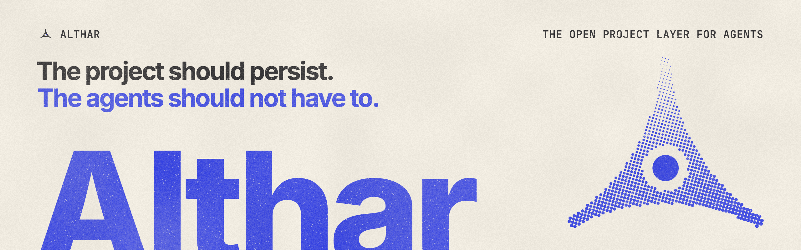

<h1 align="center">Building software has never felt so fast.</h1>

<p align="center">
  Althar is an open-source IDE for building with AI agents.<br />
  It runs the ones you already pay for, and keeps going whatever the labs change.
</p>

<p align="center">
  <a href="https://github.com/AltharIDE/althar/releases/latest"><b>Download</b></a> ·
  <a href="https://althar.ai"><b>Website</b></a> ·
  <a href="#get-started"><b>Get started</b></a> ·
  <a href="#how-it-works"><b>How it works</b></a> ·
  <a href="CONTRIBUTING.md"><b>Contributing</b></a>
</p>

<p align="center">
  Free and open source · Apache 2.0 · macOS, Windows and Linux
</p>

<br />

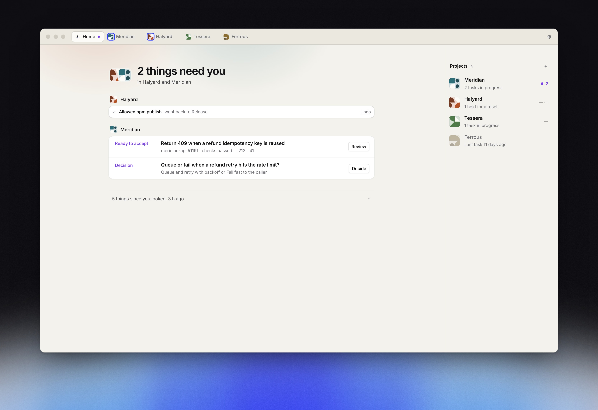

## Why Althar

The best coding agent right now is Claude Code. Or Codex. Or Gemini. Or an open model. Ask again next month. New models ship most weeks, open models keep closing the gap, and prices and limits move with all of it. The safe bet is not to bet on one.

But switch agents today and your threads, your context and your setup stay behind. Althar is built the other way round: the agents are interchangeable, and your projects are what lasts.

**Usage gets cut. Models get pulled. Althar stays.**

- **Your computer, your data.** Projects, threads and history live in a local database on your machine. No Althar account, no Althar cloud, nothing of ours between you and the model.
- **Open source, for real.** Apache 2.0. Read every line, fork it, run it. If we disappear, your setup doesn't.
- **Every plan you pay for.** Claude, ChatGPT, Copilot, JetBrains AI, SuperGrok, Kimi, Le Chat or a plain API key, side by side, with every account you have on most of them. No new account, no new bill.

Subscriptions come and go. Your projects stay.

## Your agents

<table>
  <tr>
    <td width="20%" align="center" valign="top">
      <picture>
        <source media="(prefers-color-scheme: dark)" srcset=".github/readme/agents/claude-code-dark.svg" />
        
      </picture><br />
      <b>Claude Code</b><br />
      Claude Pro or Max, or an API key
    </td>
    <td width="20%" align="center" valign="top">
      <picture>
        <source media="(prefers-color-scheme: dark)" srcset=".github/readme/agents/codex-dark.svg" />
        
      </picture><br />
      <b>Codex</b><br />
      ChatGPT Plus, Pro or Business, or an API key
    </td>
    <td width="20%" align="center" valign="top">
      <picture>
        <source media="(prefers-color-scheme: dark)" srcset=".github/readme/agents/copilot-dark.svg" />
        
      </picture><br />
      <b>GitHub Copilot</b><br />
      Copilot Pro, Pro+, Business or Enterprise
    </td>
    <td width="20%" align="center" valign="top">
      <picture>
        <source media="(prefers-color-scheme: dark)" srcset=".github/readme/agents/opencode-dark.svg" />
        
      </picture><br />
      <b>OpenCode</b><br />
      Any API key, or a local model
    </td>
    <td width="20%" align="center" valign="top">
      <picture>
        <source media="(prefers-color-scheme: dark)" srcset=".github/readme/agents/junie-dark.svg" />
        
      </picture><br />
      <b>Junie</b><br />
      JetBrains AI Pro or Ultimate, or a Junie key
    </td>
  </tr>
  <tr>
    <td width="20%" align="center" valign="top">
      <picture>
        <source media="(prefers-color-scheme: dark)" srcset=".github/readme/agents/grok-dark.svg" />
        
      </picture><br />
      <b>Grok Build</b><br />
      SuperGrok or X Premium+, or an xAI key
    </td>
    <td width="20%" align="center" valign="top">
      <picture>
        <source media="(prefers-color-scheme: dark)" srcset=".github/readme/agents/kimi-dark.svg" />
        
      </picture><br />
      <b>Kimi Code</b><br />
      A Kimi Code membership
    </td>
    <td width="20%" align="center" valign="top">
      <picture>
        <source media="(prefers-color-scheme: dark)" srcset=".github/readme/agents/mistral-vibe-dark.svg" />
        
      </picture><br />
      <b>Mistral Vibe</b><br />
      Le Chat Pro or Team, or a Mistral key
    </td>
    <td width="20%" align="center" valign="top">
      <picture>
        <source media="(prefers-color-scheme: dark)" srcset=".github/readme/agents/qwen-code-dark.svg" />
        
      </picture><br />
      <b>Qwen Code</b><br />
      Alibaba Cloud Coding Plan, or any API key
    </td>
    <td width="20%" align="center" valign="top">
      <picture>
        <source media="(prefers-color-scheme: dark)" srcset=".github/readme/agents/antigravity-dark.svg" />
        
      </picture><br />
      <b>Google Antigravity</b><br />
      A Google account, signed in inside Althar
    </td>
  </tr>
  <tr>
    <td width="20%" align="center" valign="top">
      <picture>
        <source media="(prefers-color-scheme: dark)" srcset=".github/readme/agents/on-the-way-dark.svg" />
        
      </picture><br />
      <b>More on the way</b><br />
      Any agent that speaks the <a href="https://agentclientprotocol.com">Agent Client Protocol</a> and can be held to asking can join (<a href="docs/decisions/050-an-agent-joins-where-althar-can-hold-it-to-asking.md">which, and why</a>)
    </td>
  </tr>
</table>

## What it does

<table>
  <tr>
    <td width="44%" valign="top">
      <h3>Every project has a manager.</h3>
      <p>It's called the coordinator, and it knows your whole project. Say what you want changed: it reads the repositories and your rules, turns the ask into tasks, and proposes an agent and model for each step.</p>
      <p>Change anyone, or leave it and it starts.</p>
    </td>
    <td width="56%" valign="top">
      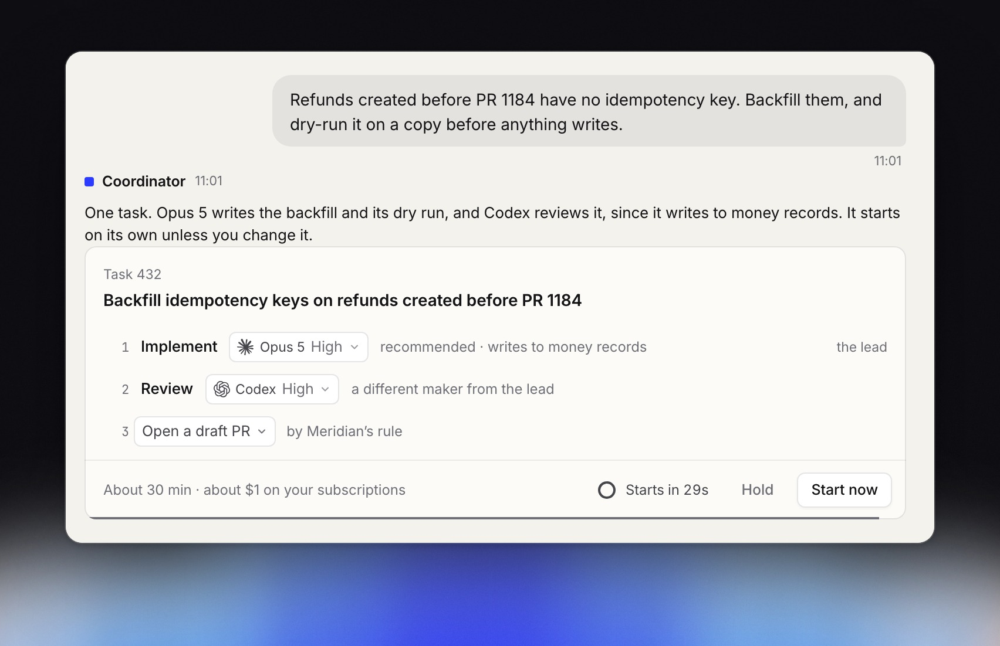
    </td>
  </tr>
  <tr>
    <td valign="top">
      <h3>No more meat proxying.</h3>
      <p>Every change is reviewed by a model from another lab, fixed by its lead, and reviewed again until it's clean. No more pasting one agent's answer into another.</p>
      <p>Then it opens a pull request in your team's format, or merges locally. You only step in to merge.</p>
    </td>
    <td valign="top">
      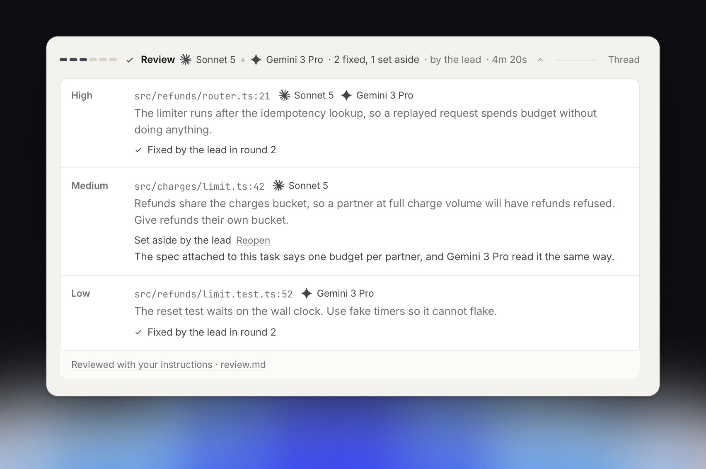
    </td>
  </tr>
  <tr>
    <td valign="top">
      <h3>Every plan you have. One agent.</h3>
      <p>Althar uses the sign-ins already on your machine: Claude, ChatGPT, Copilot, your keys. No token reselling, no proxy, nothing of ours in between.</p>
      <p>Add every account you have. When one runs out, the work moves to the next with room, on the same thread and branch.</p>
    </td>
    <td valign="top">
      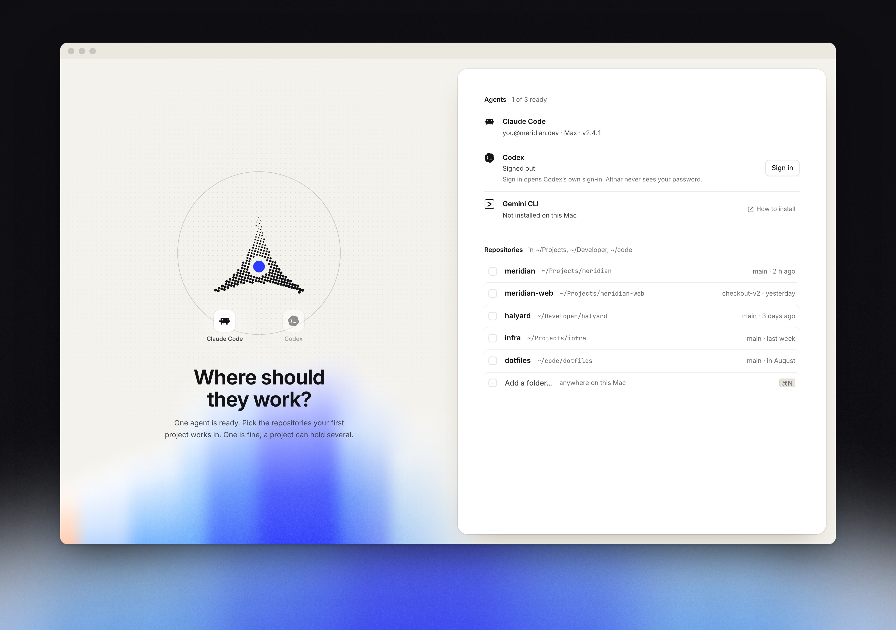
    </td>
  </tr>
  <tr>
    <td valign="top">
      <h3>It keeps going while you're away.</h3>
      <p>Usage limits, stalled turns, review rounds: Althar handles them and carries on.</p>
      <p>Every task sits on a board by lane, and you only hear about what needs you.</p>
    </td>
    <td valign="top">
      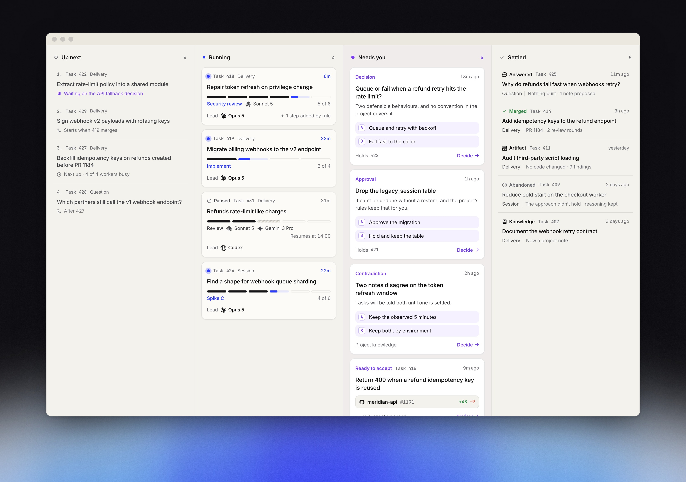
    </td>
  </tr>
  <tr>
    <td valign="top">
      <h3>Wherever you are, still in reach.</h3>
      <p>On a Mac, Althar sits round the notch or in the menu bar, with a count of what needs you. Point at it to allow a command or open a pull request. On Windows and Linux, it waits in the tray.</p>
      <p>It pings you only for a call that's yours.</p>
    </td>
    <td valign="top">
      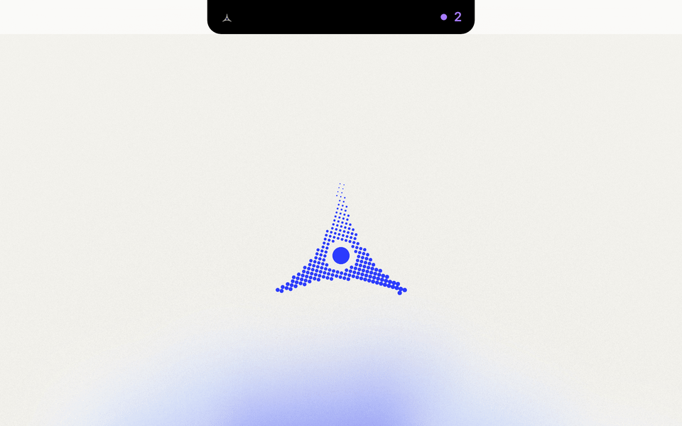
    </td>
  </tr>
  <tr>
    <td valign="top">
      <h3>The craft of a paid app.</h3>
      <p>The window opens in its own light. Every agent and account sits in one place. You pick the app's icon. When nothing needs you, it says so and gets out of the way.</p>
      <p>Open source, made with the care of something you'd pay for.</p>
    </td>
    <td valign="top">
      
    </td>
  </tr>
</table>

### And the rest

- **Automations.** Ask once, for a time of day. They run on your computer while Althar is open, and only once you turn them on.
- **Parallel tasks.** As many as you like, side by side, each in a git worktree of its own.
- **Merge conflicts.** Each lead resolves its own task's conflicts with the default branch; only the odd one comes to you.
- **Trackers and code hosts.** Day job on Linear, a client on Jira, side projects on GitHub or Trello? Plug them all in, and every issue lands in the right project. Pull requests go out to GitHub, GitLab or Bitbucket.
- **Home.** What needs you across every project, answered where it is, and what happened since you looked.
- **Plan usage.** Every account's window and when it resets, with new work steered to the one with room.
- **Steering.** Interrupt a task's lead, queue a message for its next turn, change its model, or hand the task to another agent.
- **Diffs.** Every change file by file before you accept it. Push stays yours.
- **Notifications.** When something needs you, with a count of what's waiting.
- **Local dictation.** After a one-time model download, nothing you say leaves your computer.

## How it works

<table>
  <tr>
    <td width="150" align="center">
      <picture>
        <source media="(prefers-color-scheme: dark)" srcset="brand/export/crew/project-dark.svg" />
        
      </picture>
    </td>
    <td>
      <b>Project</b><br />
      One or more repositories you open in Althar, with their own rules, tasks and history. It's the thing that lasts.
    </td>
  </tr>
  <tr>
    <td align="center">
      <picture>
        <source media="(prefers-color-scheme: dark)" srcset="brand/export/crew/coordinator-dark.svg" />
        
      </picture>
    </td>
    <td>
      <b>Coordinator</b><br />
      The project's agent that you talk to. It answers questions, plans tasks and hands them out. It never writes code itself.
    </td>
  </tr>
  <tr>
    <td align="center">
      <picture>
        <source media="(prefers-color-scheme: dark)" srcset="brand/export/crew/task-dark.svg" />
        
      </picture>
    </td>
    <td>
      <b>Task</b><br />
      One piece of work with an outcome, usually one change, growing in a worktree of its own.
    </td>
  </tr>
  <tr>
    <td align="center">
      <picture>
        <source media="(prefers-color-scheme: dark)" srcset="brand/export/crew/lead-dark.svg" />
        
      </picture>
    </td>
    <td>
      <b>Lead</b><br />
      The agent that owns a task. It implements, then settles what review finds: fixes it, or sets it aside with a reason.
    </td>
  </tr>
  <tr>
    <td align="center">
      <picture>
        <source media="(prefers-color-scheme: dark)" srcset="brand/export/crew/step-dark.svg" />
        
      </picture>
    </td>
    <td>
      <b>Step</b><br />
      One stage of a task: implement, review, verify. Each step can run on a different agent and model, and reports back to the lead.
    </td>
  </tr>
</table>

Everything runs on your machine. The project's tasks, threads and history are kept in a local database you can read.

## Get started

> [!NOTE]
> **Early.** Althar runs on macOS, Windows and Linux, and is tested most on macOS. Things will change, and some will break. [Tell us when they do](https://github.com/AltharIDE/althar/issues), or, in the app, Report a problem (in Help on a Mac, or at the foot of the quick settings), which sends what happened with the app's logs, paths and repository names hidden. Crash reports go on their own, masked the same way and never with your code, until you turn them off on the first screen or in Settings.

[Download Althar](https://github.com/AltharIDE/althar/releases/latest) for your system, open it, and pick the repositories your first project works in. The first screen finds the agents on your computer and shows which are signed in.

Claude Code, Codex and Google Antigravity sign in from inside Althar. The others sign in with their own tools:

```bash
opencode auth login
```

And `copilot login`, `junie`, `grok login`, `kimi login`, `vibe --setup`, and `qwen` then `/auth`.

To build it from source instead, see [DEVELOPMENT.md](DEVELOPMENT.md).

## The thesis

Althar comes out of a broader hypothesis: what happens to software engineering once coding agents are abundant, and the project, not the agent session, is the thing that lasts. The argument, the questions it raises and the evidence we hope to collect are in **[THESIS.md](THESIS.md)**.

## Learn more

| | |
| --- | --- |
| [Development](DEVELOPMENT.md) | Set up, run, test and change the code |
| [Engineering standards](ARCHITECTURE.md) | What every app and package in the repository holds to |
| [Architecture](docs/architecture/README.md) | How Althar is built: a local-first desktop app, with seams for a later cloud |
| [Decisions](docs/decisions) | What has been decided, and why |
| [Open questions](docs/open-questions.md) | What hasn't been decided yet |
| [Glossary](docs/glossary.md) | The words the interface uses |
| [Components](packages/ui) | The interface, piece by piece, with every state as a story |
| [Brand](brand) | The mark, lockups, banners, screenshots and the characters |

## Contributing

The most useful thing you can do right now is use Althar on real work and tell us what breaks, in [an issue](https://github.com/AltharIDE/althar/issues). To change the code, start with [CONTRIBUTING.md](CONTRIBUTING.md). Everyone taking part follows the [code of conduct](CODE_OF_CONDUCT.md). To report a security problem, see [SECURITY.md](SECURITY.md).

## Licence

Althar is open source under the [Apache License 2.0](LICENSE). See [NOTICE](NOTICE).

Claude, ChatGPT, Codex, Gemini, Google, Antigravity, OpenCode, GitHub, Copilot, JetBrains, Junie, Grok, Kimi, Mistral, Qwen, Cursor, GitLab, Bitbucket, Linear, Jira and Trello are trademarks of their owners. Althar isn't affiliated with or endorsed by them.
