<p>
  <a href="https://althar.ai">
    <picture>
      <source media="(prefers-color-scheme: dark)" srcset="brand/export/banner/readme-header-ink.png" />
      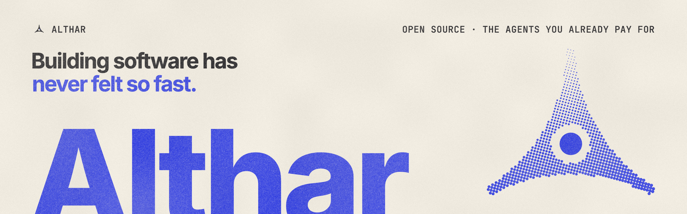
    </picture>
  </a>
</p>

<p align="center">
  Althar is an open-source IDE for building with AI agents.<br />
  It runs the ones you already pay for, and keeps going whatever the labs change.
</p>

<p align="center">
  <a href="https://github.com/AltharIDE/althar/releases/latest"><b>Download</b></a> ·
  <a href="https://althar.ai"><b>Website</b></a> ·
  <a href="#get-started"><b>Get started</b></a> ·
  <a href="CONTRIBUTING.md"><b>Contributing</b></a>
</p>

<p align="center">
  <sub>Free and open source · Apache 2.0 · macOS, Windows and Linux</sub>
</p>

<br />

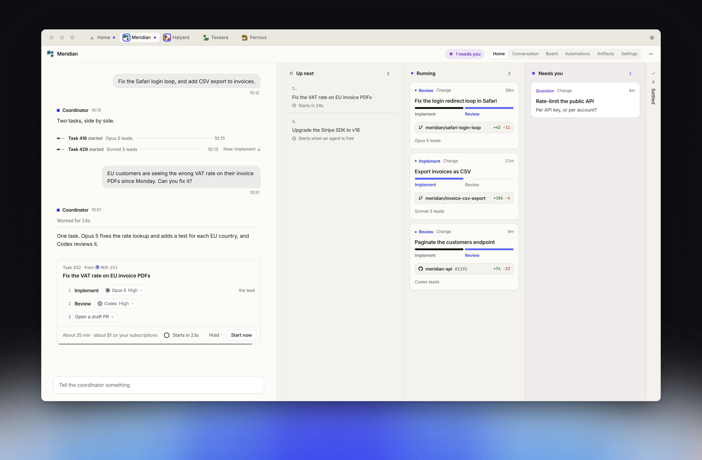

## Bring the agents you already pay for.

Althar runs each one under your own sign-in: your Claude plan, your ChatGPT plan, your keys. No new account, no new bill, nothing of ours between you and the model. When one runs out of usage, the next picks up the same thread, on the same branch.

<table>
  <tr>
    <td width="20%" align="center" valign="top">
      <picture>
        <source media="(prefers-color-scheme: dark)" srcset=".github/readme/agents/claude-code-dark.svg" />
        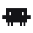
      </picture><br />
      <b>Claude Code</b><br />
      Claude Pro or Max, or an API key
    </td>
    <td width="20%" align="center" valign="top">
      <picture>
        <source media="(prefers-color-scheme: dark)" srcset=".github/readme/agents/codex-dark.svg" />
        
      </picture><br />
      <b>Codex</b><br />
      ChatGPT Plus, Pro or Business, or an API key
    </td>
    <td width="20%" align="center" valign="top">
      <picture>
        <source media="(prefers-color-scheme: dark)" srcset=".github/readme/agents/copilot-dark.svg" />
        
      </picture><br />
      <b>GitHub Copilot</b><br />
      Copilot Pro, Pro+, Business or Enterprise
    </td>
    <td width="20%" align="center" valign="top">
      <picture>
        <source media="(prefers-color-scheme: dark)" srcset=".github/readme/agents/opencode-dark.svg" />
        
      </picture><br />
      <b>OpenCode</b><br />
      Any API key, or a local model
    </td>
    <td width="20%" align="center" valign="top">
      <picture>
        <source media="(prefers-color-scheme: dark)" srcset=".github/readme/agents/junie-dark.svg" />
        
      </picture><br />
      <b>Junie</b><br />
      JetBrains AI Pro or Ultimate, or a Junie key
    </td>
  </tr>
  <tr>
    <td width="20%" align="center" valign="top">
      <picture>
        <source media="(prefers-color-scheme: dark)" srcset=".github/readme/agents/grok-dark.svg" />
        
      </picture><br />
      <b>Grok Build</b><br />
      SuperGrok or X Premium+, or an xAI key
    </td>
    <td width="20%" align="center" valign="top">
      <picture>
        <source media="(prefers-color-scheme: dark)" srcset=".github/readme/agents/kimi-dark.svg" />
        
      </picture><br />
      <b>Kimi Code</b><br />
      A Kimi Code membership
    </td>
    <td width="20%" align="center" valign="top">
      <picture>
        <source media="(prefers-color-scheme: dark)" srcset=".github/readme/agents/mistral-vibe-dark.svg" />
        
      </picture><br />
      <b>Mistral Vibe</b><br />
      Le Chat Pro or Team, or a Mistral key
    </td>
    <td width="20%" align="center" valign="top">
      <picture>
        <source media="(prefers-color-scheme: dark)" srcset=".github/readme/agents/qwen-code-dark.svg" />
        
      </picture><br />
      <b>Qwen Code</b><br />
      Alibaba Cloud Coding Plan, or any API key
    </td>
    <td width="20%" align="center" valign="top">
      <picture>
        <source media="(prefers-color-scheme: dark)" srcset=".github/readme/agents/antigravity-dark.svg" />
        
      </picture><br />
      <b>Google Antigravity</b><br />
      A Google account, signed in inside Althar
    </td>
  </tr>
  <tr>
    <td width="20%" align="center" valign="top">
      <picture>
        <source media="(prefers-color-scheme: dark)" srcset=".github/readme/agents/on-the-way-dark.svg" />
        
      </picture><br />
      <b>More on the way</b><br />
      Any agent that speaks the <a href="https://agentclientprotocol.com">Agent Client Protocol</a> and can be held to asking can join (<a href="docs/decisions/agents.md#which-agents-join">which, and why</a>)
    </td>
  </tr>
</table>

## Fall in love with building again.

Tired of juggling terminals, re-explaining your project and babysitting agents? So were we.

<table>
  <tr>
    <td width="44%" valign="top">
      <h3>Tell it what. It picks the team.</h3>
      <p>Every project has a coordinator. Say what you want done, and it turns that into tasks, each with a lead to build it and a model from another lab to review it.</p>
      <p>Leave it, and it starts.</p>
    </td>
    <td width="56%" valign="top">
      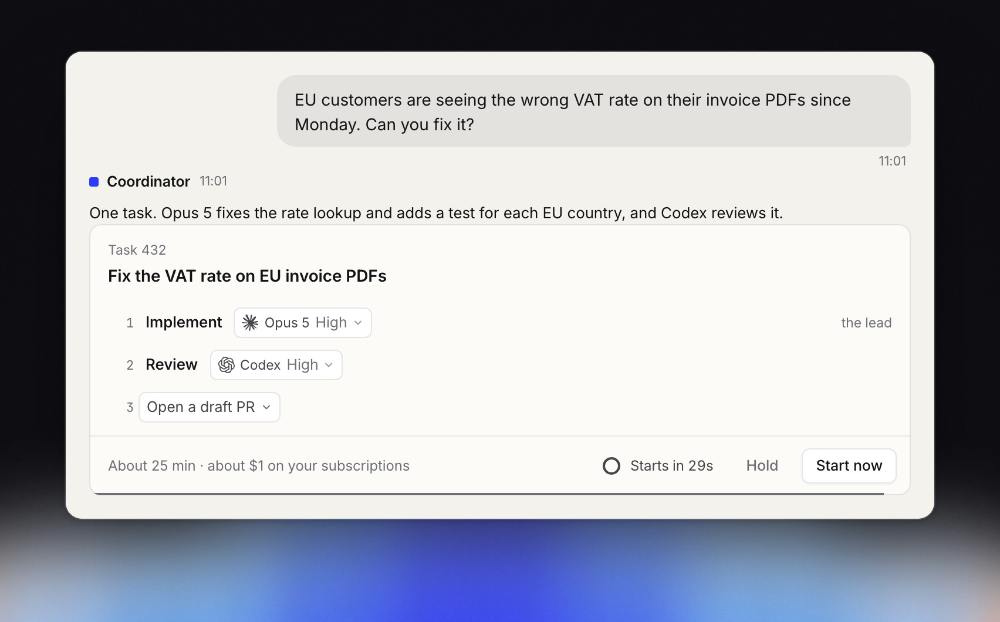
    </td>
  </tr>
  <tr>
    <td valign="top">
      <h3>Implement. Review. Fix. Review again.</h3>
      <p>Other models review the lead's work, the lead fixes what they find, and it goes round until the review is clean.</p>
      <p>You step in to merge.</p>
    </td>
    <td valign="top">
      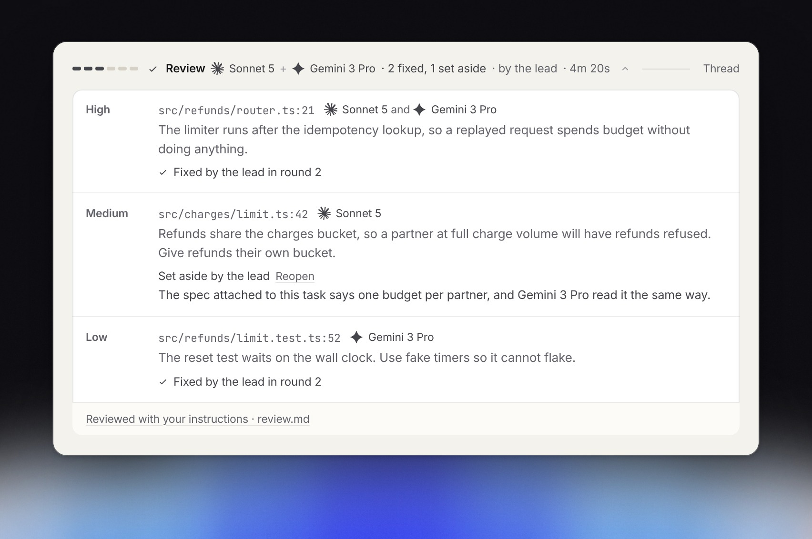
    </td>
  </tr>
  <tr>
    <td valign="top">
      <h3>Every agent's work. One board.</h3>
      <p>Up next, running, needs you, settled: every task in the project, whichever agent has it.</p>
    </td>
    <td valign="top">
      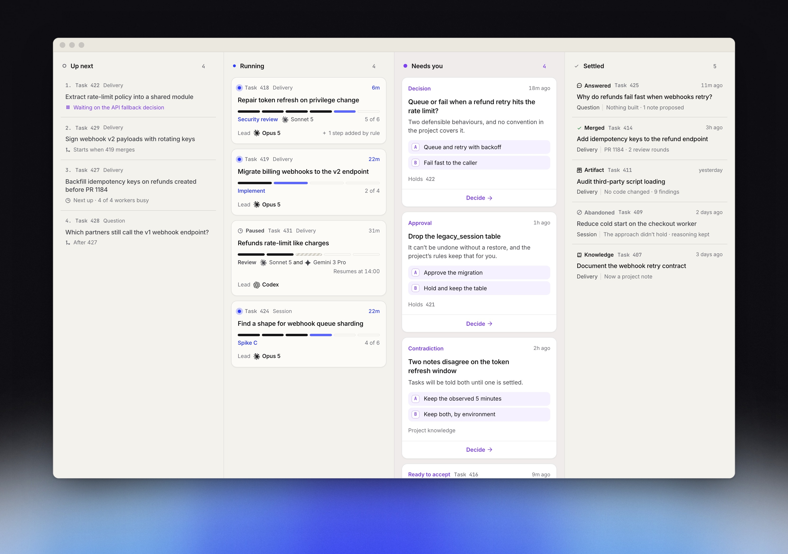
    </td>
  </tr>
  <tr>
    <td valign="top">
      <h3>It draws it out. You mark it up.</h3>
      <p>Leads draw pages and diagrams on the canvas.</p>
      <p>Comment on a version, and the next one answers it.</p>
    </td>
    <td valign="top">
      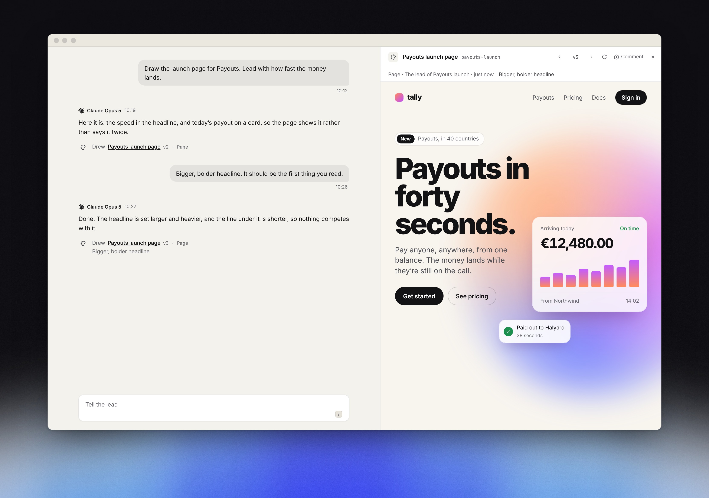
    </td>
  </tr>
  <tr>
    <td valign="top">
      <h3>See it running.</h3>
      <p>The page a task is building opens beside it, in a session of its own.</p>
      <p>The lead tries its fix there; a click from you stops it.</p>
    </td>
    <td valign="top">
      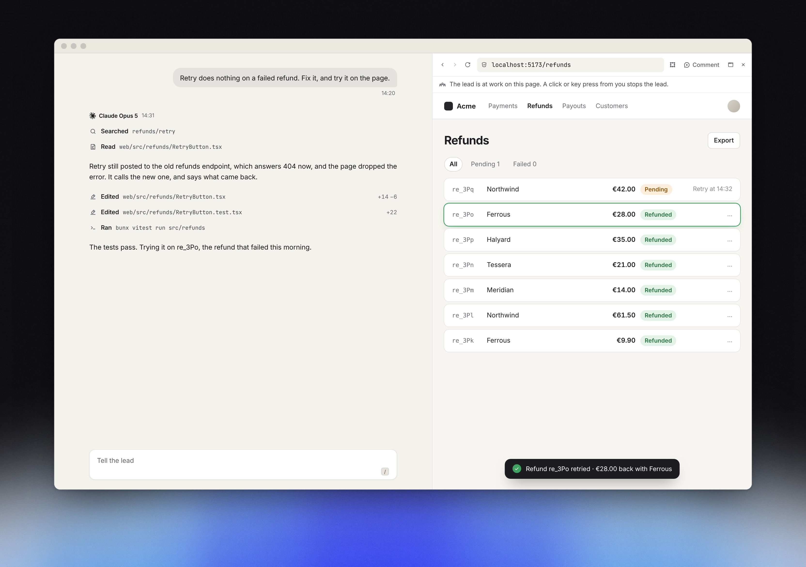
    </td>
  </tr>
  <tr>
    <td valign="top">
      <h3>Work that starts itself.</h3>
      <p>Ask once, for a time or for when something happens. It runs on your computer while Althar is open, and not until you turn it on.</p>
    </td>
    <td valign="top">
      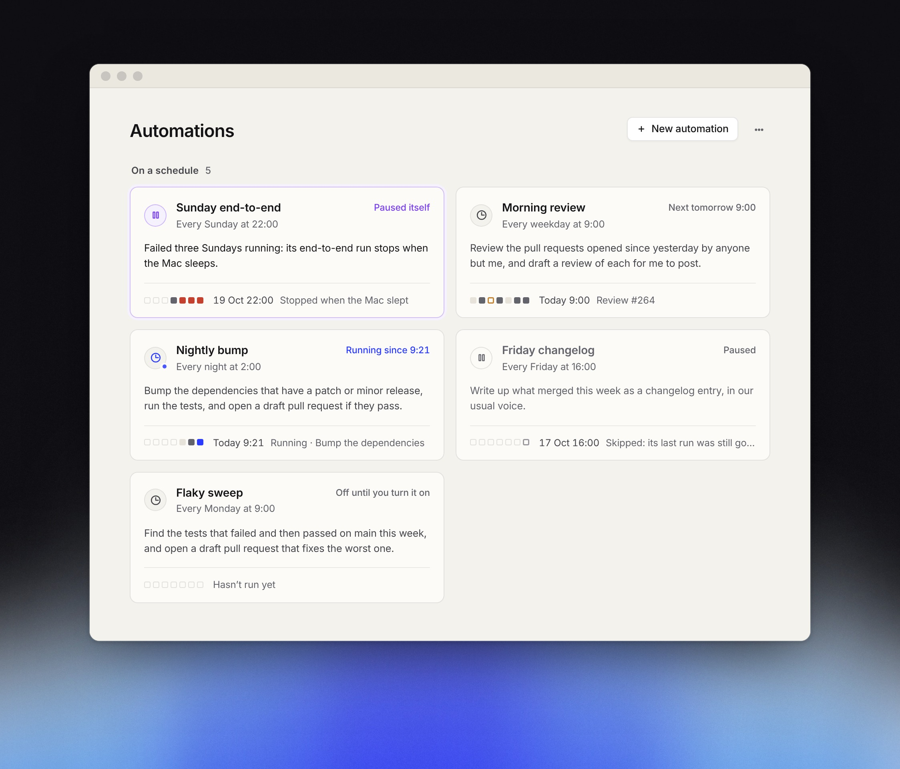
    </td>
  </tr>
  <tr>
    <td valign="top">
      <h3>Say it. Don't type it.</h3>
      <p>Dictate to the coordinator or any task, transcribed on your computer.</p>
    </td>
    <td valign="top">
      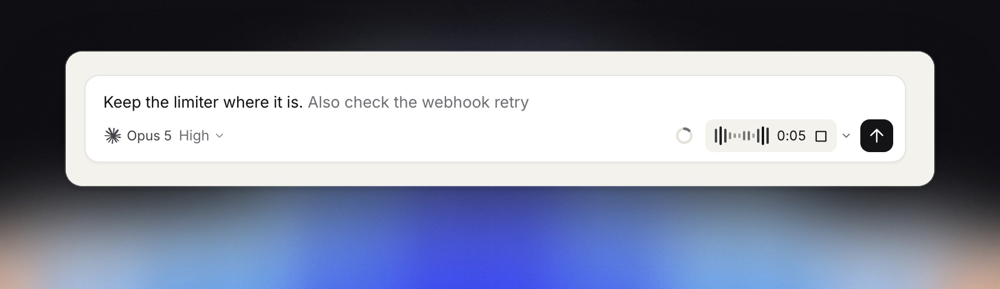
    </td>
  </tr>
  <tr>
    <td valign="top">
      <h3>Wherever you are, still in reach.</h3>
      <p>On a Mac, Althar sits round the notch or in the menu bar; on Windows and Linux, in the tray.</p>
      <p>Point at it to answer a permission or open a pull request, and carry on.</p>
    </td>
    <td valign="top">
      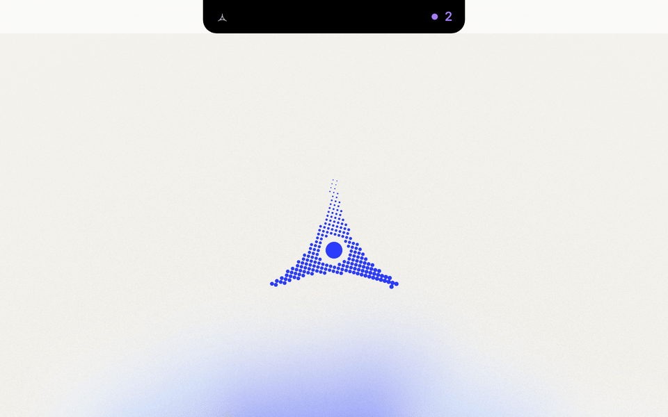
    </td>
  </tr>
</table>

## Get started

> [!NOTE]
> **Early.** Althar runs on macOS, Windows and Linux, and is tested most on macOS. Things will change, and some will break. [Tell us when they do](https://github.com/AltharIDE/althar/issues), or, in the app, Report a problem (in Help on a Mac, or at the foot of the quick settings), which sends what happened with the app's logs, paths and repository names hidden. Crash reports go on their own, masked the same way and never with your code, until you turn them off on the first screen or in Settings.

Install it with Homebrew, or [download it](https://github.com/AltharIDE/althar/releases/latest) for your system:

```bash
brew install --cask altharide/tap/althar
```

Open it. The first screen finds the agents on your computer and shows which are signed in; then you pick the repositories your first project works in.

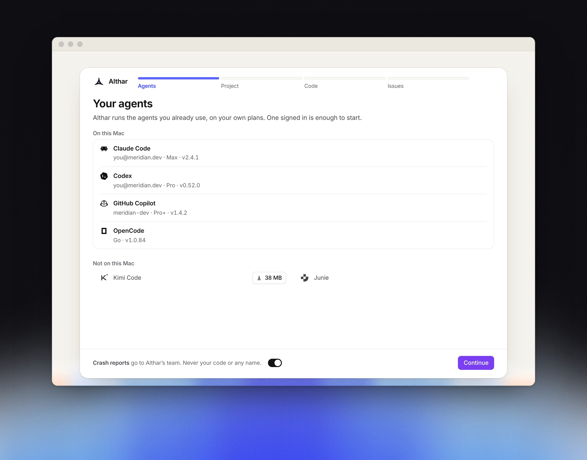

Claude Code, Codex, GitHub Copilot and Google Antigravity sign in from inside Althar. The others sign in with their own tools:

```bash
opencode auth login
```

Copilot signs in inside Althar, for personal and work accounts. Its optional CLI connection uses `copilot login`.

And `junie`, `grok login`, `kimi login`, `vibe --setup`, and `qwen` then `/auth`.

Want a hand getting set up? Book 20 minutes with me: [althar.ai/office-hours](https://althar.ai/office-hours). To build it from source instead, see [DEVELOPMENT.md](DEVELOPMENT.md).

## Learn more

| | |
| --- | --- |
| [Development](DEVELOPMENT.md) | Set up, run, test and change the code |
| [Engineering standards](ARCHITECTURE.md) | What every app and package in the repository holds to |
| [Architecture](docs/architecture/README.md) | How Althar is built: a local-first desktop app, with seams for a later cloud |
| [Decisions](docs/decisions) | What has been decided, and why |
| [Open questions](docs/open-questions.md) | What hasn't been decided yet |
| [Glossary](docs/glossary.md) | The words the interface uses: project, coordinator, task, lead, step |
| [Thesis](THESIS.md) | What happens to software engineering once coding agents are abundant |
| [Components](packages/ui) | The interface, piece by piece, with every state as a story |
| [Brand](brand) | The mark, lockups, banners, screenshots and the characters |

## Contributing

The most useful thing you can do right now is use Althar on real work and tell us what breaks, in [an issue](https://github.com/AltharIDE/althar/issues). To change the code, start with [CONTRIBUTING.md](CONTRIBUTING.md). Everyone taking part follows the [code of conduct](CODE_OF_CONDUCT.md). To report a security problem, see [SECURITY.md](SECURITY.md).

## Licence

Althar is open source under the [Apache License 2.0](LICENSE). See [NOTICE](NOTICE).

Claude, ChatGPT, Codex, Gemini, Google, Antigravity, OpenCode, GitHub, Copilot, JetBrains, Junie, Grok, Kimi, Mistral, Qwen, Cursor, GitLab, Bitbucket, Linear, Jira and Trello are trademarks of their owners. Althar isn't affiliated with or endorsed by them.
