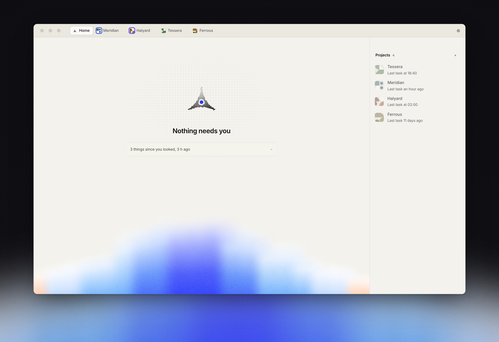
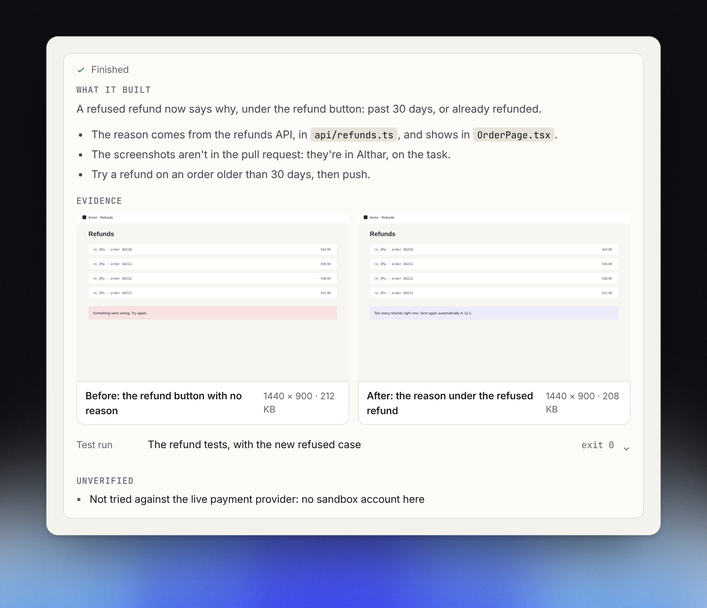
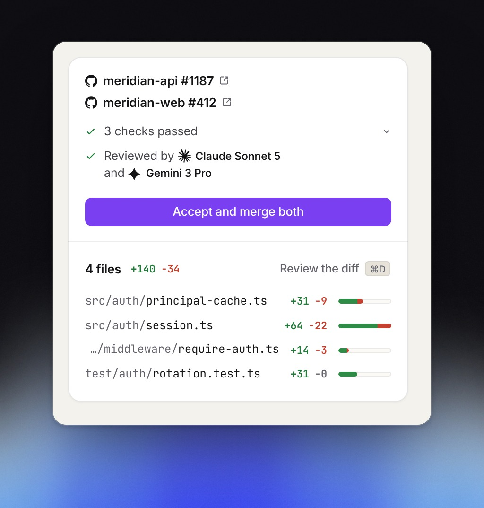
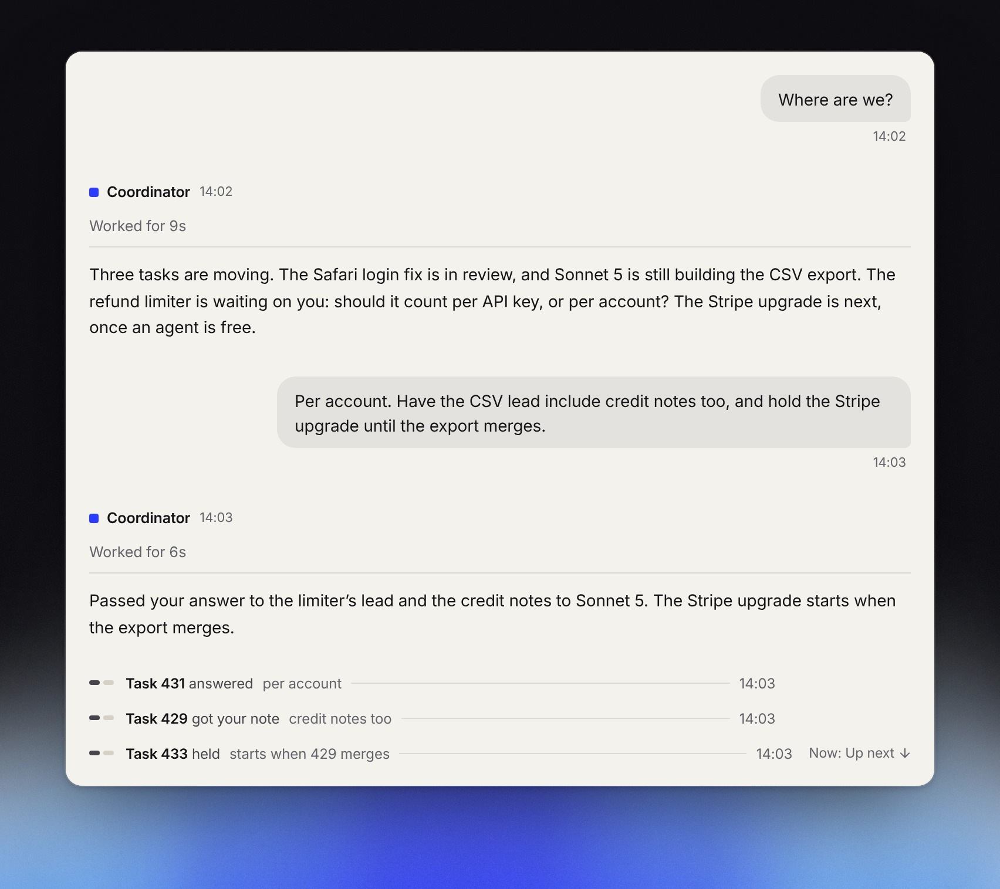
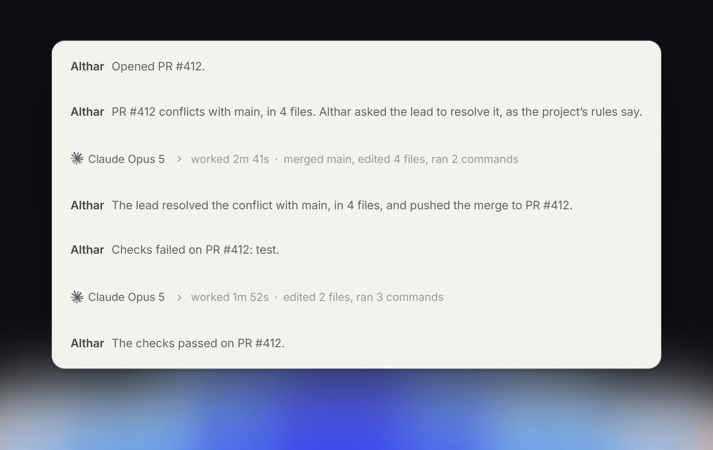

<p>
  <a href="https://althar.ai">
    <picture>
      <source media="(prefers-color-scheme: dark)" srcset="brand/export/banner/readme-header-ink.png" />
      
    </picture>
  </a>
</p>

<p align="center">
  Althar is an open-source IDE for building with AI agents.<br />
  It runs the ones you already pay for, and keeps going whatever the labs change.
</p>

<p align="center">
  <a href="https://github.com/AltharIDE/althar/releases/latest"><b>Download</b></a> ·
  <a href="https://althar.ai"><b>Website</b></a> ·
  <a href="#get-althar"><b>Get started</b></a> ·
  <a href="CONTRIBUTING.md"><b>Contributing</b></a>
</p>

<p align="center">
  Want help getting set up? Book 20 minutes with me: <a href="https://althar.ai/office-hours">althar.ai/office-hours</a>
</p>

<p align="center">
  Free and open source · Apache 2.0 · macOS, Windows and Linux
</p>

<br />


## Calm, clean, out of your way.

The window opens in its own light. Every project, agent and account sits in one place. When nothing needs you, it says so and gets out of the way.

<picture>
  <source media="(prefers-color-scheme: dark)" srcset="brand/export/screenshots/framed/at-rest-dark.jpg" />
  
</picture>

## Work arrives tested and reviewed.

Tasks don't stop at a first draft. Other models review the lead's work, the lead fixes what they find, and it goes round until the review is clean.

No more meat proxying: no more pasting one agent's answer into another.


Each task hands back what it ran, before and after pictures, and what it couldn't check. Your rules add steps, like a security review when money is touched. When it's ready it comes to you with its checks passed and who reviewed it, and you only step in to merge.




## A project manager for every project.

Say what you want done: it turns that into tasks and proposes who does each step. Leave it alone and it starts. Then keep talking to it. Every project has a coordinator that knows the project and everything running in it.

- **Knows the project.** It reads the repositories and your rules before it plans. You don't explain twice.
- **Keeps the whole picture.** Ask where things stand, and it answers for every task at once.
- **Runs the work.** It starts, holds, stops and restarts tasks, and passes your words on to their leads.
- **Builds the team.** A lead to implement, other models to review. Swap anyone before it starts.



## It fixes its own conflicts and failing checks.

Main moved and your pull request conflicts? Althar spots it, and the task's lead resolves it and pushes the merge. A check failed? The lead picks the work back up and fixes it. If it can't, it comes to you with the reason. Both are on by default.



## What else it does.

**Work that starts itself.** Ask once, for a time or for when something happens. It runs on your computer while Althar is open, and not until you turn it on.


**Talk instead of typing.** Dictate to the coordinator or any lead. It runs on your computer, after a one-time download of the speech model. The agent knows the message was spoken, so a misheard name is read generously.


**Wherever you are, still in reach.** On a Mac, Althar sits round the notch or in the menu bar; on Windows and Linux, in the tray. Point at it to answer a permission or open a pull request, and carry on.


And:

- **It keeps going while you're away.** Usage limits, stalled turns, review rounds: Althar handles them and carries on, and you only hear about what needs you.
- **One home for everything.** What needs you, across every project, in one place, answered where it is. And what happened since you looked.
- **Ten at once. None in each other's way.** Run as many tasks as you like side by side. Each gets a worktree of its own, so no two agents ever work in the same files.
- **Canvases.** Agents can draw a page, a diagram or a document beside the conversation. Comment on it, or on the words you select, and they draw it again.
- **Every workspace, side by side.** Day job on Linear, a client on Jira, side projects on GitHub? Plug them all in, and every issue lands in the right project. Pull requests go out to GitHub, GitLab or Bitbucket.

## Bring the agents you already pay for.

Althar uses the sign-ins already on your machine: your Claude plan, your ChatGPT plan, your keys. No token reselling, no proxy, nothing of ours between you and the model. New models ship most weeks and the best one for code keeps changing, so the safe bet is not to bet on one.

- <picture><source media="(prefers-color-scheme: dark)" srcset=".github/readme/agents/claude-code-dark.svg" /></picture> **Claude Code** · Claude Pro or Max, or an API key
- <picture><source media="(prefers-color-scheme: dark)" srcset=".github/readme/agents/codex-dark.svg" /></picture> **Codex** · ChatGPT Plus, Pro or Business, or an API key
- <picture><source media="(prefers-color-scheme: dark)" srcset=".github/readme/agents/copilot-dark.svg" /></picture> **GitHub Copilot** · Copilot Pro, Pro+, Business or Enterprise
- <picture><source media="(prefers-color-scheme: dark)" srcset=".github/readme/agents/opencode-dark.svg" /></picture> **OpenCode** · Any API key, or a local model
- <picture><source media="(prefers-color-scheme: dark)" srcset=".github/readme/agents/junie-dark.svg" /></picture> **Junie** · JetBrains AI Pro or Ultimate, or a Junie key
- <picture><source media="(prefers-color-scheme: dark)" srcset=".github/readme/agents/grok-dark.svg" /></picture> **Grok Build** · SuperGrok or X Premium+, or an xAI key
- <picture><source media="(prefers-color-scheme: dark)" srcset=".github/readme/agents/kimi-dark.svg" /></picture> **Kimi Code** · A Kimi Code membership
- <picture><source media="(prefers-color-scheme: dark)" srcset=".github/readme/agents/mistral-vibe-dark.svg" /></picture> **Mistral Vibe** · Le Chat Pro or Team, or a Mistral key
- <picture><source media="(prefers-color-scheme: dark)" srcset=".github/readme/agents/qwen-code-dark.svg" /></picture> **Qwen Code** · Alibaba Cloud Coding Plan, or any API key
- <picture><source media="(prefers-color-scheme: dark)" srcset=".github/readme/agents/antigravity-dark.svg" /></picture> **Google Antigravity** · A Google account, signed in inside Althar
- <picture><source media="(prefers-color-scheme: dark)" srcset=".github/readme/agents/on-the-way-dark.svg" /></picture> **More on the way** · Any agent that speaks the [Agent Client Protocol](https://agentclientprotocol.com) and can be held to asking can join ([which, and why](docs/decisions/agents.md#which-agents-join))

Agents join through the Agent Client Protocol, so a new one takes an adapter, not a rewrite.

- **Switch agents mid‑task.** Claude runs out halfway? Codex picks up the same thread, the same plan and the same branch.
- **Every plan you have.** Sign Claude Code, Codex or OpenCode in once for each plan you pay for: personal, work, a client's. When one runs out, Althar goes on with the next, in the order you set.
- **Open source, and local.** Read every line, fork it, run it. Your projects, threads and history live in a local database on your computer: no Althar account, no Althar cloud. If we disappear, your setup doesn't.

**Subscriptions come and go. Your projects stay.**

## Get Althar.

> [!NOTE]
> **Early.** Althar runs on macOS, Windows and Linux, and is tested most on macOS. Things will change, and some will break. [Tell us when they do](https://github.com/AltharIDE/althar/issues), or, in the app, Report a problem (in Help on a Mac, or at the foot of the quick settings), which sends what happened with the app's logs, paths and repository names hidden. Crash reports go on their own, masked the same way and never with your code, until you turn them off on the first screen or in Settings.

Install it with Homebrew, or [download it](https://github.com/AltharIDE/althar/releases/latest) for your system:

```bash
brew install --cask altharide/tap/althar
```

Open it. The first screen finds the agents on your computer and shows which are signed in; then you pick the repositories your first project works in.


Claude Code, Codex and Google Antigravity sign in from inside Althar. The others sign in with their own tools:

```bash
opencode auth login
```

And `copilot login`, `junie`, `grok login`, `kimi login`, `vibe --setup`, and `qwen` then `/auth`.

To build it from source instead, see [DEVELOPMENT.md](DEVELOPMENT.md).

## Learn more

- [Development](DEVELOPMENT.md): Set up, run, test and change the code
- [Engineering standards](ARCHITECTURE.md): What every app and package in the repository holds to
- [Architecture](docs/architecture/README.md): How Althar is built: a local-first desktop app, with seams for a later cloud
- [Decisions](docs/decisions): What has been decided, and why
- [Open questions](docs/open-questions.md): What hasn't been decided yet
- [Glossary](docs/glossary.md): The words the interface uses: project, coordinator, task, lead, step
- [Thesis](THESIS.md): What happens to software engineering once coding agents are abundant
- [Components](packages/ui): The interface, piece by piece, with every state as a story
- [Brand](brand): The mark, lockups, banners, screenshots and the characters

## Contributing

The most useful thing you can do right now is use Althar on real work and tell us what breaks, in [an issue](https://github.com/AltharIDE/althar/issues). To change the code, start with [CONTRIBUTING.md](CONTRIBUTING.md). Everyone taking part follows the [code of conduct](CODE_OF_CONDUCT.md). To report a security problem, see [SECURITY.md](SECURITY.md).

## Licence

Althar is open source under the [Apache License 2.0](LICENSE). See [NOTICE](NOTICE).

Claude, ChatGPT, Codex, Gemini, Google, Antigravity, OpenCode, GitHub, Copilot, JetBrains, Junie, Grok, Kimi, Mistral, Qwen, Cursor, GitLab, Bitbucket, Linear, Jira and Trello are trademarks of their owners. Althar isn't affiliated with or endorsed by them.
