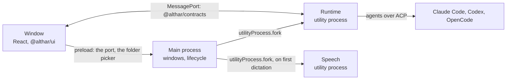

# @althar/desktop — Architecture

The desktop shell of [docs/architecture/02](../../docs/architecture/02-desktop-runtime.md). The repository's [ARCHITECTURE.md](../../ARCHITECTURE.md) sets the general engineering target.

- **Owner:** Repository maintainers
- **Consumers:** people using Althar.
- **Dependency direction:** the window depends on `@althar/ui` and `@althar/contracts`; the runtime's process on `@althar/runtime`. The window never imports the runtime, and the kit never imports Effect.

## Processes

| Where | What it holds | What it never holds |
| --- | --- | --- |
| `src/main` | Windows, the app's lifecycle, the runtime's process and its restarts, the pictures agents hand back, served from the artifact store by digest (`pictures.ts`), the folder picker and folder grants, the repositories found where people keep code for the first screen and a new project (`repositories.ts`), external links, notifications and the Dock's count, the app's own preferences (`appPreferences.ts`, kept in the profile's `desktop.json`), keeping the Mac awake while work runs, dictation's microphone permission, the system's settings and the speech process, a token on the clipboard while connecting a service waits for one (`clipboard.ts`), the app's menu (`menu.ts`), its updates (`updater.ts`, `updates.ts`), anonymous usage data, sent to PostHog while the person allows it (`usageData.ts`), crash reports, sent to PostHog's error tracking, masked, while the person allows them, and the native crashes Crashpad keeps a minidump of (`crashReports.ts`), its logs (`logs.ts`), Report a problem (`report/`), and where Althar's skills catalog is in the app and the store in the profile (`skillsCatalog.ts`) | Projects, tasks, rules, sessions |
| `src/logs` | Shared by the main process and the runtime's: a log file each process kind writes alone, turned over by size and kept about a week (`logFile.ts`), and what a report hides (`mask.ts`) | Anything anyone wrote |
| `src/preload` | The bridge: hands the page its port, and asks main for grants for picked and dropped folders and for repositories it found, carries dictation's calls, asks for a token on the clipboard, carries an update ready to install and restarting into it, Report a problem, and the page's own errors for the log | Node, the file system, a shell, paths |
| `src/speech` | Dictation's speech process (ADR-017): the pinned model, its checked and resumable download, and sherpa-onnx turning speech into text | Anything but speech |
| `src/runtime` | The runtime (`@althar/runtime`), serving the API over each window's port, and telling the main process what needs the person, what usage data says happened and what it couldn't handle (`crashes.ts`); its log lines and the agents' stderr (`logging.ts`), and what a report needs from it (`facts.ts`) | Anything about windows |
| `src/renderer` | The window: views, view models and the data layer (ADR-010) | Effect outside `data/`; Node |

## How they talk

- **Main starts the runtime** in a utility process, with the profile and worktree folders in its environment. The runtime opens the store, reconciles what an earlier launch left, and waits for ports. If it crashes, main starts it again and reloads each window, which reconnects; reconciliation makes that safe, and each task it touched says "Althar restarted." More than three crashes in a minute end the app instead.
- **An update that can't move the store stops there.** Before a pending migration the store copies itself into the profile's `backups`; if the copy can't be made, or a migration doesn't finish, the runtime's services aren't built, so nothing runs on that store. The runtime tells main what stopped it, where the copy is and what was said (`store-failed`), serves nothing, and waits to be shut down. Main keeps that, never starts the runtime again, and sends it to every window in place of a port (`main/storeFailure.ts`), with the copy where the person knows the place (`~/…`); the window shows the kit's `DataNotMoved` instead of opening, whatever it was showing (`features/update`). Show in Finder goes back to main, which alone holds the path. Report this shows once the preload gives `reportProblem` (DEV-61), and carries what stopped the update. `ALTHAR_FAIL_MIGRATION=1` adds a migration that always fails, in builds with the test hooks.
- **A profile another runtime has open is said, not crashed over.** The store is held in exclusive locking mode, so a runtime started on a profile the command-line client (or another Althar) has open fails with `DatabaseInUse`. That is the person's to put right (ADR-047), so the host tells main (`profile-in-use`, `runtime/profileInUse.ts`) in the runtime's own words for it, serves nothing and waits to be shut down. Main keeps it as a store it can't serve (`held`), restarts nothing and reports no crash (`main/restarts.ts`), and the window shows the kit's `ProfileInUse` (`features/update`): another Althar is using this profile, and Althar can open again once it closes. Try again stops that runtime and starts a new one, which says the same if the profile is still held. Main also takes Electron's single-instance lock, which is kept per user data folder (set from `ALTHAR_PROFILE` where one is given), so a second launch on a profile brings the first's window forward and quits without a runtime, while Althars on profiles of their own run side by side.
- **Each page load gets a fresh port.** On `did-finish-load`, main makes a `MessageChannelMain`, sends one end to the runtime and the other to the page through the preload. The runtime serves the API over it on a fiber of its own, until the window closes its client or the port goes.
- **The API is Effect RPC** (`@althar/contracts`): typed calls, typed errors (`ApiError`, in words), and one stream, `Watch`. Every message is checked against its schema on both sides.
- **Commands carry the window's own ids.** The client makes one per command and, when the runtime gave no answer (rather than said no), tries once more under the same id; the runtime answers the retry from the first one's receipt.
- **The window opens behind its launch.** The launch (the kit's `Launch`) plays at once while the window connects, reads the projects, the place it opens on and every open tab, then opens onto them, whole. A reload, as after the runtime restarted, opens with a fade instead.
- **The window watches once.** It watches the change feed from where its first read of the projects stood, for every screen (`data/feed.ts`), so nothing after that read is missed. A watch that breaks picks up from the last change it heard.
- **Pictures come from main, by digest** (ADR-020). The window draws a picture an agent handed back from `althar-picture://shot/<digest>`, which main answers from the profile's artifact store without the database: only bytes that are a picture the window draws, and, asked for `?w=1120`, a smaller copy made once with Chromium's decoder and kept beside the store. The Content Security Policy lets images come from there, and nothing else new.
- **What changes reaches the window four ways.** `Changed` comes from the store's change feed, with the thread it belongs to: a task's screen reads a changed item alone, and anything else about the thread reads the thread's head without its items. `Streaming` carries an agent's message or thought as far as it has come, at most every 50 ms, with its kind and agent: the thread shows it from its first words, before it has read the item, and in place of the stored text until the store catches up. `Context` is how full the context of the agent on a thread is, as the agent says; the conversation's session keeps it. `Output` is a running command's last lines, by its tool call, until the store has what it printed; since it reaches only a window that listens, a thread reads what its running commands printed so far as it shows, as one starts, and each time the watch listens again after it broke (`useOutputs`), and a read that began earlier never puts back less than was heard since.
- **A thread comes a page at a time:** the newest hundred items, and earlier pages when asked.
- **Folders come from main, as grants.** The folder picker (one folder, or several at once for a new project) and dropped folders go through main, which tells the runtime the folder and hands the window a grant; the window opens a project by its grant and never names a path (07). The repositories main finds for the first screen and a new project reach the window by an id and where each is, as the person knows the place; main grants one only by that id, once the person ticks or adds it.
- **Quitting asks the runtime to stop** every session and record it, and waits up to 20 seconds before the app goes.
- **Usage data goes from main** ([ADR-036](../../docs/decisions/036-usage-data-from-the-main-process.md)). The runtime tells main what happened (`usage`, beside its nudges), read from the record; main sends an event to PostHog with posthog-node, over the app's own network, only if it is one `usageData.ts` names, with only the properties named for it, while the person's switch is on and `DO_NOT_TRACK` isn't set, and only from a packaged build given PostHog's key. The window never sends anything, and its policy still allows no connections.
- **Crash reports go from main** ([ADR-046](../../docs/decisions/046-crash-reports-to-posthog-from-main.md)). Main watches its own uncaught errors and rejections, hears the window's (`althar:window-error`, as the log does) and the runtime's (`crash`, over the parent port), and sees a page or a process of Althar's stop other than cleanly, and the runtime stop too often to start again; Crashpad keeps a minidump of a native crash, and the next launch says only that one happened, in which process and when. Each goes to PostHog's error tracking with posthog-node as an `$exception`, masked in `before_send` as a problem report is, with the projects' and repositories' names the runtime gives (`names`, over the parent port), and cut down to the exceptions' types, messages and frames' places, the process, the version as the release, the system and the processor: never lines of source, never the dump. Twenty a launch at most, the same one once, while the person's own switch for them is on and `DO_NOT_TRACK` isn't set, and only from a packaged build given PostHog's key. What the runtime kept to what it belonged to and carried on past comes as a `handled` crash too ([ADR-047](../../docs/decisions/047-failures-kept-where-they-belong-and-reported-at-the-edge.md)): a call that failed for no reason of the person's, a part of one, an agent that stopped on its own; it goes with `where` and `agent`, ten a launch apart from the crashes, the same one in the same place once.
- **Logs go to disk, one file per process kind** (DEV-61), in `app.getPath('logs')`, or the profile's `logs` folder when a profile is given. Main writes `main.log` (its lifecycle and errors, and the window's uncaught errors and rejections, which the preload carries) and `runtime.log`: the runtime's process writes logfmt lines to stdout, and its stdout and stderr come to main through pipes, stamped as they arrive, so a crash's last words are kept; in development they go on to the terminal too. The runtime writes `agents.log` itself: every agent process's stderr, tagged with the agent and its pid. Each file turns over at its size, keeping four before it, and anything older than a week goes.
- **A report is put together in main** (`report/`). The window asks to open one before it draws the dialog, so main's picture of the window is what the person saw. Main asks the runtime for its facts over the parent port (`facts`: each agent's versions and whether it is signed in, the migrations, the thread's task and project, the latest turns that ended in an error, and the names to hide); without a runtime that answers, as before it is up or when it can't open the store, main reads the store itself, read-only, and asks each agent's CLI its version. It masks everything, posts to the reports Worker (`apps/report`) or saves a zip for mail, and keeps the email given in `desktop.json`. The install id is usage data's own (`usageData.ts`, in `desktop.json`): one id per install, which a report carries whether or not usage data is on.
- **Updates come from main** ([ADR-024](../../docs/decisions/024-signed-releases-and-updates.md)). In a packaged app it checks GitHub Releases for a newer version, downloads it, and tells each window (`althar:update`) once Squirrel has it in place; the window draws the kit's `UpdateReady` in the bar and Settings' foot (`shared/useUpdate.ts`), and asks main to restart into it. Main restarts only while the runtime says no work runs (its `Working` nudge), and otherwise the update installs as Althar quits.

## The window

MVVM in feature folders ([ADR-010](../../docs/decisions/010-desktop-app-mvvm.md)), under `src/renderer`:

| Folder | What it holds |
| --- | --- |
| `data/` | The client: Effect inside, plain promises and a subscription outside; the window's cache of what it read and its watch on the change feed ([ADR-014](../../docs/decisions/014-window-keeps-what-it-read.md)); opening the window; the services view models reach through React; the models each agent offers, read once for the window |
| `features/start` | Where the window starts: the first screen with no project yet, where the agents answer and the first project is made of the repositories found, added or dropped, with crash reports' quiet line at its foot; and the home once there are projects |
| `features/newProject` | A project before it is made, in a tab of its own (`/new`): the draft its tab holds for this launch, under the id the window made for it; its name, its colour, and its folders, read as they are added from the picker, a drop or what main found; what reading them found; and making it, after which its tab is the project's |
| `features/update` | What the window shows instead of opening when an update couldn't move the store: where the copy from before it is, and what stopped it |
| `features/home` | The home: across projects, what waits on you, what runs and what the loop did since you left, with the projects beside it and the agents' marks in the bar |
| `features/settings` | The agents on this Mac with their accounts, the code hosts and trackers (and a walk in, the panel narrowed to its card), keeping the Mac awake, showing how hard it works in the bar, and the editor files open in, notifications, where Althar shows in another app (on every system; a choice only with a notch), the app's icon, Althar as co-author, and usage data and crash reports, each part as large as it matters |
| `features/connections` | The code hosts and trackers, and connecting one: the ways each offers here (`ways.ts`), the walk's view model (`useConnect`) and its card (`ConnectFlow`), hosted by Settings, beside a task's outputs (`ConnectPanel`), in a dialog over a project's settings, its repositories and a new project (`ConnectDialog`: the one host asked for, or the list, each walked in to in its place), or in place of the list |
| `features/project` | A project's window: its front page across the top (how it stands, what it is made of) with running its default branch, where its repository says how, and under it the coordinator's thread with each task's card (its plan before it starts, then where it stands), the agent the coordinator runs on, and a task you plan yourself, beside it |
| `features/finder` | Finding a task (⌘K, Control-K off a Mac): the kit's `Finder` over the window, searching the project whose tab has the window or, on the home, every project, once typing pauses, the last answer kept while the next comes; choosing one opens it as its card does |
| `features/board` | A project's board: its lanes, what waits on you in it, and the dock the home used to open, now unused |
| `features/projectSettings` | A project's settings, a view of the project in place of its work, laid out as Althar's own: General (its name and colour changed in place, and the switches every task follows, each saying what it does on and off), Code and issues (its repositories, and the trackers its tasks' issues are on, saying who Althar is there or what can't happen until it is connected), Rules, Running (what it runs, in place, and where its tasks' work goes) and Notes (a card each, newest first, each removed with its ×); a dot on Settings and on Code and issues where a connection waits on the person; removing it from Althar at the foot of the side, asked in a dialog first |
| `features/rules` | A project's rules (ADR-013), a section of its settings, read as sentences in the order a request meets them: what is never allowed, what always asks, what goes ahead (ADR-018) and what happens to the rest; then how a task ends and is named, and what a usage limit does with the accounts work runs on. A kind of request sits in one sentence, so moving it writes it on one list and off the others. Each change is saved at once, one after another, worked out from the rules the runtime last said; a list's names the revision it was worked out from, so a rule a card kept meanwhile isn't dropped |
| `features/repositories` | A project's repositories, in its settings: each folder on this computer wired to where its work goes (its code host, and who Althar is there), adding a folder, picked or dropped, leaving one out, each one's role, where a fork's pull requests open, and connecting a host over the page; each change saved at once, and read again when a connection changes |
| `features/task` | A task's thread, the calls waiting on you (permissions as one stack, with Allow all), the composer and what floats over it (the pull requests it listens to, what its lead left running), what it changed, its Graph face (ADR-054: its rounds of work from the runtime, each step with what it came to and the calls waiting on it, `graph.ts`; a card's report or call in a popover, and the way to a place in the thread, `reveal.ts`), and its menu in the bar: start its plan now, mark its draft pull requests ready, stop, resume, abandon (asked in a dialog first) and reopen, each only where the runtime says it applies |
| `features/report` | Report a problem: the dialog, mounted once round the whole window so it opens over anything, the launch and the page an update that couldn't move the store shows among them; what each report is about (`ProblemAbout`: asked from the menu or Settings, a stuck step by its task, or an update), and every item that goes, in words |
| `shared/` | A thread's items as blocks, drawn with the kit (finished work folded, steps' results under it); the model picker every conversation and plan step uses; how agents and times are drawn; what a place shows while a slow read comes; what is written in a composer and not sent, kept by its thread (`drafts.ts`: its words also in storage across a restart, its images for the window's life); dictation in a composer (`dictation/`: the view model, each thread's dictation kept apart from its composer (`sessions.ts`), and carried with the person once they leave it (`Carried.tsx`), the recorder, the writing down as it is said, the project's names spelt as its code spells them, each system's words) |

Each feature holds its route (`route.tsx`, with what it reads before it shows), its view model (`use*.ts`), its view (`*View.tsx`) and its styles. `router.tsx` puts the routes together, with the place in the hash, since the page loads from a file.

## Principles

- **The kit draws; the app arranges.** Views compose `@althar/ui` and add layout and page margins, nothing that looks like a component of its own. When a view needs something the kit lacks, it goes into the kit, with its stories.
- **The runtime owns the state; the window keeps what it last said** ([ADR-014](../../docs/decisions/014-window-keeps-what-it-read.md)). View models read from the window's cache and hold what is streaming. A change reads again the whole reads it touches (the projects, the home, a board, the connections), on screen or not; a thread on screen reads what changed item by item, and one off screen is marked and read when next opened. Nothing goes out of date by age, and nothing is patched but a thread's items as they are read.
- **A screen opens whole.** Its route reads what it shows first, from the cache when nothing changed, and the screen being left stays until then. A read slower than 150 ms shows the place's outline, never a spinner, for at least 300 ms; what hasn't been read is never drawn as empty.
- **Each agent is asked again** once a launch, whenever the window comes back to the front, and as Settings opens. Everywhere else shows what the runtime last knew.
- **The page is locked down** (07's renderer list). Sandboxed, context-isolated, no Node, a strict Content Security Policy, no new windows and no navigation away, no web permissions granted but the microphone (audio alone, in Althar's own windows, for dictation), and no paths. Links open in the person's browser, for `https:` and local `http:` only.
- **Test hooks stay out of packaged builds.** `ALTHAR_FAKE_AGENTS` works only in a build made with `bun run build`; `bun run build:package` leaves the code out. It swaps in the fake agent, the connectors' fake GitHub (signed in to by gh, too), and secrets kept in memory, so the end-to-end tests never reach a network or the Keychain. With `ALTHAR_FAKE_CONNECTORS=demo`, every service is a fake on its own hosted address, for seeing each walk in on a demo profile. `ALTHAR_FAKE_SPEECH` swaps in a speech model that comes down at once and hears the same words, with Chromium's fake microphone, which the system is never asked about (`ALTHAR_FAKE_MICROPHONE` for the microphone alone).
- **Dictation is local** ([ADR-017](../../docs/decisions/017-dictation-on-this-machine.md)). The first press offers the speech model in the composer's tray, and nothing comes down until the person says Download; the microphone is asked for first. What is said shows faint at the cursor as it is said, and is written there when it stops, with the project's names (`GetVocabulary`, read once a window) spelt as its code spells them; never sent. Escape while listening throws it away. ⌘⇧D starts and stops it; held, letting go stops it. Dictation belongs to the thread, not the composer: leaving while it listens, for another view or for the board or a task's outputs, goes on listening, carried with the person (`dictation/Carried.tsx`): a pill of one width, saying whose it is, over the composer on screen above all that floats there (the kit's `Composer` `carried`), or at the window's foot where no composer shows. It stops (⌘⇧D too; Escape doesn't throw it away there), throws away, goes back to its composer, and once written, is changed and sent to its thread, or moved into the composer on screen. A task is sent to from there only while its lead is on it, and a draft with images only from its own composer. One thread listens at a time: starting in another writes down what the first heard. A microphone that opens only after the person left closes unheard; what is written down lands in that thread's draft, with a quiet line when it came while the person was away; what couldn't be written down is kept to try again until they throw it away. `ALTHAR_FAKE_SPEECH_SLOW` (ms) makes the stand-in model slow, for the tests of that.
- **Connecting walks the person in** (ADR-026). Connect opens the service's own walk, as a sign-in card: the ways in that work here (the service's browser sign-in where Althar's app is set up, gh's or glab's sign-in where the tool is signed in, a token on a page opened filled in, a company's own server by its address), one step at a time, then what the connection can do, as the runtime asks the service. The walk's view model holds the step; Escape and the way back step it back, then out to the list. Connect on a host a project names opens that host's walk alone, at the card's width, which closes as it ends. The clipboard is asked only while a step waits for a token, as the window comes back, and main answers only with what looks like a token. Signing in again keeps the connection's site and email.
- **Words on screen follow [the glossary](../../docs/glossary.md).**
- **Logs are quiet** (DEV-61): lifecycle, errors, and each agent's start and stop and each turn's start and end, by their ids. Never a prompt, a message, or a file's contents; what an agent writes to stderr is its own, kept as it comes, and a line longer than 4,000 characters is cut.
- **A report shows what it sends** ([ADR-045](../../docs/decisions/045-problem-reports.md)). One box is all it needs; the screenshot and the logs are on, each with a switch, and See what's sent lists every item. Paths under the home folder, project and repository names, who the person is on the computer, email addresses and anything shaped like a key or token are hidden before anything leaves. `Host.reportProblem` is how anything in the window asks for one; it is absent where the host can't report, and nothing offers to then.
- **The project runs with no agent** (ADR-023): a task's menu runs what it built, and the project's front its default branch, each named by the command it runs, where the repository says how. The run shows in the Running pill over the task's composer, beside what an agent left running, each stopped its own way; the coordinator's pill has every run in the project, each saying where. Each run leaves a card in the thread it was asked for in (`shared/RunOf`, the kit's `RunCard`), which follows it: its address opens in the browser, Stop while it runs, Run again once it ended.
- **A push the lead asks for is a card in the task's thread** (`shared/PushRequestOf`, the kit's `PushRequest`): the commits that would go up, and Push, which pushes up to the head it shows, as the outputs' Push does. The runtime keeps it current: what is on the branch now where it changed since, then pushed, asked again or closed.
- **What goes on behind a task floats over its composer** (ADR-022): the pull requests it listens to, each stoppable, and what its lead left running, with where it answers (opened in the browser), Stop, and Clear for one that ended by itself. Both follow the runtime as it changes; an arrival from a pull request shows on its pill for a moment, never one from before the task opened.
- **Every composer says how full its agent's context is,** with the kit's ring, from what the agent last said while it runs; nothing where it hasn't said.
- **One model picker for every agent.** Every agent's models are one list, each known by its agent and its own id; picking another agent's model hands the conversation to that agent, which the picker says on those models, and asks before while a turn is under way. Default efforts are the runtime's, so every way a session starts uses them; pins are only how this window lists models, so they stay in its storage, as conveniences that may be lost. Until the person pins one, each agent's current model is pinned.
- **What needs the person reaches them outside the window.** The runtime says when a task becomes ready, a call opens or work stops and can't start again (its `Nudges`, each by its kind), and how many such things wait; the main process shows a notification of each kind the person keeps on, unless they are looking at the window, with a sound only if they asked, keeps that count on the Dock while its count is on, and opens the task when they click. Never for progress.
- **How hard the computer works shows in the bar** (ADR-029), on every screen under the tabs, until the person turns it off in Settings or its peek (`showLoad`). The window asks the runtime (`GetLoad`) every three seconds while it shows and the window is in view, and never otherwise (`features/tabs/useLoad`); the kit's `LoadMeter` draws it, and a row of its peek opens its work: a task's thread, a project's conversation for its coordinator, its front for its default branch.
- **An update never lands under running work.** Althar never restarts on its own: Restart is offered, and done, only while the runtime says nothing runs, and the update otherwise waits for the person to quit. Nothing about checking or downloading shows; only an update ready to install, in one quiet line.
- **The Mac stays awake while work runs.** The runtime says whether any work runs, as the home counts it (an agent on a step or mid-turn, a step held for a reset, a plan counting down); while it does, and the person keeps it on, the main process holds the app-suspension blocker, on battery only if they said so. The display may still sleep. Released as soon as nothing runs.
- **Usage data is on until it is turned off in Settings.** Its switch is in Settings' foot, beside Co-author, opening to the switch and one line on what it sends and never sends; the first screen doesn't ask. While `DO_NOT_TRACK` is set (the preload says so) it shows off, and can't be turned on.
- **Crash reports are on until they are turned off, and asked about once.** Their switch is beside Usage data in Settings' About Althar, with one line on what they carry and never carry, and the first screen carries the same switch as one quiet line at its sheet's foot (the kit's `CrashReportsLine`, in `Start`'s `foot`): not a dialog, and nothing waits on it. While `DO_NOT_TRACK` is set both show off, and can't be turned on.
- **The app's own preferences live in the main process** (`appPreferences.ts`): each typed, with where it starts, kept in the profile's `desktop.json` and read and changed through the preload. Settings shows them with the kit's preference sections; the window reads the editor files open in from them.
- **Images go with a message** (`shared/images.ts`, `shared/useImages.ts`). Dropped on a composer, pasted or picked, a file is read in the window as any page reads a file the person gave it: no path, nothing through the preload. Its bytes are believed, as the runtime believes them (contracts' `pictureType`); one wider than 2000 pixels or over 5 MB is drawn smaller on a canvas first, and one still too large, or over 50 MB, is refused with a note in the composer. They go with Send, Send now and a handover, show on the message at once from this window's own bytes (the policy allows `data:` images), and come back with a queued message taken back to edit, to go again by their digests. For an agent whose models say it doesn't take images, none are added; images added before such an agent was picked hold the message back, saying why.
- **What a turn hands back stands under what it said** (`shared/handed.ts`, `HandedBack.tsx`). Its pictures are one set of the kit's `Shots`, opening in the `Lightbox` with the others a key away; each markdown document it wrote whole or pointed at is a `FileArtifact` read from the task's worktree as it is now, which opens in the `DocPanel` beside the thread (the task face's panel), by its whole path, and is read again whenever a tool call names it, whenever a command ends (a script may rewrite it without naming it), and as its panel opens; any other file it pointed at gets the file card. A command's output is the kit's `Terminal` in its tool call: open while it runs, streaming; once it ends, read from the store only when opened. Copy on a turn takes what it said: the window may write to the clipboard, beside dictation's microphone (`dictation.ts` holds the window's permissions), and nothing else a page can ask for.
- **Work folds; results stand.** A turn's work (its tool calls, thoughts, plan, and what it said on the way) folds under how long it worked; only its last message stays open, and nothing when a step's result follows, since the step's summary is what the person reads. While a turn runs, the fold says how long it has worked so far and what it is doing now.
- **A permission offers what the runtime says would hold** (ADR-018): Allow once, Allow always by each scope the call carries, Deny with what to do instead, and Never allow, on the task's card and on the home's; an answer sends only the scope, and the runtime keeps the rule. Several in a task are one stack, and Allow all allows each once; an answer that doesn't go through starts the cards afresh, and on the home brings its card back, so nothing that still waits looks answered. What an allow rule let through is a quiet line under its turn, and the rules screen says what goes ahead, each command taken out at once; it reads the rules again when they change, as an answer can change them.
- **A step that needs you is a call in the task.** It says what went wrong and what Althar tried, with the kit's `Stuck`: tell the lead, hand the step to another agent, or abandon it; for a review, review again or go on without it.
- **A project is a conversation, a board, or both, or its settings in their place** (b steps through the first three; side by side, the conversation is as wide as the person drags it, kept in the window's storage). A project opens on the view it was last on, from its tab or back from a task; a task's bar has no views, only the way back (Escape). The board reads every task's card and every call in one go (`GetBoard`) and reads again when something it shows changes: a task, plan, run, step, session, turn, call, pull request or worktree, not what is said in a thread. What you open from it opens its task, where a call is answered and work is accepted: a card has nothing to press (the kit's `BoardCard`), and says where its task stands in a word, its kind's word (Change, Review; none for a plain task), and at most one card in the card (its branch, its pull request, what it handed back) and one fact. A task waiting on a call is one card in Needs you, saying the call. A plain task that finished is Finished there until its screen opens (`SeeTask`), which settles it as Done; no count includes it. The bar has only the views. Over all three, the project's front page, in a wash of its ink, says how it stands: how much needs you (pointed at, what each is, each opening its task; clicked, the first of it), how much is in progress, and what settled last; and what it is made of: each repository with its host's mark, as its remote says, and the tracker its tasks' issues name, where they name one. Never where it is on this Mac. Its settings are the kit's Control Center under their button, as the app's own are: a name or colour shows at once and goes to the runtime one change after another; the rest open where they are changed.
- **The home is where you come back to** (`GetHome`). It reads every project's work that runs, waits on you or is ready (not a plain task that finished, which waits on its board), every call, and what the loop did, in one go, and reads again when any of it changes. What the loop did is read from when you last left the home on this Mac, the runtime told as the home goes (`LeftHome`), and from that one moment for as long as the home is open, so nothing goes while you look. A permission is answered on its card; the rest open their task, as on the project's board, and nothing opens beside the home. Only a task with an agent on it, or held for a reset, counts as running; the home's second section is what is in progress, which also holds tasks nobody is working on. A project is drawn with its mark, in the ink it was given when it was made. The bar has how many run and how many need you, and Settings (⌘,); the agents' own state is for Settings. ⌘1 to ⌘9 open the projects in their order.
- **A new project has a tab of its own** (`features/newProject`, ADR-025), from the tabs' +, the home's projects, ⌘N, or folders dropped on the home; the first project is the first screen's. It is named first, and its tab takes the name as it is typed; its mark is drawn from the id the window made for it (`newProjectId`), which the runtime makes it under, and its colour is the runtime's pick (`inkFor`) until the person chooses another. Its folders are read as they are added, each a repository with its branch and code host; what this Mac has named like it is offered first. What reading them found is said before anything is made: the code host, connected as whom or not (Connect opens that host's walk in over it), and any in another project. The draft lives in the window for this launch, the same whichever tab the person goes to meanwhile; made, its tab becomes the project's, open on its conversation; closed, or left with Escape, nothing is made.
- **The runtime keeps a plan's clock.** A plan card counts down to the time the runtime starts it, seen or not, then says it is starting; the runtime starts it, not the window. Holding, changing and starting it now go to the runtime, and the card shows what comes back.
- **A task's course is the runtime's to say.** The task's menu offers what the runtime says applies where it stands (`actions` in its thread), never what the window guesses from its status. Writing to a task stopped in the middle of its step resumes it, with the message first; to an abandoned one, it reopens it first; to one with nothing to carry on, it starts the lead picked, as before.

## Checks

- `bun run check`: format, type-aware lint and type checks.
- `bun run test:coverage`: view models and views with Testing Library against a fake client; the client against the real runtime over a `MessageChannel`, with the fake agent. Gated at 90% of lines and branches; the entry and the routes are left to the end-to-end tests.
- `bun run test:e2e`: the built app under Playwright, with the fake agent: a project, a task, a thread, a call answered, and the runtime crashing and coming back; the home across two projects, the second made in a tab of its own, named first and then given its folders, opening a ready task from it, and settings, with a walk in at a card's width; the coordinator planning a task that is implemented, reviewed, settled and ready; and connecting GitHub through its walk in, with a token, a planned task ending in a draft pull request that is pushed and opened, marking it ready, and reading what it changed; dictating the first time, with the stand-in speech model; and what a lead hands back: a command's output streaming, a screenshot served from the store and opened full size, a document opened beside the thread, a file's card, a table, and Copy; a task's Graph face, its lanes and steps, a review's report opened from its card and going to its place in the thread, a round's marker going there too, a follow-up as a second round, and a permission asked mid-step answered from its card with the keyboard; and the logs on disk, a page's error among them, and Report a problem from the menu, sent to a stand-in for the Worker, masked. `e2e/real.spec.ts` runs a real agent when asked, and `e2e/real-dictation.spec.ts` the real speech model on a recording; an update whose migration fails, leaving the store and the copy from before it at the migration the version before left, and the page that says so, with Report this opening the report over it.

## Gaps

- **Findings are shown, not answered.** A review's findings are left to the lead, which settles them; the kit's answers to them aren't wired up.
- **Views are tested with Testing Library,** not with Storybook stories fed view-model output as ADR-010 says; the app has no Storybook of its own yet.
- **Tasks have no numbers.** The kit's headers show a task's number; the app shows the title alone.
- **An answered call disappears** once the thread is read again, rather than folding to a line saying what was said. On the home and the edge, a permission answered on its line stays that line, quiet, until you leave.
- **The home has no sign-in card yet.** An agent that is signed out shows in the bar, in violet; signing it in is in Settings.
- **A packaged app started from the Finder** gets a short `PATH`, so agents on the user's own `PATH` (OpenCode, Claude's status check) may not be found. Development runs from a terminal and inherits its `PATH`.
- **Dictation's speech process logs nowhere.** Its output goes to the terminal, as before; it could be piped into `main.log` the way the runtime's is.
- **A report the Worker didn't take can't be saved for mail instead.** The dialog says why and keeps what was written; saving the zip from there is still to do.
- **The packaged app is Apple silicon only,** and is notarized only where the release has Apple's credentials; see the README's "The packaged app". Updates have one track, stable, and no rollback.
- **The bundled adapters run on Electron's own binary as Node in dev** (`ELECTRON_RUN_AS_NODE`), and on the Node the packaged app ships there, whose `runAsNode` fuse is off (ADR-033). A packaged build is the only place the shipped Node runs.
