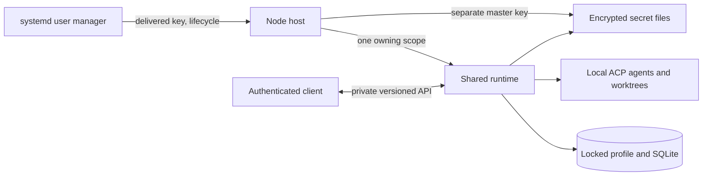
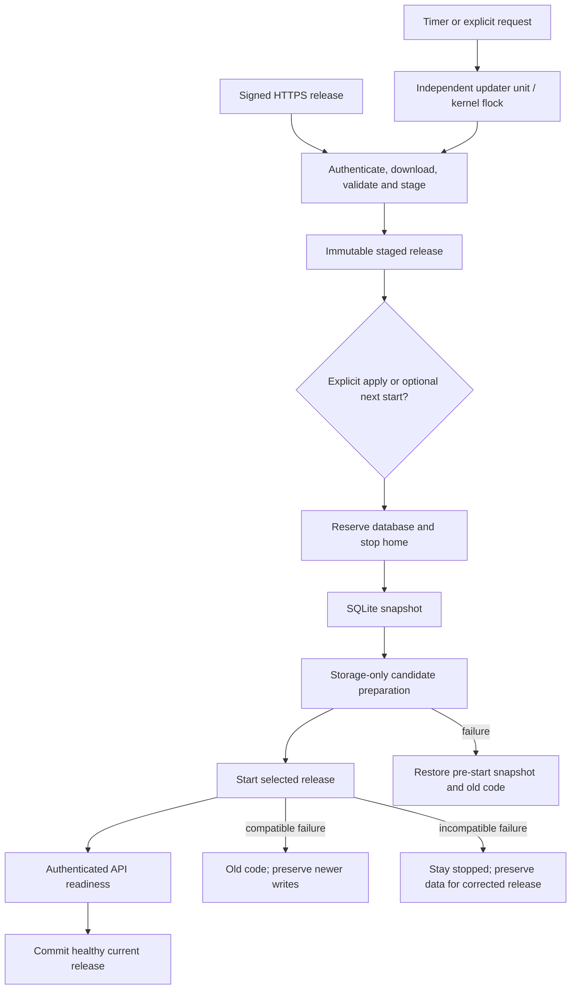

# @althar/host — Architecture

**Owner:** repository maintainers. A Linux composition root for `@althar/runtime`, independent of Electron, clients and service subscriptions. The repository [engineering target](../../ARCHITECTURE.md) applies. [ADR-103](../../docs/decisions/proposed/103-projects-live-locally-or-on-a-host-and-place-work-in-pools.md) describes the later remote-host and worker product; this app supplies its unattended single-host lifecycle.

## Ownership and flow

`options.ts` validates command input. `commands.ts` executes commands through an injectable output/service interface. `main.ts` captures delivered credential paths, strips supervisor-only environment capabilities, routes structured runtime logs to stderr and owns signal interruption. `home.ts` builds `services` with durable per-profile paths and the host's `Secrets` layer. The default runtime startup has no desktop first-screen gate, GUI callbacks or desktop telemetry dependencies.

One profile is one persistent home owned by one person. A server can run separate profiles/units; no server-wide organization or tenant model is implied. Home, actor and device identities come from the shared runtime. Projects, approvals, commands, receipts and reconciliation remain there. This app imports only public package APIs and does not implement a second scheduler, API or permission model. Clients disconnect independently of the host scope. Shutdown closes runtime resources before zeroing the in-memory vault key. Restart reconciles interrupted work through the existing runtime; it does not replay external effects as if they had never happened.

## Storage and secrets

`configuration.ts` stores version 1 configuration and refuses automatic worktree relocation or replacement of missing storage. `vault.ts` stores version 1 metadata, a key fingerprint, a random vault id and AES-256-GCM envelopes. Each secret uses a fresh 96-bit nonce; additional authenticated data binds format version, vault and secret name. Secret plaintext is limited to 1 MiB. Invalid/tampered ciphertext is unreadable, not silently absent. Initialization can create a random 32-byte key only before vault metadata exists. A missing/wrong key, desktop ciphertext without host metadata, unsafe ownership or permission modes fail closed. Changes to persisted formats need explicit versioned migration and recovery.

`privateFiles.ts` reads bounded regular files without following final symlinks, rejects multiply linked master keys, and publishes private temporary files only after fsync. Initial creation is atomic and cannot overwrite an existing key. Replacements rename atomically and fsync the containing directory. Retried creation/deletion repeats the directory barrier even when the earlier change is already visible, so a failed fsync cannot be mistaken for durable success. Vault operations serialize through a semaphore and complete their bounded filesystem work before scope cleanup zeroes the key; an escaped service reference refuses use after its scope closes. JavaScript strings and provider SDK copies cannot be reliably erased; key buffers and intermediate plaintext buffers are erased where owned.

The master key is outside the profile/backups/worktree roots, including canonicalized aliases. Operators must also keep it outside original source repositories, images and other exported folders. User input supplies paths, never raw secret values on command lines. Error messages do not echo unknown exceptions or sealed contents. Connector secrets use this vault; provider login stores remain the provider tools' own responsibility. Copying both key and ciphertext defeats this protection.

## Trust and lifecycle

A fresh private socket launch secret grants `socket` authority. SSH access is not person authority. The host does not create a window connection, protected paired-client key or an approval bypass. Signed owner keys, version negotiation, revocation, durable admission and feed positions use the shared API's existing contracts. No public port, relay or remote filesystem is added. API health authenticates and reads connection information rather than probing agents; it is bounded to 10 seconds, or 30 seconds with readiness retry. Disk/crypto work uses asynchronous filesystem operations; no blocking subprocess runs on the host thread. Parsing is bounded by private-file size limits.

The systemd unit delivers a private or OS-sealed credential, announces actual API readiness, rate-limits restart loops and terminates the full cgroup on shutdown. Helper arguments are passed without shell interpolation; unit paths escape systemd quoting/specifiers and suppress environment expansion in ExecStart. A small generated shell launcher uses fixed, quoted arguments and selects one immutable release for both Node and JavaScript. Installer writes only marked managed user units, reloads, and starts the home only when asked. It never changes lingering policy.

This is a trusted personal OS-user boundary. Same-user agents can access the user's files; mode 0700/0600 and environment stripping do not provide process or tenant isolation. Shared workers, remote credential delegation, SSH bootstrap, protected enrollment, provider validation, remote files and previews remain separate release work. No billing or organization authorization depends on this process layout.

## Immutable releases and recovery

`updates/release.ts` authenticates bounded Ed25519 envelopes before using payload fields. The operator pins keys independently; HTTPS adds transport protection, not signing authority. Metadata binds semver, monotonically increasing sequence, expiry, Linux architecture, updater protocol, API/storage fingerprint, digest, compressed/unpacked size and file count. Previously installed authentic code can boot offline after expiry; activation checks freshness and anti-rollback again. The local bootstrap is explicitly trusted local code, with its entry digest recorded. Signing never changes runtime/client permission authority.

`bundle.ts` captures bundled Node and its license plus the actual installed/locked, patched ACP dependency graph, preserving nested resolution. The build emits the application license and the notices of the third-party modules included in its JavaScript; both are required release assets. Releases target native Linux glibc x64/arm64. `preflight.ts` checks exact adapter versions and probes native binaries in an empty home with a minimal environment. `network.ts` streams bounded HTTPS downloads with timeouts, constrained redirects and digest verification. `archive.ts` validates the complete tar before extraction: no links, traversal, duplicates, special modes or path/type collisions; bounded inventory, decompression and metadata; private files and fsync before publication. `publish.ts` signs with a protected release-CI key held in memory and emits immutable archive/manifest assets. It never passes that key to provider subprocesses.

`store.ts` journals prepared/stopped/migrating/starting/recovery-required with Linux boot id and process start identity, so PID reuse is not ownership. `reservation.ts` reserves the canonical single-link database across the stop/migrate/start interval; shared SQLite opening checks it before client creation and again after exclusive lock acquisition. Only a validated managed executable receives an explicit permit, never RPC or environment input. Shared persistence rejects newer recorded schemas. Missing or foreign reservations forbid automatic restoration. `prepare.ts` opens storage and validates the existing home/vault without constructing the runtime. Snapshot restore is allowed only before runtime startup; compatible failure rolls back binaries alone, incompatible post-start failure stays stopped for rollforward. A corrected release failing preparation cannot re-enable old incompatible code.

The controller runs outside the host cgroup; stopping the host cannot kill it. The stable launcher recovers abandoned transactions under `flock` before boot. A durable request plus `.path` level trigger avoids lost wakeups; receipts reconcile interrupted requests without replaying applied or failed maintenance. Background checks never stop a running service. Default apply is explicit and may interrupt agents; optional automatic activation happens only on the next service start and only for fresh, compatible, non-quarantined releases. Idle-time automatic application awaits a real admission/drain barrier. `current` changes only after the candidate's authenticated self-probe, before systemd notification. `active` selects a prepared candidate; crash recovery repairs pointers from the durable state.

The private program root is separate from profile, worktrees and master key. Retention keeps all bootstrap/current/active/staged/failed/high-water/transaction/pending-request references plus three historical releases, three historical snapshots and 100 completed receipts. Cleanup runs under the updater lock and cannot fail an otherwise healthy update. Logs use systemd journal policy. Recovery snapshots cover SQLite only; profile/key/provider/git export remains an operator responsibility.

**Decision owner:** repository maintainers. Prefer explicit maintenance and optional next-start activation to an idle-check/restart race. Prefer fail-closed incompatible recovery to erasing effects after runtime startup. Revisit when the runtime provides an admission/drain barrier or versioned reversible migrations. `host-release.yml` gates both native architectures and exact-main validation, requires protected signing approval and leaves publication manual. First public key provisioning and real VPS/provider validation remain release gates.

## Verification

`vite.config.ts` builds for Node 24 and uses the shared medium test budget. Unit tests exercise encryption, tamper/permission refusal, atomic files and injected disk-sync failures, signed releases, hostile archives, bounded downloads, argument handling and service generation. Integration tests use the actual runtime, git, SQLite and authenticated Unix sockets, including single-writer exclusion, client disconnect during an agent turn, restart persistence, migration recovery and preservation of post-start writes. Built-process tests use an empty fixture home, no stdin, no GUI and real SIGTERM/SIGINT, including signed upgrade/fallback through the stable launcher. They do not load a developer's credentials. Service calls are injected and no host user's service is deployed by CI. The portable-release smoke separately checks real native provider binaries and locked adapter packages outside workspace resolution. Systemd/reboot and provider headless sign-in need real VPS validation before release. The dedicated workflow gates this app and runs again in the merge queue; changed-test stress runs also build before tests.

There is no graphical interface in this app. Help, safe actionable errors, JSON command results and stderr diagnostics are its operator interface. Keep stdout suitable for automation. Maintain the shared 90% coverage floor in CI; process entry wiring is excluded from source instrumentation only because it runs as a separate built process, which its lifecycle tests exercise.
