# Althar on a phone: design

What the phone app is for, what the tools around Althar ship on a phone, the
directions considered, what's built, and what's left for a person to decide.
Written 21 October 2026, from the competitor research in
[research.md](research.md) and [ADR-048](../../../docs/decisions/048-where-the-runtime-runs-and-who-may-reach-it.md).

## What the phone is for

The Mac is canonical. The phone reaches Althar on the Mac through a relay that
carries only what it can't read, and sees it only while the Mac is awake and
Althar runs (ADR-048). So the phone is a remote, not a second Althar. It does
four things, in this order:

1. **Answer.** A permission, a question, or a step that can't go on without
   the person. The phone is the one client that may answer for the person,
   since its key never reaches the Mac where agents run.
2. **Glance.** What's at work, what's next, and what the loop did while the
   person was away.
3. **Accept.** Read what a task changed and what its reviewer found, then
   merge.
4. **Start.** Say what should be done; the coordinator on the Mac plans it.

It isn't an IDE, a terminal or a chat client for agents. Every tool that
started as a terminal mirror moved away from it (Superset dropped terminal
rows; Orca's is "mostly read-only").

## What others ship

| Product | Model | What its phone does | Answers on the phone | Live Activity | Stack |
|---|---|---|---|---|---|
| Cursor (iOS, beta since June) | Cloud agents, plus remote control of the desktop | Start, follow, review diffs and demos, merge | In app | Up to 8 agents, Dynamic Island | Native (not found) |
| Codex in ChatGPT | Laptop host, QR pairing, relay | Start, follow, approve, inline review | In app; approvals were easy to miss | Tasks widget | Native (not found) |
| Superset (Sept) | Electron host, closest to Althar | Start on a machine, follow, diffs, PR status, dictation | Tool approvals, questions, plans | One per machine, ranked by urgency, dims when stale | Expo 57, Swift target for the activity |
| Orca | Desktop worktrees, relay | Mirrors terminals, replies to prompts | Prompts only | None | Expo 55 |
| Happy | CLI wrapper, E2E encrypted relay | Sessions, permissions, realtime voice | In app; pushes dropped silently | None | Expo 55, libsodium |
| Claude Code (Claude app) | Remote Control, TLS not E2E | Sessions, permissions, questions | In app; actionable pushes "not planned" | None | Native |
| Remi | Small tool | Answers on the lock screen and Watch | Yes/Always/No, behind authentication | None | Native |

Three of the tools closest to Althar (Superset, Orca, Happy) are Expo apps.
The detail and sources are in [research.md](research.md).

**What works, across them:** the phone as a remote with the computer
canonical; four attention states (needs you, failed, ready, working) driving
everything; pushes only when an agent needs you, fails or is ready; QR pairing
confirmed on the host; host presence shown everywhere, with "keep this
computer awake" on the host; one tap from home to a task; voice as dictation
into the composer.

**What fails:** approvals that never reach the phone (a presence guess
suppressed them); a prompt already answered elsewhere still showing; approve
buttons without context, or small and low, so people rubber-stamp; no way to
start local work from the phone (Cursor's top complaint); a hosted relay as a
single point of failure; sends that fail silently, and dictated drafts lost
with them.

## Directions considered

**A. Needs you, as an inbox: the spine.** The home is what waits on the
person, newest work first: permissions, then questions, then stuck steps,
then work ready. Each card is answerable in place with everything needed to
answer it: the exact command, why the project's rules ask, who asks, and
where. It matches the desktop's home and edge, and is what every tool
converged on. **Built.**

**B. A fleet monitor.** Every agent at once, by state: Superset's unified
list, GitHub's sessions tab, Cursor's Live Activity. On a phone this is a
section and a glance rather than the home: "At work" under Needs you, the
Projects tab with violet and cobalt counts, and a Live Activity. **Built,
except the Live Activity, which is drawn as a preview in Settings ›
Notifications.**

**C. Talk first.** A conversation with the coordinator, or a realtime voice
agent (Happy, Omnara). Realtime voice is niche and paid where it exists, and
Superset found native dictation into the composer beats it. **Built as the
New task sheet and a composer with dictation; realtime voice left out.**

**D. A terminal mirror (Orca).** Rejected: it reads badly on a phone, and
Althar's thread already folds the lead's work into rounds.

## What's built

An Expo app (SDK 58, React Native 0.88) in `apps/mobile`, on demo data behind
the client seam the relay will implement. Screens, as shot in
`test-results/shots` (`bun run export:web && bun run shots`):

| Screen | What it shows |
|---|---|
| Home (`home`, `home-dark`, `home-away`, `home-unpaired`) | "6 need you"; cards answered in place; At work with what each lead is saying, live; Up next; Since you looked. The Mac away: a banner, answers disabled. Unpaired: what it does, and Pair |
| Call (`call-permission`, `call-stuck`) | A call whole: Allow once, Always allow by the scopes the rules offer, Deny with what to do instead, Never; a stuck step's choices |
| Task (`task-running`, `task-ready`) | Where it stands, its steps, its calls, its pull request with checks and Merge, the thread folded into rounds, the composer |
| Changes, Diff (`changes`, `diff`) | Files with status and lines; a unified diff that wraps by default, the changed stretch marked |
| Projects, a project (`projects`, `project`) | Each project's counts; a project's lanes as segments, Needs you first |
| New task (`new-task`) | Project, what should be done, Plan it |
| Pair (`pair`, `pair-verify`) | Scan the Mac's code; check four words on both screens; done |
| Settings, Notifications (`settings`, `notifications-full`) | The paired Mac, Face ID, unpair; notification groups, with previews of the lock screen, the island and the Live Activity |
| Diagnostics (`diagnostics`) | The relay client's whole path, run in the app against a runtime of the contract's own: on a phone, a one-tap check on Hermes |
| The Mac out of date (`home-outdated`) | Which side needs updating when the two speak different API versions |

<table>
<tr><td valign="top" width="33%">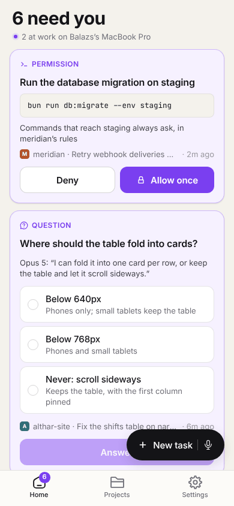 Home: what needs you, answered in place</td><td valign="top" width="33%">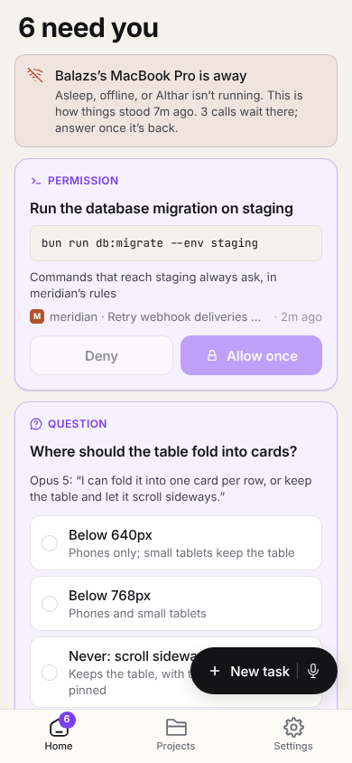 The Mac away: answers wait</td><td valign="top" width="33%">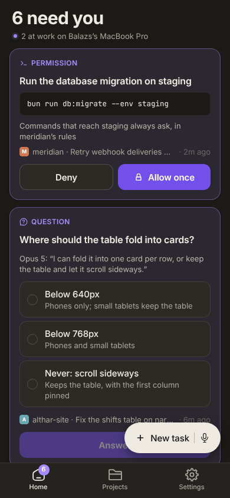 Dark</td></tr>
<tr><td valign="top" width="33%">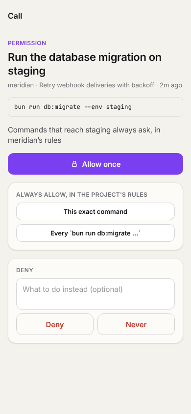 A permission, whole</td><td valign="top" width="33%">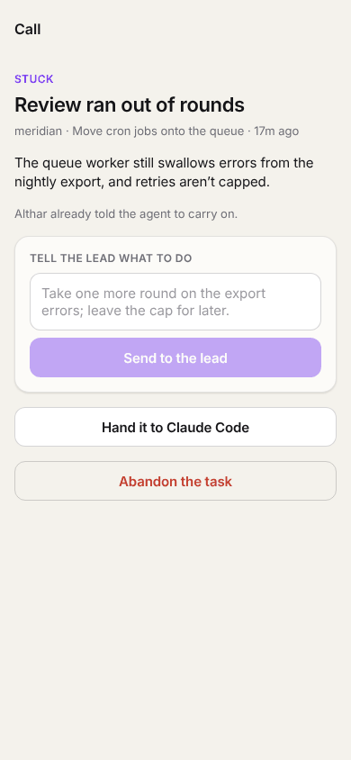 A stuck step</td><td valign="top" width="33%">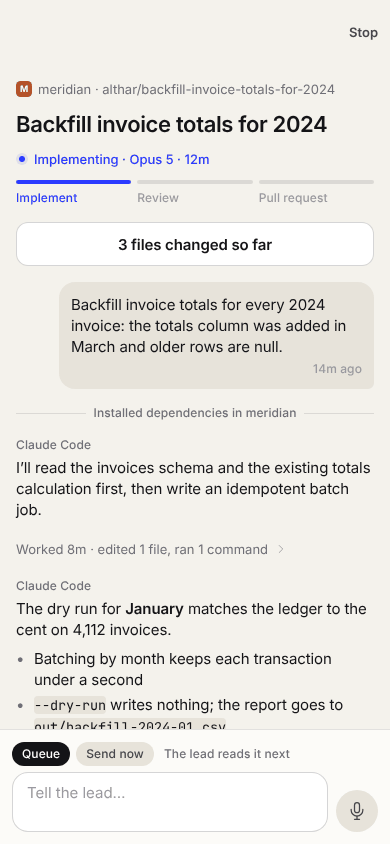 A task at work, live</td></tr>
<tr><td valign="top" width="33%">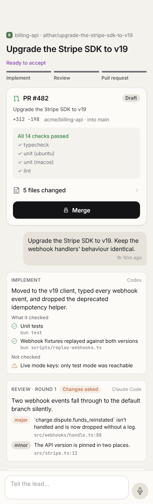 Ready: checks, merge, reports</td><td valign="top" width="33%">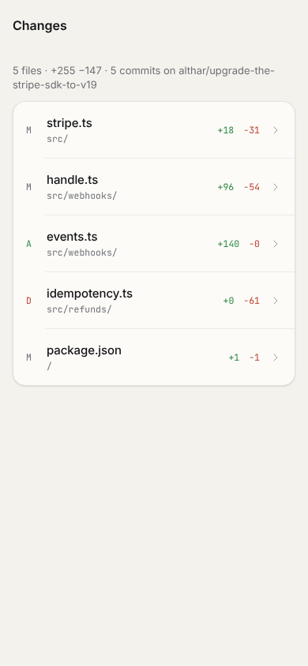 What it changed</td><td valign="top" width="33%">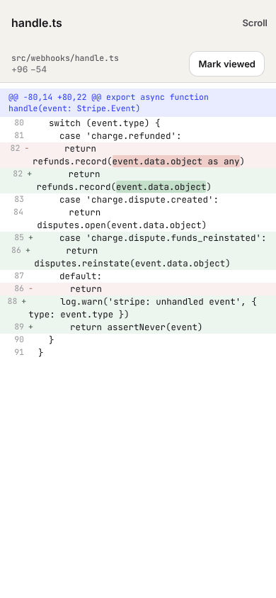 A diff, wrapped</td></tr>
<tr><td valign="top" width="33%">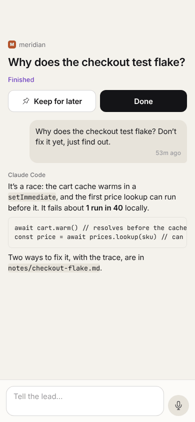 A finished question, in markdown</td><td valign="top" width="33%">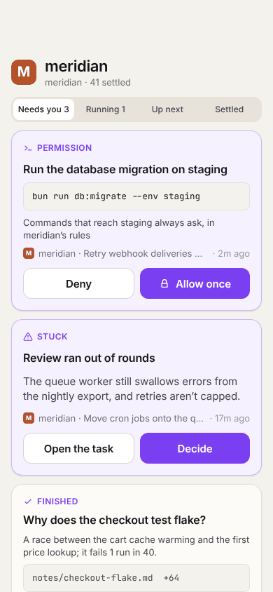 A project’s lanes</td><td valign="top" width="33%">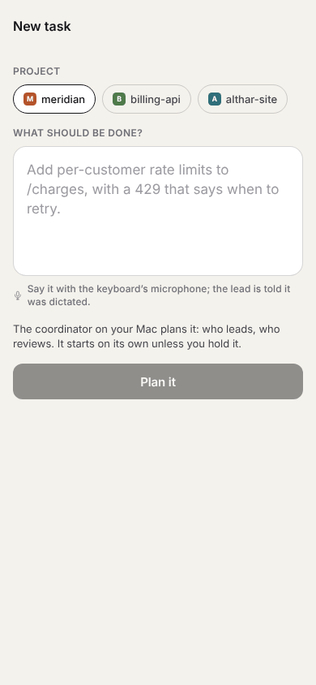 A new task</td></tr>
<tr><td valign="top" width="33%">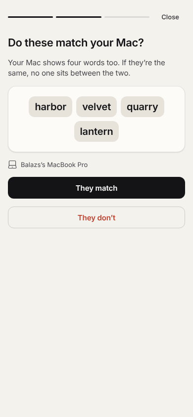 Pairing: four words to check</td><td valign="top" width="33%">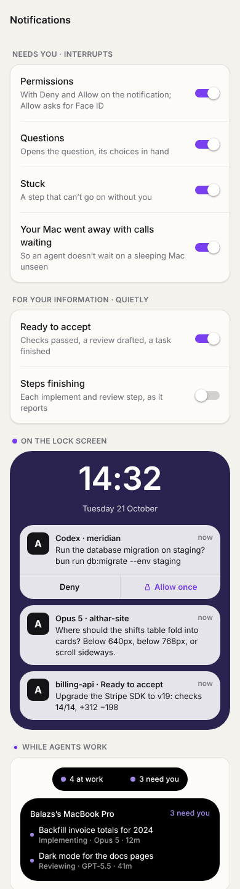 Notifications and the Live Activity</td><td valign="top" width="33%">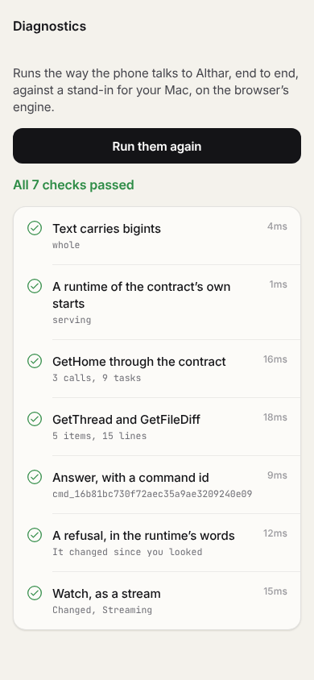 Diagnostics: the relay path, in the app</td></tr>
</table>

The shots are the web build at 390×844 (`bun run export:web && bun run shots`); on a phone the system draws the bars, sheets and keyboard.

Behind the screens, also built and tested:

- **The relay client** (`src/client/relay/RelayClient.ts`): the runtime's own
  RPC over a port that carries JSON text, with a command id per command and a
  watch that picks up where it left off, as the desktop's data layer does.
  Tested against a server of the contract's own, which also shows the demo's
  records pass the contract's schemas both ways.
- **Effect on Hermes** ([hermes-spike.md](hermes-spike.md)): it runs, on the
  exact Hermes React Native 0.88 ships. The two things it needed are done: a
  scheduler that yields with `setTimeout`, and `crypto.getRandomValues`.
- **Notifications** (`src/notify`): the categories, Deny from the
  notification, Allow opening the call for Face ID, "not delivered" when a
  Deny didn't arrive. The demo taps you as calls arrive, so it can be tried
  on a phone now.
- **The pairing code and the four words** (`src/client/relay/pairing.ts`):
  the QR's contents, refused in words when stale or wrong, and the words
  drawn from both keys and the nonce.

### The rules it follows

- **Face ID before the person's word; never before a no.** Allow, Always
  allow and Merge ask for Face ID; Deny and Never don't. Refusing is always
  safe, and it keeps the asymmetry honest on the lock screen too.
- **Context on every answer.** A permission card shows the command in full,
  in mono, the rule that keeps it for the person, the project and task, and
  how long ago. Big buttons within the thumb's reach (Codex's approvals were
  small and low).
- **The Mac's presence, everywhere it matters.** Online says nothing. Away
  says since when, what waits there, and disables answering; nothing is
  queued against a sleeping Mac, as a stale answer is worse than a late one.
- **Answered anywhere, gone everywhere.** A call answered on the Mac
  disappears from the phone as the watch says it changed; the call sheet says
  "Already answered" if it went while open.
- **Merge at the head you saw.** The phone sends the head it showed; the Mac
  refuses if the branch moved.
- **Nothing written is lost.** The composer and the new task clear only once
  the Mac has them; a failed send says so and keeps the text.
- **The desktop's words.** Needs you, Call, Permission, Question, Stuck,
  Ready to accept, Finished, Queue, Send now, Lead (docs/glossary.md); the
  kit's paper, ink, cobalt for what runs, violet for what needs you.
  `src/model/calls.ts` is the desktop's `shared/calls.ts`, so the two can't
  disagree on what needs you.

## Notifications

Two groups, as the research recommends and Claude's two toggles suggest:

- **Needs you, interrupting** (Time Sensitive, threaded by task):
  - `PERMISSION`: Deny and Allow once on the notification. Deny runs in the
    background; Allow opens the app for Face ID.
  - `QUESTION`: opens the question, its choices in hand.
  - `STUCK`.
  - `MAC_AWAY_WITH_CALLS`: the relay can send it from heartbeats alone.
- **For your information, quietly:** ready to accept, and, off at first,
  steps finishing.

Pushes carry ciphertext only. A notification service extension on the phone
decrypts them, so the relay never reads a command or a title. When an answer
from a notification fails to arrive, a local notification says so (Remi
does this). Pushes are held back only on a positive sign the person is at
the Mac, never on a guess from an open connection (Happy's bug).

## What the Mac and the runtime need

The phone can't do these itself:

1. **The relay** (ADR-048): a service the runtime dials out to over a
   WebSocket, with end-to-end encryption between the Mac and each paired
   phone, and push delivery through APNs and FCM. It sits beside
   `apps/report`'s Worker.
2. **Settings › Phone on the desktop:** the pairing code, the four words,
   paired devices with last seen, and Unpair.
3. **A paired device's role on the API:** it may answer (`Answer`,
   `AnswerQuestion`, `AnswerStuck`, `Merge`), unlike a socket client, once
   answers record who gave them (DEV-126, DEV-132).
4. **Keep the Mac awake while work runs or calls wait.** A setting exists;
   the phone should be able to say it's off.
5. **The runtime sends what pushes need:** a call opened or closed, work
   ready, a step stuck, so the relay can wake the phone.

## Left for you to decide

Each with a recommendation; none of them blocks the next steps.

1. **What a Live Activity shows.** Its remote updates come from Apple's push
   service and can't be decrypted on the phone, so the relay would see what
   it shows. *Recommend:* counts and states only remotely ("4 at work · 3
   need you"); titles only when the app updates it itself.
2. **Allow from the lock screen.** An action marked `authenticationRequired`
   needs the phone unlocked, not Face ID for that answer. *Recommend:* Deny
   on the notification, Allow opens the app for Face ID. Revisit if a
   biometric-bound key can sign from a notification action.
3. **"Allow everything for this task" from the phone.** The desktop has it
   (`SetTaskAllowEverything`). *Recommend:* not on the phone at first; it
   widens what agents may do, which is the Mac's to do.
4. **Where the relay runs.** *Recommend:* Cloudflare (a Worker with a
   Durable Object per paired Mac), beside `apps/report`. Add a direct LAN
   path later, so a relay outage isn't total (Happy's top complaint).
5. **iOS first, or both.** Expo builds Android too. *Recommend:* ship iOS
   first, and build Android in CI from day one so it doesn't rot.
6. **The private repository and `@althar/contracts`.** The phone needs the
   contract's types now and its schemas once it speaks the relay. *Recommend:*
   publish `@althar/contracts` to npm (it is Apache-2.0 already), versioned
   with `API_VERSION`; else a git dependency on this repository.
7. **The bundle id and name.** `dev.althar.mobile` and "Althar" are
   placeholders in `app.json`.

## Next

1. The relay itself, and the Mac's side of it (above). On the phone: the
   relay's channel as a `TextChannel` (a WebSocket, then a Noise KK session
   over it from a vetted library), handed to `connectRelay`; the version
   handshake as `outdated`.
2. Pairing for real: the key made in the Secure Enclave behind Face ID, sent
   to the Mac through the relay; the words drawn as `pairing.ts` draws them.
3. The notification service extension, which opens encrypted pushes; Deny
   answered from a killed app (a background task).
4. Native dictation (`expo-speech-recognition` or Apple's speech framework
   through a small module), transcribing at the end.
5. The Live Activity, as a Swift target through `@bacons/apple-targets`, as
   Superset does.
6. Review on the phone: mark files viewed, send a finding or a line to the
   lead.
