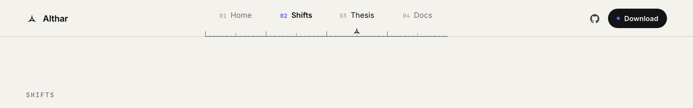
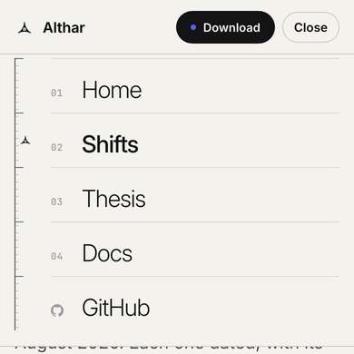
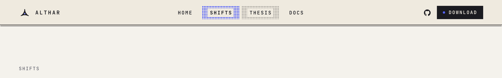
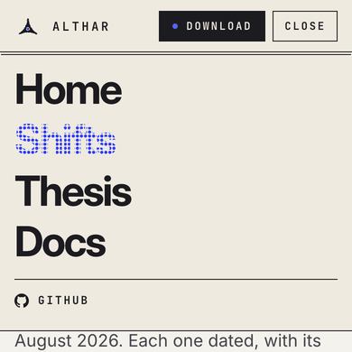
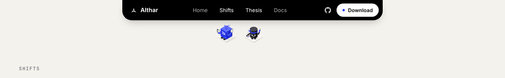
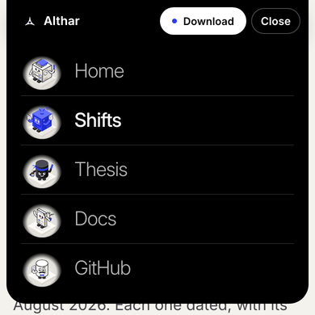

# Nav concepts

Three ideas for the site's nav, built only from the brand pack, to choose one from. `bun run site`, then open `/lab/nav` (in development only; the build leaves it out). The panel at the bottom switches between them and today's nav. Choosing a page in a concept's nav moves the nav instead of leaving, so the motion can be seen. `?concept=scale|printed|crew|today&page=/shifts` opens on one.

Each keeps what today's nav does: the same pages, GitHub and the download, the current page shown (`aria-current`), keyboard focus, and a phone menu (Escape closes it and puts focus back on Menu). Only transforms (and the odd opacity) move, and nothing moves with reduced motion.

| | Desktop, pointing at Thesis while on Shifts | Phone menu |
| --- | --- | --- |
| **Scale**: the mark is a section through a scale ruler, so the bar is the ruler's edge. The pages are numbered like a set's sheets along a track of ticks, and the mark stands on the track under the current page, sliding to whichever you point at. On a phone the track stands upright down the menu. *Uses the mark (Logo), the Masthead's numbered parts, paper and ink.* |  |  |
| **Printed**: the README banner's masthead as the bar, two inks on paper stock. The halftone mark comes up dot by dot, the pages are set in the banner's spaced mono capitals, and the current page is printed over with a screen of cobalt dots (pointed at: black). On a phone the menu is the banner's big words, the current one printed as a halftone. *Uses HalftoneMark and print-stock, print-black and cobalt from the palette.* |  |  |
| **Crew**: today's island, with a crew member for each page (the project for Home, the coordinator for Shifts, the lead for the Thesis, a task for Docs, the reviewer for GitHub). The current page's figure hangs under its name, blinking and fidgeting. Others drop when pointed at, and they go back up behind the island as you read. On a phone the menu lists the pages beside their figures. *Uses the crew figures (`brand/export/crew`, light and dark) and the island.* |  |  |
