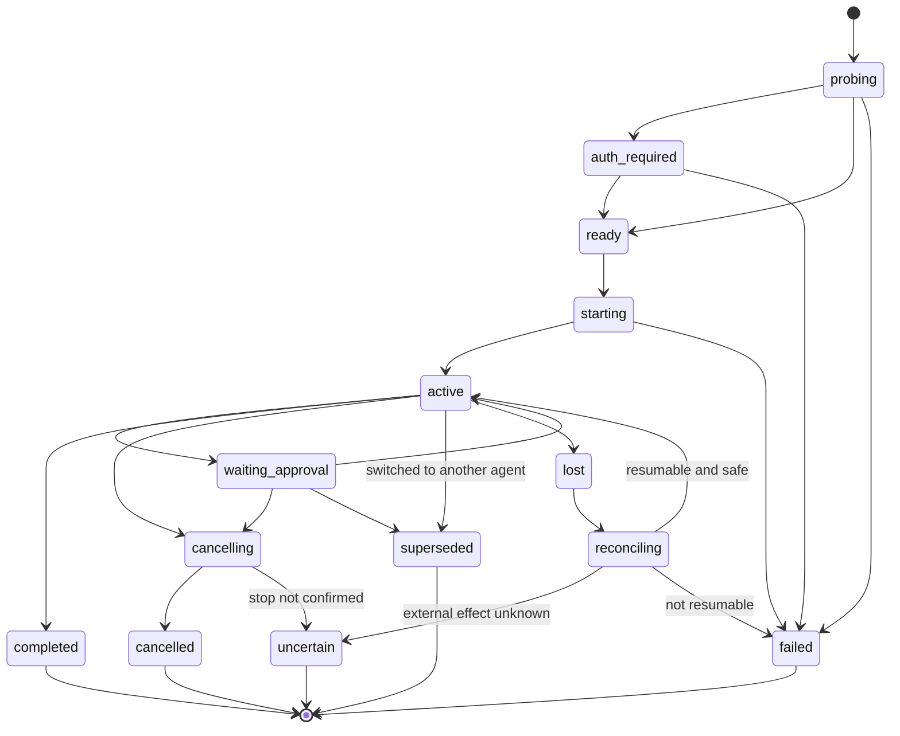

# Agent Runtime and Authentication

## Architectural decision

Althar is an agent harness in the same sense that a workflow scheduler is a
job harness: it supplies durable intent, policy, lifecycle, recovery, and
evidence around execution. It is not a new foundation-model runtime.

The boundary is:

| Althar owns | Provider runtime owns |
|---|---|
| Project, task, run, graph, attempts | Model request loop |
| Scheduling and host placement | Context window and provider compaction |
| Workspace preparation and repository grants | Provider-native tools and subagents |
| Policy, approvals, budgets, attention | Native conversation representation |
| Skill resolution and instruction bundle | Provider prompt/session mechanics |
| Normalized observations and retained evidence | Token refresh and provider account protocol |
| Restart reconciliation and repair | Provider-specific retry within one call/session |
| Cross-provider and cross-run record | Provider-native usage/accounting detail |

If Althar implements both columns, it inherits the hardest and fastest-moving
parts of Codex, Claude Code, and every future provider while weakening the
durable project layer that differentiates it.

Althar reaches every agent through one protocol, the Agent Client Protocol
(ACP), and adds native channels per agent only where ACP falls short
([ADR-002](../decisions/002-acp-for-every-agent.md)).

## Agents in the MVP

Claude Code, Codex and OpenCode are interchangeable from the first version, and
seven more since October 2026 ([ADR-050](../decisions/050-an-agent-joins-where-althar-can-hold-it-to-asking.md)). A
task's lead, any step and the coordinator can run on any of them, and a task
can move between them.

| Agent | How Althar runs it | Sign-in, held by the agent | Notes |
|---|---|---|---|
| Claude Code | `claude-agent-acp`, the ACP project's adapter on the Claude Agent SDK. Claude Code has no native ACP | Claude plan or Anthropic API key; status from `claude auth status` | Starts in the user's own default mode, which can be `bypassPermissions`, so Althar turns bypass off and adds ask rules for every session. The Agent SDK reports usage limits, but the adapter doesn't forward them |
| Codex | `codex-acp`, the ACP project's adapter, driving its own bundled Codex | ChatGPT plan or OpenAI API key; status from `codex login status` | Althar uses its `workspace-write` mode, not the default `agent` mode, whose automatic reviewer answers requests itself. Usage limits reach the adapter but are only rendered as `/status` text |
| OpenCode | `opencode acp`, native | API keys for any provider; local model servers; status from `opencode auth list` | The bring-your-own-key route. It cannot use a Claude plan. It allows most actions without asking unless configured, so Althar starts it with inline config that makes it ask |
| GitHub Copilot | `copilot --acp`, native (public preview); Althar can download it | A Copilot plan; no status command | Asks before every edit, command and fetch in its `#agent` mode. Althar holds its `allow_all` off and sends the person's `/` messages as words, as `/yolo` would turn asking off. A repository's hooks can approve, so it leads no review. One account until its keychain sign-in is seen per folder |
| Junie | `junie --acp=true`, native | A JetBrains AI plan or a Junie key; no status command | Ordinary edits inside the project don't ask; commands, sensitive files and MCP tools do. Althar holds its brave mode off. Its plan mode has no edit tools, so readers run there. One account until Althar signs a home out before removing it |
| Grok Build | `grok agent --no-leader stdio`, native | SuperGrok or X Premium+, or an xAI key; status from `grok models` | No modes: its session's `_meta` turns always-approve and its auto mode off. The allow rules in the person's Claude Code settings approve its commands, and nothing at launch stops them |
| Kimi Code | `kimi acp`, native | A Kimi Code membership; status from `kimi provider list` | Commands ask; edits inside a git repository and web fetches don't. Its plan mode refuses edits, so readers run there |
| Mistral Vibe | `vibe-acp`, native | A Mistral key its browser sign-in makes, paid by Le Chat Pro or Team, or pay-as-you-go; no status command | Its `ask` mode asks before edits, web, MCP tools and most commands; no read-only mode, so readers ask and Althar's rules deny their writes. One account: its key is a keychain item every folder shares |
| Qwen Code | `qwen --acp --approval-mode default`, native | Alibaba Cloud's Coding Plan key or any provider's; no status command | Starts in `auto`, a model judging what is safe, unless told. Commands it reads as only reading run unasked. A repository's `.qwen/settings.json` can add allow rules |
| Google Antigravity | `agy_acp_server.par`, Google's own ACP server, apart from the `agy` CLI; Althar downloads 1.3.0 from Google at the person's asking, pinned by sha256, as Orca does. No Windows build | A Google account, signed in only inside Althar over ACP's `authenticate`; no status command | Every role runs in `default`, held there, as `auto_edit` and `yolo` approve unasked; no read-only mode, so Althar's rules deny a reader's writes. The model's questions come as permission requests on `interaction_` tool calls and go to the person. Its sign-in is the home's own file, not the keychain. Google's terms may count a sign-in from another app a breach |

What each agent reports was read from the agents themselves on 28 September
2026, with `scripts/probe.ts` in `@althar/provider-adapters`: claude-agent-acp
0.84.0, codex-acp 2.0.0 and OpenCode 1.18.31. codex-acp 2.1.1, probed on
7 October 2026, reports the same modes and options. All three expose their mode and
model as session config options and can change both within a session; all
three can load and resume sessions. Claude Code and Codex also advertise
steering a turn in progress, as an extension in `_meta`. Probe again after
upgrading any of them.

The six after them were read on 18 and 19 October 2026 (GitHub Copilot CLI
1.0.98, Junie 3659.7, Grok Build 1.0.63, Kimi Code 2.2.0, Mistral Vibe 2.26.1,
Qwen Code 0.25.2): each started over ACP with a home of its own and no
sign-in, against a stand-in model on the computer where it takes one, so their
sessions, options and permission requests were seen; and from their own code
and help. Google Antigravity's server 1.3.0 is as Orca (stablyai/orca) runs
it, from Orca's code and its recording of a real session; it hasn't run here.
None has run signed in against its vendor's models yet. Which agents join, and
why four more wait, is
[ADR-050](../decisions/050-an-agent-joins-where-althar-can-hold-it-to-asking.md).

Althar checks sign-in with each agent's documented status command, never by
reading a credential store, and tells the user the agent's own login command
when it is signed out. The Claude Code desktop app and the `claude` command
line sign in separately; the adapter uses the command line's sign-in.

An agent can have several sign-ins. Each is an account with its own folder,
and the agent's usual folder is the first
([ADR-012](../decisions/012-several-accounts-per-agent.md); Several accounts,
below).

Another ACP agent is added by a registry entry and the contract suite, not new
code, where its entry can say what keeps it asking
([ADR-050](../decisions/050-an-agent-joins-where-althar-can-hold-it-to-asking.md)).
Gemini CLI no longer runs on Google's consumer plans (since 18 June 2026), which
moved to Antigravity.

### Agents not run yet

| Agent | What it waits for |
|---|---|
| Cursor | A signed-in probe of its current build: what was read is two months older, and its plan and ask modes are its servers', which may not keep Althar's tools |
| Devin | A mode that asks before an edit; and the kinds of its permission options, some of which switch the session to bypass |
| Factory Droid | Its `Script` tool asking in an ACP session |
| Auggie | Augment's permission to build it in; and a way to make it ask that doesn't name each tool |

## Adapter contract

The domain depends on the adapter's own interface, in
`@althar/provider-adapters`, not directly on a vendor SDK, CLI schema, or
ACP revision. No ACP type appears in it, so a native adapter for one agent
(Tier B below) can stand in without callers changing. It is written with Effect
([ADR-009](../decisions/009-effect-on-the-runtime-side.md)).

```ts
connect(options: {
  transport: Transport // a process Althar owns, or an in-process agent in tests
  onPermission: (request: PermissionRequest) => Effect<PermissionDecision> // from the project's rules
  permissions?: PermissionMeanings // what the agent's option ids mean: the registry's
  onQuestion?: (question: Question) => Effect<QuestionAnswer> // for the person; without it, no way to ask is offered
}): Effect<AgentConnection, AgentStartFailed | AgentExited | AgentRequestFailed, Scope>

interface AgentConnection {
  info: AgentInfo // name, version, protocol, loadSession, closeSession, steering, MCP transports, auth methods
  process?: ProcessInfo // pid, OS start time, environment digest, how stopping went
  closed: Effect<ProcessExit>
  newSession(options: NewSessionOptions): Effect<AgentSession, Failure | OptionUnavailable, Scope>
}

interface AgentSession {
  sessionId: string
  options: Effect<ConfigOption[]> // as last reported: mode, model, effort
  mode: Effect<string>
  prompt(text: string): Stream<SessionEvent, Failure | TurnInProgress> // one turn, ending with TurnEnded
  events: Stream<SessionEvent> // what the agent says between turns
  cancel: Effect<void, Failure>
  interrupt: Effect<void, Failure> // cancel, and wait for the turn to end
  setOption(configId: string, value: string): Effect<ConfigOption[], Failure | OptionUnavailable>
}
```

A scope owns each connection and session: closing it closes the session with
the agent (`session/close`, where offered) and stops the process group.

What it guarantees:

- **The mode is set, and checked.** `newSession` requires a mode, sets it
  before anything else, and refuses the session if the agent doesn't end up in
  it. An agent with no modes can't be made to ask, so it gets no session.
- **One turn at a time.** A prompt while a turn runs fails with
  `TurnInProgress`. A turn reads to its own end even when its stream is
  stopped early, so nothing it says reaches the next turn.
- **Order.** Updates, permission answers and the end of each prompt pass
  through one inbox per session in the order they arrived, so an answer never
  overtakes the tool call it answers, and a turn's last update never follows
  its end.
- **Permissions** are answered as in Permission routing below, and every
  answer is an event: `PermissionAnswered` with the option sent and how far it
  reaches, or `PermissionWithdrawn` when the turn was cancelled first.
- **Failures** are classified (see Usage limits). An agent's structured
  failure report is an `AgentFailure` event, and a turn it ended carries it on
  `TurnEnded`.
- **Questions** the agent asks the person (ACP elicitation, such as Claude's
  AskUserQuestion) are read into Althar's own fields and go to `onQuestion`
  (see Questions to the person). Without `onQuestion` the client advertises
  no form elicitation, so the agent is offered no way to ask.
- **Nothing is dropped.** An update this version doesn't know is an `Other`
  event with its raw payload.

Not built yet: loading a session, account status side channels, and steering.

The adapter reports, rather than fakes, capabilities:

- structured events and their schema version;
- session/conversation resumption;
- streaming;
- tool-approval hooks;
- file and image attachments;
- model and reasoning selection, and whether it can change within a session;
- usage/cost reporting;
- account usage limits and reset times;
- cancellation and hard termination;
- live steering, queued input, and interruption acknowledgement;
- native subagents or handoffs;
- MCP configuration;
- skill/instruction injection;
- read-only and ask-first session modes;
- sandbox or execution-location claims;
- supported authentication modes.

Unsupported capabilities are explicit. Provider independence means capability
negotiation plus isolated translation, not erasing differences into an
unreliable lowest common denominator.

## Transports

ACP is the default transport. An adapter is one ACP session transport plus
zero or more native side channels for what ACP doesn't carry. The domain sees
the adapter's capability report, never which channel supplied a fact, so a
native adapter can replace ACP for one agent without the domain changing.

| Tier | Mechanism | Policy |
|---|---|---|
| A | ACP, spoken natively or through a maintained adapter | The default for every agent. Pin agent and adapter versions |
| B | A native structured protocol or SDK, such as Codex app-server or OpenCode's server | A side channel for what ACP lacks, or a full adapter for one agent when ACP falls short |
| C | Documented headless CLI with structured JSON/events | Supported with stricter lifecycle and compatibility tests |
| D | PTY/TUI scraping, undocumented local protocols, or another agent's private session files | Experimental only; never the default correctness path |

Althar must never parse ANSI terminal presentation as its canonical event
stream. A terminal may be exposed as a user surface, but execution truth comes
from a documented structured channel or remains explicitly uncertain.

## ACP

ACP is the default because one implementation reaches every agent in the MVP,
and each later agent costs a registry entry rather than an integration. As of
September 2026 it covers:

- initialisation, protocol version and capability negotiation;
- authentication methods;
- creating and cancelling sessions, and loading them where the agent supports
  it;
- prompts and streamed updates: messages, tool calls, plans;
- permission requests, which Althar answers (see Permission routing);
- session modes and config options, including the model selector
  (`session/set_config_option`);
- the MCP servers a session may use, given at `session/new`;
- context-window use and cost (`usage_update`).

It does not cover:

- usage limits and quotas, which the protocol leaves to a future proposal;
- steering a turn in progress, so interrupt-and-continue is a cancel followed
  by a new prompt ([01](01-concepts-and-project-model.md));
- moving history between agents: a session can only be loaded by the agent
  that created it.

ACP is still not Althar's domain model:

- ACP is a client-agent transport, not a project, workflow, integration, or
  persistence model.
- Protocol drafts and capability growth must be quarantined inside an adapter.
  The protocol moves quickly; the model selector, for example, moved from an
  unstable method to session config options during 2026.
- Althar needs durable graph and authority semantics even if every provider
  eventually speaks ACP.

The adapter converts ACP sessions and notifications into Althar
`ProviderSession` and `Observation` records while retaining the raw protocol
version for diagnostics. ACP session identifiers are never promoted into
`Task` or `Run` IDs.

## The contract suite

Every agent adapter passes the same suite, against the oldest and newest
supported versions of the agent and its adapter:

1. initialisation and capability/version negotiation;
2. login-required and account-switch behaviour;
3. starting and, where supported, loading a session;
4. streaming update ordering;
5. permission request/response round trips;
6. changing the model within a session, or reporting that it can't;
7. cancellation versus process termination;
8. input queued during output and interrupt-and-continue behaviour;
9. crash behaviour during a tool action;
10. usage-limit recognition from errors, and account status where the agent
    has it;
11. unknown or added protocol fields;
12. bounded log retention and redaction;
13. a rejected action lets the turn carry on;
14. a permission request still waiting when the turn is interrupted is
    withdrawn;
15. a repository's own agent settings, allowing everything, don't stop the
    agent asking;
16. a question to the person: in a form Althar answers, carrying on with the
    answer, or in the agent's own words, as each agent asks.

The suite runs against a scripted fake agent in CI and against the real agents
on demand (`bun run test:agents`), in a repository whose own settings allow
everything and start in bypass mode. As of 29 September 2026 all three agents
pass 1, 3 to 7, 11 and 13 to 15; 2, 9 and 10 are covered against the fake
agent only; account switching, loading a session, queued input and 12 are not
built yet.

## Agent registry

Each agent is a registry entry, not a code path:

```ts
type AgentDefinition = {
  id: "claude-code" | "codex" | "opencode" | "copilot" | "junie" | "grok" | "kimi" | "mistral-vibe" | "qwen-code" | "antigravity"
  source: "bundled" | "user_installed"
  launch: (node: string) => LaunchSpec // command, args, env, which parent variables it inherits
  modes: { ask: string | null; readOnly: string | null; reader: string | null } // null: no modes, it asks by its `sessionMeta`
  options: { mode: string; model: string; effort?: string; ownEffort?: string; held?: Record<string, string> } // config option ids, the level that is a model's own, and options held at a value
  signIn: { status?: (node: string) => LaunchSpec; read: (output, exitCode) => boolean | undefined; login: string }
  home: { variable: string; usual: (env, homeDir) => string; shared: (names) => string[]; accounts?: 'one' } // ADR-012
  permissions: PermissionMeanings // what its option ids mean
  sessionMeta?: (role?: 'lead' | 'reader') => Record<string, unknown> // `_meta` for session/new: asking, or read-only
  commands?: 'althar' // the person's `/` messages go as words: one of its commands turns asking off
  knownGaps: string[]
}
```

- Adapters Althar ships, `claude-agent-acp` and `codex-acp`, are bundled at
  pinned versions. Nothing is fetched with `npx` or a similar tool at run
  time. Adapters written for Node run on a Node the packaged app ships, and
  on Electron's own Node in development ([02](02-desktop-runtime.md),
  ADR-033).
- Agents the user installs, such as OpenCode, are found by probe, and their
  version is checked against the support matrix.
- Adding an ACP agent means adding an entry and passing the contract suite.

## Where agent frameworks fit

The OpenAI Agents SDK, LangGraph, or another agent framework may later execute a
Althar-authored agent node when Althar itself owns that node's model/tool
loop.

They do not replace:

- Codex or Claude Code as full coding-agent runtimes;
- the project/repository/workspace model;
- external-system synchronization;
- the durable cross-run record;
- workflow authority and policy.

Use specialists or handoffs only when prompts, tools, or policies genuinely
differ. Spawning agents is not a substitute for decomposing a graph into
durable, observable nodes.

## Briefing agents

Althar assembles every session's starting context. A new session learns
about the task only from its brief. No session depends on what another agent
remembered ([ADR-005](../decisions/005-althar-briefs-every-agent.md)).

A brief contains, as the role needs:

- project rules and Althar's instructions for the role: lead, step, or
  coordinator;
- the task, its plan, and where the graph stands;
- the workspace: base, branch, and the diff so far;
- the conversation record: the user's messages verbatim, earlier agents'
  turns, decisions, what was tried and failed (for a command that failed, a
  bounded excerpt of what it printed), and open items;
- step results and artifacts the role needs;
- for a later review round, the earlier rounds' findings and how each was
  settled, with the lead's response and any person's decision
  ([05](05-workflow-engine.md));
- per-project instructions for a step type, such as `.althar/review.md`.

The same brief starts:

- a lead on a new task;
- every step;
- the coordinator's session when it is rebuilt ([04](04-coordinator.md));
- a new attempt after a crash or retry;
- the new agent after a switch.

Rules:

- Althar does not edit a repository's own instruction files (`CLAUDE.md`,
  `AGENTS.md`). Each agent still reads its own. The brief makes sure every
  agent also starts with the same project context. Since September 2026 Claude
  Code falls back to `AGENTS.md` only when no `CLAUDE.md` exists, so a
  repository with both still gives different agents different instructions.
- What fits goes in the first prompt. The rest stays readable through
  Althar's tools (an MCP server given to every session at `session/new`), so
  the agent reads it when it needs it.
- The brief sent is recorded as an artifact on the attempt, so what an agent
  was told is always inspectable.
- Project knowledge, when memory is built, enters sessions through the brief.

## Switching model or agent

These are two different operations.

**Model, within one agent.** Changing Sonnet to Opus in Claude Code, or between
Codex models, keeps the session. The adapter sets the model config option
through ACP and the context carries over. The prompt cache is per model, so the
first turn after a switch costs more. An agent whose ACP can't change model per
session restarts with a different configuration and loads its session again
where it can, or the change is handled as an agent switch. None of the MVP's
agents needs this today. Effort is the same: a config option (`thought_level`)
set as a session starts and changed within it.

What each agent offers comes from the agent, in its own ids and names: the
choices of its session's model and effort options. Each model has effort
levels of its own, and some none, and an agent says them only for the model
a session is on. Althar keeps no table of models; it reads them from the
agent's latest session, and asks each agent once a launch by starting it in an
empty folder, read-only, putting it on each model in turn, and stopping it.

**Agent.** A session can't move between agents. A switch starts a new session
on the new agent, in the same workspace, from a brief. The new session belongs
to a new attempt of the same node; the old session ends as `superseded`, and
its controller is fenced.

In the MVP the new agent takes over everything: the whole conversation record,
the plan, the open items, and the code as it stands. The record goes into the
first prompt as far as it fits, most recent first, and the rest is readable
through Althar's tools. No model is needed to switch, so a switch is
immediate and works when the outgoing agent is out of usage.

A switch the person makes happens when they next say something, not when
they pick the other agent's model: picking only changes who the composer says
will lead, and nothing that runs stops or starts. What they then send is the
new lead's first turn, after its brief, and is never queued for the old one,
which stops as the new one takes over. A model of the same agent is set at
once, for the next turn, since that starts nothing. A switch Althar makes, at
a usage limit or a stall, starts the new agent with "carry on" as before.

This will be tuned. Candidates include a fresh take that leaves out the
previous agent's reasoning (research in 2026 suggests a stronger model does
better without a weaker model's trajectory), starting again from base rather
than the current code, and a generated handoff in the style of Amp's. Each is a
brief policy; the mechanism stays the same.

Rejected: converting one agent's session files into another agent's format so
its own resume picks them up. Those formats are private and change with each
release (Tier D), and provider-signed reasoning is lost either way.

## Usage limits

A usage limit belongs to an account (`ProviderPrincipal`), so it pauses every
session on that account at once ([05](05-workflow-engine.md)). The agent's
other accounts are not out, and moving on tries them first (Several
accounts, below). ACP does not report plan windows yet. Althar detects limits
in two layers:

1. **From errors, on every agent.** Each adapter classifies a failed turn as
   `usage_limit`, with the reset time when the error carries one, from each
   agent's own words (`failures.ts`): a length ("reset after 19h14m47s"), a
   time on a clock in a named zone or this computer's ("resets 3pm
   (Europe/Budapest)", "try again at 3:05 PM"), or a date. Some agents give
   it as a code (Junie's -32010, Mistral Vibe's -31001) or in the error's
   data (OpenCode's `provider.quota`), and Copilot says it as a message and
   ends its turn as if done (the registry's `failsInText`). Claude's and
   Codex's adapters also report failures in structured form when the client
   asks (the JetBrains AIR `sessionFailure` extension, in `_meta`): its
   category and the actions it suggests tell an exhausted quota from a short
   rate limit and a full context, where the text alone can't. A
   failure that ends a turn comes on the prompt's response, the turn
   `end_turn` like any other; a warning while the agent retries by itself
   comes on a `session_info_update`. Every failure is one of `usage_limit`,
   `context_full` (start a new session from a brief), `transient` (a lost
   connection, a short rate limit, an overloaded or failing service: waited
   out while offline, and retried after a pause, ADR-060), `auth_required`,
   `invalid_request` or `unknown`.
2. **From account status, before the limit is reached.** Plan usage is
   required for every agent and every subscription account
   ([plan](../plans/plan-usage.md)). An account's windows (five hours, a
   week, a month, told apart by length) come from the first of these that
   works for its (agent, provider) pair:
   1. ACP's quota feature, once an adapter advertises it (an RFD is open:
      [#2316](https://github.com/agentclientprotocol/agent-client-protocol/pull/2316);
      v1's `usage_update` carries context and cost only, and ACP v2, a Draft,
      leaves it unchanged);
   2. an extension the adapter ships in ACP;
   3. the agent's own control channel, started with the account's home;
   4. the provider's usage endpoint, read with the account's own sign-in:
      the usage read, rule 3's one exception
      ([ADR-062](../decisions/062-a-usage-read-may-use-an-account-s-own-sign-in-once.md)).

   Today (`usageSources.ts` declares each pair's sources, or why it has none):
   - Claude Code: live, `claude-agent-acp` forwards the Agent SDK's
     `rate_limit_event` in `usage_update` `_meta["_claude/rateLimit"]`, and
     drops it if it arrives before a turn's first usage figure
     ([#1127](https://github.com/agentclientprotocol/claude-agent-acp/issues/1127)),
     so Althar carries a patch for that (`patches/`, on the pinned version).
     The event's own window has a use only near its limit; each window the
     CLI tracks is in its `unifiedWindows`, sent whenever one's rounded
     percentage moves. Where no session has said for a quarter of an hour, as
     on an idle account, or a window only it says (a model's own week) is
     that old: Anthropic's `/api/oauth/usage`, at most every five minutes,
     waiting as long as it asks. Each window is dated when it was read, and
     the endpoint's answer when it was asked, so it never replaces a window a
     session said after that, however often the reader gives it again; its
     others it does. An account's age is its oldest window's.
   - Codex: app-server's `account/rateLimits/read` and
     `account/rateLimits/updated` (`usage.ts`), started in the account's
     home; ChatGPT's `wham/usage` where it can't answer.
   - Kimi Code and Grok Build: their providers' usage URLs.
   - OpenCode: plan or key is told per provider from its own
     `opencode auth list --standalone --format json` (2.x; 1.x can't say);
     its plan sign-ins are kept in its own database, and not read.
   - Copilot, Junie, Mistral Vibe, Qwen Code and Antigravity give their usage
     to no other app; each says why, calmly, rather than as a fault.

   Errors (layer 1) stay under all of it: they say a limit was reached, not
   how much is left.

```ts
type AccountStatus = {
  principalId: string
  state: "ok" | "warning" | "limited" | "fault"
  windows: Array<{ kind: "five_hour" | "weekly" | "monthly" | "other"; label?: string; usedPercent: number; resetsAt?: string }>
  source: "acp" | "acp_extension" | "agent" | "endpoint" | "error"
  fault?: "sign_in_again" | "expired" | "source_changed" | "unreachable" | "no_source" | "no_data_yet" | "cannot_classify"
  noReading?: string // why the agent's usage can't be read, said calmly
  observedAt: string
}
```

With the windows, the scheduler moves or holds new work before the limit is
reached rather than after ([05](05-workflow-engine.md), Usage limits): an
account's room is its tightest window left, as last read (a window past its
reset is unknown until it is read again, and left out, as the window's gauge
and pickers leave it out by their own clock, an agent with none left saying
it hasn't been read since; a model's own window counts for
that model; money spent past the plan doesn't), and under 5% it is nearly out.
Warnings fire at 50, 25, 10 and 5% remaining (once per account, window and
reset).

## Provider session lifecycle



The same lifecycle is data in `@althar/domain` (`lifecycles.ts`), whose tests
keep it whole: every state reachable, and none left after a terminal one.

A provider session state does not directly set the run outcome. The workflow
node interprets normalized observations under its retry, verification, and
external-effect policy.

Every provider controller writes with the run attempt's
`controllerGeneration`. A stale controller may contribute attributable
diagnostic observations, but it cannot advance canonical state.

## Process ownership

For every child process, persist:

- executable identity and resolved version;
- adapter and protocol version;
- parent/child ownership identity;
- process-group/job-object strategy;
- start time and host identity;
- provider session ID if obtained;
- last observed event sequence;
- redacted launch arguments and environment allowlist digest;
- controller generation.

Cancellation is layered:

1. send provider-native cancellation;
2. wait a bounded grace period;
3. terminate the owned process group/job object;
4. verify liveness;
5. mark survivors and unknown effects explicitly.

Never kill by executable name or an unverified reused PID.

## Authentication model

Authentication is modeled with three concepts:

```ts
type ProviderPrincipal = {
  id: string
  provider: string
  subjectHint: string
  authMode: "vendor_cli" | "api_key" | "oauth" | "enterprise" | "workload"
  hostScope: string
  observedAt: string
}

type CredentialRef = {
  id: string
  owner: "vendor_cli" | "os_keychain" | "cloud_secret_store"
  locator: string
  exportable: false
}

type ExecutionGrant = {
  id: string
  principalId: string
  provider: string
  allowedHostId: string
  allowedProjectIds: string[]
  allowedOperations: string[]
  expiresAt?: string
  policyRevision: number
}
```

`ProviderPrincipal` records who Althar believes the provider session
represents. `CredentialRef` points to the supported custodian; it is not a copy
of the credential. `ExecutionGrant` is Althar policy authorizing use of that
principal for a bounded purpose.

### Vendor CLI and subscription login policy

Some providers offer a useful local CLI authenticated through a consumer or
team subscription but no supported API equivalent. Presence of that CLI is a
capability, not permission to extract or relay its session.

Rules:

1. The official CLI owns login, refresh, logout, and credential storage.
2. Althar may invoke documented status/login commands or react to a
   structured `auth_required` response.
3. Althar never reads, scrapes, copies, decrypts, exports, uploads, or
   synchronizes the CLI's credential cache, but for one exception: the
   usage read ([ADR-062](../decisions/062-a-usage-read-may-use-an-account-s-own-sign-in-once.md)),
   an account's access token read into memory for one allowlisted `GET` to
   its provider's usage URL, and dropped.
4. It never asks for a provider password or browser session cookie.
5. Subscription-backed execution runs on the user's device and only where the
   provider's current documentation and terms permit that use.
6. Althar cloud stores the fact that a device reports a capability, not the
   underlying subscription token.
7. Remote or hosted execution requires a provider-approved API key, OAuth
   grant, workload identity, service credential, or enterprise access token.
8. If no supported remote credential exists, the correct architecture is a
   local runner—not credential emulation.
9. Account switching is explicit and recorded. A run snapshots the observed
   principal and aborts or seeks approval if it changes. Althar's own
   moves between accounts are recorded as switches. A swap made by another
   tool shows up in the next sign-in check, and is recorded then.
10. Logging redacts tokens, authorization headers, cookies, device codes, and
    provider-defined secret fields before persistence.

This is both safer and more durable than coupling Althar to the current shape
of a vendor's private auth cache.

### Several accounts

An agent can have several sign-ins on one Mac: a work and a personal plan,
a plan per client, several OpenCode logins
([ADR-012](../decisions/012-several-accounts-per-agent.md)). Each is an
**account**: one sign-in, kept by the agent in a folder of its own, its
**home**. Althar only points the agent at the folder, and the rules above
still hold: it never reads, copies or moves what the agent keeps there.

```ts
type AgentAccount = {
  id: string
  agentId: string
  deviceId: string
  name: string               // the person's own: "work", "client A"
  home: string | null        // null: the agent's usual folder, its first account
  order: number              // the person's order; the first allowed one is used first
  principalId?: string       // who the agent last said it is signed in as
  paidBy?: "plan" | "key"    // from the agent's status command
  adoptedFrom?: string       // the tool that made the home, when Althar didn't
}
```

What makes a home, per agent:

| Agent | The home | Its sign-in | What else it holds |
|---|---|---|---|
| Claude Code | `CLAUDE_CONFIG_DIR` | On macOS, a Keychain item named after the folder's path (`Claude Code-credentials-` and a hash of it), so a home can't move | Settings, `CLAUDE.md`, agents, commands, plugins, history |
| Codex | `CODEX_HOME` | `auth.json` in the home, or the Keychain where it is set to use it | `config.toml`, `AGENTS.md`, skills, history |
| OpenCode | `XDG_DATA_HOME`, with OpenCode's data under `opencode/` | `auth.json`, one entry per provider | Its database and history. Its config is under `XDG_CONFIG_HOME`, which stays the person's |

**Adding an account.**
- Althar makes a home under its own data folder, named by the account's
  id, so it never moves.
- It opens the agent's own sign-in there, in a terminal, for the person:
  `claude auth login`, `codex login`, `opencode auth login`, each with the
  home in its environment.
- What of the agent's usual folder isn't the account's own is linked into
  the home, again as each session starts (the registry's `shared`): the
  person's settings, instructions and skills, and for OpenCode, whose home is
  the general data folder, all of it but `opencode`, so tools such as mise,
  fnm or pnpm find their data. The sign-in and the agent's own history are
  the home's own.
- **Removing one** signs it out with the agent's own sign-out, run in its
  home (`claude auth logout`, `codex logout`; OpenCode's sign-in is a file
  in the home), and deletes the folder. A folder another tool made is never
  touched.
- The status command, run with the home, says who the account is and
  whether a plan or a key pays for it.

**Adopting a home another tool made.** Althar offers the folders of
known switchers, and the person can add any folder by hand. It reads the
folders' names, never what is inside, and leaves them as the tool made them.

| Kind of switcher | Examples | What Althar does |
|---|---|---|
| A home per account | `codex-profiles`; codex-account-switcher (JoRo-Code); codex-accounts (omarhoumz), isolated homes; ccam's and the other `~/.claude-*` profile folders; claude-multi-account | Adopts each folder as an account |
| One live sign-in, swapped by copying a saved one over it | opencode-swap; opcode-switch; the OpenCode profile switcher script; opencode-openai-sub-switcher; opencode-switcher (Copilot); cx-switch; codex-accounts (marivaldojr); ccam's `claude-switch` | Runs whichever account is active, as the agent's first account. It never swaps, because a swap changes the account under every running session, and a login kept in two places breaks when one copy refreshes. Each saved account the person wants in parallel is added once, with a sign-in of its own |
| Rotation inside the agent or in front of it | oc-codex-multi-auth and opencode-antigravity-multi-auth (OpenCode plugins); codex-multi-auth; codex-account-gateway; claude-code-multi-account | Works unchanged. Althar sees one account, and its usage limit means the whole pool is out |

The switchers' folders and commands are read from each one when its
support is built, and checked again by the contract suite.

**Which account runs.**
- Every account can run work. A project's rules can limit each agent to some
  of its accounts, which is an `ExecutionGrant`'s `allowedProjectIds`.
- Moving to the agent's next account on a limit is the project's rule too,
  off until the person turns it on (ADR-012).
- A conversation stays on the account it runs on, for its session and its
  prompt cache.
- A new session takes the first account, in the person's order, that is
  allowed for the project, signed in, and not out of usage.
- The account is not picked per message. Pinning a conversation to one
  account can come later.

**Out of usage.**
- A limit puts one account out, not the agent. The side channels above
  report per session, so what they report goes to that session's account.
- Under the project's "move on" rule, where the project rotates, work first
  goes to the same agent's next allowed account, on the same model. A home is separate, so the new
  account starts a session from a brief, as at any switch (Switching model
  or agent).
- Only then does the work go to the next agent, and only on an account a plan
  pays for: another agent never spends the person's money unasked. The
  agent's own accounts take work over whatever pays for them, since the
  person added each one.
- The thread names the accounts, for example "Codex (personal) is out until
  14:00; Codex (work) took over".

**Environment.** A home's variable reaches every program the session runs,
not only the agent. `XDG_DATA_HOME` is the one that matters, since other
programs read it too: what is linked into the home is what keeps them
working.

### Claude plans in third-party apps

Anthropic's rules for using a Claude plan through other apps changed three
times in 2026. Third-party use was blocked on 4 April. A separate, smaller
credit was then announced for 15 June, and paused on 15 June. As of 28
September 2026, Agent SDK and third-party app usage draws on the plan's normal
limits, and Anthropic says it will give notice before changing that.

Althar running Claude Code through `claude-agent-acp` counts as third-party
use. Check the policy again before relying on a Claude plan beyond the proof of
concept; an Anthropic API key, through Claude Code or OpenCode, is the fallback.
Plan sign-in works only in Claude Code and claude.ai, so OpenCode cannot use a
Claude plan.

### API keys and OAuth

When a provider supports programmatic credentials:

- use the OS keychain locally;
- store only a keychain locator in SQLite;
- scope environment injection to the single owned child;
- never forward the entire parent environment;
- redact command lines and diagnostics;
- support revocation and key rotation;
- require cloud-side secret storage for cloud runners;
- show which principal, billing context, and host will be used before execution.

Keys the user gives Althar for OpenCode follow these rules: they are kept in
the Keychain and injected only into that OpenCode child's environment. Keys
OpenCode already holds stay with OpenCode.

Device authorization and OAuth callbacks must use the provider's documented
native-app flow. A local loopback callback or claimed HTTPS scheme requires
state/PKCE validation and exact redirect handling.

## Capability and support matrix

Each released adapter declares:

- minimum/maximum tested runtime versions;
- protocol/schema versions;
- operating systems and architectures;
- authentication modes;
- supported and degraded features;
- known unsafe or blocked versions;
- last compatibility-test date.

At launch:

1. resolve the executable without trusting repository-local PATH shadowing;
2. inspect version and signature/provenance where practical;
3. perform a cheap capability handshake;
4. compare against the matrix;
5. choose supported, degraded, or blocked behavior;
6. persist the actual result with the run.

Automatic provider upgrades must not silently change an in-flight run's
adapter semantics. An app update can add support, but active sessions stay tied
to the adapter/protocol version with which they began.

## Permission routing

Althar must see every permission request to apply the project's rules,
including the always-ask list
([ADR-007](../decisions/007-permission-requests-reach-althar.md)).

- Every session starts in a mode where the agent asks rather than acts. No
  session starts in a bypass mode. Requests arrive as ACP
  `session/request_permission`. The session records how it was started: the
  mode, and the MCP servers and tools its role was given.
- Althar decides allow or reject, and the adapter sends the narrowest
  option that carries the decision out. It never sends an "always" option: the
  agent could remember the rule itself, and later requests would stop reaching
  Althar. A standing allow is Althar's own rule, recorded with the
  decision, and applied by Althar.
  - Allow: the option for this action; where the agent offers nothing
    narrower, the one for the rest of the turn (Codex's permission profiles),
    recorded with scope `turn`.
  - Reject: the option that skips the action and lets the agent carry on.
    Where the only rejection stops the turn (Codex's file edits), the adapter
    resumes the turn itself, telling the agent what was not allowed and why,
    up to three times.
  - Agents give the same ACP kind to options that do different things (Codex
    has two `reject_once` options, one of which stops the turn), so the
    registry names what each agent's option ids mean.
  - A decision that fails to be made is a rejection.
- Cancelling a turn answers the requests still waiting with `cancelled`, as
  ACP asks of the client, whether or not the agent withdraws them.
- Althar answers from the project rules
  ([ADR-013](../decisions/013-project-rules.md)). With the default mode,
  nearly everything is allowed without the user; only what the rules keep for
  the user becomes an attention request. The rules see what reaches
  Althar, which is what agents ask to do beyond their sandbox. Every answer is recorded on the task. What the
  project's allow rules let through shows under its turn as one quiet line,
  saying which rule; the person's Allow always and Deny always keep such a
  rule in the project ([ADR-018](../decisions/018-allow-always-keeps-a-rule.md)),
  and the agent is still sent its narrowest option.
- Where the project has the coordinator decide, it judges what no rule
  answers, in a fresh session ([ADR-019](../decisions/019-coordinator-judges-permissions.md)).
  The order is: what no project can change; what is never allowed; allowing
  everything; what always asks, held for the person, which the coordinator
  never answers; the allow rules; the coordinator; the person. An allow rule
  answers first, so no judgment is spent on what a rule covers, and what the
  rules can't tell goes to the person. The thread keeps the two receipts
  apart: the rules' quiet line under a turn, and the coordinator's
  "By the coordinator: …" with its reason.
- A session with a read-only role, such as the coordinator or a review step,
  starts in the agent's read-only mode where it has one (for example Claude
  Code's plan mode, Codex's read-only sandbox, or OpenCode's plan agent), and
  the rules deny it writes as well.

What keeps each agent asking, whatever its own settings say:

| Agent | How | Checked against |
|---|---|---|
| Claude Code | Every session gets ask rules for Bash, Edit, Write, MultiEdit, NotebookEdit and WebFetch, has bypass mode turned off for its whole life, loads only the MCP servers Althar gives it (`strictMcpConfig`), and runs its shell in Claude's sandbox, all through the adapter's `_meta.claudeCode.options`. Ask rules win over allow rules from any settings file, and over a hook that approves | A repository whose `.claude/settings.json` allows those tools, defaults to `bypassPermissions`, and has a hook that approves every tool call |
| Codex | Mode `workspace-write`, whose reviewer is the person. The default `agent` mode sends requests to an automatic reviewer instead, and was seen to write outside the workspace without asking | Writing outside the workspace, which it asks for |
| OpenCode | Inline config (`OPENCODE_CONFIG_CONTENT`) that sets edits, commands and fetches to ask, for its built-in agents too, and lets it carry on after a rejection (`experimental.continue_loop_on_deny`) | A repository whose `opencode.json` allows everything |

**Sandboxes are the boundary for commands.** A permission request for a shell
command carries only its text, and no rule can tell what a script will write.
So where an agent has a sandbox, it keeps commands inside the worktree:

- Codex's, in `workspace-write`, with the network off. Its only network
  setting (`network_access`) is all or nothing, with no localhost-only form, so
  it stays off.
- Claude Code's, switched on for every session. A command that stays inside
  runs without asking. One that needs the network asks per host. A write
  outside is blocked, and Claude reports it instead of retrying outside the
  sandbox unless asked to. Where it can start (macOS; Linux with bubblewrap
  and socat that start a namespace, outside a Flatpak), a lead's session
  doesn't start without it, and Althar relies on it
  ([ADR-071](../decisions/071-the-sandbox-is-the-boundary-anything-inside-it-runs.md)):
  a command Claude Code can't read itself (a loop, `$(…)`, a heredoc, a
  script) still asks, and Althar lets it run there without reading it. A lead's sandbox also lets commands bind and
  listen on localhost (`sandbox.network.allowLocalBinding`), so tests that
  start a server, and a prototype's throwaway showcase server that the person
  opens from the Running pill, don't have to leave it. The setting is broader
  than listening (macOS, per Claude's sandbox docs): sandboxed commands can
  also connect to any localhost port, including an unauthenticated local
  service outside the sandbox such as a debugger or proxy, and can listen on
  non-loopback addresses that other machines may reach. We accept that for
  leads. It adds no writable paths, and readers don't get it.
- OpenCode has none yet. Wrapping it in the same sandbox-runtime Claude uses
  is next.

**Known commands and hosts, from the start.** Some commands can't work inside
Claude's sandbox on a Mac (a browser, Electron, a test runner, `ps`), and
some hosts every lead reaches (the code host, the package registry). Each
used to cost a failed try inside the sandbox, then a retry outside it that
the rules allowed anyway. A lead's Claude Code session now starts with both
in its settings (`sandboxReach.ts`, `Permissions.upFront`):

- commands that run outside the sandbox from the start
  (`sandbox.excludedCommands`). Each still goes through Claude Code's
  permission flow, so it asks and meets the rules as its second try would
  have. Claude Code 2.1 runs a line outside only where every command in it
  is on the list, never one with `cd`, and never one that starts with `bun`
  (`bunx` it does), so a lead is told to run them on a line of their own,
  and a Bun script is listed by what it runs (`node scripts/e2e.ts`, not
  `bun run test:e2e`);
- hosts its sandboxed commands reach without asking
  (`sandbox.network.allowedDomains`), only those the rules would let a
  request for them through without anyone: none while the rest asks the
  person or the coordinator decides it, none the project never allows. A
  host is named on its own, never `*.` for every host under one: the rules
  judge a request by the host it names, and a wildcard would let through
  hosts under it that they ask about or refuse.

Both are worked out from the project: the tools its packages bring, its
test and end-to-end scripts, what is kept for how it runs and is set up,
its repositories' code hosts, its package managers' registries and what
its packages download, and the trackers Althar is connected to (Linear's
hosts, for one). The person adds to them and takes from them in the
project's rules, under Sandbox, and those edits hold over what is worked
out later. A change applies from a lead's next session. Codex's
`workspace-write` has no list of commands to run outside it, and its list
of hosts belongs to its experimental permission profiles, which codex-acp's
modes don't use, so its leads are given neither; OpenCode has no sandbox.
Every network request keeps its host on the record.

Installing a worktree's dependencies would have to leave it, and needn't:
Althar does it before the lead starts ([below](#setting-up-a-worktree)).

**What the sandbox holds runs; what crosses meets the rules**
([ADR-071](../decisions/071-the-sandbox-is-the-boundary-anything-inside-it-runs.md)).
Where a session's sandbox holds its shell commands (the registry's `holds`:
Claude Code's lead and coordinator, where the sandbox starts), a shell
command that doesn't ask to leave it, and starts as none of the commands
that run outside from the start, is allowed in every mode without the
rules reading what it does (`runsInside`, `decideInside`). Only what the
project said itself holds there: a command or kind it never allows, where
the line plainly is one, is refused; what Althar can't read is refused too
where Never lists what the boundary doesn't stop (a deploy, a named
command); a command it asks about asks; and no one reads the keychain or
git's stored passwords where the words show it, whose service a Mac's
sandbox still reaches (ADR-071's trade-off). With everything allowed, a
command the agent asks to run outside that Althar can't read is refused,
saying to run it inside (`decideLeaving`). Where nothing holds a session (Windows, a Flatpak,
Codex, OpenCode, a review's lead), every request meets the rules below.

**Git stops what can't be undone, wherever it comes from.** Every lead's
git but on Windows, where the rules ask first and `ps` can't show git's
words for a pass (`guardHolds`), takes its hooks from a folder of Althar's, by the environment
(`core.hooksPath`, `pushGuard.ts`): `pre-push` stops a push to a default
branch, a push over commits the remote has that this one doesn't, and
deleting a branch that isn't the task's; `reference-transaction` stops
deleting such a branch here, or moving one so it loses commits. It says
what it stopped and to run it plainly outside the sandbox, so Althar asks;
once the person allows a request the rules read as one of these, the
session has a two-minute pass naming those git commands, with the
repository each runs in and a push's remote URL, which the hooks let
through once, for the git whose own words (`ps`), repository and URL match. Each hook then runs
the repository's own. It holds against a mistake: an agent that changes
its environment gets past it.

**Every ask and refusal is counted** by its kind (`tallyKindOf`: the
project's kinds, what the rules can't read, a command the project named,
credentials, the code host, what a reader may not do, the rest), on the
decision (`decisions.kind`) and the card (`counted`). The project's rules
show how each went over the last 14 days (`tally.ts`): asked and allowed,
refused, and worked around (the agent's turn went on and a later call
completed). What the guard or the sandbox refused, which no rule saw, is
read from the call and counted too (`stoppedIn`): the guard's mark on any
call, a script's that went on after it included; the sandbox's refusal on
a call that failed.

A command that has to leave its sandbox reaches Althar as a request, and
the rules read it as a shell would, into commands and words. They ask about:

- pushes to the default branch, force pushes, pushes of every branch or of
  tags, and deleting a branch other than the task's;
- merges, and deploy and publish commands;
- git pointed at another repository;
- a write whose words name a place outside the worktree, following symlinks,
  installing for the whole computer (`npm i -g`, `brew install`) among them;
- deleting or forcing a local branch that isn't the task's, clearing the
  stash, and throwing away what git keeps to recover lost work, since a
  worktree shares these with the person's checkout;
- reading a `.env` file outside the worktree.

They refuse, for every role, a request that names where the person keeps
keys and sign-ins (`~/.ssh`, `~/.aws`, `~/.npmrc` and the like), and Claude
Code sessions are given those places as denied reads. What could lose work
(a force push, a push to the default branch, deleting outside the worktree,
git throwing away work in another checkout or replacing a file there,
dropping a stash entry, a delete whose target shows only when it runs) asks
even with everything allowed, and the coordinator never judges it; always
allowing writes outside the worktree doesn't cover it
([the safety pass](../plans/safety-pass.md)).

Where they can't tell where a push goes or where an edit writes, they ask.

**Git in a worktree.** A worktree's git data lives in the main repository,
outside the worktree. Inside Codex's sandbox, each `git add` and `git commit`
therefore asks, and the rules allow git's own writes for the task, so the
person isn't involved. Claude's sandbox already lets a worktree write the main
`.git`, except its hooks and config. Making the whole `.git` writable for
Codex was rejected: it would expose hooks, config and every other branch.

Known gaps:

- A repository's hooks (`.claude/settings.json`, `.codex/hooks.json`) and
  Codex project config run as code on the Mac. Claude's SDK loads them without
  the trust prompt its app shows, and codex-acp marks every session folder
  trusted. Opening a project should be the trust step (see the open questions).
- Claude's sandbox denies writes to a repository's tracked `.claude/` files, so
  git can fail to check those out inside it
  ([claude-code#93173](https://github.com/anthropics/claude-code/issues/93173)).
- Reads and fetches outside the worktree are allowed; see the open questions.
- If ask rules ever stop winning, the fallback is to leave the project and
  local setting sources out of Claude sessions. In the Agent SDK that also
  stops the repository's `CLAUDE.md` loading.

### Setting up a worktree

A lead starts in a fresh worktree with nothing installed, and its sandbox
refuses an install: the package manager writes to its cache and temporary
folders outside the worktree (Bun's `~/.bun`, npm's `~/.npm`). The lead
would then ask to install outside the sandbox, a permission request for
something no one doubts. So Althar sets the worktree up itself, as Superset,
Conductor and Codex do, and the lead's sandbox stays as strict as it is
([ADR-023](../decisions/023-althar-runs-the-project.md)):

- **What runs** is the setup kept for the repository (`set_run_command`'s
  `setup`, the same one a run of the project starts with), else the install
  its lockfile names: `bun install --frozen-lockfile`, `pnpm install
  --frozen-lockfile`, `yarn install --frozen-lockfile`, `npm ci`. It never
  changes the lockfile. Its packages are its package.json's own, or, at the
  root of a monorepo, its workspaces' (or those a `pnpm-workspace.yaml`
  names). A repository with no packages has nothing run. Before a run, the
  install is skipped where `node_modules` is there; in a worktree it runs
  whatever `node_modules` holds, since an install Althar quitting cut short
  leaves one, and whether the worktree is set up is kept on its workspace.
- **When:** as the task's worktrees are made (a draft's too, so it is ready
  by the time its plan starts), and again for a worktree a reopened task
  puts back, as soon as it is back. How it went is kept on the workspace, so
  a lead that starts again, or a task that resumes, doesn't set it up again,
  and one Althar quit during is set up again before its lead's first turn.
- **Where and how:** in the worktree (the folder in it the project is
  about, where there is one), in the person's login shell, interactive, so
  it finds their tools as their terminal would. It is Althar's own process
  (purpose `setup`), in a process group of its own, with nothing to read
  from the person, for ten minutes at most, and stops if Althar quits.
- **The lead waits for it, but not on it:** its agent starts as before, and
  its first turn, with what the person said meanwhile, waits until each of
  its worktrees is set up; stopping the lead meanwhile stops it at once, and
  the setup goes on. The brief says what ran, and for one that failed, how
  it ended and the end of what it printed, so the lead can deal with it.
  A setup that fails never holds the task up.
- **The thread shows it,** as Althar's own line: "Installing dependencies
  in meridian…", then "Installed dependencies in meridian"; failed, the end
  of what it printed stands under the line, with its exit code.

It runs repository code on the Mac outside any sandbox (the project's own
install scripts, and those of its dependencies where the package manager
runs them): the trusted-host execution of
[07](07-persistence-security-and-cloud.md), as a run of the project is.

## Questions to the person

An agent sometimes needs the person to choose: Claude Code's AskUserQuestion,
Codex's request_user_input. Both arrive as an ACP form elicitation, each
shaped its own way, and the adapter reads them into the same fields: what
each asks, a short name for it, its options (one or several picks), and where
the person's own words go. A question waits for the person as a permission
the rules keep for them does ([ADR-021](../decisions/021-a-question-outlives-its-session.md)):

- It is a call (an attention request of the kind `question`) and an item of
  its thread, shown where it was asked, in place of the agent's tool call for
  it, each option with what it means. The home, the edge and the board list
  it, a coordinator's question under its project; it is answered in the
  thread, where Answer on the home takes the person.
- While the agent that asked waits, the answer goes straight back to it, in
  its own fields.
- It is the thread's, not the session's. If the session goes first (Althar
  restarts, the agent exits, another agent takes the thread over), the
  question stays open, and a run's step waits on it rather than being stuck.
  Its answer is told quietly to the agent on the thread next, started for it.
- It is withdrawn when the agent takes it back, its turn is stopped, or its
  task is stopped or abandoned.
- Only the lead and the coordinator are offered a way to ask. A reviewer, a
  permission judge and a model probe are given none, so they decide for
  themselves or say what they would ask in their result.

As of 10 October 2026, Claude Code asks in a form. Codex offers
request_user_input only in its Plan mode, which a lead isn't in, and OpenCode
keeps its question tool off over ACP; both ask in their own words, and a lead
that stops to wait is reminded to report its step (05).

## Approval boundary

Provider-native permission prompts are inputs to Althar policy, not a
replacement for it.

An `ApprovalRequest` records:

- normalized action and parameters;
- action digest;
- affected repositories, paths, tools, external systems, and credentials;
- relevant diff/artifact/input hashes;
- provider session and workflow node;
- policy revision and reason;
- expiry and one-time/multi-use behavior.

The `Decision` records actor, outcome, reasoning, time, and consumption. If an
input or action changes, the digest changes and the decision no longer applies.

Examples requiring Althar-level handling include:

- destructive Git operations;
- external messages, issue transitions, deployments, or merges;
- using a new repository binding or MCP server;
- introducing a skill script;
- increasing budget or loop bounds;
- graph patches that expand authority.

## Repository and prompt trust

Repositories, issue bodies, tool output, MCP responses, provider messages, and
skills are all untrusted input.

Controls:

- do not place provider credentials in a repository workspace;
- do not let repository content alter the runtime's adapter configuration
  without a reviewed project policy path;
- delimit source-derived instructions and record their origin;
- constrain Althar-owned filesystem operations to registered roots;
- allowlist child environment variables;
- require explicit grants for MCP tools and external mutations;
- record the exact brief, skills, and instructions sent to the agent;
- treat provider claims about completed actions as observations until verified.

Host-native execution uses the current user's OS authority and must be labeled
**trusted-host execution**, not “sandboxed”. Container or remote sandbox support
is a separate `ExecutionHostAdapter` with its own capabilities.

## Failure semantics

The adapter classifies failures without collapsing them:

| Class | Example | Default response |
|---|---|---|
| `auth_required` | Logged out or expired grant | Pause and request authentication |
| `unsupported_version` | CLI schema outside support matrix | Block or degraded mode; never guess |
| `transient` | Lost connection, short rate limit, overloaded or failing service | Never a missing report. Offline, or the service out of reach: the step is held for the connection, and its turn goes again in the same session once the computer is back and the service answers, however long that takes. The service answering with errors: retried after 15 s, 1 min, 4 min, then the step needs the person, with what it said (ADR-060) |
| `usage_limit` | The account's allowance is used up until a reset | Pause every session on that account; move or hold work under the project rule |
| `invalid_request` | Unsupported model/tool option | Fail node with actionable detail |
| `provider_refusal` | Policy refusal | Record terminal provider outcome |
| `process_lost` | Child vanished | Reconcile session and external effects |
| `cancel_uncertain` | Kill issued but effect unknown | Attention/verification before retry |
| `protocol_violation` | Malformed or impossible event sequence | Quarantine adapter/session and retain redacted diagnostics |

The UI displays the consequence and recovery options, not raw stack traces or a
single generic “agent failed” label.

## Verification gates

- No test obtains a provider token by reading a vendor credential cache.
- Logging and diagnostic export contain no seeded secret canary.
- Supported CLI versions pass the same contract suite.
- Unknown event fields do not crash the adapter; impossible transitions do.
- Provider restart and Althar restart are tested at every lifecycle boundary.
- Provider-native steering, where present, preserves Althar's durable input
  order; where absent, cancellation plus resume/new turn preserves the same
  interrupt-and-continue semantics.
- A stale controller cannot advance state after replacement.
- Cancellation kills the complete owned process tree on every target OS.
- An account switch invalidates the prior execution grant.
- A provider without resume support cannot be presented as resumed.
- Host-native execution is never labeled sandboxed.
- Claude Code, Codex, and OpenCode pass the same contract suite.
- No session starts in a bypass mode; every permission request reaches
  Althar.
- Switching to another agent keeps the workspace and hands over the whole
  record, and the superseded session cannot write afterwards.
- A usage limit is recognised on every agent from its error, and before it is
  reached on agents with account status.
- Every session's brief is recorded.

## References

- [Agent Client Protocol](https://agentclientprotocol.com/)
- [ACP session config options](https://agentclientprotocol.com/protocol/session-config-options)
- [ACP session usage RFD](https://agentclientprotocol.com/rfds/session-usage)
- [claude-agent-acp](https://github.com/agentclientprotocol/claude-agent-acp)
- [codex-acp](https://github.com/agentclientprotocol/codex-acp)
- [OpenCode ACP support](https://opencode.ai/docs/acp/)
- [Codex app-server](https://learn.chatgpt.com/docs/app-server)
- [Codex authentication](https://learn.chatgpt.com/docs/auth)
- [Use the Claude Agent SDK with your Claude plan](https://support.claude.com/en/articles/15036540-use-the-claude-agent-sdk-with-your-claude-plan)
- [Amp: Handoff](https://ampcode.com/news/handoff)
- [The Handoff Tax (arXiv 2608.24358)](https://arxiv.org/abs/2608.24358)
- [OpenAI Agents SDK orchestration](https://developers.openai.com/api/docs/guides/agents/orchestration)
- [OAuth 2.0 for native apps, RFC 8252](https://www.rfc-editor.org/rfc/rfc8252.html)
