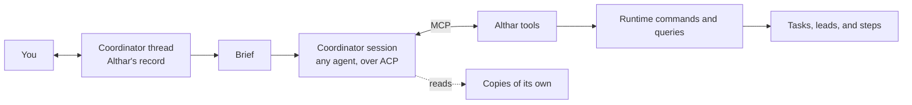

# Coordinator

## Decision

Each project has a coordinator: the agent you talk to about the project as a
whole. It plans work and hands it out. It never writes code.

> The coordinator is an ordinary agent session with Althar's tools and
> read-only access to the repositories. Althar keeps its conversation. The
> provider session is disposable.

See [ADR-004](../decisions/004-coordinator-is-an-agent-session.md).

## What it does

- answers questions about the project, its code, and its work;
- plans work, drafts tasks, and orders a batch of them;
- triages and refines tickets, once a tracker connector exists
  ([06](06-integrations-and-skills.md));
- recommends a lead model per task, with its reasons, from the models it can
  use now and what is known of each ([05](05-workflow-engine.md),
  [ADR-015](../decisions/015-coordinator-picks-models.md));
- shows a task's plan before it starts: steps, a model per step, optional
  steps, and a short countdown after which the plan starts on its own. In the
  MVP the plan is always one fixed graph with its choices filled in
  ([MVP plan](../plans/mvp.md)); composing a graph per task comes next;
- starts something small at once, without a plan (a mini task): trying
  something out, checking how something behaves. One lead it picks, no
  review, nothing outside the project when it is done, and no countdown
  (`start_task`). It is a plain task, in a worktree with no branch until its
  lead changes the repository, when its work goes on a branch of its own
  that stays on this Mac. It stays plain until the person asks its lead to
  make it a real change (`make_it_a_change`), which the coordinator hears of
  at its next turn
  ([ADR-035](../decisions/035-a-task-s-kind-is-read-from-what-it-has.md));
- runs the project for the person, with no agent, when they ask, and keeps how
  it runs when Althar can't tell (ADR-023);
- follows the work, and passes messages to a task's lead;
- keeps the project's notes: decisions the person makes in conversation that
  the code doesn't show, which every session of it starts with
  ([ADR-031](../decisions/031-coordinator-handed-over-before-it-fills.md));
- judges task permission requests when the project selects that mode, in a
  fresh read-only session using its agent and model, without delaying the
  conversation ([ADR-019](../decisions/019-coordinator-judges-permissions.md)).

It never edits a repository, installs or builds, or merges, even for a
one-line change. A change is always a task with a lead, and so is trying
something out that needs the project set up. Althar refuses the coordinator's
commands that change anything beyond its own copies, for its role, and its
brief says so, so it doesn't take that for the person saying no. What a task has built is in that task's worktree, so the coordinator
asks its lead to try it.

## Shape



The coordinator runs on the same adapter as every other agent
([03](03-agent-runtime-and-auth.md)). What makes it the coordinator is its
role: its brief, its tools, and its read-only rule.

## Read-only by construction

Read-only is enforced by what the coordinator can reach, not by its prompt,
in three layers ([ADR-004](../decisions/004-coordinator-is-an-agent-session.md)).
A reviewer, the other role that only reads, gets the same, but for what the
coordinator may run in copies of its own
([ADR-058](../decisions/058-the-coordinator-is-a-trusted-reader-in-copies-of-its-own.md)).

- It reads throwaway copies. Its working directory is an Althar-owned
  folder holding one copy per bound repository, detached at the default
  branch. Each is a repository of its own, whose git folder is made again
  for every turn: it borrows the person's repository's objects, and fetches
  only from a mirror of that repository's refs Althar keeps beside the
  folder, after Althar fetched the remote there. So its `git fetch`
  and `git tag` write only the copy, and nothing written there survives or
  reaches a task, nor is read by Althar's own git. A project with no
  repositories gets an empty folder. A reviewer reads a copy of the lead's
  worktree, snapshotted when its round begins, so it reads what the round is
  about even if the lead moves on, and the record keeps which code it was.
- The agent's own sandbox is read-only where it has one that still lets it
  call Althar's tools: Codex's `read-only` sandbox, and Claude Code with its
  edit tools denied and every shell command asking. The coordinator's Claude
  Code, where its sandbox can start, runs its commands in it without asking,
  held to its folder: writes only there, no network, no socket, reads none
  of the home folder, the person's checkouts or the task folders but its
  folder, the mirrors, the objects its copies borrow, the toolchains and
  git's config files (never its credential store), and never outside it;
  it loads no settings file and runs no hook. A command Claude Code can't
  read itself (a `for` loop, `$((…))`, `f=$(…)`, a heredoc) still asks, and
  Althar lets it run there without reading it
  ([ADR-071](../decisions/071-the-sandbox-is-the-boundary-anything-inside-it-runs.md));
  what it can't do the sandbox refuses, with its own error. The reader rules
  hold its own read and search tools to the same places. Claude
  Code's plan mode
  and OpenCode's plan agent would be simpler, but both refuse MCP tools.
  OpenCode has no sandbox yet, so for it the copy is the boundary.
- Where no sandbox holds it, Althar's reader rules are the backstop. They allow reads, searches and
  fetches, and commands that only look, each with the flags it may take (no
  `rg --pre`, `git -c`, `sort -o`). For the coordinator they also take
  `$(…)` whose commands only look, `uptime` and the like, and `git tag`
  listing. They refuse everything else with a reason, and never ask you.
  The reason reaches it in the refused call's own result, so no turn of its
  own follows its reply.
- Its only way to change anything is its tools. They issue the same commands
  the interface does: validated, recorded, idempotent, and never beyond your
  own authority.

## Althar tools

Althar gives the coordinator an MCP server at `session/new`. Names are
provisional.

| Tool | What it does | Kind |
|---|---|---|
| `project_overview` | Rules, repositories, notes | Read |
| `list_tasks`, `read_task` | Status, plan, steps, lead, and how its pull request stands: draft or ready, checks, unpushed commits, merged or closed, read from the same data as the task's card (never asked of the host; said as last seen where it may be stale or unknown). A task whose pull requests are all merged reads as finished; a closed one is said as last seen, since nothing watches it for reopening | Read |
| `find_tasks` | The project's tasks found by what they were about: words from a title, what the person asked, what a lead reported or built, a pull request's number, an issue's key, a branch or a file; best first, a line each with where it stands, its pull request, its id and what matched ([02](02-desktop-runtime.md#queries)) | Read |
| `read_thread` | A task's thread, or, without a task, its own conversation: the latest part, then further back a part at a time | Read |
| `read_change` | A task's diff and checks | Read |
| `read_pull_request` | Any of the project's pull requests, whoever opened it, by its number or link, as its host has it now: state, where it goes and whether it conflicts there, size, description, checks with the end of a failed one's log, and what everyone said on it, as data ([ADR-058](../decisions/058-the-coordinator-is-a-trusted-reader-in-copies-of-its-own.md)) | Read |
| `read_check_log` | A check's whole log on one of the project's pull requests, a page at a time ([ADR-041](../decisions/041-what-failed-said-in-full.md)) | Read |
| `rerun_check` | Runs a failed check on a pull request of the project's, or on the default branch's latest commit, once more: the one named, or each that failed. GitHub's Actions job, GitLab's pipeline job, Bitbucket Cloud's pipeline whole on the same commit; Bitbucket Data Center's builds are another service's, so it says whose and links the build ([ADR-081](../decisions/081-the-coordinator-acts-on-the-code-host-as-the-person-s-account-can.md)) | Command, undone in a step |
| `read_default_branch_checks` | The checks on a repository's default branch's latest commit, with the end of the first failed ones' logs | Read |
| `mark_ready`, `close_pull_request`, `reopen_pull_request` | Marks ready, closes unmerged, or opens again a pull request Althar opened, by its number or link. Each can be taken back in a step. Bitbucket Cloud can't reopen a declined one, so closing there waits for the person's word, and is refused until that is built; a pull request a person opened is theirs | Command, undone in a step |
| `reply_on_pull_request` | Replies, signed as from Althar, in a thread or a pull request's conversation: on one Althar opened, or whose author is the connected account or one of the repository's own people. An outside author's waits for the person's word, since the notification can't be taken back | Command, undone in a step |
| `push_tag` | Tags the commit the person's words name, or the default branch's latest, on any of the project's hosts; made by Althar, never forced. A tag already on that commit is done; one on another commit is refused unless they asked to move it; deleting one is asked for too ([ADR-081](../decisions/081-the-coordinator-acts-on-the-code-host-as-the-person-s-account-can.md#a-release)) | Asked-for |
| `read_release` | A tag's release as its host has it (GitHub's draft or published one, GitLab's release, Bitbucket's tag and Downloads), and the CI runs on the tag, with what each waits on and whose press it is, linked | Read |
| `approve_release_run` | Approves what a run on a tag waits on: GitHub's environment, GitLab's deployment approval or manual job. Where the account can't, or only the person can (Bitbucket's manual steps), it does nothing and says so with the host's button | Asked-for |
| `publish_release` | Publishes a tag's release as its host does: GitHub's draft made public, GitLab's release made, Bitbucket Cloud's files put in Downloads from the project's repository; Data Center's tag is the release | Asked-for |
| `rerun_failed_jobs` | Runs the failed jobs of a tag's newest failed run again: GitHub's and GitLab's jobs, Bitbucket Cloud's pipeline whole | Command, undone in a step |
| `read_release_steps` | How one of the project's repositories says it is released, from its CI files and release docs, to say as a line a step and keep as a project note | Read |
| `draft_task` | Creates a task in draft, with its repositories and intent: a title of a few words (at most 60 characters), and what the person last said to it kept as what they asked for, which the task's thread opens with and its lead reads | Command |
| `read_issue`, `find_issues` | An issue on a connected tracker or in the project's repository, and the person's open ones | Read |
| `draft_issue` | Drafts an issue on a connected tracker, as a card the person files, changes or discards; nothing is filed on its word ([06](06-integrations-and-skills.md#drafting-issues)) | Command |
| `list_models` | The models it can use now, by maker, with their scores and each one's efforts: the ids a step takes, the one it starts at by itself, and the person's default where they set one | Query |
| `propose_plan` | Steps, a model per step and, where it matters, an effort that model offers, optional steps. An effort it doesn't offer is refused with the ones it does; left out, the step starts at the person's default for the model, or else the model's own | Command |
| `start_task` | Drafts a mini task and starts it at once: one lead, at an effort as `propose_plan` takes one, no review, nothing outside the project when it is done; a plain task (a quick task), with no branch until its lead changes the repository, and then one that stays on this Mac | Command |
| `find_pull_requests` | The pull requests in the project's repositories, whoever opened them: open unless said, by author, words in the title, those asking the person's review, or drafts; at most 30 a repository, newest change first. A line each, with its title quoted as data and never its description, and whether Althar opened it (for which task) or a task reviews it already. Each host's list call (`CodeHost.listChanges`), read-only | Read |
| `review_pull_request` | Starts a review of someone else's pull request, by its link or its number in the project's repository, with the lead it picks: a task on a read-only copy of the pull request's head, whose lead drafts a review the person posts ([06](06-integrations-and-skills.md#reviewing-someone-elses-pull-request)). Asked again, the task still reviewing it; once that one is done, a new review | Command |
| `list_automations` | The project's automations on this computer: when each runs, what each run does, where it stands, and how its last run went ([ADR-061](../decisions/061-automations-start-ordinary-tasks-on-a-schedule.md)) | Read |
| `propose_automation`, `change_automation` | An automation as the person asked for it, or a change to one: a name, the prompt each run is asked, days and a time or every hour, the lead, and what each run ends in (nothing, a draft or ready pull request, or reviews of each new pull request). Each on a card in its thread; nothing runs until the person turns it on, and a change that reaches further needs them to turn it on again, with Undo | Command |
| `pause_automation` | Pauses one when the person says, since it only stops | Command |
| `resume_automation`, `run_automation_now` | A small card the person presses, since both spend their plan and the coordinator reads text from outside | Command |
| `rename_task` | Gives a task another title, as the person can, where its title no longer says what it does; its slug and branch stay, and what the person asked stays in its thread | Command |
| `make_it_a_change` | A lead's, not the coordinator's: offered only on a quick task not made a change yet, and refused, with why, on any other. Called when the person asks to turn what the lead made into a real thing: a title for what it does now, a reviewer named as `propose_plan` names one (none only where the person said so), and a pull request, a draft or ready for review. Makes its branch where it has none; renames the task and gives its plan, and the run under way, the review and the ending, or opens a round with them where its last run had ended; its thread and the coordinator's news say so. The lead's next `finish_step` goes through the review, then the pull request opens ([ADR-035](../decisions/035-a-task-s-kind-is-read-from-what-it-has.md)) | Command |
| `run_project` | Runs the project with no agent, its default or one of what it runs by name: the default branch in a copy of its own, or a task's worktree (ADR-023, ADR-044) | Command |
| `screenshot` | A picture of a page served on this computer, a run's or a dev server's, drawn offscreen by the desktop app at a viewport, whole or one element; leads have it too (ADR-057) | Read |
| `set_run_command` | Keeps how a repository runs, its own way to run, for Althar to run it; leads have it too (ADR-023) | Command |
| `keep_run` | Keeps something more for the project to run by a name and a command, or drops it; leads have it too (ADR-044) | Command |
| `order_tasks` | Orders a batch | Command |
| `message_lead` | Sends a message to a task's lead, queued or as an interrupt | Command |
| `keep_note`, `list_notes`, `drop_note` | The project's notes: a decision the person made, in a sentence; at most 40 (ADR-031) | Command |
| `recommend_lead` | Records a lead recommendation and its reasons | Command |

A lead's own tools, beside `finish_step` and its pull request's, do what its
sandbox would refuse, outside it (ADR-057): `install_dependencies` runs its
worktree's setup again; `run_project` and `stop_project` run the project in
its worktree, as the run the person sees; `screenshot`, as above; and
`rerun_check` runs checks on its pull request again (the coordinator's
runs them on any of the project's, and on the default branch). For checks that fail,
`read_default_branch_checks` reads those on its default branch's latest
commit, and `hand_checks_to_person` brings a failure that isn't the change's
to the person, with a line on why (ADR-070). `show_pictures` shows
the person pictures from its worktree in its thread at any time, a step open
or none, each with a caption: checked as `finish_step`'s screenshots are
(inside the worktree, what its name says it is, up to 20 MB), and kept in
the artifact store as they are, so they stay once the worktree goes. A
review's lead doesn't have it: its draft is what it hands the person.

The same server serves every session. The read tools are how a lead, a step,
or an agent that took over a task reads the record its brief left out. Command
tools are granted per role; a lead gets none of the coordinator's.

## Conversation and context

The conversation with you is Althar's record, kept in full with the
project. The provider session is a working copy of it.

The session is rebuilt from a brief ([03](03-agent-runtime-and-auth.md)) when:

- the coordinator is first opened;
- the app restarts and the agent can't load the old session;
- you switch the coordinator's agent;
- its context is filling up (below).

The coordinator's brief holds its instructions for the role and the
project's notes, then the thread as far as it fits. Older turns are read
through its tools.

### Handed to a fresh session before it fills

An agent left to fill its context compacts it by itself, at a moment of its
choosing, into a summary of its own, and a decision made only in
conversation may not survive it. So Althar hands the coordinator over first
([ADR-031](../decisions/031-coordinator-handed-over-before-it-fills.md)):

- **When.** Once the agent says its context is 80% full (`HANDOVER_AT`, from
  ACP's usage updates, as the composer's context ring shows it), between
  turns: after the turn it crossed in, or at once where it says so between
  turns. Never in a turn. The old session takes no more turns from then; what
  the person says meanwhile waits for the fresh one.
- **On what.** The same agent, account, model and effort. The fresh session
  is started first, and the old one stopped as superseded by it; one that
  can't start leaves the old one carrying on, its agent compacting by itself.
  So does a brief that would take 40% or more of a fresh session's context:
  it would be due again at once.
- **Its brief, from Althar's records rather than the raw thread:** its role,
  a line that it took over and should read earlier details with
  `read_thread`, `read_task` or the code rather than guess, the project as
  `project_overview` gives it, the notes, every open task (where it stands,
  who leads it and what waits on the person; for the newest 25, its plan and
  what its lead last reported too), and the conversation's last twelve
  messages, word for word. Each part is bounded; a message longer than a
  part comes in parts, so `read_thread` reaches all of it.
- **What the person sees:** a quiet line in the thread, "Started a fresh
  session; picked up 3 open tasks." The thread is Althar's record, so the
  whole conversation stays there to scroll.
- **What doesn't move:** plans in their countdown, held plans, drafts and
  running tasks are Althar's, not the session's, and carry on as they were.

### Notes

A decision the person makes in conversation that the code doesn't show, such
as "issue drafts need an approval card, on every tracker", is kept as one of
the project's notes, a sentence each, at most 40. The coordinator's brief
tells it to keep one when the person decides something like that, and to
drop one they take back; every brief of it holds them, and so does
`project_overview`. The person sees them in the project's settings, says
one in their own words, and removes what no longer holds. Each is a row
with its record; a removed one keeps its row.

### The compaction seam

Althar hands the coordinator over before its agent compacts, and a brief
uses the records, the notes, the last messages and the tools. Althar writes
no summaries yet.

Continuous compaction will write summaries as records:

```ts
type ThreadSummary = {
  id: string
  threadId: string
  coversFromSequence: number
  coversToSequence: number
  artifactId: string
  writtenBy: string // agent and model
  createdAt: string
}
```

A brief then uses the latest summaries for what came before its verbatim
turns. The interface can show older conversation at lower detail from the
same records. Nothing else needs to change for this to arrive.

## Task events

Task status changes reach the coordinator thread as task cards that Althar
posts, a projection of task facts. The coordinator agent doesn't write them.

In the MVP the coordinator agent is prompted only by your messages. It reads
task state through its tools when it needs it. Whether it is also prompted
when a batch it planned needs its next task is open.

## Agent, model, and usage

- The coordinator can run on any agent, and switches like a lead: the new
  agent takes over the whole thread.
- It is always on and runs on your plan, so its default model matters for
  cost. Which default is open.
- When its account runs out, it switches under the project rule like any
  session. Tasks keep running; the coordinator never blocks a task.

## One per project, then one per person

In the MVP there is one coordinator per project, on this device. Later, each
developer has their own coordinator, with its own thread and session, reading
the shared project state ([07](07-persistence-security-and-cloud.md)). Nothing
in the tools assumes one coordinator: every command carries its actor.

## Open questions

- Its default model.
- Whether task events prompt it, and which.
- When continuous compaction summarises, and with which model.

## Verification gates

- The coordinator cannot change a repository even if its agent tries.
- Every tool call is a recorded, idempotent command with an actor.
- Rebuilding the session loses no turn of the thread.
- A handover happens between turns, never in one, and leaves plans, drafts
  and running tasks as they were.
- Switching the coordinator's agent keeps the thread.
- A coordinator out of usage pauses no task.

## The person's word and errands

The host records each message's sender on the connection: `window`,
`paired_device` (with its device id), `socket`, or `internal`. A client never
supplies its own authority in a message payload. Free text supplied with an
`AnswerStuck` tell keeps that connection’s sender,
including while waiting for capacity. Generated quiet notices from Changes,
Reviews and IssueChanges, and structured question-answer summaries, remain
system input: they report a decision rather than authorizing another action.
New RPC calls are refused to a socket until the contract marks them
`SocketAllowed` (ADR-048).
Permission answers and widening rules remain the person's calls.

Each delivered turn records `person`, `news`, or `system` as its origin.
`Sessions.send` accepts an explicit `origin: 'news'` for a quiet wake.
`ToolAccess` exposes `byPerson`, `origin`, `turnId` and the person's message
ids, resolved from the live delivery on every call. The `TurnStarted.byPerson`
signal also retains shown messages for the stall watch; it is not tool
authorization. A session's old messages, a socket's visible message, and a
caller-supplied `byPerson` cannot authorize
a new action. `read_turn` gives the agent the same facts.

`Errands` owns durable ordered steps. `keep_errand` requires a person's
message in the live turn and keeps its exact words and id, each tool and its
semantic arguments, target, head, target branch, task and waits. Kept, paused,
resumed and completed errands leave lines in the thread. Task cards show the
open wait, and fresh coordinator and lead briefs include the open records.
`read_errands` reads the complete steps. Resuming records the fresh message
separately, preserving the original request. An objection uses `pause_errand`;
only fresh word can resume or cancel. The shared change sweep reports a day
without news, or a `required-check-missing` wait whose `since` marks an hour
after the other checks finished, at most once a day. The news watch can read
`errand_steps.waits` and must call `Errands.news(id)` on every poll change
touching an errand’s targets. This refreshes the no-news clock only; it does
not inspect targets or end errands. The news task must also wake the owning
thread for a fresh read when another writer pushes or a target closes, merges
or leaves its queue. Until that watch is connected, those changes are detected
only by the next attempted step, and the no-news clock runs from keep/resume.

An acting tool declares `kind: 'asked-for'` and supplies an `AskedAction`
instead of an ordinary call. The shared tool server owns its authorization,
fresh read and mutation receipt. It accepts a person's message id from this
turn or an exact open errand step in this thread. Steps run in order. A read
reporting an objection pauses the errand; another writer, a changed target
branch or someone else settling the target ends it. A head that moved is
refused, except an errand's head moved by the task's lead or Althar, which the
action receives from that fresh read. A tool binding a branch must return
that branch in its read: omitting it refuses this attempt and leaves the
errand open.

The same tool, target, head, branch and semantic request share a serialized
receipt across messages, errands and sessions. Include an observed task
revision or operation generation in the request where the same operation may
legitimately recur. An action may fail with `ActionNotPerformed` only with
positive proof it neither happened nor remains in flight (such as a host’s definite refusal).
That receipt is failed and permits retry after another fresh read. Every other
`ToolRefused` from the action is conservatively treated as a lost answer.
A lost answer or `{ pending: true, answer }` stays uncertain. Only a read proving it done confirms it; only `absent`, positive
proof it neither happened nor remains in flight, permits another attempt.
A confirmed receipt repairs an interrupted completion and its chat line
without acting again. Host-specific reads and acting tools are later parts
of ADR-081; this foundation is shared by every host and agent.
