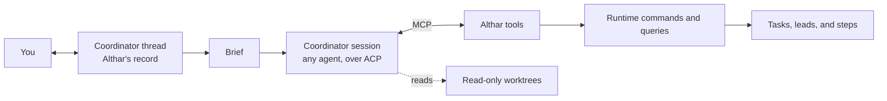

# Coordinator

## Decision

Each project has a coordinator: the agent you talk to about the project as a
whole. It plans work and hands it out. It never writes code.

> The coordinator is an ordinary agent session with Althar's tools and
> read-only access to the repositories. Althar keeps its conversation. The
> provider session is disposable.

See [ADR-004](../decisions/004-coordinator-is-an-agent-session.md).

## What it does

- answers questions about the project, its code, and its work;
- plans work, drafts tasks, and orders a batch of them;
- triages and refines tickets, once a tracker connector exists
  ([06](06-integrations-and-skills.md));
- recommends a lead model per task, with its reasons, from the models it can
  use now and what is known of each ([05](05-workflow-engine.md),
  [ADR-015](../decisions/015-coordinator-picks-models.md));
- shows a task's plan before it starts: steps, a model per step, optional
  steps, and a short countdown after which the plan starts on its own. In the
  MVP the plan is always one fixed graph with its choices filled in
  ([MVP plan](../plans/mvp.md)); composing a graph per task comes next;
- starts something small at once, without a plan (a mini task): trying
  something out, checking how something behaves. One lead it picks, no
  review, nothing outside the project when it is done, and no countdown
  (`start_task`). It is a plain task, in a worktree with no branch until its
  lead changes the repository; then it is a change on its branch, which the
  coordinator hears of at its next turn and retitles where its title no
  longer says what it does (`rename_task`,
  [ADR-035](../decisions/035-a-task-s-kind-is-read-from-what-it-has.md));
- runs the project for the person, with no agent, when they ask, and keeps how
  it runs when Althar can't tell (ADR-023);
- follows the work, and passes messages to a task's lead;
- keeps the project's notes: decisions the person makes in conversation that
  the code doesn't show, which every session of it starts with
  ([ADR-031](../decisions/031-coordinator-handed-over-before-it-fills.md));
- judges task permission requests when the project selects that mode, in a
  fresh read-only session using its agent and model, without delaying the
  conversation ([ADR-019](../decisions/019-coordinator-judges-permissions.md)).

It never edits a repository, runs builds or tests, or merges, even for a
one-line change. A change is always a task with a lead, and so is trying
something out. Althar refuses the coordinator's commands that change anything,
for its role, and its brief says so, so it doesn't take that for the person
saying no. What a task has built is in that task's worktree, so the coordinator
asks its lead to try it.

## Shape



The coordinator runs on the same adapter as every other agent
([03](03-agent-runtime-and-auth.md)). What makes it the coordinator is its
role: its brief, its tools, and its read-only rule.

## Read-only by construction

Read-only is enforced by what the coordinator can reach, not by its prompt,
in three layers ([ADR-004](../decisions/004-coordinator-is-an-agent-session.md)).
A reviewer, the other role that only reads, gets the same.

- It reads throwaway copies. Its working directory is an Althar-owned
  folder holding one worktree per bound repository, detached at the default
  branch. They are refreshed from the remote's default branch when you start
  a turn, so nothing written there survives or reaches a task. A project with
  no repositories gets an empty folder. A reviewer reads a copy of the lead's
  worktree, snapshotted when its round begins, so it reads what the round is
  about even if the lead moves on, and the record keeps which code it was.
- The agent's own sandbox is read-only where it has one that still lets it
  call Althar's tools: Codex's `read-only` sandbox, and Claude Code with its
  edit tools denied (which also denies its sandbox's writes) and every shell
  command asking. Claude Code's plan mode and OpenCode's plan agent would be
  simpler, but both refuse MCP tools. OpenCode has no sandbox yet, so for it
  the copy is the boundary.
- Althar's reader rules are the backstop. They allow reads, searches and
  fetches, and commands that only look, each with the flags it may take (no
  `rg --pre`, `git -c`, `sort -o`). They refuse everything else with a reason,
  and never ask you.
- Its only way to change anything is its tools. They issue the same commands
  the interface does: validated, recorded, idempotent, and never beyond your
  own authority.

## Althar tools

Althar gives the coordinator an MCP server at `session/new`. Names are
provisional.

| Tool | What it does | Kind |
|---|---|---|
| `project_overview` | Rules, repositories, notes | Read |
| `list_tasks`, `read_task` | Status, plan, steps, lead, and how its pull request stands: draft or ready, checks, unpushed commits, merged or closed, read from the same data as the task's card (never asked of the host; said as last seen where it may be stale or unknown). A task whose pull requests are all merged reads as finished; a closed one is said as last seen, since nothing watches it for reopening | Read |
| `find_tasks` | The project's tasks found by what they were about: words from a title, what the person asked, what a lead reported or built, a pull request's number, an issue's key, a branch or a file; best first, a line each with where it stands, its pull request, its id and what matched ([02](02-desktop-runtime.md#queries)) | Read |
| `read_thread` | A task's thread, or, without a task, its own conversation: the latest part, then further back a part at a time | Read |
| `read_change` | A task's diff and checks | Read |
| `draft_task` | Creates a task in draft, with its repositories and intent: a title of a few words (at most 60 characters), and what the person last said to it kept as what they asked for, which the task's thread opens with and its lead reads | Command |
| `read_issue`, `find_issues` | An issue on a connected tracker or in the project's repository, and the person's open ones | Read |
| `draft_issue` | Drafts an issue on a connected tracker, as a card the person files, changes or discards; nothing is filed on its word ([06](06-integrations-and-skills.md#drafting-issues)) | Command |
| `list_models` | The models it can use now, by maker, with their scores and each one's efforts: the ids a step takes, the one it starts at by itself, and the person's default where they set one | Query |
| `propose_plan` | Steps, a model per step and, where it matters, an effort that model offers, optional steps. An effort it doesn't offer is refused with the ones it does; left out, the step starts at the person's default for the model, or else the model's own | Command |
| `start_task` | Drafts a mini task and starts it at once: one lead, at an effort as `propose_plan` takes one, no review, nothing outside the project when it is done; a plain task, with no branch until its lead changes the repository | Command |
| `rename_task` | Gives a task another title, as the person can, for one whose work became a change; its slug and branch stay, and what the person asked stays in its thread | Command |
| `run_project` | Runs the project with no agent: the default branch in a copy of its own, or a task's worktree (ADR-023) | Command |
| `set_run_command` | Keeps how the project runs, for Althar to run it; leads have it too (ADR-023) | Command |
| `order_tasks` | Orders a batch | Command |
| `message_lead` | Sends a message to a task's lead, queued or as an interrupt | Command |
| `keep_note`, `list_notes`, `drop_note` | The project's notes: a decision the person made, in a sentence; at most 40 (ADR-031) | Command |
| `recommend_lead` | Records a lead recommendation and its reasons | Command |

The same server serves every session. The read tools are how a lead, a step,
or an agent that took over a task reads the record its brief left out. Command
tools are granted per role; a lead gets none of the coordinator's.

## Conversation and context

The conversation with you is Althar's record, kept in full with the
project. The provider session is a working copy of it.

The session is rebuilt from a brief ([03](03-agent-runtime-and-auth.md)) when:

- the coordinator is first opened;
- the app restarts and the agent can't load the old session;
- you switch the coordinator's agent;
- its context is filling up (below).

The coordinator's brief holds its instructions for the role and the
project's notes, then the thread as far as it fits. Older turns are read
through its tools.

### Handed to a fresh session before it fills

An agent left to fill its context compacts it by itself, at a moment of its
choosing, into a summary of its own, and a decision made only in
conversation may not survive it. So Althar hands the coordinator over first
([ADR-031](../decisions/031-coordinator-handed-over-before-it-fills.md)):

- **When.** Once the agent says its context is 80% full (`HANDOVER_AT`, from
  ACP's usage updates, as the composer's context ring shows it), between
  turns: after the turn it crossed in, or at once where it says so between
  turns. Never in a turn. The old session takes no more turns from then; what
  the person says meanwhile waits for the fresh one.
- **On what.** The same agent, account, model and effort. The fresh session
  is started first, and the old one stopped as superseded by it; one that
  can't start leaves the old one carrying on, its agent compacting by itself.
  So does a brief that would take 40% or more of a fresh session's context:
  it would be due again at once.
- **Its brief, from Althar's records rather than the raw thread:** its role,
  a line that it took over and should read earlier details with
  `read_thread`, `read_task` or the code rather than guess, the project as
  `project_overview` gives it, the notes, every open task (where it stands,
  who leads it and what waits on the person; for the newest 25, its plan and
  what its lead last reported too), and the conversation's last twelve
  messages, word for word. Each part is bounded; a message longer than a
  part comes in parts, so `read_thread` reaches all of it.
- **What the person sees:** a quiet line in the thread, "Started a fresh
  session; picked up 3 open tasks." The thread is Althar's record, so the
  whole conversation stays there to scroll.
- **What doesn't move:** plans in their countdown, held plans, drafts and
  running tasks are Althar's, not the session's, and carry on as they were.

### Notes

A decision the person makes in conversation that the code doesn't show, such
as "issue drafts need an approval card, on every tracker", is kept as one of
the project's notes, a sentence each, at most 40. The coordinator's brief
tells it to keep one when the person decides something like that, and to
drop one they take back; every brief of it holds them, and so does
`project_overview`. The person sees them in the project's settings, and
removes what no longer holds. Each is a row with its record; a removed one
keeps its row.

### The compaction seam

Althar hands the coordinator over before its agent compacts, and a brief
uses the records, the notes, the last messages and the tools. Althar writes
no summaries yet.

Continuous compaction will write summaries as records:

```ts
type ThreadSummary = {
  id: string
  threadId: string
  coversFromSequence: number
  coversToSequence: number
  artifactId: string
  writtenBy: string // agent and model
  createdAt: string
}
```

A brief then uses the latest summaries for what came before its verbatim
turns. The interface can show older conversation at lower detail from the
same records. Nothing else needs to change for this to arrive.

## Task events

Task status changes reach the coordinator thread as task cards that Althar
posts, a projection of task facts. The coordinator agent doesn't write them.

In the MVP the coordinator agent is prompted only by your messages. It reads
task state through its tools when it needs it. Whether it is also prompted
when a batch it planned needs its next task is open.

## Agent, model, and usage

- The coordinator can run on any agent, and switches like a lead: the new
  agent takes over the whole thread.
- It is always on and runs on your plan, so its default model matters for
  cost. Which default is open.
- When its account runs out, it switches under the project rule like any
  session. Tasks keep running; the coordinator never blocks a task.

## One per project, then one per person

In the MVP there is one coordinator per project, on this device. Later, each
developer has their own coordinator, with its own thread and session, reading
the shared project state ([07](07-persistence-security-and-cloud.md)). Nothing
in the tools assumes one coordinator: every command carries its actor.

## Open questions

- Its default model.
- Whether task events prompt it, and which.
- When continuous compaction summarises, and with which model.

## Verification gates

- The coordinator cannot change a repository even if its agent tries.
- Every tool call is a recorded, idempotent command with an actor.
- Rebuilding the session loses no turn of the thread.
- A handover happens between turns, never in one, and leaves plans, drafts
  and running tasks as they were.
- Switching the coordinator's agent keeps the thread.
- A coordinator out of usage pauses no task.
