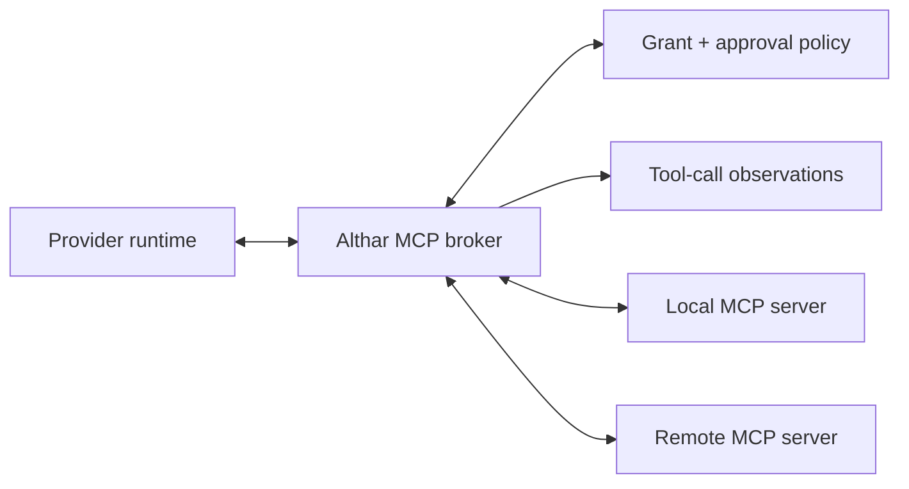

# Integrations and Skills

## Architectural decision

“Integration” currently hides four different architectural relationships.
Althar must model them separately:

| Plane | Purpose | Examples | Authority |
|---|---|---|---|
| `AgentConnection` | Execute agent work | Claude Code, Codex, OpenCode over ACP | Provider owns its session; Althar owns the run |
| `DomainConnector` | Synchronize durable business/domain state | GitHub/GitLab, Linear, Jira | External system owns its resources; Althar owns mappings and workflow state |
| `MCPConnection` | Expose callable tools and resources to an agent | Search, databases, SaaS actions | Tool server owns operation; Althar owns grant and audit |
| `SkillPackage` | Supply procedural knowledge and supporting resources | Review workflow, migration playbook | Package author owns content; Althar owns resolution and permission policy |

Combining these behind a generic “plugin” interface would erase their different
lifecycles, authentication, retry semantics, security boundaries, and UX.

## Domain connector model

A `DomainConnector` handles durable reconciliation with a known external
system. It is appropriate when Althar needs:

- background or resumable synchronization;
- stable mappings between external and internal resources;
- webhooks or cursors;
- field ownership and conflict policy;
- outbound idempotency;
- mutation receipts;
- reconciliation after unknown outcomes;
- first-class product UI.

Core entities:

```ts
type IntegrationConnection = {
  id: string
  provider: "github" | "gitlab" | "linear" | "jira" | string
  accountId: string
  installationId?: string
  principalId: string
  credentialRefId: string
  capabilities: string[]
  status: "ready" | "reauth_required" | "degraded" | "revoked"
  policyRevision: number
}

type ExternalResourceBinding = {
  id: string
  connectionId: string
  projectId: string
  externalType: string
  externalId: string
  externalUrl?: string
  localType: string
  localId: string
  mappingRevision: number
}

type ExternalMutationReceipt = {
  id: string
  commandId: string
  connectionId: string
  externalOperation: string
  idempotencyKey?: string
  requestDigest: string
  externalRequestId?: string
  status: "accepted" | "confirmed" | "rejected" | "unknown"
  observedAt: string
}
```

Also persist:

- `ExternalIdentity` for actor/user mapping;
- `SyncCursor` for pull-based checkpoints;
- `WebhookSubscription` and expiry when applicable;
- `ExternalObservation` for source-stamped inbound facts;
- `ReconciliationIssue` for divergence requiring policy or human input.

## Synchronization semantics

Every connector defines a field-ownership table before it writes externally.

Example:

| Field | Authority | Inbound behavior | Outbound behavior |
|---|---|---|---|
| Issue title | External tracker by default | Update projection and record source revision | Only explicit user/workflow mutation |
| Althar run status | Althar | Never overwritten by tracker | Optionally summarized into a dedicated external field/comment |
| Assignee | Configured per project | Import and map external identity | Require mapping and permission |
| Workflow evidence | Althar artifacts | External links become observations | Publish a link/summary, not canonical bytes |
| External issue state | Tracker | Cursor/webhook observation | Idempotent requested transition |

“Bidirectional sync” without field ownership is a loop generator, not a
feature.

### Inbound path

1. Verify webhook signature, timestamp, tenant, and subscription identity.
2. Deduplicate by provider delivery ID plus payload digest.
3. Persist the raw metadata required for audit, with secret/body redaction.
4. Convert into provider-stamped observations.
5. Apply the connector's mapping and field-ownership policy in one command.
6. Advance the cursor/subscription checkpoint only after commit.
7. Reconcile periodically because webhooks can be delayed, duplicated, or
   missed.

### Outbound path

1. Create an Althar command and durable mutation intent.
2. Evaluate actor, connection, project, and field-level policy.
3. Attach a provider-supported idempotency key where available.
4. Perform the network operation outside the database transaction.
5. Store the response/request ID and a mutation receipt.
6. Confirm via read-after-write or later inbound observation.
7. If the response is lost, classify the effect `unknown` and reconcile before
   retrying a non-idempotent action.

Outbound comments and descriptions include a stable origin marker in metadata
where supported. Inbound processing recognizes that marker to prevent echo
loops without ignoring legitimate human edits.

### Backpressure and rate limits

Connectors use:

- per-connection queues and concurrency limits;
- provider retry/reset hints;
- exponential backoff with jitter;
- bounded batch sizes;
- priority for interactive actions over background hydration;
- circuit breakers for authentication and systemic failures;
- a visible `next attempt` and manual retry;
- no tight polling loop.

Rate-limit state is operational data, not a reason to mutate project truth.

## Local versus cloud ingress

A local desktop application cannot reliably receive public webhooks while it is
offline, behind NAT, or closed.

The local MVP therefore uses:

- explicit refresh;
- refresh on project open;
- incremental cursor-based pull while the application is running, of what
  something listens to (a task's pull requests until it settles), with each
  service's cheapest form of "anything new?" (GitHub's conditional requests,
  an updated-since cursor elsewhere);
- provider-native local callbacks solely for documented auth flows.

It does not silently create a public tunnel.

A cloud deployment adds a public webhook ingress that:

- verifies and durably queues deliveries before acknowledgement;
- resolves tenant and connection;
- deduplicates/replays safely;
- fans into canonical cloud commands;
- notifies or leases work to local runners where needed.

Webhook availability does not make the external system Althar's command
authority.

## Code hosts and trackers

Code hosts and trackers are `DomainConnector`s of Althar's own, on each
service's API, never MCP wrappers
([ADR-011](../decisions/011-own-connectors-for-hosts-and-trackers.md)). There
are two models, a code host and a tracker. Each has one adapter per *product*,
not per brand: Bitbucket Cloud and Bitbucket Data Center are different APIs,
and so are Jira Cloud and Jira Data Center. Each adapter declares its
capabilities; screens and agents' tools offer only what it has, in the
service's own words ("merge request !12" on GitLab, "pull request #12"
elsewhere). Each model has a fake, which tests and the desktop's end-to-end
suite use, and a contract suite that runs against the fake in CI and against
real accounts on demand, as the agents' does.

Both models were laid against all six services before any adapter was
written. A model whose terms only one service has is a sign it is that
service's model.

### Code hosts

| | GitHub (and Enterprise Server) | GitLab (and self-managed) | Bitbucket Cloud | Bitbucket Data Center | The model |
|---|---|---|---|---|---|
| Repository | `owner/name` | Nested groups, `a/b/c/project`, and a numeric id | `workspace/repo_slug` | `PROJECT/repo_slug` | A path of segments, plus the host's own id |
| The change | Pull request #12 | Merge request !12 (`iid`, per project) | Pull request #12 | Pull request #12 | A number; the adapter gives the words |
| Draft | Every repository. Marked ready over GraphQL only | `Draft:` in the title | A `draft` flag | 8.18 and later | Capability `drafts` |
| State | open, closed, merged | opened, closed, merged, locked | open, merged, declined, superseded | open, merged, declined | open, merged, closed |
| Verdict | Approved, changes requested, commented | Approved, requested changes | Approved, request changes | Approved, needs work | approved, changes requested, commented |
| Threads | Review threads on lines, resolvable; conversation comments aren't | Discussions, resolvable | Top-level comments resolvable | Threads, resolvable; blocker comments | A thread: optional place in the diff, resolvable, resolved, comments |
| Checks | Check runs and commit statuses; Actions logs | The head pipeline's jobs, with logs | Build statuses; Pipelines step logs | Build statuses; Code Insights reports | A check: name, state, link; logs as a capability |
| Listening, polling | ETags (a "not modified" reply is free) | ETags too; a merge request's threads are read whole, having no `updated_after` | `updated_on` | The pull request's activities | A cursor per thing listened to |

- **Pushing is git** (ADR-016). Where the host is connected, Althar's own
  steps push with the connection's token, never the person's credential
  helper. Althar pushes what the lead committed and commits
  nothing itself; a step that ends in a push isn't done while the worktree
  has uncommitted files, so the lead commits what belongs to the task and
  clears away the rest. The record keeps the commit pushed.
- **A pull request is described in the repository's template,** where it
  has one in the places its host looks (GitHub's
  `pull_request_template.md`, GitLab's default merge request template,
  Bitbucket Cloud's). The lead writes the description in it, as a teammate
  would; Althar asks it to before the step can end. Althar keeps the
  template's headings and checklists, unticks every box, and adds the
  review below. A description that drops the template is replaced by the
  template with the lead's summary in its place for one. Templates kept
  elsewhere (an organisation's `.github` repository, a host's settings)
  aren't read yet.
- **What leaves the Mac is credited to the person, and to Althar.** Agents
  sign their commits in their own ways (a `Co-authored-by` trailer, a
  "Generated with" footer), and only Althar sees every agent's commits on
  their way out, so it is Althar that takes those lines out, whichever agent
  made them.
  - Before each push, and before a merge here, the branch's own commits that
    are nowhere else yet are made again with the agents' lines out. Nowhere
    else means: on no other branch, tag or remote here, not on the remote's
    branch (Althar asks the remote, since it pushes by address and keeps no
    remote branches), and not sent by Althar before. Only the branch's own
    line is made again, and only the person's commits on it: agents commit
    as the person, so a commit made as anyone else came from elsewhere and
    keeps its credit. Where one of those would have to move, the branch goes
    as it is.
  - Unless the person turned it off in Settings, Althar's own trailer goes
    in: its GitHub account, by that account's private address, so the host
    shows its picture. The person stays the author, and the pull request's
    description says Althar opened it only while that is on.
  - An agent's line is known by name and address together: a name like an
    agent's or a model's at a machine's address. On GitHub's private
    addresses the account decides, so a person called Claude keeps their
    credit there too.
  - Althar remembers each commit it makes again, and what from, as it makes
    it: what it made is never made again, and the same commit always goes
    the same way, signed or not, whatever the setting says by then. A commit
    is made again from its tree, parents, people, dates and message, and
    signed where the person has git sign their commits, or where it was
    signed. One that making again would spoil (a message in another
    encoding, a signed tag merged) leaves the branch as it is.
  - The branch moves onto the new commits only once they are pushed or
    merged, only from where it was, and never while a rebase, merge or
    cherry-pick is under way in the worktree. Where an agent committed meanwhile, its commits are credited
    onto what was sent. The commit the person saw counts as seen in either
    form.
- **After the first push, pushing is the person's.** When a plan's steps are
  done, Althar pushes the branch and opens the pull request. What the lead
  commits after, answering the person, a review or failed checks, waits on the
  task's branch until the person has looked at it and pushes it: the task
  says how many commits aren't on the pull request yet, and Push pushes up to
  the commit they saw, never one the lead made since. The lead has no tool to
  push. One exception (ADR-030): where the project has its leads resolve
  conflicts, Althar pushes the merge that resolves one, and a fix for checks
  that fail on it, and nothing with them (Resolving a conflict, below).
- **Without a connection, the person pushes the task's branch with their own
  git** (ADR-016): to the remote that repository's work goes to (the one its
  default branch follows, else `origin`, else its only remote), under the
  branch's name, up to the commit they saw, never forced, a prompt for a
  password failing rather than waiting. The task says whether the remote has
  the branch and how many commits it doesn't have, and links to the host's
  page for a new pull request from it where that can be told (GitHub, GitLab,
  Bitbucket; a GitLab, Gitea or Forgejo of a team's own by its name). Once
  something is pushed to a host Althar knows but isn't connected to, the task
  says what connecting would add: the pull request opened by Althar, its
  checks and reviews back to the lead, the merge on accept. Nothing is said
  of connecting before then; the project's settings always have Connect.
- **A repository without a pull request merges here, as the person says.**
  Where a task ended on its branch (no host Althar knows, a host not
  connected, or "push the branch only"), the person can merge it into each
  of its repositories' default branches on this Mac, up to the commit they
  saw in each. In a task of several, the ones with a pull request merge
  through it, and the button names the others ("Merge tools into main").
  - It is worked out for every repository first, without any working tree,
    so a conflict anywhere merges nothing and says which files.
  - The default branch then moves: as a ref where nothing has it checked
    out, or by a fast-forward in the working tree that has it. That needs
    nothing uncommitted there, and no file git doesn't track where the merge
    puts one, so the person's own work is never touched.
  - Refs move first and checkouts last. A checkout that refuses anyway
    (something written there since) puts back what moved, so it is all or
    none.
  - Nothing is pushed by the merge. Once merged, the task says whether each
    default branch's remote has it yet, and Push sends it there with the
    person's own git sign-in (their keychain or SSH agent), as they would from
    a terminal; a prompt for a password fails rather than waits. A remote that
    has moved on refuses, and the task says to pull first.
  - A conflict with the default branch offers to have the lead resolve it: a
    note to the lead naming the files, sent as the person's own message, to
    merge the default branch into its branch, settle each conflict, and
    commit. The person merges again after. Where the project's rules say so,
    Althar asks the lead itself, in the same words, and the merge says the
    lead is resolving it (Resolving a conflict, below).
- **A task is done once each of its repositories is merged:** its pull
  request merged, or, where it has none, its branch in its default branch
  here. A pull request closed without merging keeps the task open. Until
  then, the thread says which is still open.
- **Merging is the person's.** The model has `merge`, and Althar calls it
  only when the person accepts the change (from the board, or the task),
  never on an agent's word: the rules refuse agents' merges. A draft is
  marked ready first, and only the head Althar last read is merged, in the
  first way the repository allows.
- **A repository's host** is found from its remote URL, matched against
  known hosts and the instances the person has connected.

**Listening to a pull request** while the app runs:

- **Asked often while it's busy,** every 30 seconds, and every five minutes
  once nothing has happened on it for ten. Each call is conditional where the
  host allows (GitHub's ETags: a "not modified" reply doesn't count against
  its rate limit).
- **Everything arrives in the task's thread,** once: comments, reviews,
  checks finishing, merged, closed, marked ready. Bots aside.
- **Only some of it reaches the lead.** Failed checks do, with the end of
  their logs: the lead fixes and commits, and the person pushes. So do comments and reviews from the person and from people who
  can write to the repository (GitHub's owners, members and collaborators).
  On a public repository anyone can comment, so what anyone else says stays in
  the thread, marked as not passed on, for the person to pass on in their own
  name. Reading the pull request, the lead sees the same, and how much was
  left out.
- **Althar's own replies** are known by their receipts, not by who posted
  them: they go up under the person's account, which is also where the
  person comments. Each says it came from Althar, and which agent wrote
  it.
- **A pull request that conflicts with its target** is read from the host,
  once it has worked it out: GitHub's mergeable state, GitLab's merge
  status, Bitbucket Data Center's merge result. Bitbucket Cloud doesn't say.

**Resolving a conflict, where the project says so** (ADR-030). A project's
rules can have its leads resolve a conflict with the default branch on their
own, switched by "Resolve conflicts automatically" in its settings. Off, a conflict waits
for the person, as above.

- **A task can say otherwise.** Its ⋯ menu offers "Resolve conflicts
  automatically": use the project setting, on for this task, or off for it. It is
  kept on the task; where it differs from the project's, a quiet word beside
  the menu says so, and otherwise nothing shows. Each conflict found goes by
  what the task and its project say then, and the lead's brief by what they
  said as it started.
- **Turned on, it acts at once.** The project's switch going on, or a task's
  menu where the task wasn't resolving its conflicts, has Althar look at
  each open task with a branch here, rather than waiting for a new
  conflict: its repositories merging here are merged with their default
  branches without anything moving, whatever the person's own checkout
  holds, and a conflict starts a round as a Merge pressed would; its
  listened pull requests are asked about now, and one whose host says it
  conflicts starts one as ever. The rules below hold for each: a run that
  succeeded, one round at a time, and the same push. Turned off, a round
  under way carries on; the next conflict waits for the person.

- **Found either way, asked the same way.** A merge here that conflicts, or
  a pull request its host says conflicts, has Althar send the lead the note
  the person's press would, unasked: merge the default branch into the
  task's branch, settle each conflict so both sides' changes hold, run the
  checks, and commit the merge. For a pull request, Althar first fetches the
  branch it goes into, under the remote's name (`origin/main`, or
  `upstream/main` into the repository a fork came from), and asks only where
  the task's branch conflicts with it here too; one that merges cleanly is
  from before the target moved, or merged already and not yet pushed. A
  lead that isn't running is started, on the agent last on the thread.
- **Only where the task is open and its run succeeded,** and one round at a
  time: not while the run runs, nor where the person stopped it, which an
  agent starting would go against. The thread says Althar asked, and why:
  the project's rules, or the task's own say. A merge here pressed
  meanwhile says the lead is resolving it.
- **Althar looks at the branch, not at what the lead said,** once its turn
  is over: not while more waits for it, or while it asks the person
  something. Resolved means the branch it conflicted with is in it, nothing
  is half merged, and no file it conflicted in still has markers.
- **Not resolved, it is asked once more,** with why. Then, or where the
  person stopped it, it is the person's: the thread says why, the task is
  back in Needs you, and merging again offers the person's press, as before,
  until the branch moves.
- **No review round.** The checks are enough: the lead runs them and fixes
  what they find before it commits the merge, so the fix is in it; on a pull
  request, the host's run on what Althar pushes.
- **On a pull request, Althar pushes the resolution itself** with the
  connection, the one push of the lead's work that isn't the person's: the
  merge alone, made on the branch as the pull request had it. Where the
  branch had other commits the pull request didn't, the lead committed
  anything after the merge, something else came in, or anyone else asked
  the lead something meanwhile, nothing is pushed: the thread says the
  merge waits, and the task's Push sends it with the rest. Merging stays
  the person's.
- **The round follows the checks on what Althar pushed.** Passed (or none
  two minutes after the push), it is done, and the task is ready to merge.
  Failed, the lead is asked to fix them within the round, not as failed
  checks usually reach it: one commit on top of the merge, with nobody else
  asking it anything meanwhile, is pushed in turn, and its checks heard the
  same way. More than one, such as other work after the fix, waits for the
  person's Push. The fix counts as the lead's one more try, so checks that
  fail after it, or on a merge that took two tries, make the round the
  person's. Where the lead committed anything else since the push, the pull
  request moved on past it, or it was merged or closed, the round is over,
  and what comes after is as ever.
- **Stopping is the person's say.** Where the person stops or interrupts
  the lead, or stops the task, a round under way is theirs: nothing more is
  pushed for it, and checks that fail after don't ask the lead again. A
  message sent to interrupt it is the person talking to the lead, not taking
  the conflict over, and the round goes on. Stopping listening to
  the pull request ends its round too, since nothing there is heard; Althar
  does the same, as it starts, for a round left waiting on a pull request it
  no longer listens to.
- **The lead never pushes,** here as anywhere (Agents and the hosts, below).
  Its brief says what Althar pushes for it where the task, or else its
  project, has it resolve conflicts.
- **A round under way when Althar stopped** is looked at as it starts again,
  by what the branch holds, and is the person's if it isn't resolved.

### Trackers

| | Linear | Jira (Cloud, Data Center) | Trello | GitHub and GitLab issues | The model |
|---|---|---|---|---|---|
| Where issues live | Team (key `MER`), project, cycle | Project (key), board, sprint, epic | Board, list | Repository or project | A container, by the tracker's name for it |
| Key | `MER-231` | `PROJ-123` | Card short link | `#123` | The tracker's key |
| Text | Markdown | ADF (Cloud), wiki markup (Data Center) | Markdown | Markdown | Markdown; the Jira adapters convert |
| Status | The team's states, typed: triage, backlog, unstarted, started, completed, canceled | Statuses in To Do, In Progress, Done; changed by a transition, which may need fields | The card's list | Open or closed with a reason; GitLab's statuses in five categories | The tracker's name, and a category: triage, backlog, to do, started, done, cancelled |
| Linking a PR | An attachment; Linear's Git integration links branches named with the key | A remote link; the development panel needs Jira's own Git apps, by key | An attachment | A reference | A link, and the key in the branch and the PR's title |
| Filing an issue | `issueCreate` in a team; labels by name, the team's or the workspace's | `POST /issue` in a project, as its Task type (else the first that isn't a sub-task); labels without spaces | A card on a list, with the board's labels by name | An issue on a repository; the host makes labels it lacks (GitHub only for someone who can push) | `create` in a container from `containers`; labels the tracker can't take are left off |

- **Status by category.** Althar asks for a category, and the adapter
  picks the tracker's state. A Jira transition that needs fields becomes a
  call for the person. Trello's lists are mapped by the person, once per
  board. Who moves an issue's status, and when, is an open question.
- **The key goes in the branch and the PR's title,** so the trackers' own
  Git integrations link them. Field ownership (above) decides whether
  Althar also moves a status those integrations move.

### Drafting issues

The coordinator can draft an issue on any connected tracker with
`draft_issue` ([04](04-coordinator.md)): something to track rather than do
now. Nothing reaches the tracker on its word:

- **A draft is a card** in the coordinator's thread: the tracker, where it
  goes there (a container), its title, body and labels. The person files it,
  changes it first, or discards it. There is no countdown: a draft left
  alone files nothing.
- **Where it goes** is what the coordinator names, a tracker by its name and
  a container by its id, key or name; or, without them, where the project's
  issues already come from (the newest issue a task came from, or a draft
  filed), then its repository's issues, then the one tracker or container
  there is. Where none of that decides, the tool says what to name.
- **Two connections of one tracker** (two Jira sites, two GitLab servers,
  two accounts) are told apart by site, and by account where they share
  one: `Jira (acme.atlassian.net)`. The coordinator names one so, or by its
  site's address; a container named without a tracker, or with a name
  several share, is looked for on each, and one found on more than one is
  asked about, never guessed. The card names the tracker the same way.
  Containers are read page by page, up to ten pages.
- **Drafts are kept** (`issue_drafts`), so they outlast a restart. Filing
  marks the draft as being filed before the tracker is asked, in the same
  transaction that checks it is still open, so a second press files nothing
  more. A tracker that refuses (signed out, not allowed, not there, too many
  calls, the request as it stands) leaves the card not filed, with its
  words, to file again; one that needs signing in again isn't asked. Where
  it may have taken the issue without Althar hearing so (no answer in time,
  one Althar couldn't read, or Althar closed in the middle), the draft is
  uncertain, never confidently unfiled: the card says to look on the tracker
  before filing it again, and it is never filed again unasked. An adapter
  whose tracker took the issue succeeds, even where reading it back after
  fails (Jira's and Trello's do): it falls back to what it knows, the key
  and link included. A tracker that says it filed one without saying which
  (Linear's `success` with no issue), or fails inside as it works (a 5xx,
  or a GraphQL error of its own internals), leaves it uncertain too; only
  what it refuses is not filed. A draft discarded after it was uncertain is
  told to the coordinator as perhaps on the tracker, not as never filed.
- **The same title for the same place** in the same thread is the same
  draft, for a coordinator unsure its first call worked; for another place,
  it is another draft.
- **The coordinator hears** what became of each draft the next time it
  speaks, as it hears of its plans: filed (with its key and link), changed,
  discarded, not filed and why, or perhaps filed. A filed issue's key reads through the
  connection that filed it, so a task drafted from it later links it as
  any task's issue is linked.

Creating an issue needs a sign-in that may write: Linear's sign-in asks to
read and write, GitLab's for `api`, Trello's token for `read,write`; a Jira
token files where the account has Create Issues, and Althar's GitHub App
needs Issues: Read and write, which is set on the app itself.

### Signing in

A desktop app can't keep a secret, so each service's way in depends on
whether it gives a token without one:

| Service | Hosted | Self-hosted |
|---|---|---|
| GitHub | Althar's GitHub App, by device flow; no secret, refresh included | A pasted token (the app is registered per instance) |
| GitLab | Device flow | Device flow if the instance has Althar registered; else a pasted token |
| Bitbucket | A pasted scoped API token | A pasted HTTP access token |
| Linear | OAuth with PKCE, back to a loopback address | n/a |
| Jira | A pasted scoped API token (Atlassian's OAuth needs a secret) | A pasted personal access token |
| Trello | Althar's Power-Up key, and a user token from Trello's authorize page | n/a |

A pasted token is the fallback everywhere, including for an organisation
that won't install the GitHub App.

Connecting is a walk, one step at a time (ADR-026). It offers only the ways
that work on this device: the service's own browser sign-in where Althar's
app is set up for it; gh's or glab's sign-in where the tool is signed in to
that instance, whose token the runtime copies to its own keychain, out of
agents' reach, and sends only over HTTPS to that instance (the hosted
service at its own address, or a server connected or found from a remote);
and a token made on the service's page, opened filled in
where the page takes it (GitHub's fine-grained token: its name, owner, 90
days and permissions; GitLab's name and `api` scope), noticed on the
clipboard as the window comes back, or pasted. A company's own server is
asked for first, filled in from the projects' remotes, each asked without
signing in which product answers there. A remote is read as its code
host's, under that instance's own path, whatever tracker shares its server. Every connection is then checked
by reads alone: who it signs in as, whether it reaches the projects'
repositories, each thing Althar does there, and when its token runs out
where the service says. What only a write would tell is said not to be
known. Signing a connection in again keeps its address, and the email or
key its token went with. A connection belongs to the person on
this device. Its token is sealed by the app with Electron's `safeStorage`,
whose key the system keychain keeps for the signed app alone, and kept in a
file of its own in the profile; the store keeps only a reference to it.
Another process, an agent's shell among them, can read the file but not
open it: asking the keychain for the key prompts the person. The runtime
asks the app's main process to seal and open, and never holds the key. The
command-line client has no key, so connections stay the app's.

One refusal doesn't drop a connection. A call the service refuses as
unauthorized gets a second look: the token read afresh from the keychain,
and the service asked who it is for, by its cheapest call (GitHub's
`GET /user`). Calls refused together share the one look, and a call whose
look finds the sign-in working is made again. Only a token refused again,
or gone from the keychain, is no good. A connection made with gh's or
glab's sign-in notes which tool's it is, since the tool may replace the
token Althar copied: signed in or refreshed again, or GitHub letting an
older token go once an app has too many. One signed in any other way, a
pasted token among them, is noted as that, and no tool's sign-in takes it
over. Its token no good, Althar asks the tool for the one it has now, and
takes it where it works for the same account. A tool that says it has no
sign-in is asked once more a moment later, as gh says so when its own
keychain is slow; one that doesn't answer at all leaves the connection as
it is. Only when the tool is signed out too does the connection need its
person to sign in again, and its fact says why: the call refused, the
second look, and what the tool had, in the service's words and never with
a token. A connection its person signs in again, or removes, while Althar
looks is left as they made it. Publishing a task, and trying its pull
request again, asks the tool again for a connection already waiting to be
signed in again, and takes even the token it had, where the service now
takes it. Althar's own
keychain or store failing it, such as the main process too busy to answer
under load, is no refusal: the call can be tried again, and the connection
stays as it is. A sealed secret is read or kept again, a moment apart,
before Althar gives up on it. A caller hears that a connection's sign-in
stopped working only once the connection needs its person.

### Agents and the hosts

Agents reach code hosts and trackers only through Althar:

- **Althar's own steps** push the task's branch, open its pull request and
  mark it ready.
- **Althar's tools** let agents read a pull request (comments, reviews,
  checks with their logs) and an issue, and reply on a pull request. They
  reach only the task's own repository, and every call is recorded.
- **The coordinator drafts issues,** and the person files them: no agent
  files an issue, or anything else on a tracker, on its own word.
- **Agents run without the person's ways into a host:** `gh` and `glab`
  signed out, git's credential helpers reset (`credential.helper` empty, in
  git's environment), git's prompts off, and no SSH agent. Althar pushes
  for them. The environment is the boundary.
- **Nor with the MCP servers the person set up for them** (ADR-016). Claude
  Code loads only the servers it is given. Codex and OpenCode load every one
  their config names, so each of the person's is switched off by name as the
  agent starts: Codex's through `CODEX_CONFIG`, OpenCode's in the config it
  takes from `OPENCODE_CONFIG_CONTENT`. The names are read from each file
  the agent itself reads: its global and home config, and the project's,
  from the repository's root down to the session's folder. Codex refuses a
  server it can't reach, so each is switched off with its own command or
  URL beside it.
- **The rules refuse** `gh` and `glab` commands that change a host, with a
  reason that names Althar's tool; and, for every role, the ways to
  credentials a shell still has: the keychain's `security`, and git's helpers
  called directly. Credentials the person keeps in plain files under their
  home folder remain readable to an agent that goes looking; only a sandbox
  closes that (open question).
- **What slips through is adopted:** opening a pull request first looks for
  one already open on the task's branch.

A change set may link several pull requests, one per repository, but it never
claims their merge is atomic. Publication and merge policy is evaluated per
repository and then projected into a grouped outcome.

## MCP architecture

MCP is the right standard for agent-callable tools and resources. It is not the
right default for durable product synchronization.

### Local broker

The recommended target is an Althar MCP broker:



The broker:

- discovers configured servers outside untrusted repositories;
- negotiates server/protocol capabilities;
- exposes only project/run-allowed tools and resources;
- maps provider tool calls to exact grants;
- redacts and records call metadata and result artifacts;
- enforces timeout, output-size, concurrency, and network policy;
- translates provider-specific MCP configuration where necessary.

ACP gives each session its MCP servers at `session/new`, so Althar decides
per session what an agent can reach, whatever the agent's own configuration
says. Every session gets Althar's own tools server
([04](04-coordinator.md)) and the broker's allowed servers.

When direct provider MCP configuration is allowed, record its exact
configuration digest and treat pass-through as an explicit adapter capability.
It has weaker uniform audit and enforcement than the Althar broker.

### MCP grants

Tool visibility, invocation permission, and approval policy are separate:

```ts
type MCPToolGrant = {
  serverId: string
  toolName: string
  projectId: string
  runId?: string
  allowedArgumentShape?: unknown
  approval: "never" | "policy" | "always"
  maxCalls?: number
  expiresAt?: string
  policyRevision: number
}
```

A skill declaring an MCP dependency can trigger preflight. It cannot create a
grant.

### MCP tasks

Newer MCP task capabilities may help represent long-running tool operations,
but Althar still wraps them in a workflow node/attempt. MCP task status is an
external observation, not Althar's run authority.

## Skills

Althar should adopt the open Agent Skills package shape:

```text
skill-name/
  SKILL.md
  scripts/       # optional
  references/    # optional
  assets/        # optional
```

The `SKILL.md` front matter and body provide discovery metadata and
instructions; referenced files are loaded progressively. Althar can add a
manifest sidecar for provenance and compatibility without forking the content
format.

### Skill is not workflow, tool, or connector

- A **skill** explains how to perform a class of work and may package resources.
- A **workflow** defines durable execution order, state, recovery, and bounds.
- A **tool/MCP server** provides a callable capability.
- A **connector** maintains a typed durable relationship with an external
  system.

A skill may reference a workflow template, require a tool, or explain a
connector-specific procedure. It does not inherit their authority or lifecycle.

### Skill entities

```ts
type SkillDefinition = {
  id: string
  name: string
  source: string
  publisher?: string
}

type SkillVersion = {
  id: string
  definitionId: string
  contentHash: string
  manifest: unknown
  trust: "builtin" | "verified" | "local" | "untrusted"
  installedAt: string
}

type SkillBinding = {
  id: string
  skillVersionId: string
  scope: ScopeRef
  activation: "explicit" | "eligible"
  precedence: number
  policyRevision: number
}

type SkillResolutionSnapshot = {
  id: string
  runId: string
  resolvedSkills: Array<{
    skillVersionId: string
    contentHash: string
    sourceScope: ScopeRef
    activationReason: string
  }>
  compiledInstructionHash: string
  dependencyPreflightHash: string
}
```

### Scope and precedence

Supported sources may include:

1. built-in/product;
2. organization/admin;
3. user;
4. project;
5. repository;
6. task;
7. workflow node.

Precedence is explicit and inspectable. Two skills with the same name or
conflicting instructions are not silently concatenated. The resolver either:

- selects the higher-precedence pinned version;
- applies a declared composition rule;
- or produces a preflight conflict.

Provider-native discovery behavior is treated as an adapter feature. A
multi-repository project cannot rely on whichever repository root the provider
happens to consider current.

### Resolution and reproducibility

At run admission:

1. discover eligible bindings for the task and node;
2. resolve explicit pins and conflicts;
3. inspect required runtimes, scripts, MCP servers, and connector capabilities;
4. evaluate trust and permission policy;
5. compile the provider-specific instruction/asset representation;
6. hash and persist the exact resolution snapshot;
7. show blocking dependencies before execution.

An in-flight run never switches to a newly installed or edited skill. Retry
uses the snapshot unless the user creates an explicit migrated attempt.

Critical workflow nodes pin skill versions. Implicit semantic activation is
reserved for advisory, low-authority work because model-dependent discovery is
not sufficiently reproducible for destructive or external actions.

### Multi-repository skill delivery

Do not copy a project skill into every repository or mutate selected working
copies.

The provider adapter chooses among:

- native user/project skill configuration;
- a generated run-level instruction bundle;
- a read-only managed overlay within the task's workspaces;
- explicit prompt attachments.

The run records what the provider actually received and excludes managed skill
overlays from repository changes.

### Skill scripts

Scripts are executable code, not documentation.

- installation and update show publisher, provenance, content hash, and changed
  executable files;
- untrusted or newly changed scripts require review/policy approval;
- scripts execute with the node's existing filesystem, network, secret, and
  process grants—never more;
- dependencies are pinned or resolved through an approved environment;
- output is bounded and recorded as observations/artifacts;
- automatic updates never affect active runs;
- deleting a skill does not delete historical snapshots.

Signed provenance is useful, but a signature establishes publisher identity,
not safety.

### Skill testing

Each maintained skill should have:

- metadata/schema validation;
- broken-reference and dependency checks;
- trigger-selection evals;
- representative behavior tests;
- negative tests for non-triggering and denied capabilities;
- compatibility tests against supported provider adapters;
- secret-canary and workspace-boundary tests for scripts.

## External auth boundaries

Every integration connection records a principal and opaque credential
reference. The same principles as provider auth apply:

- use vendor-supported OAuth/app installation/API credentials;
- keep local secrets where only Althar can open them: sealed by the app,
  with a key the OS keychain keeps for the app alone ("Signing in", above);
- never place credentials in skills, repository config, or MCP arguments;
- separate account connection from project authorization;
- make tenant/workspace/site selection explicit;
- revoke grants and invalidate sessions when a connection is removed;
- avoid transferring a local subscription/session credential to cloud.

An MCP server may implement its own OAuth flow. The broker stores the connection
and scopes independently from the provider runtime so switching agents does not
silently switch SaaS authority.

## Verification gates

- A project can connect an issue tracker without granting it to every run.
- Duplicate or reordered webhooks converge without duplicate mutations.
- A lost outbound response produces `unknown` until reconciliation.
- Echoed Althar-originated changes do not loop indefinitely.
- Rate-limit exhaustion cannot block unrelated connections.
- Local-only operation never requires a public tunnel.
- MCP discovery does not imply invocation permission.
- A skill dependency cannot grant an MCP tool, credential, or filesystem root.
- A modified skill cannot affect an active run.
- Multi-repository skill delivery leaves selected working copies unchanged.
- Revoking a connection stops new calls while retaining redacted historical
  evidence.

## References

- [Model Context Protocol 2026-07-28 update](https://blog.modelcontextprotocol.io/posts/2026-07-28/)
- [Official MCP TypeScript SDK](https://ts.sdk.modelcontextprotocol.io/v2/)
- [Codex skills](https://learn.chatgpt.com/docs/build-skills)
- [OpenAI plugin architecture](https://developers.openai.com/plugins/concepts/plugins)
- [Agent Skills specification](https://agentskills.io/specification)
- [Linear OAuth](https://linear.app/developers/oauth-2-0-authentication)
- [Linear webhooks](https://linear.app/developers/webhooks)
- [Linear rate limits](https://linear.app/developers/rate-limiting)
- [Jira Cloud webhooks](https://developer.atlassian.com/cloud/jira/software/webhooks/)
- [Jira Cloud rate limiting](https://developer.atlassian.com/cloud/jira/platform/rate-limiting/)
