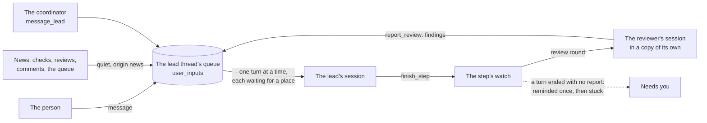
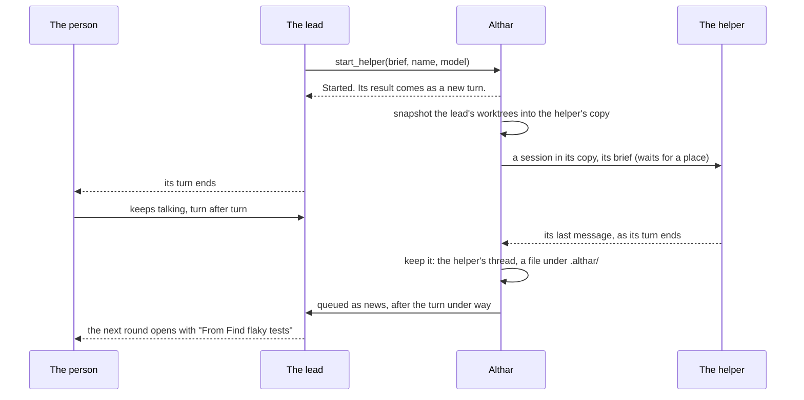

# ADR-087: A lead starts helpers on any agent, each in a copy of its own, and hears each one's result as a new turn

- **Status:** Proposed, to build from the list below ([Build](#build));
  amended by [ADR-097](097-agents-work-as-the-person-s-own-and-only-what-can-t-be-undone-asks.md) (2026-11-06): a helper gets the person's
  MCP servers and skills as its lead does, and ADR-081's mark no longer
  follows it; its caps stay, as cost caps, and it still pushes nothing
- **Date:** 2026-11-02
- **Amends:** [ADR-015](015-coordinator-picks-models.md) (a lead picks its
  helpers' models), [ADR-022](022-what-agents-leave-running.md) (the Running
  list holds helpers too), [ADR-032](032-agents-at-once-on-this-machine.md)
  (a helper takes a place of its own)
- **Owner:** Repository maintainers
- **Context:** DEV-181 asks that a task's lead can start a helper in the
  background, on any agent and model, keep talking with the person while it
  runs, and hear its result as a new turn, the same on every agent. Today
  only a Claude Code lead can, with its own Agent tool, on Claude models. The
  research ([background helpers](../research/background-helpers.md)) read how
  thirty agents, orchestrators, protocols and frameworks do it, from their
  docs, changelogs, source and issues, on 2 November 2026. What shaped this:
  - **An agent's own helpers wake their parent inside the agent, or not at
    all, and over ACP that turn has nowhere to go.** ACP v1 has no turn the
    agent starts. Claude Code's adapter holds the turn open until its
    background subagents finish (claude-agent-acp #870), which "hides the end
    of the answer" and once held a turn two hours (#1262); Cursor's and
    Devin's CLIs hold it too. OpenCode stops streaming once the prompt ends,
    so the turn its child's result starts never reaches the client. Codex
    doesn't wake an idle parent at all: "31 children finished while their
    parent was idle, and none woke it" (openai/codex #46120). Gemini CLI and
    VS Code block. In Althar today, a Claude Code lead's background subagents
    hold its turn, and what the person says next waits behind them. MCP's
    tasks wake only Claude Code, and ACP v2, which lets an agent start a
    turn, is a draft. A turn Althar sends itself is the one way that works on
    every agent, and orchestrators came to it: Orca moved its coordinators to
    "end their turn and Orca wakes them" the day this was written, "a lot
    more token efficient and reliable", and Sculptor made itself "the only
    turn-initiator" after an agent waking itself starved the person's
    messages and broke Stop.
  - **Helpers that share the parent's folder step on it.** Codex, OpenCode,
    Copilot CLI, Gemini CLI and Cursor share it by default, and every one of
    them warns about overwrites ("agents step on each other's changes
    constantly", OpenCode #17994; Codex's workers are told "they are not
    alone in the codebase"). Products that write in parallel give each helper
    a worktree or a machine and bring the work back on purpose: Cursor,
    Factory, Amp's threads, the Codex app, Devin, Copilot's cloud agent.
  - **Results go missing, and pass for the person.** Results lost to
    compaction, to a notification sent elsewhere, to a poll that missed its
    moment, fill Claude Code's changelog, and are Cursor's and Copilot CLI's
    most reported bugs. Claude Code had to mark each result "no human input",
    after a model "impersonated the user" with one (#39027).
  - **Polling burns tokens and still misses.** One Codex run spent 89
    `wait_agent` calls and about 10.3M tokens learning "not yet"; Claude Code
    and OpenCode removed their polling tools; LangChain moved to pushing
    results.
  - **Fan-out runs away without caps, and wakes can loop.** Claude Code caps
    20 at once "so one message can't fan out unbounded background agents",
    Copilot 2 to 32 by plan, Codex's v2 three children; most go one level
    deep. Nimbalyst added a cap of fifty in a parent's life beside four at
    once, because "a completion-wakeup re-drives the parent, a weak model
    spawns another child, the child settles in milliseconds".
  - **A brief goes in, and the last message comes out,** wherever a helper
    can be another model. Codex's v2 forks the whole history by default, and
    people's quotas went from 22% to 98% in two minutes (#58898).

  How Althar works today is [below](#althar-today): the queue a thread's
  turns come from, places among the agents at work, the reviewer, which is
  already a helper of a kind, and the step's watch, which today calls a lead
  stuck if its turn ends before it reports.
- **Decision:**
  - **A lead has two tools, `start_helper` and `stop_helper`,** the same on
    every agent ([The tools](#the-tools)). `start_helper` takes a brief, a
    short name, and optionally a model, an effort and `writes`, and answers
    at once. There is no tool to wait or poll: the result comes to the lead.
  - **A helper is a session of the task in a thread of its own,** as a
    reviewer is, on any agent and model Althar can use, run and watched by
    Althar, not by the lead's agent.
  - **It works in a copy of its own, always:** the lead's worktrees as they
    stand when it starts, untracked files included, checked out apart from
    them, as a review round's copy is ([Where a helper works](#where-a-helper-works)).
    Nothing it does lands in the lead's work, and the lead and the person
    carry on meanwhile.
  - **It does what its lead may, never more, and only in its copy**
    ([What a helper may do](#what-a-helper-may-do)): it reads, and runs what
    the lead's rules let the lead run (tests, builds, screenshots), held by
    its agent's sandbox to its copy where the agent has one; it pushes
    nothing and acts on nothing outside. By default what it changes is
    thrown away with its copy. With `writes`, what it changed is kept as a
    commit, which the lead brings into its own work with git, settling any
    conflict as it does with main.
  - **It never asks the person a question,** as a reviewer doesn't; a
    permission the lead's mode would put to the person is shown in the lead's
    thread under the helper's name, and the helper waits for it.
  - **The lead picks its model and effort,** from `list_models`, which leads
    get too, within the project's usage rules; without one, the lead's own,
    at its effort. A helper whose agent fails is tried again as a step is
    (ADR-060); if it keeps failing, the lead hears at once, with the models
    it may use now, and can start it on another ([The model](#the-model)).
  - **Its result reaches the lead as a new turn,** the way news does: its
    last message, kept first, then queued on the lead's thread after the turn
    under way, several together in one turn, starting a lead that stopped,
    and never the person's word ([The result](#the-result-as-a-new-turn)). A
    lead waiting on its helpers holds no place and isn't stuck; it can't
    finish its step while one is at work.
  - **Helpers take places among the agents at work: at most four of a
    task's at once, ten at work or waiting, fifty in its life,** one level
    deep, an hour each at most ([Places and limits](#places-and-limits)).
  - **The thread shows each helper where the lead started it,** opening in
    place to its work, with Stop beside what the lead left running; its
    result opens the lead's next round; its usage counts in the task's, by
    model ([In the thread](#in-the-thread)).
  - **Each agent's own helpers in the background are switched off,** and its
    in-turn ones kept where it allows: Claude Code's, OpenCode's and Kimi's
    within the turn stay; Codex, Copilot, Grok, Vibe and Antigravity lose
    theirs, which can't be split ([Agents' own subagents](#agents-own-subagents)).
  - **A helper is the first kind of wait DEV-176 builds on**
    ([One mechanism with DEV-176](#one-mechanism-with-dev-176)): the lead's
    turn ends, holding no place; Althar keeps what it waits for; and what
    comes back is queued and starts the lead's next turn.
  - **The build is eight tasks** ([Build](#build)); [Out of scope](#out-of-scope)
    says what isn't in them, and [Settled with the person](#settled-with-the-person)
    the calls they made.
- **Alternatives considered:**
  - **Each agent's own helpers, wired through.** Claude Code's Agent tool,
    Codex's `spawn_agent`, OpenCode's `subagent`: each runs only its own
    agent's models, each wakes its parent inside its own process, which ACP
    can't carry, Codex doesn't wake an idle parent, and several agents have
    none. It would differ on every agent, which ADR-082 rules out.
  - **A tool that returns later,** through MCP's tasks or ACP's draft v2.
    MCP's tasks wake only Claude Code, and a client that polls a task
    "internally" still holds the model's turn; ACP v2 is a draft no agent
    Althar runs speaks by default
    ([research](../research/background-helpers.md#protocols)). A tool that
    answers at once and a turn Althar sends need neither.
  - **A tool that waits for the helper.** It meets each agent's tool
    timeout: 60 seconds in Codex, 30 in OpenCode.
  - **A polling tool** (`read_helper`, Codex's `wait_agent`, Microsoft's
    `wait_for_first_completion`). Models poll at once, report stale status
    and loop; Claude Code removed its own, and LangChain moved to pushing
    results. The lead can read a helper's thread with `read_thread`, which
    doesn't wait.
  - **Steering a result into the lead's turn under way,** through
    claude-agent-acp's and codex-acp's private `_session/steering`, as
    Claude Code delivers between tool calls. Two agents of ten have it, it
    isn't ACP's yet (#1261), and a result a moment later, after the turn, is
    no worse for it.
  - **The helper in the lead's own folder, read-only.** Only some agents can
    be held to reading, a reader can't run the project's tests, and it sees
    the lead's half-made edits change under it. A copy costs a commit and a
    checkout, and holds every agent.
  - **Writing helpers that merge themselves into the lead's folder.** The
    lead keeps working meanwhile; a merge it didn't make would land in the
    middle of its edits. Every product that writes in parallel brings work
    back on purpose.
  - **A helper's asks denied outright,** as Claude Code did until 2.1.186
    and Factory and Microsoft's background agents do. The helper then
    reports success for what never happened (claude-code #32402), and the
    lead can't tell. Shown under the helper's name, an ask is the person's
    call, as a step's is.
  - **The lead's whole conversation passed to the helper** (a fork). Forks
    work only within one agent, they multiply the cost (Codex #58898), and a
    fresh context is what makes a helper worth having: Cognition found a
    reviewer that sees only the diff beats one that carries the coder's
    history.
  - **Helpers as tasks of their own,** with cards, as orchestrators run
    agents side by side. A helper is part of its lead's work: the person
    follows one task, and the lead hears the result.
  - **A report tool the helper must call** (Orca's `worker_done`, Agent
    Orchestrator's `ao report`). Models skip it; the turn's end can't be
    skipped.
  - **Results that wait until the person starts the lead,** as Agent
    Orchestrator "never spawns an orchestrator to deliver a report". #505
    made a stopped lead hear what is meant for it; a helper's result is.
  - **Stopping a lead's helpers when the person stops its turn.** Cursor and
    Devin changed their answer twice. The person stops a helper on its own
    row; settling the task stops them all.
- **Trade-off:**
  - **A lead woken later reads its context again.** A result that comes after
    the lead's prompt cache has gone (five minutes, `CACHE_LIFE`) costs a
    full read of its context, and may hand it to a fresh session (ADR-038).
    Batching keeps it to one wake for helpers that end together; work of a
    few seconds is still cheaper on the lead's own subagents within its turn.
  - **A result turn is a turn on the lead's plan,** and where an agent bills
    by request, as GitHub Copilot does, each wake is one (OpenCode #8030).
  - **A copy is a snapshot.** The helper doesn't see what the lead changes
    after it started, and a writing helper's commit can conflict with it.
    The lead brings it in, and settles.
  - **A helper that runs the project needs its copy set up,** which takes an
    install's time where nothing can be cloned.
  - **Asks can reach the person from work they didn't start,** under the
    helper's name, in the mode they chose.
  - **Four helpers and a lead are five places** on a machine whose count may
    be four (ADR-032): a task can take the machine while the person's other
    work waits behind it, though never what the person does.
  - **Usage grows.** Helpers are more sessions on the person's plans, and
    multi-agent work costs a multiple of a lone agent's (Anthropic measured
    about 15× a chat's); the caps hold the count, not each one's size.
- **Overlaps:**
  - **DEV-176** shares the wait: build task 1 is both's
    ([One mechanism](#one-mechanism-with-dev-176)).
  - **DEV-183** gives leads `read_thread`, which reads a helper's thread, and
    holds a task's reviewer in its copy, as a helper is held; task 3 shares
    that holding.
  - **ADR-081's watch** (its task 2) is where DEV-176's waits are heard; a
    helper's end is heard from its own session.
- **Revisit when:**
  - ACP gives agents turns of their own (v2's prompt that answers at once),
    or standardizes steering, or the agents' MCP clients carry tasks that
    wake the model: Althar's own turn may then be one way among others.
  - Leads hit the limits (four, ten, fifty, an hour) often, or never start
    helpers, or start them for what their own subagents would do cheaper.
  - Writing helpers' commits conflict more often than they are taken.
  - An agent's switch changes or goes (OpenCode's 2.x line has none), or one
    brings its own background result back as a turn (Codex's
    `wake_on_agent_messages`).
  - The person asks to talk to a helper, or to start one themselves.

Paths below are in `packages/runtime/src`, or in `packages/` where they start
with another package's folder, as they stood at b3c7d343.

## Althar today

- **A thread's turns come from its queue, one at a time.** What the person
  says, what the coordinator passes on and what Althar hears for the lead
  (failing checks, reviews, comments, the merge queue sending a pull request
  back) are rows in `user_inputs`, delivered by `Sessions.deliveries`
  (`Sessions.ts:1795`), everything queued together in one turn (`promptFor`,
  `Sessions.ts:488`). What Althar writes goes `quiet`, shown by what it came
  from, with `origin: 'news'`, so a turn it starts is never the person's
  word (ADR-081).
- **A stopped lead is started again for what is meant for it** (#505,
  DEV-183): `message_lead` and a pull request's news call
  `Sessions.startLast` (`Coordinator.ts:1107-1113`, `Changes.ts:3464-3479`), and the
  turn waits for usage (`waits_for_place`, `Sessions.ts:1823-1851`) and a
  place.
- **Each turn of a lead or a reviewer waits for a place among the agents at
  work** (`Busy.ts:17-80`, ADR-032, ADR-037): places are keyed by task, lead
  or reviewer (`keyOf`, `Busy.ts:156`), the person's work never waits, a
  task's work under way goes before new work, and a lead idle between turns
  holds none.
- **A step whose lead ends a turn without `finish_step` is reminded once,
  then needs the person** (`Runs.ts:1478-1626`), unless input is queued for
  its thread, which means another turn is coming (`Runs.ts:1563-1566`). A
  lead that starts something and ends its turn to wait for it is stuck
  today.
- **A reviewer is already a helper of a kind.** It is a session of the task
  in a thread of its own (role `reviewer`, `Sessions.ts:1106-1116`), on any
  agent and model the plan names, reading a throwaway copy of the lead's
  worktrees as they stood when its round began (`reviewCopy.ts`: the
  worktree's tree, untracked files included, committed and checked out
  detached under `<project>/.review/<task>/`), so nothing it does lands in
  the lead's work and the person can talk to the lead meanwhile. It runs in
  the agent's reader mode under the reader rules (`Sessions.ts:2027-2130`),
  has no way to ask the person (`Sessions.ts:2168`), and reports with
  `report_review`, whose findings reach the lead as a turn. DEV-183 asks
  that it be held in its copy as the coordinator is (ADR-058), and run the
  project's checks.
- **A lead may be handed to a fresh session between turns** (`handover.ts`,
  ADR-038): the queue is the thread's, not the session's, so what waits
  reaches the fresh one.
- **Claude Code's own background subagents hold the lead's turn.** Althar
  declares the JetBrains AIR capabilities `sessionFailure` and `asyncTasks`
  (`provider-adapters/src/AgentConnection.ts:722`), not
  `backgroundSubagents`, so claude-agent-acp 0.99.1 keeps a turn that
  started background subagents open until they finish
  (`acp-agent.js:1225-1234`, `:5553-5563` in its `dist`). Since Claude Code
  2.1.198 subagents run in the background by default. What the person says
  next waits behind them, unless they interrupt. What Claude Code says
  between Althar's turns, as when something it left running ends, is
  recorded (`betweenTurns`, ADR-022), and the calls it opens then count it as
  at work (`callsOpen`, `wakeAt`, `Sessions.ts:329-334`). Its subagents'
  calls show flat in the thread: the kit's `thread/SubAgents` is drawn by
  nothing in the app.
- **Models are the coordinator's to pick** (ADR-015): `list_models`
  (`Coordinator.ts:1643`) is the coordinator's alone; a lead has no list.
- **Tools are MCP calls that answer before the turn goes on,** served per
  role, `coordinator`, `lead` or `reviewer` (`ToolServer.ts`). A tool that
  "returns later" has to answer at once and come back another way.
- **Sandboxes hold a session to a folder on two agents:** Claude Code's,
  which Althar holds to the coordinator's copies (ADR-058) and a lead's
  worktree (ADR-071), and Codex's `workspace-write`, which keeps writes in
  the session's folder (`registry.ts`). Elsewhere Althar's rules hold it.

## The tools

A lead's, and only a lead's: a helper has neither, so helpers go one level
deep.

**`start_helper`**

| Input | |
|---|---|
| `brief` | What to do, whole: the helper reads nothing of the lead's conversation |
| `name` | What it is, in a few words, shown in the thread: "Find flaky tests" |
| `model` | Optional: a model as `list_models` writes it, of any agent. Without one, the lead's own |
| `effort` | Optional: one of the efforts `list_models` gives for it. Without one, the lead's own where the model has it, else the model's default |
| `writes` | Optional, false by default: keep what it changes, as a commit for the lead to bring in |

It answers at once, before the helper has a place or has started, in words
written for the model, so that it neither waits nor guesses (OpenCode's and
Claude Code's tool results say the same, because models did both):

> Started "Find flaky tests" on GPT-5.6 Luna. Its result comes to you as a
> new turn when it ends. Don't wait or poll for it, and don't say what it
> will find: carry on with work it doesn't touch, or end your turn.

It refuses, saying why: where the model isn't one the lead may use now;
where the task has ten helpers at work or waiting, or has had fifty; on an
agent whose last three helpers of the task ended without starting, until the
person next writes (another agent's model still starts); in a review of
someone else's pull request; and in a helper's own session, which doesn't
have it.

**`stop_helper`** stops one of the lead's helpers by its name or id. Nothing
of it comes back: the lead knows why it stopped it.

The lead reads a helper's thread, for what it did and not only what it said,
with `read_thread`, which DEV-183 gives leads. There is no tool to wait for
or poll a helper.

## Where a helper works

- **A copy of each of the task's worktrees, as they stand when it starts.**
  Althar commits each worktree's tree, untracked files included, as the
  snapshot a review round reads (`snapshotForReview`), and checks it out
  detached in the helper's own folder, beside the task's folder as review
  copies are: `<project>/.helpers/<task>/<n>/<repository>`. The helper sees
  the lead's work as it is, not the default branch: Claude Code's worktrees
  branch from the default branch unless told, and a fan-out of 17 "aborted
  with zero output" (claude-code #75045).
- **Never the lead's folder.** The lead keeps editing and the person keeps
  talking to it; nothing the helper does lands there.
- **Ready when it needs to run something.** A helper that reads needs
  nothing more. One that runs the project's commands calls
  `install_dependencies`, which replays the task's recorded setup (ADR-080)
  in its copy; where the volume clones files copy-on-write (APFS, btrfs,
  XFS), Althar clones the lead's ignored dependency folders into the copy
  instead, in seconds.
- **It goes** once its result is delivered, unless it kept a commit, which
  stays until the task settles, and with its task's folder (ADR-056).

## What a helper may do

Never more than its lead, and only in its copy.

- **Its mode is its lead's** (the project's or the task's, ADR-043), and its
  rules are the lead's with its copy as its folder: writing there goes
  without asking, as a lead's writes in its worktree do, and a command goes
  as it would for the lead. Where its agent has a sandbox that holds a
  session to its folder, Claude Code's (ADR-058, ADR-071) or Codex's
  `workspace-write`, it is held to its copy, as DEV-183 holds a task's
  reviewer. Its web reads follow the project's switch (ADR-078).
- **It pushes nothing and acts on nothing outside** (kept by ADR-097 as
  tidiness: a helper's work comes back through its lead; its MCP servers
  are its lead's, and what can't be undone among their calls asks the
  person, in the lead's thread under its name, as its commands do). Its git runs Althar's
  guard with every push refused (`pushGuard.ts`); it has none of Althar's
  tools that act on the code host or the tracker. It has those that read
  (`read_issue`, `read_pull_request`, `read_checks`, `read_check_log`),
  `screenshot`, and `install_dependencies` in its copy. Its turns are never
  the person's, so nothing asked-for runs in them (ADR-081).
- **It never asks the person a question.** As a reviewer, it decides for
  itself and says in its result what it couldn't settle. Claude Code takes
  `AskUserQuestion` from every subagent; Kilo's children "cannot ask the end
  user a question directly".
- **A permission the lead's mode would put to the person is shown in the
  lead's thread under the helper's name,** and the helper waits for the
  answer, as docs/architecture/05 has a step's asks break into the thread.
  Claude Code denied background agents' asks until June 2026, then showed
  them in the main session naming the agent (2.1.186); OpenCode's nested asks
  hung unseen for eight months (#13715). A helper waiting on the person keeps
  its place only for `askGrace`, as a lead does.
- **What reaches it from outside carries ADR-081's mark** (no longer:
  ADR-097 drops the mark), and so does its
  result: an outside author's words that a helper read can't steer the
  lead's web reads.

### Writing helpers

With `writes`, when the helper's work ends Althar commits what it changed in
its copy as one commit, whose parent is the snapshot it started from, and
keeps it on a hidden ref (`refs/althar/helpers/<task>/<n>`), never a branch
and never pushed. The result says what it changed and how to bring it in:

> Its changes are commit 3f2a91c, on top of your work as it stood when it
> started: `git cherry-pick --no-commit 3f2a91c`.

The lead brings it in with git, in its own turn, and settles any conflict as
it does with main (ADR-030), or leaves it. Nothing merges by itself: the lead
has kept working meanwhile, and only it knows what it meant. Cursor ("Changes
stay on each subagent's branch until the parent agent merges the results"),
the Codex app's `codex apply`, VS Code's background sessions and Amp's
threads bring work back the same way, on purpose.

## The model

- **Leads get `list_models`,** the list the coordinator has (ADR-015): every
  model of every agent signed in and not out of usage, without those the
  person switched off, with how each scores, whether a plan pays for it, and
  its efforts.
- **The lead names the model; Althar takes the best way to it,** as it does a
  step's: a plan before a key, within the project's accounts rule
  (`accounts.only`), steering clear of an account nearly out as a new step
  does (`NEARLY_OUT`); an automation's task, only what a plan pays for
  (`PlanOnly`). A model the lead may not use is refused, naming those it may.
- **Without a model, the lead's own,** on the same account and effort. The
  lead can name another model and effort for each helper: "Haiku on medium"
  for a search, the strongest on high for a hard question. Claude Code's
  `Agent` call takes `model` and `effort` the same way.
- **A failing agent is tried again, then the lead chooses.** A helper whose
  agent's service fails, or that can't start, is tried again after a growing
  pause, as a step is (ADR-060): 15 seconds, a minute, four minutes; offline,
  it waits for the connection. A fourth failure in a row ends it, and its
  result comes to the lead at once, as a new turn, saying what failed and
  naming the models it may use now:

  > Helper "Find flaky tests" (OpenCode, GLM-5) didn't start: OpenCode's
  > service kept failing ("Cannot connect to API"). You may use: Claude Haiku
  > 4.5, Claude Sonnet 5.5, GPT-5.6 Luna, …

  The lead starts it again on one of those, with the same brief, as it
  judges. Althar never switches agent by itself: another agent's model is
  another price and another plan's usage, and the lead chose this one.
- **The lead's brief says how to choose,** as the coordinator's does: a
  quicker, cheaper model for searching and reading, a different maker's for a
  second opinion, the strongest for hard reasoning, a plan over a key.
  People asked for this choice where it was hidden (Codex #31814, 100
  comments).
- This amends ADR-015: the coordinator picks a task's lead and reviewer, and
  the lead picks its helpers.

## The result, as a new turn

- **What comes back is the helper's last message,** once its turn ends with
  nothing of its own still at work (`stillBusy`): what it found, as it said
  it. Its brief asks for that, short, with paths and lines, saying what it
  couldn't do. With `writes`, the commit too. It is settled at the turn's
  end, not by a report tool the helper may skip: an Orca worker ended on a
  question in plain text, with no report, and its dispatch looked fine for
  seven minutes (orca #37040). Claude Code, Codex and OpenCode take the last
  message too.
- **It is kept before it is sent.** It is written to the helper's thread, and
  whole as a file under `.althar/` in the lead's folder, which git ignores
  (as ADR-064's attachments are), before it is queued; the turn carries it,
  up to 8,000 words, and links the file. A restart in between still delivers
  it, once, and a lead that compacts or is handed over (ADR-038) can read it
  again. Claude Code lost reports to compaction until its notifications named
  the file.
- **It is queued on the lead's thread as news:** quiet, after the turn under
  way, never interrupting it, with `origin: 'news'`, so it is never the
  person's word and nothing asked-for runs in the turn it starts (ADR-081).
  It says whose it is:

  > Helper "Find flaky tests" (GPT-5.6 Luna) ended. What it said, which is
  > its own and not the person's:

- **Several that end together go in one turn,** as everything queued does
  (`promptFor`): one wake, not one per helper.
- **A lead whose session stopped is started again for it,** waiting for usage
  and a place, as for a message or a review (#505). One being handed to a
  fresh session gets it there: the queue is the thread's, and the handover
  brief lists the helpers still at work.
- **What the person says goes in the same queue,** in the order it came; the
  person's message and a result that arrive together are one turn.
- **A lead's turn that ends while its helpers work isn't missing its
  report.** The step's watch counts a helper at work as another turn to come,
  as it counts queued input (`Runs.ts:1563`): no reminder, never stuck. And
  `finish_step` is refused while one is at work, naming them, so a result
  never arrives after the step: the lead waits, or stops them.
- **A helper the person stops** ends, and what it had said is kept on its
  thread; the lead isn't woken for it, and its next turn starts with a line
  saying the person stopped it.

## Places and limits

- **A helper at work takes a place among the agents at work** (ADR-032),
  keyed by its task and number beside the lead's and the reviewer's
  (`keyOf`). It waits as its task's work under way does, behind what the
  person did, and its task's lead goes before it. A helper waiting for a
  place says so on its row, never in Up next: its task is already under way.
- **At most four of a task's helpers at work at once,** so one lead can't
  fill the machine; more wait their turn in the order started. Codex's v2
  allows three children. **At most ten at work or waiting,** after which
  `start_helper` refuses, naming them: people report 24 run for 3 asked
  (claude-code #82565), and 46 Opus subagents from one workflow (#66023).
  **At most fifty in a task's life,** against a result that starts the lead,
  which starts another helper, which ends at once (Nimbalyst's backstop);
  and after three helpers in a row on one agent end without starting,
  `start_helper` refuses that agent until the person next writes in the
  thread, as Orca stops a dispatch after three; the lead can still start one
  on another agent. A helper counts once toward the three when its retries
  run out, however many tries it took; a try that a retry recovers doesn't
  count.
- **One level.** A helper has no `start_helper`. Its agent's own in-turn
  subagents work inside it where the agent keeps them, and its background
  ones are off, as for a lead.
- **An hour at most,** counted while it is at work, after which it is stopped
  and its result says so, with what it had said. Claude Code has no total
  limit on a background agent, and people asked for one (#94013); OpenCode's
  and Cline's helpers hung or looped until they got one.
- **A stalled helper** is told to carry on once, as a lead's stalled turn is
  (`Stalls.ts`); stalled again, or going round in circles, it ends, and its
  result says why. A helper never makes its step need the person.
- **A usage limit** moves it to its agent's next account where the project
  rotates accounts; otherwise it ends, and its result says until when, with
  what it had and the models the lead may use now. It never moves to another
  agent by itself: the lead chose the model, and can start another.
- **A failing service** is tried again, then ends, as
  [The model](#the-model) says.
- **A restart** starts a helper that was at work again once, in its copy,
  told that a restart stopped it; stopped again within five minutes, it ends,
  and the lead hears.
- **Usage** counts toward the account's plan as any session's does, and in
  the task's usage, by model.

## In the thread

The person sees what the lead started and can stop it; the rest stays out of
the way (docs/architecture/05: a step is a line in the thread, its session
readable in its own).

- **Where the lead started it, a row in the lead's work:** the helper's name,
  its model (the maker's mark and name, ADR-015), how long it has run, and a
  mark for how it stands: at work, done, failed, stopped. It opens in place
  to the helper's own work, one at a time, as the kit's `SubAgents` draws a
  turn's sub-agents; never a side panel. Its brief is there to read, whole
  (Codex's encrypted briefs "remove readable task audit trail", #28058).
- **Over the composer, in the Running list** (ADR-022), beside what the lead
  left running, while it works, with Stop: one list for what runs on the
  task's behalf.
- **When its result reaches the lead,** the lead's round opens with it, on
  Althar's side, under the helper's name, its first three lines and the rest
  on a click, as `Relayed` draws what the coordinator passed on.
- **Its asks** show as the lead's do, under the helper's name.
- **The Graph face** (ADR-054) has a lane for each helper's model, and a card
  for each helper.
- **The task's card** stays in Running while a helper is at work (ADR-065).
  A helper never puts a task in Needs you but for an ask the person must
  answer.
- **Costs** are in the task's usage, a line for each model, the helpers' with
  the lead's; never a line per helper.

Words, without narrating:

| Where | Words |
|---|---|
| The row | Find flaky tests · GPT-5.6 Luna · 4m |
| Its states | a mark only: at work, done, failed, stopped |
| The row's button, and in Running | Stop |
| The result's head | From Find flaky tests |
| A helper's ask | Find flaky tests asks to run `bun test` |
| A stopped helper, in the lead's next turn | You stopped Find flaky tests. |
| Waiting for a place | Waiting for a place |

## Agents' own subagents

Every agent Althar runs has helpers of its own, and over ACP their background
ones break: they hold the lead's turn (Claude Code, Copilot), lose their
result (Codex, OpenCode, Mistral Vibe, Kimi), or start turns Althar didn't
ask for (Grok)
([research](../research/background-helpers.md#each-agent-althar-runs-and-its-own-helpers-over-acp)).
In-turn ones work: the lead waits, and the result comes back in its turn.

- **Althar switches each agent's background helpers off,** at launch, and
  keeps its in-turn ones where the agent allows that. Where it can only
  switch off all of them, it does, and `start_helper` is a lead's only
  helper in the background:

  | Agent | Switch | Kept |
  | --- | --- | --- |
  | Claude Code | `CLAUDE_CODE_DISABLE_BACKGROUND_TASKS=1` | `Agent` within the turn |
  | OpenCode | `OPENCODE_EXPERIMENTAL_BACKGROUND_SUBAGENTS=false` | `task` within the turn |
  | Kimi Code | `TaskList`, `TaskOutput`, `TaskStop` in `[tools] disabled` | `Agent` within the turn |
  | Codex | `features.multi_agent = false` | none; its children never block |
  | Copilot | `--excluded-tools task` | none; one tool runs both ways |
  | Grok | `GROK_SUBAGENTS=0` | none |
  | Mistral Vibe | `VIBE_ENABLE_SUBAGENTS=false` | none; its children never block |
  | Antigravity | `_meta.agy.disabledTools: ["start_subagent"]` | none; all are background |
  | Qwen Code | none: left on | its own, whose results come back as turns of its own over ACP |
  | Junie | none found | its own; the brief asks for `waitForResult` |

- **Why off rather than made to work:** a background helper of the agent's
  own takes no place, keeps none of the limits, can't be stopped from the
  thread, works in the lead's folder, and can't be another agent's model.
  `start_helper` does all of that, the same on every agent. The two agents
  that bring a result back (Qwen, and Claude Code with ACP's `subagents`
  capability declared) would still be outside all of that.
- **What it costs.** Claude Code loses detached shell commands too (one that
  times out stops rather than moving to the background); a dev server goes
  through `run_project`, as the lead's brief says. Kimi's background shell
  commands go with its background helpers. On Codex, Copilot, Grok, Vibe and
  Antigravity a quick look-around goes through `start_helper`, in a copy, or
  the lead does it itself.
- **The lead's brief says which to use** where in-turn helpers stay: its own
  for quick work on its own model within the turn; `start_helper` for
  another model or agent, work the person should see and be able to stop,
  or work that should outlive the turn.
- **Where a switch changes or goes,** the agents' contract suite says so
  (task 8): a lead whose own helper outlives its turn fails it. OpenCode's
  2.x line has no switch yet, Codex's `wake_on_agent_messages` may make its
  children wake a parent, and Qwen's and Junie's are left as they are until
  then.

## One mechanism with DEV-176

DEV-176 has a lead wait on something outside its task (a pull request's
checks, a merge, the default branch going green, a time) and carry on when it
happens. A helper is a wait whose something is a session of the task. Both
need:

1. a lead's turn that ends waiting, holding no place and not stuck (build
   task 1);
2. a record of what it waits on, kept across restarts, that says when it is
   over: the helper's thread here, DEV-176's watch there (ADR-081's task 2);
3. what came back, queued as news on the lead's thread and starting its next
   turn (#505's `startLast`);
4. the card saying what it waits on where nothing of the task is at work,
   which for a helper never happens.

The first is built once, in task 1, for both. DEV-176 adds `wait_for` and
its kinds, the longest wait, and several pull requests from one task.

## Build

The coordinator plans these from this list. Each title is a task's, in at
most 60 characters. Paths are in `packages/runtime/src` unless they start
with another package's folder.

| # | Task | Scope | Size | After |
| ---: | --- | --- | :---: | --- |
| 1 | A lead waiting on its own work isn't stuck | The step's watch (`Runs.ts:1478-1626`) counts a helper at work as another turn to come: no reminder, never stuck. `finish_step` refuses while a helper is at work, naming each. The handover brief (`handover.ts`) lists the helpers at work. Shared with DEV-176, whose waits it takes next. Tests: a turn that ends with a helper at work is neither reminded nor stuck, and one that ends without is, as now | S | – |
| 2 | Leads get list_models | The coordinator's `list_models` served to leads too, the same list; the lead's brief says how to pick a helper's model, as the coordinator's says for a step's. Tests: a model the person switched off isn't listed to a lead | S | – |
| 3 | Helper sessions in copies of their own | A `helper` role beside `task`, `coordinator` and `reviewer`, for the context, the tools and the rules; a thread for each helper on its task. Its copy: the round's snapshot (`reviewCopy.ts`, made general) under `<project>/.helpers/<task>/<n>/`. Its mode and rules the lead's, with its copy as its folder; Claude Code's sandbox held to the copy (`sessionMeta`, `holds`), Codex's `workspace-write` there; Althar's push guard refusing every push; its tools (`read_issue`, `read_pull_request`, `read_checks`, `read_check_log`, `screenshot`, `install_dependencies` in its copy); no questions; its asks under its name. Places keyed by helper (`Busy.ts`), four of a task's at once, ten at work or waiting, fifty in its life, an agent refused after three of its helpers fail to start, the lead first. The hour, stalls (`Stalls.ts`), usage limits, a failing service tried again on the step's schedule (ADR-060: `Connectivity.ts`'s pauses of 15 s, 1 min and 4 min, not `Failures.backoff`'s defaults), then ended, and restarts as [above](#places-and-limits); stopped with its task (`LeftBehind.settled`, ADR-068) and gone with its folder (ADR-056). A clause in the agents' contract suite: a helper can't write its lead's folder, on every agent (ADR-082) | L | 1 |
| 4 | Leads start helpers and hear their results as turns | `start_helper` and `stop_helper` ([The tools](#the-tools)): the answer, the refusals, the model's way as a step's (plan, `accounts.only`, `PlanOnly`, nearly out), the lead's own model and effort without one; a helper that failed for good reported at once with the models the lead may use now. The result kept on the helper's thread and as a file under `.althar/` in the lead's folder, then queued as quiet news after the turn under way, batched, delivered once, starting a lead that stopped (`startLast`); the person's Stop as a line in the lead's next turn. The helper's brief, and the lead's lines on when to start one. Tests, DEV-181's done-when: a Claude Code lead with a Codex helper and a Codex lead with a Claude Code helper, each only reading, the person talking to the lead meanwhile and the result coming as a new turn; an OpenCode helper whose service fails, tried again, then reported, and the lead starting it on Haiku at medium effort, on the agents' fakes in CI and once on real accounts before the release | L | 2, 3 |
| 5 | Helpers in the thread, with Stop | The row where the lead started it (the kit's `SubAgents`, grown: the model's mark and name, how long, the brief, opening in place to the helper's work), helpers in the Running list with Stop (ADR-022), the result's "From …" block (as `Relayed`), asks under the helper's name, the Graph face's lanes (ADR-054), the task's usage by model. Stories with plays for each state; an end-to-end spec: start a helper, see it, stop it | M | 4 |
| 6 | Helpers that write: a commit for the lead to take | `writes`: the helper's changes committed on its snapshot, kept on `refs/althar/helpers/<task>/<n>`, never pushed, named in the result with how to bring them in; gone when its task settles. Tests: the lead takes it with `git cherry-pick --no-commit`; one that conflicts with the lead's work since is left for the lead to settle | M | 4 |
| 7 | Agents' own background helpers switched off | Each agent's switch from [Agents' own subagents](#agents-own-subagents) at its launch (`provider-adapters/src/registry.ts`: the environment, `CODEX_CONFIG`, Copilot's arguments, Kimi's config under `KIMI_CODE_HOME`, Antigravity's `_meta.agy` on `session/new`), for leads, helpers and reviewers alike; the person's own settings never turn one back on. The lead's brief: which helpers it has, and `run_project` for a dev server. Tests: each agent's launch has its switch; on Claude Code's recorded output, an `Agent` call with `run_in_background` runs within the turn | S | –
| 8 | Helpers proven on every agent | Task 3's contract clause and task 4's turn, on each agent's fake in CI and on real accounts before the release, as the agents' contract suite runs (doc 03): each agent as a lead starting a helper, and as a helper, with a gap said where one can't be (`registry.ts`), never silent | M | 4 |

In order:
1. **First, side by side:** 1, 2 and 7.
2. **Then:** 3.
3. **Then:** 4.
4. **Then, side by side:** 5, 6 and 8.

## Out of scope

- **Helpers starting helpers.** One level, as most agents have it.
- **Talking to a helper while it works,** the person or the lead (Codex's
  `send_input`, Claude Code's `SendMessage`, Copilot's `write_agent`): stop
  it and start another, for now.
- **The same brief on several models, to compare** (Cursor's `/best-of-n`):
  a lead can start several helpers, but nothing compares them.
- **Helpers on another computer, or in the cloud** (Codex cloud, Cursor's
  cloud agents, Copilot's cloud agent, Devin).
- **The coordinator starting helpers.**
- **A helper starting from the lead's conversation** (a fork): forks can't
  cross agents.
- **Althar bringing a writing helper's work in by itself.**
- **A spend cap in money.** Places, the counts and the hour hold a helper;
  its usage shows by model.
- **A pull request of a helper's own.**
- **DEV-176's own part:** `wait_for` and its kinds, the longest wait, several
  pull requests from one task.
- **MCP's tasks, ACP's v2 and steering,** which this doesn't need; see
  Revisit when.

## Settled with the person

On 2026-11-02 the person settled what the research left open:

1. **What a helper may do:** read and run what its lead may, in its copy,
   taking what works well elsewhere, as Claude Code's background agents do:
   the call answers at once, the result comes as a later turn and names a
   file with the whole of it, and the helper works in a copy of its own.
2. **A helper's asks:** shown under its name in the lead's thread.
3. **The limits:** four of a task's helpers at once, ten at work or waiting,
   fifty in a task's life, an hour each.
4. **A lead the person stopped:** started again by a helper's result.
5. **The model:** the lead's own model and effort by default; the lead can
   name another model, of any agent, and its effort. A failing agent is tried
   again by Althar; if it keeps failing, the lead hears and picks another
   ("Haiku on medium").

On 2026-11-03 they settled the last:

6. **Agents' own helpers:** their background ones switched off on every agent
   where Althar can, in-turn ones kept where the agent allows; on Codex and
   OpenCode, `start_helper` for work in the background.
