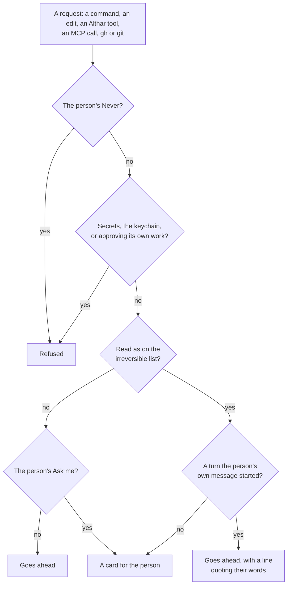

# ADR-097: Agents work as the person's own: everything is allowed by default, their MCP servers and skills load in every role, and only what can't be undone asks

- **Status:** Accepted, to build in the phases of
  [docs/plans/capable-by-default.md](../plans/capable-by-default.md)
- **Date:** 2026-11-06
- **Supersedes, in part:**
  [ADR-004](004-coordinator-is-an-agent-session.md) (the coordinator is
  optional; read-only is tidiness),
  [ADR-011](011-own-connectors-for-hosts-and-trackers.md) (agents without the
  person's sign-in; tools only on the task's repository),
  [ADR-013](013-project-rules.md) (what asks by default),
  [ADR-016](016-push-without-a-connection.md) (the person's MCP servers
  switched off; leads never pushing themselves),
  [ADR-035](035-a-task-s-kind-is-read-from-what-it-has.md) (a review runs
  nothing and posts only on Post),
  [ADR-043](043-allow-everything-is-one-switch-for-a-project-or-a-task.md)
  (allowing everything is opt-in; the host only through Althar),
  [ADR-050](050-an-agent-joins-where-althar-can-hold-it-to-asking.md) (who may
  lead a review),
  [ADR-052](052-a-task-attaches-to-a-pull-request-it-didn-t-open.md) (forks),
  [ADR-057](057-a-lead-works-outside-its-sandbox-through-althar-s-tools.md)
  (a review's lead gets no tools; screenshots of this computer only),
  [ADR-058](058-the-coordinator-is-a-trusted-reader-in-copies-of-its-own.md)
  (the coordinator installs nothing, reaches no network, loads nothing of the
  person's),
  [ADR-066](066-althar-runs-any-branch-or-pull-request-and-fetches-for-leads.md)
  (leads carry none of the person's sign-ins),
  [ADR-067](067-allow-everything-asks-only-before-what-can-t-be-undone.md)
  (the floor in the other modes),
  [ADR-071](071-the-sandbox-is-the-boundary-anything-inside-it-runs.md)
  (where no sandbox holds, and review steps),
  [ADR-078](078-project-leads-can-read-the-web.md) (Codex's network, the
  `curl` form),
  [ADR-081](081-the-coordinator-acts-on-the-code-host-as-the-person-s-account-can.md)
  (no host sign-in, leads' reach, the web mark, tags asking twice),
  [ADR-086](086-the-coordinator-moves-a-task-on-the-person-s-word-or-asks-on-a-card.md)
  (a card for a task move),
  [ADR-087](087-a-lead-starts-helpers-on-any-agent-in-copies-of-their-own.md)
  (what a helper is given),
  [ADR-088](088-plan-countdown-review-rounds-and-new-project-defaults-are-settings.md)
  (allowing everything is no default),
  [ADR-089](089-the-asks-and-refusals-left-are-what-can-t-be-undone.md)
  (what still asks outside allowing everything),
  [ADR-094](094-skills-one-store-a-curated-catalog.md) (skills for leads
  only, off until turned on),
  [ADR-095](095-skill-and-openspec-files-stay-off-the-repository.md) (skill
  and OpenSpec files held back). Each says at its top what of it this
  replaces.
- **Owner:** Repository maintainers
- **Context:** People use agents for what they can do: their own MCP
  servers, their own skills, running the app, posting what they found. On 6
  November the person ran a design-review skill in Claude Code that built
  the app and Storybook, screenshotted both, compared them and posted the
  result on a colleague's pull request through an MCP server. Althar could
  do none of it: a review's lead runs nothing, gets no skills or MCP servers,
  takes no screenshots, and drafts no pictures.

  A sweep of the ADRs and the code that day ([the plan](../plans/capable-by-default.md))
  counted about 65 limits on what an agent may do, see, reach or use, each
  decided on its own and each sounding reasonable. Together they made Althar
  the most locked down of the tools like it. Read from their source the same
  day, Orca and T3 Code run agents with full access by default, with the
  person's MCP servers, skills and `gh`, and no sandbox. The person's
  direction had already said otherwise than the limits: a task is a loose
  container of parts (13 October), and Althar is permissive by default, with
  only crossings that can't be undone asking (29 October).

  The person's decisions on the plan, on 6 November, in their words: "I
  would allowEverything as default, yes. Um including the mcp_servers … We
  should try and prefer our own path, but like if you have a look at you
  know what does claudeCode do, right? It still manages PRs, Orca still
  manages PRs. T3 code, I think, might also manage PRs for you. So if all of
  these other tools can do it, then I don't think this is the place where we
  should be different. We should not be limiting people. Rewrite every ADR
  that implies that we are making that choice." Of the coordinator: "It is a
  good concept. Maybe we should not force the people into it … Even a lead
  should be able to start a new task. They should share an MCP pool. There's
  no reason for them to have different capabilities … Maybe coordinators
  should really not be making changes. But that's mostly a choice in so far
  as, you know, if it does make a change and it makes things a little bit
  messy, but not because of a security thing … Anything that I'm able to do
  on the UI, the coordinator should be able to do. And most likely … maybe
  even the lead."
- **Decision:** an agent Althar starts works as the person's own agent, with
  their MCP servers, their skills, their sign-ins, the network and the
  project's tools, in every role. It asks only before what can't be taken
  back.
  1. **Allow everything is the default,** for new projects and existing ones
     ([What asks](#what-asks)).
  2. **The person's own MCP servers and skills load in every role,** each
     with a switch to turn it off. Althar's own tools and paths are
     preferred where they exist, never imposed
     ([The person's setup](#the-persons-own-setup-in-every-role)).
  3. **The irreversible list applies to MCP calls and to the person's own
     `gh` and git** as far as the agent's permission hooks let Althar see
     them ([MCP](#mcp-calls-and-the-irreversible-list),
     [Sign-ins](#the-persons-own-sign-in)).
  4. **Leads and the coordinator share one pool** of tools, MCP servers and
     skills. Leads ship code and the coordinator doesn't change code, which
     is tidiness, not safety ([One pool](#one-pool-for-leads-and-the-coordinator)).
  5. **The coordinator is optional**
     ([The coordinator](#the-coordinator-is-optional)).
  6. **What stays** is a short list, each line for a reason no tool takes
     away ([What stays](#what-stays-and-why)).
  7. **Two questions the person hasn't settled** take the plan's
     recommendations, marked so
     ([Recommended](#recommended-not-yet-settled)).
- **Alternatives considered:**
  - **Agents keep no host sign-in, with Althar's tools widened and the
    person's MCP servers allowed:** the plan's first recommendation. Althar
    would keep one recorded way to the host. The person chose not to limit
    people where Claude Code, Orca and T3 Code don't; Althar's path stays
    the one its briefs prefer and the one it records.
  - **The person's MCP servers only for task leads,** or only servers
    Althar has read: each is a limit the others don't have, and the design
    review needed them in a review's lead.
  - **An MCP broker of Althar's own** (architecture
    [06](../architecture/06-integrations-and-skills.md#local-broker)): Althar
    starts and relays the person's servers, so every call is seen whatever
    the agent. It would close what the agents' hooks miss, but it has to
    carry each server's own sign-in (OAuth, a stdio server's environment, a
    remote server's token), which is a large build. Kept for when phase 1
    shows what slips past ([below](#mcp-calls-and-the-irreversible-list)).
  - **Allow everything for new projects only:** the person chose existing
    ones too.
  - **The coordinator as the one way work starts:** the person found it a
    good concept, not one to force.
  - **Letting the coordinator change code:** the person kept it from that,
    for tidiness: a change is a task with a branch, a review and a record,
    and an edit in the coordinator's throwaway copy has none of them.
  - **Merging two tasks into one:** wanted once, then set aside on 6
    November as a rabbit hole. Out of scope.
- **Trade-off:**
  - **The person's credentials sit in unattended sessions.** With their `gh`,
    git sign-in and MCP servers, a lead steered by a page, a comment or a
    pull request can act on the host as them. What can't be undone still
    needs their word where Althar can see it, git's guard still stops a
    force push, a push to the default branch and deleting another branch,
    and the never list on the host holds for Althar's own calls. A call
    Althar can't see goes ahead, as an unreadable command already does
    ([ADR-067](067-allow-everything-asks-only-before-what-can-t-be-undone.md#amendment-what-the-rules-cant-read-goes-ahead)).
  - **MCP calls are read by name and arguments, not by what they do**
    ([What it can't catch](#what-it-cant-catch)).
  - **What an agent pushes itself has no receipt of Althar's,** and goes
    round the holds Althar puts on a push
    ([What's lost](#whats-lost-when-an-agent-pushes-itself)).
  - **The web mark goes.** An outside author's words that reach a
    conversation no longer make its web reads ask
    ([ADR-081](081-the-coordinator-acts-on-the-code-host-as-the-person-s-account-can.md#the-web)).
    A stranger's comment could steer an agent into sending private code out
    in a URL. The project's switch, "Leads can reach the web", stays the
    person's control for that, and an outside author's review keeps its
    commands offline.
  - **Leads starting tasks, and acting on tasks, cost usage** the person
    didn't ask for task by task. The cost caps and the places among agents
    at work hold it.
- **Revisit when:** an agent loses work, publishes, merges or speaks for the
  person through an MCP call or a sign-in Althar didn't see; the person
  meets cards they didn't want, with everything allowed; an agent's hooks
  let MCP calls past Althar for good (then the broker); a project is shared,
  and it matters whose sign-in and whose word count; the person settles the
  two [recommendations](#recommended-not-yet-settled) otherwise.

## What asks

Allow everything is on for every project: a new one is made with it, and
each existing one gets a revision of its rules with it on, recorded as of
this decision. The person's own Never and Ask me rules, command rules and
the mode under the switch stay as they were: Never still refuses, a command
they ask about still asks, and turning the switch off gives back what the
project had. A task's own switch reads as on wherever its project's is
(ADR-043). The switch shows nowhere on a task's header or card (the
person's note of 16 October).

Only this list asks, in every role, sandbox or not:

| Kind | What | Why it can't be undone |
| --- | --- | --- |
| **Lost work or history** | A force push (`+ref` and `--mirror` included); a push to the default branch, or deleting it; deleting, or moving by force, another branch whose commits are on no other ref, here or on the remote; discarding changes in another checkout, the person's own above all (git that throws work away there, replacing a file there); deleting or moving away what's outside the task's worktree, and removing a worktree that isn't the task's | What was there is gone, for the person and for every checkout that shares it |
| **Publishing, releases, teardown and merging** | Publishing a package; a release, a release tag, and moving or deleting a tag; tearing down (`destroy`, `kubectl delete` and the like, ADR-089); merging a pull request, entering a merge queue or turning on auto-merge | It reaches every user, updater or environment at once, and a registry never takes a version back |
| **Speaking for the person to others** | Posting a review or a comment on a pull request or issue that isn't the task's own; replying to an outside author; a message to anyone through another service (an MCP server's Slack message or email) | Their notification can't be called back |
| **Secrets and the keychain** | Reading where keys and sign-ins are kept (`~/.ssh`, `~/.aws`, token files: `SECRET_PLACES`), and the keychain's `security` or git's helpers called directly. Refused, not asked: there is no answer the person would want to give | A credential sent to a model's provider can't be taken back |
| **An agent answering its own permission request** | Refused, whoever asks; as is anything else that approves an agent's own work: approving a pull request a task opened, making a commit status or a check run, dismissing a review (ADR-081's fourth limit), and widening what agents may do (Althar's rules and switches, the host's protection, access and settings) | Otherwise none of the above holds |

**Asking is the person's word, and nothing else's.** For an Althar tool, an
MCP call or a command that is on the list, the person's own message in the
turn is their word: in a turn it started, it goes ahead with a line saying
what it did and which words it acted on (ADR-081, `byPerson`). In any other
turn it is a card in the thread. The coordinator's judge never answers it,
and no agent does (ADR-019).

**Everything else goes ahead, unasked:** commands the rules can't read
(scripts, heredocs, variables), with a sandbox or without one; writing
outside the worktree; global installs; deploys to preview; every stash
operation; `git reflog expire`, `git gc --prune` and the like; a `.env`
the task doesn't own, as ADR-067 has it; the network; running and
screenshotting the app in any role; reading any pull request or issue in
the project's repositories. What can be got back isn't worth a question.

**The floor goes in every mode.** ADR-067 kept the whole floor (the stash,
what git keeps to recover lost work, a `.env` outside) asking in the modes
other than allowing everything. Those modes are now the person's choice to
be asked more, and what they want asked there they say in Ask me. Turning
the switch off in a new project gives the built-in Ask me list, which is
the list above.

## The person's own setup, in every role

Every role gets it: a task's lead, the reviewer of a task's change, a
review's lead, the coordinator, and a lead's helpers (ADR-087). Not the
permission judge, which stays tool-free (ADR-019), nor a model probe.

- **MCP servers.** Each agent loads the servers the person set up for it,
  as it would in their terminal: from their user and local config, and from
  a repository's own (`.mcp.json` and the like) where the agent's own trust
  would load it, never from an outside author's pull request. Claude Code
  stops taking only Althar's (`strictMcpConfig`), and Codex and OpenCode
  stop having the person's switched off by name as they start (ADR-016's
  mechanism, `provider-adapters` `ownTools.ts`). Settings lists each server
  the agents would load, with a switch to turn it off, everywhere or for a
  project. Althar's own server is always there.
- **Skills.** The person's own skills and plugins load, as their agent
  loads them. Althar's catalog is on by default, for every role, and each
  skill has its switch (ADR-094). A skill's `hooks` frontmatter is still
  refused at install, since it runs code as the skill loads;
  `allowed-tools` is fine, since nothing it would allow asks now.
- **Skill and OpenSpec files in a change** go up with the rest of its diff,
  which the review reads. ADR-095's switches and its held push go.
- **Claude Code's auto-memory** is on: it writes to the person's own
  `~/.claude`, as running Claude Code themselves would.
- **Althar's path first, never imposed.** Every brief says what Althar's
  own tools give that another way doesn't: a push Althar makes is recorded,
  held where someone else pushed, and goes where the project sends it; a
  pull request, review or issue through Althar's tools gets a receipt and a
  line in the thread. An agent that uses the person's server or `gh`
  instead isn't refused for it. What it does is read against the list
  above, as below.

## MCP calls and the irreversible list

The person's MCP servers can merge, post and push: a GitHub server with
their token does all three, outside Althar's held pushes and outside the
rule that only the person's message sets off a merge or a post. The person
chose not to limit people, so MCP is allowed. The irreversible list applies
to MCP calls as far as the agent's permission hooks let Althar see them.

**Recommended: every call to one of the person's servers reaches Althar as
a permission request, and Althar reads it by server, tool and arguments.**

- **How each call reaches Althar.** Each session gets an ask rule for each
  of the person's servers (Claude Code's `mcp__<server>` rules, which win
  over the person's allow rules as Bash's ask rule does), or the agent's own
  per-tool ask where it has one (OpenCode's permission patterns, Codex's
  approval for MCP tools). Each call then arrives as ACP's
  `session/request_permission` with the tool's name and its arguments, as
  commands do today (ADR-007).
- **How Althar reads it.** Most calls go ahead at once, with the rules'
  quiet line under the turn. A call is on the list where it plainly is one:
  - by its tool, for the servers people use for their hosts and trackers
    (GitHub's, GitLab's, Linear's and Atlassian's own servers): a merge, a
    release, a tag, a ref deleted or forced, a file written to the default
    branch, a review or comment on a pull request or issue that isn't the
    task's own;
  - by what its name says, for any server: a merge, a publish or a release,
    a deletion, a force, or sending, posting or replying to someone;
  - by its arguments, for a server's general call (a `graphql` or `api`
    tool): a GraphQL mutation or a REST method and path, placed as ADR-081
    places Althar's own gated call.
- **On the list, it is asked-for:** it goes ahead in a turn the person's
  own message started, with a line naming the call and their words, and is
  a card in any other turn. What widens what agents may do (a repository's
  settings, protection, access, secrets, webhooks, the families of ADR-081's
  never list) is refused, as through Althar's own call.
- **Recorded either way:** each call's server, tool and how it was answered
  are kept with the turn, as a command's are.

### What it can't catch

- **A tool whose name and arguments don't say what it does:** a shell or
  browser server, a general `execute`, a `run_workflow` that publishes, a
  `sync` that force-pushes.
- **Speaking for the person on a service Althar doesn't know,** where the
  tool's name doesn't say it sends.
- **Calls the agent doesn't send through Althar:** an agent with no
  per-tool ask for MCP, or one whose own settings answer before Althar's
  ask can. Each agent's case is read in phase 1, and an agent whose MCP
  calls can't be held goes in its registry entry's `knownGaps`.
- **Steering, in a turn the person started:** what the agent reads there
  could take it to a call they didn't mean, which then has their word.
  ADR-081 accepted the same for Althar's own tools; the line in the thread
  is where they see it.

What slips past goes ahead, as an unreadable command does. An MCP broker
of Althar's own, under the alternatives above, is the way to close it, if
it comes to matter.

## The person's own sign-in

Agents may use the person's own `gh`, `glab` and git sign-in where they have
one set up: their `gh` and `glab` config, git's credential helpers and their
SSH agent are no longer taken out of the agent's environment
(`runtime/src/Config.ts`, ADR-011). A project switch, "Agents use my code
host sign-in", on by default, turns it off.

- **The rules read `gh` and `glab` as they read git,** no longer refusing
  what changes a host: `gh pr merge`, `gh release create`, a tag pushed,
  `gh api` deleting a ref, a comment on someone else's pull request, and
  the rest of the list ask; the rest goes ahead.
- **git's guard holds whatever sign-in pushes** (`pushGuard.ts`): a force
  push, a push to the default branch and deleting another branch are
  stopped in the agent's own git, as now.
- **Althar's push stays the preferred path, and the recorded one.** A
  lead's commits push as its turn ends (ADR-072), and `push_to_pull_request`
  and `fetch_from_remote` stay its tools (ADR-066).

### What's lost when an agent pushes itself

- **The receipt:** what reached the host, when and as whom, which Althar
  keeps for each push of its own.
- **The hold:** where someone else pushed to the branch, Althar holds its
  push and shows the person what would go; the agent's plain push is
  refused by the host instead, and only the guard stops it forcing.
- **Where it goes:** a fork's branch upstream or on the fork (ADR-085), and
  an attached pull request's own branch name (ADR-052). The agent pushes
  where its own remote says.
- **Whose name:** the commits go up as the person's own account, which may
  not be the connection Althar uses.

### How Althar notices

Althar reads the task's branch on the remote after each of the lead's turns,
as it fetches before a push anyway, and in its sweep. A head it didn't push
that is a commit of the task's worktree is the lead's own push: a line in
the thread says so, and Althar takes it as the task's, so it neither holds
the next push nor ends an errand as someone else's push would (ADR-081). A
head that isn't the worktree's is someone else's, as now. A pull request
opened with `gh` on the task's branch is adopted, as one opened some other
way already is (ADR-011). A merge or a release made with `gh` comes as news
when the next read sees it.

## One pool, for leads and the coordinator

Leads and the coordinator get the same Althar tools, the same MCP servers
and the same skills. Two things differ, and neither is a matter of safety:

- **A lead ships code.** It works in its task's worktree, commits, and
  Althar pushes and opens its pull request.
- **The coordinator doesn't change code.** Its edit tools stay denied, and
  it works in copies of its own (ADR-058). This is tidiness: a change made
  there has no branch, no review and no record, and is thrown away with the
  copy. A change is a task. It may install, build and run tests in its
  copies, and its sandbox reaches what a lead's does.

**Leads may start new tasks:** `draft_task`, `start_task`,
`review_pull_request` and `propose_plan` for what they drafted. A task a
lead started says so in its thread, and is the project's like any other.

**The coordinator directs leads.** It tells a lead what to do next
(`message_lead`), tells one to push or pushes its task as the Push button
does, coordinates several, and does on a task whatever the person can in
the window: accept, merge on the person's word, stop, hold, restart,
settle or discard, review again or skip the review, attach a pull request,
rename, open a new pull request, mark one ready, run the project. Each goes
at once, with a line in its thread and the task's (ADR-086's lines stay;
its card for a move can be undone goes). What can't be undone, a merge
above all, waits for the person's word, as [above](#what-asks). Turning an
automation on or resuming one stays on the person's word: it spends their
plan on a schedule, beyond any task's caps.

**Leads can do most of this too,** with the same tools, on their own task
and on the project's others, with the same lines. The coordinator stays
where work that spans tasks lives by its brief, not by a rule: batches, the
merge line, releases (ADR-081).

**The person's own, still:** answering a permission request or a question,
and widening what agents may do: the project's rules and its switches,
accounts, connections, and the MCP server and skill switches (ADR-048,
ADR-081's second limit).

## The coordinator is optional

A task can start without it: from the board, from the composer, or from a
lead. The coordinator stays the place for triage, routing, launching a batch
of tasks from the tracker, and merging. A project whose person never talks
to it runs no coordinator session. How a task started without it gets its
plan and models fast is phase 2's, beside the work on making small changes
finish in minutes.

## What stays, and why

| Kept | Why |
| --- | --- |
| The OS sandbox writes only the worktree, the temp folder and the tools' caches (ADR-071) | It's why commands needn't ask |
| The irreversible list asks in every mode, never judged ([above](#what-asks)) | Lost work, a merge, a publish or a word to others can't be taken back |
| git's guard hooks on pushes and branch moves (ADR-071, ADR-089) | A script can hide a force push |
| Secret files and the keychain are refused | Leaked credentials can't be taken back |
| No agent answers its own permission request, or approves its own work | Otherwise none of the above holds |
| Asked-for tools, and MCP calls read as on the list, go only on the person's own message (ADR-081), [as far as Althar sees them](#what-it-cant-catch) | News, pull request text and a lead's words can't merge, publish or post |
| An outside author's code doesn't run without the person's word, and none of its repository's settings, hooks or MCP config load ([below](#recommended-not-yet-settled)) | A stranger's code on the person's machine |
| Cost caps: a step's turns and hours, review rounds, helpers' counts (ADR-081, ADR-087, ADR-088) | Money, not safety |

## Recommended, not yet settled

The person hasn't decided these. The plan's recommendations hold until they
do:

- **An outside author's pull request is read-only by default.** An outside
  author is someone on a fork, or someone the host doesn't name a member or
  collaborator. Its review reads a copy, installs and runs nothing of it,
  loads none of its repository's settings or hooks, and its commands reach
  no network; the person's own MCP servers and skills load as in every
  role. "Run it", in the thread, makes it the team's kind of review, in the
  sandbox, with the network still off for its commands.
- **Posting on someone else's pull request goes on the person's word in the
  thread,** as an asked-for tool, with no card. A setting of their own
  ("Post reviews of my team's pull requests without asking") still posts
  the team's unasked.

A pull request by the repository's own people, from a branch in the
repository, gets what a task's lead gets: a worktree at its head with the
project's setup replayed, its code run in the sandbox, skills, MCP servers,
the network, screenshots, and a draft that carries pictures.

## What each ADR it supersedes loses

| ADR | What goes | What holds |
| --- | --- | --- |
| 004 | The coordinator as the one way work starts; read-only as a safety boundary | It changes no code, for tidiness |
| 011 | Agents run without the person's sign-ins; `gh` and `glab` writes refused; Althar's tools reach only the task's repository | Althar's connectors; its push and pull request steps, preferred |
| 013 | The six kinds asking by default; "changing the code host" as what no project can change | Reading credentials; the person's Never, Ask me and command rules |
| 016 | The person's MCP servers switched off by name; leads never pushing themselves | Pushing with the person's git where nothing is connected |
| 035 | A review runs nothing and posts only on Post | An outside author's review, read-only by default |
| 043 | Allowing everything as an opt-in; the host only through Althar | The one switch, project and task; Never over it |
| 050 | No review led by an agent a repository's settings can approve for | That rule for an outside author's review |
| 052 | A branch on someone else's fork never attached | Never forced; attached one at a time |
| 057 | A review's lead gets no tools; screenshots of this computer only | The tools themselves |
| 058 | No installs in its copies; no network for its commands; none of the person's setup | Copies of its own, edit tools denied |
| 066 | Leads carry none of the person's sign-ins | `fetch_from_remote`, preferred |
| 067 | The floor in the other modes | The irreversible kinds |
| 071 | Today's rules where no sandbox holds; review steps' rules | The sandbox as the boundary; the guard |
| 078 | Codex's shell without the network; the `curl` form | The project's switch; outside reviews offline |
| 081 | No host sign-in; leads only on their task's pull requests; the web mark; a tag asking twice; replies to the team's people unasked | The four limits, the person's word, errands, the merge line |
| 086 | A card for a task move outside the person's turn | The lines in both threads; discarding deletes nothing |
| 087 | Helpers without the person's MCP servers and skills | Copies of their own, pushing nothing, the caps |
| 088 | Allowing everything as no default | The settings, read where they apply |
| 089 | `reflog expire` and `gc --prune` asking in the other modes | The guard's reads, teardown and publishing asking |
| 094 | Skills for leads only, off until turned on | One store, the catalog, reviewed installs |
| 095 | The Repository files switches and the held push | – |
