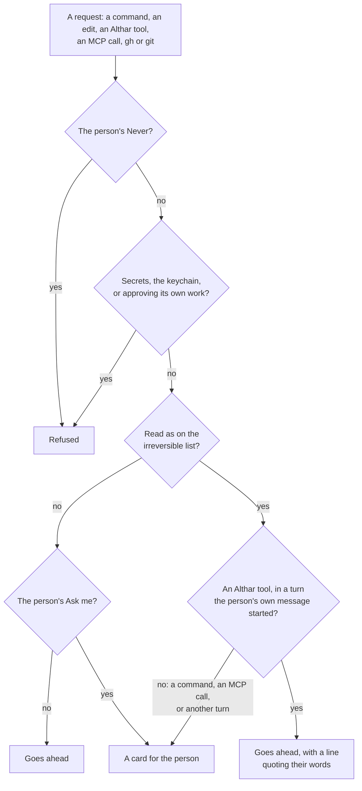
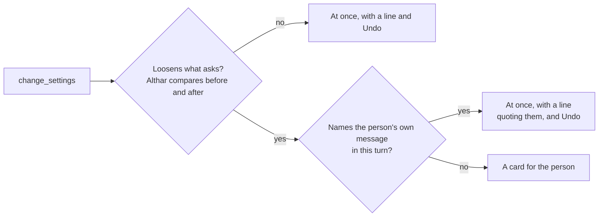

# ADR-097: Agents work as the person's own: everything is allowed by default, their MCP servers and skills load in every role, and only what can't be undone asks

- **Status:** Accepted, to build in the phases of
  [docs/plans/capable-by-default.md](../plans/capable-by-default.md)
- **Date:** 2026-11-06
- **Supersedes, in part:**
  [ADR-004](004-coordinator-is-an-agent-session.md) (the coordinator is
  always on, and tasks can also start without it; read-only is tidiness),
  [ADR-011](011-own-connectors-for-hosts-and-trackers.md) (agents without the
  person's sign-in; tools only on the task's repository),
  [ADR-013](013-project-rules.md) (what asks by default; revisions as the
  person's alone),
  [ADR-016](016-push-without-a-connection.md) (the person's MCP servers
  switched off; leads never pushing themselves),
  [ADR-026](026-connecting-walks-the-person-in.md) (agents run with `gh` and
  `glab` signed out),
  [ADR-027](027-what-the-flatpak-reaches.md) (no SSH agent or signed-in tool
  reaches an agent in the Flatpak),
  [ADR-030](030-the-lead-resolves-conflicts-and-althar-pushes-the-merge.md)
  (the lead has no way to push its merge),
  [ADR-035](035-a-task-s-kind-is-read-from-what-it-has.md) (a review runs
  nothing and posts only on Post),
  [ADR-043](043-allow-everything-is-one-switch-for-a-project-or-a-task.md)
  (allowing everything is opt-in; the host only through Althar),
  [ADR-050](050-an-agent-joins-where-althar-can-hold-it-to-asking.md) (who may
  lead a review),
  [ADR-052](052-a-task-attaches-to-a-pull-request-it-didn-t-open.md) (forks),
  [ADR-057](057-a-lead-works-outside-its-sandbox-through-althar-s-tools.md)
  (a review's lead gets no tools; screenshots of this computer only),
  [ADR-058](058-the-coordinator-is-a-trusted-reader-in-copies-of-its-own.md)
  (the coordinator installs nothing, reaches no network, loads nothing of the
  person's),
  [ADR-066](066-althar-runs-any-branch-or-pull-request-and-fetches-for-leads.md)
  (leads carry none of the person's sign-ins),
  [ADR-067](067-allow-everything-asks-only-before-what-can-t-be-undone.md)
  (the floor in the other modes),
  [ADR-071](071-the-sandbox-is-the-boundary-anything-inside-it-runs.md)
  (where no sandbox holds, and review steps),
  [ADR-073](073-git-over-ssh-in-the-flatpak-goes-through-the-device.md)
  (agents' ssh kept from the person's SSH agent),
  [ADR-078](078-project-leads-can-read-the-web.md) (Codex's network, the
  `curl` form),
  [ADR-081](081-the-coordinator-acts-on-the-code-host-as-the-person-s-account-can.md)
  (no host sign-in, leads' reach, the web mark, tags asking twice; Althar's
  rules as the person's alone),
  [ADR-086](086-the-coordinator-moves-a-task-on-the-person-s-word-or-asks-on-a-card.md)
  (a card for a task move),
  [ADR-087](087-a-lead-starts-helpers-on-any-agent-in-copies-of-their-own.md)
  (what a helper is given),
  [ADR-088](088-plan-countdown-review-rounds-and-new-project-defaults-are-settings.md)
  (allowing everything is no default),
  [ADR-089](089-the-asks-and-refusals-left-are-what-can-t-be-undone.md)
  (what still asks outside allowing everything),
  [ADR-094](094-skills-one-store-a-curated-catalog.md) (skills for leads
  only, off until turned on),
  [ADR-095](095-skill-and-openspec-files-stay-off-the-repository.md) (skill
  and OpenSpec files held back). Each says at its top what of it this
  replaces.
- **Amends:** [ADR-007](007-permission-requests-reach-althar.md) (what
  becomes an attention request; readers that run tests),
  [ADR-019](019-coordinator-judges-permissions.md) (the judge is a mode the
  person picks)
- **Owner:** Repository maintainers
- **Context:** People use agents for what they can do: their own MCP
  servers, their own skills, running the app, posting what they found. On 6
  November the person ran a design-review skill in Claude Code that built
  the app and Storybook, screenshotted both, compared them and posted the
  result on a colleague's pull request through an MCP server. Althar could
  do none of it: a review's lead runs nothing, gets no skills or MCP servers,
  takes no screenshots, and drafts no pictures.

  A sweep of the ADRs and the code that day ([the plan](../plans/capable-by-default.md))
  counted about 65 limits on what an agent may do, see, reach or use, each
  decided on its own and each sounding reasonable. Together they made Althar
  the most locked down of the tools like it. Read from their source the same
  day, Orca and T3 Code run agents with full access by default, with the
  person's MCP servers, skills and `gh`, and no sandbox (the plan names
  the files and settings that show it). The person's
  direction had already said otherwise than the limits: a task is a loose
  container of parts (13 October), and Althar is permissive by default, with
  only crossings that can't be undone asking (29 October).

  The person's decisions on the plan, on 6 November, in their words: "I
  would allowEverything as default, yes. Um including the mcp_servers … We
  should try and prefer our own path, but like if you have a look at you
  know what does claudeCode do, right? It still manages PRs, Orca still
  manages PRs. T3 code, I think, might also manage PRs for you. So if all of
  these other tools can do it, then I don't think this is the place where we
  should be different. We should not be limiting people. Rewrite every ADR
  that implies that we are making that choice." Of the coordinator: "It is a
  good concept. Maybe we should not force the people into it … Even a lead
  should be able to start a new task. They should share an MCP pool. There's
  no reason for them to have different capabilities … Maybe coordinators
  should really not be making changes. But that's mostly a choice in so far
  as, you know, if it does make a change and it makes things a little bit
  messy, but not because of a security thing … Anything that I'm able to do
  on the UI, the coordinator should be able to do. And most likely … maybe
  even the lead." Later the same day they took the settings in too: the
  coordinator, and leads from the same pool, change the project's settings
  and Althar's own, as the person can on the Settings screens. Today an
  agent keeps the project's notes, how it runs and its automations, and
  nothing else there.
- **Decision:** an agent Althar starts works as the person's own agent, with
  their MCP servers, their skills, their sign-ins, the network and the
  project's tools, in every role. It asks only before what can't be taken
  back.
  1. **Allow everything is the default,** for new projects and existing ones
     ([What asks](#what-asks)).
  2. **The person's own MCP servers and skills load in every role,** each
     with a switch to turn it off. Althar's own tools and paths are
     preferred where they exist, never imposed
     ([The person's setup](#the-persons-own-setup-in-every-role)).
  3. **The irreversible list applies to MCP calls and to the person's own
     `gh` and git** as far as the agent's permission hooks let Althar see
     them ([MCP](#mcp-calls-and-the-irreversible-list),
     [Sign-ins](#the-persons-own-sign-in)).
  4. **Leads and the coordinator share one pool** of tools, MCP servers and
     skills. Leads ship code and the coordinator doesn't change code, which
     is tidiness, not safety ([One pool](#one-pool-for-leads-and-the-coordinator)).
  5. **The coordinator and leads change settings,** the project's and
     Althar's own, everything the Settings screens show, through one pair
     of tools. Each change is said in a line and can be undone; one that
     loosens what asks needs the person's own message in that turn
     ([Settings](#settings)).
  6. **The coordinator is always on, and tasks can also start without it**
     ([Tasks can start without the coordinator](#tasks-can-start-without-the-coordinator)).
  7. **What stays** is a short list, each line for a reason no tool takes
     away ([What stays](#what-stays-and-why)).
  8. **Two questions the person hasn't settled** take the plan's
     recommendations, marked so
     ([Recommended](#recommended-not-yet-settled)).
- **Alternatives considered:**
  - **Agents keep no host sign-in, with Althar's tools widened and the
    person's MCP servers allowed:** the plan's first recommendation. Althar
    would keep one recorded way to the host. The person chose not to limit
    people where Claude Code, Orca and T3 Code don't; Althar's path stays
    the one its briefs prefer and the one it records.
  - **The person's MCP servers only for task leads,** or only servers
    Althar has read: each is a limit the others don't have, and the design
    review needed them in a review's lead.
  - **An MCP broker of Althar's own** (architecture
    [06](../architecture/06-integrations-and-skills.md#local-broker)): Althar
    starts and relays the person's servers, so every call is seen whatever
    the agent. It would close what the agents' hooks miss, but it has to
    carry each server's own sign-in (OAuth, a stdio server's environment, a
    remote server's token), which is a large build. Kept for when phase 1
    shows what slips past ([below](#mcp-calls-and-the-irreversible-list)).
  - **Allow everything for new projects only:** the person chose existing
    ones too.
  - **The coordinator as the one way work starts:** the person found it a
    good concept, not one to force.
  - **Letting the coordinator change code:** the person kept it from that,
    for tidiness: a change is a task with a branch, a review and a record,
    and an edit in the coordinator's throwaway copy has none of them.
  - **Merging two tasks into one:** wanted once, then set aside on 6
    November as a rabbit hole. Out of scope.
  - **Settings as the person's alone,** as ADR-081 had Althar's rules: the
    person wants the coordinator to do whatever they can in the window.
    What made it the person's, that an agent could free itself from an
    ask, is kept by the one exception for loosening.
  - **One settings tool per section:** [below](#settings).
- **Trade-off:**
  - **The person's credentials sit in unattended sessions.** With their `gh`,
    git sign-in and MCP servers, a lead steered by a page, a comment or a
    pull request can act on the host as them. What can't be undone still
    needs their word where Althar can see it, git's guard still stops a
    force push, a push to the default branch and deleting another branch,
    and the never list on the host holds for Althar's own calls. A call
    Althar can't see goes ahead, as an unreadable command already does
    ([ADR-067](067-allow-everything-asks-only-before-what-can-t-be-undone.md#amendment-what-the-rules-cant-read-goes-ahead)).
  - **MCP calls are read by name and arguments, not by what they do**
    ([What it can't catch](#what-it-cant-catch)).
  - **What an agent pushes itself has no receipt of Althar's,** and goes
    round the holds Althar puts on a push
    ([What's lost](#whats-lost-when-an-agent-pushes-itself)).
  - **The web mark goes.** An outside author's words that reach a
    conversation no longer make its web reads ask
    ([ADR-081](081-the-coordinator-acts-on-the-code-host-as-the-person-s-account-can.md#the-web)).
    A stranger's comment could steer an agent into sending private code out
    in a URL. The project's switch, "Leads can reach the web", stays the
    person's control for that, and an outside author's review keeps its
    commands offline.
  - **Leads starting tasks, and acting on tasks, cost usage** the person
    didn't ask for task by task. The cost caps and the places among agents
    at work hold it.
  - **Agents change settings unasked.** A lead steered by a page could
    rename the project, turn a rule tighter, or raise review rounds and
    agents at once, which spends more of the person's plan. Each change is
    a line with Undo, and none that loosens what asks goes without the
    person's words.
- **Revisit when:** an agent loses work, publishes, merges or speaks for the
  person through an MCP call or a sign-in Althar didn't see; the person
  meets cards they didn't want, with everything allowed; agents change
  settings the person keeps undoing; an agent's hooks
  let MCP calls past Althar for good (then the broker); a project is shared,
  and it matters whose sign-in and whose word count; the person settles the
  two [recommendations](#recommended-not-yet-settled) otherwise.

## What asks

Allow everything is on for every project: a new one is made with it, and
each existing one gets a revision of its rules with it on, recorded as of
this decision. The person's own Never and Ask me rules, command rules and
the mode under the switch stay as they were: Never still refuses, a command
they ask about still asks, and turning the switch off gives back what the
project had. A task's own switch reads as on wherever its project's is
(ADR-043). The switch shows nowhere on a task's header or card (the
person's note of 16 October).

Only this list asks, in every role, sandbox or not:

| Kind | What | Why it can't be undone |
| --- | --- | --- |
| **Lost work or history** | A force push (`+ref` and `--mirror` included); a push to the default branch, or deleting it; deleting, or moving by force, another branch whose commits are on no other ref, here or on the remote; discarding changes in another checkout, the person's own above all (git that throws work away there, replacing a file there); deleting or moving away what's outside the task's worktree, and removing a worktree that isn't the task's | What was there is gone, for the person and for every checkout that shares it |
| **Publishing, releases, teardown and merging** | Publishing a package; a release, a release tag, and moving or deleting a tag; tearing down (`destroy`, `kubectl delete` and the like, ADR-089); merging a pull request, entering a merge queue or turning on auto-merge | It reaches every user, updater or environment at once, and a registry never takes a version back |
| **Speaking for the person to others** | Posting a review or a comment on a pull request or issue that no task of Althar's opened, follows or came from; replying to an outside author; a message to anyone through another service (an MCP server's Slack message or email) | Their notification can't be called back |
| **Secrets and the keychain** | Reading where keys and sign-ins are kept (`~/.ssh`, `~/.aws`, token files: `SECRET_PLACES`), and the keychain's `security` or git's helpers called directly. Refused, not asked: there is no answer the person would want to give | A credential sent to a model's provider can't be taken back |
| **An agent answering its own permission request** | Refused, whoever asks; as is anything else that approves an agent's own work: approving a pull request a task opened, making a commit status or a check run, dismissing a review (ADR-081's fourth limit), and widening what the host lets agents do (its protection, access and settings). Loosening Althar's own rules and switches isn't refused: it goes only on the person's own message ([Settings](#settings)) | Otherwise none of the above holds |

**Asking is the person's word, and nothing else's.** Althar's own tools for
what's on the list (merging, tags, releases, posting) are asked-for: they
name the words they act on, so the person's own message in the turn is their
word, and the tool goes ahead with a line saying what it did and which words
(ADR-081, `byPerson`); in any other turn it is a card. A command or an MCP
call on the list names no words, so it asks on a card, as a command does
today (ADR-067), even in a turn the person started. That is one reason the
briefs prefer Althar's tools. The coordinator's judge never answers any of
it, and no agent does (ADR-019).

**Everything else goes ahead, unasked:** commands the rules can't read
(scripts, heredocs, variables), with a sandbox or without one; writing
outside the worktree; global installs; deploys to preview; every stash
operation; `git reflog expire`, `git gc --prune` and the like; a `.env`
the task doesn't own, as ADR-067 has it; the network; running and
screenshotting the app in any role; reading any pull request or issue in
the project's repositories. What can be got back isn't worth a question.

**The floor goes in every mode.** ADR-067 kept the whole floor (the stash,
what git keeps to recover lost work, a `.env` outside) asking in the modes
other than allowing everything. Those modes are now the person's choice to
be asked more, and what they want asked there they say in Ask me. Turning
the switch off in a new project gives the built-in Ask me list, which is
the list above.

## The person's own setup, in every role

Every role gets it: a task's lead, the reviewer of a task's change, a
review's lead, the coordinator, and a lead's helpers (ADR-087). Not the
permission judge, which stays tool-free (ADR-019), nor a model probe.

- **MCP servers.** Each agent loads the servers the person set up for it,
  as it would in their terminal: from their user and local config, and from
  a repository's own (`.mcp.json` and the like) where the agent's own trust
  would load it, never from an outside author's pull request. Claude Code
  stops taking only Althar's (`strictMcpConfig`), and Codex and OpenCode
  stop having the person's switched off by name as they start (ADR-016's
  mechanism, `provider-adapters` `ownTools.ts`). Settings lists each server
  the agents would load, with a switch to turn it off, everywhere or for a
  project. Althar's own server is always there.
- **Skills.** The person's own skills and plugins load, as their agent
  loads them. Althar's catalog is on by default, for every role, and each
  skill has its switch (ADR-094). A skill's `hooks` frontmatter is still
  refused at install, since it runs code as the skill loads;
  `allowed-tools` is fine, since nothing it would allow asks now.
- **Skill and OpenSpec files in a change** go up with the rest of its diff,
  which the review reads. ADR-095's switches and its held push go.
- **Claude Code's auto-memory** is on: it writes to the person's own
  `~/.claude`, as running Claude Code themselves would.
- **Althar's path first, never imposed.** Every brief says what Althar's
  own tools give that another way doesn't: a push Althar makes is recorded,
  held where someone else pushed, and goes where the project sends it; a
  pull request, review or issue through Althar's tools gets a receipt and a
  line in the thread. An agent that uses the person's server or `gh`
  instead isn't refused for it. What it does is read against the list
  above, as below.

## MCP calls and the irreversible list

The person's MCP servers can merge, post and push: a GitHub server with
their token does all three, outside Althar's held pushes and outside the
rule that only the person's message sets off a merge or a post. The person
chose not to limit people, so MCP is allowed. The irreversible list applies
to MCP calls as far as the agent's permission hooks let Althar see them.

**Recommended: every call to one of the person's servers reaches Althar as
a permission request, and Althar reads it by server, tool and arguments.**

- **How each call reaches Althar.** Each session gets an ask rule for each
  of the person's servers (Claude Code's `mcp__<server>` rules, which win
  over the person's allow rules as Bash's ask rule does), or the agent's own
  per-tool ask where it has one (OpenCode's permission patterns). Each call
  then arrives as ACP's `session/request_permission`, as commands do
  (ADR-007), and Althar keeps what it says of the call: claude-agent-acp
  puts the tool's name and its server in the request's `_meta`, which
  Althar's adapter drops today (`AgentConnection.ts`), so a foreign MCP call
  is read as a command from its title, matches no kind and goes ahead.
  codex-acp sends Codex's approval of an MCP call there only as a fallback,
  so which of Codex's calls reach Althar is read in phase 1. Copilot, Kimi
  Code and Mistral Vibe load the person's servers already; their calls ask
  as their modes have them (03).
- **How Althar reads it.** Most calls go ahead at once, with the rules'
  quiet line under the turn. A call is on the list where it plainly is one:
  - by its tool, for the servers people use for their hosts and trackers
    (GitHub's, GitLab's, Linear's and Atlassian's own servers): a merge, a
    release, a tag, a ref deleted or forced, a file written to the default
    branch, a review or comment on a pull request or issue that no task of
    Althar's opened, follows or came from;
  - by what its name says, for any server: a merge, a publish or a release,
    a deletion, a force, or sending, posting or replying to someone;
  - by its arguments, for a server's general call (a `graphql` or `api`
    tool): a GraphQL mutation or a REST method and path, placed as ADR-081
    places Althar's own gated call.
- **On the list, it asks** as a command on the list does: a card, never
  judged, even in a turn the person started, since the call names none of
  their words. Althar's own tool for the same thing (`merge_pull_request`,
  `push_tag`, `post_review`) goes on their message with no card. What widens
  what agents may do (a repository's
  settings, protection, access, secrets, webhooks, the families of ADR-081's
  never list) is refused, as through Althar's own call.
- **Recorded either way:** each call's server, tool and how it was answered
  are kept with the turn, as a command's are.

### What it can't catch

- **A tool whose name and arguments don't say what it does:** a shell or
  browser server, a general `execute`, a `run_workflow` that publishes, a
  `sync` that force-pushes.
- **Speaking for the person on a service Althar doesn't know,** where the
  tool's name doesn't say it sends.
- **Calls the agent doesn't send through Althar:** an agent with no
  per-tool ask for MCP, or one whose own settings answer before Althar's
  ask can. Each agent's case is read in phase 1, and an agent whose MCP
  calls can't be held goes in its registry entry's `knownGaps`.
- **Steering:** a page, a comment or a pull request could take the agent
  to a call the person didn't mean. On the list, the card shows it before it
  goes; off the list (a reply on the task's own pull request, a read), it
  goes ahead, with its line in the thread, as ADR-081 accepted for Althar's
  own tools.

What slips past goes ahead, as an unreadable command does. An MCP broker
of Althar's own, under the alternatives above, is the way to close it, if
it comes to matter.

## The person's own sign-in

Agents may use the person's own `gh`, `glab` and git sign-in where they have
one set up: their `gh` and `glab` config, git's credential helpers and their
SSH agent are no longer taken out of the agent's environment
(`runtime/src/Config.ts`, ADR-011). The proposed project switch is not
implemented by this sweep; the inherited environment is the default.

In the Flatpak the person's sign-in is on the device, not in the sandbox
(ADR-027, ADR-073). Agents that run on the device get it as their
environment crosses. For those in the sandbox, passing the SSH agent's
socket in, which ADR-073 turned down only for ADR-011's sake, is the
plan's recommendation; `gh` and `glab` need their config's folder too.

- **The rules read `gh` and `glab` as they read git,** no longer refusing
  what changes a host: `gh pr merge`, `gh release create`, a tag pushed,
  `gh api` deleting a ref, a comment on someone else's pull request, and
  the rest of the list ask; the rest goes ahead.
- **git's guard holds whatever sign-in pushes** (`pushGuard.ts`): a force
  push, a push to the default branch and deleting another branch are
  stopped in the agent's own git, as now.
- **Althar's push stays the preferred path, and the recorded one.** A
  lead's commits push as its turn ends (ADR-072), and `push_to_pull_request`
  and `fetch_from_remote` stay its tools (ADR-066).

### What's lost when an agent pushes itself

- **The receipt:** what reached the host, when and as whom, which Althar
  keeps for each push of its own.
- **The hold:** where someone else pushed to the branch, Althar holds its
  push and shows the person what would go; the agent's plain push is
  refused by the host instead, and only the guard stops it forcing.
- **Where it goes:** a fork's branch upstream or on the fork (ADR-085), and
  an attached pull request's own branch name (ADR-052). The agent pushes
  where its own remote says.
- **Whose name:** the commits go up as the person's own account, which may
  not be the connection Althar uses.

### How Althar notices

Althar reads the task's branch on the remote after each of the lead's turns,
as it fetches before a push anyway, and in its sweep. A head it didn't push
that is a commit of the task's worktree is the lead's own push: a line in
the thread says so, and Althar takes it as the task's, so it neither holds
the next push nor ends an errand as someone else's push would (ADR-081). A
head that isn't the worktree's is someone else's, as now. A pull request
opened with `gh` on the task's branch is adopted, as one opened some other
way already is (ADR-011). A merge or a release made with `gh` comes as news
when the next read sees it.

## One pool, for leads and the coordinator

Leads and the coordinator get the same Althar tools, the same MCP servers
and the same skills. Two things differ, and neither is a matter of safety:

- **A lead ships code.** It works in its task's worktree, commits, and
  Althar pushes and opens its pull request.
- **The coordinator doesn't change code.** Its edit tools stay denied, and
  it works in copies of its own (ADR-058). This is tidiness: a change made
  there has no branch, no review and no record, and is thrown away with the
  copy. A change is a task. It may install, build and run tests in its
  copies, and its sandbox reaches what a lead's does.

**Leads may start new tasks:** `draft_task`, `start_task`,
`review_pull_request` and `propose_plan` for what they drafted. A task a
lead started says so in its thread, and is the project's like any other.
It records the lead's task as its parent (`tasks.parent_task_id`): its card
says "Started by" that task, and the lead's thread has a line linking to
it. What a lead starts waits the plan's countdown, its quick tasks too, so
the person can hold it, and a lead starts at most three tasks in a turn
and ten from its task in all (`LEAD_STARTS`). A lead turns its own task
into another kind this way: a prototype's real build, or a review's fix, is
a task of its own, started from it; `make_it_a_change` still turns a quick
task into a change in place.

**The coordinator directs leads.** It tells a lead what to do next
(`message_lead`), tells one to push or pushes its task as the Push button
does, coordinates several, and does on a task whatever the person can in
the window: accept, merge on the person's word, stop, hold, restart,
settle or discard, review again or skip the review, attach a pull request,
rename, open a new pull request, mark one ready, run the project. Each goes
at once, with a line in its thread and the task's (ADR-086's lines stay;
its card for a move can be undone goes). What can't be undone, a merge
above all, waits for the person's word, as [above](#what-asks). Turning an
automation on or resuming one stays on the person's word: it spends their
plan on a schedule, beyond any task's caps.

**Leads can do most of this too,** with the same tools, on their own task
and on the project's others, with the same lines. The coordinator stays
where work that spans tasks lives by its brief, not by a rule: batches, the
merge line, releases (ADR-081).

**The person's own, still:** answering a permission request or a question,
and loosening what asks, which an agent's change to the settings does only
on their message ([Settings](#settings)).

## Settings

The coordinator does on the Settings screens what the person can, and so do
leads, from the same pool: the settings of the project each works in, and
Althar's own.

**Recommended: one pair of tools, `read_settings` and `change_settings`,**
not one per section. One per section would put some sixteen more tools in
every session of every role, and a new setting would wait on a tool of its
own. The pair names a section and a setting as the screens' addresses do
(`project/rules`, `althar/plans-and-reviews`), so a setting to come is there
once its screen has it.

- `read_settings` gives one section's settings, or every section's: each
  with its words as the screen shows them, its value, the values it takes,
  and whether a change to it would loosen what asks.
- `change_settings` takes a section and what of it changes, in the shape the
  screen sends, and goes through the call the screen makes
  (`SetProjectRules` against the revision it read, `SetPlansAndReviews`,
  `SetSkillActive` and the rest), so the screen shows the change at once.
- One tool per section would show the agent each section's schema before
  it calls; the pair gives the same in `read_settings`'s first answer.

| Screen | What it covers | A change |
| --- | --- | --- |
| The project's General | Its name; where new tasks start (locally or in a worktree); work toward; resolving conflicts, pushing the lead's commits, posting screenshots and moving issues, each automatically | At once |
| Code and issues | Its repositories, and each one's role; its tracker, and where drafts go | At once; adding a repository or connecting a host or a tracker, and leaving a repository out, are [the person's](#what-stays-the-persons) |
| Rules | The mode under the switch; Allow everything, for the project or a task; Never and Ask me; commands that run outside the sandbox, and hosts it reaches; Leads can reach the web; Agents use my code host sign-in; which of the person's accounts its work runs on, and the usage limit; how a task ends | Tightening at once; loosening on the person's message |
| Running | What it runs; its setup before each task; worktrees; branch and pull request names | At once. A setup runs outside any sandbox, as one a lead records already does (ADR-080) |
| Notes | Its notes | At once, as `keep_note` does |
| Agents | Which agent and model each role uses, efforts, models turned off | At once |
| Skills, and MCP servers (from phase 1) | Each skill's and each server's switch, everywhere or for a project | Off at once. A server switched back on is loosening: it hands agents a sign-in again |
| Code hosts and trackers | Connections | [The person's](#what-stays-the-persons) |
| Work on this computer | Agents at once; keeping awake; CPU and memory in the bar; opening at login; pausing all automations; when finished tasks' folders go | At once; un-pausing automations on the person's word, as resuming one is |
| Plans and reviews | The plan's countdown; review rounds; what a task does when they run out | At once |
| New projects | What a new project's rules start from: the mode, the usage limit, moving to an agent's next account, how a task ends | The mode as in Rules; the rest at once |
| Reviews and pull requests | Posting reviews of the team's pull requests without asking; Althar as co-author; the review seal | Posting without asking, turned on, is loosening; the rest at once |
| Notifications, Appearance, Editor | Sounds, and when; light or dark, the icon, where what needs the person shows; the editor | At once |

About has nothing to set.

**What loosens what asks.** A change loosens what asks where, after it,
something that would have asked or been refused goes ahead, or an agent
reaches what it couldn't:

- in Rules: the mode toward fewer asks (Ask me, then the coordinator
  decides, then allowed); Allow everything on, for the project or a task; a
  rule taken out of Never or Ask me, or moved from Never to Ask me, a kind
  of the irreversible list among them; a command added to what runs outside
  the sandbox, or a host to what it reaches; Leads can reach the web, or
  Agents use my code host sign-in, turned on;
- elsewhere: an MCP server switched back on; the team's reviews posted
  without asking; automations un-paused; New projects' mode toward fewer
  asks.

Althar decides which a change is, not the agent: the contract marks each
setting with the way it loosens (an order for the mode, taking out or adding
for a list, on or off for a switch), and a change that loosens anything is
loosening as a whole. A setting with no mark is plain. Secrets stay refused
whatever is set: no setting opens `SECRET_PLACES` or the keychain. The
host's own settings (its protection, access and secrets) aren't Althar's,
and stay refused, as ADR-081's never list has them.

**Loosening goes on the person's own message, in that turn,** as an
asked-for tool does ([What asks](#what-asks)): `change_settings` names the
words it acts on, Althar checks they are the person's own message in the
turn (`byPerson`), and the line quotes them. In any other turn it is a card
the person answers. The judge never answers it, and no agent does.
Otherwise an agent could get past an ask by changing the rule that made it
ask, which is approving itself. The person's word comes from the window or
a paired device, as ADR-048 has it.

**Tightening, and every other change, goes at once.** An agent may turn
Allow everything off, add a Never rule or pause the automations: asking
more can be undone, and the person sees it.

**Each change is said in a line, and can be undone.** The line is in the
thread of the agent that made it: the setting, what it was, what it is now,
and Undo. Settings shows who changed each setting last, and when. Undo puts
back what was there, as a change of its own: the person's press is their
own word, and an agent's undo goes as any change does, so undoing a
tightening waits for the person's message. A change is recorded as the
agent's, with the person's words where it acted on them; until now each
revision of the rules was recorded as the person's (ADR-013). The rules keep
their revisions; the other sections keep what was there in the line.

### What stays the person's

- **Signing out, removing a connection or an account, leaving a
  repository out, and taking the project out of Althar** go on the
  person's word, as asked-for tools do: only they can undo them.
- **Signing in, connecting and adding a repository** need them there
  anyway, in a browser, with a key or picking a folder: the tool opens the
  walk-in or the picker, as Connect and Add do, and they finish it
  (ADR-026).
- **Answering a permission request or a question** stays theirs alone
  (ADR-019).

## Situations: what Althar says in a thread of the work around it

Five things happen to a task that its lead, working alone, cannot see or say.
Each is a line in the task's thread, where it happens, in Althar's own voice
(the kit's `AltharLine`, in its warning tone where the person may need to act),
and each has what the runtime needs. They went from the #640 prototype with
these changes to its sketches:

- **A Never rule an agent meets.** The call stands declined, and under it:
  "Refused by your rule `rm -rf ~/Library`. The lead was told so. Rules". The
  same words, "Refused by your rule `rm -rf ~/Library`.", are the tool's result
  to the lead (`refusedWords`, Permissions.ts). Nothing asks and nothing waits:
  Never is the person's answer given ahead. A kind the project never allows
  reads "Refused by your rule against force pushes."
- **An ask that waits while the person is away.** The request records where it
  reached the person besides the window (`attention_request.reached`: the
  device and when) and its card says how long it has waited: "Waiting 40 min ·
  sent to your iPhone at 13:20". *Different from the prototype:* nothing in
  Althar sends to a device yet, so the record is what a channel calls
  (`Permissions.reached`) and the line shows only where it was. Once a request
  that reached a device has waited three minutes, its lead is let go on without
  it (`Permissions.setAside`, Situations.ts): the call is refused with a word
  saying the person is away, the request stays open for the person and is out
  of the session's way, and the lead is told when it is answered. An allowed
  call goes through once, the next time the lead makes the same call, short of
  what is never allowed. The kept call is the person's to answer, not a
  suspended one: an agent's permission request cannot outlive its turn, so the
  lead repeats it.
  The request belongs to the person, not the session: it stays open when the
  lead's session ends, and is answered all the same. It does not survive
  Althar restarting, whose agent processes end with it; those are withdrawn
  when it starts. Answered after the lead's session has ended, a request of a
  task still open starts its lead again, in its place among the agents at work,
  to read the answer (`Runs.answered`, as for a question); a stopped or settled
  task's lead is left, the answer queued.
- **A task a lead started that stops reaching its parent.** Settled without a
  change, failed, or stopped by the person (stopped by anyone else says
  nothing): once, a line in the parent's thread in its warning tone, "<child>
  stopped without a change: <why>. Its report" (or "stopped by you"), and
  news that wakes the parent's lead, started again if it had stopped, as
  `message_lead` does (`task.parent_told` keeps that it was said). The why is
  the first sentence of the child's last report.
- **Two tasks changing the same files.** Overlaps.ts already told both leads
  once; it now also puts "<other task> changes `TaskView.tsx` too. Both leads
  were told." in each thread. Nothing on the board.
- **A server that fails mid-task.** claude-agent-acp reports a server that
  failed to start or needs signing in in a notice's `_meta.claudeCode`
  (`kind: "mcpServerStatus"`); a call to that server that then fails keeps
  which server and how (`server` on the tool call; the server is remembered from the
  event that named the call, since the update that fails carries only its status), and the thread says so
  under the call: "Claude Code isn't signed in to Linear, so this didn't go
  through. Sign in". *Different from the prototype:* the call isn't turned to
  done by signing in (the lead goes on, and Althar can't repeat its call), and
  the line doesn't say what the call would have done: Althar knows its title,
  not its effect. Sign in opens the agent's sign-in in Settings until the MCP
  servers' own page can take it.

## Tasks can start without the coordinator

The coordinator is always there. There is no switch, setting or mode to turn
it off, in any project. A task can also start without going through it: from
the board, from the composer, or from a lead. The coordinator stays the place
for triage, routing, launching a batch of tasks from the tracker, and merging,
and it directs the leads. Its session starts when the person talks to it, or
when news it acts on wakes it; that is not a setting and doesn't turn it off.
How a task started without it gets its plan and models fast is phase 2's,
beside the work on making small changes finish in minutes.

## What stays, and why

| Kept | Why |
| --- | --- |
| The OS sandbox writes only the worktree, the temp folder and the tools' caches (ADR-071) | It's why commands needn't ask |
| The irreversible list asks in every mode, never judged ([above](#what-asks)) | Lost work, a merge, a publish or a word to others can't be taken back |
| git's guard hooks on pushes and branch moves (ADR-071, ADR-089) | A script can hide a force push |
| Secret files and the keychain are refused | Leaked credentials can't be taken back |
| No agent answers its own permission request, approves its own work, or loosens what asks without the person's words ([Settings](#settings)) | Otherwise none of the above holds |
| Asked-for tools go only on the person's own message (ADR-081); a command or an MCP call on the list asks on a card, [as far as Althar sees it](#what-it-cant-catch) | News, pull request text and a lead's words can't merge, publish or post |
| An outside author's code doesn't run without the person's word, and none of its repository's settings, hooks or MCP config load ([below](#recommended-not-yet-settled)) | A stranger's code on the person's machine |
| Cost caps: a step's turns and hours, review rounds, helpers' counts (ADR-081, ADR-087, ADR-088) | Money, not safety |

## Recommended, not yet settled

The person hasn't decided these. The plan's recommendations hold until they
do:

- **An outside author's pull request is read-only by default.** An outside
  author is someone on a fork, or someone the host doesn't name a member or
  collaborator. Its review reads a copy, installs and runs nothing of it,
  loads none of its repository's settings or hooks, and its commands reach
  no network; the person's own MCP servers and skills load as in every
  role. "Run it", in the thread, makes it the team's kind of review, in the
  sandbox, with the network still off for its commands.
- **Posting on someone else's pull request goes on the person's word in the
  thread,** as an asked-for tool, with no card. A setting of their own
  ("Post reviews of my team's pull requests without asking") still posts
  the team's unasked.

A pull request by the repository's own people, from a branch in the
repository, gets what a task's lead gets: a worktree at its head with the
project's setup replayed, its code run in the sandbox, skills, MCP servers,
the network, screenshots, and a draft that carries pictures.

## As built: the capable-agents UX (the #640 prototype's directions)

The person picked the directions in the prototype of 6–7 November (#640);
this is how they were built, and where the build went another way than
this ADR or the prototype's README.

- **Allow everything is on.** A new project's first rules have it, and an
  existing project whose rules never said gets one revision with it on, the
  first time they are read (`Policies.ts`): an explicit off, the person's
  own, stays off. Their Never, Ask me and command rules stay as they were.
- **What asks, in the project's Rules (direction A).** While everything is
  allowed, Rules lead with the kinds that still ask: lost work and history
  (the default branch, force pushes, every branch or tags, other branches'
  deletion), publishing and merging (`deploy`), speaking for the person (a
  new rule kind, `speak`), each Asks you or Never, and secrets, Never and not
  to be changed, as above; then the person's own Never and Ask me commands.
  *Another way than the README:* the mode and the switch don't go. "Ask about
  more" turns allowing everything off and gives back the sentences, from
  Never to the rest, where the switch turns it on again: a project the person
  had asking about more keeps doing so, and its rules read as before. Deleting
  what is outside the task stays asking, but isn't made Never with its kind:
  its rule kind is all writing outside the worktree, which goes ahead.
- **The person's Ask me holds with everything allowed** (the flow chart
  above), which the rules hadn't done.
- **MCP calls are read** (`mcpActs.ts`, `irreversible.ts`): by the server
  and tool Claude Code's bridge names (`_meta.claudeCode`, or the
  `mcp__server__tool` and `mcp.server.tool` names), then by what the tool's
  name says and, for a general `graphql` or `api` tool, its mutation or
  method. A merge or a release is publishing, a post, review or message
  speaking for the person, a deletion of a branch, tag or file or a push to
  the default branch lost history; each asks, with everything allowed too.
  Every MCP post asks, the task's own pull request's included, as Althar
  can't yet tell from a server's call whose pull request it is; Althar's own
  tools still go on the person's word. The MCP spec's tool annotations
  aren't read: no agent's bridge passes them on yet.
- **The ask card** says Can't be undone, the action on its button, what
  can't be taken back in one line, the words it would post, and the server
  and tool or the command; Not now or the action, with no always. The
  permission request carries it (`AttentionRequest.irreversible`).
- **Each MCP call names its server** in its row; one that acted on the
  outside world stands out under the round's work as a card: the server,
  what it did, the words it posted, Open where its result says where to see
  it (`ToolCallItem.mcp`). Its input and result aren't kept, as before; the
  words it posted are, cut at 600 characters.
- **The person's servers load in every role** (above, "MCP servers"): each
  session is given the servers found in Claude Code's, Codex's or
  OpenCode's own settings, whichever found it, that are on there and ticked
  for its role in Settings › MCP servers, for every project or one, beside
  Althar's own; Codex and OpenCode still have their own switched off by name
  and Claude Code still takes only what it is given, so a session gets
  exactly those, whichever agent runs it. A repository's `.mcp.json` is
  listed nowhere yet and loads nowhere, as its trust is the agent's own.
  The runtime reads the person's agents only where the desktop app gives it
  their home (`agentConfigs`): a test's runtime reads none.
- **One switch keeps the person's agents' servers the same** (`mcpSync.ts`),
  with the dialog before it starts (direction A), To settle, Since, a chip
  per server per file that takes it back out, a server's menu that keeps it
  out of one agent, and Leave them in or Take them out when turned off. It
  writes through `claude mcp add-json --scope user` and `codex mcp add`;
  OpenCode has no such command, so its JSON is edited in place with its
  comments kept. A copy of each file is kept before Althar first writes to
  it, and a record of what it added: taking back removes only that, and only
  while it is still as Althar wrote it: the same command, arguments,
  environment, address, headers and token, and not turned off since; one the
  person changed is theirs, and stays. What it couldn't take back stays its
  own, to take back again, and what an agent's command couldn't do is said in
  Settings. It brings the agents in step as Settings reads them and as each
  session starts, which is when an agent reads its settings, rather than
  watching the files. A pick for a server set up two ways replaces another
  agent's way only where the picked one can go there as it is. A token goes across as its
  variable's name; one written out in a file isn't copied, nor a Codex
  command's variable by name (Codex's `--env` takes values), nor an SSE
  server to Codex: each is said under To settle. Sign-ins open each agent's
  own `mcp login` in a terminal; whether an agent is signed in to a server
  isn't read, so a server Althar copied that signs in on its own shows
  Sign in until pressed.
- **Skills get their own switch** (`skillSync.ts`): it links each skill
  into Claude Code's and Codex's folders (OpenCode reads both), never moves
  or copies one, and takes out only its own links. One name with two
  versions waits under To settle; picking one replaces only a link of the
  person's, never a folder of theirs. *Another way than the README:* the
  skills table has no role columns, as a skill loads by each agent's own
  folders and Althar can't yet hold one back by role.
- **A task's parts (direction C)** sit just before the faces: the worktree
  (with the files it changed, which the files button was), its pull
  requests (Merge from the row where it waits; a failing check's names and
  Ask the lead to fix it), a review draft (Post it from the row), its issue,
  what runs (Open, Stop) and its screenshots. Add opens a pull request or
  attaches one; a worktree (a chat made a change, as make-it-a-change was
  asked of the lead), a review, an issue and a page are asked of the lead in
  the person's words. *Not built:* Access as a part, as with everything
  allowed there is nothing to give a task but what can't be undone, which
  the card asks for each time; Run a check again, and taking an issue off a
  task, which have no command yet.
- **The Situations and the fast lane** are tasks of their own, started from
  this one: the thread (a Never rule met, an ask that waits, a lead-started
  task that stops, two tasks on the same files, a server that fails), and the
  fast lane with Auto's lighter model. The coordinator is never something to
  turn off, in any project.

## What each ADR it supersedes loses

| ADR | What goes | What holds |
| --- | --- | --- |
| 004 | The coordinator as the one way work starts; read-only as a safety boundary | It changes no code, for tidiness |
| 011 | Agents run without the person's sign-ins; `gh` and `glab` writes refused; Althar's tools reach only the task's repository | Althar's connectors; its push and pull request steps, preferred |
| 013 | The six kinds asking by default; "changing the code host" as what no project can change; each revision recorded as the person's | Reading credentials; the person's Never, Ask me and command rules |
| 016 | The person's MCP servers switched off by name; leads never pushing themselves | Pushing with the person's git where nothing is connected |
| 026 | Agents running with `gh` and `glab` signed out | Althar's copy of the token never reaching agents |
| 027 | No SSH agent or signed-in tool reaching an agent | What crosses is built, not inherited; Althar's git through the device's ssh |
| 030 | The lead having no way to push its merge | Althar pushing the merge it checked, preferred; the round and its checks |
| 035 | A review runs nothing and posts only on Post | An outside author's review, read-only by default |
| 043 | Allowing everything as an opt-in; the host only through Althar | The one switch, project and task; Never over it |
| 050 | No review led by an agent a repository's settings can approve for | That rule for an outside author's review |
| 052 | A branch on someone else's fork never attached | Never forced; attached one at a time |
| 057 | A review's lead gets no tools; screenshots of this computer only | The tools themselves |
| 058 | No installs in its copies; no network for its commands; none of the person's setup | Copies of its own, edit tools denied |
| 066 | Leads carry none of the person's sign-ins | `fetch_from_remote`, preferred |
| 067 | The floor in the other modes | The irreversible kinds |
| 071 | Today's rules where no sandbox holds; review steps' rules | The sandbox as the boundary; the guard |
| 073 | ADR-011's boundary on agents' ssh | The device's ssh for Althar's git, the pinned hosts, nothing asking |
| 078 | Codex's shell without the network; the `curl` form | The project's switch; outside reviews offline |
| 081 | No host sign-in; leads only on their task's pull requests; the web mark; a tag asking twice; replies to the team's people unasked; Althar's rules and switches as the person's alone | The four limits, the person's word, errands, the merge line; loosening Althar's rules on their word |
| 086 | A card for a task move outside the person's turn | The lines in both threads; discarding deletes nothing |
| 087 | Helpers without the person's MCP servers and skills | Copies of their own, pushing nothing, the caps |
| 088 | Allowing everything as no default | The settings, read where they apply |
| 089 | `reflog expire` and `gc --prune` asking in the other modes | The guard's reads, teardown and publishing asking |
| 094 | Skills for leads only, off until turned on | One store, the catalog, reviewed installs |
| 095 | The Repository files switches and the held push | – |

## Enforcement sweep, 7 November 2026

The sandbox and environment tranche is built. The rules and session
instructions tranche waits for #684 to merge; the audit marks those rows
pending. This sweep is not complete.

The [limits audit](../plans/no-arbitrary-limits-audit.md) records every
restriction found, its disposition and regression coverage. Sandboxed shell
commands reach every host, without a project host list. Claude Code gets an
open network; Codex gets it in both its session config and the adapter's
per-turn policy; OpenCode has no OS sandbox and goes through the rules.
An outside review remains offline.

The coordinator may read ordinary files anywhere and reach the network;
its OS sandbox still holds writes to its folder and temporary files.
Secret-file protections remain. Common dev servers and test runners started
by hand get the same sandbox exclusions as recorded project commands.

The person's code-host identity is inherited: gh/glab config and tokens,
git's credential helpers and the SSH agent. This completes the environment
part of phase 3 here. Althar's sealed connection secrets and provider API
keys are not inherited. Explicit credential-export commands still refuse.
The git guard remains in place regardless of which sign-in pushes.

Skill and OpenSpec files are ordinary repository files, with no separate
push consent. Copilot's built-in tools remain available. Screenshots may
visit any HTTP or HTTPS page, including redirects, in the existing isolated
browser session; file URLs remain refused.

A refusal that leaves an agent silent is followed up, and any final notice
names the command and the reason Althar refused it. Review workspaces,
reviewers' tool lists and running review code are moved to the task-as-parts
work by the coordinator's direction; they are not a separate path in this
sweep.
