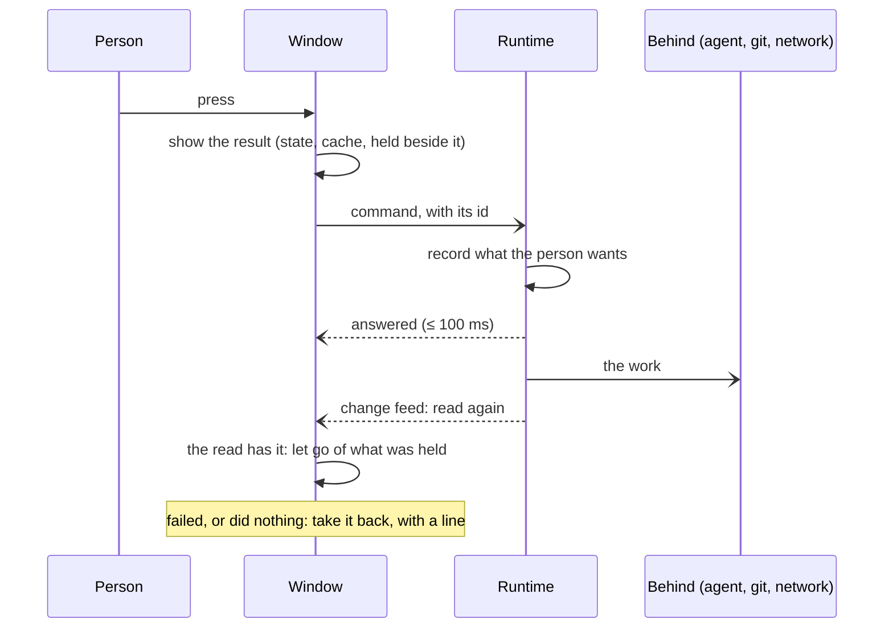

# Foundations

How Althar is put together: the shell and the runtime, how the UI stays instant and quick while the computer is busy, the code's style on each side, how failures are kept small, what CI gates, and the rule that a feature ships for every service that can have it.

**Replaces:** ADR-003, ADR-008, ADR-009, ADR-010, ADR-047, ADR-048, ADR-074, ADR-082

ADR-001, the repository's engineering target, is in [`ARCHITECTURE.md`](../../ARCHITECTURE.md).

## The shell and the runtime

Althar is an Electron app. All of its code is TypeScript, and the runtime needs Node to run the agents' ACP adapters, so one runtime and one web engine was the simplest choice. The cost is a larger download and more memory than Tauri, and Electron's hardening is Althar's job.

- **The runtime runs in an Electron utility process.** The main process starts and supervises it, and hands each window a `MessagePort` to it.
- **`@althar/runtime` imports nothing from Electron.** It also runs under plain Node for tests and the CLI. What a host gives it, such as secrets, fetch and folder grants, comes in as options. What the host does with usage data and crash reports stays the host's (`apps/desktop/src/runtime/runtime.ts`).
- **The adapters run on a Node the app ships**, not on Althar's own binary ([agents.md](agents.md#the-node-the-adapters-run-on)).

How the processes fit together is in [architecture 02](../architecture/02-desktop-runtime.md).

## Where the runtime runs, and who may reach it

Today the runtime runs in the app, one per profile. Work outlives the window, but not the app:

- **Closing the last window** leaves Althar working on a Mac, and anywhere the person chose to keep it working in the background.
- **Quit with work under way asks first.** The runtime counts the leads and reviews in a turn, the runs going, and what agents left running. The window then offers to quit, to keep everything working in the background, or to carry on. With nothing at work, Quit just quits.
- **Open at login** is the person's switch, on a Mac and on Windows. Opened so, Althar starts with no window: the runtime and its automations run, and a window opens when the person asks for one. Linux has no such switch, so none is offered.
- **The store holds its SQLite file locked**, so only one runtime writes to a profile. The CLI runs a smaller runtime of its own in-process, and can't run while the app has the profile open.

**Who a call comes from is set by the host, never by the call.** Each connection is a window, a paired device, a socket or internal (`MessageSender`, in `packages/contracts/src/Api.ts`).

- A message the person writes in the window, or on a paired device, is their word. It covers what the agent works out from it, in the turn it started ([what-agents-may-do.md](what-agents-may-do.md)).
- A client on the local socket can never give the person's word. Every API call is refused to a socket unless the contract marks it as allowed (`SocketAllowed`). A socket client can read, start tasks, talk to leads and stop sessions. It can't answer a permission request or a question, push, merge, post a review, or loosen what agents may do. The reason is that nothing on this computer tells the person's own client from one an agent runs as the person's OS user.

The shared API now gives a profile a persistent home id and pins its host device and owner across launches. A connection has a home, actor, client device and authority; the execution device remains separate. Trusted owner clients can register and revoke Ed25519 client keys. Registered devices currently act for that profile's owner and can reach all its projects. They are not organization members or project guests. Their private keys belong in the client's protected storage, never a workspace. Enrollment UI and protected client key storage have not shipped.

The desktop can opt into a private local socket with `ALTHAR_API_SOCKET=1`. Its private endpoint descriptor carries a fresh launch secret granting socket authority only. A registered key authenticates with a short-lived, single-use signed connection challenge. Authentication precedes RPC; every call checks the API version and current credential. Revocation ends live connections and prevents new commands and cached-result reads. A command already admitted belongs to the runtime and may finish after its client disconnects or is revoked; disconnect is not cancellation.

Commands carrying `commandId` have durable API admission and receipts shared across connections. The id is bound to the method, decoded payload and authenticated identity. Completed retries return their recorded result or refusal. An interrupted or crashed action with no confirmed result becomes `CommandOutcomeUnknown`, rather than running an external effect again. This is not an exactly-once guarantee for an external service. Database-only domain commands keep their transactional receipts.

New clients reconnect with a home, cursor and checkpoint identifying the exact history entry. A restored, missing or divergent history requires a fresh snapshot. The existing desktop's numeric `Watch` remains compatible; remote clients must use snapshot `position` and `WatchFrom`. Native attention now uses the shared typed API. Notifications remain advisory; pending asks are durable in the home.

Not built yet: a persistent headless host, SSH bootstrap, phone pairing, protected mobile key storage, relay transport, worker enrollment and leases, remote filesystem/preview channels, or multiplayer membership and project grants. A socket listener alone does not supply those features.

**Proposed:** [ADR-103](proposed/103-projects-live-locally-or-on-a-host-and-place-work-in-pools.md) would let a project live on this computer, on a host the person runs, or on a managed one. It would add a persistent headless host, SSH beside a relay, and pools of workers that take work on leases. It keeps one writer per profile and keeps paired input apart from what a socket or an agent may do. Until it is accepted, the state above is the current one.

## The UI is instant

Everything the person does shows its result in the frame they do it. The runtime, git, agents and the network catch up behind it, and what fails is taken back with a line saying why. This holds for every screen, on every platform, idle or under load. It was decided on 12 Nov 2026, after a day of bugs that all had one shape: the window waited for something before it showed what the person did, or let an older read take back what it had shown.

| What the person saw | What waited, or what took it back |
|---|---|
| Clear in an aside went back late, and its pill flickered away later still | The press waited for the runtime to settle the task (`markDone().then(onBack)`), and the pill waited for the board to be read again |
| A model picked in the composer showed about 30 s later | The picker awaited the agent's own set-model; #786 records the pick at once (`Sessions.chooseLead`) and sets it on the agent behind |
| A message sent mid-turn showed as sent, then snapped back into the queue | The window guessed "queued" by a rule of its own from a stale snapshot, and the runtime decided by another |
| Ship spun for seconds with the Mac busy | Ship waited for its reviewer's agent and the push, git started on the runtime's thread, and reads scanned tables that grow (#800) |
| Pills flickered | A read from before an action landed after it, and drew the old state again for a moment |

These are the rules. Review holds every change to them, and where a rule can be checked mechanically, a lint or a test checks it.

1. **A press changes the window first.** A handler changes what shows synchronously (state, the cache, a move, a close), then `void`s the call. Nothing is awaited, and nothing waits in a `.then`, before the first visible change. Leaving a screen never waits on a call. *Checked by* `althar/press-at-once` (`lint/press.js`) for handlers written in place. Review checks named handlers and view models' intents, which the lint doesn't read.
2. **What the window showed holds until a read confirms it.** An optimistic change is kept beside the cache, as a pick, a set of cleared ids or a message being sent. It stays until a read that includes it lands, not just until the call answers, and each change is held by its own id, so overlapping ones never undo each other (`useAsideMoves` for an aside cleared or made a task, `useGoneAtOnce` for a removed preset). A read from before the change never takes it back; once one has confirmed it, the reads say what shows. Where the window checks what the runtime did, it reads afresh after the answer, never whichever read happens to be in the cache. *Checked by* a test for each optimistic action that lands an older read after the press, and overlapping ones, and expects no change (`asides.test.ts`, `presets.test.tsx`, the picker's in `useTask.test.tsx`).
3. **What failed is taken back, with a line.** The line is in words, where the person pressed, never silent, and no spinner is left behind. Where the runtime answers but did nothing, the window reads again and says so, as an aside the runtime didn't clear comes back with a line over its composer.
4. **One rule decides, on both sides.** Where the window predicts what the runtime will do (queued or sent now, settled or not, which model the next turn runs on), it uses the same function the runtime does (`@althar/domain`, `@althar/contracts`), or a field the runtime sends. It never uses a guess of its own.
5. **The runtime records what the person wants, answers, and works behind.** A window call answers once the choice is recorded. It never waits on an agent, a remote, a process starting or ending, or a lock that background work holds. Long work shows as progress on what it's about. Examples are `chooseLead` and Ship answering once its run is admitted. The budget is 100 ms for a window call with the Mac busy, and a development build logs any over 250 ms (`lag.ts`). *Checked by* `keyReads.test.ts`, which fails if Ship waits for its reviewer's agent.
6. **Nothing heavy on a thread that answers the person.** That means the runtime's thread, the main process, and the renderer's thread on a press. Processes start on the runner (`spawner.ts`). No synchronous child process and no recursive copy runs on the runtime's or the main process's thread. What is read on every change is found by an index. In the renderer, a press does no work that grows with a thread or a board: lists draw what changed, item by item, and heavy parsing (diffs, highlighting, large output) runs off the press, idle or in a worker. *Checked by* `althar/off-the-thread` (`lint/thread.js`) and `keyReads.test.ts`, the lag log for the runtime, and review with the profiler for the renderer.
7. **The window names what it makes.** A new project is made under the id the window gave it ([desktop-app.md](desktop-app.md#a-new-project)), so the window can show it, and go to it, before the runtime answers. Every command carries a command id, so sending it again is safe (`once`).
8. **Still while it changes.** Nothing jumps as a result arrives. Room is kept for what may appear: an aside's × sits in room its pill always keeps, and streamed words come in place. A read that changes nothing draws nothing, and a list moves as a whole (`ListMotion`). A screen never draws empty what it has read before ([desktop-app.md](desktop-app.md#how-the-window-reads)).
9. **Fast on every platform.** The budgets are the same on macOS, Windows and Linux, and hold on the slowest path each has. Windows starts processes slower and holds folders a moment after them. Linux probes its sandbox, and the Flatpak starts everything through its spawn helper. A platform's slow path is fixed, never accepted as that platform's.
10. **Measured, and guarded once fixed.** A slow path is timed before and after its fix, on a store of the person's size, idle and with every core and the disk busy (`tests/real/responsiveness.test.ts`). The fix comes with a test or a bench that fails on the old behaviour.

**Where waiting is the point,** the press still shows in the same frame that it is under way (its button busy), and the lint's disable line says why: a dialog of the system's, a form only the runtime or a code host can check, whose error goes at its field, or opening what only the answer names. A line that waits for any other reason is a bug, said so on the line ("Not instant yet") and listed below.

How a press runs:

Not built yet:

- **Claude Code's sandbox probe:** it runs bubblewrap with `spawnSync` once a launch, on Linux only, for up to 5 s (`claudeSandboxStarts`). It should be probed asynchronously as the runtime starts.
- **Presses that still wait on the runtime:** deleting an automation, removing a run from its editor, and asking the coordinator what the project runs. Each is marked "Not instant yet" on its line.
- **A message sent mid-turn** still decides "queued" by the window's own rule, until its task lands.
- **Intents inside view models** that wait before they change anything, which the lint doesn't read. They are found in review, as they are touched.

## The window answers while the computer is busy

One runtime thread answers every window and runs every agent's session, so anything that holds it holds every click. Agents' builds and tests compete for the same cores and disk. So:

- **Agents run in the background.** An agent, everything it starts, and a worktree's setup run at niceness 10 (Below normal on Windows). The person's own runs of their project, and Althar's own processes, keep normal priority. A build where nothing else wants the cores takes as long as before. While Althar or the person's other apps want them, those go first. macOS's stronger task policies (`taskpolicy -c utility`, `-b`) were tried: under contention they made a build take 13 to 14 times as long, so they aren't used.
- **Nothing waits on the runtime's thread.** The runtime's own commands, git's above all, start on a runner thread (`spawner.ts`), since starting a process holds the thread that starts it until the child has started, 5 to 30 ms each under load. At most half the cores' worth run at once (2 to 8), and a window's call has as many again of its own, so it never waits behind the background's. Fetches, pushes and whatever else reaches a remote run in a lane of their own, with the same allowance, since they wait on the network for up to minutes: a read of the repository never waits behind them. No synchronous child process or large file copy runs on the thread.
- **The store waits for the disk at checkpoints, not at every commit.** It runs in WAL with `synchronous = NORMAL`, SQLite's own advice for WAL. It stays whole after any crash. A crash of the computer itself, not of Althar, may lose the last moment's commits.
- **What is read on every change is found by an index.** The board, the home and a task's view are read again on each change an agent makes, so none of their statements may read every row of a table that grows with use (items, turns, events, answers). `keyReads.test.ts` fails on one that does.
- **What git said is kept by what it stood on.** The commits a worktree's refs name are read again only once a file they stand on changes (`refStamps.ts`).
- **Ship answers once its run is admitted.** The review's start or the push goes on apart, and shows on the task as it goes. What fails after admission needs the person, as a plan's ending does.

A development build logs each window of five seconds in which the runtime's event loop ran more than 100 ms late, and each window call that took longer than 250 ms (`lag.ts`). `tests/real/responsiveness.test.ts` is a by-hand run that times a task's view, the board, the home and Ship on a store of the person's size, idle and with every core and the disk busy.

The store still runs on the runtime's thread: with the above, its statements took about 1.5 s of a two-minute window under load, and none held the thread past 200 ms. Moving it to a worker of its own is the next step if the lag log shows otherwise.

## Recorded facts are complete; behaviour may start simple

Althar is built to product standard from the first commit. A shortcut is allowed only in behaviour, and only where it is easy to fill in later. Recorded facts and data shapes are complete from the start: process and session ids, event order, who said what, and every task as a graph even where the workflow is fixed. Smarter behaviour is a later change if the facts are kept. If they are missing, the history can't be recovered.

## Effect on the runtime side

Code on the runtime side is written with [Effect](https://effect.website) 4, pinned to one exact release across the repository and upgraded on purpose. The runtime supervises agents and processes for a long time: bounded retries, cancellation in stages, owned process trees, named failure classes, ports with fakes in CI, runtime validation of anything untrusted, and tracing across processes. Plain promises give none of that by default.

- **Where:** `domain`, `persistence-sqlite` (Effect's SQL client and migrator on `node:sqlite`), `runtime`, `provider-adapters`, the workflow kernel, the contract between the window and the runtime (Effect RPC over `MessagePort`), and the CLI.
- **Where not:** `@althar/ui`, whose components take props and report through callbacks; the desktop app outside its data layer; the public site.
- **How:**
  - `Effect.gen` rather than long pipes.
  - One service per port, with its implementations as layers composed only in the runtime's composition root.
  - Tagged errors for each failure class.
  - `Schema` at every boundary.
  - Tests with fake layers and a test clock.
- **Promise-based APIs** (the ACP SDK, Electron, `gh`) are wrapped at the edge.
- **The workflow kernel is Althar's own.** Effect's durable-workflow packages bring a persistence model of their own.

Some of what Althar uses is marked unstable and can change in a minor release: the SQL client and migrator, RPC, workers, `Crypto` and `@effect/vitest`. Read a minor release's notes for these before moving to it. Agents know Effect 3 better and sometimes write it; the type checks catch that.

## The desktop app's layers

The renderer has three layers, and each depends only on the one below it:

- **Views** are React components that compose `@althar/ui`, render what their view model returns, and call its intents. They hold no app logic.
- **View models** are hooks (`useTaskThread`, `useBoard`). They turn data into what a view shows, and intent into commands. They never render.
- **The data layer** is written with Effect. It holds the RPC client, the change-feed subscriptions and the caches. View models see plain values, promises and subscriptions from it, never Effect types.

Code is organised by feature. `apps/desktop/src/renderer/features/<feature>/` holds a feature's views and view models together. Shared code lives in `src/renderer/shared/` and the data layer in `src/renderer/data/`. Routing is TanStack Router. View models are tested as hooks against a fake data layer, and views through stories. A global store was ruled out because it would be a second copy of state the runtime already owns.

## Failures stay with what they belong to

A failure is kept to the smallest thing it belongs to. Where work covers independent things, one that fails says so on its own and the rest carry on, and a loop survives the round it couldn't handle. All or nothing is only for what can't stand in parts, such as a project made of its repositories, or a write in one transaction. This matters because Effect's `forEach`, `all` and `forever` end at the first failure unless each item is caught. One agent's failed check once took every agent off the Agents screen.

- **One way to keep a failure** is `contained` (`packages/runtime/src/Failures.ts`). The failure is logged and reported, and a stand-in that says what is true takes its place. An account whose check failed is `unknown`. An agent whose check failed carries a `problem` in words, shown on its row with Check again.
- **What the person caused or can put right is shown, never reported.** `api()` tells the two apart.
- **The rest is reported at the edge, as a handled crash:** by `contained`, by `api()` for a call that failed for no reason of the person's, and for an agent that stopped on its own (by its id and how its process ended, never what it wrote). It goes through the crash reports' sender, masked and behind the same switch ([packaging.md](packaging.md)). Handled failures have a budget of their own, ten a launch, so they never crowd out a crash.

The rule is also in [`ARCHITECTURE.md`](../../ARCHITECTURE.md#failures-and-diagnostics).

## What CI gates

A merge is gated on Linux, and a release on every platform. Windows' jobs were the slowest and flakiest, and running everything twice made the merge queue wait for machines.

- **A pull request runs what its change reaches, on Linux.** That means the checks of the packages it changes and of those that build on them, and the unit tests whose imports reach a changed file (`packages/testing/src/select.ts`). Once it is ready for review and reaches the app, it also runs the desktop app's whole end-to-end run. A change any test may rest on (the lockfile, root config, lint rules, patches, `@althar/testing`, a workflow) runs everything. Docs run nothing.
- **Its new and changed tests run many times over** (`stress`). The one Windows job is the end-to-end smoke test, for code that behaves differently there.
- **The merge queue checks each pull request again on main as it will be,** up to three at once. `merge queue` is the one check main's rules require.
- **Schedule the same work efficiently.** Runtime and desktop E2E shards use per-file duration history, with every selected file assigned exactly once and unknown files included. When the queue runs full runtime coverage, that execution also satisfies its selected runtime tests; lint and type checks still gate, along with every coverage part and the merged coverage threshold. PR-head stress and Windows smoke requirements must finish successfully or be explicitly inapplicable; missing, cancelled and timed-out work cannot pass the gate.
- **A failing test runs once more.** One that passes only then files a `flaky` issue, and is quarantined while the issue is open: it still runs, but its failure goes on the issue instead of failing the job.
- **After merge, `post-merge` runs everything else on main:** Windows, coverage, the end-to-end run, the installer and the Linux packages. `nightly` runs the whole suite shuffled, and the day's changed tests many times on Windows.
- **Main may be red on Windows or coverage between merges; a release never is.** A failed `post-merge` opens "Main is red", and `release` tags only a commit `post-merge` passed on.

Which workflow runs when, and how to read them, is in [DEVELOPMENT.md](../../DEVELOPMENT.md#changes-and-ci).

## A feature ships for every service that can have it

A feature built for one code host, tracker or agent is built for every one of its kind that can have it. Where that fits in the same change, it is the same change. Where it doesn't, the rest are tasks planned with it, done in the same release, and the feature isn't done until they are.

- **"Can have it" counts what Althar can stand in for.** An errand that merges one pull request at a time, each up to date and green, stands in for a merge queue. Althar's own merge stands in for an update-branch button. A gap is only what neither the service nor Althar can do.
- **A gap is said, never silent.** The adapter's capabilities say it in code (`HostCapabilities`, `TrackerCapabilities`, the agent's registry entry). A screen shows a control only where it works. A tool refuses in the service's words, with why and what to do instead, never as a no-op or a bare `false`.
- **Features are written against Althar's models**, not one service's API, so only the adapter differs. A service's own thing ships as its counterpart elsewhere: GitHub's environment approval is GitLab's deployment approval, and a release is GitHub's draft, GitLab's release, or Bitbucket's tag and downloads.
- **Every adapter meets the feature's contract.** The feature adds a clause to the contract suite, which runs on every adapter's fakes and recorded answers in CI. Where a capability is off, the clause checks the refusal.
- **The gaps are listed, each with why,** in [architecture 06](../architecture/06-integrations-and-skills.md#every-service-alike) for services and [architecture 03](../architecture/03-agent-runtime-and-auth.md#every-agent-alike) for agents.

One exception is the person's choice. The coordinator judging permission requests is a mode only Claude Code runs, and it isn't extended to other agents ([what-agents-may-do.md](what-agents-may-do.md)).

Not built yet:
- reviewing outside pull requests on GitLab and Bitbucket (`capabilities.reviews` is GitHub's alone);
- starting issues on GitHub's and GitLab's issues (`starts`);
- priority and project on every tracker.

## Changes

- 8 Nov 2026: written from the ADRs under Replaces.
- 12 Nov 2026: the window answers while the computer is busy: agents in the background, nothing waiting on the runtime's thread, the store's commits not waiting for the disk, key reads by index, Ship answering once admitted.
- 13 Nov 2026: the UI is instant: ten rules for what a press shows and what never runs on a thread that answers the person, the bugs they came from, and the lint rules and tests that check them (`althar/press-at-once`, `althar/off-the-thread`).
- 14 Nov 2026: shared API identity, private socket attachment, revocable owner devices, durable API command receipts, checked feed positions and native attention. Organization access and commercial entitlements remain separate later work.
