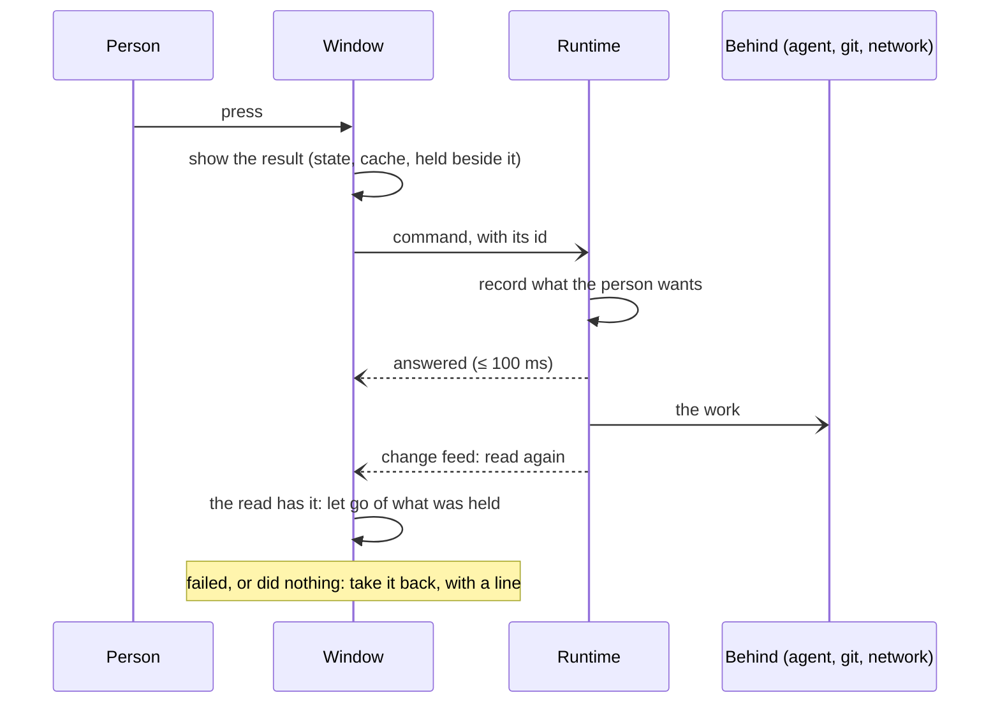

# Foundations

How Althar is put together: the shell and the runtime, clients of another version, how the UI stays instant and quick while the computer is busy, the code's style on each side, the runtime's layers, how failures are kept small, what CI gates, and the rule that a feature ships for every service that can have it.

**Replaces:** ADR-003, ADR-008, ADR-009, ADR-010, ADR-047, ADR-048, ADR-074, ADR-082

ADR-001, the repository's engineering target, is in [`ARCHITECTURE.md`](../../ARCHITECTURE.md).

## The shell and the runtime

Althar is an Electron app. Its shell and existing runtime are TypeScript, and the runtime needs Node to run the agents' ACP adapters, so one runtime and one web engine was the simplest choice. The cost is a larger download and more memory than Tauri, and Electron's hardening is Althar's job. The planned native worker described below does not replace this shell or home runtime.

- **The runtime runs in an Electron utility process.** The main process starts and supervises it, and hands each window a `MessagePort` to it.
- **`@althar/runtime` imports nothing from Electron.** It also runs under plain Node for tests, the CLI and the standalone Linux host. What a host gives it, such as secrets, fetch and folder grants, comes in as options. What the host does with usage data and crash reports stays the host's (`apps/desktop/src/runtime/runtime.ts`).
- **The adapters run on a Node the app ships**, not on Althar's own binary ([agents.md](agents.md#the-node-the-adapters-run-on)).

How the processes fit together is in [architecture 02](../architecture/02-desktop-runtime.md).

## Where the runtime runs, and who may reach it

The desktop runs one runtime per profile. Work outlives the window, but not the app:

- **Closing the last window** leaves Althar working on a Mac, and anywhere the person chose to keep it working in the background.
- **Quit with work under way asks first.** The runtime counts the leads, reviews and helpers in a turn, the runs going, and busy background commands of unfinished tasks. Finished or stopped tasks keep no agent place through their previews; a live turn on them still counts. The window then offers to quit, to keep everything working in the background, or to carry on. With nothing at work, Quit just quits.
- **Open at login** is the person's switch, on a Mac and on Windows. Opened so, Althar starts with no window: the runtime and its automations run, and a window opens when the person asks for one. Linux has no such switch, so none is offered.
- **The store holds its SQLite file locked**, so only one runtime writes to a profile. The CLI runs a smaller runtime of its own in-process, and can't run while the app has the profile open.

**Who a call comes from is set by the host, never by the call.** Each connection is a window, a paired device, a socket or internal (`MessageSender`, in `packages/contracts/src/Api.ts`).

- A message the person writes in the window, or on a paired device, is their word. It covers what the agent works out from it, in the turn it started ([what-agents-may-do.md](what-agents-may-do.md)).
- A client on the local socket can never give the person's word. Every API call is refused to a socket unless the contract marks it as allowed (`SocketAllowed`). A socket client can read, start tasks, talk to leads and stop sessions. It can make a project on the home it is connected to, as an agent's task there could: from a repository it clones there, one the home finds where code is kept on its disk, or a new one in the home's place for projects, each folder by a grant the home makes, never a path the client names (`FindHomeFolders`). Those grants open no more than they name: a repository's opens that repository alone, and only while it is still there, links followed; the place for new code only takes a clone or a new repository, and opens nothing. Each is built in a hidden folder of its own beside where it goes and moved in whole, only where that is still free and never through a link, so two at once of one name never meet. A home tells a socket which calls it may make (`GetConnectionInfo`'s `calls`), and its window offers only those: a home from before it said is asked to update. It can set the home up from the window: connect the code hosts it works with there (a token made on the host's page and pasted, the home's own `gh` or `glab` sign-in, or the host's device sign-in where the home has Althar's app for it), and sign its agents' accounts in there (the agent's page opened in the window's browser and its code pasted back, or a device code). Each credential is kept on the home, sealed out of its agents' reach, as one made on the home itself would be; none of these is on the irreversible list, and none answers for the person. It can't answer a permission request or a question, push, merge, post a review, put a repository on a host, connect, check or remove a tracker (its runtime takes only code-host products and connections from it, and follows only the sign-ins it started), or loosen what agents may do. The reason is that nothing on this computer tells the person's own client from one an agent runs as the person's OS user.

The shared API now gives a profile a persistent home id and pins its host device and owner across launches. A connection has a home, actor, client device and authority; the execution device remains separate. Trusted owner clients can register and revoke Ed25519 client keys. Registered devices currently act for that profile's owner and can reach all its projects. They are not organization members or project guests. Their private keys belong in the client's protected storage, never a workspace. Protected enrollment for clients that may supply the person's word has not shipped. Connection-only pairing below does not grant that authority.

The desktop can opt into a private local socket with `ALTHAR_API_SOCKET=1`. Its private endpoint descriptor carries a fresh launch secret granting socket authority only. A registered key authenticates with a short-lived, single-use signed connection challenge. Authentication precedes RPC; every call checks the API version and current credential. Revocation ends live connections and prevents new commands and cached-result reads. A command already admitted belongs to the runtime and may finish after its client disconnects or is revoked; disconnect is not cancellation.

Commands carrying `commandId` have durable API admission and receipts shared across connections. The id is bound to the method, decoded payload and authenticated identity. Completed retries return their recorded result or refusal. An interrupted or crashed action with no confirmed result becomes `CommandOutcomeUnknown`, rather than running an external effect again. This is not an exactly-once guarantee for an external service. Database-only domain commands keep their transactional receipts.

New clients reconnect with a home, cursor and checkpoint identifying the exact history entry. A restored, missing or divergent history requires a fresh snapshot. The existing desktop's numeric `Watch` remains compatible; remote clients must use snapshot `position` and `WatchFrom`. Native attention now uses the shared typed API. Notifications remain advisory; pending asks are durable in the home.

**Standalone Linux host, 15 Nov 2026:** [`apps/host`](../../apps/host/README.md) runs the shared runtime under Node with a persistent profile, separate-key authenticated encryption, private API health, signal cleanup and a systemd user unit with credential delivery. A client does not own its lifetime. It is a trusted personal OS-user boundary; same-user agents are not isolated workers. Portable signed Linux releases include Node and locked adapters. The managed updater checks/downloads/verifies automatically and applies explicitly by default; optional compatible activation is on the next service start, before accepting work. Incompatible API/storage updates always need explicit approval. An independent controller reserves storage, snapshots and prepares migrations before starting a candidate. Preparation failures may restore the snapshot; compatible startup failures revert code without discarding newer writes; incompatible post-start failures stay stopped for a corrected release. Older code refuses newer schema records. [The host architecture](../../apps/host/ARCHITECTURE.md#immutable-releases-and-recovery) records ownership, trust and recovery decisions. Production signing-key provisioning, actual release publication and real VPS/provider validation remain release work.

**SSH attachment, 15 Nov 2026:** `@althar/transport-node` supplies private-socket and system OpenSSH clients. The host's `connect-stdio` authenticates locally and forwards socket-authority RPC without exporting the launch secret. The CLI can inspect, create a task in a provisioned project or join an existing thread; disconnecting leaves work running. Expected home/API identity is checked before commands, and feed recovery uses checked positions. OpenSSH installation, key provisioning and host setup remain operator steps. [Transport architecture](../../packages/transport-node/ARCHITECTURE.md) records the protocol and bounds.

**Direct HTTPS/WSS and connection pairing, 16 Nov 2026:** the Linux host can opt into a TLS listener, configured independently of its service and updater. It validates the configured origin and browser origin, bounds TLS/HTTP/authentication and RPC resources, and authenticates a one-use signed device challenge before upgrading to the RPC stream. The private socket's local operator can issue a five-minute connection invitation, list devices and revoke connection-only keys. Invitations store only a token hash in memory and end on restart; a successful registration remains in SQLite. Retrying the same invitation with the same proven key recovers a lost reply; another key cannot claim it. These devices have socket authority, never the person's word.

The desktop's Homes dialog now defaults to a pairing code, previews its destination and retains SSH as an option. It saves OS-encrypted device keys before exchanging the invitation, keeps them out of renderer messages and public settings, and refuses a missing/unsafe keyring. The operator's code supplies the home id, TLS certificate and public-key pin. Node verifies the TLS chain and the pin before sending credentials. The supplied certificate also lets the client trust a private or self-signed endpoint. Reconnect signs a fresh challenge without reusing the invitation. Device revocation closes live connections and denies reconnect. Each connection owns its RPC scope and subscriptions; disconnect does not cancel admitted home commands or tasks. Desktop files, clipboard credentials and previews remain unavailable to remote windows.

Pairing survives compatible host updates and restarts when the home database, desktop keyring and TLS identity are preserved. A renewal reconnects with the same key and a still-trusted certificate chain. Changing the TLS key or replacing a self-signed certificate requires pairing again. TLS configuration is applied on an explicit restart, and the host publishes private API readiness only after its configured network listener starts. The updater's existing explicit-by-default policy and incompatible-update recovery rules stay. Saved desktop homes migrate from version 1 to version 2; older desktop code refuses the new settings instead of rewriting them.

Not built yet: protected desktop enrollment, protected mobile key storage, managed worker leases, or multiplayer membership and project grants. A socket listener alone does not supply those features. SSH setup of a home, phone pairing, the relay, remote files and previews, and adding a worker from the window have since been built (below and in [the host README](../../apps/host/README.md)).

### Remote connections and native workers

**Decided, 16 Nov 2026:** the connection-only client path above is implemented; native workers and protected approval enrollment remain ahead. Keep the existing TypeScript/Node home as the durable project authority. Build the worker supervisor and small sandbox execution agent in Rust. A worker owns execution and its recovery journal, not a second project database, scheduler or permission policy. The desktop can be a client and, later, a worker for a remote home; these are separate identities and capabilities.

- **Clients connect to a home over HTTPS and WSS.** HTTPS handles pairing and connection management; WSS carries bounded commands, replies and event streams using the shared client API. Existing local MessagePorts/private sockets stay. A reachable endpoint may use Tailscale or another private network, or direct HTTPS with valid server identity. No Tailscale dependency, Althar account or relay is required for direct use. SSH remains an optional setup or connection route, using the person's SSH configuration and host-key checks.
- **Pair once, reconnect with a revocable device identity.** An invitation that grants person authority must be confirmed by an already trusted owner client. The local operator can issue the connection-only invitations described above. An initial owner enrollment and recovery path must be reviewed before release. Neither a VPN connection, SSH login nor relay account supplies the person's word. Protected client keys and trusted approval provenance remain release gates; a client whose key agents can read retains socket authority. Pairing alone does not prove a human approved each later action.
- **Home-to-worker messages use Protobuf**, with generated TypeScript and Rust bindings from one versioned schema. This is a separate execution contract from the shared client API; it does not require replacing every client message with Protobuf. gRPC is the initial transport candidate, to prove in the first cross-language slice. Negotiate versions and capabilities and reject unsupported work before starting it.
- **No relay in the next implementation slice.** A later relay may carry end-to-end authenticated encrypted traffic and provide discovery. Its accounts, quotas and service entitlements remain separate from home ownership, device authorization and approval authority. Managed homes and workers must not depend on a relay being built first.
- **Measure the whole execution path.** Record warm/cold allocation to first usable command and first useful agent response, p50/p95, queue time, idle memory and active process-tree memory. Include image/cache preparation, repository setup, toolchains and authentication. Rust alone is not a startup or memory guarantee; provider adapters may still need Node on an execution machine. Managed multi-tenant isolation remains a separate release gate.

**Adding a worker, 23 Nov 2026:** a worker is added as easily as a home is connected: from **Settings › Computers**, with an SSH address or, for a machine without SSH, a one-time code. Nobody makes or copies a certificate, and nobody types a command over SSH.

- **The home is its own certificate authority for its workers.** It makes the authority and its worker port's certificate the first time it is asked to take one, kept private in its profile (`workers/authority.json`), and opens its worker port then, without a restart. A home configured with an operator's own certificates (`configure-workers`) keeps them, and its workers are still enrolled by command.
- **A worker is its own key.** It makes a P-256 key that never leaves it; the home signs it as a client certificate and enrolls the worker by that key, so signing again (a retried setup) keeps the same worker. A connection still needs a certificate the home's authority signed, so the authority gates the handshake and the ledger decides who is enrolled. Removing a worker refuses its key, and tells the worker (`AgentWorkerRemoved`): one connected now hears it between runs, one away hears it in place of a hello when it next connects, for as long as the ledger keeps it removed. A worker its home set up then takes itself off its computer (`althar-worker uninstall`): its services, its folder and its releases, and the sandbox's AppArmor rule where its login may use `sudo` without a password. It leaves the agents' own sign-ins and the login. One set up by hand only stops: it is its operator's.
- **A worker cleans up after its runs.** A run's checkout, its helpers' copies and its scratch go once the home has recorded the run's end, the point the worker forgets the run's control group; nothing reads them after. One stopped mid-run keeps them until its home reconciles the run, and a worker sweeps, as it starts, what a crash left of runs it has no record of.
- **The worker trusts its home alone.** It keeps the home's authority certificate, checks that the home's certificate names `home.althar.invalid` (TLS SNI and name check, whatever address it dials), and tries the addresses the home gave it in turn.
- **Who may add, change and remove workers** (`AddWorker`, `CreateWorkerCode`, `SetWorkerProjects`, `RemoveWorker`): the person's own window, or the home's local operator socket, which a window over SSH uses, as device pairing is gated (`connectionAdmin`). A device paired over the network may not. A worker never gains the person's word: it runs what the home sends, for the projects the person picked for it in the window, and its changes come back to the home, where publishing still asks.
- **Agents for any project the home grants.** A worker the home set up offers each agent for `*`; the home's grants (`agent_worker_project`) decide which projects' work it is given, as before. It says which agents are signed in, and its release, in its hello.
- **SSH setup** pipes the bootstrap script, as a home's does, with the person's OpenSSH, host-key checks and no forwarding; the desktop verifies the release against its pinned keys before it is installed. The worker runs as a systemd user service, from a signed release of its own, published under the home's tag and signed by the same key (`althar-worker-linux-<arch>`, its manifest saying `product: worker`): `althar-worker`, Node, its setup's commands without the home, the ACP adapters and the agents' own programs. Its timer takes a newer worker release signed by the same key while it runs no task; neither updater takes the other's release. The home's release still carries the worker, for workers installed from it before they had their own: their first update moves them to the worker's release of the same version. It stops carrying it once those have moved (owner: the host release's maintainers; expires with host 0.4.0). The window signs agents in over the same SSH address, with the agents' own sign-in flows.
- **A code** carries the home's ID, its addresses, its authority's certificate and a random token; the home keeps the token's SHA-256 in memory for ten minutes, takes one worker by it (the same key may ask again), and listens for codes only while one waits. The code's machine takes the newest release and its public key from the releases page over HTTPS and checks the archive against its manifest: trust on first use, then every update signed by that key.

These decisions narrow [ADR-103](proposed/103-projects-live-locally-or-on-a-host-and-place-work-in-pools.md); they do not accept all of its pool, placement, file-transfer, hosting or multiplayer design. Its delivery plan records the remaining work and proof. The implementation and remaining release gates above distinguish the delivered connection path from the native worker direction.

## Clients of another version

Decided 26 Nov 2026. A home, the desktop and the phone ship apart, so a client connects to a home of another release. `API_VERSION` refuses a client that speaks another version, but it has never moved: they connect, and a newer home's answers must read in an older client. They didn't. When a notice's `role` went from four values to six (#717), every older client failed to read a newer home's threads, whole.

- **The wire is a file a reviewer reads.** `packages/contracts/api.schema.json` records every call, command and stream: whether a socket may make it, its lane, and its payload, success and error as JSON Schema, with each schema the contract exports under its name. `bun run snapshot` writes it from the contract, and a test fails while the two differ, so the pull request that changes what crosses shows it in its diff.
- **A client reads what it doesn't know yet.** A union in an answer that grows is open on decode (`packages/contracts/src/open.ts`). A member the client doesn't know takes the union's fallback, as a notice's role is `unknown`, drawn as Althar's own line, and a watch's event is `Unknown`, which the window passes over. Where nothing could show it, it is left out: an item of a thread, a call waiting on the person, a connection to a product the client doesn't know. One item read alone is none.
- **A home sends only what it lists.** Encoding stays strict: a runtime can't send a fallback, or a member its contract doesn't have. Payloads are never open, so a home refuses what it can't do rather than guessing.
- **Adding to an open union is compatible; adding to one that isn't, breaks.** A union in an answer that will grow is opened first, in a release of its own, so the clients out there read the member when it comes. `API_VERSION` still goes up for a change no older client survives. An error's `reason` and an agent's id are words already, so a new one reads.

Not open yet: a product elsewhere than in `ListConnections`, a nudge's kind, a notice's step, a task's phase and a tool call's kinds. A new one of those still fails an older client.

What leaving out costs: an event the client passes over moves nothing, its cursor neither, so it reads again what that event changed only with the next it knows; and a page of a thread whose every item is of a kind it doesn't know reads as empty, from which it can't ask for the page before. A newer home's kinds are few beside its items, so neither is likely, and both end when the client updates.

26 Nov 2026: a check refuses a break. Until now the snapshot showed a change to the wire, but nothing judged it. `wire`, in `queue.yml`, runs on every pull request and group whatever they change, with no install (`.github/scripts/wire.py`). It compares `api.schema.json` with main's, both ways:

- **An older client calling a newer home** can't when a call is gone, a socket can't make it any more, a payload's field is required that wasn't, or a payload takes less than it did.
- **An older client reading a newer home's answer** fails when a union that isn't open has a new member, a field it reads is left out or made null, or a field's type changes. Its success, each element of a stream and its error are all answers.
- **These don't break:** a call added, a payload that takes more or an optional field, an answer's field added (Effect's structs drop keys they don't know), an answer that narrows, and a member added to an open union. A home never sends an open union's fallback, so the check doesn't count it as sent.

A break passes only where `API_VERSION` goes up. Each message names the call, the path into it and why. Run on #717, it refuses the role in each of the four calls that answer with thread items: "compacted" and "interrupted" are new to a union the older client reads closed.

## The UI is instant

Everything the person does shows its result in the frame they do it. The runtime, git, agents and the network catch up behind it, and what fails is taken back with a line saying why. This holds for every screen, on every platform, idle or under load. It was decided on 12 Nov 2026, after a day of bugs that all had one shape: the window waited for something before it showed what the person did, or let an older read take back what it had shown.

| What the person saw | What waited, or what took it back |
|---|---|
| Clear in an aside went back late, and its pill flickered away later still | The press waited for the runtime to settle the task (`markDone().then(onBack)`), and the pill waited for the board to be read again |
| A model picked in the composer showed about 30 s later | The picker awaited the agent's own set-model; #786 records the pick at once (`Sessions.chooseLead`) and sets it on the agent behind |
| A message sent mid-turn showed as sent, then snapped back into the queue | The window guessed "queued" by a rule of its own from a stale snapshot, and the runtime decided by another |
| Ship spun for seconds with the Mac busy | Ship waited for its reviewer's agent and the push, git started on the runtime's thread, and reads scanned tables that grow (#800) |
| Pills flickered | A read from before an action landed after it, and drew the old state again for a moment |

These are the rules. Review holds every change to them, and where a rule can be checked mechanically, a lint or a test checks it.

1. **A press changes the window first.** A handler changes what shows synchronously (state, the cache, a move, a close), then `void`s the call. Nothing is awaited, and nothing waits in a `.then` or a `.finally`, before the first visible change; marking the press busy isn't that change. Leaving a screen never waits on a call. *Checked by* `althar/press-at-once` (`lint/press.js`) for handlers written in place and those they name in the same file. Review checks view models' intents and handlers passed down from elsewhere, which the lint doesn't read.
2. **What the window showed holds until a read confirms it.** An optimistic change is kept beside the cache, as a pick, a set of cleared ids or a message being sent. It stays until a read that includes it lands, not just until the call answers, and each change is held by its own id, so overlapping ones never undo each other (`useAsideMoves` for an aside cleared or made a task, `useGoneAtOnce` for a removed preset). A read from before the change never takes it back; once one has confirmed it, the reads say what shows. Where the window checks what the runtime did, it reads afresh after the answer, never whichever read happens to be in the cache. *Checked by* a test for each optimistic action that lands an older read after the press, and overlapping ones, and expects no change (`asides.test.ts`, `presets.test.tsx`, the picker's in `useTask.test.tsx`).
3. **What failed is taken back, with a line.** The line is in words, where the person pressed, never silent, and no spinner is left behind. Where the runtime answers but did nothing, the window reads again and says so, as an aside the runtime didn't clear comes back with a line over its composer.
4. **One rule decides, on both sides.** Where the window predicts what the runtime will do (queued or sent now, settled or not, which model the next turn runs on), it uses the same function the runtime does (`@althar/domain`, `@althar/contracts`), or a field the runtime sends. It never uses a guess of its own.
5. **The runtime records what the person wants, answers, and works behind.** A window call answers once the choice is recorded. It never waits on an agent, a remote, a process starting or ending, or a lock that background work holds. Long work shows as progress on what it's about. Examples are `chooseLead` and Ship answering once its run is admitted. The budget is 100 ms for a window call with the Mac busy, and the app logs any over 250 ms, packaged or not (`lag.ts`). *Checked by* `keyReads.test.ts`, which fails if Ship waits for its reviewer's agent.
6. **Nothing heavy on a thread that answers the person.** That means the runtime's thread, the main process, and the renderer's thread on a press. Processes start on the runner (`spawner.ts`). No synchronous child process and no recursive copy runs on the runtime's or the main process's thread. What is read on every change is found by an index. In the renderer, a press does no work that grows with a thread or a board: lists draw what changed, item by item, and heavy parsing (diffs, highlighting, large output) runs off the press, idle or in a worker. *Checked by* `althar/off-the-thread` (`lint/thread.js`) and `keyReads.test.ts`, the lag logs for the runtime and the main process, the window's log of its long frames and slow presses (`shared/frames.ts`), and review with the profiler for the renderer.
7. **The window names what it makes.** A new project is made under the id the window gave it ([desktop-app.md](desktop-app.md#a-new-project)), so the window can show it, and go to it, before the runtime answers. Every command carries a command id, so sending it again is safe (`ApiCommands`).
8. **Still while it changes.** Nothing jumps as a result arrives. Room is kept for what may appear: an aside's × sits in room its pill always keeps, and streamed words come in place. A read that changes nothing draws nothing, and a list moves as a whole (`ListMotion`). A screen never draws empty what it has read before ([desktop-app.md](desktop-app.md#how-the-window-reads)).
9. **Fast on every platform.** The budgets are the same on macOS, Windows and Linux, and hold on the slowest path each has. Windows starts processes slower and holds folders a moment after them. Linux probes its sandbox, and the Flatpak starts everything through its spawn helper. A platform's slow path is fixed, never accepted as that platform's.
10. **Measured, and guarded once fixed.** A slow path is timed before and after its fix, on a store of the person's size, idle and with every core and the disk busy (`tests/real/responsiveness.test.ts`). The fix comes with a test or a bench that fails on the old behaviour.

**Where waiting is the point,** the press still shows in the same frame that it is under way (its button busy), and the lint's disable line says why: a dialog of the system's, a form only the runtime or a code host can check, whose error goes at its field, or opening what only the answer names. A line that waits for any other reason is a bug, said so on the line ("Not instant yet") and listed below.

How a press runs:

Not built yet:

- **A message sent mid-turn** still decides "queued" by the window's own rule, until its task lands.
- **Intents inside view models** that wait before they change anything, which the lint doesn't read. They are found in review, as they are touched.

## The window answers while the computer is busy

One runtime thread answers every window and runs every agent's session, so anything that holds it holds every click. Agents' builds and tests compete for the same cores and disk. So:

- **Agents run in the background.** An agent, everything it starts, and a worktree's setup run at niceness 10 (Below normal on Windows). The person's own runs of their project, and Althar's own processes, keep normal priority. A build where nothing else wants the cores takes as long as before. While Althar or the person's other apps want them, those go first. macOS's stronger task policies (`taskpolicy -c utility`, `-b`) were tried: under contention they made a build take 13 to 14 times as long, so they aren't used.
- **Nothing waits on the runtime's thread.** The runtime's own commands, git's above all, start on a runner thread (`spawner.ts`), since starting a process holds the thread that starts it until the child has started, 5 to 30 ms each under load. At most half the cores' worth run at once (2 to 8), and a window's call has as many again of its own, so it never waits behind the background's. Fetches, pushes and whatever else reaches a remote run in a lane of their own, with the same allowance, since they wait on the network for up to minutes: a read of the repository never waits behind them. No synchronous child process or large file copy runs on the thread.
- **The store waits for the disk at checkpoints, not at every commit.** It runs in WAL with `synchronous = NORMAL`, SQLite's own advice for WAL. It stays whole after any crash. A crash of the computer itself, not of Althar, may lose the last moment's commits.
- **What is read on every change is found by an index.** The board, the home and a task's view are read again on each change an agent makes, so none of their statements may read every row of a table that grows with use (items, turns, events, answers). `keyReads.test.ts` fails on one that does.
- **What git said is kept by what it stood on.** The commits a worktree's refs name are read again only once a file they stand on changes (`refStamps.ts`).
- **Ship answers once its run is admitted.** The review's start or the push goes on apart, and shows on the task as it goes. What fails after admission needs the person, as a plan's ending does.

The app logs, packaged or not and only on this computer, each window of five seconds in which the runtime's event loop or the main process's ran more than 100 ms late, each window call that took longer than 250 ms (`lag.ts`), and each frame of the window's that took 100 ms or more to draw and each press whose next frame came that late, by what it was on, never what it showed (`shared/frames.ts`). `tests/real/responsiveness.test.ts` is a by-hand run that times a task's view, the board, the home and Ship on a store of the person's size, idle and with every core and the disk busy.

The home owns the store's one writer. Board, Home and document search use read-only SQLite connections on workers. Screen reads have their own queue, and search and background refreshes use a separate queue. Search indexes public documents in small transactions as the source records change. Board and Home serve the latest completed cards and refresh worktree details behind the screen. The command's checks for merge and push still read fresh Git state.

## Recorded facts are complete; behaviour may start simple

Althar is built to product standard from the first commit. A shortcut is allowed only in behaviour, and only where it is easy to fill in later. Recorded facts and data shapes are complete from the start: process and session ids, event order, who said what, and every task as a graph even where the workflow is fixed. Smarter behaviour is a later change if the facts are kept. If they are missing, the history can't be recovered.

## Effect on the runtime side

TypeScript code on the runtime side is written with [Effect](https://effect.website) 4, pinned to one exact release across the repository and upgraded on purpose. The planned Rust worker must meet the same cancellation, ownership, validation and recovery rules without depending on Effect. The runtime supervises agents and processes for a long time: bounded retries, cancellation in stages, owned process trees, named failure classes, ports with fakes in CI, runtime validation of anything untrusted, and tracing across processes. Plain promises give none of that by default.

- **Where:** `domain`, `persistence-sqlite` (Effect's SQL client and migrator on `node:sqlite`), `runtime`, `provider-adapters`, the workflow kernel, the contract between the window and the runtime (Effect RPC over `MessagePort`), and the CLI.
- **Where not:** `@althar/ui`, whose components take props and report through callbacks; the desktop app outside its data layer; the public site.
- **How:**
  - `Effect.gen` rather than long pipes.
  - One service per port, with its implementations as layers composed only in the runtime's composition root.
  - Tagged errors for each failure class.
  - `Schema` at every boundary.
  - Tests with fake layers and a test clock.
- **Promise-based APIs** (the ACP SDK, Electron, `gh`) are wrapped at the edge.
- **The workflow kernel is Althar's own.** Effect's durable-workflow packages bring a persistence model of their own.

Some of what Althar uses is marked unstable and can change in a minor release: the SQL client and migrator, RPC, workers, `Crypto` and `@effect/vitest`. Read a minor release's notes for these before moving to it. Agents know Effect 3 better and sometimes write it; the type checks catch that.

## The desktop app's layers

The renderer has three layers, and each depends only on the one below it:

- **Views** are React components that compose `@althar/ui`, render what their view model returns, and call its intents. They hold no app logic.
- **View models** are hooks (`useTaskThread`, `useBoard`). They turn data into what a view shows, and intent into commands. They never render.
- **The data layer** is written with Effect. It holds the RPC client, the change-feed subscriptions and the caches. View models see plain values, promises and subscriptions from it, never Effect types.

Code is organised by feature. `apps/desktop/src/renderer/features/<feature>/` holds a feature's views and view models together. Shared code lives in `src/renderer/shared/` and the data layer in `src/renderer/data/`. Routing is TanStack Router. View models are tested as hooks against a fake data layer, and views through stories. A global store was ruled out because it would be a second copy of state the runtime already owns.

## The runtime's layers

The runtime's modules are in eight layers, top to bottom, and a module imports only from its own layer and the ones below it: api, read, coordinator · tools, workflow, sessions, then agents, policy, connections and workspace as four areas of one layer, then store, then kit. A table places every module, [`packages/runtime/layers.js`](../../packages/runtime/layers.js), and lint reads the code against it; [the runtime's ARCHITECTURE.md](../../packages/runtime/ARCHITECTURE.md#where-a-file-goes) says what goes in each layer and how a new file picks one.

- **A table, not a move.** The modules stay where they are, in one folder; the table says where each is in the order. Moving 300 files into a folder per layer would change every import and every open branch at once, for an order the table already checks. A folder can follow the table later, an area at a time; the table takes a folder by its path (`api/**`).
- **What lint refuses in `packages/runtime/src`:** an import of a higher layer, and a module the table doesn't place (`althar/layers`, `lint/layers.js`); an import cycle of values (`import/no-cycle`, types left out); a re-export anywhere but an `index.ts` (`althar/exported-where-made`, `lint/exports.js`); and an import used only for types that isn't `import type` (`typescript/consistent-type-imports`, `typescript/no-import-type-side-effects`).
- **Why cycles are refused.** In a cycle, what a module holds as it starts depends on which of its partners loaded first, and its files can only be read, tested and split together. Before this the runtime had value cycles of 28, 8, 6 and 3 modules, and, counting types, of 41, 32 and 3. The 32 came from splitting Runs, Changes and Sessions by size on 21 Nov (DEV-274): each part imported back through the file it came from, which re-exported the parts to keep old imports working. Pointing each import at the file that makes the name, marking the type-only imports `import type`, and moving a few helpers down untied every value cycle; counting types, cycles of 38, 5 and 2 modules remain, which nothing loads.
- **Type imports may point up.** They load nothing, so they can't make a cycle at run time; and the modules that need one are hubs that name what is above them, the config's options for each service, the live events each service sends, the words for each error. Moving those types down would take each service's options away from the service, or make the hub define everything above it.
- **The areas of one layer import each other.** Agents, policy, connections and workspace import each other in every direction, so ordering them would have meant moving most of what is in them; no-cycle still keeps them from going round.
- **An exception is listed in the table with why**, and is debt; there are none.
- **A file is split along its responsibilities, never by its length.** The source-size check fails a runtime file past 4,000 lines and says to split it into modules with one job each, placed in their layers, with no file left behind that re-exports them and no bag of dependencies handed to them. `Queries.ts` is left out of the check until it is split by screen, so the next change to it doesn't cut it where its lines run out.

## Failures stay with what they belong to

A failure is kept to the smallest thing it belongs to. Where work covers independent things, one that fails says so on its own and the rest carry on, and a loop survives the round it couldn't handle. All or nothing is only for what can't stand in parts, such as a project made of its repositories, or a write in one transaction. This matters because Effect's `forEach`, `all` and `forever` end at the first failure unless each item is caught. One agent's failed check once took every agent off the Agents screen.

- **One way to keep a failure** is `contained` (`packages/runtime/src/Failures.ts`). The failure is logged and reported, and a stand-in that says what is true takes its place. An account whose check failed is `unknown`. An agent whose check failed carries a `problem` in words, shown on its row with Check again.
- **What the person caused or can put right is shown, never reported.** `api()` tells the two apart.
- **The rest is reported at the edge, as a handled crash:** by `contained`, by `api()` for a call that failed for no reason of the person's, and for an agent that stopped on its own (by its id and how its process ended, never what it wrote). It goes through the crash reports' sender, masked and behind the same switch ([packaging.md](packaging.md)). Handled failures have a budget of their own, ten a launch, so they never crowd out a crash.

The rule is also in [`ARCHITECTURE.md`](../../ARCHITECTURE.md#failures-and-diagnostics).

## What CI gates

A merge is gated on Linux, and a release on every platform. Windows' jobs were the slowest and flakiest, and running everything twice made the merge queue wait for machines.

- **A pull request runs what its change reaches, on Linux.** That means the checks of the packages it changes and of those that build on them, and the unit tests whose imports reach a changed file (`packages/testing/src/select.ts`). Once it is ready for review, it also runs the coverage gate of every package it reaches that has one, the runtime's and the other packages' alike, and, when it reaches the app, the desktop app's whole end-to-end run. A change any test may rest on (the lockfile, root config, lint rules, patches, `@althar/testing`, a workflow) runs everything. Docs run nothing.
- **Every gate a change can fail runs before it merges.** A guard that reads a file as text is a lint rule, which runs in the checks of the package whose file it reads; one that reads across the repository runs wherever a change reaches what it reads. Only what can't run on a pull request (Windows' full suites, the app's and the UI kit's coverage, the packages) waits for `post-merge`.
- **Its new and changed tests run many times over** (`stress`). The one Windows job is the end-to-end smoke test, for code that behaves differently there.
- **A pull request is queued only once its own checks have passed on its head:** every workflow its files call for, its stress run and Windows' smoke test where it needs one, and on a ready one the coverage gate of each package it reaches. `merge queue` is the one check main's rules require, and it waits for them.
- **The merge queue checks what pull requests could break together,** on main as it will be, up to three at once: for each entry, the unit tests and package checks both its change and what landed beneath it since it branched reach. It doesn't run a pull request's checks over, nor the end-to-end run, coverage or Windows, which the pull request ran and `post-merge` runs again. Its builds took 22 minutes and sent back a quarter of pull requests, a third of them on coverage measured to the thousandth of a point, when they ran everything again. `numbers`, `measures` and `wire` run in every group as on every pull request: two that each pass alone can still take the same number, raise a count or change the wire together.
- **Schedule the same work efficiently.** Runtime and desktop E2E shards use per-file duration history, which `post-merge` measures on main and every part of a run reads the same of, with every selected file assigned exactly once and unknown files included. When a ready pull request runs full runtime coverage, that execution also satisfies its selected runtime tests; lint and type checks still gate, along with every coverage part and the merged coverage threshold. A pull request's own workflows, its stress run and Windows' smoke test must finish successfully on its head or be explicitly inapplicable; missing, cancelled and timed-out work cannot pass the gate.
- **A failing test runs once more.** One that passes only then files a `flaky` issue, and is quarantined while the issue is open: it still runs, but its failure goes on the issue instead of failing the job.
- **A quarantine has an owner and an end.** It lasts a week, or until its test fails on its retry twice in a day, when it is broken, not flaky. Then the test is skipped on pull requests, in the queue and after merge, listed on every job's summary, and run every night, where it gates; its issue is labelled `broken` and names its owner, the pull request and session that last changed what the test covers.
- **Some counts only fall.** The measures in `.github/measures.json` (the runtime's import cycles, `json_extract` calls, comparisons of a code host's or an agent's name, tests that sleep on the real clock, writers of a status) are counted on every pull request and group, which may lower a baseline and never raise one.
- **After merge, `post-merge` runs everything again on main:** Windows, every coverage gate, the end-to-end run, the installer and the Linux packages, and measures the durations the next runs spread their parts by. `nightly` runs the whole suite shuffled, and the day's changed tests many times on Windows.
- **Main may be red between merges, on Windows, the app's coverage, the end-to-end run or a break two pull requests make together that the queue's selection didn't reach; a release never is.** A failed `post-merge` opens "Main is red", and `release` tags only a commit `post-merge` passed on.

Which workflow runs when, and how to read them, is in [DEVELOPMENT.md](../../DEVELOPMENT.md#changes-and-ci).

## Numbers that can't collide

ADR-107, decided 20 Nov 2026. A store's migrations keep their numbers, and a check refuses a pull request whose migration number is taken: by main, or by a pull request ahead of it in the merge queue.

A migration is `NNNN_name.ts`, run in order of its number. A store records the numbers it ran (`schema_migrations.migration_id`) and runs only those above the largest (Effect's `SqliteMigrator`); an older build refuses a store whose largest is above its own (`DatabaseSchemaTooNew`). Two pull requests branched from the same main each take the next number, and each passes alone. In the 0.8.0 week three took 0080, and in November one renumbered to 0096 after #1064 took 0095. A second migration with a taken number fails Effect's migrator outright, but only once both are in one tree, and one below a number a store has run never runs on it at all.

Two ways were weighed:

- **(a) Name migrations by a unique id, ordered by merge.** No number to take, so nothing to collide. But order by merge isn't in the tree: it needs a list main writes after a merge, or a timestamp that sorts two pull requests by when they were written rather than when they landed. And a store records numbers: it would have to record ids beside them and read both, with shipped stores recording one way and new ones another. That is the change to how a store records and reads its migrations that this decision has to avoid, for a collision a check can refuse.
- **(b) A check that refuses a number that is taken.** Nothing a store records changes, and no shipped migration is renumbered. Chosen.

What is built:

- **`numbers`, in `queue.yml`, on every pull request and every merge-queue group,** whatever they change, with no install (`.github/scripts/numbers.py`). `merge queue`, the check main's rules require, needs it. On a pull request it reads the tree as merged with main; in the queue, main with the group in. So of two pull requests that each pass alone with 0096, the second is refused in the queue before it lands.
- **What it refuses:** a migration number used twice; one of main's migrations renamed, renumbered, removed or changed, or any file it is made of, byte for byte (a store that ran it would skip what took its place, run it again, or keep what the old one made); a number below 0001, or numbers that skip one (a store at 0097 would never run a 0096 that landed later); a migration that imports from outside its folder, which could change it unseen. The message names the migration to renumber, the number to take and what to rename: "Migration 0095 is taken: main already has 0095_sessions_by_agent. Renumber 0095_task_tags to 0096: rename the file, and its folder if it has one."
- **An open pull request with the same number is a warning, not a failure,** on the pull request whose `numbers` ran: it compares the migration files and proposal files this one adds with those every other open pull request adds, and names the one that has the same number. The pull request opened first hears of it only when its own check runs again, on its next push, and an ADR added only as a row of the table, with no proposal file, isn't compared. Either could merge first, and both renumbering would collide again; the queue refuses whichever lands second.
- **ADR numbers are checked the same way.** The numbered ones left are the proposals in [`proposed/`](proposed/) and the rows of the [README](README.md)'s table, which keep the number of an ADR folded away. The check refuses a number with two proposal files or two rows, and a proposal whose number has no row or another ADR's row. A new ADR takes the number after the table's last.

Shipped migrations keep their numbers, and a store records and reads them as before: the check reads only the tree.

26 Nov 2026: migrations that don't collide. Each pull request that added one changed the same lines: the end of `index.ts`'s list, the end of `checksums.ts` and the end of `schema.sql`. 39 pull requests added one between 1 and 24 November, four on 22 November, and any two in flight conflicted. Now:

- **A migration is its file.** The store finds each `NNNN_name.ts` by its name (Vite's `import.meta.glob`; the folder on the disk for code run without Vite, as Playwright's) and runs them in the order of their numbers. Nothing lists them.
- **No checksum is kept by hand.** `checksums.ts` and the test that compared it are gone. They held a migration to its statements only in a test: a store has never checked them, so nothing at run time changes. `numbers` holds each file main's migrations are made of to main's instead, which also freezes a migration once main has it, rather than once a release has carried it.
- **`schema.sql` is sorted:** tables by name, each with its indexes and triggers, one column a line. Two migrations that change different tables change different lines.

Adding a migration is one new file and `schema.sql` regenerated. Two that change the same table still meet on its lines, and two that take the same number are still the queue's to refuse.

## A feature ships for every service that can have it

A feature built for one code host, tracker or agent is built for every one of its kind that can have it. Where that fits in the same change, it is the same change. Where it doesn't, the rest are tasks planned with it, done in the same release, and the feature isn't done until they are.

- **"Can have it" counts what Althar can stand in for.** An errand that merges one pull request at a time, each up to date and green, stands in for a merge queue. Althar's own merge stands in for an update-branch button. A gap is only what neither the service nor Althar can do.
- **A gap is said, never silent.** The adapter's capabilities say it in code (`HostCapabilities`, `TrackerCapabilities`, the agent's registry entry). A screen shows a control only where it works. A tool refuses in the service's words, with why and what to do instead, never as a no-op or a bare `false`.
- **Features are written against Althar's models**, not one service's API, so only the adapter differs. A service's own thing ships as its counterpart elsewhere: GitHub's environment approval is GitLab's deployment approval, and a release is GitHub's draft, GitLab's release, or Bitbucket's tag and downloads.
- **Every adapter meets the feature's contract.** The feature adds a clause to the contract suite, which runs on every adapter's fakes and recorded answers in CI. Where a capability is off, the clause checks the refusal.
- **The gaps are listed, each with why,** in [architecture 06](../architecture/06-integrations-and-skills.md#every-service-alike) for services and [architecture 03](../architecture/03-agent-runtime-and-auth.md#every-agent-alike) for agents.

One exception is the person's choice. The coordinator judging permission requests is a mode only Claude Code runs, and it isn't extended to other agents ([what-agents-may-do.md](what-agents-may-do.md)).

Not built yet:
- reviewing outside pull requests on GitLab and Bitbucket (`capabilities.reviews` is GitHub's alone);
- starting issues on GitHub's and GitLab's issues (`starts`);
- priority and project on every tracker.

## Changes

- 8 Nov 2026: written from the ADRs under Replaces.
- 12 Nov 2026: the window answers while the computer is busy: agents in the background, nothing waiting on the runtime's thread, the store's commits not waiting for the disk, key reads by index, Ship answering once admitted.
- 13 Nov 2026: the UI is instant: ten rules for what a press shows and what never runs on a thread that answers the person, the bugs they came from, and the lint rules and tests that check them (`althar/press-at-once`, `althar/off-the-thread`).
- 15 Nov 2026: standalone Linux host lifecycle, unattended encrypted secrets and a supervised user service. Remote enrollment and provider release validation remain ahead.
- 15 Nov 2026: signed immutable host releases, explicit-by-default managed updates, storage reservations and phase-aware recovery. Next-start automatic activation remains optional; idle-time restart awaits admission/drain support. Owner: repository maintainers; revisit with that barrier or reversible versioned migrations.
- 14 Nov 2026: shared API identity, private socket attachment, revocable owner devices, durable API command receipts, checked feed positions and native attention. Organization access and commercial entitlements remain separate later work.
- 16 Nov 2026: Claude Code's sandbox probe runs asynchronously once the window's first screen is drawn, and a Claude Code session waits for it where it isn't in yet (`probeClaudeSandbox`). The lag log is on in packaged builds too, the main process logs its own, and the window logs its long frames and slow presses.
- 16 Nov 2026: the presses that still waited show at once (deleting an automation, removing a run, asking what the project runs); `althar/press-at-once` reads a busy mark as no result, `.finally` as waiting and handlers named in the same file, and `althar/off-the-thread` follows a renamed import.
- 16 Nov 2026: direct HTTPS/WSS with optional private networking and SSH, reviewed device pairing, Rust execution workers and a Protobuf worker contract are decided but not built. Keep the Node home, defer relay implementation and separate worker identity from person authority. ADR-103's wider design remains proposed.
- 16 Nov 2026: opt-in HTTPS/WSS, home/TLS-key-bound connection invitations, encrypted desktop connection keys, checked reconnect and live revocation. Software-stored keys retain socket authority. Invites expire on restart; durable registrations survive compatible updates. Protected approvals, provider/VPS validation and native workers remain ahead.
- 20 Nov 2026: numbers that can't collide (ADR-107): `numbers` refuses a migration or ADR number main or a pull request ahead in the merge queue has, and warns a pull request, when its check runs, of an open one that adds a migration or proposal file with the same number.
- 26 Nov 2026: migrations that don't collide: the store finds its migrations by their file names, `numbers` holds main's migrations to main's byte for byte in place of the hand-kept checksums, and `schema.sql` is sorted by table with one column a line.
- 26 Nov 2026: the merge queue runs what its entries could break together, not each pull request's checks over: a pull request is queued only once its own checks have passed on its head, and the end-to-end run, coverage and Windows run on the pull request and after merge, not in the queue.
- 23 Nov 2026: adding a worker from the window: the home as its own authority, signing a worker's own key, opening its worker port without a restart; SSH setup from the signed release as a systemd user service that updates itself; a one-time code for a machine without SSH; agents for any project the home grants, picked in the window; sign-in reported by the worker and run from the window. Who may manage workers moved to `connectionAdmin`: the person's window or the home's operator, not a paired device.
- 22 Nov 2026: a window on another computer's home makes projects there. The home finds where code is kept on its disk and where a new project's code goes, and grants each folder itself (`FindHomeFolders`), as the folder picker does on a desktop; reading, cloning, starting a repository and opening a project by those grants, its connections and its code hosts' repositories, and what its machine is (`GetMachine`), are allowed to a socket. Nothing that gives the person's word moved. The grants the home makes for it open only what they name (a repository found or made, or the place for new code), and it says which calls a socket may make, so a window on an older home offers its update rather than what would fail.
- 25 Nov 2026: a window on another computer's home sets it up: connecting its code hosts and signing its agents in are allowed to a socket (`ConnectToken`, `StartSignIn`, `ConnectCli`, `AddAccount`, `StartAccountSignIn` and the calls that read and end them). A refusal of those wasn't on the irreversible list or in [what stays](what-agents-may-do.md#what-stays-and-why), so it went. A window on an older home offers its update in their place.
- 26 Nov 2026: a window on another computer's home changes the home's own settings: how its tasks go, its pull requests, its presets, its agents at once, its automations and its finished tasks' folders are allowed to a socket (`SetPlansAndReviews`, `SetAgentsAtOnce`, `GetTaskFolders` and the like). A project's rules (`SetProjectRules`) stay with the project's own settings, and what only the person decides stays with the person: trusting outside code fully (`SetRunOutside`), removing finished tasks' folders and what they hold (`CleanUpFolders`, `RemoveTaskFolder`) and removing a preset of their own (`RemovePreset`); a home's window shows none of those to change. Settings in such a window puts the home's sections under its name and what it runs, and this computer's own under its own name; a window on an older home shows the home's settings as they stand, unchangeable, under one strip offering its update. Its MCP servers and skills show and change there too (`GetAgentTools`, `ListSkills` and the calls that change them); a server's sign-in runs the agent's own command and opens a browser where it runs, so it stays with a window on that computer.
- 26 Nov 2026: a window on another computer's home shows each screen as the home lets it: what the home doesn't show it (a project's rules, notes, how its tasks go, its tracker and artifacts, its automations) is a calm line on what stays there and still holds, and isn't asked of the home; what it shows but won't take a change to from here is shown as it stands under one line, with no press or key reaching its controls. A refusal is said in plain words ("This home doesn’t take that from a window on another computer yet."), never as asking for a "trusted person client". That a paired device is the person, and each call's authority declared once in contracts and enforced only in the runtime, is the next change: it reverses the owner-client gate above, so it comes with its own decision on owner enrollment.
- 26 Nov 2026: every gate before merge, quarantine with an owner and an end, baselines that only fall (ADR-074). Post-merge had failed 32 of 86 runs in a week, 17 of the last 20 on `harness (packages)`'s coverage, which no pull request ran, and #1219's future date failed a guard no pull request that changed only the app ran. Now a ready pull request and the queue gate the coverage of each package the change reaches (`select.ts`'s `gated`), a minute or two of a machine for each, in parallel; the drafts that ran the CLI's and transport-node's coverage on every push no longer do. The guards for a test's own time, a Mac's key and a future date became lint rules (`althar/test-time`, `althar/spec-time`, `althar/system-keys`, `althar/no-future-dates`), each a property of one file, checked where that file changes at no extra cost; the spec-import guard, which follows imports across the repository, runs with the app's tests when a change reaches a spec, seconds. Test durations come from `post-merge`'s own runs, as an artifact the plans read, with no write token and no pull request to propose them; the committed file is the fallback. A quarantine lasts a week (those open when this landed until 3 Dec, so the queue went no redder the day it did: a lapsed test is skipped, never gated), a test that fails on its retry twice in a day is broken, only CI's issues quarantine, and `nightly` names owners by git and runs the lapsed specs. `stress` also runs the eight tests nearest a change's source (sixteen at night), on every ready pull request that changes source: a few runner-minutes more. `measures` counts what may only fall in under a second, on every pull request and group; its baselines are set again as this refactor's other changes land.
- 26 Nov 2026: clients of another version: the wire's snapshot (`api.schema.json`), in the diff of each change to it, and unions in answers opened on decode, with encoding strict.
- 26 Nov 2026: the runtime's layers: a table places every module of `packages/runtime/src` in one of eight layers, and lint refuses an import up them, a module the table doesn't place, a value import cycle, a re-export outside an `index.ts` and a type import that isn't `import type`; the size check says to split by responsibility, never into re-export stubs or bags of dependencies, and leaves `Queries.ts` until it is split by screen.
- 27 Nov 2026: what CI gates: the coverage the queue measured again (the refactor's item 0.1, 26 Nov) gave way to #1243's merge queue, which runs only what its entries could break together. A ready pull request still gates the coverage of each package it reaches, and `post-merge` measures them all; `numbers`, `measures` and `wire` run on every pull request and in every group.
- 27 Nov 2026: workers clean up after themselves: a run's files once the home has recorded its end, a crash's at start, and the whole worker off its computer when the person removes it (`AgentWorkerRemoved`, `althar-worker uninstall`). Workers install from a release of their own, beside the home's.
