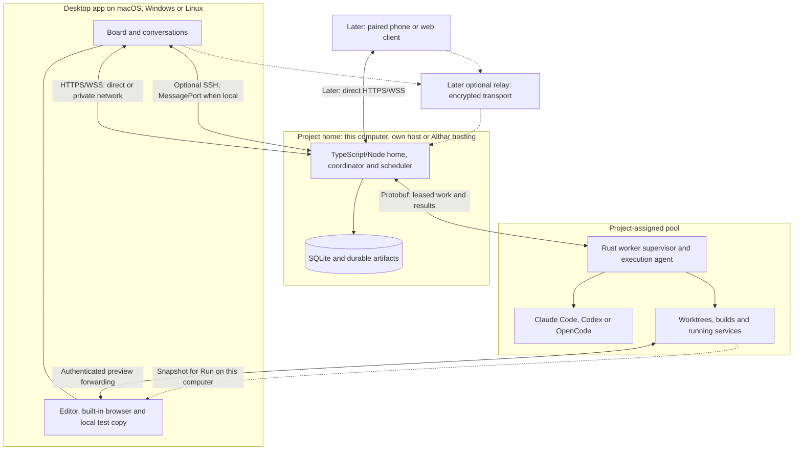
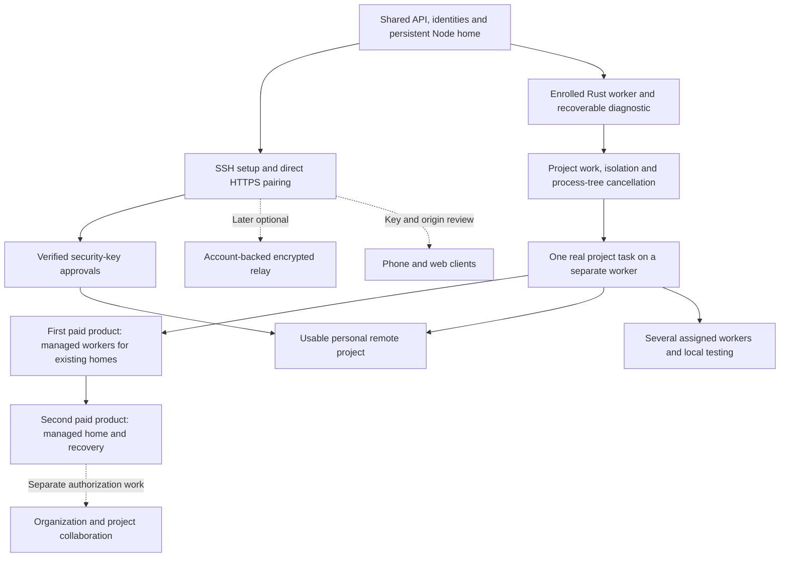

# ADR-103: A project lives locally or on a host, and places its work across its pools

> The wider design remains a proposal. The shared API and host foundations below are built; the transport and language choices accepted on 16 Nov are recorded with their delivery status in [Foundations](../foundations.md#remote-connections-and-native-workers). Other proposed decisions would fold into [Foundations § Where the runtime runs, and who may reach it](../foundations.md#where-the-runtime-runs-and-who-may-reach-it).

- **Status:** Proposed
- **Date:** 2026-11-07
- **Updated:** 2026-11-26
- **Owner:** Runtime and desktop maintainers
- **Amends:** [ADR-048](../foundations.md#where-the-runtime-runs-and-who-may-reach-it),
  not replaces it: the local utility process, one writer per profile and
  separation of clients from agents stay. The headless host becomes a
  persistent service; remote project ownership need not wait for multiplayer;
  direct HTTPS/WSS works with or without a private network, SSH remains
  optional, and a relay may follow later; provider support decides which
  sign-ins a host can use.
  Also amends [ADR-003](../foundations.md#the-shell-and-the-runtime) (remote project connections),
  [ADR-028](../packaging.md#off-a-mac-windows-and-the-keyring) (headless sealing),
  [ADR-091](../workspaces-and-runs.md#local)
  (Local belongs to a particular computer), and
  [ADR-100](../desktop-app.md#a-web-page-beside-the-conversation)
  (forwarded previews). Except for the accepted subset recorded in Foundations,
  these remain proposed amendments.
- **Context:** Several leads, worktrees and builds exhaust the person's
  laptop. They want agents on their own VPS, controlled from Althar, with
  work continuing when that laptop sleeps. They also want to use another
  computer or a phone. This must leave the whole local app useful on its own
  and lead to managed cloud execution later.

  The questions in this task settled on project-assigned pools, automatic
  placement per task, shared hosts with separate worktrees and OS sandboxes,
  forwarded web previews, and an explicit local copy for platform testing.
  A VPS is one possible machine, never a prerequisite.

## Decision

Separate the project's home, its task compute and the device showing it.
The same app can show local, self-hosted and Althar-hosted projects.

| Part | Owns | Can run on |
| --- | --- | --- |
| Project home | Canonical state, conversations, always-on coordinator, scheduling and asks | This computer, another computer the person owns, or Althar hosting |
| Worker | A task's agents, workspaces, commands, builds and runs | This computer, personal remote hosts, or managed cloud hosts |
| Client | Presentation, the person's input, local editor and browser | Desktop, and later phone or web |

A home can also be a worker. In fully local use these parts stay on one
computer, with the utility process and MessagePorts Althar has today.
Nothing requires an account, relay or remote machine for that use.

### One project authority, several clients

The home is the only writer of its project record. Desktop clients, CLI
clients and workers never open its SQLite file. Its profile can hold several
projects, as now; this does not require a database or process per project.
Project ids are resolved with their home, rather than treated as local paths.

Keep SQLite's exclusive lock and backups. Do not put it on a network share,
replicate a writable copy to each client, or have every worker start the
whole orchestration layer. Workers keep only their execution journal,
workspace bytes and pending uploads. Several Macs see the same ordered
record through the API. Commands carry ids and expected revisions;
reconnection never blindly repeats a merge, push or other external effect.

The coordinator is always on at the home. Leads and the coordinator share
one pool of tools and MCP servers. Placement changes where a tool executes,
not which role is allowed to use it.

A remote home continues while a client sleeps, quits or updates. Reconnect
reads changes from a durable cursor, or refreshes a snapshot when that cursor
is too old, then resumes live events. Pending asks remain in their threads
and Needs you. A local home still depends on that computer being awake and
running; a relay or remote worker does not change that fact.

Moving a project home is a stopped, versioned export/import: state, artifact
manifest, repository bindings and pending inputs, with accounts rebound at
the destination. Fence and retire the old writer before enabling the new
one. No automatic migration or two-way database sync in the first slice.

### Pools and task placement

#### Worker ownership and access

Every pool has one owner, either a person or an organization. The
[existing project owner contract](../../../packages/contracts/src/identities.ts)
already represents both kinds of owner. Use the durable person identity
for personal projects and private worker pools. Linking a cloud account
adds a login and billing relationship for managed services while retaining
the person's existing local identity. An organization has its own
ownership and billing records. Its members act through their individual
accounts with roles granted by the organization.

The home is the project writer and scheduler. A project and its home have
an owner scope, and projects in a home initially share that scope. Keep
ownership separate from the home ID, machine and endpoint. Moving the
home preserves project and pool ownership. One computer can serve a
personal home and attach as a client to a company home. Each connection
uses the identity and grants for its own home.

A worker registration belongs to a pool. For private capacity the owner
administers its workers. For managed capacity Althar operates the
machines and allocates workers for the owner's pool. A pool grants
specific homes and projects access. Within a home, a project can use its
owner's approved pools, subject to the person's role and the project's
placement policy. Personal Linux workers enroll separately with each
home. One Linux user account can hold one active agent lease at a time,
including across homes. A shared managed pool will need an allocator that
reserves resources across workers and checks the project’s grants.

The selected project determines the owner scope before the home resolves
eligible pools. Check the authenticated person's permission, the project
and home grant, capacity, and the payer's limit before dispatch. A worker
receives credentials for the authorized project and attempt. Keep work,
secrets and artifacts within that scope. Revocation blocks new
admissions. The home applies the existing lease and cancellation policy
to work already admitted.

| Situation | Pool available to the project | Who pays |
| --- | --- | --- |
| Personal Pro user runs a personal project in Althar Cloud | Their personal managed pool, provided when they link their cloud account | Their personal cloud account |
| The same user runs a personal project on their own worker | Their personal private pool | They operate their machine |
| The same user opens a company project from the company home | A company pool approved for that project, subject to their company role | The company operates private capacity or pays for its managed capacity |

Managed admissions record the payer and cap with the project, home,
pool and attempt. Reuse the same reservation and receipt for delivery
retries. Membership changes affect future authorization while historic
receipts retain the payer recorded at admission. A personal plan can
include a monthly compute allowance. Allowances, prices and overage
terms remain product decisions.

Ship the personal managed path first with a default pool and a personal
budget. Keep the owner scope and grants explicit in the model so company
roles and pools can use the same placement and metering path when
collaboration ships.

#### Placement

The first worker placement contract uses a project's enrolled workers and
their connected providers and availability. The home reads repository
requirements from the task. Desktop uses the same eligibility rules as the
home and shows where the lead runs before Start. The home rechecks the
choice when it accepts the plan. Taking a plan back to Hold lets the person
choose its place again.

| Capability | On the home today | On an enrolled worker today |
| --- | --- | --- |
| Task shape | Worktree or existing checkout, one or several repositories, private copies | Implement lead in separate worktrees for up to eight repositories |
| Other roles | Coordinator, helpers, reviewers and pull request reviews | Helpers can join the lead’s checkout or use a separate copy on the same worker. The home runs the coordinator and reviews. |
| Execution environment | Althar-managed setup, runs, skills, configured MCP and local platform tools | The Linux worker’s installed toolchain, provider account and project setup. Built-in and selected HTTP MCP tools connect through the home. Selected command-based MCP tools use executables registered on the worker. Codex and Claude leads and helpers can load selected skills. |
| State and output | Task state, approvals, worktrees and managed runs | Agent messages, Git changes, managed command output, private HTTP and WebSocket previews, verified local Git copies and named files from an active checkout |
| Assignment | The task's own home | An available worker granted access to the project that advertises the lead's provider |

Linux workers now report their platform, architecture, usable CPU cores,
available memory and workspace volume space over the authenticated lease.
The home offers automatic selection for an eligible project worker and
resolves that choice again at Start. The worker reserves one execution
lease. A Linux worker account takes a local lock before accepting the
checkout transfer. It checks the previous systemd unit and its process
group before admitting another run. Two homes with the same worker account
share this limit. A busy worker can refuse the start before the home sends
the checkout.
Mac and Windows worker services and requirements for specialized toolchains
still need their own platform support.

The worker must eventually describe the tools, workspace shapes and
runtime safeguards it can provide. Placement can then explain the first
unmet requirement while keeping the person's choice and the home as the
authority for admission.

A project names the pools it may use. A pool supplies private workers or
managed capacity. Enrolled workers advertise OS, architecture, available
CPU, memory and disk, installed tools, provider/account capabilities and
reachable services. Access to repositories and secrets requires a
project-scoped grant.

Place each new task on an eligible worker across those pools. Check required
platform, repository access, credentials and capacity first; prefer prepared
source and caches, then available capacity. Reserve resources atomically at
the worker so two homes cannot both count the same spare memory. Limits
include host concurrency, disk reserve, per-project concurrency and any
person-set spending cap. An unavailable eligible worker leaves the task
waiting with its reason. Never spill into a pool the project isn't assigned,
or buy capacity beyond a cap, on the agent's initiative.

Keep the task's repositories and sessions together on that worker initially.
New tasks may go elsewhere when it fills. A running task stays put; load is
not a reason to duplicate it. Later handoff stops and fences the old attempt,
transfers a durable snapshot, and starts a new attempt. It is not live
migration of a process or a promise that provider sessions are portable.

**A worker checks it can run a task, and a task moves (26 Nov).** A worker's
release ships what its agents' sandbox needs (bubblewrap and ripgrep from
Codex's own package, socat built static), and adding one ends with a test run:
bubblewrap started as a run starts it and each signed-in agent started once,
which also says the models it offers there. Where newer Ubuntu keeps user
namespaces to programs AppArmor names, a root login writes one rule for the
worker's own bubblewrap; otherwise Add a worker offers one press with `sudo -n`,
or the command to copy. The worker repeats its check after each sign-in and
hourly, and reports it with its heartbeats. Placement reads it with the
project's own files: work goes only to a worker whose check finished, found its
sandbox starts and started the lead's agent there; one that hasn't checked (an
older release, or a check still running), whose sandbox can't start, whose lead's
agent isn't signed in or couldn't start there, with too little disk or no git is
greyed out with why, and refuses a run with the same words; Bun, Node, pnpm and uv it installs itself into its
own folder before a task's setup; anything else its lead installs into its own
folders, asking the person before root, and records as the project's setup for
workers. A worker task's model picker offers that worker's models only. A
running task moves between the home and its workers, or between workers, from
its menu, between its lead's turns: the worker's work comes home first, its
lead starts afresh where it runs now with a handover, and where its model
isn't offered there the person picks one that is. Where the worker can't bring
its work home, the task stays where it runs unless the person says to move
from what its last turn brought home. This is the handoff above,
between turns rather than mid-attempt.

Pools express placement. Confidentiality also needs separate credentials,
storage and caches; unrelated customers cannot share a personal host's
trust boundary. A client's isolated pool never shares those with another
client's general pool merely because both belong to the same person.

### Local, runs, files and the editor

The first Desktop copy action downloads the home’s verified Git bundle for
each task repository. The worker returns its commit, working files and
staged files under one checkpoint. The home verifies all three before
packaging them and keeps its own staging area separate. Desktop verifies
each digest and keeps the copy in its own folder. If the worker cannot checkpoint, the
person can deliberately choose the home’s current mirror.

**Local keeps its meaning:** the person's existing checkout on a named
computer, with its simulators and services. It pins execution to that
computer. A clone on a VPS is a host checkout, never silently that Local
checkout. ADR-091's one-task checkout lock and refusal to stash, reset or
overwrite the person's changes remain. Automatic placement uses separate
worktrees by default.

**Run on this computer** makes a separate local test worktree from an
immutable task snapshot. Include its repository commits, unpushed objects,
staged and unstaged changes, deletions and ordinary untracked source. Record
the base, manifest and digest for every repository. Quiesce writers or take
a filesystem snapshot; detect changes and retry where that is unavailable.
Do not offer the copy if a consistent capture cannot be established.
Ignored dependencies, build products and secrets are not copied implicitly.
Run the setup recorded for this OS; obtain local env files and signing
identities on this computer. Setup records and prepared caches are qualified
by OS, architecture and inputs, not replayed across platforms blindly.

Results name the snapshot they tested. Remote work can continue. Updating
the test copy is explicit and never overwrites local edits; sending edits
back is a deliberate patch with a base and conflict handling. No continuous
two-way checkout mirror, and no general helper that lets a remote agent
drive a client's computer. Automated macOS or Windows checks use an enrolled
worker of that platform; missing checks stay unverified.

`run_project` starts and supervises a service on the workspace's worker.
Run's list names its place and opens a preview through an authenticated
tunnel. Forward HTTP, WebSockets, hot reload and the run's related API ports;
manage reconnects, origin mapping and cookies without exposing a public
worker port. An unauthenticated local process must not gain access through
a guessed forwarded address. Run data identifies host, task and attempt,
not just `localhost:3000`.

ADR-100's isolated browser still renders on the client. Its schemes,
permissions, downloads and sign-in handling stay. Client comments carry the
logical run URL and snapshot back to the task. A worker can capture its
own page headlessly at 1× without a connected client; the picture becomes
an artifact. This does not share the client's browser cookies or the
agent's browser session. Streamed remote browsers and native desktops come
later if needed.

Diffs and source reads execute where the workspace lives. Replace bare paths
with host/workspace ids plus relative paths. Artifacts and attachments use
bounded, resumable transfers with hashes, permission checks and retention;
the home keeps their durable manifest and required bytes before calling a
result complete. Local file grants do not become remote path grants.
Uploads reject traversal and escaping links, retain existing size limits,
and make executable content inert until explicitly used. Offline clients
see cached data labelled as such.

**Open in VS Code** uses Remote-SSH for a remote workspace; the local test
copy opens locally. Other editors use their supported remote integration
or the local copy. The runtime returns a workspace reference; the client
validates it and constructs the editor action rather than executing a URL
or shell command supplied by a worker.

### Connections and the person's word

Connect directly to a reachable home with HTTPS for pairing and connection
management, and WSS for commands, replies and streamed events. Carry the
shared versioned client API with bounded messages and backpressure; do not
create a second set of task or permission semantics. Local MessagePorts and
private sockets remain. Support Tailscale or another private network as a
route, and direct HTTPS with valid server identity without a VPN. Network
membership never authenticates a person or authorizes an approval.

SSH is an optional setup or connection route, not a prerequisite for normal
paired connections. Respect SSH config, pinned host keys and the person's
normal authentication, including proxy/jump configuration. The existing
SSH adapter uses system OpenSSH key/agent authentication without password
prompts. Installing a versioned, signed bundle, checking prerequisites and
starting a supervised user service remain separate setup work. Use systemd
with linger where needed so logging out does not stop it, and state which
setup step needs administrative access. A private-network route or SSH
tunnel need not expose a public API port.

The existing SSH path carries bounded, framed Effect RPC through the
private socket, adapted to `PortLike`; a native MessagePort cannot be sent
across a network. Authenticate before attaching any API or opening
preview/file channels. Never tunnel `ToolServer` as the client API. An SSH
login reaches the host; it is not proof of the person's own input.

Do not build a relay in the next slice. A later Connect service can provide
an outbound relay with end-to-end authenticated encryption between paired
endpoints. It holds routing and service entitlements, not project content
or approval authority. Local and direct connections remain independent of
an Althar account. Relay accounts can provide discovery without becoming
the keys that sign person commands. Phone and web access need not wait for
a relay, but their pairing, protected keys, origin trust and recovery need
review before shipping.

Each client has a revocable identity; record actor and device per command.
Bootstrap pairing is confirmed by a trusted owner client through an
expiring, single-use challenge, pinned to the home identity. Review the
initial owner enrollment and recovery path before release. Its private
device key stays on the client, outside host workspaces and agents' readable
files. The home verifies a connection challenge, command id and replay
protection. Several paired
devices can connect; revoking one stops its streams and future commands.
CLI/socket callers and worker tokens cannot claim to be a paired person.
If a client cannot protect its key from agents on its own computer, it has
socket authority until it can; calling its key paired is not a boundary.
Pairing authenticates a device, not physical human intent for every action.
The trusted approval path must preserve that distinction.

For direct HTTPS permission answers, the paired connection can request a
one-use confirmation for a specific open ask. The home presents the exact
decision on its own HTTPS origin and requires a WebAuthn assertion with
user verification from a security key linked to that device. An enrollment
produces a public key for the administrator to verify and install. It grants
authority only after the home reads its administrator-owned key list. The
device keeps socket authority throughout. The home checks revocation and the
open request again before applying the decision, and records the actor and
device with its receipt.

ADR-081/086's rule stays: fresh words from the window or a paired device,
or an authorized errand, supply the person's word in the turn they start.
Bind that provenance at authenticated ingress, not from a `byPerson` field
supplied by an agent. The home rechecks it, current state and cancellation
when an irreversible action is actually dispatched. Permission answers and
changes that loosen rules keep their existing person-only checks. Remote
execution creates no new approval category; permissive defaults and the
person's Never rules stay.

### Worker protocol, failure and recovery

Build the worker supervisor and small sandbox execution agent in Rust;
keep the existing TypeScript/Node home and scheduler. Define their separate
worker protocol in Protobuf, generating TypeScript and Rust bindings from
one versioned schema. gRPC is the initial transport candidate to validate
across the real boundary, including authentication, cancellation,
backpressure, reconnect and compatible upgrades. Do not convert the client
API to Protobuf just because the worker uses it. The worker can invoke
provider adapters and toolchains that still require Node; do not duplicate
the home runtime or claim the execution environment is Node-free.

Enrollment grants a worker identity scoped to its home and assigned work,
never person authority. Negotiate versions and capabilities before
admitting work. A decoded Protobuf message still needs bounds, semantic
validation and authorization. Pin generators/toolchains, verify generated
binding drift and test old/new peers before requiring a protocol feature.

The home issues an attempt id, controller generation, lease and fencing
token. The worker journals accepted commands and ordered events before
acknowledging them. Heartbeats renew the lease; reconnect resends unacknowledged
events by sequence. Tool requests to the home carry the session, project,
attempt and token. The home enforces their tool role and current lease;
the worker's loopback MCP gateway exposes only that session's tools.

Keep worker connection and enrollment separate from that execution
protocol. The personal-host diagnostic dials a reachable home and verifies
its certificate with mutual TLS. An operator-provisioned relay carries
the same encrypted connection over two outbound WSS links, and the home
can keep its worker port on loopback. Reuse that transport for the
desktop home and eventual managed workers. The Protobuf execution
messages, capability negotiation, journal and replay rules apply to each
route. See the [outbound worker relay guide](../../../packages/worker-protocol/README.md#outbound-worker-relay).
Verify both application identities and their grants across the gateway.
Bind a managed worker credential to its allocation, home and expiry, then
bind each start to the home-issued project, attempt, fence and execution
lease. Document the gateway's visibility into routed worker messages and
the separate storage used for scoped data transfers. A cloud account can
buy capacity. The home authorizes work and mediated actions, and the person
authorizes protected approvals.

A client disconnect does not end a task. Losing the worker's connection to
the home is different: after its bounded lease grace, it stops starting
work and stops owned processes, retaining source, logs and results for
reconciliation. It cannot approve its own ask while disconnected. The home
does not launch a replacement solely because a heartbeat expired: expiry
cannot prove an old process or external effect stopped. Stale results are
observations until reconciled, never current authority. Fence database
writes and mediated actions, and report unconfirmed external effects
without claiming exactly-once execution.

Stopping a task cancels its attempts and complete process trees, including
runs and setup. An unreachable worker shows cancellation as unconfirmed.
After a host restart, reconcile the journal, process ownership, workspace
and provider resume support before resuming. Retain unpushed work and
uploaded snapshots; neither a dead worker nor expired capacity means a
task is disposable. Loss of the only disk still loses unsnapshotted work.

### Sign-ins, secrets, MCP servers and skills

Host capabilities include Claude Code, Codex and OpenCode independently.
Sign in on the execution host using the provider's supported device flow
or browser flow with the callback forwarded there; otherwise offer its
documented terminal login over SSH. Never ship a laptop's vendor cache.
Validate subscription use on a personal headless host provider by provider.
Replace ADR-048's blanket refusal of remote subscriptions with that support
matrix. Managed cloud uses supported remote grants; a subscription is not
advertised there until its supported flow and terms are verified. A host
without a usable account is ineligible for that agent, not secretly on a
different paid API account.

Sign-in status and plan usage are read on the host holding that account,
including ADR-062's narrow usage-read exception. Send normalized limits and
freshness to the home, not tokens. Account admission and exhaustion track the
same provider principal across hosts, so a pool cannot multiply its apparent
allowance. Revocation invalidates future grants and affected sessions.

The desktop keeps safeStorage and its keyring. A headless host supplies a
different `Secrets` implementation: authenticated encryption of secret
files, with a generated master key delivered by the service manager from a
separate, tightly permissioned credential location. Use OS-sealed credentials
where available; never depend on an interactive desktop keyring or fall
back to plaintext secret values. Backup and recovery keep the key separate
from ciphertext. Automatic restart requires an available unsealing key;
passphrase-only sealing instead requires an unlock after reboot. Encryption
protects copied secret files only while the key stays separate, not a
compromised host administrator or a disk copy containing both. Keep agent
users away from the home profile, pairing keys and secret store.

Give workers project- and attempt-bound credentials over the authenticated
channel only where execution needs them. A worker's approved `gh`, `glab`
and SSH sign-ins can be the person's own, as ADR-097 permits. Prefer scoped
host grants; keep host keys pinned. Do not depend on forwarding the client's
SSH agent to keep work going when it sleeps. ADR-073's Flatpak bridge stays
on the device where git runs; it does not make that device a remote Git
credential service. Git guards and the person's-word checks still apply.

Build on #684's MCP/skills inventory, role choices and reversible sync,
not a second discovery system. Publish portable configuration and skill
content by digest to enrolled hosts; rebuild links and run projections
there. A symlink to a laptop folder is not a remote skill. Preserve local
hand edits and record precisely what Althar installed. Bind env references
to secrets on the target; never copy raw agent config files or embedded
credentials. Stdio servers need host-installed commands; `localhost` URLs
refer to that host. Mac-only servers stay unavailable to remote work until
an explicit service/worker capability exists. Name a missing capability
instead of silently dropping the person's tools.

### Isolation, updates and operations

Personal persistent hosts share installed toolchains and caches, with a
worktree and the supported OS sandbox per task. Probe Linux namespaces,
bubblewrap and other agent prerequisites by running them, not finding a
binary. Preserve ADR-071's guarantees only where they hold; otherwise use
ADR-097's existing trusted-host behavior and state it accurately. Separate
the supervisor/profile from agent processes with OS identities and scoped
IPC. A command reader or bearer token readable by those processes is not
that boundary.

Managed cloud needs an isolated task environment and a tenant boundary.
Choose containers on tenant-isolated machines or microVMs after measuring
real builds and escape exposure; ordinary shared-kernel containers alone
are not an assumed boundary for unrelated customers. Cache prepared images
and dependencies, restore snapshots and add credentials after restoration.
Measure warm/cold allocation to first usable command and first useful agent
response, p50/p95, queue time, idle memory and active process-tree memory.
Include repository setup, caches, toolchains, provider startup and
authentication. Report the home, supervisor and guest process costs
separately. Do not infer task startup speed from VM boot or Rust alone.

Client, home and worker exchange protocol versions, build versions and
capabilities before use. Refuse incompatible commands with a route to
update; a stale client must not make a home migrate or downgrade its store.
The app manages signed host updates, backups and rollback of binaries.
The first standalone host checks/downloads/verifies automatically and applies
explicitly by default. Optional automatic activation happens on the next
service start before work begins, only for compatible releases. Explicit
maintenance stops agents; finish active work first. Idle-time application
needs a real admission/drain barrier and is not implemented. Schema rollback
may restore a snapshot only during storage-only preparation; after an
incompatible runtime may have acted, keep data and require a corrected
release. Installing a new desktop alone does not restart a remote home.
Roll out compatible workers before requiring their features.
The native worker needs its own signed artifact, version/capability checks
and process-ownership proof before updates may replace it. Reuse the host
release trust and recovery rules; the existing Node host updater does not
already provide a Rust worker rollout or an admission/drain barrier.

Keep structured logs on both sides with home, host, task, attempt, command
and event ids. Show connection loss, queue reason, last heartbeat, version,
disk pressure and failed setup where the person can act on them. Bound and
rotate logs, redact secrets, and export diagnostics deliberately. Headless
hosts send no desktop analytics or crash reports (ADR-036/048); operational
health and any managed-service metering are separate from product analytics.

### Local, Connect, Hosted and cloud workers

The proposed first paid product is **managed worker capacity for an
existing home**. A desktop home or a personally hosted home offers
**Run in cloud** for an eligible new task. Sustained capacity pressure can
surface that action when a task is likely to wait. The first release asks
the person to confirm placement and spend, and keeps running attempts on
their current worker.
Account linking enables allocation, a spending limit and a usage receipt
for the cloud run. Leave prices and plans open. Track compute separately
from model usage.

The cloud service provisions and retires an isolated runner, issues its
short-lived credential, connects it to the home and meters its compute.
The home owns scheduling, approval policy, conversations, project state
and the final task record. Give the runner the chosen source snapshot and only the
credentials and artifact access that attempt needs. Authorize each transfer
separately. Scope retention and cleanup to the attempt so a worker can be
retired after preserving its result. A desktop home still needs to be
awake to coordinate and respond to asks. If it goes offline, the worker
follows the bounded lease and reconciliation rules, and the home can pick
up retained results when it returns.

The proposed second paid product is **hosting the home itself**. It keeps
the coordinator and project record available when the person's device is
offline. Home migration, recovery and export belong to that product.

Keep these independent: local/self-hosted single-player; optional **Connect**
relay access to running homes; **Hosted** for a managed single-player home;
cloud workers as optional compute; and multiplayer collaboration. This is
a technical service boundary, not a relay pricing decision. Direct use and
managed hosting do not require a relay. Hosting does not imply unlimited
agent compute, model usage or artifacts. Service entitlements cannot change
who owns a local record, grant person authority or force a self-hosted
project through the relay.

Managed single-player initially keeps one home writer and isolated profile,
using the same runtime and SQLite. Placement, backups and failover must
fence the old writer before a replacement opens it. Multiplayer may later
use doc 07's Postgres authority; it is not required to put one person's
project on their own server. Choose US or EU placement for homes, backups,
artifacts and eligible pools; respect that choice during recovery and
overflow. A pool's own provider bill stays with its owner.

## What changes, by package

Paths below are the existing seams to change, not features implemented here.
New hosts and protocols named here still have to be built.

| Package/app | Change and starting files |
| --- | --- |
| `apps/host` | Existing plain Node home, service lifecycle, secrets and signed updates. Add direct HTTPS/WSS and reviewed enrollment without moving project authority into a worker. Keep Electron imports out of the runtime. |
| Native worker and worker protocol (new; paths to choose in the first slice) | Rust supervisor and sandbox execution agent, canonical Protobuf schemas and generated TypeScript/Rust bindings. Build the authenticated execution/journal/recovery boundary, not another home. Pin toolchains and add language-specific CI before shipping. |
| `packages/transport-node` | Existing bounded socket/SSH clients; add the Node side of direct HTTPS/WSS while keeping authority, version and checked-feed rules shared with other client transports. |
| `apps/desktop` main/preload | Route local and remote connections in [`main.ts`](../../../apps/desktop/src/main/main.ts), `startRuntime` and `connect`; keep local supervision. Implement pairing, tunnels and client-side file/editor grants. Split native actions out of [`runtime.ts`](../../../apps/desktop/src/runtime/runtime.ts); route forwarded runs through [`browser/pages.ts`](../../../apps/desktop/src/main/browser/pages.ts). |
| `apps/desktop` renderer | Home-aware clients and caches in [`data/client.ts`](../../../apps/desktop/src/renderer/data/client.ts); host/pool setup, connection state, run location and local test copies. Never resolve a remote path with the client's filesystem. |
| `apps/cli` | [`main.ts`](../../../apps/cli/src/main.ts) attaches through the API (DEV-128), locally or remotely. An attached CLI is not the person's paired device merely because SSH authenticated it. |
| `packages/contracts` | [`transport.ts`](../../../packages/contracts/src/transport.ts), [`Api.ts`](../../../packages/contracts/src/Api.ts) and [`files.ts`](../../../packages/contracts/src/files.ts): version handshake, authenticated connection roles, home/workspace references, durable cursors, file transfers and previews. Keep worker control separate from person commands. |
| `packages/domain` | Host, pool, placement, attempt/lease and snapshot identities, states and commands in [`src`](../../../packages/domain/src). Keep project authority distinct from workspace location. |
| `packages/persistence-sqlite` | Migrations from [`schema.sql`](../../../packages/persistence-sqlite/schema.sql) for pool assignments, host locations, leases, acknowledgements and snapshots. Keep [`Database.ts`](../../../packages/persistence-sqlite/src/Database.ts)'s exclusive lock. |
| `packages/runtime` control | [`Runtime.ts`](../../../packages/runtime/src/Runtime.ts), [`Config.ts`](../../../packages/runtime/src/Config.ts), [`Api.ts`](../../../packages/runtime/src/Api.ts), [`Instance.ts`](../../../packages/runtime/src/Instance.ts) and [`ToolServer.ts`](../../../packages/runtime/src/ToolServer.ts): host services, actor provenance, placement, fenced worker dispatch and result reconciliation. The current tool server is loopback HTTP with per-session role tokens, not a remote UI endpoint. |
| `packages/runtime` execution/files | [`Projects.ts`](../../../packages/runtime/src/Projects.ts), [`local.ts`](../../../packages/runtime/src/local.ts), [`Sessions.ts`](../../../packages/runtime/src/Sessions.ts), [`Runs.ts`](../../../packages/runtime/src/Runs.ts), [`Launches.ts`](../../../packages/runtime/src/Launches.ts), [`Folders.ts`](../../../packages/runtime/src/Folders.ts), [`diffs.ts`](../../../packages/runtime/src/diffs.ts), [`sentFiles.ts`](../../../packages/runtime/src/sentFiles.ts) and [`Artifacts.ts`](../../../packages/runtime/src/Artifacts.ts): move filesystem/process operations behind host-qualified execution and transfer interfaces. Today they assume local paths and processes. |
| `packages/provider-adapters`, `packages/skills` | [`AgentConnection.ts`](../../../packages/provider-adapters/src/AgentConnection.ts) and [`projection.ts`](../../../packages/skills/src/projection.ts): run ACP beside the agent, host capability probes, supported headless auth and portable skill projection. Extend #684's `agentTools.ts`, `mcpSync.ts`, `skillSync.ts` and `agentServers.ts` when it lands; those files are still on its branch at this writing. |
| Managed services | First, account linking, an outbound execution gateway, isolated worker allocation, bounded artifact transfer and metering. Later, managed home lifecycle and optional client relay. Preserve home and person authority across all three. |

The desktop host waits for the first screen before connector fetches,
seals through main, and asks main to draw screenshots. The headless host must
replace those dependencies or it will still depend on an open window.
Native attention now uses the shared typed API; pending asks remain durable
in the home rather than depending on notification delivery.
The CLI's present in-process layer uses `Secrets.none`; it is not a complete
remote host just by exposing a socket.

## Delivery phases and proof

**Foundation implemented, 14 Nov 2026:** the shared versioned API now has
persistent home/client identity, signed device attachment and revocation,
an opt-in private local socket, durable command admission/results, checked
home/cursor/checkpoint reconnect and typed native attention. See
[architecture 02](../../architecture/02-desktop-runtime.md#local-transport)
for the contracts and limits. This does not accept the rest of this proposal
or complete a usable remote project: SSH bootstrap, protected client keys,
remote files/previews, provider validation, pools and workers remain ahead.
Registered devices currently act for one profile owner; they are not a
multiplayer permission model. Pricing and entitlements remain separate.

**Host service foundation implemented, 15 Nov 2026:** [`apps/host`](../../../apps/host/README.md) now supplies a persistent Node home, versioned private API, separate-key authenticated encryption, health, restart/signal cleanup and a systemd user service with delivered credentials. Signed portable Linux releases and managed updates include independent supervision, verified staging, explicit application by default, optional compatible next-start activation and phase-aware database/code recovery. This is a trusted single-user process, with co-located agents rather than isolated workers. Production signing-key provisioning/publication, actual VPS/systemd reboot validation, provider headless login/refresh, protected client enrollment, SSH bootstrap and remote files/previews remain work before a usable remote project ships. No pools, worker leases, relay or multiplayer authorization are implied.

**SSH attachment implemented, 15 Nov 2026:** the host's `connect-stdio`
bridge and CLI attach through the private socket or system OpenSSH with
socket authority, expected home/API checks and checked feed positions.
[Desktop SSH attachment #982](https://github.com/AltharIDE/althar/pull/982)
merged on 17 Nov with socket authority.

**Connection-only direct access implemented, 16 Nov 2026:** opt-in HTTPS/WSS,
operator-issued five-minute invitations, encrypted desktop keys, paired-device
reconnect and immediate revocation now use the shared API. The first desktop
path retains socket authority: it cannot approve permissions, enroll trusted
approval devices or use desktop-local files/previews. A pin in the operator's
code authenticates a private TLS endpoint; changing the TLS key needs pairing
again. Invitations end on restart, while registrations remain durable. Host
setup/certificate provisioning, protected approvals and real provider/VPS
validation remain release work.

**Native worker diagnostic:** [the Protobuf foundation](https://github.com/AltharIDE/althar/pull/1026)
merged on 18 Nov. The opt-in Linux home listener authenticates a worker
using mutual TLS and a durable enrollment. The home can issue a single
fenced start grant for a fixed diagnostic. The worker journals the start
and result, and the home persists a replayed result or records an unknown
outcome after an interrupted attempt. The
[operator guide](../../../apps/host/README.md#native-worker-diagnostic)
covers certificate and journal setup.

**Workers added from the window, 23 Nov 2026:** a personal worker is added from Settings › Computers over SSH or with a one-time code; the home is its own certificate authority, signs the worker's own key and opens its worker port on demand; the worker runs from the signed release as a systemd user service that updates itself, offers its agents for any project the home grants, and says which are signed in. Projects are granted in the window. [Foundations](../foundations.md#remote-connections-and-native-workers) records the trust model; [the host README](../../../apps/host/README.md#add-a-worker) how it runs.

Client enrollment, self-hosted projects and managed worker capacity can
advance independently where they share the existing home and execution
contract. The first paid release tests a managed worker from an existing
home. A hosted home follows as its own product. The following work remains
proposed beyond the accepted transport and language choices.

1. **Finish trusted client enrollment.** Direct HTTPS/WSS, connection-only
   pairing, bounded streams, revocation and checked-feed reconnect are now
   implemented. Keep software-key clients at socket authority. Before
   granting person authority, review initial owner enrollment, protected key
   storage, recovery and approval provenance, and validate them on supported
   clients. Prove an unpaired process cannot answer an ask and reconnect
   cannot replay an external action. Direct transport alone does not close
   this approval-security gate.
2. **Extend the native worker execution path to project work.** Build on
   the locked Rust toolchain, shared Protobuf bindings and authenticated
   diagnostic. Add project-scoped authorization, renewable leases, bounded
   live logs, and process-tree cancellation with reconciliation of
   unconfirmed external effects. Add automated enrollment and a signed
   worker artifact. Capture the warm/cold and memory baseline described
   above with real project setup and provider startup.
3. **Managed workers for existing homes.** Prove one eligible Linux task
   initiated from a desktop home behind NAT. Reserve capped compute for a
   linked account, provision one isolated runner, transfer a scoped
   workspace, and return logs and a durable result to the existing home.
   Offer the same execution path from a personal Node home. Prove retry
   deduplication for allocation and metering, credential expiry, cancellation
   and recovery, source and secret isolation, regional placement, provider
   sign-in, cleanup and recovery of unpushed work. Verify reusable images
   and snapshots are free of credentials. Measure time to useful work
   before widening the platform, provider or account matrix.
4. **One usable personal remote project.** Connect the client and worker
   paths. Co-locate a personal Linux home and worker initially; create a
   remote project and clone its repositories rather than silently moving a
   local one. Ship host-side agent login, setup, files/diffs/artifacts,
   run forwarding and editor handoff. Complete signed release publication
   and installation/bootstrap UX. Prove on a real VPS that a task builds
   and records its result with the desktop asleep, then reconnect. Gate
   each provider on supported headless sign-in, refresh and plan usage on
   that VPS. An unsupported provider remains unavailable there.
5. **Several workers and local testing.** Automatic placement across assigned
   pools, resource reservations, fenced leases, host outages and snapshots;
   Run on this computer and platform-qualified setup. Prove a saturated host
   sends a new task to another approved worker, unassigned pools stay unused,
   concurrent homes cannot overbook, a stale attempt cannot complete, and
   local verification includes uncommitted remote source without losing edits.
6. **Hosted single-player.** Managed regional homes, recovery and export,
   secrets, independent updates and entitlements. Use the person's own pools
   first; distinguish coordinator availability, provider usage and worker
   capacity. Prove restore, key recovery, writer fencing, offline clients and
   a complete export back to a personal host. This does not wait for relay.

**Optional later connection work:** an encrypted relay can reuse the paired
client API after a routing, abuse-control, privacy and operating-cost review.
Prove relayed and direct commands have identical authority and revocation
rules; relay availability does not keep a sleeping local home running.
Phone/web clients additionally need their protected-key, recovery, origin
and input-provenance proof, whether they connect directly or through a relay.

**Separate later collaboration work:** organization membership, project
invites, roles and shared authority build on the actor/project identities.
Owner-device registration is not a substitute for that authorization model.
Collaboration need not block a managed single-player home, and a relay
account alone never grants access to someone's project.

Each slice includes focused contract/failure tests. Fake agents prove protocol
behavior, not Linux isolation, provider sign-in, real Git credentials or
preview behavior; those need live host checks. The foundation above does not
provide those deployment proofs.

## What stays as it is

- Electron and the local utility-process runtime; local single-player use.
- One writer per profile, versioned migrations, backups and the ledger.
- The always-on coordinator, shared tools, permissive defaults and the
  irreversible list. ADR-081/086's person/errand authority still holds.
- Provider-owned agent loops and supported sign-in, with no credential-cache
  copying. Plan usage's narrow exception stays narrow.
- Local checkout ownership, review and Git guards; ADR-073 on a Flatpak device.
- ADR-100's client-side browser isolation and ADR-036's desktop analytics path.

## Risks and open questions

- **Provider support:** verify each agent's headless subscription login,
  refresh and plan usage on a personal VPS, then separately in managed
  environments. DEV-130's old blanket subscription ban needs updating when
  this proposal is accepted; do not treat it as measured provider support.
- **Trust:** a personal VPS administrator can compromise its runtime and
  credentials. Paired-client keys protect the ingress distinction, not a
  malicious project home. Managed tenancy needs independent isolation checks.
- **Recovery:** choose lease grace, snapshot cadence, backup retention and
  recovery targets from failure tests. Do not promise zero loss of bytes that
  only exist on a failed worker. A home outage also pauses orchestration.
- **Resources:** measure idle and active coordinator footprint, MCP processes,
  sustained builds, disk growth and startup. Fast cloud task creation needs
  prepared capacity and compatible cache keys. No benchmark is claimed here.
- **Client security:** review pairing, key storage/recovery, web origin trust
  and preview authentication before exposing person commands on those clients.
- **Platforms:** Linux is the first remote service target. Native macOS and
  Windows worker services, toolchains and simulator ownership need their own
  live validation; they use the same protocol, not a Mac-specific helper.

## Alternatives and references

Keeping every project on the laptop and adding SSH workers relieves builds
but keeps orchestration dependent on it. Requiring a remote home for everyone
breaks local use. Per-host task databases create competing boards. A hosted
Postgres service first makes personal VPS use wait for multiplayer machinery.
The separation above avoids those dependencies while retaining a local path.

The researched product patterns support this split: Orca offers local,
SSH-worktree and full-server modes; Amp offers personal runners and explicit
copies of remote changes for local testing. These are documented behaviors,
not independent VPS tests:

- [Orca run modes](https://orca.dev/docs/ways-to-run),
  [SSH worktrees](https://orca.dev/docs/ssh),
  [remote servers](https://orca.dev/docs/remote-servers),
  [mobile connections](https://orca.dev/docs/mobile).
- [T3 remote access](https://github.com/pingdotgg/t3code/blob/main/docs/user/remote-access.md):
  direct LAN/Tailscale, optional SSH and account-backed Connect are separate
  connection routes. This is a product reference, not an Althar trust proof.
- [Amp runners](https://ampcode.com/docs/cli/runners),
  [local sync](https://ampcode.com/docs/orbs#sync-changes-to-your-computer).
- [DEV-128: CLI attachment](https://linear.app/althar/issue/DEV-128),
  [DEV-130: cloud runners](https://linear.app/althar/issue/DEV-130),
  [DEV-131: phone and relay](https://linear.app/althar/issue/DEV-131).
- [Desktop runtime](../../architecture/02-desktop-runtime.md),
  [agent runtime and auth](../../architecture/03-agent-runtime-and-auth.md),
  [persistence, security and cloud](../../architecture/07-persistence-security-and-cloud.md).
