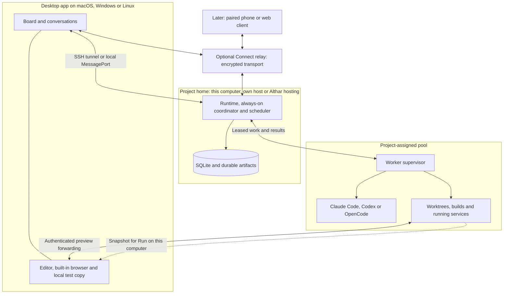

# ADR-103: A project lives locally or on a host, and places its work across its pools

> A proposal, not built. Where it would fold in: [foundations.md § Where the runtime runs, and who may reach it](../foundations.md#where-the-runtime-runs-and-who-may-reach-it).

- **Status:** Proposed
- **Date:** 2026-11-07
- **Owner:** Runtime and desktop maintainers
- **Amends:** [ADR-048](../archive/048-where-the-runtime-runs-and-who-may-reach-it.md),
  not replaces it: the local utility process, one writer per profile and
  separation of clients from agents stay. The headless host becomes a
  persistent service; remote project ownership need not wait for multiplayer;
  SSH joins the relay; provider support decides which sign-ins a host can use.
  Also amends [ADR-003](../archive/003-electron-shell.md) (remote project connections),
  [ADR-028](../archive/028-linux-windows-packages-and-the-keyring.md) (headless sealing),
  [ADR-091](../archive/091-a-task-works-local-in-the-person-s-checkout-or-in-a-worktree.md)
  (Local belongs to a particular computer), and
  [ADR-100](../archive/100-a-web-page-opens-beside-the-conversation-in-a-session-of-its-own.md)
  (forwarded previews). These are proposed amendments until this ADR is accepted.
- **Context:** Several leads, worktrees and builds exhaust the person's
  laptop. They want agents on their own VPS, controlled from Althar, with
  work continuing when that laptop sleeps. They also want to use another
  computer or a phone. This must leave the whole local app useful on its own
  and lead to managed cloud execution later.

  The questions in this task settled on project-assigned pools, automatic
  placement per task, shared hosts with separate worktrees and OS sandboxes,
  forwarded web previews, and an explicit local copy for platform testing.
  A VPS is one possible machine, never a prerequisite.

## Decision

Separate the project's home, its task compute and the device showing it.
The same app can show local, self-hosted and Althar-hosted projects.

| Part | Owns | Can run on |
| --- | --- | --- |
| Project home | Canonical state, conversations, always-on coordinator, scheduling and asks | This computer, another computer the person owns, or Althar hosting |
| Worker | A task's agents, workspaces, commands, builds and runs | This computer, personal remote hosts, or managed cloud hosts |
| Client | Presentation, the person's input, local editor and browser | Desktop, and later phone or web |

A home can also be a worker. In fully local use these parts stay on one
computer, with the utility process and MessagePorts Althar has today.
Nothing requires an account, relay or remote machine for that use.

### One project authority, several clients

The home is the only writer of its project record. Desktop clients, CLI
clients and workers never open its SQLite file. Its profile can hold several
projects, as now; this does not require a database or process per project.
Project ids are resolved with their home, rather than treated as local paths.

Keep SQLite's exclusive lock and backups. Do not put it on a network share,
replicate a writable copy to each client, or have every worker start the
whole orchestration layer. Workers keep only their execution journal,
workspace bytes and pending uploads. Several Macs see the same ordered
record through the API. Commands carry ids and expected revisions;
reconnection never blindly repeats a merge, push or other external effect.

The coordinator is always on at the home. Leads and the coordinator share
one pool of tools and MCP servers. Placement changes where a tool executes,
not which role is allowed to use it.

A remote home continues while a client sleeps, quits or updates. Reconnect
reads changes from a durable cursor, or refreshes a snapshot when that cursor
is too old, then resumes live events. Pending asks remain in their threads
and Needs you. A local home still depends on that computer being awake and
running; a relay or remote worker does not change that fact.

Moving a project home is a stopped, versioned export/import: state, artifact
manifest, repository bindings and pending inputs, with accounts rebound at
the destination. Fence and retire the old writer before enabling the new
one. No automatic migration or two-way database sync in the first slice.

### Pools and task placement

A project names the pools it may use. A pool contains enrolled workers;
hosts advertise OS, architecture, available CPU, memory and disk, installed
tools, provider/account capabilities and reachable services. Host membership
alone gives no access to an unassigned project's repositories or secrets.

Place each new task on an eligible worker across those pools. Check required
platform, repository access, credentials and capacity first; prefer prepared
source and caches, then available capacity. Reserve resources atomically at
the worker so two homes cannot both count the same spare memory. Limits
include host concurrency, disk reserve, per-project concurrency and any
person-set spending cap. An unavailable eligible worker leaves the task
waiting with its reason. Never spill into a pool the project isn't assigned,
or buy capacity beyond a cap, on the agent's initiative.

Keep the task's repositories and sessions together on that worker initially.
New tasks may go elsewhere when it fills. A running task stays put; load is
not a reason to duplicate it. Later handoff stops and fences the old attempt,
transfers a durable snapshot, and starts a new attempt. It is not live
migration of a process or a promise that provider sessions are portable.

Pools express placement. Confidentiality also needs separate credentials,
storage and caches; unrelated customers cannot share a personal host's
trust boundary. A client's isolated pool never shares those with another
client's general pool merely because both belong to the same person.

### Local, runs, files and the editor

**Local keeps its meaning:** the person's existing checkout on a named
computer, with its simulators and services. It pins execution to that
computer. A clone on a VPS is a host checkout, never silently that Local
checkout. ADR-091's one-task checkout lock and refusal to stash, reset or
overwrite the person's changes remain. Automatic placement uses separate
worktrees by default.

**Run on this computer** makes a separate local test worktree from an
immutable task snapshot. Include its repository commits, unpushed objects,
staged and unstaged changes, deletions and ordinary untracked source. Record
the base, manifest and digest for every repository. Quiesce writers or take
a filesystem snapshot; detect changes and retry where that is unavailable.
Do not offer the copy if a consistent capture cannot be established.
Ignored dependencies, build products and secrets are not copied implicitly.
Run the setup recorded for this OS; obtain local env files and signing
identities on this computer. Setup records and prepared caches are qualified
by OS, architecture and inputs, not replayed across platforms blindly.

Results name the snapshot they tested. Remote work can continue. Updating
the test copy is explicit and never overwrites local edits; sending edits
back is a deliberate patch with a base and conflict handling. No continuous
two-way checkout mirror, and no general helper that lets a remote agent
drive a client's computer. Automated macOS or Windows checks use an enrolled
worker of that platform; missing checks stay unverified.

`run_project` starts and supervises a service on the workspace's worker.
Run's list names its place and opens a preview through an authenticated
tunnel. Forward HTTP, WebSockets, hot reload and the run's related API ports;
manage reconnects, origin mapping and cookies without exposing a public
worker port. An unauthenticated local process must not gain access through
a guessed forwarded address. Run data identifies host, task and attempt,
not just `localhost:3000`.

ADR-100's isolated browser still renders on the client. Its schemes,
permissions, downloads and sign-in handling stay. Client comments carry the
logical run URL and snapshot back to the task. A worker can capture its
own page headlessly at 1× without a connected client; the picture becomes
an artifact. This does not share the client's browser cookies or the
agent's browser session. Streamed remote browsers and native desktops come
later if needed.

Diffs and source reads execute where the workspace lives. Replace bare paths
with host/workspace ids plus relative paths. Artifacts and attachments use
bounded, resumable transfers with hashes, permission checks and retention;
the home keeps their durable manifest and required bytes before calling a
result complete. Local file grants do not become remote path grants.
Uploads reject traversal and escaping links, retain existing size limits,
and make executable content inert until explicitly used. Offline clients
see cached data labelled as such.

**Open in VS Code** uses Remote-SSH for a remote workspace; the local test
copy opens locally. Other editors use their supported remote integration
or the local copy. The runtime returns a workspace reference; the client
validates it and constructs the editor action rather than executing a URL
or shell command supplied by a worker.

### Connections and the person's word

Use SSH to bootstrap and connect a personal Linux host. Respect SSH config,
pinned host keys and the person's normal authentication, including their
own proxy/jump configuration. Install a versioned, signed host bundle,
check prerequisites, then start a supervised user service. Use systemd with
linger where needed so logging out does not stop it. State which setup step
needs administrative access. No Docker, VPN or public API port is required.

Carry the versioned Effect RPC contract over framed, bounded messages on
the private socket through SSH. Adapt it to `PortLike`; a native MessagePort
cannot be sent across a network. Authenticate before attaching the API or
opening preview/file channels. Never tunnel `ToolServer` as the client API.
An SSH login reaches the host; it is not proof that a command is the
person's own input.

Connect adds an outbound WebSocket relay with end-to-end authenticated
encryption between paired endpoints. The relay holds routing and service
entitlements, not project content or approval authority. Direct SSH remains
independent of an Althar account. A relay account can handle discovery and
billing without becoming the key that signs the person's commands. No
Tailscale dependency. Phone and web access build on this connection; web
pairing and key recovery need their own reviewed protocol before shipping.

Each client has a revocable identity; record actor and device per command.
Bootstrap pairing is confirmed in the app through a one-time challenge,
pinned to the host identity. Its private device key stays on the client,
outside host workspaces and agents' readable files. The home verifies a
connection challenge, command id and replay protection. Several paired
devices can connect; revoking one stops its streams and future commands.
CLI/socket callers and worker tokens cannot claim to be a paired person.
If a client cannot protect its key from agents on its own computer, it has
socket authority until it can; calling its key paired is not a boundary.

ADR-081/086's rule stays: fresh words from the window or a paired device,
or an authorized errand, supply the person's word in the turn they start.
Bind that provenance at authenticated ingress, not from a `byPerson` field
supplied by an agent. The home rechecks it, current state and cancellation
when an irreversible action is actually dispatched. Permission answers and
changes that loosen rules keep their existing person-only checks. Remote
execution creates no new approval category; permissive defaults and the
person's Never rules stay.

### Worker protocol, failure and recovery

The home issues an attempt id, controller generation, lease and fencing
token. The worker journals accepted commands and ordered events before
acknowledging them. Heartbeats renew the lease; reconnect resends unacknowledged
events by sequence. Tool requests to the home carry the session, project,
attempt and token. The home enforces their tool role and current lease;
the worker's loopback MCP gateway exposes only that session's tools.

A client disconnect does not end a task. Losing the worker's connection to
the home is different: after its bounded lease grace, it stops starting
work and stops owned processes, retaining source, logs and results for
reconciliation. It cannot approve its own ask while disconnected. The home
does not launch a replacement solely because a heartbeat expired: expiry
cannot prove an old process or external effect stopped. Stale results are
observations until reconciled, never current authority. Fence database
writes and mediated actions, and report unconfirmed external effects
without claiming exactly-once execution.

Stopping a task cancels its attempts and complete process trees, including
runs and setup. An unreachable worker shows cancellation as unconfirmed.
After a host restart, reconcile the journal, process ownership, workspace
and provider resume support before resuming. Retain unpushed work and
uploaded snapshots; neither a dead worker nor expired capacity means a
task is disposable. Loss of the only disk still loses unsnapshotted work.

### Sign-ins, secrets, MCP servers and skills

Host capabilities include Claude Code, Codex and OpenCode independently.
Sign in on the execution host using the provider's supported device flow
or browser flow with the callback forwarded there; otherwise offer its
documented terminal login over SSH. Never ship a laptop's vendor cache.
Validate subscription use on a personal headless host provider by provider.
Replace ADR-048's blanket refusal of remote subscriptions with that support
matrix. Managed cloud uses supported remote grants; a subscription is not
advertised there until its supported flow and terms are verified. A host
without a usable account is ineligible for that agent, not secretly on a
different paid API account.

Sign-in status and plan usage are read on the host holding that account,
including ADR-062's narrow usage-read exception. Send normalized limits and
freshness to the home, not tokens. Account admission and exhaustion track the
same provider principal across hosts, so a pool cannot multiply its apparent
allowance. Revocation invalidates future grants and affected sessions.

The desktop keeps safeStorage and its keyring. A headless host supplies a
different `Secrets` implementation: authenticated encryption of secret
files, with a generated master key delivered by the service manager from a
separate, tightly permissioned credential location. Use OS-sealed credentials
where available; never depend on an interactive desktop keyring or fall
back to plaintext secret values. Backup and recovery keep the key separate
from ciphertext. Automatic restart requires an available unsealing key;
passphrase-only sealing instead requires an unlock after reboot. Encryption
protects copied secret files only while the key stays separate, not a
compromised host administrator or a disk copy containing both. Keep agent
users away from the home profile, pairing keys and secret store.

Give workers project- and attempt-bound credentials over the authenticated
channel only where execution needs them. A worker's approved `gh`, `glab`
and SSH sign-ins can be the person's own, as ADR-097 permits. Prefer scoped
host grants; keep host keys pinned. Do not depend on forwarding the client's
SSH agent to keep work going when it sleeps. ADR-073's Flatpak bridge stays
on the device where git runs; it does not make that device a remote Git
credential service. Git guards and the person's-word checks still apply.

Build on #684's MCP/skills inventory, role choices and reversible sync,
not a second discovery system. Publish portable configuration and skill
content by digest to enrolled hosts; rebuild links and run projections
there. A symlink to a laptop folder is not a remote skill. Preserve local
hand edits and record precisely what Althar installed. Bind env references
to secrets on the target; never copy raw agent config files or embedded
credentials. Stdio servers need host-installed commands; `localhost` URLs
refer to that host. Mac-only servers stay unavailable to remote work until
an explicit service/worker capability exists. Name a missing capability
instead of silently dropping the person's tools.

### Isolation, updates and operations

Personal persistent hosts share installed toolchains and caches, with a
worktree and the supported OS sandbox per task. Probe Linux namespaces,
bubblewrap and other agent prerequisites by running them, not finding a
binary. Preserve ADR-071's guarantees only where they hold; otherwise use
ADR-097's existing trusted-host behavior and state it accurately. Separate
the supervisor/profile from agent processes with OS identities and scoped
IPC. A command reader or bearer token readable by those processes is not
that boundary.

Managed cloud needs an isolated task environment and a tenant boundary.
Choose containers on tenant-isolated machines or microVMs after measuring
real builds and escape exposure; ordinary shared-kernel containers alone
are not an assumed boundary for unrelated customers. Cache prepared images
and dependencies, restore snapshots and add credentials after restoration.
Measure allocation to first usable command, warm and cold, plus queue time.
Do not infer task startup speed from VM boot alone.

Client, home and worker exchange protocol versions, build versions and
capabilities before use. Refuse incompatible commands with a route to
update; a stale client must not make a home migrate or downgrade its store.
The app manages signed host updates, backups and rollback of binaries.
Schema rollback requires restoring a compatible backup. Drain active work
before a service update; installing a new desktop alone does not restart a
remote home. Roll out compatible workers before requiring their features.

Keep structured logs on both sides with home, host, task, attempt, command
and event ids. Show connection loss, queue reason, last heartbeat, version,
disk pressure and failed setup where the person can act on them. Bound and
rotate logs, redact secrets, and export diagnostics deliberately. Headless
hosts send no desktop analytics or crash reports (ADR-036/048); operational
health and any managed-service metering are separate from product analytics.

### Local, Connect, Hosted and cloud workers

Keep these independent: free local/self-hosted single-player; **Connect**
for relay access to running homes; **Hosted** for a managed single-player
home including Connect; cloud workers as optional compute; multiplayer as
collaboration on either hosting arrangement. Hosting does not imply unlimited
agent compute, model usage or artifacts. Entitlements cannot change who owns
a local record or force a self-hosted project through the relay.

Managed single-player initially keeps one home writer and isolated profile,
using the same runtime and SQLite. Placement, backups and failover must
fence the old writer before a replacement opens it. Multiplayer may later
use doc 07's Postgres authority; it is not required to put one person's
project on their own server. Choose US or EU placement for homes, backups,
artifacts and eligible pools; respect that choice during recovery and
overflow. A pool's own provider bill stays with its owner.

## What changes, by package

Paths below are the existing seams to change, not features implemented here.
New hosts and protocols named here still have to be built.

| Package/app | Change and starting files |
| --- | --- |
| `apps/host` (new) | Plain Node host and worker entry points; configuration, service install, shutdown, health, sealing and signed updates. Extract host wiring from [`runtime.ts`](../../../apps/desktop/src/runtime/runtime.ts), not Electron imports into the runtime. |
| `apps/desktop` main/preload | Route local and remote connections in [`main.ts`](../../../apps/desktop/src/main/main.ts), `startRuntime` and `connect`; keep local supervision. Implement pairing, tunnels and client-side file/editor grants. Split native actions out of [`runtime.ts`](../../../apps/desktop/src/runtime/runtime.ts); route forwarded runs through [`browser/pages.ts`](../../../apps/desktop/src/main/browser/pages.ts). |
| `apps/desktop` renderer | Home-aware clients and caches in [`data/client.ts`](../../../apps/desktop/src/renderer/data/client.ts); host/pool setup, connection state, run location and local test copies. Never resolve a remote path with the client's filesystem. |
| `apps/cli` | [`main.ts`](../../../apps/cli/src/main.ts) attaches through the API (DEV-128), locally or remotely. An attached CLI is not the person's paired device merely because SSH authenticated it. |
| `packages/contracts` | [`transport.ts`](../../../packages/contracts/src/transport.ts), [`Api.ts`](../../../packages/contracts/src/Api.ts) and [`files.ts`](../../../packages/contracts/src/files.ts): version handshake, authenticated connection roles, home/workspace references, durable cursors, file transfers and previews. Keep worker control separate from person commands. |
| `packages/domain` | Host, pool, placement, attempt/lease and snapshot identities, states and commands in [`src`](../../../packages/domain/src). Keep project authority distinct from workspace location. |
| `packages/persistence-sqlite` | Migrations from [`schema.sql`](../../../packages/persistence-sqlite/schema.sql) for pool assignments, host locations, leases, acknowledgements and snapshots. Keep [`Database.ts`](../../../packages/persistence-sqlite/src/Database.ts)'s exclusive lock. |
| `packages/runtime` control | [`Runtime.ts`](../../../packages/runtime/src/Runtime.ts), [`Config.ts`](../../../packages/runtime/src/Config.ts), [`Api.ts`](../../../packages/runtime/src/Api.ts), [`Instance.ts`](../../../packages/runtime/src/Instance.ts) and [`ToolServer.ts`](../../../packages/runtime/src/ToolServer.ts): host services, actor provenance, placement, fenced worker dispatch and result reconciliation. The current tool server is loopback HTTP with per-session role tokens, not a remote UI endpoint. |
| `packages/runtime` execution/files | [`Projects.ts`](../../../packages/runtime/src/Projects.ts), [`local.ts`](../../../packages/runtime/src/local.ts), [`Sessions.ts`](../../../packages/runtime/src/Sessions.ts), [`Runs.ts`](../../../packages/runtime/src/Runs.ts), [`Launches.ts`](../../../packages/runtime/src/Launches.ts), [`Folders.ts`](../../../packages/runtime/src/Folders.ts), [`diffs.ts`](../../../packages/runtime/src/diffs.ts), [`sentFiles.ts`](../../../packages/runtime/src/sentFiles.ts) and [`Artifacts.ts`](../../../packages/runtime/src/Artifacts.ts): move filesystem/process operations behind host-qualified execution and transfer interfaces. Today they assume local paths and processes. |
| `packages/provider-adapters`, `packages/skills` | [`AgentConnection.ts`](../../../packages/provider-adapters/src/AgentConnection.ts) and [`projection.ts`](../../../packages/skills/src/projection.ts): run ACP beside the agent, host capability probes, supported headless auth and portable skill projection. Extend #684's `agentTools.ts`, `mcpSync.ts`, `skillSync.ts` and `agentServers.ts` when it lands; those files are still on its branch at this writing. |
| Managed services (later) | Connect relay, pairing/discovery, Hosted lifecycle, regional storage and optional cloud capacity. Same client/worker contracts; service routing and billing do not grant person authority. |

The current desktop host waits for the first screen before connector fetches,
seals through main, sends nudges through `parentPort`, and asks main to draw
screenshots. The headless host must replace all four, including delivery of
attention on the durable API, or it will still depend on an open window.
The CLI's present in-process layer uses `Secrets.none`; it is not a complete
remote host just by exposing a socket.

## Delivery phases and proof

1. **One usable personal Linux host.** Build `apps/host`, sealing, versioned
   private-socket RPC, pairing and SSH bootstrap. Co-locate a remote project
   home and one worker in its one-host pool. The app still opens local
   projects too. Create a remote project and clone its repositories rather
   than silently moving an existing local one. Ship host-side agent login,
   setup, files/diffs/artifacts, run forwarding, editor handoff and reconnect.
   Prove on a real VPS that a task builds and records its result with the
   Mac asleep, then reconnect and answer an ask. Prove another unpaired
   process cannot submit a person-only answer. Gate each agent on its
   headless subscription sign-in, refresh and plan usage working on that
   VPS; an agent that fails stays off remote hosts until it passes. This is
   the first usable slice.
2. **Several workers and local testing.** Automatic placement across assigned
   pools, resource reservations, fenced leases, host outages and snapshots;
   Run on this computer and platform-qualified setup. Prove a saturated host
   sends a new task to another approved worker, unassigned pools stay unused,
   concurrent homes cannot overbook, a stale attempt cannot complete, and
   local verification includes uncommitted remote source without losing edits.
3. **Connect and more clients.** Reviewed encrypted relay, pairing/revocation,
   notifications and multi-desktop access; phone/web clients after their
   key-storage and input-provenance work. Prove direct and relayed commands
   obey the same authority rules and that a client reconnect cannot replay
   an irreversible action. Show a local home as unavailable when asleep.
4. **Hosted single-player.** Managed regional homes, recovery and export,
   secrets, independent updates and entitlements. Use the person's own pools
   first; include coordinator availability while distinguishing provider
   usage and worker capacity. Prove restore, key recovery, writer fencing,
   offline clients and a complete export back to a personal host.
5. **Managed cloud workers and multiplayer.** Isolated environments, prepared
   snapshots, capacity controls, retention and measured startup; collaboration
   adds people, roles and a shared authority. Reuse placement and lease
   protocols. Prove tenant separation, cancellation, no secret in a reusable
   snapshot, regional placement, and export of unpushed work before retiring
   capacity. Provider sign-in in managed environments is its own release
   gate, checked again rather than carried over from phase 1.

Each slice includes focused contract/failure tests. Fake agents prove protocol
behavior, not Linux isolation, provider sign-in, real Git credentials or
preview behavior; those need live host checks. This document implements none
of them.

## What stays as it is

- Electron and the local utility-process runtime; local single-player use.
- One writer per profile, versioned migrations, backups and the ledger.
- The always-on coordinator, shared tools, permissive defaults and the
  irreversible list. ADR-081/086's person/errand authority still holds.
- Provider-owned agent loops and supported sign-in, with no credential-cache
  copying. Plan usage's narrow exception stays narrow.
- Local checkout ownership, review and Git guards; ADR-073 on a Flatpak device.
- ADR-100's client-side browser isolation and ADR-036's desktop analytics path.

## Risks and open questions

- **Provider support:** verify each agent's headless subscription login,
  refresh and plan usage on a personal VPS, then separately in managed
  environments. DEV-130's old blanket subscription ban needs updating when
  this proposal is accepted; do not treat it as measured provider support.
- **Trust:** a personal VPS administrator can compromise its runtime and
  credentials. Paired-client keys protect the ingress distinction, not a
  malicious project home. Managed tenancy needs independent isolation checks.
- **Recovery:** choose lease grace, snapshot cadence, backup retention and
  recovery targets from failure tests. Do not promise zero loss of bytes that
  only exist on a failed worker. A home outage also pauses orchestration.
- **Resources:** measure idle and active coordinator footprint, MCP processes,
  sustained builds, disk growth and startup. Fast cloud task creation needs
  prepared capacity and compatible cache keys. No benchmark is claimed here.
- **Client security:** review pairing, key storage/recovery, web origin trust
  and preview authentication before exposing person commands on those clients.
- **Platforms:** Linux is the first remote service target. Native macOS and
  Windows worker services, toolchains and simulator ownership need their own
  live validation; they use the same protocol, not a Mac-specific helper.

## Alternatives and references

Keeping every project on the laptop and adding SSH workers relieves builds
but keeps orchestration dependent on it. Requiring a remote home for everyone
breaks local use. Per-host task databases create competing boards. A hosted
Postgres service first makes personal VPS use wait for multiplayer machinery.
The separation above avoids those dependencies while retaining a local path.

The researched product patterns support this split: Orca offers local,
SSH-worktree and full-server modes; Amp offers personal runners and explicit
copies of remote changes for local testing. These are documented behaviors,
not independent VPS tests:

- [Orca run modes](https://www.onorca.dev/docs/ways-to-run),
  [SSH worktrees](https://www.onorca.dev/docs/ssh),
  [remote servers](https://www.onorca.dev/docs/remote-servers).
- [Amp runners](https://ampcode.com/docs/cli/runners),
  [local sync](https://ampcode.com/docs/orbs#sync-changes-to-your-computer).
- [DEV-128: CLI attachment](https://linear.app/althar/issue/DEV-128),
  [DEV-130: cloud runners](https://linear.app/althar/issue/DEV-130),
  [DEV-131: phone and relay](https://linear.app/althar/issue/DEV-131).
- [Desktop runtime](../../architecture/02-desktop-runtime.md),
  [agent runtime and auth](../../architecture/03-agent-runtime-and-auth.md),
  [persistence, security and cloud](../../architecture/07-persistence-security-and-cloud.md).
