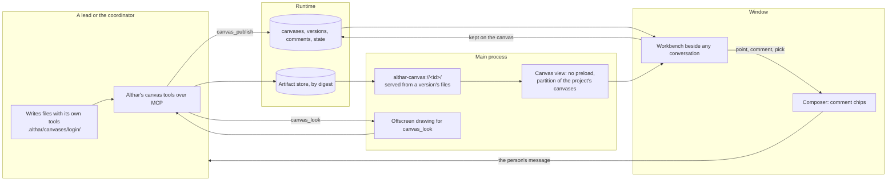

# ADR-104: A project keeps canvases its agents draw and the person comments on

> A proposal, not built. Where it would fold in:
> [desktop-app.md](../desktop-app.md) (a canvas beside the conversation),
> [tasks.md § What agents hand back](../tasks.md#what-agents-hand-back)
> (canvases in the artifact store), and
> [what-agents-may-do.md § Althar's tools outside the sandbox](../what-agents-may-do.md#althars-tools-outside-the-sandbox)
> (the canvas tools).

- **Status:** Proposed
- **Date:** 2026-11-09
- **Owner:** Runtime and desktop maintainers
- **Amends:**
  - [ADR-020](../tasks.md#what-agents-hand-back): the artifact store also
    keeps canvases' versions, each a manifest of files by digest.
  - [ADR-053](../desktop-app.md#the-workbench): the workbench gets a fourth
    kind, a canvas, beside a document, a file and a page.
  - [ADR-057](../what-agents-may-do.md#althars-tools-outside-the-sandbox) and
    [ADR-097](../what-agents-may-do.md#what-asks): the shared pool gets the
    canvas tools. Reviewers read canvases but don't publish them.
  - [ADR-064](../desktop-app.md#files-sent-with-a-message): `.althar/` in an
    agent's folder also holds the canvases it works on, which git ignores.
  - [ADR-078](../what-agents-may-do.md#the-web): the project's web switch
    also decides what a canvas may load.
  - [ADR-079](../reviews.md#outputs-show-the-change-as-built): a task's
    Outputs show the canvases its lead published.
  - [ADR-100](../desktop-app.md#a-web-page-beside-the-conversation): an HTML
    canvas is drawn the way a page is, in a view of its own with its own
    partition, served by Althar instead of loaded over http.

  These are proposed amendments until this ADR is accepted.
- **Context:**
  - **What the person asked for.** They asked for "a sort of Claude Code
    like canvas plus MCP for the agent in Althar", for iterating on and
    visualising things, and then: "Artifacts should be available project
    wide, with every lead and coordinator having access."
  - **What agents have today.** They hand back screenshots, Markdown
    documents (with Mermaid drawn) and command output. They drive the page
    beside the conversation. Nothing lets them put something to iterate on
    beside the conversation, make a new version of it, and hear what the
    person says about a spot in it. Nothing lets another lead or the
    coordinator pick it up.
  - **The research** ([canvases](../../research/canvases.md)) read how MCP
    Apps, Claude's artifacts, Claude Code, OpenAI, Google, VS Code, Cursor,
    tldraw, draw.io, Antigravity, notebooks and Electron's own guidance do
    it, on 9 November 2026. What shaped this:
    - **Althar's own MCP tools are the one route that works on every
      agent.** MCP Apps views reach the agent, which is the MCP client, not
      Althar. Claude Code skips their resources (2.1.281), and
      `claude-agent-acp` doesn't forward them. VS Code's canvases work
      only in Copilot's harness. Althar serves its own tools, so it sees
      every call without an agent forwarding anything.
    - **Files the agent writes and then publishes beat content in a
      call.** Claude Code's Artifacts, Cursor's canvases, Antigravity and
      Kiro all have the agent write files with its own tools, then name
      them. Content in a tool's arguments is sent whole each time, or needs
      an edit language of its own.
    - **What is iterated on has to stay one thing.** MCP Apps' open issues
      are a new view per call (#430) and no view without a call (#672).
      ChatGPT's Canvas was replaced by blocks that scroll away, to
      complaints. Claude Code's Artifacts keep one address, a version per
      publish, and refuse a publish made on a stale copy.
    - **Comments pinned to a spot, gathered, then sent as one message.**
      Codex, VS Code, Lovable, Warp, Antigravity and Cursor all do it.
      Althar already does it on pages
      ([Point and comment](../desktop-app.md#point-and-comment)).
    - **The agent sees what it drew.** tldraw sends the agent a picture of
      its view, and Claude Code, VS Code and Codex give screenshot tools.
      The loop is write, look, fix.
    - **A tool call that waits on the person holds the turn**
      (Claude Code's `openDiff`; Althar's own lesson in
      [ADR-087](087-a-lead-starts-helpers-on-any-agent-in-copies-of-their-own.md)).

## Decision

A project keeps **canvases**: things its agents draw for the person to look
at and iterate on. A canvas is one of these:

- a page
- a mockup
- a diagram
- a chart
- a document
- a picture
- a set of directions to choose between

Each canvas has a name, and a version for each time an agent published it.
It belongs to the project, not to the task or conversation it was made in.
The coordinator and every task's lead can list, read, look at, open and
publish any of the project's canvases. Reviewers can read and look. The
person opens any canvas beside any conversation in the project, comments on
a spot in it, and the comment goes to that conversation's agent and stays on
the canvas for every other agent to read.

| Part | What it is | Where it lives |
|---|---|---|
| Canvas | A name, a title and a kind, in a project | The store (`canvases`) |
| Version | The files of one publish, by digest, with who published it and on which version | The artifact store; a row per version |
| Working copy | A version's files in an agent's own folder, where it edits them with its own tools | `.althar/canvases/<name>/`, which git ignores |
| Canvas view | Where an HTML canvas is drawn: a `WebContentsView` with no preload, in the project's canvas partition, on an origin of the canvas's own | The main process |
| Comment | The person's note on a spot in a version, open until an agent resolves it | The store (`canvas_comments`) |
| State | A small JSON value a canvas keeps of what the person did in it (a form, a choice) | The store, per canvas |



### Every lead and the coordinator reach every canvas

**A canvas is the project's.** It is not tied to the task that made it, the
lead's session, or the worktree its files were written in. Any lead's work
can build on another's. Here are four examples:

- **A design and its build.** A prototype task's lead draws three
  directions. The person picks one. A later task's lead builds it from that
  canvas, and its pull request's screenshots go beside it.
- **The coordinator's map.** The coordinator keeps a canvas of the project's
  map, its architecture or a roadmap. Leads read it before they start and
  publish a new version when their change moves it.
- **A chart a review reads.** A lead draws a chart of a benchmark. The
  reviewer of its change reads and looks at it.
- **An outlasting canvas.** A canvas outlives the task. When a finished
  task's folder is cleaned away
  ([Finished tasks' folders](../workspaces-and-runs.md#finished-tasks-folders)),
  its canvases stay, because their versions are in the artifact store, not
  in the folder.

What being the project's means:

- **The coordinator and every lead in the project are served the canvas
  tools**, from the shared pool (ADR-097). They get the same tools, and
  their access reaches the same canvases. The runtime reads the project from
  the session, as it reads whose page a `page_*` call drives; a canvas of
  another project is never reachable.
- **Reviewers are served the reading tools** (`canvas_list`, `canvas_read`,
  `canvas_look`, `canvas_get`), marked `inReview`, so a review of someone
  else's pull request can read them too. They don't publish. A review's
  lead of an outside author gets none: its work stays offline and apart
  ([The web](../what-agents-may-do.md#the-web)), and a canvas can hold the
  project's private work.
- **Who made a version is kept, never who owns the canvas.** Each version
  records the session, the task (or the coordinator) and the turn that
  published it, and the version it was made on.
- **Agents never delete a canvas.** They archive it, which takes it out of
  the list and keeps its versions. Deleting is the person's. It can't be
  undone, so it asks, as everything that can't be undone does
  ([What asks](../what-agents-may-do.md#what-asks)).

### The tools

All the canvas tools are Althar's own, served over the runtime's MCP server
(`ToolServer.ts`) like `screenshot` and the `page_*` tools. They are listed
and called the same way on every agent.

| Tool | Who | What it does |
|---|---|---|
| `canvas_list` | Pool, reviewers | The project's canvases: name, title, kind, latest version, who published it, from which task, when, open comments, whether it's open beside a conversation now, and who holds a working copy. Archived canvases on request. |
| `canvas_get` | Pool, reviewers | Copies a version's files (the latest by default) into the caller's folder at `.althar/canvases/<name>/`. Returns the path, the version, its open comments and its state. This is how an agent starts changing a canvas, or reads its files. |
| `canvas_publish` | Pool | Publishes the files in `.althar/canvases/<name>/` as a new version. Takes `entry` (the file drawn first), `title`, `base` (the version it was made on), an optional `note` ("tighter spacing, as asked"), `group`, and `open`. Makes the canvas if the name is new. |
| `canvas_look` | Pool, reviewers | A picture of a version as drawn, at 1×, with what went wrong while drawing it: console errors, failed loads, a diagram that didn't parse. Takes a viewport (the page bar's devices), the whole length, or one element. Works whether or not anyone has it open. |
| `canvas_read` | Pool, reviewers | A canvas's comments (open and resolved, each with its version and anchor), its state, the person's pick in its group, and its versions with their notes. |
| `canvas_open` | Pool | Opens a version beside the caller's own conversation, as `page_open` does for a page. |
| `canvas_resolve` | Pool | Marks comments as answered, by the version that answers them, with an optional line for each. |
| `canvas_archive` | Pool | Takes a canvas out of the list and keeps its versions. |

- **The names are the project's**: lowercase words and hyphens, unique in
  the project (`login-flow`, `release-timeline`). An agent can tell from a
  name what a canvas is, and the person can say it to any agent.
- **Each call is in the thread.** A publish reads in the turn's work line as
  "Drew login-flow · v3"; it opens the canvas beside the conversation and
  never moves the conversation
  ([A turn at work](../desktop-app.md#a-turn-at-work)).
- **No call waits on the person.** A publish returns once the version is
  kept. A comment or a pick reaches the agent as the person's message, a
  new turn, as everything the person says does.
- **The brief says when to draw.** The brief is where Althar already says to
  draw a Mermaid block. It adds that a canvas is for what the person will
  look at again, iterate on, compare or pass on. Here are some cases:

  | Case | Where it goes |
  |---|---|
  | A mockup | A canvas |
  | Directions to choose between | A canvas |
  | A chart of results | A canvas |
  | A diagram the person will come back to | A canvas |
  | A page that explains a flow | A canvas |
  | What the person reads once and moves on from | The reply |
  | A diagram that only explains the answer | A Mermaid block in the reply |

  The brief also says to look at what it published before saying it's done.
  This is the line Claude's own guidance draws: "If the person is going to
  read the output and move on, … a conversational reply".

### Making and changing one: files, then publish

An agent makes a canvas by writing its files with its own tools, in its own
folder, then publishing them. Changing one works the same way: get the
version, edit the files, publish.

- **The files are in `.althar/canvases/<name>/`** in the folder the agent
  starts from:
  - for a lead, its task's worktree, or the folder holding several
  - for the coordinator, its own folder

  A `.gitignore` there keeps them out of git, as with attachments. Every
  agent writes there, inside its sandbox, with the edits it is best at. No
  file's words go through a tool's arguments.
- **A publish copies the folder into the artifact store.**
  - **What is read.** Each file is read inside the canvas's folder only,
    with links that lead out of it refused, and hashed into the store as
    ADR-020 keeps a picture: written aside, flushed, renamed into place.
  - **The manifest.** Then a manifest is kept: each path with its digest,
    size and type, and the entry. The version's row is committed last, so a
    version never names a file that isn't there.
  - **Unchanged files.** A file that didn't change is the same digest, kept
    once.
- **The limits are the message limits** (`MESSAGE_FILES`): at most 2,000
  files and 100 MB in a version, each file at most 50 MB. A publish past them
  is refused, with what was over. A canvas is for looking at, so it doesn't
  hold a whole project.
- **The folder is a working copy.** Althar never follows it. What everyone
  sees is the published version, the same on every screen and after the
  folder is gone. Publishing is quick, so a lead publishes as it goes and
  looks each time.
- **Paths starting `.althar/` are Althar's** inside a canvas (for the bridge
  below), and a publish refuses a file there.

### Two agents on one canvas

Leads work at once, so two can change the same canvas. **A publish names the
version it was made on (`base`).**

- **When the base is still the latest,** the publish is the next version.
- **When it isn't, the publish is refused.**
  - **What the agent gets.** The newer version's files are written beside
    the agent's own, at `.althar/canvases/<name>@<n>/`, with what changed and
    who changed it.
  - **What it does next.** The agent brings its change onto them and
    publishes again, on the newer base. This is Claude Code's rule for a
    stale copy, and it loses nobody's work.
- **A working copy shows.** `canvas_get` marks that a session holds a copy,
  until its turn ends. `canvas_list` and the canvas's bar say "The lead of
  Sign-in redesign has a copy". Nothing is locked; the mark only warns.
- **A publish without a base** is accepted only for a new name. To an
  existing canvas, it is refused with words to get it first.

### What a canvas may hold

The entry's kind decides how it is drawn. All its other files are what the
entry reaches.

| Entry | Drawn by | Runs script |
|---|---|---|
| `.md` | Althar's own Markdown, as a document beside the conversation is drawn, with Mermaid blocks as diagrams; raw HTML isn't drawn | No |
| `.mmd` | Mermaid alone, with `securityLevel: 'strict'` and the window's theme | No |
| `.svg` | As a picture (``), so its scripts never run | No |
| `.png`, `.jpg`, `.gif`, `.webp` | As a picture, by its bytes, as ADR-020 tells | No |
| `.html` | The canvas view: a page of the canvas's own, sandboxed | Yes, in the view only |

- **A group is a set of directions.** Canvases published with the same
  `group` (`login-directions`) show side by side, each with Choose. The
  person's pick is a message, as a comment is (below). It is also kept as
  the group's pick, which `canvas_read` returns. This is ADR-079's `option`,
  for things that aren't screenshots of the change.
- **Charts are HTML,** with whatever library the canvas loads or carries.
  Vega-Lite as a kind of its own is left for later (Not now).

### Where it is drawn, and what holds it in

A Markdown, Mermaid, SVG or picture canvas is drawn in Althar's own window,
as documents and pictures are now, from the version's files, which the main
process serves by digest. None of them runs anything.

**An HTML canvas runs what an agent wrote.** ACP says a client "SHOULD NOT
run scripts from Agent content". Althar runs it only from a deliberate
publish, never from what an agent says in a message, and only where it can
reach nothing:

- **It is a `WebContentsView`** that the main process owns, laid over the
  workbench as a page is (ADR-100).
  - **Settings.** It has no preload; sandbox and context isolation are on;
    Node and the `webview` tag are off.
  - **Process.** It is a process of its own, so it never shares the
    renderer that holds Althar's bridge.
  - **What it can't reach.** It can't reach Althar's bridge, the runtime's
    port, or anything Althar keeps. Every IPC call about canvas views
    checks that it comes from Althar's own windows.
- **It runs in one partition for the project's canvases,**
  `persist:canvases-<projectId>`, apart from the person's pages
  (`persist:task-<id>`) and from Althar's window. Nothing signed in to a page
  is in it.
- **It is served from `althar-canvas://<canvas id>/`.**
  - **The scheme.** A scheme registered as standard and secure, so each
    canvas is an origin of its own. A canvas's storage stays its own across
    its versions and never reaches another canvas's.
  - **Where it is handled.** Only in that partition's own `protocol`, so no
    other view, page or window can load it. The window's session doesn't
    know it, and no port is open on the computer for it.
  - **What is served.** The handler serves only the files in the shown
    version's manifest, from the artifact store, by path; anything else is
    a 404.
  - **Why not `file:` or a local server.** That's the guide's "custom
    protocols", not `file:`. Any process on the computer can reach a local
    server.
- **Every response carries a CSP Althar writes:**
  - `default-src 'self'` and `frame-src 'self'`
  - `script-src` and `style-src` with `'self' 'unsafe-inline'`, so that a
    single-file page works, plus `'unsafe-eval'` and `'wasm-unsafe-eval'`,
    which charting and 3D libraries need (MCP Apps' #199 and #605)
  - `object-src 'none'` and `base-uri 'self'`
  - `form-action 'self'` and `frame-ancestors 'none'`
- **Every guard of a page holds.**
  - **Permissions.** Every web permission is refused, apart from writing to
    the clipboard what the person copies.
  - **Downloads** are refused, with Save files offered instead.
  - **Navigation.** A navigation off the canvas's origin doesn't happen in
    the view. An `http:` or `https:` link opens where links from a thread
    open (the page beside the conversation, or the person's browser, as
    Settings › Browser says). Any other scheme is refused. Pop-ups go the
    same way.
- **The partition is cleared** when the project is removed. A canvas's
  storage goes with the canvas when the person deletes it.

### Its network

**What a canvas may load follows the project's web switch**
([The web](../what-agents-may-do.md#the-web)), since the reason is the same:
a canvas holds the project's work, and a page that can fetch anywhere can
send it out.

- **With the switch on** (the default), `script-src`, `style-src`,
  `img-src`, `font-src` and `connect-src` also allow `https:`. A canvas can
  load Chart.js, d3, Tailwind or a font from a CDN, and fetch public data.
- **With it off,** they allow only `'self'`, `data:` and `blob:`. A canvas
  carries its libraries in its own files, and the brief says so.
- **A host under Never is refused**, as for every command.

### The bridge: state and send

An HTML canvas can do two things back, through its own origin, with no
preload and no `postMessage` to a window that might be Althar's:

| Address | What it does |
|---|---|
| `GET /.althar/state` | The canvas's state: a JSON value, at most 256 KB |
| `PUT /.althar/state` | Replaces it, whole. The last write wins; the version it was written from is noted |
| `POST /.althar/send` | `{ text, data? }`: puts a chip in the composer of the conversation the canvas is open beside, as a comment does |
| `GET /.althar/canvas.js` | A small script with `althar.state.get()`, `althar.state.set(value)`, `althar.send(text, data)` and `althar.theme` |
| `GET /.althar/tokens.css` | Althar's tokens (palette, type, spacing), light and dark, following the window's theme |

- **A send never sends.** It lands in the composer as a chip, and the person
  presses Send. Here is why:
  - **A client can't answer for the person**
    ([ADR-048](../foundations.md#where-the-runtime-runs-and-who-may-reach-it)),
    and a canvas is less than a client.
  - **MCP Apps' `ui/message` lets the host ask for consent;** Althar asks
    every time, by making it a draft.
  - A canvas that sends in a loop fills a chip, not a thread.
- **State is the second way back.** A form, a set of sliders, the cards the
  person dragged into order: these read better as data than as prose.
  - **Who reads it.** `canvas_read` gives it to any agent; the canvas keeps
    it across versions; a later version reads what the earlier one left.
  - **Where it comes from.** This is the Apps SDK's `widgetState` and
    A2UI's data model, kept by the project instead of the call.
- **Why the tokens.** So a mockup looks like it belongs in the product it is
  for, and a chart reads in both themes. The brief points at `tokens.css`
  for drafts of Althar's own interface.

### Beside the conversation

**A canvas opens on the workbench**
([ADR-053](../desktop-app.md#the-workbench)), beside the thread and never
over it, one thing at a time, as a document, a file and a page do. Its width
is kept as a page's is.

- **It opens beside any conversation in the project:**
  - from its line in a thread
  - from a link to it in what an agent wrote (`althar-canvas` names, read as
    a chip as code names are)
  - from the project's canvases
  - from `canvas_open`
  - from the command menu

  The conversation it opens beside is where its comments go.
- **The bar** has:
  - its title
  - the version (v3 of 5, who published it, from which task, when, and its
    note)
  - Comment
  - Viewport (HTML only, the page's devices)
  - Save files (a version's files, to a folder the person picks)
  - Open as a tab
  - Close

  An older version says "Not the latest", with Latest. Versions step with
  `[` and `]`.
- **A canvas is drawn as published.** A new version while it is open shows
  at once, scrolled where it was, if its entry is the same.

#### The project's canvases

**The project's canvases are one list,** opened from the board's header and
from the command menu, so the board needs no sidebar. Each canvas in it
shows:

- a picture of the latest version, taken when it was published
- its name and title
- who published it last, from which task, and when
- its open comments

A group is one card with its directions. Archived canvases are a press
away. Its exact layout is for the kit, with
[DESIGN.md](../../../DESIGN.md).

#### In the thread and Outputs

- **In the thread,** a publish is one line in the turn's work ("Drew
  login-flow · v3"). The turn's last message names the canvases it drew,
  each a chip that opens it.
- **In a task's Outputs,** under What it made, are the canvases its lead
  published in that task, as last published. A prototype's directions are
  its group. They never go to a pull request; screenshots of the change do,
  as now (ADR-077, ADR-079).
- **On the coordinator's side,** a canvas it published reads the same in its
  thread.

### The person's word back: comments and picks

**Comments on a canvas are Point and comment's,** gathered by the same code
(`renderer/shared/comments.ts`, the kit's `CommentChip` and `CommentCard`),
which was meant for every comment made beside a conversation.

| Kind | Point at | The anchor kept |
|---|---|---|
| HTML | An element, with the page's overlay: outlined, ↑ and ↓ widen and narrow, Enter takes it. The overlay is injected into an isolated world of the view, in a closed shadow root, so the canvas never sees what the person types | Its selector, words, rect, the viewport, and a crop |
| Markdown | A passage selected | Its words, the heading it is under, and its line in the entry |
| Mermaid, SVG, picture | An area dragged | The rect as a share of the picture, and a crop |
| Any | The whole canvas | Nothing |

- **A comment goes two ways.**
  - **Into the composer.** It goes into the composer of the conversation
    the canvas is open beside, as a chip beside the person's other
    attachments. Sent, the person's words go first, then each comment with
    the canvas's name, its version and its anchor, and the crop as a
    picture.
  - **Onto the canvas.** It is kept on the canvas with its version and
    anchor, open, where `canvas_read` shows it to every agent in the
    project. So a lead that picks up a canvas later knows what the person
    asked of it, though it wasn't the one told.
- **The canvas keeps numbered pins** for its open comments, on the version
  they were made on. A later version shows them faintly, as "on v2".
- **An agent resolves comments** with `canvas_resolve`, by the version that
  answers them. A resolved one leaves the pins and stays in `canvas_read`.
  The person can resolve one too, or open it again.
- **A pick is a message.** Choose on one of a group's directions puts "Chose
  login-directions/b" into the composer as a chip, with the person's words.
- **Comments are never sent alone,** and never streamed to an agent as the
  person makes them. Everyone the research read gathers them and sends them
  as one message.

### The agent sees what it drew

`canvas_look` draws a version where no one sees it, as `screenshot` does,
and returns the picture and what went wrong.

- **How it draws.** A window offscreen, in a fresh partition that keeps
  nothing, with the canvas's scheme handled for that one version only, at
  the viewport asked (ADR-057).
  - **Markdown and Mermaid** are drawn with the window's own drawing, in a
    hidden window that loads the kit, so the picture is what the person
    sees.
  - **Errors returned.** A diagram that doesn't parse, a console error, a
    request that failed or that the CSP refused.
- **The picture of the list is the same drawing,** taken as a version is
  published and kept in the artifact store.
- **Where nothing draws** (the command line, a runtime with no desktop
  attached), `canvas_look` says so, as `screenshot` does. Publishing, reading
  and getting still work.

**Not decided yet:** whether the `page_*` tools also drive an HTML canvas
open beside the caller's conversation, to click through a prototype. They
reach only the caller's own page now, and a canvas view is the project's.

### What is kept

- **Each version's files are in the artifact store,** referred to from its
  version (`ArtifactSubject` gains `canvas_version`). The same file in two
  versions, or in two canvases, is kept once.
- **What is kept, and for how long:**
  - **Versions** are kept until the person deletes the canvas, archived or
    not.
  - **Comments and state** go with their canvas.
  - **Mark-and-sweep,** once built, keeps every file a version refers to
    ([Not built yet](../tasks.md#what-agents-hand-back)).
- **Canvases are marked as possibly holding secrets**, as pictures and
  output are: an agent might draw a page of real data. They leave the
  computer only by the person's hand (Save files, from the bar), and a pull
  request never gets them on its own.

### Off the desktop

- **The command line** (`@althar/cli`) is served the same tools. Publishing,
  reading, getting and resolving work. Looking says nothing draws there, and
  `canvas_open` says no window is open, as `page_open` does.
- **A project whose runtime lives on a host** (proposed in
  [ADR-103](103-projects-live-locally-or-on-a-host-and-place-work-in-pools.md))
  works the same way:
  - **Where things live.** Versions are in the project home's artifact
    store, the working copy is in the worker's folder, and the client draws.
  - **What crosses.** A version is files by digest, so a client fetches only
    what it hasn't seen, and the canvas scheme is served by the client's
    main process from what it fetched.

### MCP Apps

Canvases aren't MCP Apps, but they keep to MCP Apps' sandbox rules, so that
MCP Apps can be drawn the same way later.

- **Why not now.**
  - **The views never reach Althar.** The person's MCP servers are the
    agent's, so their views go to the agent, which doesn't draw them or pass
    them on (research: ACP). Althar would have to stand between the agent
    and those servers to see them.
  - **One view per call doesn't fit.** A view drawn anew for each call is
    the opposite of a canvas the project keeps (#430, #672).
  - **HTML in a call is the wrong form.** A document in a tool's result,
    sent whole each time, isn't how agents edit best.
- **What is kept compatible:**
  - **The sandbox** meets the spec's rules: an origin not the host's, scripts
    allowed, CSP from headers Althar serves, and no domain the canvas didn't
    get.
  - **The bridge maps onto MCP Apps' messages:**
    - `send` is `ui/message`, as a draft.
    - State is `ui/update-model-context`, the last write winning.
    - `tokens.css` is the host's `styles.variables`.
- **Later,** once Althar stands between an agent and the person's servers
  (MCP-over-ACP is an active ACP RFD), a server's view could be drawn as a
  canvas beside the conversation, with `AppBridge` (`@modelcontextprotocol/ext-apps`)
  in the canvas view. That is a decision of its own.

### How Claude Code does it, and what Althar takes

| Claude Code | Althar |
|---|---|
| The agent writes a file, then the `Artifact` tool publishes it by path | The same: the agent's own tools write; `canvas_publish` publishes the folder |
| A version per publish, one address | The same: one name in the project, a version per publish |
| A publish on a stale copy is refused, and the agent merges | The same, by `base`, with the newer version written beside the agent's copy |
| The page is on claude.ai, behind a sign-in, private by default | On this computer, in the project, with no account; nothing leaves it unless the person sends it |
| The publishing session watches its artifacts; comments come to it | The project owns the canvas; comments go to the conversation it's open beside, and stay on the canvas for every agent |
| A session may answer comments on its own | A comment is the person's message, sent by the person |
| A CSP of five CDNs and its own origin | The project's web switch: `https:` or only its own files |
| Powers declared at publish and asked for (connectors, a database, "ask Claude") | Only state and send, which can't act for the person |
| The Browser pane checks the agent's work by screenshots and clicks | `canvas_look`, and the page tools for the running project |
| The IDE's `openDiff` blocks for the person's answer | Nothing blocks; the person's word is a new turn |

## The data model

```sql
CREATE TABLE canvases (
  id            TEXT PRIMARY KEY,          -- the origin's host
  project_id    TEXT NOT NULL REFERENCES projects(id),
  name          TEXT NOT NULL,             -- lowercase words and hyphens
  title         TEXT NOT NULL,
  kind          TEXT NOT NULL,             -- markdown | mermaid | svg | picture | html
  "group"       TEXT,                      -- a set of directions
  created_at    TEXT NOT NULL,
  archived_at   TEXT,
  UNIQUE (project_id, name)
);

CREATE TABLE canvas_versions (
  canvas_id     TEXT NOT NULL REFERENCES canvases(id),
  number        INTEGER NOT NULL,          -- 1, 2, 3 …
  base          INTEGER,                   -- the version it was made on
  manifest      TEXT NOT NULL,             -- the manifest's digest in the artifact store
  entry         TEXT NOT NULL,
  note          TEXT,
  picture       TEXT,                      -- the list's picture, by digest
  thread_id     TEXT NOT NULL,             -- who published it
  task_id       TEXT,                      -- null for the coordinator
  session_id    TEXT NOT NULL,
  turn_id       TEXT,
  created_at    TEXT NOT NULL,
  PRIMARY KEY (canvas_id, number)
);

CREATE TABLE canvas_comments (
  id            TEXT PRIMARY KEY,
  canvas_id     TEXT NOT NULL REFERENCES canvases(id),
  version       INTEGER NOT NULL,
  anchor        TEXT NOT NULL,             -- JSON: element, passage, area or whole
  body          TEXT NOT NULL,
  message_id    TEXT,                      -- the message it went with
  thread_id     TEXT,                      -- the conversation it went to
  resolved_by   INTEGER,                   -- the version that answered it
  resolved_note TEXT,
  created_at    TEXT NOT NULL
);

CREATE TABLE canvas_state (
  canvas_id     TEXT PRIMARY KEY REFERENCES canvases(id),
  value         TEXT NOT NULL,             -- JSON, at most 256 KB
  version       INTEGER NOT NULL,          -- the version it was written from
  updated_at    TEXT NOT NULL
);
```

- **A group's pick** is a row in `canvas_state` under the group's own key, or
  a column of its own; the migration decides.
- **Working copies** are held in memory by the runtime, per session, and
  never stored. They last only as long as a turn.
- **The canvas's id is its origin's host,** lowercase and fixed, so storage
  survives a rename of its title.

## What changes, by package

| Package | What changes |
|---|---|
| `@althar/domain` | `CanvasId`, `CanvasName`, `CanvasKind`, the anchor and manifest schemas, the bridge's request schemas |
| `@althar/persistence-sqlite` | The four tables and their migration; `ArtifactSubject` gains `canvas_version` |
| `@althar/runtime` | `Canvases.ts`: the store, publishing (read inside the folder, hash, manifest, commit), the base check, working-copy marks, comments, state. `canvasTools.ts`: the eight tools, served to the pool and the reading four to reviewers. The brief's line on canvases. |
| `@althar/contracts` | Reads for the project's canvases, a canvas and its versions, comments and state; the live event when a version is published; commands for resolving, deleting and picking |
| `apps/desktop` main | `canvases/`: the scheme, handled in the canvas partition's protocol; the view, reusing `pages.ts`'s guards, overlay and devices; offscreen drawing for `canvas_look` and the list's pictures, beside `screenshots.ts`; the bridge's three addresses |
| `apps/desktop` renderer | The workbench's canvas kind; the project's canvases; the line and chips in the thread; Outputs' canvases; comments on passages and areas, into `comments.ts` |
| `@althar/ui` | `CanvasBar`, `CanvasCard`, `CanvasGroup`, an area picker for pictures, with stories |
| `@althar/cli` | Says where a canvas would open, and that nothing draws there |

## Building it

Each step ships on its own, with its tests first (90% lines and branches),
and a story or an end-to-end spec that shows it.

1. **The store and the tools, with documents and pictures.**
   - **What it adds.** Canvases, versions, the artifact store's manifests,
     and `canvas_list`, `canvas_get`, `canvas_publish` (with `base`),
     `canvas_read`, `canvas_resolve` and `canvas_archive`.
   - **What draws.** Markdown, Mermaid, SVG and pictures on the workbench,
     the thread's line, and comments on passages and areas.
   - **What it proves.** One lead publishes; another lead and the
     coordinator get, change and publish it; a stale base is refused and
     merged.
2. **HTML.**
   - **What it adds.** The canvas view, its scheme and partition, CSP by the
     web switch, every page guard, point and comment on elements, and
     `canvas_look` with errors.
   - **What it proves.** The guard tests show a canvas can't load
     `file:`, another canvas's files, the window's bridge or the runtime's
     port.
3. **The project's canvases, Outputs and picks.** The list with its
   pictures, groups and Choose, Outputs' canvases, `canvas_open`, and
   deleting with its ask.
4. **State and send.** `canvas.js`, `/.althar/state`, `/.althar/send` into
   the composer, and `tokens.css`.

## Not now

- **Editing in Althar.** The person comments; agents change canvases. This
  keeps the person's rule that Althar is no editor
  ([Code beside the conversation](../desktop-app.md#code-beside-the-conversation)).
- **Vega-Lite, Excalidraw or draw.io as kinds of their own.**
  - **Vega-Lite** is a chart from JSON with no script, which suits a canvas
    with the web off.
  - **Excalidraw** (MIT) and **draw.io's** files are diagrams the person
    could also edit in their own tools.
  - Each can be loaded by an HTML canvas today.
- **An infinite whiteboard** (tldraw, Excalidraw) as the canvas itself.
- **Sharing a canvas off the computer**, as a link or a file to send.
  Saving its files is the way for now.
- **Copying a canvas into the repository** as a press. A lead can copy its
  files there itself, as a change.
- **Drawing the person's MCP servers' views** (MCP Apps), above.

## Risks and open questions

- **A canvas sends the project out.** With the web switch on, a canvas's
  script can fetch any `https:` host, and a lead steered by a page could
  draw one that does. This is the switch's own risk, the same for the lead's
  commands, and it is not new. With the switch off, `connect-src` is the
  canvas's own origin.
- **Process isolation of the canvas view.** The view is a process of its own
  as a `WebContentsView`. Whether two canvases' views share one process
  wasn't checked; they are different origins either way, and hold nothing
  of each other.
- **Many versions.** A lead that publishes on every small change makes many
  versions. They cost little, since unchanged files are one digest. The list
  shows only the latest. Versions may be folded later ("v4–v11, by the lead
  of …").
- **Comments on a canvas that has moved on.** A comment's anchor is on the
  version it was made on. A later version may have no such element. The pin
  shows "on v2", and the agent is given the crop, so it knows what was
  meant.
- **Who hears a comment.** A comment goes to the conversation the canvas is
  open beside, which may not be the lead that drew it. The comment stays on
  the canvas, so the lead that next gets it reads it. Whether the
  coordinator should also pass it on to that lead unasked is left open.
- **Names.** Two leads may both want `login`. The second publish of a new
  name already taken is refused, with the canvas that has it.

## Alternatives turned down

- **MCP Apps as the format.** Their views never reach Althar, they make a
  view per call, and they put a document in a tool's result. See
  [MCP Apps](#mcp-apps).
- **Content in the tool's arguments** (legacy artifacts, Imagine).
  - **The cost.** The whole document goes through each call, or needs an
    edit language of its own. Agents edit files better with their own tools.
  - **Why it doesn't work here.** A file in the agent's folder is what
    another lead can get and change.
- **A declarative component tree** (A2UI, json-render). This is safe, with
  no script, and themed by the host. Its catalog is narrow: a prototype or a
  chart needs HTML, which models write best. It may come back for forms, if
  canvases' scripts prove a problem.
- **A canvas per task, in its folder, followed live.**
  - **The ask.** The person asked for canvases across the project.
  - **What breaks.** A folder goes when its task is done, and another lead
    can't reach it.
  - **What following live costs.** Following files live would show what
    hasn't been published, differently on each screen.
- **An iframe in Althar's window,** on a null origin or one of its own. An
  iframe shares the renderer that holds Althar's bridge. A null origin loses
  storage and makes every message `"*"`. A view of its own is a process and a
  session apart, and reuses everything pages built: guards, overlay,
  devices, offscreen drawing.
- **A local http server for canvases,** loaded as an ordinary page. Any
  process on the computer could reach it. A scheme handled only in one
  partition is reachable by nothing else.
- **A tool that waits on the person,** like `openDiff`. It holds the turn,
  hides what comes after and holds the person's next message
  ([ADR-087](087-a-lead-starts-helpers-on-any-agent-in-copies-of-their-own.md)).
- **The publishing session watching its canvases,** like Claude Code. A
  session ends, and a canvas is the project's. The person's comment goes
  where the person is.
