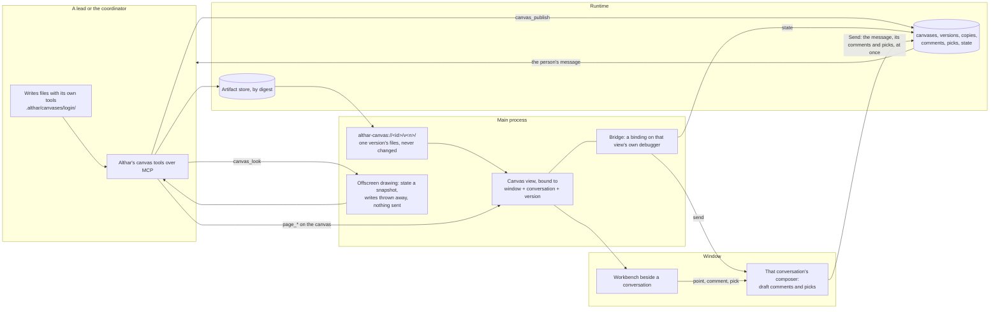

# ADR-104: A project keeps canvases its agents draw and the person comments on

> A proposal, not built. Where it would fold in:
> [desktop-app.md](../desktop-app.md) (a canvas beside the conversation),
> [tasks.md § What agents hand back](../tasks.md#what-agents-hand-back)
> (canvases in the artifact store), and
> [what-agents-may-do.md § Althar's tools outside the sandbox](../what-agents-may-do.md#althars-tools-outside-the-sandbox)
> (the canvas tools).

- **Status:** Proposed, and partly built: see [What is built](#what-is-built)
- **Date:** 2026-11-09 (revised the same day, after review; first slice built 2026-11-10)
- **Owner:** Runtime and desktop maintainers
- **Amends:**
  - [ADR-020](../tasks.md#what-agents-hand-back): the artifact store also
    keeps canvases' versions, each a manifest of files by digest.
  - [ADR-053](../desktop-app.md#the-workbench): the workbench gets a fourth
    kind, a canvas, beside a document, a file and a page.
  - [ADR-057](../what-agents-may-do.md#althars-tools-outside-the-sandbox) and
    [ADR-097](../what-agents-may-do.md#what-asks): the shared pool gets the
    canvas tools. Reviewers read canvases but don't publish them.
  - [ADR-064](../desktop-app.md#files-sent-with-a-message): `.althar/` in an
    agent's folder also holds the canvases it works on, which git ignores.
  - [ADR-079](../reviews.md#outputs-show-the-change-as-built): a task's
    Outputs show the canvases its lead published.
  - [ADR-100](../desktop-app.md#a-web-page-beside-the-conversation): an HTML
    canvas is drawn the way a page is, in a view of its own with its own
    partition, served by Althar instead of loaded over http; and the
    `page_*` tools also drive the canvas beside the caller's conversation,
    with the same machinery (#723).

  These are proposed amendments until this ADR is accepted.
- **Context:**
  - **What the person asked for.** They asked for "a sort of Claude Code
    like canvas plus MCP for the agent in Althar", for iterating on and
    visualising things, and then: "Artifacts should be available project
    wide, with every lead and coordinator having access."
  - **What agents have today.** They hand back screenshots, Markdown
    documents (with Mermaid drawn) and command output. They drive the page
    beside the conversation. Nothing lets them put something to iterate on
    beside the conversation, make a new version of it, and hear what the
    person says about a spot in it. Nothing lets another lead or the
    coordinator pick it up.
  - **The research** ([canvases](../../research/canvases.md)) read how MCP
    Apps, Claude's artifacts, Claude Code, OpenAI, Google, VS Code, Cursor,
    tldraw, draw.io, Antigravity, notebooks and Electron's own guidance do
    it, on 9 November 2026. What shaped this:
    - **Althar's own MCP tools are the one route that works on every
      agent.** MCP Apps views reach the agent, which is the MCP client, not
      Althar. Claude Code skips their resources (2.1.281), and
      `claude-agent-acp` doesn't forward them. VS Code's canvases work
      only in Copilot's harness. Althar serves its own tools, so it sees
      every call without an agent forwarding anything.
    - **Files the agent writes and then publishes beat content in a
      call.** Claude Code's Artifacts, Cursor's canvases, Antigravity and
      Kiro all have the agent write files with its own tools, then name
      them. Content in a tool's arguments is sent whole each time, or needs
      an edit language of its own.
    - **What is iterated on has to stay one thing.** MCP Apps' open issues
      are a new view per call (#430) and no view without a call (#672).
      ChatGPT's Canvas was replaced by blocks that scroll away, to
      complaints. Claude Code's Artifacts keep one address, a version per
      publish, and refuse a publish made on a stale copy.
    - **Comments pinned to a spot, gathered, then sent as one message.**
      Codex, VS Code, Lovable, Warp, Antigravity and Cursor all do it.
      Althar already does it on pages
      ([Point and comment](../desktop-app.md#point-and-comment)).
    - **The agent sees what it drew.** tldraw sends the agent a picture of
      its view, and Claude Code, VS Code and Codex give screenshot tools.
      The loop is write, look, fix.
    - **A tool call that waits on the person holds the turn**
      (Claude Code's `openDiff`; Althar's own lesson in
      [ADR-087](087-a-lead-starts-helpers-on-any-agent-in-copies-of-their-own.md)).
  - **The research doesn't show another renderer can replace what pages
    already have.** Pages beside the conversation already have the guards,
    point and comment, and the driving machinery leads use (#723). So the
    HTML canvas is drawn and driven with that machinery, not a second copy.

## Decision

A project keeps **canvases**: things its agents draw for the person to look
at and iterate on. A canvas is one of these:

- a page
- a mockup
- a diagram
- a chart
- a document
- a picture
- a set of directions to choose between

Each canvas has a name, and a version for each time an agent published it.
It belongs to the project, not to the task or conversation it was made in.
The coordinator and every task's lead can list, read, look at, open and
publish any of the project's canvases. Reviewers can read and look. A
person opens any canvas beside any conversation in the project, and comments
on a spot in it or picks between directions. What they send goes to that
conversation's agent and is kept on the canvas for every other agent to
read.

| Part | What it is | Where it lives |
|---|---|---|
| Canvas | A name, a title and a kind, in a project | The store (`canvases`) |
| Version | The files of one publish, by digest, never changed; who published it and on which version | The artifact store; a row per version |
| Working copy | A version's files in an agent's own folder, where it edits them with its own tools; Althar records which version each copy came from | `.althar/canvases/<name>/` (git ignores it); a row per copy |
| Canvas view | Where an HTML canvas is drawn: a `WebContentsView` with no preload, in the project's canvas partition, on the canvas's own origin, at one version's address. Each view is bound to one window, one conversation and one version | The main process |
| Comment | A person's note on a spot in a version: private to them until sent, then kept with its author, version, anchor and message, open until resolved | The composer's draft, then the store (`canvas_comments`) |
| Pick | A person's choice of one direction in a group, sent as a message, kept with who picked what and when | The store (`canvas_picks`) |
| State | What a canvas keeps of what is done in it. A person's own state is theirs. Shared state is the project's, written only on the revision it was read at | The store (`canvas_state`) |



### Every lead and the coordinator reach every canvas

**A canvas is the project's.** It is not tied to the task that made it, the
lead's session, or the worktree its files were written in. Any lead's work
can build on another's. Here are four examples:

- **A design and its build.** A prototype task's lead draws three
  directions. The person picks one. A later task's lead builds it from that
  canvas, and its pull request's screenshots go beside it.
- **The coordinator's map.** The coordinator keeps a canvas of the project's
  map, its architecture or a roadmap. Leads read it before they start and
  publish a new version when their change moves it.
- **A chart a review reads.** A lead draws a chart of a benchmark. The
  reviewer of its change reads and looks at it.
- **An outlasting canvas.** A canvas outlives the task. When a finished
  task's folder is cleaned away
  ([Finished tasks' folders](../workspaces-and-runs.md#finished-tasks-folders)),
  its canvases stay, because their versions are in the artifact store, not
  in the folder.

What being the project's means:

- **The coordinator and every lead in the project are served the canvas
  tools**, from the shared pool (ADR-097). They get the same tools, and
  their access reaches the same canvases. The runtime reads the project from
  the session, as it reads whose page a `page_*` call drives; a canvas of
  another project is never reachable.
- **Reviewers are served the reading tools** (`canvas_list`, `canvas_read`,
  `canvas_look`, `canvas_get`), marked `inReview`, so a review of someone
  else's pull request can read them too. They don't publish. A review's
  lead of an outside author gets none: its work stays offline and apart
  ([The web](../what-agents-may-do.md#the-web)), and a canvas can hold the
  project's private work.
- **Everything is kept with who did it.** A project may be reached by
  several people (proposed in
  [ADR-103](103-projects-live-locally-or-on-a-host-and-place-work-in-pools.md)).
  So every record carries an actor, the store's own `actors`:
  - a version, its publish
  - a comment or a pick, its sending
  - a resolution
  - a shared write

  It also carries the session, task and turn, where an agent did it.
- **Who made a version is kept, never who owns the canvas.** Each version
  records its actor, its session, its task (or the coordinator), its turn,
  and the version it was made on.
- **Agents never delete a canvas.** They archive it, which takes it out of
  the list and keeps its versions. Deleting is a person's. It can't be
  undone, so it asks, as everything that can't be undone does
  ([What asks](../what-agents-may-do.md#what-asks)).

### The tools

All the canvas tools are Althar's own, served over the runtime's MCP server
(`ToolServer.ts`) like `screenshot` and the `page_*` tools. They are listed
and called the same way on every agent.

| Tool | Who | What it does |
|---|---|---|
| `canvas_list` | Pool, reviewers | The project's canvases: name, title, kind, latest version, who published it, from which task, when, open comments, whether it's open beside a conversation now, and who has a working copy of which version. Archived canvases on request. |
| `canvas_get` | Pool, reviewers | Puts a version's files (the latest by default) in the caller's folder without overwriting edits (below). Returns the copy's path and version, whether it reused, replaced or set aside a copy, and the version's open comments. |
| `canvas_publish` | Pool | Publishes a working copy as a new version: `.althar/canvases/<name>/` by default, or another copy named by `from`. `base` defaults to the version the copy came from. Takes `entry` (the file drawn first), `title`, an optional `note` ("tighter spacing, as asked"), `group`, and `open`. Makes the canvas if the name is new. |
| `canvas_look` | Pool, reviewers | A picture of a version as drawn, at 1×, with what went wrong while drawing it: console errors, failed loads, a diagram that didn't parse, what it tried to send. Takes a viewport (the page bar's devices), the whole length, or one element. Draws it apart from everyone's views (below), whether or not anyone has it open. |
| `canvas_read` | Pool, reviewers | A canvas's sent comments (open and resolved, each with its author, version, anchor and message, and who resolved it, when and with which version), its group's picks with who picked which version when, its shared state with its revision, and its versions with their notes. A caller with the canvas open beside its own conversation also gets that view's version and the state the person has in it. |
| `canvas_open` | Pool | Opens a version beside the caller's own conversation, as `page_open` does for a page. |
| `canvas_resolve` | Pool | Marks sent comments as answered, by the version that answers them, with an optional line for each. |
| `canvas_archive` | Pool | Takes a canvas out of the list and keeps its versions. |

- **The `page_*` tools drive a canvas too.** That is the next section's.
- **The names are the project's**: lowercase words and hyphens, unique in
  the project (`login-flow`, `release-timeline`). An agent can tell from a
  name what a canvas is, and the person can say it to any agent.
- **Each call is in the thread.** A publish reads in the turn's work line as
  "Drew login-flow · v3"; it opens the canvas beside the conversation and
  never moves the conversation
  ([A turn at work](../desktop-app.md#a-turn-at-work)).
- **No call waits on the person.** A publish returns once the version is
  kept. A comment or a pick reaches the agent as the person's message, a
  new turn, as everything the person says does.
- **The brief says when to draw.** The brief is where Althar already says to
  draw a Mermaid block. It adds that a canvas is for what the person will
  look at again, iterate on, compare or pass on. Here are some cases:

  | Case | Where it goes |
  |---|---|
  | A mockup | A canvas |
  | Directions to choose between | A canvas |
  | A chart of results | A canvas |
  | A diagram the person will come back to | A canvas |
  | A page that explains a flow | A canvas |
  | What the person reads once and moves on from | The reply |
  | A diagram that only explains the answer | A Mermaid block in the reply |

  The brief also says to look at what it published, and to use its
  controls, before saying it's done. This is the line Claude's own guidance
  draws: "If the person is going to read the output and move on, … a
  conversational reply".

### Driving a canvas

**A lead or the coordinator drives the HTML canvas beside its own
conversation with the `page_*` tools**, as it drives the page there
([Leads and the coordinator drive the page](../desktop-app.md#leads-and-the-coordinator-drive-the-page)).
A form, a slider or a prototype's flow is only checked by using it.

- **Which view.** A call reaches the canvas with `on: "canvas"`; without it,
  it still reaches the page, as now. Whose canvas is never an argument: it
  is the canvas view open beside the caller's conversation, on the workbench
  or waiting behind what is. Where none is open, the tool says so, with
  words to `canvas_open` one. `page_state` names its canvas and version.
- **It is the same machinery** (#723), which carries over:
  - the snapshot with references, through the overlay's driver in an
    isolated world
  - real input through the debugger
  - script in an isolated world
  - dialogs
  - logs since a mark
  - every bounded call
- **A reference belongs to one document.** A new version, a reload or a
  navigation is a new document, so its old references are refused, with
  words to take a new snapshot.
- **The person wins.**
  - **The lead shows.** While a lead acts, the element is outlined and the
    bar says who is at work.
  - **The person's input stops it.** A press, key or scroll from the person
    stops the action in flight and what queued behind it.
  - **Pointing to comment holds the lead.** While the person points to
    comment, the lead's actions wait.
  - **A call the runtime gave up on stops** at its next step.
- **What it does is the person's, in that view.** The canvas's own writes go
  through the view's binding, so they are recorded as that view's. A
  `send` the canvas makes while a lead drives it lands in the composer as a
  draft, as one the person made would; nothing is sent.
- **The guards are the canvas view's**, below. `page_open` and navigation
  can't take a page view to a canvas, or a canvas view off its canvas.

### Making and changing one: files, then publish

An agent makes a canvas by writing its files with its own tools, in its own
folder, then publishing them. Changing one works the same way: get the
version, edit the files, publish.

- **The files are in `.althar/canvases/<name>/`** in the folder the agent
  starts from:
  - for a lead, its task's worktree, or the folder holding several
  - for the coordinator, its own folder

  A `.gitignore` there keeps them out of git, as with attachments. Every
  agent writes there, inside its sandbox, with the edits it is best at. No
  file's words go through a tool's arguments.
- **A publish copies the folder into the artifact store.**
  - **What is read.** Each file is read inside the copy only, with links
    that lead out of it refused, and hashed into the store as ADR-020 keeps
    a picture: written aside, flushed, renamed into place.
  - **The manifest.** Then a manifest is kept: each path with its digest,
    size and type, and the entry. The version's row is committed last, so a
    version never names a file that isn't there.
  - **Unchanged files.** A file that didn't change is the same digest, kept
    once.
  - **After the publish,** the copy is recorded as being that version.
- **The limits are the message limits** (`MESSAGE_FILES`): at most 2,000
  files and 100 MB in a version, each file at most 50 MB. A publish past them
  is refused, with what was over. A canvas is for looking at, so it doesn't
  hold a whole project.
- **The folder is a working copy.** Althar never follows it. What everyone
  sees is the published version, the same on every screen and after the
  folder is gone. Publishing is quick, so a lead publishes as it goes and
  looks each time.
- **Paths starting `.althar/` are Althar's** inside a canvas, and a publish
  refuses a file there.
- **Links inside a canvas are relative.** A version is served under its own
  path (below), so `/style.css` from the canvas's root finds nothing. The
  brief says to use `style.css`. `canvas_look` reports a root path as a
  failed load, with that advice.

### Working copies are never overwritten

`canvas_get` never loses an agent's edits. Unpublished edits stay on disk
across turns, and the agent may get a canvas twice, or come back to it in a
later turn.

- **Each copy has a record** in the store: the folder it is in, its path,
  the version it came from, and the manifest of what was put there. This
  covers `<name>/` and every set-aside copy. A record lasts as long as its
  folder, not a turn. So "who has a copy" in `canvas_list` is the records
  of folders still on this computer.
- **When the agent gets a canvas,** the copy at `.althar/canvases/<name>/` is
  compared with its record:

  | The copy at `<name>/` | What `canvas_get` does |
  |---|---|
  | Not there | Puts the version there |
  | Unchanged since it was put there, of the version asked | Reuses it, as it is |
  | Unchanged, of another version | Replaces it with the version asked, since nothing in it is lost |
  | Changed since it was put there, or there with no record | Leaves it alone, and puts the version asked beside it, at `<name>@<n>/` |

  The answer says which happened, and for an edited copy, the version it
  was made on.
- **A set-aside copy `<name>@<n>/` is version *n*,** which never changes.
  - **It is still version *n*:** it is reused.
  - **It was edited:** the next free name is used, `<name>@<n>-2/`, then
    `-3`.
  - **Something that isn't a copy has the name:** the next free name is used
    too.

  Nothing in a canvas's folder is ever removed by Althar while its task's
  folder is there. The folder goes with its task, as attachments do.
- **Any copy can be published** with `from` (`login-flow@4-2`), on the base
  its record gives.

### Two agents on one canvas

Leads work at once, so two can change the same canvas. **A publish names the
version it was made on (`base`),** which is the copy's record unless the
agent says otherwise.

- **When the base is still the latest,** the publish is the next version.
- **When it isn't, the publish is refused.**
  - **What the agent gets.** The latest version is set aside beside the
    agent's copy, as `canvas_get` sets one aside, with what changed and who
    changed it.
  - **What it does next.** The agent brings its change onto it and publishes
    again, on the newer base. This is Claude Code's rule for a stale copy,
    and it loses nobody's work.
- **A publish with no base** is accepted only for a new name. A copy with no
  record can't publish to an existing canvas until the agent gets it.
- **Nothing is locked.** `canvas_list` and the canvas's bar say "The lead of
  Sign-in redesign has a copy of v3", from the records; the mark only
  warns.

### What a canvas may hold

The entry's kind decides how it is drawn. All its other files are what the
entry reaches.

| Entry | Drawn by | Runs script |
|---|---|---|
| `.md` | Althar's own Markdown, as a document beside the conversation is drawn, with Mermaid blocks as diagrams; raw HTML isn't drawn | No |
| `.mmd` | Mermaid alone, with `securityLevel: 'strict'` and the window's theme | No |
| `.svg` | As a picture (``), so its scripts never run | No |
| `.png`, `.jpg`, `.gif`, `.webp` | As a picture, by its bytes, as ADR-020 tells | No |
| `.html` | The canvas view: a page of the canvas's own, sandboxed | Yes, in the view only |

- **A group is a set of directions.** Canvases published with the same
  `group` (`login-directions`) show side by side, each with Choose. A pick
  is sent as a message, as a comment is (below). This is ADR-079's
  `option`, for things that aren't screenshots of the change.
- **Charts are HTML,** with whatever library the canvas loads or carries.
  Vega-Lite as a kind of its own is left for later (Not now).

### Where it is drawn, and what holds it in

A Markdown, Mermaid, SVG or picture canvas is drawn in Althar's own window,
as documents and pictures are now, from the version's files, which the main
process serves by digest. None of them runs anything.

**An HTML canvas runs what an agent wrote.** ACP says a client "SHOULD NOT
run scripts from Agent content". Althar runs it only from a deliberate
publish, never from what an agent says in a message, and only where it can
reach nothing of Althar's:

- **It is a `WebContentsView`** that the main process owns, laid over the
  workbench as a page is (ADR-100).
  - **Settings.** It has no preload; sandbox and context isolation are on;
    Node and the `webview` tag are off.
  - **Process.** It is a process of its own, so it never shares the
    renderer that holds Althar's bridge.
  - **What it can't reach.** It can't reach Althar's bridge, the runtime, or
    anything Althar keeps. Every IPC call about canvas views checks that it
    comes from Althar's own windows.
- **It runs in one partition for the project's canvases,**
  `persist:canvases-<projectId>`, apart from the person's pages
  (`persist:task-<id>`) and from Althar's window. Nothing signed in to a page
  is in it.
- **A canvas is an origin; a version is an address under it.**
  - **The origin.** It is `althar-canvas://<canvas id>`, from a scheme
    registered as standard and secure. A canvas's browser storage is its
    own, the same across its versions, and never another canvas's.
  - **The version.** A version is the path `/v<n>/`, so version 3's entry is
    `althar-canvas://<canvas id>/v3/index.html`. An address always gives
    the same bytes, because a version never changes. Two people, or two
    windows, with v2 and v3 open load different addresses, and neither
    depends on what the other shows.
  - **What is served.** The handler serves only the files in that
    version's manifest, from the artifact store, by path; anything else is
    a 404.
  - **Where it is handled.** Only in that partition's own `protocol`
    ([handled per session](https://www.electronjs.org/docs/latest/api/protocol#using-protocol-with-a-custom-partition-or-session)),
    so no other view, page or window can load it. The window's session
    doesn't know it, and no port is open on the computer for it.
  - **Why not `file:` or a local server.** That's the guide's "custom
    protocols", not `file:`. Any process on the computer can reach a local
    server.
- **Each view is bound** to the window it is in, the conversation it is
  beside, and the version it was opened at, by the main process, which made
  it.
  - **Its bridge rides that binding** (below), so what a canvas sends or
    writes is known to come from that view.
  - **Opening another version is a new document** in the same view, and
    its binding moves with it.
- **Every response carries headers Althar writes:**
  - `object-src 'none'` and `frame-ancestors 'none'`, so it can't be framed
    by anything but itself
  - `base-uri 'self'`
  - the type from the manifest, with `nosniff`

  What it may load from elsewhere is the network's, next.
- **Every guard of a page holds.**
  - **Permissions.** Every web permission is refused, apart from writing to
    the clipboard what the person copies.
  - **Downloads** are refused, with Save files offered instead.
  - **Navigation.** A top-level navigation off its own version's address
    doesn't happen in the view. An `http:` or `https:` link opens where
    links from a thread open (the page beside the conversation, or the
    person's browser, as Settings › Browser says). Any other scheme is
    refused. Pop-ups go the same way.
- **The partition is cleared** when the project is removed. A canvas's
  storage goes with the canvas when a person deletes it.

### Its network

**A canvas reaches the network as the project's agents do.** There is no
host allowlist, and the web switch isn't extended to canvases: the switch
decides whether leads get their agents' web tools, not what anything may
reach ([The web](../what-agents-may-do.md#the-web)). So a canvas can load and
reach:

- a library or a font from a CDN
- public data
- a dev server or an API on this computer (`http://localhost:5173`)
- a WebSocket feed (`ws:`, `wss:`)

**Two things are refused, in the canvas partition's `webRequest`, for every
request a canvas makes:**

- **A host under the person's Never**, and every host under it, as the
  rules refuse a command that names it.
- **Althar's own listeners**, the privileged interfaces a canvas must never
  reach:
  - the runtime's tool server (`127.0.0.1:<port>/mcp`)
  - any other port the runtime or the main process listens on
  - the local socket clients use
    ([ADR-048](../foundations.md#where-the-runtime-runs-and-who-may-reach-it))

  These are refused by port, on every loopback address and name. A canvas
  can't reach another canvas's files or its bridge through the network
  either: neither is served on a port.

Everything else follows the shared network policy as it stands, and changes
when it does.

### The bridge: state and send

An HTML canvas can do two things back. Neither goes over the network, and
neither needs a preload:

- **How it's made.** The main process adds a binding on the view's own
  debugger (`Runtime.addBinding`, the debugger #723 attaches for input).
  It adds a small script at each new document
  (`Page.addScriptToEvaluateOnNewDocument`) that gives the page:
  - `althar.state`, a person's own state
  - `althar.shared`, the shared state
  - `althar.send(text, data)`
  - `althar.theme`
- **Why this binding.** A call from the page arrives on that view's
  debugger, so the main process knows which view, window, conversation and
  version it came from. No address, token or origin check stands in for
  that, and a canvas in another view can't call it as this one.
- **`/.althar/tokens.css`**, served under each version, is Althar's tokens
  (palette, type, spacing), light and dark, following the window's theme.
  It's there so a mockup looks like it belongs in the product it is for,
  and a chart reads in both themes.

| Call | What it does |
|---|---|
| `althar.state.get()` | This person's own state for the canvas: a JSON value, at most 256 KB, or nothing |
| `althar.state.set(value)` | Replaces it. It's one person's, so the last write wins across their own views |
| `althar.shared.get()` | `{ value, revision }`: the canvas's shared state |
| `althar.shared.set(value, revision)` | Replaces it if `revision` is still the latest, and returns the new one. Otherwise refused, with the latest `{ value, revision }` to bring the change onto |
| `althar.send(text, data?)` | A chip in the composer of the conversation this view is beside, in this window, as a comment's is |

- **A person's own state and the project's shared state are apart.**
  - **A person's own state is how they left the canvas:** a tab, a filter,
    a slider, a draft in a form. Nobody else's view reads it. An agent reads
    it only through `canvas_read`, from the view beside its own
    conversation, where the person is showing it.
  - **Shared state is what the canvas means to keep for the project:** the
    order the person dragged the roadmap into, the fields a form settled.
    Every person's view and every agent reads it.
  - **A write records its actor and its view's version.** A write on a stale
    revision is refused, never merged, so two people changing it from the
    same value never lose each other's change. This is the store's own
    `expectedRevision`.
- **A send never sends.** It lands in the composer as a draft chip, and the
  person presses Send. Here is why:
  - **A client can't answer for the person**
    ([ADR-048](../foundations.md#where-the-runtime-runs-and-who-may-reach-it)),
    and a canvas is less than a client.
  - A canvas that sends in a loop fills a chip, not a thread.
  - A send's `data` goes with the message.
- **Agents don't write state.** An agent changes a canvas by publishing. A
  canvas's first state is in its files, where every version can see it.

### Beside the conversation

**A canvas opens on the workbench**
([ADR-053](../desktop-app.md#the-workbench)), beside the thread and never
over it, one thing at a time, as a document, a file and a page do. Its width
is kept as a page's is.

- **It opens beside any conversation in the project:**
  - from its line in a thread
  - from a link to it in what an agent wrote (`althar-canvas` names, read as
    a chip as code names are)
  - from the project's canvases
  - from `canvas_open`, in each window showing the caller's conversation
  - from the command menu

  The view is bound to that window, that conversation and that version
  (above). What a person sends from it goes to that conversation.
- **The bar** has:
  - its title
  - the version (v3 of 5, who published it, from which task, when, and its
    note)
  - Comment
  - Viewport (HTML only, the page's devices)
  - Save files (a version's files, to a folder the person picks)
  - Open as a tab
  - Close

  An older version says "Not the latest", with Latest. Versions step with
  `[` and `]`.
- **A new version doesn't replace the one a person is looking at.** The bar
  says "v4 is out", with Show. A person reading v3, or commenting on it,
  keeps v3 until they move. That way a comment is always on the version its
  author saw. A canvas a lead opened beside its own conversation with
  `canvas_open` follows its new versions, since the lead is iterating
  there.

#### The project's canvases

**The project's canvases are one list,** a view of the project's own,
Canvases, beside Automations in its header, so the board needs no sidebar.
One opened takes the view, and its Close comes back to the list. Each
canvas in it shows:

- a picture of the latest version, taken when it was published
- its name and title
- who published it last, from which task, and when
- its open comments
- its group's latest pick

A group is one card with its directions. Archived canvases are a press
away. Its exact layout is for the kit, with
[DESIGN.md](../../../DESIGN.md).

#### In the thread and Outputs

- **In the thread,** a publish is one line in the turn's work ("Drew
  login-flow · v3"). The turn's last message names the canvases it drew,
  each a chip that opens it.
- **In a task's Outputs,** under What it made, are the canvases its lead
  published in that task, as last published. A prototype's directions are
  its group. They never go to a pull request; screenshots of the change do,
  as now (ADR-077, ADR-079).
- **On the coordinator's side,** a canvas it published reads the same in its
  thread.

### A person's word back: comments and picks

**Comments on a canvas are Point and comment's,** gathered by the same code
(`renderer/shared/comments.ts`, the kit's `CommentChip` and `CommentCard`),
which was meant for every comment made beside a conversation.

| Kind | Point at | The anchor kept |
|---|---|---|
| HTML | An element, with the page's overlay: outlined, ↑ and ↓ widen and narrow, Enter takes it. The overlay is injected into an isolated world of the view, in a closed shadow root, so the canvas never sees what the person types | Its selector, words, rect, the viewport, and a crop |
| Markdown | A passage selected | Its words, the heading it is under, and its line in the entry |
| Mermaid, SVG, picture | An area dragged | The rect as a share of the picture, and a crop |
| Any | The whole canvas | Nothing |

**A comment is a draft until it is sent, and private to its author.**

- **Making one keeps nothing in the store.** It goes into the composer of
  the conversation the view is beside, as a chip beside the person's other
  attachments. It holds the canvas, the version the person saw, the anchor
  and the crop. Its pin shows only in that person's view, marked as a
  draft. No agent and no other person can read it.
- **Editing or removing it** changes or drops the chip and its pin, as with
  any attachment in the composer. A draft lasts as the composer's other
  drafts do, in that window.
- **Sent, the message, its comments and its picks are kept at once,** in one
  command and one transaction:
  - the person's words first
  - then each comment, with the canvas's name, the version it was made on,
    its anchor, and its crop as a picture
  - then each pick

  Only then are the comments on the canvas, where `canvas_read` shows them
  to every agent in the project, with their author and the message they
  went with. So a lead that picks up a canvas later knows what was asked of
  it, though it wasn't the one told.
- **A send that fails keeps nothing.** The drafts stay in the composer, and
  trying again sends the same command again. The command id makes the retry
  safe: the runtime answers a repeated command with its first result, and
  keeps nothing twice.
- **A queued message's comments are kept when it is queued,** since that is
  when the runtime has the message.
- **Sent comments keep numbered pins,** on the version they were made on. A
  later version shows them faintly, as "on v2".
- **Resolving keeps who did it.**
  - **An agent resolves comments** with `canvas_resolve`. Kept with them are
    its actor, session and turn, the version that answers them, and its
    line.
  - **A person can resolve one too, or open it again;** that is kept with
    their actor.
  - **A resolved one leaves the pins** and stays in `canvas_read`.
- **A pick is a draft too, then a message.** Choose on one of a group's
  directions puts "Chose login-directions/b, v2" into the composer as a
  chip. Sent, it is kept with:
  - who picked
  - which canvas and version
  - the message it went with
  - when

  Anyone may pick later. Each pick is kept, and the group's latest is the
  one the list shows. `canvas_read` gives them all, so an agent sees whose
  choice it builds on and whether it was replaced.
- **Comments are never streamed** to an agent as a person makes them.
  Everyone the research read gathers them and sends them as one message.

### The agent sees what it drew

`canvas_look` draws a version where no one sees it, as `screenshot` does,
and returns the picture and what went wrong.

- **How it draws.** A window offscreen, in a fresh partition that keeps no
  browser storage, with the canvas's scheme handled for that one version
  only, at the viewport asked (ADR-057).
  - **Markdown and Mermaid** are drawn with the window's own drawing, in a
    hidden window that loads the kit, so the picture is what the person
    sees.
  - **Errors returned.** A diagram that doesn't parse, a console error, a
    request that failed or was refused.
- **Looking changes nothing.** A fresh partition keeps browser storage
  apart, but the bridge is the project's, so an offscreen drawing gets a
  bridge of its own:
  - **Reads are a snapshot.** `althar.shared.get()` gives the shared state
    as it was when the look began, and `althar.state.get()` gives nothing,
    since no person is looking.
  - **Writes are thrown away.** They land in the snapshot, which goes when
    the look ends. A look at an old version never touches the current
    shared state.
  - **Sends reach no composer.** The look's answer lists what the canvas
    tried to send ("It asked to send: …"), which is worth knowing.
- **The picture of the list** is taken in the same way, as a version is
  published, and kept in the artifact store.
- **Where nothing draws** (the command line, a runtime with no desktop
  attached), `canvas_look` says so, as `screenshot` does. Publishing,
  reading and getting still work.
- **Using it is the `page_*` tools'** ([Driving a canvas](#driving-a-canvas)),
  on the canvas a person sees, with the person's own state in it.

### What is kept

- **Each version's files are in the artifact store,** referred to from its
  version (`ArtifactSubject` gains `canvas_version`). The same file in two
  versions, or in two canvases, is kept once.
- **What is kept, and for how long:**
  - **Versions** are kept until a person deletes the canvas, archived or
    not.
  - **Comments, picks and state** go with their canvas.
  - **Mark-and-sweep,** once built, keeps every file a version refers to
    ([Not built yet](../tasks.md#what-agents-hand-back)).
- **Canvases are marked as possibly holding secrets**, as pictures and
  output are: an agent might draw a page of real data. They leave the
  computer only by a person's hand (Save files, from the bar), and a pull
  request never gets them on its own.

### Off the desktop

- **The command line** (`@althar/cli`) is served the same tools.
  - **What works.** Publishing, reading, getting and resolving.
  - **What doesn't.** Looking says nothing draws there. `canvas_open` and
    the page tools say no window is open, as `page_open` does.
- **A project whose runtime lives on a host** (proposed in
  [ADR-103](103-projects-live-locally-or-on-a-host-and-place-work-in-pools.md))
  works the same way:
  - **Where things live.** Versions are in the project home's artifact
    store, the working copy and its record are with the worker's folder,
    and each client draws.
  - **What crosses.** A version is files by digest, so a client fetches only
    what it hasn't seen, and the canvas scheme is served by the client's
    main process from what it fetched.
  - **What each person keeps.** Each person's views, drafts and own state
    are theirs, on their client. What they send and what is shared is the
    home's.

### MCP Apps

Canvases aren't MCP Apps, and this decision doesn't make them compatible.

- **Why not now.**
  - **The views never reach Althar.** The person's MCP servers are the
    agent's, so their views go to the agent, which doesn't draw them or pass
    them on (research: ACP). Althar would have to stand between the agent
    and those servers to see them.
  - **One view per call doesn't fit.** A view drawn anew for each call is
    the opposite of a canvas the project keeps (#430, #672).
  - **HTML in a call is the wrong form.** A document in a tool's result,
    sent whole each time, isn't how agents edit best.
- **What a later adapter could reuse** is the isolation, not the policy:
  - a view in a process of its own, with no preload
  - an origin per view's content, from a scheme handled only in one
    partition
  - headers Althar writes
  - a bridge bound to its view through the debugger
  - the guards

  MCP Apps' own rules differ from a canvas's. A view gets only the domains
  its resource declares; a canvas follows the project's network. Its
  messages (`ui/message`, `ui/update-model-context`, `tools/call`) aren't a
  canvas's bridge either.
- **What an adapter would decide for itself:**
  - its CSP from each resource's declarations
  - how its messages map, and what of them is the person's to send
  - how a view per call sits on the workbench

  It would need Althar to stand between an agent and the person's servers
  first (MCP-over-ACP is an active ACP RFD). That is a decision of its own.

### How Claude Code does it, and what Althar takes

| Claude Code | Althar |
|---|---|
| The agent writes a file, then the `Artifact` tool publishes it by path | The same: the agent's own tools write; `canvas_publish` publishes a working copy |
| A version per publish, one address | One name in the project, a version per publish, each version at an address of its own |
| A publish on a stale copy is refused, and the agent merges | The same, by `base`, with the latest version set aside beside the agent's copy |
| The page is on claude.ai, behind a sign-in, private by default | On this computer, in the project, with no account; nothing leaves it unless a person sends it |
| The publishing session watches its artifacts; comments come to it | The project owns the canvas; a sent comment goes to the conversation it was made beside, and stays on the canvas for every agent |
| A session may answer comments on its own | A comment is the person's message, sent by the person |
| A CSP of five CDNs and its own origin | The project's network, as its agents have it, apart from the person's Never and Althar's own listeners |
| Powers declared at publish and asked for (connectors, a database, "ask Claude") | Only state and send, which can't act for the person |
| The Browser pane checks the agent's work by screenshots and clicks | `canvas_look`, and the `page_*` tools on the canvas beside the conversation |
| The IDE's `openDiff` blocks for the person's answer | Nothing blocks; the person's word is a new turn |

## The data model

```sql
CREATE TABLE canvases (
  id                 TEXT PRIMARY KEY,     -- the origin's host
  project_id         TEXT NOT NULL REFERENCES projects (id),
  name               TEXT NOT NULL,        -- lowercase words and hyphens
  title              TEXT NOT NULL,
  kind               TEXT NOT NULL,        -- markdown | mermaid | svg | picture | html
  "group"            TEXT,                 -- a set of directions
  created_by_actor_id TEXT NOT NULL REFERENCES actors (id),
  created_at         TEXT NOT NULL,
  archived_at        TEXT,
  archived_by_actor_id TEXT REFERENCES actors (id),
  UNIQUE (project_id, name)
);

CREATE TABLE canvas_versions (
  canvas_id     TEXT NOT NULL REFERENCES canvases (id),
  number        INTEGER NOT NULL,          -- 1, 2, 3 …, served at /v<number>/
  base          INTEGER,                   -- the version it was made on
  manifest      TEXT NOT NULL,             -- the manifest's digest in the artifact store
  entry         TEXT NOT NULL,
  note          TEXT,
  picture       TEXT,                      -- the list's picture, by digest
  actor_id      TEXT NOT NULL REFERENCES actors (id),
  thread_id     TEXT NOT NULL,
  task_id       TEXT,                      -- null for the coordinator
  session_id    TEXT NOT NULL,
  turn_id       TEXT,
  created_at    TEXT NOT NULL,
  PRIMARY KEY (canvas_id, number)
);

CREATE TABLE canvas_copies (               -- working copies, as long as their folder
  folder        TEXT NOT NULL,             -- the agent's folder
  path          TEXT NOT NULL,             -- login-flow, login-flow@4, login-flow@4-2
  canvas_id     TEXT NOT NULL REFERENCES canvases (id),
  version       INTEGER NOT NULL,          -- the version it came from, or last published as
  manifest      TEXT NOT NULL,             -- what was put there, to tell an edit
  task_id       TEXT,
  session_id    TEXT NOT NULL,
  updated_at    TEXT NOT NULL,
  PRIMARY KEY (folder, path)
);

CREATE TABLE canvas_comments (             -- sent comments only; drafts are the composer's
  id            TEXT PRIMARY KEY,
  canvas_id     TEXT NOT NULL REFERENCES canvases (id),
  version       INTEGER NOT NULL,
  anchor        TEXT NOT NULL CHECK (json_valid(anchor)), -- element, passage, area or whole
  body          TEXT NOT NULL,
  crop          TEXT,                      -- by digest
  author_actor_id TEXT NOT NULL REFERENCES actors (id),
  message_id    TEXT NOT NULL,             -- the message it was sent with
  thread_id     TEXT NOT NULL,
  created_at    TEXT NOT NULL
);

CREATE TABLE canvas_resolutions (          -- each resolve and reopen, in order
  comment_id    TEXT NOT NULL REFERENCES canvas_comments (id),
  at            TEXT NOT NULL,
  resolved      INTEGER NOT NULL CHECK (resolved IN (0, 1)),
  by_version    INTEGER,                   -- the version that answers it
  note          TEXT,
  actor_id      TEXT NOT NULL REFERENCES actors (id),
  session_id    TEXT,
  turn_id       TEXT,
  PRIMARY KEY (comment_id, at)
);

CREATE TABLE canvas_picks (
  id            TEXT PRIMARY KEY,
  project_id    TEXT NOT NULL REFERENCES projects (id),
  "group"       TEXT NOT NULL,
  canvas_id     TEXT NOT NULL REFERENCES canvases (id),
  version       INTEGER NOT NULL,
  actor_id      TEXT NOT NULL REFERENCES actors (id),
  message_id    TEXT NOT NULL,
  thread_id     TEXT NOT NULL,
  created_at    TEXT NOT NULL
);

CREATE TABLE canvas_state (
  canvas_id     TEXT NOT NULL REFERENCES canvases (id),
  actor_id      TEXT,                      -- a person's own; null for the shared state
  value         TEXT NOT NULL CHECK (json_valid(value)), -- at most 256 KB
  revision      INTEGER NOT NULL DEFAULT 1 CHECK (revision >= 1),
  version       INTEGER NOT NULL,          -- the version the view showed
  written_by_actor_id TEXT NOT NULL REFERENCES actors (id),
  updated_at    TEXT NOT NULL,
  UNIQUE (canvas_id, actor_id)
);
```

- **A message's comments and picks are kept in the same transaction as the
  message,** by the command that sends it.
- **A shared write** is a command with `expectedRevision`, refused when
  stale. A person's own state is written last-wins.
- **The canvas's id is its origin's host,** lowercase and fixed, so storage
  survives a rename of its title.

## What changes, by package

| Package | What changes |
|---|---|
| `@althar/domain` | `CanvasId`, `CanvasName`, `CanvasKind`; the anchor, manifest and copy schemas; comment, pick and state commands |
| `@althar/persistence-sqlite` | The tables above and their migration; `ArtifactSubject` gains `canvas_version` |
| `@althar/runtime` | `Canvases.ts`: the store; publishing (read inside the copy, hash, manifest, commit); working copies and their records (reuse, replace, set aside); the base check; comments and picks kept with their message; state with revisions. `canvasTools.ts`: the eight tools, served to the pool, and the reading four to reviewers. `PageTools.ts`: `on: "canvas"`. The brief's lines on canvases. |
| `@althar/contracts` | Reads for the project's canvases, a canvas and its versions, sent comments, picks and state; the live event when a version is published; a message's comments and picks with the message it is sent with; commands for resolving, reopening, deleting and shared writes |
| `apps/desktop` main | `canvases/`: the scheme, handled in the canvas partition's protocol, by version; the views, each bound to window, conversation and version, reusing `pages.ts`'s guards, overlay, devices and driving engine; the debugger binding for the bridge; the partition's `webRequest` refusals; offscreen drawing with a snapshot bridge, beside `screenshots.ts` |
| `apps/desktop` renderer | The workbench's canvas kind; the project's canvases; the line and chips in the thread; Outputs' canvases; draft comments on passages and areas into `comments.ts`; draft picks; "v4 is out" |
| `@althar/ui` | `CanvasBar`, `CanvasCard`, `CanvasGroup`, an area picker for pictures, draft pins, with stories |
| `@althar/cli` | Says where a canvas would open, and that nothing draws there |

## Building it

Each step ships on its own, with its tests first (90% lines and branches),
and a story or an end-to-end spec that shows it.

1. **The store and the tools, with documents and pictures.**
   - **What it adds.** Canvases and versions, the artifact store's
     manifests, working copies and their records, and `canvas_list`,
     `canvas_get`, `canvas_publish` (with `base` and `from`), `canvas_read`,
     `canvas_resolve` and `canvas_archive`.
   - **What draws.** Markdown, Mermaid, SVG and pictures on the workbench,
     the thread's line, and draft comments on passages and areas, kept as
     they are sent.
   - **What it proves.** One lead publishes; another lead and the
     coordinator get, change and publish it; a stale base is set aside and
     merged; getting twice, or across turns, never loses an edit; a draft
     comment is in nobody's `canvas_read` until it is sent, and a failed
     send keeps nothing.
2. **HTML, drawn and driven.**
   - **What it adds.** The canvas view at version addresses, bound to its
     window, conversation and version; its partition and refusals; every
     page guard; point and comment on elements; `canvas_look` with a
     snapshot bridge; and the `page_*` tools on the canvas, before HTML is
     offered to agents.
   - **What it proves.** The guard tests show a canvas can't load `file:`,
     another canvas's files, Althar's listeners or a Never host, and can
     reach a localhost dev server and a WebSocket. Two views at v2 and v3
     get their own bytes. A look leaves shared state as it was.
3. **The project's canvases, Outputs and picks.**
   - **What it adds.** The list with its pictures, groups and Choose,
     picks kept with who and which version, Outputs' canvases,
     `canvas_open`, and deleting with its ask.
4. **State and send.**
   - **What it adds.** `althar.state` and `althar.shared` over the binding,
     with revisions; `althar.send` into the bound composer; and
     `tokens.css`.

## What is built

The first slice, on 10 November 2026: everything an agent and the person
need to draw, see, comment and draw again, across the project.

| Part | Built |
|---|---|
| The store | Canvases, versions (each with its entry's digest), working copies, comments and resolutions, each with its actor; versions' files and manifests in the artifact store |
| The tools | `canvas_list`, `canvas_get`, `canvas_publish`, `canvas_read`, `canvas_open`, `canvas_resolve` and `canvas_archive`, to the pool; the reading three to reviewers |
| Working copies | Never overwritten: reused, replaced when untouched, else the version set aside at `<name>@<n>/`, then `-2`, `-3`; a stale base refused and the latest set aside |
| Drawing | Markdown with its diagrams, Mermaid, SVG and pictures in the window; HTML in a view of its own, at `althar-canvas://<id>/v<n>/`, served only in the project's canvas partition, for versions a window opened |
| Guards | No preload; every web permission refused but writing what the person copies; downloads refused; navigation kept to the version, web links to the person's browser; Althar's own listeners refused, as the runtime tells main its port |
| The person's word | Comments on the whole canvas or the words selected, waiting in the composer as drafts, kept with the message that sends them; answered ones with the lead's reply |
| On screen | The canvas's line in the turn that drew it; the panel on the workbench, with its versions, "v2 is out" and Show; a canvas published or opened opening as it arrives; the project's Canvases view |
| Briefs | The lead's and the coordinator's say when to draw one |
| Proof | Runtime, main, window and kit tests, and `apps/desktop/e2e/canvases.spec.ts`, which draws, comments and draws again in the built app |

**Not built yet:**

- `canvas_look`, and the offscreen drawing with a snapshot bridge it
  needs.
- The `page_*` tools on a canvas (`on: "canvas"`).
- The bridge: `althar.state`, `althar.shared` and `althar.send`, over the
  view's debugger.
- Picks: `group` is kept and listed, but directions don't show side by side
  with Choose.
- Comments on an area of a picture and on an element of a page: those take
  whole-canvas comments for now.
- Refusing hosts under the person's Never in the canvas partition: only
  Althar's own listeners are refused today.
- The list's pictures, Save files, a task's Outputs' canvases, and
  deleting a canvas.

## Not now

- **Editing in Althar.** The person comments; agents change canvases. This
  keeps the person's rule that Althar is no editor
  ([Code beside the conversation](../desktop-app.md#code-beside-the-conversation)).
- **Live editing together.** Two people typing in one canvas at once, with
  their changes merged as they type. Revisions and versions are enough to
  lose nothing.
- **Vega-Lite, Excalidraw or draw.io as kinds of their own.**
  - **Vega-Lite** is a chart from JSON with no script.
  - **Excalidraw** (MIT) and **draw.io's** files are diagrams the person
    could also edit in their own tools.
  - Each can be loaded by an HTML canvas today.
- **An infinite whiteboard** (tldraw, Excalidraw) as the canvas itself.
- **Sharing a canvas off the computer**, as a link or a file to send.
  Saving its files is the way for now.
- **Copying a canvas into the repository** as a press. A lead can copy its
  files there itself, as a change.
- **Drawing the person's MCP servers' views** (MCP Apps), above.

## Risks and open questions

- **A canvas can send the project out.** A canvas's script reaches what
  the project's agents reach, and a lead steered by a page could draw one
  that sends what it shows. This is the shared policy's own risk, the same
  for the lead's commands, and it is not new. Never is the person's way to
  close a host.
- **Process isolation of the canvas view.** The view is a process of its own
  as a `WebContentsView`. Whether two canvases' views share one process
  wasn't checked; they are different origins either way, and hold nothing
  of each other.
- **The debugger is busy.** The bridge's binding uses the debugger the page
  tools attach. They have to share it: one attachment per view, with the
  binding added at attach, not a second client. Building step 2 proves it.
- **Many versions.** A lead that publishes on every small change makes many
  versions. They cost little, since unchanged files are one digest. The list
  shows only the latest. Versions may be folded later ("v4–v11, by the lead
  of …").
- **Comments on a canvas that has moved on.** A comment's anchor is on the
  version it was made on. A later version may have no such element. The pin
  shows "on v2", and the agent is given the crop, so it knows what was
  meant.
- **Who hears a comment.** A comment goes to the conversation the canvas was
  open beside, which may not be the lead that drew it. The comment stays on
  the canvas, so the lead that next gets it reads it. Whether the
  coordinator should also pass it on to that lead unasked is left open.
- **Names.** Two leads may both want `login`. The second publish of a new
  name already taken is refused, with the canvas that has it.

## Alternatives turned down

- **MCP Apps as the format.** Their views never reach Althar, they make a
  view per call, and they put a document in a tool's result. See
  [MCP Apps](#mcp-apps).
- **Content in the tool's arguments** (legacy artifacts, Imagine).
  - **The cost.** The whole document goes through each call, or needs an
    edit language of its own. Agents edit files better with their own tools.
  - **Why it doesn't work here.** A file in the agent's folder is what
    another lead can get and change.
- **A declarative component tree** (A2UI, json-render). This is safe, with
  no script, and themed by the host. Its catalog is narrow: a prototype or a
  chart needs HTML, which models write best.
- **A canvas per task, in its folder, followed live.**
  - **The ask.** The person asked for canvases across the project.
  - **What breaks.** A folder goes when its task is done, and another lead
    can't reach it.
  - **What following live costs.** Following files live would show what
    hasn't been published, differently on each screen.
- **One address for "the shown version".** Two views of one canvas at
  different versions would need one URL to give different bytes.
- **An origin per version.** A canvas's storage would start empty at each
  version. The origin is the canvas; the version is the path.
- **A bridge over the scheme or a port** (`/.althar/send`, a token in the
  address). An address can't tell which view asked, and a token in a page
  can be read by the page and handed on. The debugger's binding knows its
  view.
- **Comments kept as they are made.** Another agent, or another person,
  would read words the author was still writing or would throw away.
- **The web switch deciding a canvas's network.** It decides leads' web
  tools, not what may be reached, and the notes keep the default open. It
  would also have cut off localhost dev servers and WebSocket feeds.
- **A renderer and screenshot path of the canvas's own, with no driving.**
  The page machinery already draws, guards and drives a view, and a
  prototype is only checked by using it.
- **An iframe in Althar's window,** on a null origin or one of its own. An
  iframe shares the renderer that holds Althar's bridge. A null origin loses
  storage and makes every message `"*"`. A view of its own is a process and a
  session apart, and reuses everything pages built.
- **A local http server for canvases,** loaded as an ordinary page. Any
  process on the computer could reach it. A scheme handled only in one
  partition is reachable by nothing else.
- **A tool that waits on the person,** like `openDiff`. It holds the turn,
  hides what comes after and holds the person's next message
  ([ADR-087](087-a-lead-starts-helpers-on-any-agent-in-copies-of-their-own.md)).
- **The publishing session watching its canvases,** like Claude Code. A
  session ends, and a canvas is the project's. The person's comment goes
  where the person is.
