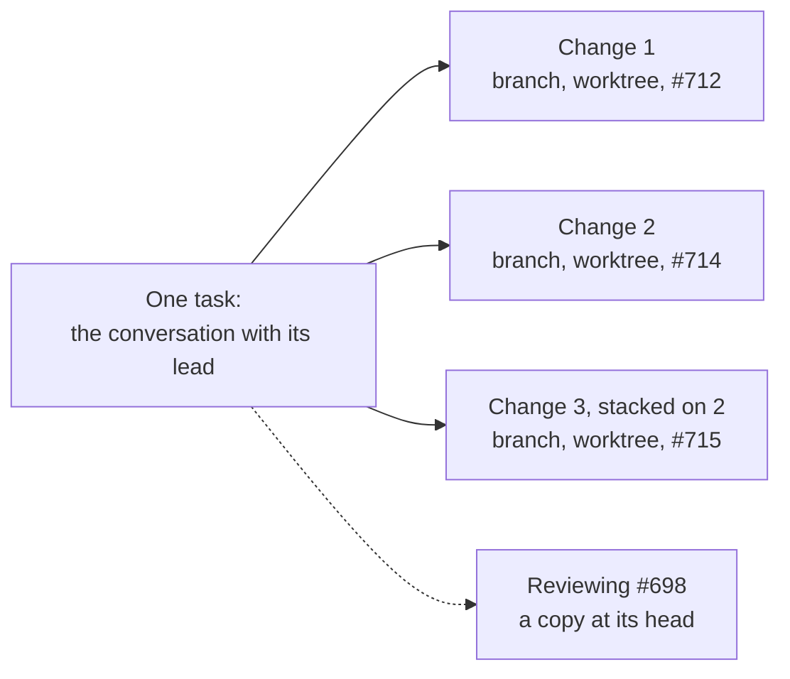
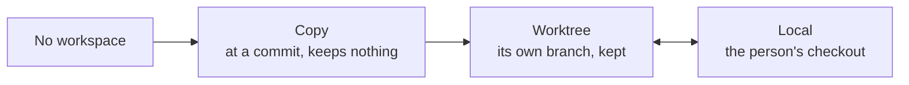
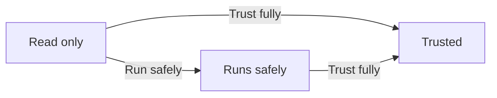
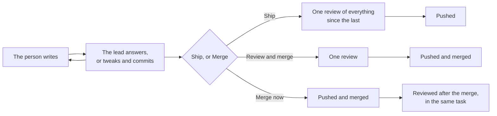
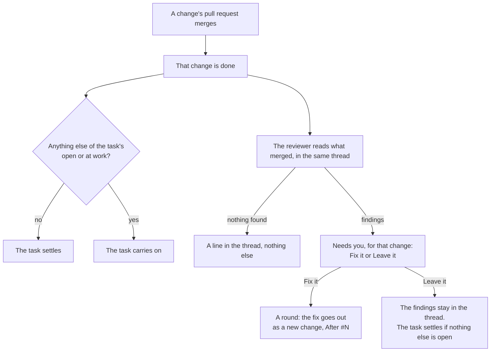

# A task is a conversation plus parts, changeable at any time

> A proposal, its core being built (#722, [Building it](#building-it)). It
> folds into [tasks](../tasks.md),
> [workspaces and runs](../workspaces-and-runs.md), [reviews](../reviews.md),
> [code hosts](../code-hosts.md), [agents](../agents.md) and
> [what agents may do](../what-agents-may-do.md).
> [What this changes](#what-this-changes-in-the-decision-documents) lists
> each section.

- **Status:** Proposed; talking to a lead, Ship and checking fixes built
  (#722); each turn's time, the review after a merge in the same task and
  Merge with commits not shipped built (#739)
- **Date:** 2026-11-08; how it reads, 2026-11-09
- **Owner:** Runtime and desktop maintainers
- **Amends:** the sections in
  [What this changes](#what-this-changes-in-the-decision-documents), among
  them ADR-035, 072, 091, 093 and 102, and the proposed ADR-087's helpers,
  which can be handed a change. It builds the Scratch shelf, presets
  and moving a running task, which [tasks § What a task is](../tasks.md#what-a-task-is)
  records as the 13 October direction and lists as not built. Only the old
  ADR-035 rejected a shelf, and that direction overtook it, as it did
  [`plans/task-as-container.md`](../../plans/task-as-container.md).
- **Context:** On 13 October the person set the direction: a task is a loose
  container, a conversation with an agent plus parts that attach and change at
  any time. The lightest form is a temporary chat on a Scratch shelf off the
  board, and common uses become presets. Since then:
  - #684 added the parts row to a task's header;
  - #689 made the team changeable at any time;
  - #686 added the small-change lane;
  - #663 lets leads start tasks.

  What is left is the model under the row. Today a task's place and target
  freeze at its first step, a review can't run anything, and each kind has its
  own hand-written path to the next (`make_it_a_change`, taking a review
  over). This is phase 5 of
  [capable by default](../../plans/capable-by-default.md#5-the-task-as-parts).
  It takes in phase 4, "Reviews that run things": a review that runs code is
  a review whose workspace moved up, not a path of its own.

  On 8 November the person added a second problem, which the coordinator
  passed on. Althar works well for clear-cut work, but going back and forth
  with a lead is slow and inflexible. A question or a small tweak to a
  finished task starts a fresh session, opens a round with a report to give
  and a whole review, and each fix after the review sets off another whole
  review. With review as a part that runs when work ships, rather than a
  fixed step, the parts model answers that too. The person answered the
  questions behind both on 8 November.

  Later that day the person asked whether one chat could open several pull
  requests, in parallel even, as Claude Code can. A task then held one per
  repository at a time. Offered several changes in one task, a task for
  each, or no change, they chose the first: "As hard as it is, it has to be
  A. People's asks are not always clear cut."

  On 9 November a design round (#722) worked every case this adds through on
  the real window, and the person chose how it reads: a task stays one piece
  of work however many changes it holds, with one sentence and one button
  ([How it reads](#how-it-reads)). Two flows of theirs shaped it: a release
  whose checks fail with main's, so main is fixed first, and a second ticket
  asked for in the same conversation. Whether two tickets go up as one pull
  request or two is the lead's call (the person, 9 November).

## Decision

- **A task is a conversation with its lead, plus five parts:** Workspace,
  Checked by, Reviewing, Outputs and Access. The team belongs to the
  conversation, and already changes at any time.
- **Every part changes at any time, at once,** by the person, the lead or the
  coordinator. A change someone else made gets a line in the thread, and the
  lead's own fold into its work. Only two moves wait for the person: running
  an outside author's code, and a removal that would lose something.
- **A task holds as many changes as it needs, at once,** in one repository
  or several. Each has its own branch, worktree and pull request, and ships
  and is reviewed on its own. Everything hangs on the change, never on a
  folder, and Althar follows what the lead does with git rather than
  forbid it.
- **It reads as one piece of work, however many changes it holds:** one
  sentence and one button, the same on its card, in its header and in Needs
  you. The sentence names a change only where that change is the exception,
  and counts what's alike.
- **What the person says goes to the task.** The lead works out which change
  it's for, and each turn's line says where its commits went.
- **The workspace moves up a step at a time:** none, a copy, a worktree,
  Local. It moves back between a worktree and Local, and down only where
  nothing would be lost. A review that runs code comes from this move.
- **"Run it" on an outside author's code asks how far to trust it:** Run
  safely, the default, or Trust fully, or Not now. A setting can answer for
  the person.
- **Clear-cut tasks don't change.** A task sent off with a plan comes back
  reviewed and up as a pull request, draft or ready as its plan says.
- **Talking to a lead is a turn, not a round:** the same session, with no
  step, no report and no review. The turn's last message is its answer.
- **A tweak stays on the task's branch until the person ships it.** Shipping
  is when the review runs: one pass over everything since the last review.
  Then the commits go up. Until then the branch is held: nothing pushes it
  but Ship, Althar's own course included.
- **Merge, with commits not shipped, offers two:** Review and merge, or Merge
  now. What Merge now merges is reviewed after the merge, where the task has
  a reviewer.
- **Fixes after a review are checked only where they need it:** a tiny fix
  needs no check, and a bigger one gets one short check by the same reviewer.
  A fix never sets off another whole review.
- **The review after a merge runs in the same task.** The merge ends only
  its change: the task settles where that was its last, and comes back only
  if the review finds something.
- **A lead starts afresh only when its context is full,** never at a break.
- **Each turn records where its time went,** so "why is it slow" has an
  answer for every turn.
- **Removing a part loses nothing.** Branches, pull requests, findings and
  pictures stay.
- **A temporary chat is a task with a copy and nothing else.** It sits on
  Scratch, off the board, until it takes a worktree or an output.
- **Presets are named sets of starting parts.** Althar ships some, the
  person saves their own from a task, the coordinator offers one when it sees
  a set repeat, and Settings can edit them.
- **The coordinator works out from the person's message** whether it's a
  chat or a task and which preset fits. Its plan card names the preset, and
  the person can pick another there. Once the task starts, its parts change
  from the parts row, and nothing names the preset.
- **Nothing new stores a task's kind.** Parts are read from the rows that
  already hold them. The [new data](#the-data-model) is small.
- **Its core is built first** (the person, 9 November): talking to a lead,
  Ship and checking fixes, then the rest ([Building it](#building-it)).

## The parts

| Part | What it holds | When a task has it | In the parts row |
|---|---|---|---|
| **Workspace** | Where the work happens on disk: a copy, a worktree or Local, with its branch and the branch it works toward. One for each of the task's changes in each repository it touches, or a copy before there is a change; and one at each pull request it reviews | Every task but one with nothing to read yet | Always, with what runs there |
| **Checked by** | Who reviews this task's own work, and when: before it ships, or after it merges. Each change is reviewed on its own | A change, unless its plan named no reviewer | Where there is a reviewer |
| **Reviewing** | Pull requests this task reviews, each with its drafted review | A review, or any task asked to look at a related pull request | Each pull request reviewed |
| **Outputs** | Pull requests it opened or attached, in any repository; the issue it came from or filed; its pictures and files | As soon as there is one | Each one |
| **Access** | What the lead may run and reach in that code, read from who wrote it | Every task, read from its code's author | Only for an outside author's code |

Each part has one job, so removing one means one thing. "Remove the review"
was ambiguous with a single review part: stop checking my work, or stop
reviewing theirs? Here those are two parts.

**Access shows only where it differs from the team's.** The team's code runs
as everything else does under the project's rules, and the row says nothing
about it (the person's note of 16 October). An outside author's code shows
where it stands: Read only, Runs safely or Trusted.

## Changing parts

- **The person** changes parts from the parts row: Add offers each part the
  task doesn't have, and each part's menu changes or removes it. The change
  is made at once. Access is the exception: every task has it, and its menu
  offers only Run it, or Stop running it once the code runs, with no Remove.
- **The lead and the coordinator** change parts at once when the task needs
  it, with `add_part`, `change_part` and `remove_part`, each with a reason.
  For example, a chat whose lead has to write takes a worktree. They share
  these tools, as they share every tool.
- **A change the lead makes on its way folds into its work,** with the rest
  of its turn: "Took a worktree, to write the fix." A change gets a line of
  its own in the thread only where someone else made it (the person, the
  coordinator or Althar), or where it offers a way on, such as Keep them
  together or Drop it. Every change is recorded either way, with who made it
  and why.
- **Two moves wait for the person's own word:**
  - Running an outside author's code ("Run it", below). It is the
    [What stays](../what-agents-may-do.md#what-stays-and-why) line on a
    stranger's code. A lead can suggest it, but never say it.
  - A removal that would lose something, such as a draft review never
    posted. It asks first, on a card.
- **A move that changes the lead's folder waits for its turn to end:**
  between a worktree and Local, and a rebase onto a new target. The lead
  never finds its folder moved under it, and the thread's line says the move
  is waiting. Every other change is made at once, even mid-turn: a copy takes
  its branch where it stands, so a chat's lead that has to write gets its
  worktree without stopping.

`make_it_a_change` and taking a review over go. "Make it a change" is now
adding a worktree, adding Checked by and giving the task an ending, one
part at a time or through a preset. The card's kind label stays, read from
the parts.

## A task holds as many changes as it needs

People's asks aren't always clear cut. One conversation can turn into two
fixes, or a fix and a refactor that should go up apart. So a task holds any
number of changes at once, in one repository or several (the person, 8
November).

How others do it is in
[several pull requests from one conversation](../../research/several-pull-requests-from-one-conversation.md).
T3 Code, Orca, Agent Orchestrator and Claude Code all let one conversation
hold several pull requests now, T3 Code and Orca only since September and
October, and Paradev's users ask for it. Their bugs come from four places,
and four rules keep clear of them. The rest of this section follows from
these:

- **Everything hangs on the change, never on a folder,** so a branch moving
  in a folder can't show the wrong pull request.
- **A pull request is recorded as it's made, or found by a change's own
  branch and target,** never guessed from a name or a folder.
- **A merge ends only its own change,** never the task, its session or what
  runs.
- **Every turn, line and badge names the change it's about,** by its name,
  and every push, review and merge its pull request.

Parallel work comes from a helper in the change's own worktree, so nothing
needs bringing back.

Where the rest of this proposal says "the task's branch", it means each
change's. A move between a worktree and Local, a new target, the hold for
Ship and the review's mark each belong to one change. Only the hold reaches
further, up a stack ([below](#starting-and-splitting)), since a push sends
everything below it.

### What a change is

- **A change is one line of work:** a branch in each repository it touches,
  the branch it works toward, and its pull requests. It is today's change
  set, which already holds a branch and a pull request per repository. A
  task held one at a time. Now it holds as many as it needs, and a task
  that never splits has one, as now.
- **A change has a name,** a few words such as "Lane heights", given by
  whoever starts it, as a task is named. A task with one change never shows
  it, since the task's title says it. Once a task has two, the window calls
  each by its name, and lines of record add the pull request's number:
  "Merged · Lane heights (#714)."
- **A change records the issues it closes,** one or several, and its pull
  request closes them all.
- **Everything hangs on the change, never on a folder.** Its pull requests,
  checks, hold for Ship, review mark and place on the card belong to the
  change. A folder is only where a change is checked out at the moment.
  Orca, Paradev and Agent Orchestrator tie the pull request to the folder,
  and show the wrong one once the folder's branch moves.
- **Each change being worked on has a worktree of its own,** since git lets
  only one folder have a branch checked out. The first keeps today's path,
  `~/Althar/<project>/<task>/<repository>`. The others sit beside it, named
  for their branches, so the task's folder holds them all. The lead's
  sandbox and "Open in editor" already take the whole task's folder. A
  change whose folder went, after the usual wait, gets it back when it's
  worked on again, as a finished task's does.
- **The lead works in all of them,** from the task's folder, as a lead
  across several repositories does now. Its brief names each change, with
  its folder, branch, pull request and what waits. A commit belongs to the
  change whose branch it is on, and the turn's line says which.
- **Althar follows what the lead does with git, rather than forbid it.**
  Starting a change is the way Althar offers, but its paths are never
  imposed (the person's note of 6 November). As each turn ends, Althar reads
  each folder's branch from git:
  - a folder now on another branch makes that branch a change of the
    task's, with a line in the thread. It works toward the task's target,
    or, where the branch has one open pull request, toward that one's
    base, and the pull request is attached under the attaching rules;
  - the change whose branch the folder left keeps its branch and pull
    request, with no folder until it's worked on again;
  - a folder left detached, or on the branch a change works toward, gets a
    line, and the lead puts it right.

  T3 Code has followed a thread's branch since 5 November, rather than the
  one stamped when the thread began, which one user found wrong on 25
  threads.
- **A pull request is recorded as it is made, and found only by a change's
  own branch and target:**
  - as it's made: by Ship or `open_pull_request`, by attaching one, or from
    the address a `gh pr create` the lead ran itself printed, as T3 Code
    reads it. One recorded this way stays the change's, by its number,
    until it merges or closes. Reading the host never swaps it;
  - as Althar reads the host, for a change with no open pull request
    recorded: an open one whose head is the change's own branch, on the
    repository it pushes to, and whose base is the branch it works toward,
    on the repository it targets, is that change's. That catches one the
    lead opened through an MCP server, or the person opened on the website;
  - where that doesn't give one pull request, Althar takes none and names
    what it found in a line. One from the change's branch into another
    base, such as a backport to `release/0.8.0`, would show the checks and
    Merge of another target. A host that allows two that match leaves
    nothing to tell them apart by. The lead or the person attaches the one
    that's the change's;
  - never by a branch-name prefix, by what a folder has checked out, or as
    "the repository's pull request". Prefix matching is Agent
    Orchestrator's longest-running family of bugs, and Claude Code hid a
    session's later pull requests by keeping one per repository;
  - a branch can have several pull requests over time. The open one is the
    change's, and a closed one stays in Outputs. Paradev showed the closed
    one instead (#5619).
- **A pull request belongs to one change of one task,** as Agent
  Orchestrator has it and attaching does now: one that another open task
  follows stays that task's.

### Starting and splitting

- **A change starts at once,** on the word of the person, the lead or the
  coordinator, and the thread marks it as a step in the work: "New change ·
  Rename, on `althar/rename-setting`." It names the target only where it
  isn't the task's: "into `release/0.8.0`". The person asks for one ("split
  this into two pull requests", "fix that too, but separately"), or the lead
  starts one.
- **Whether work is one change or several is the lead's call,** where the
  person hasn't said (the person, 9 November). It splits where the parts
  should be reviewed or merged apart, or go to another target or
  repository. Two tickets asked for in one conversation can be one change
  whose pull request closes both, or a change each. What only works
  together stays one change, and so does a fix the change under way needs,
  unless it fixes what the change didn't break, such as main: that goes
  first, as a change of its own (below).
- **Keep them together** joins two changes again before either ships, where
  the lead split on its own choice: the lead carries one's commits, and the
  issues it closes, onto the other. The row that started the change offers
  it. It is never offered where the person asked for the work apart.
- **A change branches from the task's target unless it needs another
  change's code.** Siblings merge in any order. A change that needs
  another's work stacks on it: it branches from that change's branch, and
  its pull request targets it. When the one below merges, Althar
  retargets the one above to what the merged one worked toward, as
  changing the target does
  ([below](#changing-the-branch-a-task-works-toward)).
- **A change can go first** without being stacked under another. Where a
  change waits for another to merge but doesn't build on its code, such as
  a release whose checks fail until main is fixed, both work toward the same
  target, and the one waiting says what it waits for: "Waits for Fix main to
  merge". Its failing checks that the first change fixes don't ask for the
  person. When the first merges, Althar brings the target into the one
  waiting, as keeping a branch current does, and holds it there with any
  commits of its waiting for Ship. Stacking the fix under the release would
  point the release's pull request at the fix's branch, show the fix in its
  diff, and keep main red for everyone until the release merged.
- **A hold reaches up a stack.** A push sends a branch's whole history, so
  a change whose branch carries commits that wait for Ship on a change
  below it is held as if they were its own. Nothing pushes it but a Ship
  that ships the one below too: not a plan's turn, a round for failing
  checks, or keeping the stack current. Althar works this out from git
  before each push, rather than keeping it.
- **Ship on a stacked change ships what waits beneath it first,** from the
  bottom up, and says so before it starts: "Held: 2 commits waiting on Lane
  heights below · Ship". Each change gets its own review of everything since
  its last, and goes up only after it, with a "Shipped" row of its own. The
  task's Ship, for every change waiting, goes in the same order.
- **Keeping a stack current takes only what's shipped.** Althar's own
  course brings the target into the bottom change, and into each change
  above the pushed head of the one below, never its commits waiting. The
  lead takes those in itself only where the work above needs them, and the
  change above is then held with them.
- **A stacked change's review reads its own commits,** against the head of
  the one below. The commits below are for that change's own review.
- **Merge on a stacked change offers the whole stack,** from the bottom up:
  "Merge #714, then #715". Each merges once the one below has merged and
  it has been retargeted, and each after its own review, as T3 Code's Merge
  stack and Orca's "Merge through #N" do. A change with commits waiting
  offers Review and merge or Merge now, as any does
  ([below](#merge-with-commits-not-shipped)). Keeping stacks to where
  they're needed spares reviewers what Agent Orchestrator's had: several
  pull requests to review "in the correct order" (#1044).
- **Splitting work already made** moves only what hasn't shipped. The lead
  makes the new change and carries the commits or files across, with git,
  as it would by hand. A pull request's pushed history is never rewritten,
  as now.

### Each change ships and is followed on its own

- **Each change has its own hold for Ship, its own review mark, and its own
  pull request, checks and seal.** The task's Ship ships every change
  waiting, the bottom of a stack first, each with its own review, and a
  change's own row ships only it. "Ship it" in the thread ships what the
  person means, which the lead works out as it does for any message, asking
  in a line only where it can't.
- **Each pull request is followed on its own:** the checks of its head, what
  people say on it, and its conflicts. What Althar's course brings for
  several at once, such as failing checks on two, reaches the lead as one
  turn that names each change and pull request. It is never a turn for each
  pull request, as T3 Code's was, and never "your pull request", as Agent
  Orchestrator's was.
- **Every line in the thread, card and message to the lead names the change
  it is about,** by its name once a task has two, and every push, review and
  merge names its pull request.
- **In a plan's steps, a change goes up as it does now.** Its commits push
  as the lead's turns end, and a lead that needs a change's checks before
  the plan ends opens its pull request as a draft with `open_pull_request`.
  Each change is reviewed when the plan ends, one review for each. That is
  DEV-176's "fix main, whatever it takes": several pull requests, each
  followed until its checks pass. DEV-176's `wait_for`, a lead's wait on
  anything else, stays its own.

### Working on several at once

- **The lead hands a change to a helper**
  ([ADR-087](087-a-lead-starts-helpers-on-any-agent-in-copies-of-their-own.md),
  proposed) to work on in the background, while the person keeps talking to
  the lead. The helper works in that change's worktree, and is the only one
  writing there until it reports. So its commits are on the change's branch
  when it's done, and nothing needs bringing back. It still pushes nothing:
  the change ships with Ship, after its review.
- **Why there:** every product read runs parallel branches as children with
  a worktree each, and none of them brings the work back by itself. Giving
  the helper the change's own worktree does the same, without a second
  conversation for the person to follow.
- **This amends ADR-087,** whose helpers each work in a copy of their own,
  with commits the lead takes in. That stays for a helper given no change.
- **This build takes ADR-087's helpers,** its tasks 1 to 5, and adds a
  helper handed a change, which needs less than ADR-087's own: no copy, and
  nothing to bring back. ADR-087's sixth task, a writing helper's commit for
  the lead to take in, is only for a helper given no change.
- **The change's row in the header says a helper is on it,** with Stop.
  Asked meanwhile for something in that change, the lead waits for the
  helper's report, or stops it and starts another with the new ask, as
  ADR-087 has it.
- **Many at once,** such as "split this migration into ten", take a helper
  each, four of a task's at work at once as ADR-087 allows, and the rest
  waiting their turn.

### When one merges

- **A change is done when its pull request merges or closes,** or all of
  them, for a change across repositories. Its worktree goes after the usual
  wait for finished folders, and the task, its session and its other
  changes carry on. A merge never ends a turn or a helper, and stops what
  runs only where the task then settles. Claude Code removed a session's
  worktree when its first pull request merged, and Agent Orchestrator
  stopped following a worker's other pull requests.
- **Before each push, Althar reads the pull request's state.** Where it
  merged a moment ago, the commits go to a new change, "After #N", as a
  round after a merge does now, rather than to the merged branch.
- **The task settles once all its changes are done,** no draft review or
  review findings of its wait on the person, and no turn or helper of its
  is at work. T3 Code and Agent Orchestrator settle the same way. Settling
  then stops what else it ran, as now, but for an after-merge review
  ([below](#after-merge-in-the-same-task)).

### Local, attaching and the card

- **Local holds one change.** The person's checkout has one branch, so at
  most one of a task's changes works there, and the others in worktrees.
  Moving a change to Local is how the person tries it in their own checkout,
  and it follows the rules of the move ([below](#moving-between-a-worktree-and-local)).
- **Attaching a pull request adds a change** that follows it. The task no
  longer stops following the one before. One whose head is a change's own
  branch is recorded on that change instead, in place of any open one it
  had.
- **The card keeps one fact,** the task's one sentence
  ([How it reads](#the-one-sentence)). With one change it is as now. With
  several, it names a change only where that change is the exception,
  "Lane heights: checks failing", and counts what's alike: "Both ready to
  merge", or "Waiting for checks on both", as DEV-176 asks. A mark for each
  change and a count, "3 changes", sit at the card's foot, apart from the
  state: T3 Code's "+6" beside a green icon read as six open pull requests.
- **Which change the sentence names is worked out each time it's drawn,**
  never kept as a "current" pull request. T3 Code and Orca each kept one
  beside the list for code that still read one, and a contributor to Orca
  counted 57 files reading it (#9213).
- **The header lists every change** behind its marks. Each opens to a row
  with the change's name, branch, pull request, where it stands, commits
  waiting, any helper on it, and its own quiet button.
- **Outputs shows every change on one page,** in the task's order, each a
  line (its mark, name, pull request, where it stands, its size) that opens
  to all it made. The one the sentence names starts open, a settled one
  folded where it was, and one whose after-merge review found something
  open.

## The workspace moves up

- **A copy** is a checkout detached at a commit: the default branch's, or a
  pull request's head. It keeps nothing. Today's quick task works in one,
  detached at the default branch, and so does a review, at the pull
  request's head. For the team's own code, the lead can install and run
  things in it. For an outside author's code, Access decides what it may
  run.
- **A worktree** is today's: a folder with the task's own branch, set up
  with the recorded setup, whose commits are kept and can ship.
- **Local** is today's: the person's own checkout, one task at a time.

**Moving up keeps everything.** A copy becomes a worktree by making the
task's branch where it stands. That is today's "a branch on first write",
which stays: where a lead leaves commits or changes in a copy as its turn
ends, Althar moves it up itself, so nothing is lost on a detached head.

**Moving down happens only where nothing would be lost.** A worktree whose
branch has nothing the copy wouldn't have can become a copy again. Otherwise
the way down is removing the workspace, which keeps the branch (below).

**Each repository moves on its own.** A task that reviews a pull request in
one repository and fixes something in another has a copy in the first and a
worktree in the second. One that fixes something and reviews a related pull
request in the same repository has both there, side by side: its own
worktree, and a copy at the pull request's head. Place, a worktree or Local,
is one choice for each change, across its repositories, as it is for a task
now. At most one of a task's changes is Local.

### Moving between a worktree and Local

This is the Handoff that
[workspaces-and-runs § Local](../workspaces-and-runs.md#local) leaves
unbuilt. A running task moves between turns, with its branch and its
conversation.

- **To Local:** the worktree's uncommitted work is committed to the task's
  branch first. The move then waits, as a second Local task does now, until
  the person's checkout is free, and until it is clean, the task working on
  in its worktree meanwhile. Then it follows the whole
  [Local rule](../workspaces-and-runs.md#local), as a task starting Local
  does:
  - on its default branch, the checkout switches to the task's branch,
    remembering where it was (`returns_to`);
  - on a branch of the person's own, it asks first: switch to the task's
    branch, or stay in the worktree. The answer holds only while the
    checkout stays as it was when asked.

  The worktree folder goes once the checkout has switched, and the branch
  stays.
- **To a worktree:** the lead commits its own files by name first, as it
  always does in the person's checkout. Althar commits nothing there, so
  whatever is left uncommitted is the person's. Git lets only one folder
  have a branch checked out, so the checkout lets go of the task's branch
  before a worktree takes it:
  - **Clean, and still on the task's branch:** the checkout goes back to
    where it was (`returns_to`), as it does when a task settles. Then a
    worktree is made on the branch, and the task carries on there.
  - **Already on another branch,** because the person switched it: the
    branch is free, and the worktree is made at once.
  - **With uncommitted changes:** the move waits, and the task carries on
    in Local. The workspace part names what holds it, "Moves to a worktree
    once `Board.tsx` is committed". Althar tries again as each turn ends,
    and the person can call the move off. A settled Local task already
    does this when it's reopened with its checkout still on its branch.
- **The conversation carries on.** Where the agent can resume its session in
  the new folder, it does. Otherwise the next turn starts a fresh session
  with the thread's handover, as switching the lead does now.
- Every Local rule stays: Althar never switches a checkout with uncommitted
  changes, never switches it off a branch of the person's own without
  asking, and never stashes, resets or cleans it.

[ADR-103](103-projects-live-locally-or-on-a-host-and-place-work-in-pools.md)
would pin Local to a named computer's checkout. Moving to Local then means
that computer's.

### Changing the branch a task works toward

- **Before anything is pushed,** Althar rebases the task's branch onto the
  new target between turns. A conflict stops the rebase, names the files and
  hands it to the lead.
- **After a push,** the open pull request can't change its history, so
  Althar does what it does after a merge now. It makes a fresh branch from
  the new target, named for the task with `-2`, and cherry-picks the task's
  own commits onto it. Then it pushes that branch, as its own pushes go now,
  opens a pull request into the new target and asks the person whether to
  close the old one. The old branch isn't touched.
- **A held branch stays held.** Where commits wait for Ship, the
  cherry-picks take them along, and the new branch is made only on this
  computer, held as the old one was. Ship pushes it and opens its pull
  request, after its review, and only then asks about the old one, which
  keeps what was pushed until then.
- **The review's mark moves too.** The commit the last review read up to
  becomes its rebased or cherry-picked copy, so the next review reads only
  the task's own commits since, not the new target's.
- Everything that follows the target, follows the new one: the pull
  request's base, keeping the branch current, the checks compared against,
  and the diff's base.

### Running someone else's pull request

A review that runs code is a review whose workspace moved up, or whose
Access did. There is no separate path.

- **A pull request by the repository's own people** is a member's or a
  collaborator's, on a branch in the repository. Its lead already gets every
  lead tool and the network (the limits sweep, #696). What this adds is the
  workspace: its review starts with a worktree at its head, with the
  recorded setup replayed, so `run_project`, `screenshot` and its tests run
  its code in the sandbox. Any agent may lead it, Codex and the others
  ADR-050 kept from reviews included. The design review becomes this, run
  with the person's skill.
- **An outside author's pull request** starts as a copy, Read only, as it is
  now. None of the repository's settings, hooks or MCP config load, its
  commands reach no network, and only an agent that can be held to reading
  leads it.

**"Run it" is the person's word,** in the thread or from the Access part. It
asks how far to trust the code:

- **Run safely,** the default: the copy installs from the lockfile with
  install scripts off. The install reaches only the package registries the
  base branch's config names, never a host the pull request added. Then the
  code's own commands, its tests and its app, run in the sandbox, offline.
  Nothing is copied in from the person's setup, such as `.env`.
- **Trust fully:** the code runs as the team's does, with the recorded setup
  and its files, install scripts and the network. The prompt says so in
  those words.
- **Not now** leaves the code Read only, and the prompt goes.

**A setting can answer the prompt:** "When I say Run it on code from outside
the team": ask each time (the default), run safely, or trust fully. It sits
in Althar's settings, and a project's rules can set their own. The setting
only answers the prompt. The code still runs only once the person says "Run
it".

A project that needs install scripts to run, such as an Electron or
Playwright download, won't fully set up under Run safely. The thread says
what didn't install, with Trust fully in the same line.

## Talking to a lead, and shipping

Most tasks are clear cut, and they work as now: the person sends one off,
and hears of it once it has been reviewed and is up as a pull request. What
changes is going back and forth with a lead, to ask it something or tweak
what it made. That should be as quick as working with the agent on its own.

### A message is a turn, not a round

- **What the person says to a lead whose plan is done is a turn** in the
  same session, as is all of a chat. It opens no round and no step, asks for
  no report, and starts no review. The turn's last message is its answer,
  and it already carries everything the person needs (#699).
- **Nothing reminds the lead to report,** and a turn never leaves a task
  Stuck for lacking one. `finish_step` stays for a plan's steps and for
  settling a review.
- **A lead still at its plan's steps** takes the message into the step under
  way, as now.
- **The message goes to the task, never to one of its changes.** The person
  doesn't pick a change to talk to. The lead works out which one the message
  is about, as it would in a conversation, and each turn's line says where
  its commits went: "1 commit to Lane heights". A commit to the wrong change
  shows at once, and the person says so.
- **A reply the person hasn't seen** puts the task in Needs you until they
  open it. One they watched arrive doesn't. A question from the lead, or a
  permission it waits on, shows there as now.
- **Althar's own course still opens rounds:** fixing failing checks,
  answering what people said on the pull request, resolving a conflict, and
  Fix it after a review. Those are reviewed as the plan says, and push as
  their turn ends, as now, except while the branch is held for Ship
  ([below](#while-the-branch-is-held)).

### A tweak waits for Ship

- **What the person's turns commit stays on the task's branch,** in its
  worktree or the person's checkout, and isn't pushed. The person tries it
  where it is, with the project running, and asks for more.
- **The branch is then held for Ship.** From the end of a person's turn
  that leaves commits past where Althar last pushed, until Ship, nothing
  pushes the task's branch but Ship. A push sends the whole branch, so this
  is the only way the person's commits stay down: anything Althar pushed
  past them would carry them up.
- **Commits the person makes by hand** in the task's folder hold it too.
  Althar records the branch's head as each turn ends, and commits past that,
  when the next turn begins or before Althar next pushes, are the person's.
- **Commits not shipped keep the task in Needs you,** as commits to push do
  now. Its sentence says how much is waiting, "3 commits not shipped ·
  Ship", and its card's word is "Not shipped". Failing checks of the pushed
  head and replies waiting go in the same sentence: "3 commits not shipped ·
  lint fails on #714 · Ship".
- **Shipping is the person's word:** Ship, or "ship it" or "push it" in the
  thread. "Do this and ship it" is the word to ship once that turn is done.
  A lead or the coordinator ships when the person asked it to, as
  `push_to_pull_request` does now.
- **Shipping runs Checked by first:** one review of everything since the last
  review, then the lead settles what it found (below), then the commits go
  up. They go to the open pull request, or to a new one where the last
  merged or closed, or where there was none. A new pull request is a draft or
  ready, as the plan's ending says.
- **A task with no Checked by ships at once.** One whose review runs after
  merge ships at once too, and is reviewed once it merges.
- **The project rule "Push the lead's commits automatically"** keeps pushing
  what Althar's own course commits while the branch isn't held. The Push
  card for a held push stays as it is: it pushes what Althar held back, and
  runs no review.
- **Settling a task with commits not shipped asks first:** Ship, or settle
  and leave them on the branch.

### While the branch is held

Nothing pushes the branch but Ship, so Althar's own course goes as follows:

- **Failing checks start no round.** They are the checks of the pushed
  head, which the ship replaces. The card shows them beside Ship. Ship
  pushes, the checks run on the new head, and a round to fix them follows
  only if they fail again, as now.
- **A conflict with the target is resolved as Ship begins.** The lead
  brings the target in first, as a conflict round does now, so the review
  reads the result.
- **What people say on the pull request** gets its answer at once, as now.
  A change it asks for is committed beside the person's and waits for Ship,
  and the reply says so.
- **Fix it, after a review that ran after a merge,** is the person's word,
  so it ships: the fix goes up in its "After #N" change, with any commits
  waiting there, and Fix it says how many it takes along.
- **The Push card,** where code hosts' rules held back a push of Althar's
  own, becomes Ship, since one push would send both.

### Merge, with commits not shipped

With nothing waiting, Merge merges as now. With commits not shipped, it
offers two:

- **Review and merge:** one review of the commits waiting. The lead settles
  what it finds, and then they go up and merge. A finding the lead sets aside
  brings the task back to the person before anything merges.
- **Merge now:** the commits go up and merge at once. They are reviewed after
  the merge, in the same task ([below](#after-merge-in-the-same-task)),
  whatever Checked by's when says. A task with no reviewer gets no review
  after the merge.

### The person's words go first

What the person says to an agent already never waits for a place among the
agents at work ([scheduling](../scheduling.md)). What the coordinator passes
on from the person counts as theirs too, so it goes first in the same way.
Within one task too: a round of Althar's own, such as fixing failing checks,
that waits for a place runs after the person's message to the same lead.

### A lead's session lasts until it's full

- **A lead is handed to a fresh session only when its context is full:**
  before a turn, once it's past 200,000 tokens or 80% of its window,
  whichever comes first. A break hands nothing over, at any size.
- **So coming back to a task after a pause carries on the conversation,**
  with all the lead knows of the work. Nothing starts afresh, rebuilds a
  brief or reads its files again.
- **The cost:** after a pause longer than its prompt cache's life, the next
  message reads the whole context at full price. The context ring shows the
  size, and Compact stays one press away, as now.
- **A reviewer keeps one session across a review,** as now. That is what
  lets it check fixes (below).

### Where a turn's time goes

**Each turn records where its time went:**

- waiting for a place;
- starting or handing over the session;
- the agent's own work, and the tools it ran.

A ship adds its review and its checks. The turn's line in the thread shows
the total, and names the part that took most where one did: "Worked for 4m
· 3m 10s waiting for a place". With several changes, it says where the
turn's commits went. Opening the line shows every part. The task adds up
all its turns. A slow turn then says what made it slow.

## Checked by: a task's own review

Checked by holds the reviewer, which is changed where the team is, and when
the review runs:

- **Before it ships,** the default for a change. The review runs as work
  leaves the person's hands. A plan that ends in a pull request ships at its
  end, so its review runs there, as now. After that, each Ship reviews
  everything since the last review. A prototype or an exploration whose plan
  ends without a pull request is reviewed only once the person ships it.
- **After it merges:** the small-change lane, and what Merge now merges.
- **No Checked by:** no review, as for a chat, or a plan that named no
  reviewer.

**The person can run a review at any time:** Review on the Checked by part,
or "review it" in the thread. It reads everything since the last review, and
ships nothing.

**One review covers everything since the last.** Althar keeps, for each
change in each repository, the commit its last review read up to, and the
next one reads from there: every tweak since, in one pass. A task with
several changes waiting gets one review for each, which run at once where
there are places.

"Make it a full task" on a small change moves its review to before it ships.
Removing Checked by stops a review under way, as Skip the review does.

The task's own reviewer gets a copy it can install in, with the recorded
setup replayed, plus `install_dependencies` and `run_project`. It runs the
task's tests and build before it reports. It still only reads the task's
work: it changes nothing in the task's worktree.

### Fixes are checked by the same reviewer, only where they need it

A fix no longer sets off another whole review.

- **The reviewer's session stays open** while the lead settles its findings.
- **A tiny fix needs no check:** its commit changes ten lines or fewer, all
  in the file its finding named. Althar reads that from the diff.
- **A bigger fix gets one short check.** The same reviewer, its copy moved to
  the fixes, reads only them, against its findings, and says whether each is
  settled. A finding it reopens goes back to the lead once more. That second
  fix isn't read again.
- **The pull request lists the fixes nobody re-read:** the tiny ones, and any
  second fix. A task whose fixes were all tiny or checked keeps its seal.
  Its seal names the commit the last pass or check read, and the folded
  review names the tiny fixes after it. A second fix nobody re-read still
  takes the seal away, as code changed after the last pass does now.
- **The "Review rounds" setting goes,** since a check is never more than one
  pass. "When rounds run out" keeps its job for a finding the check
  reopened: carry on, or ask the person.

A fresh reviewer for each check, if it's ever wanted, would be a setting
later (the person, 8 November).

### After merge, in the same task

This covers a small change, and what Merge now merged on any task. All of
it is about the change that merged. The task's other changes, its helpers
and its session carry on ([above](#when-one-merges)).

- **The change is done as it merges.** Where it was the task's last, and
  nothing else of the task's is open or at work, the task settles and
  leaves the person's plate at once. Otherwise the task carries on as it
  was. Either way, the reviewer reads a copy at the merged commit, in the
  task's own thread. There is no second task and no second card.
- **If the review finds nothing,** the thread gets a line, with no
  notification and nothing in Needs you.
- **If it finds something,** the task is in Needs you with the findings,
  which name the merged pull request: "Review found 2 after #715 merged · Fix
  it", the card's word "Review found 2". Two ways on:
  - **Fix it** opens a round. The lead gets the findings, and its fix goes
    out as a new change, "After #N", as any round after a merge does now:
    "New change · `althar/rename-later-fix`, after #715, for its 2
    findings". The task's other changes are left as they are.
  - **Leave it** closes the findings, which stay in the thread. The task
    settles where nothing else of its is open or at work, and otherwise
    carries on.
- **Nothing is posted on the merged pull request.** Today's review after a
  merge is a review task of its own, so it drafts and posts as a review of a
  pull request does. Here it is the task's own review, which reports in its
  thread, as Checked by does before a merge. The fix's pull request says
  what it fixes.
- **Settling spares these reviews.** While the task carries on, nothing
  stops, and the review runs beside its other work. Where the task settles
  with an after-merge review still running, of that change or one that
  merged before, "Settling stops everything" gets one exception: each such
  review's reviewer and copy run until the review ends, and the sweep
  leaves them alone until then. Everything else the task ran stops as it
  does now. If Althar restarts mid-review, the review starts again.
- A fast-lane pull request still carries no seal. A plan that named no
  reviewer, and a pull request closed unmerged, get no review after merge, as
  now.

## Reviewing: pull requests a task reviews

- **Any task can review a pull request:** a change can review a related one,
  and a review can open a pull request of its own by taking a worktree. A
  task can review several.
- **Each pull request reviewed brings its own workspace and Access:** a copy,
  or a worktree for the team's, at its head. It is a workspace row of its
  own, beside the task's own workspace in the same repository
  ([the data model](#the-data-model)).
- **Its draft is the person's to post,** as now: from the card, on their
  word in the thread, or by the team-review setting. An outside author's
  draft always waits for them.
- **A task whose only parts are its reviews settles once its drafts are
  posted,** as a review does now. A task with changes of its own settles
  once all of them are done. A draft still unposted then keeps the task in
  Needs you until the person posts it or drops it.

## Removing a part loses nothing

| Removed | What stays | What goes | Asks first when |
|---|---|---|---|
| **Workspace** | The branch, here and on the remote; Local's checkout goes back as on settling | The folder, after its uncommitted work is committed; what runs there stops | Never: Althar commits nothing in the person's checkout, and says what it left |
| **Checked by** | Findings already filed, in the thread | A review under way stops; no seal | Never |
| **Reviewing** | The thread, and any posted review | Althar stops following that pull request | Its draft was never posted |
| **A pull request, from Outputs** | The pull request, open on the host | Althar stops following it | Never: closing it is a separate move, on the person's word |
| **A picture or file, from Outputs** | The item in the thread | It leaves Outputs and the pull request's screenshots comment | Never |

Access isn't removed. It moves back when the person says "Stop running it":
what runs stops, and the copy is Read only again.

## Chats and Scratch

This builds the shelf that [tasks § What a task is](../tasks.md#what-a-task-is)
lists as not built. Only the old ADR-035 rejected it, and the 13 October
direction overtook that.

- **A chat is a task with a conversation and a copy of the default branch,**
  and nothing else. It has no plan, no countdown and no Checked by. It starts
  at once.
- **It sits on Scratch, off the board's lanes.** Scratch lists chats by
  their latest exchange. It opens in place from the board, as one chip at
  most, and never as a sidebar ([DESIGN.md](../../../DESIGN.md)). Its look is
  settled by a prototype of its own: the 9 November round set it aside for
  one.
- **A chat never waits in Needs you for being finished.** Its questions and
  permission requests still show there, as every task's do.
- **It moves to the board as soon as it takes a worktree or an output,**
  including a draft review, and says so in its thread. Nothing moves back to
  Scratch by itself. The person can move a task either way.
- **Chats stay until the person clears them.** Clearing settles a chat, and
  ⌘K (Ctrl+K elsewhere) still finds it. Writing to it again brings it back
  to Scratch. Its copy goes after the usual wait for finished folders, and
  comes back when the chat needs it
  ([finished tasks' folders](../workspaces-and-runs.md#finished-tasks-folders)).
  The copy is made without setup, and the setup replays the first time the
  lead runs something.

## Presets

A preset is a named set of starting parts. It holds a workspace, Checked by
and when, an ending (a draft pull request, one ready for review, or none),
where the task sits, a lead and reviewer or "the coordinator picks", and a
few lines of brief. A preset is only a start: the parts are what a task has,
and changing them never changes the preset.

- **Built in:**
  - Chat
  - Change
  - Small change
  - Review a PR
  - Prototype, led by Claude Opus 5.5 at an effort set by its size (the
    person's notes), reviewed only once it ships
- **The plan card names the preset** as the first word of its kicker,
  "Change · Task board-still", in the kicker's own type. A press on it opens
  the others. Nothing names the preset once the task starts: a preset is
  only a start, and the parts say what the task has.
- **Save as preset,** from any task's menu, takes its parts, team and the
  first lines of its brief.
- **The coordinator offers one.** When it sees the person set up the same
  parts more than once, it offers a preset on a card, with a name and what it
  holds. Nobody has to write one.
- **Settings has a page to edit them.** Nobody has to use it.

Presets are the person's, in Althar's settings, and work in every project.
One saved from a task can be kept to that project.

## How a task starts

- **The coordinator works out from the person's message** whether it's a
  chat or a task, and which preset fits. There is no switch in the composer.
  A message that wants a conversation of its own with an agent starts a chat
  at once. One that wants work done gets a plan, whose card names the preset.
  The coordinator still answers itself what it can answer in a line or two.
- **The person changes it on the plan card,** before the task starts:
  picking another preset there changes the plan's parts to match. Once it
  starts, they change the parts themselves, from the parts row, under the
  rules above, so nothing is lost.
- **Tasks that start without going through the coordinator,** from the board
  or from a lead, start as Change unless whoever starts them names a preset.
  The coordinator is always on either way.

## How it reads

The window shows all of this the way it shows a task now. The 9 November
design round (#722) chose how, from three ways of hiding a task's changes,
and worked every case through on the real window. It went by these rules:

1. **One thing asks at a time.** A task has one sentence and one button,
   worked out each time it's drawn. Only what that sentence is about is
   violet.
2. **Defaults stay invisible.** A task that never splits reads as now. A
   part shows once it's there and matters.
3. **Counts over lists:** "Both ready to merge", "3 changes".
4. **Changes have names** once a task has two. Lines of record add the pull
   request's number.
5. **Copy never narrates the screen.** A line only where the person needs to
   know something, or can act.
6. **Nothing fails quietly.** Every stop says what happened and offers the
   way on, in place.
7. **The window stays still while agents work.** Things change in place, and
   only the steps of the work stand out of the thread.
8. **The person acts in place:** Ship, Merge, Call it off and Run it work
   from the card, the header or the thread.
9. **Nothing is lost,** and Althar asks only where something would be, or
   before running a stranger's code.
10. **Each colour has one meaning:** violet waits on the person, cobalt is
    under way, red failed, green shipped or merged.

### The one sentence

- **A task is one sentence and one button,** the same on its board card, in
  its header's pill and in Needs you: "Lane heights: checks failing · Fix
  it". The card leaves out what its status word already says: under "Review
  found 2" it reads "After #715 merged".
- **The sentence is about what most needs the person,** in this order: an
  ask, a failure, a conflict, ready to merge, commits not shipped, a draft to
  post, a move waiting, a helper at work, checks running. With several
  changes it names a change only where that change is the exception, and
  counts what's alike. A change waiting for another to go first doesn't take
  the sentence for what the other fixes.
- **The button acts on every change it can:** "Merge both" merges the bottom
  of a stack first, and Ship ships each held change, bottom up, each with
  its own review.
- **A mark for each change sits inside the pill,** before the sentence, and
  opens to a row for each change with its own quiet button. A change that
  waits on the person but isn't the one the sentence is about has an ink
  mark, not a violet one.

### The thread

- **A part change** someone else made, or one that offers a way on, is one
  plain grey line, its button in its sentence: "Your checkout is on
  `balazs/notes` · Switch". The lead's own fold into its work.
- **The steps of the work are rows of their own,** as a review is: a small
  stamp where "Althar" stands ("New change" in cobalt, "Shipped" and
  "Merged" in green), then a few words, the change named in ink and branches
  as code, and the row's button at their end: "New change · Terms page, on
  `althar/terms-page`, for DEV-141. Keep them together". A row never wraps;
  what doesn't fit ends in an ellipsis, the whole on hover.
- **Each turn's line** says where its time went, and where its commits went
  ([above](#where-a-turns-time-goes)).
- **Althar's lines after an answer sit with it,** in the room its hidden Copy
  row already keeps, rather than a round away.

### The board, Needs you and the header

- **The board** holds every task but chats. A card's kind is read from its
  parts:
  - **Change:** it has a branch of its own, or a pull request it opened or
    attached;
  - **Review:** it reviews a pull request, with no branch of its own;
  - **nothing:** anything else, such as a prototype.

  "Local" and "→ release/0.8.0" show where they apply, as now. A card with
  several changes has their marks and "3 changes" at its foot.
- **Needs you** is unchanged, but for four things: a chat doesn't wait there
  for being finished; a reply the person hasn't seen waits there until they
  open it; commits not shipped keep a task there; and a task comes back when
  the after-merge review of one of its changes finds something, settled or
  not.
- **The header's parts row** keeps what #684 built, adds Checked by, and adds
  Access where it shows. It holds what the task has as a whole, and each
  change's own are in its row. Ship shows when commits are waiting.

### When work can't go on

Each says what happened and offers the way on, where the person is looking:

| What | What it says | The way on |
|---|---|---|
| The account is out of usage | "Claude is out of usage until 14:00 · Use another model" | The models free to take the work over, each with how it's reached, or Wait |
| No place for an agent | "Rename's fix waits for a free agent" | It starts once one is free, and the turn's line counts the wait |
| A step stopped | "The review for Ship stopped · Try again" | Try again, or another model takes it |
| The host refused a push | "GitHub refused the push · Sign and ship" | Set up signing, or Try again |
| A move waits on the person's edits | "Moves to a worktree once `Board.tsx` is committed · Call it off" | Call it off, and the task stays in the checkout |
| A pull request Althar won't take as the change's | A line: "#718, from `althar/rename` into `release/0.8.0` · Attach it" | Attach it, or leave it. The sentence doesn't change |

## The data model

There is no parts table, and no stored kind. Each part is read from the rows
that already hold it.

| Part | Read from |
|---|---|
| Workspace | `workspaces` rows, whose `kind` gains `copy` beside `worktree` and `checkout`, and which gain `reviewing`: the pull request a row is at, or none for the task's own. Today's review copy and a quick task's detached worktree are rows already, and become copies. No row means no workspace |
| Checked by | The plan's review step and its reviewer, which gains `when`: before it ships or after it merges. The small-change lane's "skipped before merge" becomes "after it merges" |
| Reviewing | The reviews of pull requests in `Reviews.ts` and their `review_drafts`, now any number per task |
| Outputs | Change sets and `repository_changes`, attached pull requests, the task's issue, and the artifact store, all as now |
| Access | The reviewed code's author, read from the host as now, plus a `trust` the person's "Run it" sets: `read`, `safe` or `full` |

What is new:

- **`tasks.shelf`,** `board` or `scratch`: set by the preset, moved to the
  board by Althar when a task takes a worktree or an output, and moved either
  way by the person.
- **`tasks.preset`:** the preset a task started from, for its plan card and
  for Save as preset. Nothing reads it for behaviour.
- **`when` on the review step and `trust` on a reviewed pull request,** as
  the table says.
- **Several open change sets per task.** Each is a change, and its
  `repository_changes` rows hold its branch and pull request in each
  repository, as now: `UNIQUE (change_set_id, binding_id)` stays. Today a
  task's change sets follow one another. Now several are open at once.
- **The branch a change works toward moves onto the change,** a `base_ref`
  on each `repository_changes` row, from the workspace row's, since a change
  can be without a folder. It can be another change's branch.
- **A folder's branch is read from git as each turn ends.** Where it
  changed, the folder goes to the change whose branch it now has
  (`repository_changes.workspace_id`, which can already be null), making
  that change first where the branch is new.
- **`workspaces.reviewing` and a new key.** Today's key,
  `UNIQUE (task_id, binding_id, device_id)`, allows one workspace per task
  and repository on a computer, so neither a second change nor two reviewed
  pull requests in one repository could have one. It becomes two unique
  indexes: one for the task's own workspaces (`reviewing` is null), which
  adds the branch, so each change has its row; and one per reviewed pull
  request. Two indexes, since a null never clashes in a plain unique key.
- **The commit the last review read up to,** on each `repository_changes`
  row. The next review of that change reads from it.
- **The hold for Ship,** on each `repository_changes` row: the head as the
  last turn ended, and whether the branch is held. Commits not shipped are
  those past where Althar last pushed, which it already keeps, while the
  branch is held. A change stacked on a held one is held while its branch
  holds commits past the pushed head of the one below, which Althar reads
  from git before each push rather than keep.
- **A pull request found on the host** matches a row's head repository and
  branch, and its base repository and `base_ref`. It is taken only where
  the row has no open pull request recorded and exactly one matches. One
  recorded is kept by its number.
- **`workspaces.moving_to`,** `worktree` or `checkout`: a move between them
  that waits for the person's checkout, until it is made or called off. A
  Local start waits as `preparing` does now, but a running task's row is
  already `ready`, so its move needs a field of its own.
- **Each turn's timings:** waiting for a place, starting the session, the
  agent's work and its tools, plus a ship's review and checks.
- **One event per part change** (`task.part_added`, `task.part_changed`,
  `task.part_removed`, as `record_events` names its types), with who made
  it (the person, the lead or the coordinator) and why. The thread's line is
  read from it.
- **Presets** are data in Althar's settings. The built-in ones live in code.

**Migration:**

- Today's kinds need none, since they are already read from these rows.
  Every existing task sits on the board.
- Each task's latest change set becomes its one change, and nothing moves on
  disk. The review's mark and the hold below go on its rows.
- Rows that are copies today get `kind = 'copy'`: a review's (`access` is
  `read`), and a quick task's that hasn't branched (`kind` and `branched_at`
  both null). Without that, a null `kind` reads as a worktree, and every
  review and quick task would show one. A review's row also gets
  `reviewing`, from the pull request it reviews.
- A task's last review reads up to the commit its last pass read, the one
  its copy was made at, so what was reviewed before isn't reviewed again,
  and commits after it are. Those are fixes after the rounds ran out, or
  work whose review was skipped. A task never reviewed reads from where its
  branch started.
- No branch is held: what exists was pushed, or is held as now.
- The "Review rounds" setting is dropped.

**The tools:**

- `add_part`, `change_part` and `remove_part` replace `make_it_a_change`, for
  leads and the coordinator alike.
- `start_task`, `propose_plan` and `draft_task` gain `preset`. `works_in` and
  `toward` stay, and `change_part` changes them later.
- `review_pull_request` starts a task from the Review a PR preset. Any other
  task adds a review with `add_part`.
- `add_part` with a worktree on a new branch starts a change, with what it
  works toward and a line on why. `change_part` and `remove_part` name the
  change they act on, where a task has several. A branch the lead makes
  with git does the same, read as its turn ends.
- `ship_task` ships on the person's word, as Ship does: one change, or every
  change waiting.
- `create_branch` and `open_pull_request` go at once for a lead and the
  coordinator, with no ask. Neither is on the irreversible list, and the
  person's note of 7 November makes an ask beyond that list a bug.
- "Run it" is not a tool. It is only ever the person's.

## Building it

The person's choice (8 November) was for this proposal to ship first, and
then all of it to be built together. On 9 November they asked for its core
to be built at once, with the design round (#722), keeping what clients and
stores had working on upgrade. Built there, each in its area document:

- **A message is a turn, not a round,** for the person's words and what the
  coordinator passes on: no step, report, reminder or review; a
  `finish_step` in it keeps its summary and opens nothing; a blank one is
  told to carry on, as a step's is
  ([tasks](../tasks.md#rounds-back-to-work-and-shipping-again)).
- **A tweak waits for Ship:** the hold (`workspaces.held_at`, from where each
  turn began, `turn_deliveries.heads`, so a restart keeps it), with every
  push and publish but Ship's refused past it, failing checks and conflicts
  waiting for Ship; Ship as a run of its own, its review reading only what
  came after the last, its ending pushing to the open pull request, or
  opening the next or the first; `ship_task`, the Ship command, and Ship on
  the card, in the header's chip, on Home and in Outputs
  ([code hosts](../code-hosts.md#a-leads-commits-go-up-as-its-turn-ends)).
- **Fixes are checked only where they need it,** tiny ones not at all and
  named on the pull request, the seal kept
  ([reviews](../reviews.md#how-a-review-round-runs)).
- **A reply the person hasn't seen waits in Needs you**
  ([tasks](../tasks.md#needs-you-and-settling)).
- **A lead starts afresh only when its context is full**
  ([agents](../agents.md#keeping-context-small)).

Built since, in #739:

- **Each turn records where its time went** (`turn_deliveries.timings`):
  waiting for a place, starting or handing over its session, and the
  agent's work and tools. Its line names the part that took most, and the
  task adds its turns up in Outputs' Usage.
- **The review after a merge runs in the same task** (`merge_reviews`, its
  reviewer in a thread of the task's own): a small change's, and what Merge
  now merged. The task settles as the change merges, the review is spared
  by settling, and what it finds brings the task back to Needs you with
  Fix it and Leave it, on its card, in its header and in Needs you, and for
  agents with `answer_review_after_merge`. Nothing is posted on the merged
  pull request, and no second task is made.
- **Merge, with commits not shipped,** offers Review and merge (a Ship
  that merges once its commits are up, unless the lead set a finding aside)
  or Merge now (up and merged at once, reviewed after the merge).
- **Settling with commits not shipped asks first:** the Abandon dialog
  offers Ship beside it.
- **Commits the person makes by hand hold the branch:** of what isn't sent
  yet, a commit written outside every turn of the task's agents is the
  person's, looked at as each turn of its lead begins and before Althar
  pushes on its own. Told by when it was written, which crediting keeps,
  rather than by a head kept as each turn ends, which the person could
  outrun.
- **A task holds several changes:** `start_change`, for its lead and the
  coordinator, starts one on a branch and worktree of its own beside the
  first's, toward another branch or stacked on another change
  (`workspaces.name`, a row per change, unique per branch); the lead's brief
  lists them, Ship opens each one's pull request, and the task settles once
  all have merged. A branch the lead makes with git in a change's folder
  becomes a change of the task's, the change it left keeping its branch and
  pull request with no folder (`away`) until it is worked on again; one left
  detached, or on what it works toward, gets a line. A pull request opened
  outside Althar from a change's own branch, into what it works toward, is
  that change's. The thread says when a change starts, Outputs groups the
  pull requests by change, and the card says how many there are.
- **Stacks:** a change stacked on another branches from its branch and its
  pull request goes into it. A change whose branch carries commits that
  wait for Ship on the one below is held with them, worked out from git
  before each push. Ship sends the bottom of a stack first, and its review
  is asked to read each change on its own. Merge on a stacked change merges
  the one below first, as it stands, and its button says so ("Merge PR
  #714, then PR #715"). Once the one below merges, the one above goes into
  what it went into, on the host (`editChange` sets a base on every host)
  and in its workspace, said in the thread. "Not done yet" is said only
  once something of the task has merged.
- **A running task moves between a worktree and Local,** between its
  lead's turns, from its folder's row in the header: into Local with what
  its worktree hadn't committed, once the checkout is free and clean,
  asking first about a branch of the person's own; out of Local once the
  checkout can let go of the task's branch. What holds a move is kept on
  the workspace (`workspaces.moving_to`), said once, tried again every few
  seconds, and can be called off. The lead's next turn starts a fresh
  session in the new folder, handed the work so far.

Compatibility: every change to the store is additive, with nullable
columns an older build reads past; a run with no `ships` and a workspace
with no `held_at` behave as before, so a round under way from before the
update finishes as a round; the API only gains fields and a command; the
old "Review rounds" setting is kept and read by nothing; the lead's tools
keep their names, `make_it_a_change` included.

Still to build, as the rest of this proposal says: the branch a running
task works toward changing, "Run it", the parts tools, Scratch and presets.

It is done when:

- a question to a finished task's lead is answered in the same session, with
  no step, review or handover, and its turn's line shows where the time went;
- one chat opens two pull requests in one repository, each reviewed and
  shipped on its own, with a helper working on one while the person talks
  to the lead about the other;
- the first of a task's pull requests merges, and its other change, its
  session and what runs carry on. Its after-merge review's findings bring
  the task to Needs you, and Leave it closes only them, leaving the task
  open;
- a `gh pr create` the lead ran itself, a pull request it opened through an
  MCP server, and a branch it made with git in a change's folder each show
  as a change of the task's, and the change that folder left keeps its pull
  request;
- a pull request from a change's branch into another base is named in a
  line and not taken as the change's;
- a stack of two merges with one Merge, from the bottom up, each after its
  own review;
- with a tweak waiting on the change below, the change stacked on it
  pushes nothing, not even for a plan's turn or failing checks, and Ship on
  it ships the one below first, each after its own review;
- a tweak, tried in the person's running project, ships with one review of
  only what changed since the last;
- while a tweak waits, failing checks and a comment on the pull request
  push nothing, and the tweak reaches the pull request only with Ship;
- a review's bigger fix is checked by the same reviewer in one pass, and a
  tiny one by none;
- the person's design-review skill posts on a colleague's pull request, run
  in a worktree at its head;
- a change reviews a related pull request in its own repository, with a
  copy beside its worktree;
- "Run it" runs an outside pull request's tests offline;
- a small change's review after merge runs in its own task and thread;
- a chat on Scratch takes a worktree and moves to the board;
- a running task moves between a worktree and Local, and out of Local
  waits while the person's checkout has edits;
- a task changes the branch it works toward with a tweak waiting, and the
  tweak reaches the new pull request only with Ship;
- a preset is saved from a task, and the coordinator offers one.

## What this changes in the decision documents

| Section | Today | With this |
|---|---|---|
| [tasks § What a task is](../tasks.md#what-a-task-is) | Four parts: a workspace, a review, outputs and access. The Scratch shelf, presets and moving a running task are not built | Five, with the review split into Checked by and Reviewing. All three are built |
| [tasks § Kinds](../tasks.md#kinds-read-from-what-a-task-has) (ADR-035) | Plain, review or change, read from a task's plan, pull requests and review. A quick task becomes a change through `make_it_a_change` | Change, review or none, read from its parts. A chat sits on Scratch, and adding parts replaces `make_it_a_change` |
| [tasks § Rounds](../tasks.md#rounds-back-to-work-and-shipping-again) | The person's words to a finished lead open a round with the plan's steps and review. No report means a reminder, then the person. A task has as many pull requests as it needs, one per repository at a time | A turn, with no step, report or review. Its commits wait for Ship. A task has a pull request for each of its changes, several in one repository at once included |
| [tasks § Needs you and settling](../tasks.md#needs-you-and-settling) | A finished task that isn't a change waits there. A merged change is done, and only another round brings a settled task back | A task settles once all its changes are done, not as one merges. A chat doesn't wait there for being finished. A reply the person hasn't seen waits there until they open it, commits not shipped keep a task there, and a task comes back when an after-merge review of one of its changes finds something |
| [tasks § The small-change lane](../tasks.md#the-small-change-lane) and [reviews § A small change is reviewed after it merges](../reviews.md#a-small-change-is-reviewed-after-it-merges) (ADR-102) | A merged small change is reviewed in a task of its own, which posts what it finds as any review of a pull request does | Reviewed in the same task, as is what Merge now merges, and nothing is posted on the merged pull request. The merge ends only that change, and the task settles where it was its last |
| [tasks § Plan and review settings](../tasks.md#plan-and-review-settings) | Rounds of review: 1, 2, 3 or 5, and what happens when they run out | The rounds setting goes. "When rounds run out" stays, for a finding the check reopened |
| [reviews § How a review round runs](../reviews.md#how-a-review-round-runs) | A fix that changed code sets off another whole round, up to the "Review rounds" setting | Tiny fixes aren't checked, others get one short check by the same reviewer, and the setting goes |
| [reviews § What a pull request shows of its review](../reviews.md#what-a-pull-request-shows-of-its-review) | No seal where the code changed after the last pass | A seal where every fix since the last pass or check was tiny, and the folded review names them |
| [reviews § Reviewing someone else's pull request](../reviews.md#reviewing-someone-elses-pull-request) (ADR-050, ADR-097) | An outside author's code is only read, and a team's is read in a copy | "Run it" asks Run safely or Trust fully, and a team's runs in a worktree |
| [code-hosts § A lead's commits go up as its turn ends](../code-hosts.md#a-leads-commits-go-up-as-its-turn-ends) (ADR-072) | Every turn's commits push as it ends, and commits the person made by hand go up with the lead's | What the person's turns or hands commit holds the branch, and every change stacked on it, and only Ship pushes them until then. Otherwise Althar's own course pushes as now |
| [tasks § Helpers (proposed)](../tasks.md#helpers-proposed) (ADR-087) | A helper works in a copy of its own, and the lead takes its commits in | It can also be handed one of the task's changes, and works in that change's worktree. This build takes ADR-087's tasks 1 to 5 |
| [tasks § The board card](../tasks.md#the-board-card) | One fact: a change's branch, pull request, checks or conflict | The task's one sentence, in its order. With several changes it names one only where it's the exception, counts what's alike, and has a mark for each at its foot |
| [desktop-app § How the window reads](../desktop-app.md#how-the-window-reads) and [§ A thread reads in rounds](../desktop-app.md#a-thread-reads-in-rounds) | A task's header shows its pull request's state | One sentence and one button in the header's pill, with a mark for each change. The steps of the work (a new change, Shipped, Merged) are stamped rows in the thread, and Althar's lines after an answer sit with it |
| [workspaces-and-runs § Worktree](../workspaces-and-runs.md#worktree) | One worktree per repository | One for each change in each repository, all in the task's folder |
| [code-hosts § Attaching a pull request a task didn't open](../code-hosts.md#attaching-a-pull-request-a-task-didnt-open) (ADR-052) | A task follows one pull request per repository, and attaching another stops following the one before | Attaching adds a change, and the task follows every one |
| [code-hosts § Not built yet](../code-hosts.md#not-built-yet) and [what-agents-may-do § Asking is the person's word](../what-agents-may-do.md#asking-is-the-persons-word) | `create_branch` and `open_pull_request` go only on the person's word | At once, for a lead and the coordinator |
| [workspaces-and-runs § Local](../workspaces-and-runs.md#local) (ADR-091) and [§ The branch a task works toward](../workspaces-and-runs.md#the-branch-a-task-works-toward) (ADR-093) | Fixed at the first step | Change at any time |
| [workspaces-and-runs § Settling stops everything](../workspaces-and-runs.md#settling-stops-everything) | Everything the task ran | All but an after-merge review |
| [agents § Keeping context small](../agents.md#keeping-context-small) | A lead starts afresh at a break past 80,000 tokens | Only when its context is full |
| [what-agents-may-do § What stays](../what-agents-may-do.md#what-stays-and-why) | Running a stranger's code waits for the person | Still, and their word picks how far to trust it |

## Risks and open questions

- **Moving between Local and a worktree beside the person's own edits**
  needs the most care. Into Local, the move waits for a free, clean
  checkout, and asks before leaving a branch of the person's own. Out of
  Local, it waits until the checkout can let go of the task's branch, and
  the task carries on in Local meanwhile. Althar never commits, stashes,
  resets or cleans the person's work, and switches their checkout only as
  the Local rule allows.
- **Several changes in one task touch nearly everything** that took one per
  repository for granted: the workspace key, the hold, the review's mark,
  the card, settling, and every tool that names a task's branch. Every
  product read hit bugs there when it made the same move. The rules above
  name the change in everything, and record each pull request as it is made.
- **A lead can lose track of which folder it's in,** and commit to the wrong
  change, more so since the person never picks one to talk to. Its brief
  names each change's folder, and each turn's line says which change a
  commit went to, so the person sees it at once.
- **The one sentence's order decides what the person sees first.** A wrong
  order would hide what's urgent behind what's routine. The design round
  drew it against every case here, and the build tests it against the same
  ones.
- **The lead's call between one change and two** will sometimes be wrong for
  the person. Keep them together undoes a split it chose, and "split this"
  makes one.
- **Each worktree takes disk and a setup.** Several changes in one task
  multiply that. A change's folder goes after the usual wait once it's done.
- **A changed target can conflict.** The rebase and the cherry-picks stop
  and hand the conflict to the lead, as a conflict with the default branch
  does now.
- **A warm session costs more per message** once its prompt cache has
  lapsed. Each turn's record shows what it cost, and Compact stays one press
  away.
- **Work can sit unshipped,** on a branch only on this computer, and a held
  branch's failing checks wait for Ship. The card says so, and settling asks
  first.
- **"Tiny" is a rule of thumb:** ten lines, in the finding's file. It can
  let a wrong one-line fix through, so the pull request names each one for a
  reader to look at.
- **An after-merge review keeps working on a settled task.** It spends usage
  after the person has moved on, and needs its exception to the sweep tested
  across a restart.
- **A tweak low in a stack holds everything above it.** A plan's turns on
  the change above push nothing, so its checks don't run until Ship. Its
  row in the header says what holds it: "Held: 2 commits waiting on #714
  below".
- **A stranger's lockfile** can point at a git host or a tarball address.
  Run safely fetches from the registries alone, so such entries don't
  install, and the thread names them.
- **The coordinator will sometimes guess wrong** between a chat and a task.
  Parts changing at any time makes that cheap to fix from the header.
- **Scratch grows** until the person clears it. Whether it offers to clear
  chats untouched for a while is left to Scratch's own prototype.
- **A branch the lead makes only to try something** becomes a change, and
  the task's Ship would ship it. The thread's row says it started one, with
  Drop it, which removes its workspace and keeps the branch.
- **Each change needs its setup replayed** in its own worktree, which is
  slow in a large repository. Where the volume clones files copy-on-write,
  Althar clones the first worktree's ignored dependency folders instead, as
  ADR-087 has it for a helper's copy.
- **Open:** whether a change should ever have a workspace in one repository
  at Local and in another in a worktree. For now place stays one choice for
  the whole change.
- **Open:** whether a stack uses the code host's own stacks where it has
  them, as Orca and T3 Code do with GitHub's, or only branches that target
  one another. The build reads what GitHub offers then.

## Alternatives turned down

- **A `task_parts` table.** One read instead of several, but it stores
  something that can disagree with the rows, which is what ADR-035 avoided.
- **One pull request per repository at a time,** as now. It's the simplest
  model, and Paradev keeps it, but its users then split one conversation
  across workspaces to get several pull requests (Paradev #8473). The
  person chose several (8 November).
- **A task for each pull request, started from the chat.** It is mostly
  built already, and Claude Code's Projects work this way. But each one's
  detail lives in a thread of its own, and steering them goes through
  another lead. It stays the way for unrelated work.
- **One worktree that switches between a task's branches.** Two changes
  couldn't be worked on at once, and the project running there would
  change under the person. Every product that does this shows the wrong
  pull request at times, since it ties the pull request to the folder.
- **Forbidding a branch switch in a change's folder,** as Orca does while an
  agent works there. Althar's paths are preferred but never imposed (the
  person's note of 6 November), and with everything on the change,
  following a switch costs only a folder.
- **Finding pull requests by a branch-name prefix,** as Agent Orchestrator
  does, so that a lead's new branches are found without being recorded. It
  misses some and takes others, and is that product's longest-running
  family of bugs.
- **Keeping a "current" pull request beside the list,** as T3 Code and Orca
  do. It keeps code that reads one working, but it is one more thing that
  can be wrong. Working out the one that most needs the person, each time,
  can't go stale.
- **Helpers that bring their work back for the lead to take in,** as
  ADR-087 has it, for a helper given a change. No product read brings a
  child's branch back by itself, and the change's own worktree makes it
  unnecessary.
- **A separate path for reviews that run code.** It would be a second
  mechanism for what a workspace's move already does, and two places to keep
  an outside author's code from running.
- **One Review part for both jobs.** It reads naturally, but "remove the
  review" would mean two different things.
- **Pushing a tweak as its turn ends,** as now. The pull request would carry
  work nobody reviewed, and every push sets off the checks. The person drew
  the line at shipping (8 November).
- **Drawing the line by a change's size.** A guess at size is wrong both
  ways. Shipping says what the person means.
- **Letting Althar's own course push past the person's commits,** as
  code-hosts does now. The person's tweaks would reach the pull request
  before they said Ship.
- **Leaving Local at once, with the person's edits still in the checkout.**
  Sharing the branch between both folders (`git worktree add --force`)
  would let the lead's next commit move it under the person's files. A
  branch of the worktree's own would split the task's work in two, and what
  the person commits next, on the old one, would need carrying across.
- **Keeping the person's commits on a ref of their own,** and pushing
  Althar's fixes past them by cherry-picking. A folder has one head, so the
  lead would fix a state it isn't working in, and a fix made on the tweaks
  may not apply without them.
- **Reviewing every round of a reviewed task,** as now. It is what makes a
  tweak slow.
- **Always reviewing before a merge.** Every merge would wait. **Never
  waiting** instead would put larger unreviewed work on the default branch
  before anyone read it.
- **A whole new review, or a fresh reviewer, for each fix.** It reads
  everything again and builds its context again. The reviewer that filed the
  findings already knows them.
- **Starting a lead afresh at a break,** as now. It is the cold start the
  person runs into most.
- **Keeping the separate review task after merge.** It means two cards for
  one change.
- **Keeping the task open until its after-merge review ends.** It keeps one
  card, but merged work would sit on the board for the person to wait out.
- **Removing a part undoing it on the host,** by closing the pull request or
  deleting the branch. It is tidier, but loses work without asking.
- **Keeping Local frozen after the first step.** It is safer for the
  person's checkout, but "at any time" would then not hold for the one place
  people move to most.
- **A Chat or Task switch in the composer,** or preset chips in it. Either
  is one more choice on every message, for what the coordinator can work
  out.
- **Built-in presets only, or presets written in Settings first.** The first
  can't capture the person's own uses. The second goes against nobody writing
  config (the person's note of 31 October).
- **"Run it" as always full trust,** or always offline. The first runs a
  stranger's install scripts with the network on one word. The second only
  works where the packages are already cached.
- **Building it in slices that each ship,** the first draft's order. The
  person chose to build it all together.
- **Merging two tasks into one** stays out (the person's note of 7
  November).
- **The window on one change at a time,** with a switch after the task's
  title, which the design round drew as B. The person keeps a mode in mind,
  and a wait on another change hides behind the switch.
- **A tab for each change over the message box,** drawn as C. It adds a row
  for as long as a task has two, and a choice on every message.
- **Always one pull request per ticket,** or always one for all of them.
  Neither fits every ask (the person, 9 November). The lead judges, and Keep
  them together undoes a split it made.
- **Stacking a fix that main needs under the work it unblocks.** The fix
  would show in the other's diff, and main would stay red until both merged.
- **A chip naming the preset** in the header or on the card. It would say
  what the parts already show.
- **A line in the thread for every part change.** The lead's own, made on
  its way, would fill the thread with what it is plainly doing.
