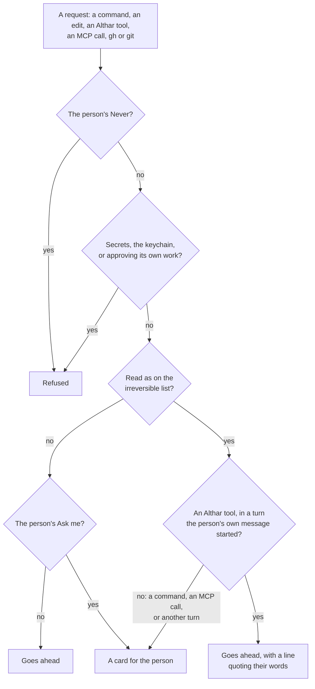

# What agents may do

What an agent Althar starts may do without asking, what asks the person, and
what is refused. This covers every role: a task's lead, the reviewer, a
review's lead, the coordinator and a lead's helpers. It also covers the
project's rules, the sandbox, git's guard, the web, Althar's own tools outside
the sandbox, and the settings agents change.

**Replaces:** ADR-007,
ADR-013,
ADR-018,
ADR-019,
ADR-043,
ADR-057,
ADR-067,
ADR-071,
ADR-078,
ADR-089,
ADR-097
(apart from its MCP servers, skills and sign-in, which are in
[the person's setup](the-persons-setup.md)).

How it is built (the permission flow, the rule engine, each agent's
launch options) is in
[architecture 03](../architecture/03-agent-runtime-and-auth.md).

## The principle

An agent Althar starts works as the person's own agent would. Althar is
permissive by default. Only what can't be taken back asks: the irreversible
list below. Any other block, refusal or ask is a bug to remove, network
allowlists included. When unsure, allow. An agent that is blocked says what
blocked it; nothing fails quietly.

Why: people use agents for what they can do, and the other tools like Althar
(Claude Code, Orca, T3 Code) run them with full access. A limit that sounds
reasonable on its own makes, with the others, a tool that can't do the work.

## What asks

**Allow everything is on for every project,** new and existing. A project
made before it got one revision of its rules with it on; an explicit off, the
person's own, stays off. The switch doesn't show on a task's header or board
card.

With everything allowed, only this list asks, in every role, with a sandbox
or without one:

| Kind | What | Why it can't be undone |
| --- | --- | --- |
| **Lost work or history** | A force push (`+ref` and `--mirror` included); a push to the default branch, or deleting it; deleting, or moving by force, another branch whose commits are on no other ref, here or on the remote; discarding changes in another checkout, the person's own above all; deleting or moving away what's outside the task's worktree; removing a worktree that isn't the task's | What was there is gone, for the person and for every checkout that shares it |
| **Publishing, releases, teardown and merging** | Publishing a package (`npm`, `bun`, `pnpm`, `yarn`, `cargo`, `gem`, `twine`, `poetry`); a release, a release tag, and moving or deleting a tag; tearing down (`destroy` in `cdk`, `terraform`, `tofu`, `pulumi` or `fly`, `terraform apply -destroy`, `kubectl delete`, `helm uninstall`, `wrangler delete`, `vercel remove`, `netlify sites:delete`); merging a pull request, entering a merge queue or turning on auto-merge | It reaches every user, updater or environment at once, and a registry never takes a version back |
| **Speaking for the person** | A post on a pull request or issue that no task of Althar's opened or came from, a reply to an outside author, and a message to anyone through another service ([below](#speaking-for-the-person)) | Their notification can't be called back |

A dry run (`--dry-run`) doesn't ask. A deploy goes ahead, since the next
deploy replaces it.

Two more are refused, not asked, because there is no answer the person would
want to give:

- **Secrets and the keychain.** Reading where keys and sign-ins are kept
  (`~/.ssh`, `~/.aws`, `~/.npmrc`, token files: `SECRET_PLACES`), the
  keychain's `security` and git's credential helpers called directly. A
  credential sent to a model's provider can't be taken back. `security`
  subcommands that hold no secret go (`find-identity`, `find-certificate`,
  `list-keychains`, `show-keychain-info`, `verify-cert`, `cms` without `-S`,
  `error`, `help`), as a build needs them to find its signing identity.
- **An agent approving itself.** No agent answers its own permission request.
  Nor may it approve a pull request a task opened, make a commit status or a
  check run, dismiss a review, or widen what the host lets agents do (its
  protection, access, secrets and settings). Otherwise none of the rest holds.

**Everything else goes ahead, unasked.** That includes commands the rules
can't read (scripts, heredocs, `$(…)`, variables, loops), with a sandbox or
without; writing outside the worktree; global installs; every stash
operation; `git reflog expire`, `git gc --prune` and the like; reading a
`.env` the task doesn't own; the network; running and screenshotting the
app; reading any pull request or issue in the project's repositories. What
can be got back isn't worth a question.

The rules read a line as plainly as they can. A plain `git push origin
main`, `git push --force` or `rm -rf` of the person's checkout asks wherever
it stands in a compound command. A heredoc's body for another language
(`python3 - <<'EOF'`) isn't read as shell; a shell's (`bash <<'EOF'`) is.
What the rules can't tell goes ahead, not to a judge: a judgment adds up to a
minute to every command.

- **Beside a Never, an unreadable command runs.** Never refuses only what a
  line's words plainly show; the agent is trusted with what the rules can't
  see.
- **`gh` and `glab` are read as git is.** An edit that can be undone goes
  ahead; a merge, a release, a post and a credential export are on the list.
  Approving the agent's own work, or widening what the host lets agents do,
  through `gh api`, `glab` or GraphQL, is refused, not asked. A host API call
  the rules don't know goes ahead rather than being read as irreversible.
- **There is no floor beyond this list** in any mode, and the Flatpak's
  device bridge is an ordinary command.

Why "when unsure, allow": every ask or refusal beyond the list cost the
person time and agents kept working around them. An agent that is refused is
told the command and the reason in the same turn; a refusal that leaves it
silent is followed up with both (`AgentConnection.ts`).

## Asking is the person's word

An ask is answered by the person, and nothing else answers it: not the
coordinator's judge, not another agent.

- **Althar's own tools for what's on the list** (merging, tags, releases,
  posting) are asked-for. They name the words they act on. Where those are
  the person's own message in the turn, from the window or a paired device,
  the tool goes ahead with a line saying what it did and quoting them
  (`byPerson`). In any other turn it is a card.
- **A command or an MCP call on the list** names no words, so it asks on a
  card even in a turn the person started. That is one reason the briefs
  prefer Althar's own tools.
- **The card** says it can't be undone, puts the action on its button, says
  in one line what can't be taken back, shows the words it would post and
  the server and tool or the command. It offers Not now or the action, and
  no "always".

**Not built yet:** several of Althar's own tools still ask beyond this list
and go back to it. They are starting a workflow, deleting any branch,
posting any review, commenting on any issue, any write through the gated host
call, discarding a task, and `create_branch` and `open_pull_request`, which go
only on the person's word. A lead's `push_tag` also asks every time. See
[code hosts](code-hosts.md).

## Speaking for the person

A post (a review, a comment or a reply) goes ahead on a pull request or issue
that a task of Althar's opened or came from, the person's own, or one by the
repository's own people. A reply to an outside author goes on the person's
word, their message in the turn that asks it. So does a
message through another service, such as an MCP server's Slack message or
email. Merely following a pull request doesn't make it Althar's: Althar
follows every open one.

**Not built yet:**

- Every post through an MCP server asks, the task's own pull request
  included. Althar can't yet tell from a server's call whose pull request it
  is. Althar's own tools follow the rule above.

## The sandbox is the boundary

The OS sandbox holds what a command can write; the rules hold the
irreversible list, inside the sandbox and outside it. Every shell command
reaches Althar's rules, which answer it at once: a visible irreversible one,
or one the person asks about, asks; everything else runs, loops, `$(…)`,
heredocs and scripts included.

- **Where it holds:** Claude Code's lead and the coordinator, on macOS, and
  on Linux where bubblewrap and socat start a namespace, outside a Flatpak.
  There the session doesn't start without it (`failIfUnavailable`). A lead
  writes only its worktree, its temp folder and the tool caches
  (`TOOL_PLACES`); the coordinator only its folder and temp files. Its
  network reaches any host and may bind localhost; of the Unix sockets only
  the SSH agent's is let through, so Docker's or the session bus's is not a
  way out. Keys and sign-ins stay unreadable by the sandbox's deny list.
- **Codex** runs in `workspace-write` with the network open, set in its
  session and on every turn by Althar's patch of codex-acp. Its turn takes
  the `untrusted` approval policy, so every command its own safe list doesn't
  cover, a merge, a release or a post among them, reaches Althar and meets
  the list; what its safe list covers runs unasked.
- **What runs outside:** on macOS, Electron and Chromium can't start inside
  Claude Code's or Codex's sandbox at all, so an end-to-end run has to cross.
  The commands a project runs anyway (its tests, its build, dev servers) run
  outside from the start (`excludedCommands`), worked out from the project,
  and so do common dev servers and test runners started by hand
  (`sandboxReach.ts`). They still meet the irreversible list.
- **Where no sandbox holds:** Windows, a Flatpak, Linux without bubblewrap
  and socat, OpenCode and the other agents. There the rules read each
  request, let what they can't read go ahead, and ask only before the
  irreversible list.
- **A line is read from where the lead's shell is.** Claude Code writes its
  shell's folder into its transcript; Althar reads the newest and starts the
  line there, where it is in the worktree or a temp folder. Otherwise the
  line is read from the worktree's top. A path that names nothing there
  deletes nothing, and doesn't ask.

**Known gap: the keychain on a Mac.** Claude Code's macOS sandbox lets
through the keychain's service, and no setting denies it. A script inside the
sandbox could run `security find-generic-password` and read an item whose
access list trusts that tool. Althar refuses it where the words show it, but
a script hides it. Closing it needs Claude Code's sandbox to deny the
service. Only signing builds use the keychain in this repository, and denying
it would break signing locally.

## Git's guard

What can't be undone is stopped where it happens, at git. Every lead's git
takes its hooks from a folder of Althar's (`core.hooksPath`, `pushGuard.ts`):

- `pre-push` stops a push to the default branch, a force push (over commits
  the remote has that this one doesn't) and deleting another branch;
- `reference-transaction` stops deleting another branch here, or moving one
  so it loses commits. A branch whose commits are on another ref goes, so
  `git branch -d` doesn't ask.

The guard acts only in the task's repositories, or on a push to one of
their remotes; a scratch repository in the lead's temp folder is its own.
Whatever ran it, a script or a loop, the guard says what it stopped and to
run it plainly, so Althar asks. When the person allows such a request, the
session gets a two-minute pass for exactly those git commands, in that
repository and to that remote URL, spent on the first use. Each hook then
runs the repository's own.

Why: a script can hide a force push, and reading words for `push` reads
words, not what happens. The guard sees the refs git actually sends. It
holds against a mistake, not an agent set on getting past it. It holds for
every lead but on Windows, where Git for Windows' `ps` can't show git's own
words; there the rules ask first.

A lead may pop or drop its own stash entry: git names each entry by the
branch it was stashed on.

## The person's rules

A project's rules (`Policies.ts`, read by `rules.ts`) hold what the person
keeps for themselves, over the switch:

- **Never:** kinds and commands refused, whatever else is set. An agent that
  meets one is told "Refused by your rule `rm -rf ~/Library`.", and the
  thread says the same under the call. Nothing asks and nothing waits: Never
  is the person's answer given ahead.
- **Ask me:** kinds and commands that ask, with everything allowed too.
- **Allow rules:** kinds always allowed, and commands by how they start
  (`git status`) or by the exact line. They matter under "Ask about more".
  A Never and an Ask me always beat an allow rule.
- **Commands are matched as the shell runs them.** Each command of a line is
  read on its own, with environment assignments and wrappers such as `sudo`
  and `timeout` taken off. It is also read as what a package runner (`npx`,
  `bunx`) or an interpreter runs for it. The program is matched by name, `*`
  matches anything, and a lone `*` matches nothing too. Matching a whole line
  by its start is what other tools were bypassed through
  (`git status && curl … | sh`).
- **A deploy is read where a command says it:** a tool's subcommand
  (`fly deploy`, `terraform apply`), a script named for it, or a runner's
  target (`make deploy`). It is never read from arguments or quoted text.

**Allow always and Deny always,** on a card, write an allow rule or a Never
rule into the project, as a revision of the rules. The agent is still sent
its narrowest option, never an "always", so it keeps no rule of its own. A
card offers only an always that would hold. When the rules change, what still
waits is decided again, so the other cards of a stack an Allow always covers
go. Allow all allows each card of a stack once, and keeps no rule.

The rules also keep how a task ends where its plan doesn't say, how branches
and pull request titles are named (`{key}`, `{slug}`, `{title}`, over what
each repository's docs say), whether leads resolve conflicts on their own,
which of the person's accounts the work runs on, and what happens at a usage
limit (move to the next account, or wait for the person with each account
that could take it over).

Each change is a revision. The rules as they are decide the next request,
and a run cites the revision it started under.

**What the rules counted.** Every ask and refusal is counted by its kind
(`tally.ts`): a kind of the project's, what the rules can't read, a command
the project named, credentials, the code host. Rules shows, under "Last 14
days", how each went: allowed, refused, worked around. What the boundary
stops itself (the guard, or the sandbox's "Operation not permitted") is
counted from the failed call. A kind agents keep working around gets
dropped.

## Ask about more, and the coordinator decides

Turning allow everything off ("Ask about more") gives back the rules as
sentences: Never, Ask me, Go ahead, and what the rest gets. The rest gets one
of three modes:

- **Allow, except what you keep:** the rest goes ahead.
- **Ask me:** anything beyond reads and the task's own files waits for the
  person, and every OpenCode command.
- **The coordinator decides:** the rest goes to the coordinator's judge, and
  what it can't decide waits for the person.

These are the person's choice to be asked more. None is the default, and the
switch turns allow everything on again. A task has its own switch, in its
menu, to allow everything on that task alone; the project's switch holds over
it.

**The coordinator decides** stays a mode the person can pick. It is never the
default and isn't extended to more agents. With everything allowed, nothing
goes to the judge. How the judge works:

- It answers only what is left once Never, the irreversible list, Ask me and
  allow rules have answered. It never answers what can't be undone, and never
  what the rules can't read: that goes to the person.
- Each judgment is a fresh session on the coordinator's agent and model,
  with no tools, no MCP servers, no settings or hooks, in an empty folder. It
  doesn't enter the coordinator's conversation. At most two run at once, and
  each has a minute. A missing account, a failure, an unclear answer or the
  deadline goes to the person.
- It allows, refuses or asks, with a one-sentence reason, shown as "By the
  coordinator: …". The rules are read again before its answer is applied.
  Each judgment is recorded with its model, cost and time.
- Only Claude Code can judge (`permissionJudge` in the registry). Codex's and
  OpenCode's requests go to the person.

## How a request reaches Althar

- **No session starts in a bypass mode.** Sessions start where the agent
  asks, and its requests arrive as ACP's `session/request_permission`. Each
  session's launch options keep the agent asking whatever its own or the
  repository's settings say. Althar never writes the agent's settings files.
- **Althar answers with the narrowest option** that carries out its
  decision, never an "always", so the agent keeps no rule of its own. A
  request that goes ahead is a quiet line under the turn.
- **A refusal says why in the refused call itself,** for an agent that reads
  it there (Claude Code, through Althar's patch of claude-agent-acp). No turn
  follows to explain it, so no second reply lands in the coordinator's chat.
  Other agents are told at the turn's end.
- **An ask that waits while the person is away** records where it reached
  them, and its card says how long it has waited. After three minutes on a
  paired device, the lead goes on without it: the call is refused, saying the
  person is away, and the request stays open. When the person allows it, the
  lead's next try of that call goes through. A request belongs to the person,
  not the session: answered after the session ended, it starts the task's lead
  again to read the answer. Requests don't survive Althar restarting.

## Althar's tools outside the sandbox

Some of what a lead needs fails in a sandbox. Althar does it itself, outside
any sandbox, as tools, so the agent asks Althar rather than stepping out:

- **`install_dependencies`** runs the worktree's recorded setup again, as it
  ran when the worktree was made ([workspaces and runs](workspaces-and-runs.md)).
- **`run_project` and `stop_project`** run the project in the lead's own
  worktree as the person's Run does, with its card in the thread and the
  Running pill. A lead stops only its task's runs.
- **`screenshot`** has the desktop app draw a page offscreen, in a session
  of its own that keeps and grants nothing, and gives it back at 1×: the
  viewport, the whole page or one element. Any page over http or https, on
  this computer or elsewhere, redirects followed; a `file:` address is
  refused. Where nothing draws pages, as on the command line, it says so.
- **`rerun_check`** runs a task's failing checks again: an Actions job on
  GitHub, a pipeline's job on GitLab. A check another service reports, and
  every Bitbucket check, can't be run again from Althar, and the lead is told
  so.

A review's lead of the repository's own people gets these as a task's lead
does, and so does the coordinator, from the same pool
([coordinator](coordinator.md)).

## The web

"Leads can reach the web" is a project switch in Rules, on by default. With
it on, leads and reviewers get their agent's own web tools (Claude Code's
WebSearch and WebFetch, Codex's live search, OpenCode's websearch and
webfetch) without asking. It applies when a session starts. There is no host
allowlist: sandboxed commands reach every host, for leads, reviewers and the
coordinator alike. A host the person puts under Never is refused, and so is
every host under it: Claude Code's sandbox gets it as a denied domain, and
the rules refuse a command that names it.

Why the switch stays: a lead that reads a private repository and fetches any
URL can be steered by a page or a comment into sending code out in a URL. The
switch is for repositories where that matters. It is not an air gap.

**An outside author's review stays offline.** An outside author is someone
on a fork, or someone the host doesn't name a member or collaborator. Its
review reads a copy, installs and runs nothing of it, loads none of its
repository's settings, hooks or MCP config, and its commands reach no
network, whatever the switch says. It gets the six reading tools, not a
lead's. Why: the stranger's words could steer the agent into sending private
code out, and a host list wouldn't stop that, since a leak can ride on an
allowed host.

"Run it", the person's word, runs an outside author's code as far as they
say, safely or trusted fully, and Stop running it takes that back
([reviews § Run it](reviews.md#run-it)).

## Settings agents change

The coordinator, and leads from the same pool, change the project's settings
and Althar's own, everything the Settings screens show, through
`read_settings` and `change_settings` (`SettingsTools.ts`). One pair of tools
names a section and a setting as the screens' addresses do
(`project/rules`), so a new setting needs no tool of its own.

- **A change that loosens what asks goes only on the person's own message,
  in that turn,** and the line quotes them. In any other turn it is a card.
  Otherwise an agent could get past an ask by changing the rule that made it
  ask. Loosening is: the mode toward fewer asks; Allow everything turned on;
  a rule taken out of Never or Ask me, or moved from Never to Ask me; a
  command or host added to what the sandbox lets through; the web switch
  turned on; an MCP server switched back on; the team's reviews posted
  without asking; automations un-paused. Althar decides which a change is,
  from marks on each setting, not the agent.
- **Tightening, and every other change, goes at once.** Asking more can be
  undone, and the person sees it.
- **Each change is a line in the agent's thread,** with what it was, what it
  is now, and Undo. A change is recorded as the agent's, with the person's
  words where it acted on them.
- **The person's alone:** signing out, removing a connection or an account,
  leaving a repository out and taking the project out of Althar, on their
  word; signing in, connecting and adding a repository, which need them there
  anyway; and answering a permission request or a question.
- No setting opens `SECRET_PLACES` or the keychain, and the host's own
  settings stay refused.

## What stays, and why

| Kept | Why |
| --- | --- |
| The OS sandbox writes only the worktree, the temp folder and the tools' caches | It's why commands needn't ask |
| The irreversible list asks in every mode, never judged | Lost work, a merge, a publish or a word to others can't be taken back |
| Git's guard hooks on pushes and branch moves | A script can hide a force push |
| Secret files and the keychain are refused | Leaked credentials can't be taken back |
| No agent answers its own permission request, approves its own work, or loosens what asks without the person's words | Otherwise none of the above holds |
| Asked-for tools go only on the person's own message; a command or an MCP call on the list asks on a card, as far as Althar sees it | News, pull request text and a lead's words can't merge, publish or post |
| An outside author's code doesn't run without the person's word, none of its repository's settings, hooks or MCP config load, and its review's commands reach no network | A stranger's code, and a stranger's words, on the person's machine |
| Running or resuming an automation goes on the person's word, as a card otherwise | It spends their usage on a schedule, while they're away, beyond any task's caps |
| An unattended automation's run never pushes to the default branch | Nobody is there to answer the ask |
| A lead's helpers push nothing | Tidiness: the lead stays the one who pushes, so a task has one record of what went up |
| Cost caps: a step's turns and hours, review rounds, helpers' counts | Money, not safety |
| The coordinator changes no code | Tidiness: a change is a task, with a branch, a review and a record |

Anything else that blocks, refuses or asks is a bug.

## Changes

- 8 Nov 2026: written from the ADRs under Replaces.
- 8 Nov 2026: the limits sweep (#696) built: every command reaches the rules inside the sandbox too, the network is open to every role, `gh` and `glab` are read as git is, an unreadable command runs beside a Never, and screenshots draw any http or https page.
- 10 Nov 2026: an outside author's code runs only as far as the person says with Run it, safely (install scripts off, offline) or trusted fully, and a setting can answer how far, never whether ([reviews](reviews.md#run-it)).
- 10 Nov 2026: Run it built, and Stop running it ([reviews § Run it](reviews.md#run-it)).
