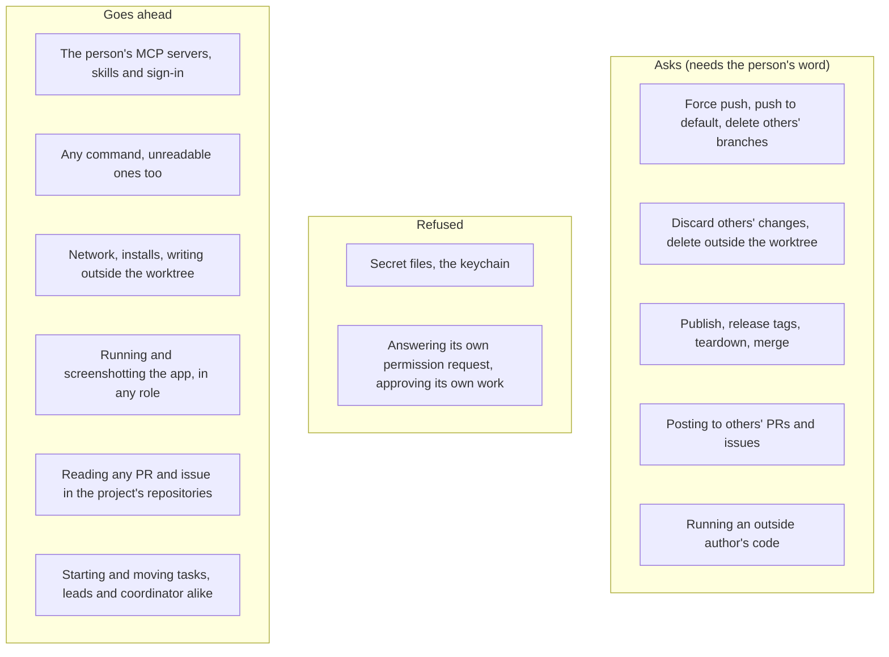

# Agents work as the person's own, and only what can't be undone asks

> **Decided, 6 November 2026,** and recorded in
> [ADR-097](../decisions/097-agents-work-as-the-person-s-own-and-only-what-can-t-be-undone-asks.md),
> which supersedes the restrictive parts of the ADRs it lists. This is the
> phased plan to build it, not architecture. Delete this file when the last
> phase ships.

## Why

People use agents for what they can do: their own MCP servers, their own
skills, running the app, posting what they found. Althar has collected
about 65 limits on what an agent may do, see, reach or use, decided one at
a time, each sounding reasonable. Together they make Althar the most locked
down of the tools like it. The person's direction already says otherwise:
a task is a loose container of parts (13 Oct), and Althar is permissive by
default, with only crossings that can't be undone asking (29 Oct). Much of
the code and many ADRs never caught up.

The case that showed it (6 Nov). The person ran a design-review skill in
Claude Code. It builds the app and Storybook, screenshots both, compares
them, and posts the result on a colleague's pull request through an MCP
server. Althar can't do any of that today:

- a review's lead runs nothing;
- it gets no skills and no MCP servers;
- it can't take or show screenshots;
- its draft holds no pictures.

## What the others do

Read from their source on 6 November: Orca (stablyai/orca at `4941215ad1f9`)
and T3 Code (pingdotgg/t3code at `6577c6b61851`). Each row was read, not
inferred; where a file says otherwise than the docs, the file's is given.

| | Orca | T3 Code | Althar today |
|---|---|---|---|
| Default | Full access (`agentPermissionDefault: 'full-access'`): Claude with `--dangerously-skip-permissions`, Codex with `--dangerously-bypass-approvals-and-sandbox` | Full access for every new thread (`docs/user/permission-modes.md`, `DEFAULT_RUNTIME_MODE`) | Asks for six kinds of thing by default; only Allow everything reduces that to what can't be undone |
| Modes | Per agent: its own, Ask, Accept edits, Approve for me (Auto), Full access (its docs still say Yolo and Manual) | Supervised, Auto-accept edits, Auto, Full access, per thread; an admin can cap it (`maxRuntimeMode`) | Rules, judge, Allow everything |
| Sandbox | None: "a worktree is an isolated checkout, not a security sandbox". Docker is experimental | None. A Docker pull request is open | OS sandbox for Claude leads: writes only the worktree, reads everything but secrets |
| The person's MCP servers | Yes: Claude's user, project and local settings; Codex's `~/.codex` copied, its servers with it. The app can start an empty `.mcp.json`, not add a server | Yes, and its own server beside them; Codex keeps its own config. Antigravity's are kept out | None, for every role (`strictMcpConfig`; switched off by name for Codex and OpenCode). Copilot, Kimi Code and Mistral Vibe load them already |
| The person's skills and plugins | Yes | Yes, offered in the composer | Althar's catalog, task leads only, every catalog skill off until turned on |
| Code host | The app pushes, opens, stacks and merges pull requests; agents inherit the person's environment, `gh` and git's cached credentials included | The same: agents inherit the host's environment and open pull requests with `gh` themselves, which the app spots and links | No sign-in for agents; Althar's tools, reaching only the task's own pull request |
| Someone else's PR | A worktree at its head, forks included | "Work on PR" (in its mobile app): a thread on its branch, at the thread's mode | Read-only copy, runs nothing, no skills or MCP, draft only |
| A task's shape | A workspace links many pull requests and issues | A thread holds several pull requests and can move to a new worktree mid-thread | Three kinds with one-way paths between them |

Neither has a flow where an agent reviews a pull request and posts the
review itself: in both, the person submits. Neither puts pictures in a PR
comment either; `gh` can't upload them. The only credentials either strips
are T3's own Codex sign-in's (`OPENAI_API_KEY` and the like); neither
touches git or `gh`.

Two things Althar does that they don't, and which are worth keeping:

- **Althar pushes.** It holds a push where someone else pushed and keeps a
  record of what reached the host. Since ADR-097 that is the preferred
  path, not the only one.
- **It stops what can't be undone,** in every mode.

## What was decided

ADR-097 has the whole of it. In short:

1. **Allow everything is the default,** for new and existing projects. Only
   the irreversible list asks:
   - lost work or history: a force push, a push to the default branch,
     deleting others' branches, discarding others' changes, deleting
     outside the worktree;
   - publishing, releases, teardown and merging;
   - speaking for the person to others;
   - secrets and the keychain (refused);
   - an agent answering its own permission request (refused).

   The person's own Never and Ask me rules still hold.
2. **The person's own MCP servers and skills load in every role** (lead,
   reviewer, review's lead, coordinator, helpers), each with a switch.
   Althar's own tools and paths are preferred, never imposed. MCP calls that
   are plainly on the list go through the same ask, as far as the agents'
   permission hooks show them. Agents may use the person's own `gh` and git
   sign-in.
3. **One pool for leads and the coordinator:** the same tools, MCP servers
   and skills. Leads ship code; the coordinator doesn't change code, for
   tidiness, not safety. Leads may start tasks. The coordinator directs
   leads and does what the person can in the window. Merging two tasks into
   one is out of scope.
4. **The coordinator is optional.** Tasks start from the board, the
   composer or a lead.
5. **Kept:** the sandbox's write boundary, git's guard, no secret files, no
   self-approval, an outside author's code not running without the person's
   word, cost caps, and asked-for tools only on the person's message (an
   MCP call on the list asks on a card, as far as Althar sees it).
6. **Still open, recommended until the person settles them:** an outside
   author's pull request is read-only by default, with "run it" on their
   word; posting on someone else's pull request goes on their word in the
   thread.

## The phases

Each phase is a task of its own, on its own branch, in this order. "Now" is
the code at `6fa8c335e`; file and line references were checked there.

### 1. Allow everything as the default, and MCP and skills in every role

**Rules.**
- Allow everything on for every project: new ones seeded with it
  (`Policies.seedRules`, `startingRules`; `contracts` `Api.ts`'s new-project
  defaults can't pick it now), existing ones given a revision with it on.
  The person's Never, Ask me, command rules and mode under the switch stay.
- The built-in Ask me list becomes the irreversible list (`rules.ts`'s
  `RULES`, `MVP_RULES`, `Policies.ts`'s `FIRST`).
- Merging, release tags and speaking for the person are on the list as the
  rules read commands, not only as Althar's asked-for tools.
- The floor goes in every mode: `Kept.floor` keeps only what is
  `irreversible`. The stash, `reflog expire`, `gc --prune` and `prune` go
  ahead everywhere.
- Without a sandbox (Codex, OpenCode, Windows, Flatpak), a line the rules
  can't read goes ahead, where Never lists nothing the guard doesn't stop.
- Codex gets the network in its shell (`registry.ts`'s `network_access`).
  The plain-`curl` reading rule (`readsWeb`) goes. `screenshot` draws any
  address (`screenshots.ts`).

**The person's setup.**
- MCP servers: Claude stops using `strictMcpConfig` (`registry.ts`, four
  roles), and Codex and OpenCode stop switching servers off by name
  (`ownTools.ts`, `Config.ts`). A repository's own config loads where the
  agent's trust would load it, never from an outside author's pull request.
  Settings lists each server, with a switch everywhere and per project.
- MCP calls and the list: an ask rule per person's server for Claude Code
  (`mcp__<server>`), the agent's own per-tool ask elsewhere where it has
  one, and the adapter keeping the tool and server claude-agent-acp sends
  in `_meta` (`AgentConnection.ts` drops it now). The rules read a call by
  server, tool and arguments: the host and tracker servers people use by
  tool name, any server by what its name says, a general `graphql` or `api`
  tool by its mutation or method and path, as ADR-081's gated call is
  placed. On the list: a card, as a command on the list (it names none of
  the person's words, so their message in the turn isn't enough). What
  widens agents' reach: refused. Find
  out per agent which calls reach Althar (Codex sends MCP approvals to
  `request_permission` only as a fallback), and write the rest into each
  entry's `knownGaps`.
- Skills: the catalog on by default (`skills` `local.ts`), for every role
  (`Sessions.ts`'s `!reads`); the person's own skills and plugins load as
  their agent loads them (they already do for leads, through the agents'
  own folders); `allowed-tools` no longer refused at install, `hooks` still
  is (`validate.ts`).
- ADR-095's switches and held push go (`repositoryFiles`).
- Claude Code's auto-memory on.

**The drift the plan found,** in the code, beside the docs this change
fixed: the comment at `rules.ts:254-256` calls key files readable (they're
refused: `SECRET_PLACES`); the `gh pr merge` refusal (`rules.ts:614`) says
merging is the person's, against ADR-081 (it should name
`merge_pull_request`, or, once phase 3 reads `gh` as git, go); the comment
at `rules.ts:76` counts a push the rules can't read as irreversible;
`rules.ts` and `provider-adapters` `registry.ts` still cite
`docs/plans/safety-pass.md`, which is gone (ADR-067 and ADR-097 hold what
lasted of it).

### 2. One pool, leads starting tasks, and the coordinator directing leads

- **One tool set.** Leads get the coordinator's commands (`draft_task`,
  `start_task`, `propose_plan` for what they drafted, `review_pull_request`,
  `message_lead`, the task moves), and the coordinator gets the leads'
  (`install_dependencies` and `run_project` in its copies, `read_task_diff`,
  `show_pictures`). Per role, only what differs: a lead's own task and
  worktree, the coordinator's edit tools denied (`Coordinator.ts:1873-1928`
  serves them apart now).
- **The coordinator's copies** take an install and a test run; its sandbox
  reaches a lead's hosts (ADR-058 kept it offline). Its reader rules where
  no sandbox holds become a lead's, with its copies as its folder.
- **Task moves at once:** `stop_task`, `hold_task`, `restart_task`,
  `settle_task` act in any turn, with the lines in both threads; the
  `task_ask` card goes (`TaskActions.ts:201-210`, `:555-576`). Resuming or
  turning on an automation stays on the person's word.
- **Matching the window.** List every button the person has on a task (the
  task menu, the Change card, a Stuck call's answers, the plan card) and
  give each a tool where it has none: push a task's commits as the Push
  button does (there is `push_accepted_task`, and only `message_lead`
  otherwise), review again, skip the review, open a new pull request, mark
  ready, rename, attach. What can't be undone (accept and merge) stays on
  the person's word (`TaskActions.ts:491-506`).
- **The coordinator optional.** A task starts from the board, the composer
  or a lead without it; its plan and models come from the person's
  defaults. Its session starts when the person talks to it, or news it acts
  on wakes it. With the task "Small changes finish in minutes, not 40".
- **The reviewer of a task's change** runs tests and builds in its copy
  (ADR-071's review steps).
- **Helpers** (ADR-087, when built) get their lead's MCP servers and skills.

### 3. Host tools

- **The person's own sign-in.** Stop taking `gh`, `glab`, git's credential
  helpers and the SSH agent out of agents' environment (`Config.ts:329-386`,
  `process.ts`'s allowlist), behind a project switch, on by default. The
  rules read `gh` and `glab` as git (`rules.ts:402-449`, `:614-625`): what's
  on the list asks, the rest goes ahead.
- **Noticing a push Althar didn't make:** after a lead's turn and in the
  sweep, read the task's branch on the remote; a head that is the
  worktree's is the lead's own push, said in a line and taken as the task's
  (no hold, no errand ended); a pull request opened with `gh` on the branch
  is adopted, as now.
- **Reading.** Leads read any pull request and issue in the project's
  repositories, not just their task's own. They see outside authors'
  comments too, marked as outside; they still don't wake on them.
- **Posting.** A lead posts a review or a comment, with pictures, on any
  pull request in the project's repositories, on the person's word in the
  thread: an asked-for tool, like merging (ADR-081). A team's pull request
  may post without asking under the person's existing setting. Replying to
  an outside author works the same way; it's refused outright today
  (`coordinatorPullRequests.ts:150-162`). A reply on a pull request no task
  of Althar's opened or follows becomes asked-for too: it speaks for the
  person. The cap of 50 comments per review goes: Althar splits a longer
  review into several.
- **Pictures in reviews and comments.** Althar uploads screenshots and the
  lead's evidence where the host takes them (GitHub user attachments),
  which `gh` can't do.
- **Merging and tags.** A lead merges and pushes a tag on the person's word
  (ADR-081's task 15). A tag asks once, not twice.
- **Forks.** A fork's branch whose author allows maintainers to edit is
  pushed to on the person's word (DEV-170). A fork's pull request can be
  attached (ADR-052).
- **The web mark goes** (ADR-081's task 17, not built), and the coordinator
  follows the project's web switch as leads do.
- **Kept:** the never list for Althar's gated call; no self-approval,
  statuses or dismissals.

### 4. Reviews that run things

- **A pull request by the repository's own people** (its author a member or
  collaborator, its branch in the repository) gets what a task's lead gets:
  a real worktree at its head, with the project's setup replayed; its code
  run in the sandbox (tests, the app, Storybook); skills, MCP servers, the
  network, `screenshot` and `show_pictures`; and a draft that carries
  pictures. The design review becomes this task with the person's skill.
  Codex leads one too, and so do the agents ADR-050 kept from reviews.
- **An outside author's pull request** keeps today's read-only copy by
  default: no install, no run, none of the repository's settings, hooks or
  MCP config, its commands offline, Codex not leading it. One word from the
  person ("run it") turns it into the team's kind of review, in the
  sandbox, with the network off for its commands.
- **A review's lead's tools** grow from today's six (`read_pull_request`,
  `read_checks`, `read_issue`, `find_issues`, `draft_review`,
  `settle_task`; `Reviews.ts:1148-1158` refuses the rest) to a lead's.
- The draft stays the person's to post, unless they told the lead to post
  it or turned on their team-review setting.
- Proven by the person's design-review skill posting on a colleague's pull
  request.

### 5. The task as parts

ADR-035 already reads a task's kind from what it has. The next step is
letting it have any mix of parts, each added or dropped on the person's
word. Then no kind needs a hand-written path to another.

- **Workspace:** none, a read-only copy, or a worktree. Any can become the
  next.
- **Outputs:** any number of pull requests (opened, attached or reviewed),
  in one repository or several; drafted reviews; pictures and files.
  - A change can draft a review of a related pull request.
  - A review can open a pull request of its own.
  - A task can split its change into two pull requests, or stack one on
    another.
- **Access:** what the lead may run and reach, read from who wrote the code
  (the outside-author line), not from the task's kind.
- `make_it_a_change` and the like become **add a part**: add a worktree,
  add a pull request as output, add a review. Each says in the thread what
  it added. The kind label on the card stays, read from the parts.
- Merging two tasks into one stays out (6 Nov).

This phase is the largest. It changes ADR-035, ADR-052 and the change sets
model (`change_sets`, `repository_changes`), so it gets an ADR of its own
once phases 1 to 4 have shown what it needs.

## What stays, and why

| Kept | Why |
|---|---|
| The OS sandbox writes only the worktree, temp and tool caches | It's why commands needn't ask |
| The irreversible list asks in every mode, never judged | Lost work, a merge, a publish or a word to others can't be taken back |
| Git guard hooks on pushes | A script can hide a force push |
| Asked-for tools only on the person's own message (ADR-081); a command or an MCP call on the list on a card | News and PR text can't merge, publish or post, as far as Althar sees the call |
| Secret files and the keychain are refused | Leaked credentials can't be taken back |
| No agent answers its own permission request, or approves its own work | Otherwise none of the above holds |
| An outside author's code doesn't run without the person's word, and none of its repository's settings or hooks load | A stranger's code on the person's machine |
| Cost caps (40 turns, 6 hours, review rounds, helpers' counts) | Money, not safety |
| The coordinator changes no code | Tidiness: a change is a task, with a branch, a review and a record |

## The docs this changed

ADR-097, and a line at the top of each ADR it supersedes in part: 004, 011,
013, 016, 035, 043, 050, 052, 057, 058, 066, 067, 071, 078, 081, 086, 087,
088, 089, 094 and 095 (wholly), and a line amending 007 and 019. Architecture 03, 04 and 06 and the
glossary say what was decided, marked where it waits on a phase.
`docs/plans/safety-pass.md` is gone; ADR-067 and ADR-097 keep what lasted
of it.

Drift the plan found, fixed in the docs here:

- 03 said dropping a stash entry asks with everything allowed; it hasn't
  since ADR-067.
- 06 listed four tools for a review's lead; the code gives six.
- 06 called key files readable; they're refused (`SECRET_PLACES`), and
  Claude Code's sandbox denies reading them.
- The `gh pr merge` refusal says merging is the person's, against
  ADR-081; the docs no longer say so, and the code's words are phase 1's.
