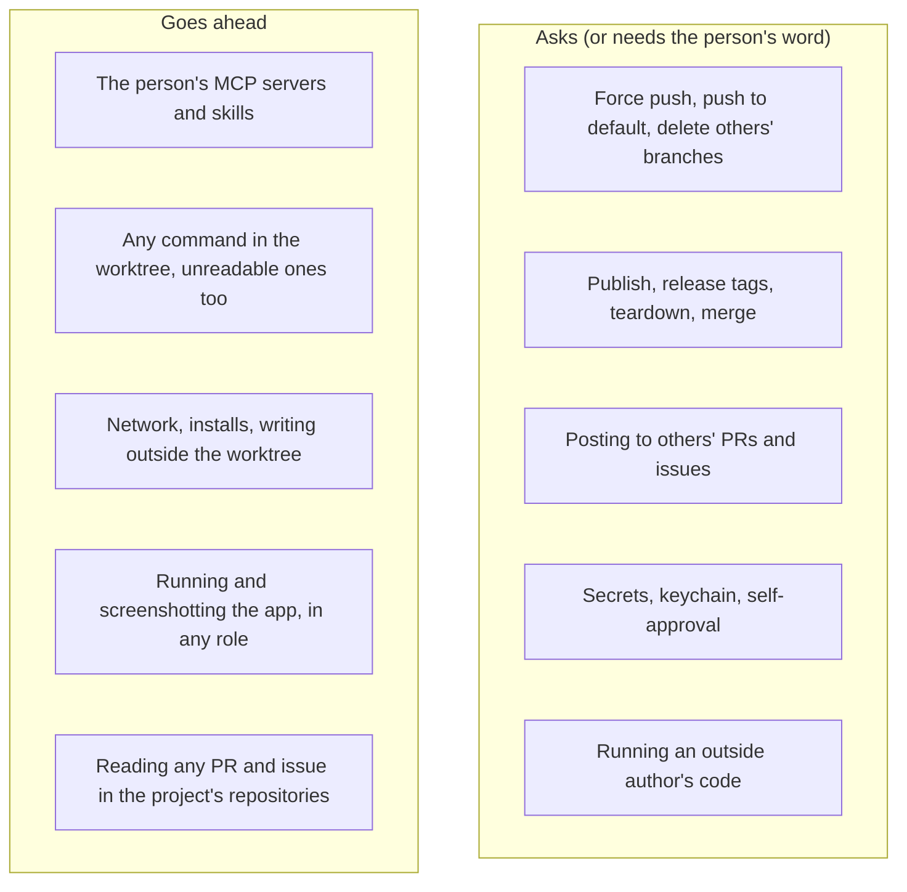

# Agents work as the person's own, and only what can't be undone asks

> **Proposed, 6 November 2026.** A plan for the person to decide on, not
> architecture. Once decided, it becomes one ADR that supersedes the
> restrictive parts of the ADRs listed at the end, and each of those gets a
> line pointing to it. Delete this file when the last phase ships.

## Why

People use agents for what they can do: their own MCP servers, their own
skills, running the app, posting what they found. Althar has collected
about 65 limits on what an agent may do, see, reach or use, decided one at
a time, each sounding reasonable. Together they make Althar the most locked
down of the tools like it. The person's direction already says otherwise:
a task is a loose container of parts (13 Oct), and Althar is permissive by
default, with only crossings that can't be undone asking (29 Oct). Much of
the code and many ADRs never caught up.

The case that showed it (6 Nov). The person ran a design-review skill in
Claude Code. It builds the app and Storybook, screenshots both, compares
them, and posts the result on a colleague's pull request through an MCP
server. Althar can't do any of that today:

- a review's lead runs nothing;
- it gets no skills and no MCP servers;
- it can't take or show screenshots;
- its draft holds no pictures.

## What the others do

Read from their source on 6 November: Orca (stablyai/orca at `4941215ad1f9`)
and T3 Code (pingdotgg/t3code at `6577c6b61851`).

| | Orca | T3 Code | Althar today |
|---|---|---|---|
| Default | Full access: Claude with `--dangerously-skip-permissions`, Codex with `--dangerously-bypass-approvals-and-sandbox` | Full access for every new thread (`docs/user/permission-modes.md`) | Asks for six kinds of thing by default; only Allow everything reduces that to what can't be undone |
| Modes | Yolo, Auto, Manual, per agent | Supervised, Auto-accept edits, Auto, Full access, per thread; an admin can cap it | Rules, judge, Allow everything |
| Sandbox | None: "a worktree is an isolated checkout, not a security sandbox". Docker is experimental | None. A Docker pull request is open | OS sandbox for Claude leads: writes only the worktree, reads everything but secrets |
| The person's MCP servers | Yes, from user, project and local settings, and the app can add one to a repository's `.mcp.json` | Yes, every source, plus its own server | None, for every role (`strictMcpConfig`; switched off by name for Codex and OpenCode) |
| The person's skills and plugins | Yes | Yes, offered in the composer | Althar's catalog, task leads only, every skill off until turned on |
| Code host | The app pushes, opens, stacks and merges pull requests; the agent has the person's `gh` | The same, and agents push and open pull requests with `gh` themselves | No sign-in for agents; Althar's tools, reaching only the task's own pull request |
| Someone else's PR | A worktree at its head, forks included | "Work on PR": a thread on its branch, at the thread's mode | Read-only copy, runs nothing, no skills or MCP, draft only |
| A task's shape | A workspace links many pull requests and issues | A thread holds several pull requests and can move to a new worktree mid-thread | Three kinds with one-way paths between them |

Neither has a flow where an agent reviews a pull request and posts the
review itself: in both, the person submits. Neither found a way to put
pictures in a PR comment either; `gh` can't upload them. Their only strict
mode is for one-off text such as summaries, never for a working thread.

Two things Althar does that they don't, and which are worth keeping:

- **Althar pushes.** It holds a push where someone else pushed and keeps a
  record of what reached the host.
- **It stops what can't be undone.** That includes force pushes, pushes to
  the default branch, deleting someone else's branch, teardown and
  publishing, even with everything allowed.

That's the line to keep. The rest can go.

## The principle

An agent Althar starts works as the person's own agent: with their MCP
servers, their skills, the network, the project's tools, and the code
running in its worktree. It asks only before what can't be taken back:

1. **Lost work and history:**
   - a force push or a push to the default branch;
   - deleting or moving another branch;
   - discarding changes in another checkout, the person's own included;
   - deleting outside the worktree.
2. **Publishing:**
   - a package publish, a release or a release tag;
   - teardown (`destroy`, `kubectl delete` and the like);
   - a merge.
3. **Speaking for the person to others:** posting on someone else's pull
   request or issue, or replying to an outside author. The person's word in
   the thread is enough; a card isn't needed.
4. **Credentials:**
   - reading secret files such as SSH keys and token files;
   - reaching the keychain;
   - an agent answering its own permission request.

One more line stays: **an outside author's code does not run on the
person's machine** unless the person says so. An outside author is someone
on a fork, or someone the host doesn't name as a member or collaborator.
That's the one place Althar treats a repository as hostile.

Everything else goes ahead without asking, in every mode, sandbox or not.
That includes:

- commands the rules can't read;
- deploys to preview;
- writing outside the worktree;
- global installs;
- stashes;
- the network.

What can be got back isn't worth a question.

## What changes

Grouped by what the person gets. "Now" is the code at `b44a306aa`.

### 1. The person's own setup, in every role

- **MCP servers.**
  - Now: every role gets only Althar's server, and the person's are off.
  - Then: every role gets the person's servers, from user, project and
    local config. Each project and each server can be switched off, in
    Settings.
  - Caveat: a GitHub server with the person's token can post as them. That
    is what they set up, and it is how they posted the design review.
  - What changes: Claude stops using `strictMcpConfig`, and Codex and
    OpenCode stop switching servers off by name (`provider-adapters`
    `registry.ts`, `ownTools.ts`).
- **Skills.**
  - Now: Althar's catalog goes to task leads only, and every skill starts
    off.
  - Then: the person's own skills and plugins load, as in Claude Code. The
    catalog is on by default for every role: lead, reviewer, review's lead
    and coordinator.
  - Kept: a skill's `hooks` frontmatter is still refused, because it runs
    code at load. `allowed-tools` is fine now, since nothing asks anyway.
- **Skill and OpenSpec files in a change** go up with the rest of the
  diff, which reviews them. The two project switches go (ADR-095).
- **Claude Code's auto-memory** turns on. It writes to the person's
  `~/.claude`, which is what they'd get running Claude Code themselves.

### 2. Rules: only what can't be undone asks, in every mode

- **The defaults.**
  - Now: the six kinds ask by default (ADR-013, ADR-088).
  - Then: the list above. Allow everything becomes the default, not a
    switch the person has to find.
  - Kept: the person's own Never and Ask rules still hold.
- **The floor goes.** That is dropping another task's stash, `stash clear`,
  `reflog expire`, `gc --prune` and `prune`; ADR-067 itself says these can
  be got back. Reading a `.env` outside the worktree stays with secrets.
- **Without a sandbox** (Codex, OpenCode, Windows, Flatpak), a line the
  rules can't read goes ahead. Only the irreversible list asks.
- **Codex gets the network** in its shell. The plain-`curl` reading rule
  goes, and so does the screenshot tool's "this computer only" limit.
- **The reviewer of a task's own change** runs tests and builds in its
  copy. It's the person's own code; ADR-071 recorded nine refusals that
  were all worked around.
- **The coordinator.**
  - It installs in its copies and reads task folders.
  - It stops, holds, restarts and settles tasks at once. ADR-086 calls all
    of these undoable.
  - It still edits no code: a code change is a task, which keeps the
    review. That's a process choice, not a safety one.

### 3. The code host: wider tools, the person's word for the public

- **Reading.** Leads read any pull request and issue in the project's
  repositories, not just their task's own. They see outside authors'
  comments too, marked as outside; they still don't wake on them.
- **Posting.**
  - A lead posts a review or a comment, with pictures, on any pull request
    in the project's repositories, when the person said so in the thread.
    That makes it an asked-for tool, like merging (ADR-081).
  - A team's pull request may post without asking under the person's
    existing setting.
  - Replying to an outside author works the same way. It's refused
    outright today.
  - The cap of 50 comments per review goes: Althar splits a longer review
    into several.
- **Pictures in reviews and comments.** Althar uploads screenshots and the
  lead's evidence where the host takes them (GitHub user attachments),
  which `gh` can't do. This is what makes a design review postable.
- **Merging and tags.** A lead merges and pushes a tag on the person's word
  (ADR-081's lifted limits, task 15). A tag asks once, not twice.
- **Forks.** A fork's branch whose author allows maintainers to edit is
  pushed to on the person's word (DEV-170). A fork's pull request can be
  attached.
- **Kept:**
  - Agents still carry no host sign-in, and Althar's own tools push.
  - The never list still holds: repository settings, protection, access,
    secrets and webhooks.
  - Still no self-approval, statuses or dismissals.
  - This is the one place we differ from Orca and T3 Code. It's what lets
    Althar hold a push, record what reached the host, and push to the
    right place for a fork. The person's MCP servers cover what Althar's
    tools don't.

### 4. Reviews that can do what a person reviewing would

- **A pull request by the repository's own people** (its author a member
  or collaborator, its branch in the repository) gets what a task's lead
  gets:
  - a real worktree at its head, with the project's setup replayed;
  - its code run in the sandbox: tests, the app, Storybook;
  - skills, MCP servers, the network, `screenshot` and `show_pictures`;
  - and a draft that carries pictures.

  The design review becomes this task with the person's skill. Codex leads
  one too.
- **An outside author's pull request** keeps today's read-only copy by
  default: no install, no run, and none of the repository's settings or
  hooks. One word from the person ("run it") turns it into the team's kind
  of review, in the sandbox, with the network off. That's the one place
  Althar still treats a repository as hostile.
- The draft stays the person's to post, unless they told the lead to post
  it or turned on their team-review setting.

### 5. The task as parts

ADR-035 already reads a task's kind from what it has. The next step is
letting it have any mix of parts, each added or dropped on the person's
word. Then no kind needs a hand-written path to another.

- **Workspace:** none, a read-only copy, or a worktree. Any can become the
  next. `reviewFix.ts`'s copy-to-worktree step is the first piece.
- **Outputs:** any number of pull requests (opened, attached or reviewed),
  in one repository or several; drafted reviews; pictures and files.
  - A change can draft a review of a related pull request.
  - A review can open a pull request of its own.
  - A task can split its change into two pull requests, or stack one on
    another.
- **Access:** what the lead may run and reach, read from who wrote the code
  (the outside-author line above), not from the task's kind.
- `make_it_a_change`, `fix_review` and the like become **add a part**:
  add a worktree, add a pull request as output, add a review. Each says in
  the thread what it added. The kind label on the card stays, read from the
  parts.

This phase is the largest. It changes ADR-035, ADR-052 and the change sets
model (`change_sets`, `repository_changes`), so it gets an ADR of its own
once phases 1 to 4 have shown what it needs.

## What stays, and why

| Kept | Why |
|---|---|
| The OS sandbox writes only the worktree, temp and tool caches | It’s why commands needn’t ask; the person said a worktree sandbox may make sense |
| The irreversible list asks in every mode, never judged (ADR-067's) | Lost work, a merge or a publish can't be taken back |
| Git guard hooks on pushes | A script can hide a force push |
| Agents carry no host sign-in; Althar pushes and holds pushes | The record of what reached the host, and pushes that go to the right place |
| Asked-for tools only on the person's own message (ADR-081) | News and PR text can't merge, publish or post |
| Secret files and the keychain are refused | Leaked credentials can't be taken back |
| No agent answers its own permission request | Otherwise none of the above holds |
| An outside author's code doesn't run without the person's word, and none of its repository's settings or hooks load | A stranger's code on the person's machine |
| Cost caps (40 turns, 6 hours, review rounds) | Money, not safety |

## Order

Each phase is a task of its own, on its own branch:

1. **The person's setup:**
   - MCP servers and skills in every role;
   - the switches to turn them off;
   - auto-memory;
   - ADR-095's switches dropped.
2. **Rules:**
   - Allow everything as the default;
   - the floor dropped;
   - unreadable lines go ahead without a sandbox;
   - Codex's network;
   - reviewers that run things;
   - the coordinator's installs and task moves.
3. **The host:**
   - reading any of the project's PRs and issues;
   - posting on the person's word, with pictures;
   - lead merges and tags;
   - forks that allow edits.
4. **Reviews:** a worktree, setup and the run for the team's pull
   requests; "run it" for an outside author's; pictures in the draft.
   Proven by the person's design-review skill posting on a colleague's
   pull request.
5. **The task as parts:** its ADR first, then the build.

## Decisions for the person

1. **The host.** Agents keep no host sign-in, with Althar's tools widened
   and the person's MCP servers allowed (recommended). Or agents get the
   person's `gh` and git sign-in, as Orca and T3 Code do. The second loses
   held pushes and the record of what reached the host.
2. **An outside author's pull request.** Read-only by default, with "run
   it" on the person's word (recommended). Or treated like the team's.
3. **Posting on someone else's pull request.** On the person's word in the
   thread (recommended). Or always as a draft card they post.
4. **Allow everything as the default** for new projects and existing ones
   (recommended), or for new projects only.

## ADRs this rewrites

- 016 (MCP)
- 094 and 095 (skills)
- 035's review section and 050's review eligibility
- 057 (screenshots, the tools a review's lead gets)
- 004 and 058 (the coordinator's reads and installs)
- 071 (review steps keep their rules; sessions with no sandbox)
- 013 and 088 (what asks by default)
- 067 and 089 (the floor)
- 078 (Codex's network, the `curl` form)
- 081 (outside authors, the web mark, tags asking twice) and 086 (the
  coordinator's task moves)
- 052 (forks)
- 087 (helper caps, before they're built)
- 011 (tools reach only the task's repository)

Also updated: architecture 03 (permission routing), 04 (the coordinator's
reads, its tools) and 06 (agents and the hosts, reviewing, MCP, skills).
`docs/plans/safety-pass.md` is superseded and gets deleted.

Some docs are already out of step with the code:

- 03 still says dropping a stash entry asks with everything allowed.
- 06 lists four review tools where the code gives seven.
- 06 and a comment in `rules.ts` call key files readable; they're refused
  now.
- The `gh pr merge` refusal says merging is the person's, against ADR-081.

Those get fixed in phase 2 whatever is decided.
