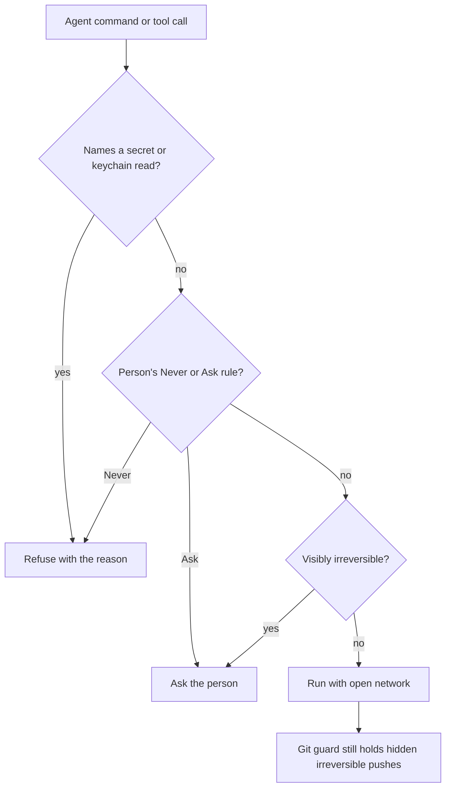

# Limits audit, 7 November 2026

The contract is [ADR-097's irreversible list](../decisions/097-agents-work-as-the-person-s-own-and-only-what-can-t-be-undone-asks.md#what-asks)
and [What stays](capable-by-default.md#what-stays-and-why). A restriction without a row there goes.
This table also records work deliberately moved out of this task by the coordinator.

| Limit and enforcement point | Disposition | Basis for keeping, or regression coverage |
| --- | --- | --- |
| Claude shell network limited to discovered project hosts (`registry.ts`, `sandboxReach.ts`, `Permissions.upFront`) | Removed | `registry.test.ts`; live `agents/network.test.ts` uses Google Fonts and Next/font |
| Codex shell networking disabled (`registry.ts`) | Removed | `registry.test.ts`; live network probe |
| Codex ACP overriding network configuration on every turn with `networkAccess: false` | Removed | Fresh patch of codex-acp 2.5.0; `codexNetwork.test.ts` executes the installed adapter's turn method for both sandbox modes |
| OpenCode network permissions | No host allowlist or OS sandbox exists | Every command reaches Althar's rules; live network probe covers its shell |
| Claude sandbox refuses Unix sockets, including the inherited SSH agent (`registry.ts`) | Removed | `registry.test.ts`; shell network/IPC is open while writable roots and secret-file denial remain |
| Coordinator sandbox offline and unable to bind localhost (`registry.ts`) | Removed | `registry.test.ts` |
| Coordinator cannot read ordinary home, checkout or task files (`coordinatorFolder.ts`) | Removed | `coordinatorCopies.test.ts` keeps credential-store and SSH-file exclusions |
| Hand-started dev servers and test runners missing sandbox exclusions (`sandboxReach.ts`) | Removed | `sandboxReach.test.ts`: direct commands, package runners and dev/test scripts |
| `gh` and `glab` signed out, credential helpers reset (`Config.ts`) | Removed for ordinary sessions | `connections.test.ts`: transports retain sign-ins; real git credential helper in temporary home still works |
| SSH agent and code-host tokens/config locations stripped (`process.ts`) | Removed | `process.test.ts`: child inherits code-host identity; provider API keys and Althar's database remain excluded |
| Skill/OpenSpec files held back from a task branch (`repositoryGuard.ts`) | Removed | `repositoryGuard.test.ts`: real git push includes both even with legacy switches off |
| Copilot built-in MCPs disabled (`registry.ts`) | Removed | `registry.test.ts`: built-in tools available, auto-approval still held off |
| Screenshot restricted to localhost or known run origins (`screenshots.ts`, desktop screenshot navigation) | Removed | `leadRunTools.test.ts`, desktop `screenshots.test.ts`: remote HTTP works; file URLs stay refused |
| Refusal followed by an empty turn hides what blocked the agent (`AgentConnection.ts`) | Removed | `connection.test.ts`: recovery and notice include the actual command and refusal reason |
| Blanket `gh`/`glab` writes refusal (`rules.ts`) | Pending #684 merge | Replace with irreversible classification, keeping posting, publishing, merging and credential disclosure held |
| Flatpak device-bridge refusal (`rules.ts`) | Pending #684 merge | Remove the blanket prohibition; visible irreversible operations still ask |
| Read-only role refuses unreadable shell syntax, including process substitution (`rules.ts`) | Pending #684 merge | Coordinator commands inside its OS sandbox run unread; without it, only visible writes outside its folder are refused |
| Non-irreversible permission floor and opaque-command refusals (`rules.ts`) | Pending #684 merge | Remove built-in limits beyond the list; retain the person's own Never and Ask rules |
| Session brief says agents carry no host sign-in and imposes Althar's tools (`Sessions.ts`) | Pending #684 merge | Update the instructions to match actual access; Althar's tools are preferred |
| Selected skills restricted to task leads (`Sessions.ts`) | Pending #684 merge | The person's enabled skills belong in ordinary coordinator/helper sessions too |
| Reviewer tool lists, review lead's six-tool guard (`ToolServer.ts`, `Reviews.ts`), read-only review copies, running review code | Moved to the task-as-parts work | Explicit coordination decision; no review-only workspace path added here; #686 also changes Reviews.ts |
| The OS sandbox's writable roots and protected hook/config locations | Kept | What stays: “The OS sandbox writes only the worktree, the temp folder and the tools' caches”; `sandboxBoundary.test.ts`, `registry.test.ts` |
| Force pushes, default/integration branch pushes, deleting another branch, discarding another person's changes, deleting outside the worktree | Kept | Irreversible list: Lost work or history; `rules.test.ts`, `permissionEdges.test.ts`, `pushGuard.test.ts`, `workToward.test.ts` |
| Git pre-push and reference-transaction guards, approval pass bound to one git invocation | Kept | What stays: “git's guard hooks on pushes and branch moves”; `pushGuard.test.ts` |
| Publishing, releases, teardown and merging | Kept | Irreversible list: Publishing and merging; `rules.test.ts`, `permissionEdges.test.ts`, #684 MCP act tests |
| Speaking for the person through a command, MCP call or Althar tool | Kept | Irreversible list: Speaking for the person; #684's `speak` kind and MCP act tests; `coordinatorTools.test.ts` |
| Person's host Never rules under the open network | Kept | Person's own Never: `Permissions.upFront` forwards them as Claude denied domains; runtime and adapter tests cover precedence over the wildcard |
| Person's explicit Never and Ask rules, switches disabling a server, and explicit Ask about more | Kept | ADR-097 What asks: “The person's own Never and Ask me rules … stay”; `rules.test.ts`, `sandboxBoundary.test.ts`, #684 policy/MCP tests |
| Reading secret files, exporting credentials, keychain operations that read or change secrets | Kept | What stays: “Secret files and the keychain are refused”; `rules.test.ts`, `registry.test.ts`, `coordinatorCopies.test.ts` |
| Provider modes/options that would auto-approve requests; judge has no tools; native slash commands cannot enable bypass | Kept | What stays: “No agent answers its own permission request”; `registry.test.ts`, `connection.test.ts`, `permissionJudge.test.ts` |
| Loosening rules or server access without the person's live words, self-approval, permission answers by an agent | Kept | What stays: no self-approval or self-authorized loosening; `settingsTools.test.ts`, `coordinatorTools.test.ts`, `permissionJudge.test.ts` |
| Asked-for tool authorization, errands paused on objections, live-person word for merge/publish/post | Kept | What stays: “Asked-for tools go only on the person's own message”; `coordinatorTools.test.ts`, `coordinatorTools.test.ts`, `taskButtons.test.ts` |
| Outside author's repository config/hooks/plugins disabled; code not run without the person's word; offline review commands | Kept | What stays: “An outside author's code doesn't run without the person's word”; review workspace changes deferred; `connections.test.ts`, `registry.test.ts`, `reviews.test.ts` |
| Turn/hour/usage budgets, review rounds, helper and lead-started-task counts, scheduling slots | Kept | What stays: Cost caps; `limits.test.ts`, `leadTools.test.ts`, coordinator/task scheduling tests |
| Process-group ownership, terminating only owned processes, valid MCP session tokens, supported protocol modes | Kept | Integrity of the sandbox and no self-approval, rather than command restrictions; `process.test.ts`, `connection.test.ts`, `coordinatorTools.test.ts` |
| Screenshot viewport/pixel/time bounds and HTTP-only protocol | Kept | Resource bounds and secret-file protection; screenshot tests keep file URLs refused |

## Flow

## Verification boundary

Unit and fake-agent coverage is distinct from signed-in provider validation.
The live network probe installs Next in a temporary folder, uses filesystem
polling to avoid this Mac's native watcher limit, then each agent
runs the same script that fetches Google Fonts and serves a Next/font page.
OpenCode currently has no OS sandbox; its probe verifies its actual shell and
permission path, not a sandbox it does not have. Provider results and any
unavailable live checks are recorded with the task's completion.

### Current results

The sandbox/environment tranche is committed; the sweep is **not complete**.
Main was fetched at `bd524e92ae07` (#686) and still contains no #684.
`rules.ts`, `Policies.ts` and `Sessions.ts` have therefore not been edited.
Once #684 merges, merge main, complete the pending rows above and rewrite the
remaining rules/session documentation around that final behavior.

The live probe fetched Google Fonts CSS through all three agents. Codex and
OpenCode also served the Next/font page with HTTP 200; OpenCode has no OS
sandbox. Claude's curl succeeded, but its Next compilation stalled until the
120-second HTTP request bound. Polling avoids its native watcher failures;
opening Unix sockets and disabling Node's global proxy mode did not resolve
the compilation stall. Claude's full Next/font case remains unverified.

Focused adapter, refusal, runtime dev/screenshot, coordinator-copy, real
skill-file push, desktop screenshot and irreversible git-guard tests pass.
The guard tests now clear the live task's inherited guard scope so their
scratch repositories are actually guarded. Checks pass for adapters,
runtime, desktop and CLI. Full suites, coverage and desktop end-to-end runs
were not run.
