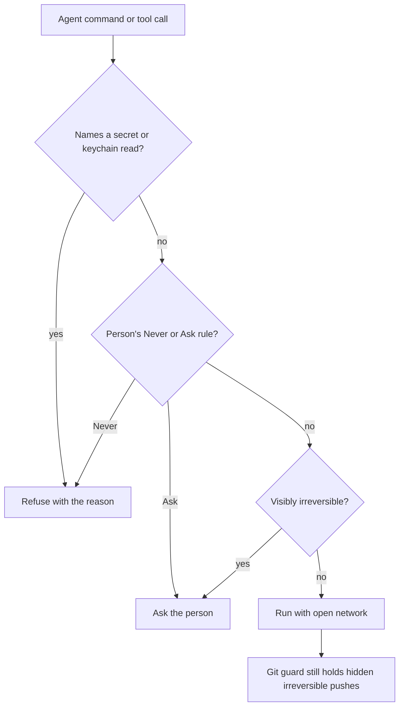

# Limits audit, 7 November 2026

The contract is [ADR-097's irreversible list](../decisions/097-agents-work-as-the-person-s-own-and-only-what-can-t-be-undone-asks.md#what-asks)
and [What stays](capable-by-default.md#what-stays-and-why). A restriction without a row there goes.
This table also records work deliberately moved out of this task by the coordinator.

| Limit and enforcement point | Disposition | Basis for keeping, or regression coverage |
| --- | --- | --- |
| Claude shell network limited to discovered project hosts (`registry.ts`, `sandboxReach.ts`, `Permissions.upFront`) | Removed | `registry.test.ts`; live `agents/network.test.ts` uses Google Fonts and Next/font |
| Codex shell networking disabled (`registry.ts`) | Removed | `registry.test.ts`; live network probe |
| Codex ACP overriding network configuration on every turn with `networkAccess: false` | Removed | Fresh patch of codex-acp 2.5.0; `codexNetwork.test.ts` executes the installed adapter's turn method for both sandbox modes |
| OpenCode network permissions | No host allowlist or OS sandbox exists | Every command reaches Althar's rules; live network probe covers its shell |
| Claude sandbox refuses Unix sockets, including the inherited SSH agent (`registry.ts`) | Removed | `registry.test.ts`; shell network/IPC is open while writable roots and secret-file denial remain |
| Coordinator sandbox offline and unable to bind localhost (`registry.ts`) | Removed | `registry.test.ts` |
| Coordinator cannot read ordinary home, checkout or task files (`coordinatorFolder.ts`) | Removed | `coordinatorCopies.test.ts` keeps credential-store and SSH-file exclusions |
| Hand-started dev servers and test runners missing sandbox exclusions (`sandboxReach.ts`) | Removed | `sandboxReach.test.ts`: direct commands, package runners and dev/test scripts |
| `gh` and `glab` signed out, credential helpers reset (`Config.ts`) | Removed for ordinary sessions | `connections.test.ts`: transports retain sign-ins; real git credential helper in temporary home still works |
| SSH agent and code-host tokens/config locations stripped (`process.ts`) | Removed | `process.test.ts`: child inherits code-host identity; provider API keys and Althar's database remain excluded |
| Skill/OpenSpec files held back from a task branch (`repositoryGuard.ts`) | Removed | `repositoryGuard.test.ts`: real git push includes both even with legacy switches off |
| Copilot built-in MCPs disabled (`registry.ts`) | Removed | `registry.test.ts`: built-in tools available, auto-approval still held off |
| Screenshot restricted to localhost or known run origins (`screenshots.ts`, desktop screenshot navigation) | Removed | `leadRunTools.test.ts`, desktop `screenshots.test.ts`: remote HTTP works; file URLs stay refused |
| Refusal followed by an empty turn hides what blocked the agent (`AgentConnection.ts`) | Removed | `connection.test.ts`: recovery and notice include the actual command and refusal reason |
| Blanket `gh`/`glab` writes refusal (`rules.ts`) | Removed | `rules.test.ts`: reversible edits run; posting, publishing, merging and credential disclosure remain held |
| Flatpak device-bridge refusal (`rules.ts`) | Removed | `rules.test.ts`: transparent wrapper; visible merges and credential reads remain held |
| Read-only role refuses unreadable shell syntax, including process substitution (`rules.ts`) | Removed | `rules.test.ts`, `sandboxBoundary.test.ts`, `coordinator.test.ts`: opaque commands run; visible outside writes refuse |
| Non-irreversible permission floor and opaque-command refusals (`rules.ts`) | Removed | `rules.test.ts`, `sandboxBoundary.test.ts`: extra floor and opaque-command refusals removed; explicit Never and Ask still hold |
| Session brief says agents carry no host sign-in and imposes Althar's tools (`Sessions.ts`) | Removed | Session briefs describe inherited identity and prefer Althar tools; coordinator/skills session tests |
| Selected skills restricted to task leads (`Sessions.ts`) | Removed | `skills.test.ts`, `registry.test.ts`: enabled skills load in ordinary roles; outside reviews omit executable plugins |
| Claude native sandbox refuses process-substitution pipes under `/dev/fd` | Unresolved upstream limit | Not on either retained list; live probe fails even with explicit fd allowances |
| Review lead's six-tool list for a review of the repository's own people (`Reviews.ts`) | Removed | `reviews.test.ts`: a team's review lead lists and calls every lead tool, not only the reading six |
| An outside author's review keeps the six reading tools (`Reviews.ts`) | Kept | What stays: “An outside author’s code doesn’t run without the person’s word”; `reviews.test.ts` |
| Read-only review copies, the in-task reviewer's tool list, running the reviewed code | Moved to the task-as-parts work | Explicit coordination decision; `Reviews.ts` and the reviewer role are #686's and a later task's to change |
| The OS sandbox's writable roots and protected hook/config locations | Kept | What stays: “The OS sandbox writes only the worktree, the temp folder and the tools' caches”; `sandboxBoundary.test.ts`, `registry.test.ts` |
| Force pushes, default/integration branch pushes, deleting another branch, discarding another person's changes, deleting outside the worktree | Kept | Irreversible list: Lost work or history; `rules.test.ts`, `permissionEdges.test.ts`, `pushGuard.test.ts`, `workToward.test.ts` |
| Git pre-push and reference-transaction guards, approval pass bound to one git invocation | Kept | What stays: “git's guard hooks on pushes and branch moves”; `pushGuard.test.ts` |
| Publishing, releases, teardown and merging | Kept | Irreversible list: Publishing and merging; `rules.test.ts`, `permissionEdges.test.ts`, #684 MCP act tests |
| Speaking for the person through a command, MCP call or Althar tool | Kept | Irreversible list: Speaking for the person; #684's `speak` kind and MCP act tests; `coordinatorTools.test.ts` |
| Person's host Never rules under the open network | Kept | Person's own Never: `Permissions.upFront` forwards them as Claude denied domains; runtime and adapter tests cover precedence over the wildcard |
| Person's explicit Never and Ask rules, switches disabling a server, and explicit Ask about more | Kept | ADR-097 What asks: “The person's own Never and Ask me rules … stay”; `rules.test.ts`, `sandboxBoundary.test.ts`, #684 policy/MCP tests |
| Reading secret files, exporting credentials, keychain operations that read or change secrets | Kept | What stays: “Secret files and the keychain are refused”; `rules.test.ts`, `registry.test.ts`, `coordinatorCopies.test.ts` |
| Provider modes/options that would auto-approve requests; judge has no tools; native slash commands cannot enable bypass | Kept | What stays: “No agent answers its own permission request”; `registry.test.ts`, `connection.test.ts`, `permissionJudge.test.ts` |
| Loosening rules or server access without the person's live words, self-approval, permission answers by an agent | Kept | What stays: no self-approval or self-authorized loosening; `settingsTools.test.ts`, `coordinatorTools.test.ts`, `permissionJudge.test.ts` |
| Asked-for tool authorization, errands paused on objections, live-person word for merge/publish/post | Kept | What stays: “Asked-for tools go only on the person's own message”; `coordinatorTools.test.ts`, `taskButtons.test.ts` |
| Outside author's repository config/hooks/plugins disabled; code not run without the person's word; offline review commands | Kept | What stays: “An outside author's code doesn't run without the person's word”; review workspace changes deferred; `connections.test.ts`, `registry.test.ts`, `reviews.test.ts` |
| Turn/hour/usage budgets, review rounds, helper and lead-started-task counts, scheduling slots | Kept | What stays: Cost caps; `limits.test.ts`, `leadTools.test.ts`, coordinator/task scheduling tests |
| Process-group ownership, terminating only owned processes, valid MCP session tokens, supported protocol modes | Kept | Integrity of the sandbox and no self-approval, rather than command restrictions; `process.test.ts`, `connection.test.ts`, `coordinatorTools.test.ts` |
| Screenshot viewport/pixel/time bounds and HTTP-only protocol | Kept | What stays: Cost caps and secret files; screenshot tests keep file URLs refused |

## Flow

## Verification boundary

Unit and fake-agent coverage is distinct from signed-in provider validation.
The live network probe installs Next in a temporary folder, uses filesystem
polling to avoid this Mac's native watcher limit, then each agent
runs the same script that fetches Google Fonts and serves a Next/font page.
OpenCode currently has no OS sandbox; its probe verifies its actual shell and
permission path, not a sandbox it does not have. Provider results and any
unavailable live checks are recorded with the task's completion.

### Current results

#684 is merged into this branch. The pending rules/session rows are implemented.
Review workspaces and the in-task reviewer's tool list remain moved to
task-as-parts by the coordinator's explicit direction; they are not claimed
removed here.

The public-network probe has fetched Google Fonts and served a Next/font page
with HTTP 200 through Claude Code, Codex and OpenCode. Claude's earlier runs
intermittently stalled compiling Next; the fixture now uses one webpack worker
and filesystem polling to avoid this shared Mac's worker/watcher limits.
OpenCode has no OS sandbox; its check covers its real shell and permission path.
The coordinator process-substitution check exercises both Althar's permission
path (with and without a sandbox) and a real Codex sandbox.

**Unresolved upstream restriction:** Claude's bundled native sandbox refuses
opening its own `/dev/fd/12` pipe in `diff <(printf same) <(printf same)`.
Explicit read/write allowances for `/dev/fd` did not change that. Those ineffective
allowances were removed. This is not an irreversible boundary, and is not
claimed justified or removed. Claude process substitution remains unverified.

Unit/fake-agent tests are separate from signed-in probes. Focused checks and
final results are handed with the completion evidence. Full suites, coverage
and desktop end-to-end runs are left to CI.

### Allowed where uncertain

Unreadable scripts and commands beside a Never rule run unless the rule visibly
matches. Unknown code-host API mutations run. The rules do not infer that an
unknown program publishes or speaks for the person. The OS sandbox, explicit
secret protections, git guards and the person's visible rules remain.
