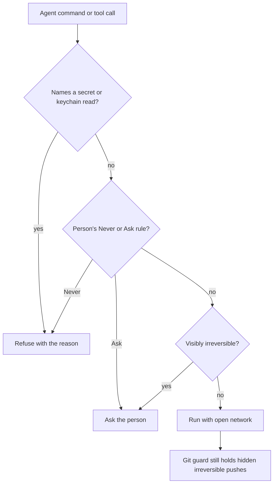

# Limits audit, 7 November 2026

The contract is [ADR-097's irreversible list](../decisions/what-agents-may-do.md#what-asks)
and [What stays](../decisions/what-agents-may-do.md#what-stays-and-why). A restriction without a row there goes.
This table also records work deliberately moved out of this task by the coordinator.

| Limit and enforcement point | Disposition | Basis for keeping, or regression coverage |
| --- | --- | --- |
| Claude shell network limited to discovered project hosts (`registry.ts`, `sandboxReach.ts`, `Permissions.upFront`) | Removed | `registry.test.ts`; live `agents/network.test.ts` uses Google Fonts and Next/font |
| Codex shell networking disabled (`registry.ts`) | Removed | `registry.test.ts`; live network probe |
| Codex ACP overriding network configuration on every turn with `networkAccess: false` | Removed | Fresh patch of codex-acp 2.5.0; `codexNetwork.test.ts` executes the installed adapter's turn method for both sandbox modes |
| OpenCode network permissions | No host allowlist or OS sandbox exists | Every command reaches Althar's rules; live network probe covers its shell |
| Claude sandbox refuses Unix sockets, including the inherited SSH agent (`registry.ts`) | Removed, but only the SSH agent's socket is allowed | `registry.test.ts`: `allowUnixSockets` names `SSH_AUTH_SOCK` and `allowAllUnixSockets` stays off, so Docker's or the session bus's socket is not a way out |
| Coordinator sandbox offline and unable to bind localhost (`registry.ts`) | Removed | `registry.test.ts` |
| Coordinator cannot read ordinary home, checkout or task files (`coordinatorFolder.ts`) | Removed | `coordinatorCopies.test.ts` keeps credential-store and SSH-file exclusions |
| Hand-started dev servers and test runners missing sandbox exclusions (`sandboxReach.ts`) | Removed | `sandboxReach.test.ts`: direct commands, package runners and dev/test scripts; live `agents/network.test.ts` has Claude start `npx next dev`, a command `ALWAYS` lists, as a background command outside its sandbox and serve a Next/font page |
| `gh` and `glab` signed out, credential helpers reset (`Config.ts`) | Removed for ordinary sessions | `connections.test.ts`: transports retain sign-ins; real git credential helper in temporary home still works. Inside a Claude sandbox `.config/gh` and `.npmrc` stay secret places, so only an environment token carries that sign-in there |
| SSH agent and code-host tokens/config locations stripped (`process.ts`) | Removed | `process.test.ts`: child inherits code-host identity; provider API keys and Althar's database remain excluded |
| Skill/OpenSpec files held back from a task branch (`repositoryGuard.ts`) | Removed | `repositoryGuard.test.ts`: real git push includes both even with legacy switches off |
| Copilot built-in MCPs disabled (`registry.ts`) | Removed | `registry.test.ts`: built-in tools available, auto-approval still held off |
| Screenshot restricted to localhost or known run origins (`screenshots.ts`, desktop screenshot navigation) | Removed | `leadRunTools.test.ts`, desktop `screenshots.test.ts` and `apps/desktop/e2e/screenshots.spec.ts`: remote HTTP works and a local redirect is followed; non-HTTP schemes stay refused |
| Refusal followed by an empty turn hides what blocked the agent (`AgentConnection.ts`) | Removed | `connection.test.ts`: recovery and notice include the actual command and refusal reason |
| Blanket `gh`/`glab` writes refusal (`rules.ts`) | Removed | `rules.test.ts`: reversible edits run; posting, publishing, merging and credential disclosure remain held |
| Flatpak device-bridge refusal (`rules.ts`) | Removed | `rules.test.ts`: transparent wrapper; visible merges and credential reads remain held |
| Read-only role refuses unreadable shell syntax, including process substitution (`rules.ts`) | Removed | `rules.test.ts`, `sandboxBoundary.test.ts`, `coordinator.test.ts`: opaque commands run; visible outside writes refuse |
| Non-irreversible permission floor and opaque-command refusals (`rules.ts`) | Removed | `rules.test.ts`, `sandboxBoundary.test.ts`: extra floor and opaque-command refusals removed; explicit Never and Ask still hold |
| Sandboxed commands skipped the irreversible list once sign-ins and the network were open (`rules.ts`) | Removed | `decideInside` now asks for what `lastingOf` reads as irreversible; `sandboxBoundary.test.ts` covers merge, release, comment, publish and force push inside the sandbox |
| `gh api` with no leading slash, ref moves and tags, approvals, statuses, branch protection, collaborators, secrets and public visibility (`rules.ts`) | Removed where they were missed; self-approval and widening refused | `rules.test.ts` covers each: ref writes and deletions ask; approvals, statuses, protection, access, secrets and visibility are refused |
| `glab mr approve`, GitLab's `merge_requests/:iid/approve` API path, and GraphQL approval, status and protection mutations (`rules.ts`) | Refused as self-approval or widening | `sandboxBoundary.test.ts`: `glab mr approve`, `glab api …/approve`, `mergeRequestApprove`, `addPullRequestReview` with APPROVE, `createCommitStatus`, `updateBranchProtectionRule`, protected branches, members and variables refuse |
| Claude's coordinator could not run a shell command with `<(…)` (`registry.ts`) | Removed | Any coordinator command may run outside the sandbox when it asks to, decided by the same read-only rules; live `agents/network.test.ts` shows `diff <(…) <(…)` passing and `registry.test.ts` keeps `allowUnsandboxedCommands` on |
| Session brief says agents carry no host sign-in and imposes Althar's tools (`Sessions.ts`) | Removed | Session briefs describe inherited identity and prefer Althar tools; coordinator/skills session tests |
| Selected skills restricted to task leads (`Sessions.ts`) | Removed | `skills.test.ts`, `registry.test.ts`: enabled skills load in ordinary roles; outside reviews omit executable plugins |
| Claude native sandbox refuses process-substitution pipes under `/dev/fd` | Removed by running the read outside the sandbox | The native sandbox still refuses the pipes, and no fd allowance changes that; the coordinator may run a command outside, where Althar's read-only rules refuse a visible outside write. Live `agents/network.test.ts` |
| Review lead's six-tool list for a review of the repository's own people (`Reviews.ts`) | Removed | `reviews.test.ts`: a team's review lead lists and calls every lead tool, not only the reading six |
| An outside author's review keeps the six reading tools (`Reviews.ts`) | Kept | What stays: “An outside author’s code doesn’t run without the person’s word”; `reviews.test.ts` |
| Read-only review copies, the in-task reviewer's tool list, running the reviewed code | Moved to the task-as-parts work | Explicit coordination decision; `Reviews.ts` and the reviewer role are #686's and a later task's to change |
| Codex's sandboxed commands never reached Althar (`registry.ts`) | Removed | Its turn takes the `untrusted` approval policy through the codex-acp patch: any command not on Codex's safe list reaches Althar, so a merge, release or post asks. `codexNetwork.test.ts` checks the turn, `registry.test.ts` the session's env; live `agents/network.test.ts` sees `gh pr merge` request permission |
| The OS sandbox's writable roots and protected hook/config locations | Kept | What stays: “The OS sandbox writes only the worktree, the temp folder and the tools' caches”; `sandboxBoundary.test.ts`, `registry.test.ts` |
| Force pushes, default/integration branch pushes, deleting another branch, discarding another person's changes, deleting outside the worktree | Kept | Irreversible list: Lost work or history; `rules.test.ts`, `permissionEdges.test.ts`, `pushGuard.test.ts`, `workToward.test.ts` |
| Git pre-push and reference-transaction guards, approval pass bound to one git invocation | Kept | What stays: “git's guard hooks on pushes and branch moves”; `pushGuard.test.ts` |
| Publishing, releases, teardown and merging | Kept | Irreversible list: Publishing and merging; `rules.test.ts`, `sandboxBoundary.test.ts` (inside the sandbox too), `permissionEdges.test.ts`, #684 MCP act tests |
| Speaking for the person through a command, MCP call or Althar tool | Kept | Irreversible list: Speaking for the person; #684's `speak` kind and MCP act tests; `coordinatorTools.test.ts` |
| Person's host Never rules under the open network | Kept | Person's own Never: `Permissions.upFront` forwards them as Claude denied domains, and `hostRuleOf` refuses a command that names the host, or a sandbox's network request for it, or any host under it, whichever way the rule is typed (`example.com` or `*.example.com`); a rule naming a script (`deploy.sh`) is read as a command, not a host. `rules.test.ts`, `sandboxBoundary.test.ts`, `registry.test.ts` cover precedence over the wildcard |
| Person's explicit Never and Ask rules, switches disabling a server, and explicit Ask about more | Kept | ADR-097 What asks: “The person's own Never and Ask me rules … stay”; `rules.test.ts`, `sandboxBoundary.test.ts`, #684 policy/MCP tests |
| Reading secret files, exporting credentials, keychain operations that read or change secrets | Kept | What stays: “Secret files and the keychain are refused”; `rules.test.ts`, `registry.test.ts`, `coordinatorCopies.test.ts` |
| Provider modes/options that would auto-approve requests; judge has no tools; native slash commands cannot enable bypass | Kept | What stays: “No agent answers its own permission request”; `registry.test.ts`, `connection.test.ts`, `permissionJudge.test.ts` |
| Loosening rules or server access without the person's live words, self-approval, permission answers by an agent | Kept | What stays: no self-approval or self-authorized loosening; `settingsTools.test.ts`, `coordinatorTools.test.ts`, `permissionJudge.test.ts` |
| Asked-for tool authorization, errands paused on objections, live-person word for merge/publish/post | Kept | What stays: “Asked-for tools go only on the person's own message”; `coordinatorTools.test.ts`, `taskButtons.test.ts` |
| Outside author's repository config/hooks/plugins disabled; code not run without the person's word; offline review commands | Kept | What stays: “An outside author's code doesn't run without the person's word”; review workspace changes deferred; `connections.test.ts`, `registry.test.ts`, `reviews.test.ts` |
| Turn/hour/usage budgets, review rounds, helper and lead-started-task counts, scheduling slots | Kept | What stays: Cost caps; `limits.test.ts`, `leadTools.test.ts`, coordinator/task scheduling tests |
| Process-group ownership, terminating only owned processes, valid MCP session tokens, supported protocol modes | Kept | Integrity of the sandbox and no self-approval, rather than command restrictions; `process.test.ts`, `connection.test.ts`, `coordinatorTools.test.ts` |
| Screenshot viewport/pixel/time bounds and HTTP-only protocol | Kept | What stays: Cost caps and secret files; screenshot tests keep file URLs refused |

## Flow

## Verification boundary

Unit and fake-agent coverage is distinct from signed-in provider validation.
The live network probe installs Next in a temporary folder and uses filesystem
polling to avoid this Mac's native watcher limit. Codex and OpenCode run a
script there that fetches Google Fonts and serves a Next/font page. Claude Code
runs the sandboxed fetch alone, and starts its Next/font dev server the way a
project keeps it (a background `npx next dev`, which `ALWAYS` lists and its
sandbox runs outside).
OpenCode currently has no OS sandbox; its probe verifies its actual shell and
permission path, not a sandbox it does not have. Provider results and any
unavailable live checks are recorded with the task's completion.

### Current results

#684 is merged into this branch. The pending rules/session rows are implemented.
Review workspaces and the in-task reviewer's tool list remain moved to
task-as-parts by the coordinator's explicit direction; they are not claimed
removed here.

The public-network probe fetches Google Fonts and serves a Next/font page with
HTTP 200 through Codex and OpenCode, inside their sandboxes. Claude Code's
sandboxed `curl https://fonts.googleapis.com/css2?family=Inter` passes as well,
inside its sandbox with no escalation. Its Next/font dev server is started the
way a project keeps one (`npx next dev`, which `ALWAYS` lists), which runs
outside its sandbox: the live test starts it in the background and fetches the
page, which serves. A
script that starts Next itself, inside Claude's native sandbox rather than as
the excluded dev-server command, still stalls at `Compiling /` on this Mac now
and then; the fixture uses one webpack worker and filesystem polling to avoid
this shared Mac's worker/watcher limits, and the same script outside the
sandbox serves in under a second. That is a machine/provider limit in Claude's
native sandbox, not one of Althar's rules, and the dev-server exclusion is the
route a person's project already takes.
A coordinator's `diff <(printf same) <(printf same)` now runs on Codex inside
its sandbox and on Claude by asking to run outside it; Althar's read-only
rules decide such a command: a visible write outside its folder is refused.

Review's round 1 findings are settled: `decideInside` asks for the visible
irreversible kinds; `gh api` ref writes, tags, approvals, statuses, protection,
collaborators, secrets and visibility changes are held or refused; Claude's
sandbox allows only the SSH agent's socket; the coordinator's edits are denied
again and its git-in-another-folder read list is positive; its brief describes
the open network. Review's later rounds closed the rest: `glab mr approve` and
GitLab's approval, status and protection paths and GraphQL mutations refuse;
a Never host rule covers the hosts under it and a script rule is no longer read
as a host; the coordinator's outside-the-sandbox retry is documented as any
command, decided by the read-only rules; and Codex's turn now takes the
`untrusted` approval policy, so the commands it doesn't read as safe reach
Althar. That is a turn setting in Codex 0.165: its config parser refuses the
name, so the patch reads it from the session's environment. Live probes show
Codex asking before `gh pr merge` and Claude's sandboxed Google Fonts `curl`
passing inside the sandbox with the current settings.

A Never host is covered at the rules and registry level rather than by a live
`curl`: `Permissions.upFront` forwards the host to Claude as a denied domain,
so its sandbox refuses the request and Claude reports the host it could not
reach; `decide` and `decideInside` refuse a command that names the host.
Codex has no per-host sandbox list, so there the person's host rule holds when
the command reaches Althar, and Althar's tools are the route for the acts the
list keeps.

Unit/fake-agent tests are separate from signed-in probes. Focused checks and
final results are handed with the completion evidence. Full suites, coverage
and desktop end-to-end runs are left to CI.

### Allowed where uncertain

Unreadable scripts and commands beside a Never rule run unless the rule visibly
matches. Unknown code-host API mutations run. The rules do not infer that an
unknown program publishes or speaks for the person. The OS sandbox, explicit
secret protections, git guards and the person's visible rules remain.
