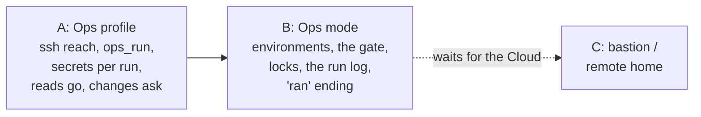
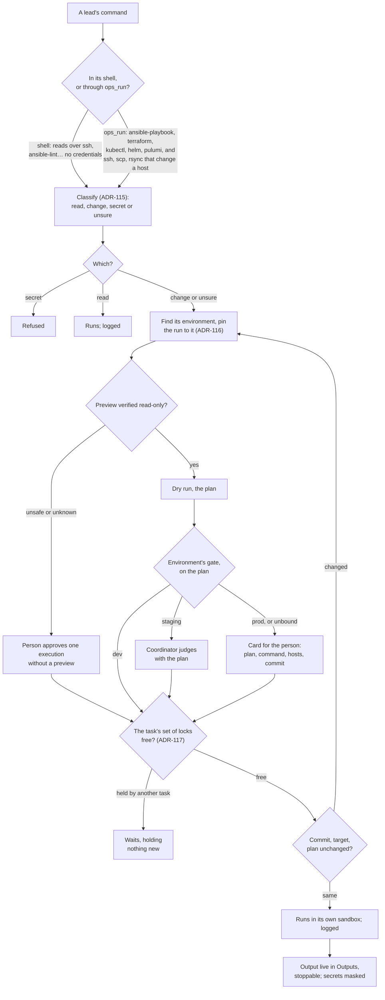
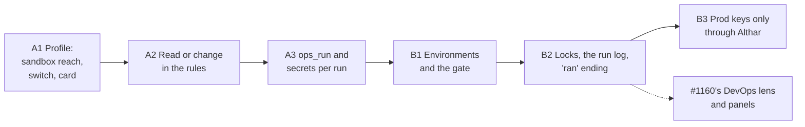

# Ops mode: infrastructure repositories in Althar

> **Temporary: the plan for letting agents work on infrastructure
> repositories (Ansible, Terraform, Kubernetes manifests, Helm) safely.**
> Written on 24 November 2026 from Linear's
> [DEV-283](https://linear.app/althar/issue/DEV-283) (step A, the Ops
> profile) and [DEV-284](https://linear.app/althar/issue/DEV-284) (step B,
> Ops mode) and a reading of the code, for Balázs to review before anything
> is built. Its decisions are proposals:
> [ADR-113](../decisions/proposed/113-an-ops-sandbox-profile-opens-ssh-and-never-keys.md) to
> [ADR-117](../decisions/proposed/117-one-task-per-environment-and-every-run-in-the-log.md).
> What lasts folds into the decision documents as each phase ships, and
> this file is deleted when the last one does.

## In short

Today an agent's sandbox is cut for writing code. On an infrastructure
repository that leaves the person two bad choices: ask on every command,
or Allow everything, which lets `terraform apply` and `ansible-playbook`
run on production unasked, as any other deploy does.

Ops mode comes in two steps, and a third that waits (the project's
decision):

- **A, the Ops profile** ([DEV-283](https://linear.app/althar/issue/DEV-283)).
  A sandbox profile, switched on per project or per task, that lets a lead
  reach the person's SSH agent, `~/.ssh/config` and `known_hosts` but never
  a private key or a cloud credential file. Commands that need credentials
  run through an Althar tool, `ops_run`, in a sandbox of their own that
  reaches only their target's credentials, with the
  secrets it needs handed to that run alone. Reads go ahead; changes ask.
- **B, Ops mode** ([DEV-284](https://linear.app/althar/issue/DEV-284)).
  Environments (dev, staging, prod) bound to inventory groups, Terraform
  workspaces, kube contexts and hosts. A change's gate depends on its
  environment: dev goes ahead, the coordinator judges staging, the person
  decides prod on a card with the plan, the exact command and the hosts.
  One task at a time holds an environment, every run is in a log, and a
  task can end "ran, with this result" without a pull request.
- **C, running on a bastion or a remote home,** waits for the self-hosted
  Althar Cloud. Everything here runs on the person's computer.

## The problem today

An agent on an Ansible repository, as Althar starts it now:

| It tries | What happens | Where |
|---|---|---|
| `ssh web1 'systemctl status nginx'` | Fails: `~/.ssh` is denied as a whole, so ssh reads neither `config` (no host aliases, users, jump hosts) nor `known_hosts` (host key verification fails). The SSH agent's socket is let through, so the key would work. | `SECRET_PLACES` in `provider-adapters/src/secrets.ts`, `secretReadRules` and `sshSockets` in `registry.ts` |
| `ansible-playbook site.yml --check --diff` | Fails on a vault-encrypted variable: the vault password lives in `~/.vault_pass` or a password manager, and nothing hands it over. Pointed at the file, the rules refuse nothing (it isn't a known secret place), so the agent reads the password. | `rulePaths.ts` (`secretOf`) |
| `ansible-playbook site.yml` | **Goes ahead unasked** with Allow everything (every project's default): the rules don't know `ansible-playbook`. | `DEPLOYERS` in `rules.ts` doesn't list it |
| `terraform apply`, `kubectl apply`, `helm upgrade` | Read as a deploy, and **go ahead** with Allow everything: "a deploy goes ahead, since the next deploy replaces it". | `deploys()` in `rules.ts`; [what agents may do § What asks](../decisions/what-agents-may-do.md#what-asks) |
| `terraform destroy`, `kubectl delete`, `helm uninstall` | Ask, as tearing down. | `DESTROYERS`, `destroys()`, `lastingOf()` in `rules.ts` |
| `kubectl get pods` | Fails: `~/.kube` is denied, as it should be: a kubeconfig holds tokens and client keys. | `SECRET_PLACES` |
| `terraform plan` | Fails, or reads `~/.aws` through the provider: `~/.aws` is denied in the sandbox. | `SECRET_PLACES` |

So a person who works on infrastructure either answers a card for every
`ssh`, turns the sandbox's protections into prompts they stop reading, or
uses Allow everything, which allows everything on prod too. The read
that should be free fails, and the change that should ask runs.

## What the code already has

- **The sandbox is the boundary** ([ADR-071](../decisions/what-agents-may-do.md#the-sandbox-is-the-boundary)).
  Claude Code's lead runs every shell command in its OS sandbox
  (bubblewrap on Linux, Seatbelt on macOS) with `autoAllowBashIfSandboxed:
  false`, so every command still reaches Althar's rules (`decideInside` in
  `rules.ts`). Writes are held to the worktree, the temp folder and the
  tool caches (`writesOf`, `toolPlaces.ts`); reads of `SECRET_PLACES` are
  denied (`secretReadRules`).
- **The SSH agent's socket is already let through,** and no other Unix
  socket (`sshSockets()` in `registry.ts`), so git over SSH works inside
  the sandbox. The key never leaves the agent; what's missing for `ssh` is
  its config and `known_hosts`.
- **The rules already read deploy tools by their subcommand,** never by
  arguments or quoted text (`DEPLOYERS`, `DESTROYERS`, `dryRun()` in
  `rules.ts`), and the irreversible list asks with everything allowed
  (`lastingOf`). Teardown asks today; plain applies don't.
- **A project's rules carry a mode, Never, Ask me and allow rules,** with a
  revision a run cites (`Policies.ts`, `ruleContext.ts`). Allow everything
  is a project switch and a task switch (`allowEverything` in
  `Policies.ts` and `Permissions.ts`; [ADR-043](../decisions/what-agents-may-do.md#ask-about-more-and-the-coordinator-decides)).
  The person's Ask me holds with everything allowed (ADR-097).
- **The coordinator's judge** answers what's left in a fresh read-only
  session, with a one-sentence reason, recorded with model, cost and time
  (`PermissionJudge.ts`; [ADR-019](../decisions/what-agents-may-do.md#ask-about-more-and-the-coordinator-decides)).
  Only Claude Code judges.
- **Althar's tools outside the sandbox** (`install_dependencies`,
  `run_project`) run what fails inside it, with their own card in the
  thread ([what agents may do § Althar's tools outside the sandbox](../decisions/what-agents-may-do.md#althars-tools-outside-the-sandbox)).
  Run's processes, their environment, live output and stopping are
  `Launches.ts`, `runProcess.ts`, `stopping.ts`; everything Althar starts
  carries `ALTHAR_WORK` so its processes are found and counted
  (`machine.ts`, `processTree.ts`).
- **Sealed secrets:** `Secrets.ts` keeps a code host's token sealed by the
  main process's keyring (`apps/desktop/src/main/keyring.ts`), never in the
  record or a log. A store for the person's own secrets is DEV-208, not
  built.
- **One task at a time** already exists for Local: a second task waits for
  the checkout, recorded as `workspace.move_waits` (`local.ts`;
  [workspaces and runs § Local](../decisions/workspaces-and-runs.md#local)).
- **Detection by files** already works out a project's tools, caches and
  hosts (`TOOL_PLACES` in `toolPlaces.ts`, `workedOutReach` in
  `sandboxReach.ts`).
- **Task endings** are here, the branch, a draft or a ready pull request
  (`TaskEnd` in `contracts/src/Api.ts`, `TaskEnding` in `runRecords.ts`).
- **#1160** (Althar for the whole team, not merged) proposes that a DevOps
  lens starts new tasks in the Ops profile ([ADR-108](https://github.com/AltharIDE/althar/pull/1160))
  and read-only panels on a cluster and Prometheus, with environments
  picked from kube contexts ([ADR-112](https://github.com/AltharIDE/althar/pull/1160)).
  This plan's environments are the same ones.

## How a command goes, with both steps built

With only A built, environments, the dry run and the lock are skipped: a
change or an unsure command asks the person, wherever it points. A change
to a host in the lead's shell is refused there and sent to `ops_run`.

## A: the Ops profile

Three proposals:

- [ADR-113, the Ops sandbox profile](../decisions/proposed/113-an-ops-sandbox-profile-opens-ssh-and-never-keys.md):
  what it opens (the SSH agent's socket, `~/.ssh/config` and its
  includes, `known_hosts` read-only, the repository's `ansible.cfg` and
  inventory, the tools' caches) and never (private keys, `~/.aws`,
  `~/.kube`, `~/.config/gcloud`, `~/.azure`, `~/.vault-token`,
  `~/.terraform.d/credentials.tfrc.json`, Ansible Galaxy's token, Helm's
  registry login). How it's switched on per project or task, and the card
  that offers it when a repository looks like infrastructure.
- [ADR-114, secrets per run](../decisions/proposed/114-secrets-go-to-one-run-never-to-the-agent.md):
  the `ops_run` tool runs a command in a sandbox of its own that reaches
  only its target's credentials and trusted executables, with a vault
  password or a token Althar keeps sealed, handed to that run only, by a
  descriptor or a file only that run can read, only while no session
  without read isolation runs, and masked in what comes back. No secret is
  written in its `argv`.
- [ADR-115, read or change](../decisions/proposed/115-a-command-is-read-or-change-per-tool-and-unsure-asks.md):
  per tool, what is a read (`--check`, `plan`, `get`, `status`), what is a
  change, what is a secret read, and that unsure is treated as a change
  in this profile, the one place the "when unsure, allow" principle gives
  way, because the person switched it on to be asked.

## B: Ops mode

Two more:

- [ADR-116, environments and the gate](../decisions/proposed/116-environments-bind-targets-and-set-the-gate.md):
  `.althar/ops.yaml` binds each environment to inventory files and groups,
  Terraform workspaces and folders, kube contexts and SSH hosts, read from
  the default branch; dev goes, staging the coordinator judges, prod the
  person decides on a card; a file can tighten a gate, never loosen it.
- [ADR-117, locks and the run log](../decisions/proposed/117-one-task-per-environment-and-every-run-in-the-log.md):
  one task holds an environment for its changes until it settles or lets
  go; every `ops_run` is recorded with its command, target, commit, who
  allowed it, exit code and output; a task can end "ran, with this
  result".

## Phases

1. **A1, the profile's reach.** `secrets.ts` splits `~/.ssh` into what the
   profile opens and what stays denied; `registry.ts` gives Claude Code's
   sandbox the read exceptions and the extra caches; `toolPlaces.ts` learns
   Ansible's, Terraform's and Helm's files and caches; `Policies.ts` and
   `Permissions.ts` keep the switch per project and task; the detection
   card. *Done when* a lead on an infra repository runs `ssh web1 uptime`
   and `ansible-inventory --graph` without asking, and `cat ~/.ssh/id_ed25519`
   fails in its sandbox and is refused by the rules. Tests: the sandbox
   settings per profile (`provider-adapters/tests/registry.test.ts`), the
   rules refusing every key path (`runtime/tests/sandboxBoundary.test.ts`),
   the card's detection.
2. **A2, read or change.** A new `opsCommands.ts` beside `rules.ts` reads
   ansible, terraform/tofu/terragrunt, pulumi, kubectl, helm and ssh per
   ADR-115; a new rule kind, `infra`, with the profile's own check in
   `decide` and `decideInside` before any allow. *Done when* the
   classification's table tests pass, `ansible-playbook site.yml` asks in
   an Ops task with everything allowed, and a Code sibling on the same
   project keeps today's verdicts.
3. **A3, `ops_run` and secrets.** The tool, its card and its live output,
   on Run's process code; its own sandbox with only the target's
   credentials and Althar's run-only caches; secrets kept per project in
   the sealed store, given to one run, masked in its output. *Done when*
   [DEV-283](https://linear.app/althar/issue/DEV-283)'s acceptance holds: a
   check-mode playbook with a vault runs without asking and without the
   password anywhere in the lead's reach.
4. **B1, environments and the gate.** `.althar/ops.yaml`, its reader, the
   target resolution per tool, the gate per environment, the prod card,
   the judge's input with the plan. *Done when* a prod apply can't run
   without the person's card and the gate's tests cover each environment.
5. **B2, locks, the run log and the ending.** The environment lock as
   recorded facts, the `ops_runs` table and its events, the log in
   Outputs and an environment's view, the `ran` ending. *Done when*
   [DEV-284](https://linear.app/althar/issue/DEV-284)'s acceptance holds.
6. **B3, prod keys only through Althar.** An SSH agent filter for the
   sandbox that offers only the keys of environments a shell may reach,
   so `ssh` to prod from the shell has no key at all; prod's go only to
   an approved `ops_run`. Last, as it changes how the person's keys are
   used; see open question 3.

A1 and A2 are independent of each other and could go in parallel. B needs
A3: the gate decides `ops_run`s.

## Risks

- **The SSH agent signs for anything.** The profile keeps the key
  unreadable, not unusable: with the socket, a script in the sandbox can
  log in to any host the key opens, and a script the rules can't read
  (`bash -c "$(…)"`) goes ahead under ADR-097. A1 and A2 hold against
  mistakes, not an agent set on getting past them, as git's guard does.
  B3 closes it for prod. Until then the profile's card says so.
- **A read runs the repository's code.** `terraform plan` runs `external`
  data sources; `ansible-playbook --check` runs a task marked
  `check_mode: false` for real, and every `pipe` lookup. The code is the
  lead's worktree, which it can change. So every `ops_run` runs in a
  sandbox of its own with only its target's credentials and executables
  from caches no lead writes (ADR-114). If the sandbox cannot start, only
  in-process data checks remain available. A preview that may have side
  effects, including one from a merged playbook, requires the person's
  approval for each execution. Post-lock validation checks its inputs
  without repeating that preview (ADR-115, ADR-116).
- **Check mode isn't a promise.** A module without check support skips in
  `--check`, and a diff can be partial. The prod card says "Ansible's dry
  run", not "what will happen". Terraform's saved plan is exact, and the
  apply runs that plan.
- **Output carries secrets.** `--diff` on a template prints what it
  renders, password included; `no_log` doesn't hide a diff. Masking is
  best effort (ADR-114): Althar masks every value it handed over and every
  vault value it could open for the run.
- **An approval can go stale while it waits.** A prod card answered an
  hour later, or a change queued behind another task's lock, would run on
  whatever the files and the cluster are by then. The decision is bound
  to the commit, the target, the `argv` and the inputs, and checked again
  after the lock and just before the run; anything material changed asks
  again (ADR-116).
- **The binding file is in the repository an agent writes.** Bindings are
  read from the default branch as merged, never from the worktree, and a
  file can only tighten a gate (ADR-116).
- **A lock on one computer.** Two people, or two Althars, each lock only
  their own. Terraform's state lock still holds between them; Ansible has
  none. Team locks come with the Cloud (C).
- **Only where the sandbox holds reads.** The profile's promise that no
  key is readable holds for Claude Code on macOS and on Linux with
  bubblewrap, not in the Flatpak, on Windows, or for Codex and OpenCode,
  whose sandboxes don't deny reads ([what agents may do § The sandbox is the boundary](../decisions/what-agents-may-do.md#the-sandbox-is-the-boundary)).
  There the switch says so (ADR-113).
- **Claude Code's read exceptions are unproven here.** Opening
  `~/.ssh/config` inside a denied `~/.ssh` needs the sandbox's
  allow-within-deny. Even the deny list's hold on shell commands is, as
  `registry.ts` says, as Claude Code documents it, not yet checked against
  a real session. A1 starts with that test.

## Open questions, for Balázs

Each has a recommendation; none is decided.

1. **Does `infra` ask with everything allowed, or only with the profile
   on?** *Recommended: only with the profile on.* Without it, Allow
   everything stays what ADR-097 says, and a person who never opted in
   isn't asked more. The detection card is where they meet the choice.
   **Open.**
2. **Unsure: change or read?** *Recommended: change, in the profile only*
   (ADR-115). On dev a change goes ahead anyway, so unsure costs a
   question only on staging and prod, where the person asked for one.
   **Open.**
3. **Prod keys: the person's agent, or Althar's?** *Recommended: B3's
   filter,* the sandbox seeing a filtered SSH agent that lists only the
   keys `.althar/ops.yaml` gives to dev and staging. The person's agent
   and keys stay theirs; nothing is copied into Althar. The alternative,
   Althar holding prod's key in its keyring, is stronger and a second
   place for a key to leak from. **Open.**
4. **`known_hosts`: may a lead add a host?** *Recommended: no;* it's read
   only, and an unknown host fails with a card, "Trust web9's key
   (SHA256:…)?", that Althar adds for the person. A host key accepted
   blindly is how a man in the middle gets in. **Open.**
5. **Where do ops secrets live?** *Recommended: DEV-208's store, built
   first with only what `ops_run` needs* (names, sealed values, which
   environments get each), and the rest of DEV-208 (Run, setup, a lead's
   environment) on top. A reference to the person's own file
   (`~/.vault_pass`) or a password manager (`op://…`) as a second phase.
   **Open.**
6. **Should the DevOps lens switch the profile on?** #1160's ADR-108 says
   a lens sets the profile a new task starts with; DEV-283 says the
   profile never switches on by itself. *Recommended: picking the DevOps
   lens shows the profile's card once, pre-selected, and the person's
   press switches it on;* after that, the lens's new tasks start in it.
   **Open.**
7. **Staging's judge on agents that can't judge.** Only Claude Code
   judges. *Recommended: staging goes to the person where the
   coordinator's agent can't judge,* as ADR-019 does for the rest.
   **Open.**
8. **Prod from a paired phone?** *Recommended: yes,* the card is the
   person's word wherever they are, and it shows the same plan, command
   and hosts; with a line that it's prod, in the environment's colour.
   **Open.**
9. **Must a prod run come from a merged commit?** *Recommended: from a
   commit, with no uncommitted changes in the worktree; one not on the
   default branch says so on the card in bold* (ADR-116). Hotfixes go
   before their pull request merges; requiring a merge would send people
   back to their terminal. **Open.**

## Out of scope

- **C, a bastion or a remote home:** waits for the self-hosted Althar
  Cloud. So does a lock shared across people.
- **Writes from panels:** #1160's ADR-112 keeps panels read-only; a change
  is a task through this gate.
- **Secrets beyond ops runs:** a lead's environment, Run and setup get
  them with the rest of DEV-208.
- **Pulumi, CloudFormation, Salt, Chef and Puppet** beyond what ADR-115's
  table lists: added to the table later, each with tests, as the deploy
  list grows today.
