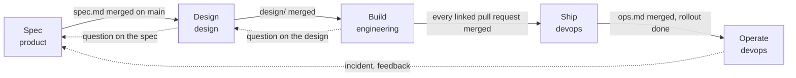
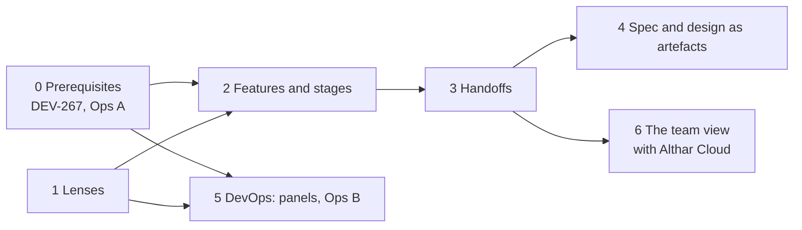

# Althar for the whole team

> **Temporary: the plan for taking a feature through its whole life in
> Althar,** from product's intent to devops running it. Written on 22
> November 2026 from the coordinator's first draft (the `whole-team-flow`
> canvas) and a reading of the code, for Balázs to review and work on before
> anything is built. Its decisions are proposals:
> [ADR-108](../decisions/proposed/108-a-role-is-a-lens-not-a-separate-app.md) to
> [ADR-112](../decisions/proposed/112-panels-are-read-only-connectors-with-a-view-devops-first.md).
> What lasts folds into the decision documents as each phase ships, and
> this file is deleted when the last one does.

## In short

"The IDE for your whole team" means a feature's whole life happens in
Althar: product writes the intent and the spec in the repository, design
designs, engineering builds, devops takes it over and runs it. Each team
adds its part to the repository (or repositories), and the next one carries
on from what was merged.

Three things are decided, and the rest follows from them:

1. **A role is a lens, not a separate app.** Everyone has the same shell,
   board, cards, threads and canvases. A role changes only defaults, and
   nothing is hidden or forbidden by it ([ADR-108](../decisions/proposed/108-a-role-is-a-lens-not-a-separate-app.md)).
2. **Althar enforces no gates.** Approval belongs to the code host and the
   tracker, where the team sets it. A stage is done when its artefact has
   merged on the default branch, which carries the host's gates already
   ([ADR-111](../decisions/proposed/111-gates-live-on-the-code-host-and-the-tracker.md)).
3. **The repository and the tracker are the source of truth.** A feature's
   stage is read from its files and `spec.md`'s frontmatter, with an
   optional mirror in the tracker. Shared team state through the
   self-hosted Althar Cloud comes later and is out of scope
   ([ADR-109](../decisions/proposed/109-a-feature-moves-through-stages-kept-in-the-repository.md)).

The third has a consequence worth saying first: **with no server, each
person's own Althar reads the repository and carries on its part.** When
the spec merges, nobody's Althar sends the designer anything; the
designer's Althar hears main, sees that the feature's next stage is theirs,
and its coordinator proposes their tasks
([ADR-110](../decisions/proposed/110-a-stage-hands-over-when-its-artefact-merges.md)).

## New words

| Word | What it is | Where it lives |
|---|---|---|
| **Role** | product, design, engineering, devops, or the project's own. A person picks one or more per project, and looks through one at a time. | Which roles a person has: their Althar, per project. A custom role's definition: `.althar/flow.yaml`. |
| **Lens** | The defaults a role brings: landing view, pinned panels, board grouping and filters, preset order, notification defaults, sandbox profile, models. | Althar ([ADR-108](../decisions/proposed/108-a-role-is-a-lens-not-a-separate-app.md)). |
| **Feature** | One intent across its whole life, above tasks. May span repositories. | `specs/<feature>/` in its home repository, optionally mirrored to a tracker project or issue. |
| **Stage** | Spec → Design → Build → Ship → Operate by default. Each has an owner role, an artefact and the next stage. | `.althar/flow.yaml`, or the default when the file is absent. |
| **Handoff** | A stage's artefact merged on the default branch: the next stage's owners hear it, and their coordinator proposes their tasks. | Read from the repository; shown on the feature's timeline. |
| **Panel** | A read-only connector and a view: a cluster's health, a metric, an alert. | Althar's connectors ([ADR-112](../decisions/proposed/112-panels-are-read-only-connectors-with-a-view-devops-first.md)). |

The canvas had six stages (Intent, then Spec). Here they are five: the
intent is the first section of `spec.md`, merged with it. A project that
wants them apart adds a stage in `flow.yaml`.

### The artefacts

```
specs/<feature>/
  spec.md     # product: problem, goal, acceptance criteria; frontmatter
              # holds the feature's id, stage owners, repositories, tracker link
  design/     # design: canvas exports, Figma links and screenshots, tokens, decisions
  build.md    # engineering: plan and the feature's pull requests (Althar fills the list)
  ops.md      # devops: rollout, environments, runbook, alerts
```

In several repositories the feature lives in its home repository's
`specs/`, and the pull requests elsewhere name it with a `Feature: <slug>`
line in their description, or a `feature:<slug>` label.

## The flow



- **Every arrow is a merge,** with whatever the host requires for it:
  reviews, code owners, checks. Althar adds nothing to it.
- **"Ready for next" is a soft signal.** A stage owner can mark their part
  ready before it merges; the next role sees it and may start early.
  Nothing waits on it and nothing is locked by it.
- **Going back is a question, not a move.** A later stage asks an earlier
  one on the pull request or the tracker; the feature stays where it is.
- **Work runs in parallel.** An engineering spike can start during Design;
  stages mark the main road only.
- **At each handoff the coordinator** of each person whose role owns the
  next stage reads the merged artefact and proposes their tasks, held for
  them: design prototypes after a spec, build tasks after a design, a
  rollout checklist after a merge. They are the same plans and cards as
  today.

## What each lens sets

Every row is a default the person can change, and every view stays
reachable from every lens.

| | Product | Design | Engineering | DevOps |
|---|---|---|---|---|
| **Lands on** | Features by stage | Canvases (the Artefacts room) | Conversation and board, as today | Environments, with the panels |
| **Board** | Grouped by feature | Grouped by feature, prototypes first | Lanes as today | Grouped by environment or feature |
| **Presets first** | Spec draft, Research summary, Chat | Prototype, Directions, UI audit | Change, Small change, Review a PR | Ops task, Runbook, Incident look |
| **Pinned panels** | Feature stage, tracker cycle | Storybook (a page) | Checks, pull requests | Cluster health, alerts |
| **Notified of** | Questions back on specs, handoffs | Handoffs, comments on canvases | As today | Handoffs into Ship, alerts |
| **Sandbox** | As today | As today | As today | **Ops profile** (Ops A) |
| **Its stage is done when** | `spec.md` merges | `design/` merges | its pull requests merge | `ops.md` merges |

## Design directions

A prototype task drew three directions on the whole desktop app with
made-up data (`prototype-role-lenses-and-the-feature-timeline`; the
canvases `role-lenses-minimal`, `role-lenses-panels` and
`role-lenses-feature-first` in Althar, group `role-lenses`). Each shows
the four lenses, Saved carts' timeline with its Build → Ship handoff
waiting on DevOps, and the lens switch. The timeline is the same in all
three.

- **A · Minimal.** The same layout for everyone. A lens changes the
  landing view and how the board groups: by environment for DevOps, by
  feature for Product and Design, today's lanes for Engineering. The lens
  is a chip in the project's row, and its menu lists the handoffs waiting
  on you.
- **B · Panels.** Today's board for everyone, with a column of pinned
  panels at its end, the lens's own first: cluster health, alerts and
  deploys for DevOps; CI and pull requests for Engineering; canvases,
  Storybook and screenshot diffs for Design; features by stage and the
  tracker's cycle for Product. Any panel can be pinned from the lens menu.
- **C · Feature-first.** The features' timeline, every feature against
  every stage, is everyone's home, with the lens's inbox of handoffs over
  it; the board is a press away (Features | Tasks).

They aren't exclusive: each is one of a lens's fields from the table
above. A is board grouping, B is pinned panels, C is a landing view.

## What is there already

Reading the code moved a few things against the canvas:

- **Multi-repository work is modelled.** A project binds several
  repositories (`repository_bindings`), a task holds a change per
  repository (`0072_several_changes`), and `finish_step` takes a
  description per repository. Linking a feature across repositories is
  reading, not new plumbing, so it moves from the last phase to Phase 2.
- **Tasks wait for their blockers** (DEV-228, `task_waits`,
  `packages/runtime/src/waits.ts`) and **leads wait for outside changes**
  (`wait_for`, `externalWaits.ts`), both built. A next stage's task that
  is already planned can wait on this stage's tasks without errands.
- **Errands are still needed** for what the person asks for later ("when
  the build pull requests merge, draft the rollout"), and those waits
  never fire today (DEV-267). That makes DEV-267 a prerequisite of
  handoffs, as the canvas said, but not of reading stages.
- **The host's gates are read already.** `githubRules.ts`,
  `gitlabRules.ts` and `bitbucketRules.ts` read branch protection,
  rulesets, required checks, required reviews and merge queues into
  `MergeRules`, and GitHub's and GitLab's code-owner reviews. CODEOWNERS
  itself isn't parsed yet.
- **Trackers' workflows are read already:** Linear's team states,
  projects, milestones and cycles, Jira's transitions and statuses, and a
  task's issue moves with it. A tracker mirror of a feature's stage uses
  these.
- **Presets, notifications and the landing view exist; board grouping and
  filters don't.** Presets are listed built-ins first, then the person's
  by creation (`presetsIn` in `presets.ts`); notifications have per-kind
  switches (`appPreferences.ts`); a project opens on conversation and
  board side by side (`ProjectView.tsx`). The board has fixed lanes and no
  grouping or filter (`features/board/lanes.ts`): that is the biggest new
  piece of Phase 1.
- **There is no per-person setting per project** apart from MCP servers
  and skills switched on per project. A profile is one person, so a
  person's roles are kept beside those, per project.
- **Nothing committed under `.althar/` is read today.** Althar's own
  folders there (`attachments`, `canvases`, `ci`, scratch) each carry a
  `.gitignore` of their own, so a committed `.althar/flow.yaml` beside
  them is possible without changing how they are ignored.
- **There is no named sandbox profile.** Ops A adds the first; `~/.kube`
  is one of the denied places today (`secrets.ts`).
- **A page beside the conversation** (ADR-100) can already show Grafana,
  ArgoCD or Storybook. Devops can pin one before any panel is built.

## Phases



0. **Prerequisites.** DEV-267, so errands fire on the events they wait on,
   including those that happened before the errand was kept. Ops A, the
   Ops sandbox profile, so the devops lens has a profile to default to.
1. **Lenses** ([ADR-108](../decisions/proposed/108-a-role-is-a-lens-not-a-separate-app.md)).
   A role per person per project, a switch in the project's header, and
   each lens's landing view, preset order and notification defaults first:
   cheap, and felt at once. Board grouping by feature and filters next, as
   they need features to group by. Role presets (Spec draft, Runbook,
   Incident look) are built-ins with a brief, model-free like the rest.
2. **Features and stages** ([ADR-109](../decisions/proposed/109-a-feature-moves-through-stages-kept-in-the-repository.md)).
   Read `.althar/flow.yaml` and `specs/*/spec.md` from the default branch;
   a feature card and its timeline, read-only; `Feature:` links across the
   project's repositories; the optional tracker mirror. Nothing here acts.
3. **Handoffs** ([ADR-110](../decisions/proposed/110-a-stage-hands-over-when-its-artefact-merges.md),
   [ADR-111](../decisions/proposed/111-gates-live-on-the-code-host-and-the-tracker.md)).
   The coordinator hears a stage's artefact merge, and proposes the next
   role's tasks, held. "Ready for next" as a soft signal. The host's gates
   shown on the timeline, CODEOWNERS read for who owns each artefact.
4. **Spec and design as artefacts.** A spec view beside the conversation
   (a document, as today), a canvas exported into `specs/<feature>/design/`
   on the person's word, Figma links and screenshots there. A Figma
   connector only if links and screenshots fall short (open question 1).
5. **DevOps** ([ADR-112](../decisions/proposed/112-panels-are-read-only-connectors-with-a-view-devops-first.md)).
   Kubernetes and Prometheus panels, read-only, and the tools agents read
   them with; Ops B (environments, the plan/apply gate, locks, a run log);
   the handoff into Ship and an alert offered as an incident task. The
   panels need only Phase 1, so they can start beside Phases 2 and 3.
6. **The team view.** Who works on what, and what waits on whom, across
   people. Phases 1 to 5 work for a team with no server, each person's
   Althar reading the same repository; seeing other people's Althar work
   needs shared state, so this waits for the self-hosted Althar Cloud and
   is out of scope here.

**Beside them:** the design directions for the lens switch, the feature
timeline and the devops view are a prototype task of their own
(`prototype-role-lenses-and-the-feature-timeline`, the `role-lenses`
canvas group).

## Decided, from the canvas's questions

- **The team model:** the repository and the tracker are the source, and
  the Cloud syncs later ([ADR-109](../decisions/proposed/109-a-feature-moves-through-stages-kept-in-the-repository.md)).
- **Where a stage's state lives:** read from the artefacts and `spec.md`'s
  frontmatter, mirrored to the tracker where the project says so (ADR-109).
- **Roles:** per person per project, several allowed, one looked through at
  a time ([ADR-108](../decisions/proposed/108-a-role-is-a-lens-not-a-separate-app.md)).
- **Gates and CODEOWNERS:** gates are the host's and the tracker's; Althar
  reads CODEOWNERS to show who owns what, and suggests the lines, but
  enforces nothing ([ADR-111](../decisions/proposed/111-gates-live-on-the-code-host-and-the-tracker.md)).
- **The first devops sources:** Kubernetes and Prometheus, read-only
  ([ADR-112](../decisions/proposed/112-panels-are-read-only-connectors-with-a-view-devops-first.md)).

## Open questions, for Balázs

Each has a recommendation; none is decided.

1. **Figma: a connector, or links and screenshots?** *Recommended: links
   and screenshots first.* A design stage's artefact is `design/`, and a
   Figma link with a screenshot beside it, both committed, is something
   every agent and reviewer can read today, offline and in the diff. A
   connector (reading frames and comments, exporting on change) comes
   once teams say the screenshots go stale. It would be a read-only
   connector of [ADR-112](../decisions/proposed/112-panels-are-read-only-connectors-with-a-view-devops-first.md)'s
   kind. **Open.**
2. **Which role comes after engineering?** *Recommended: product.* The
   chain starts with the spec, and without product's lens and stage there
   is nothing for design or devops to carry on from. Devops runs in
   parallel through Ops A and B, which are needed for infrastructure
   repositories whether or not features exist, and their panels need only
   the lenses. **Open.**
3. **Positioning and pricing.** Whether "The IDE for your whole team"
   changes the site, pricing or a team licence. *Recommended: out of
   scope for this plan;* decide it with the Cloud, which is what a team
   would pay for. **Open.**

4. **Which design direction?** *Recommended: all three, as each lens's
   defaults rather than a choice between them.* A's grouping is the
   default board for every lens; B's panel column is what DevOps and
   Design pin; C's feature table is Product's landing view (the Features
   room). Phase 1 then ships A first, as it needs no panels or features;
   C comes with Phase 2 and B with Phase 5. **Open.**
5. **Five stages or six?** The plan merges Intent into Spec; the
   prototype draws them apart, with Intent as the tracker issue and Spec
   as `spec.md`. *Recommended: five by default, six where a project's
   `flow.yaml` says so,* since a tracker issue merges nowhere and so can't
   hand over by the rule in ADR-110. **Open.**

Two smaller ones came up while reading the code:

6. **`.althar/flow.yaml`, or a file beside the specs?** *Recommended:
   `.althar/flow.yaml`,* the first committed file Althar reads under
   `.althar/`, so a repository's Althar settings have one place as they
   grow. `specs/flow.yaml` is the alternative if teams would rather not
   commit anything under `.althar/`. **Open.**
7. **Do handoff proposals count down?** *Recommended: no, held* until the
   next stage's owner looks: a handoff is someone else's work arriving,
   and the person decides when theirs starts. A lens setting could let
   them count down like any plan. **Open.**

## Out of scope

- Shared team state, a team view across people and anything that needs a
  server: the self-hosted Althar Cloud.
- Running work on a bastion or a remote home (Ops C), which waits for the
  Cloud too.
- Positioning, pricing and licences.
- Code. This plan and its ADRs are reviewed first.
