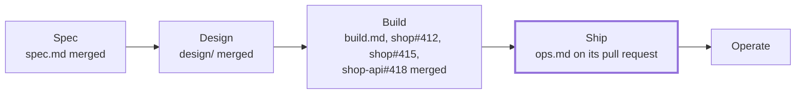

# A worked example: Saved carts

> Part of the plan [Althar for the whole team](../../whole-team.md), and
> deleted with it. It shows the convention of
> [ADR-109](../../../decisions/proposed/109-a-feature-moves-through-stages-kept-in-the-repository.md)
> filled in, for the same feature the `role-lenses` prototype draws. Every
> name, number and link in it is made up.

This folder stands for the root of a shop's home repository, `shop`. A
second repository, `shop-api`, holds the API.

```
.althar/flow.yaml               the project's stages (here, the default five)
specs/saved-carts/
  spec.md                       product: frontmatter, problem, goal, acceptance criteria
  design/README.md              design: screens with Figma links, decisions
  build.md                      engineering: plan and the feature's pull requests
  ops.md                        devops: rollout, environments, alerts, runbook
```

**Where it stands:** as in the prototype, with the Build → Ship handoff
waiting on devops. `spec.md`, `design/` and `build.md` have merged on
`shop`'s default branch, and so have the three pull requests in
`spec.md`'s `pullRequests.build`, in both repositories. So Build is done,
and Ship is the current stage. `ops.md` is shown as devops drafted it on
its open pull request; Ship is done when that merges. The frontmatter's
`stage: ship` says the same as the merges do; where they disagree, the
timeline shows both.



## `.althar/flow.yaml`

Read from the home repository's default branch. With no file, the five
stages in [the example](.althar/flow.yaml) are the default.

| Key | What | Default |
|---|---|---|
| `specs` | The folder features live in, from the repository's root. | `specs/` |
| `stages` | The stages, in order. | The five below |
| `stages[].id` | The stage's name: in `spec.md`'s `owners`, `skip`, `ready` and `pullRequests`, and in a pull request's `Feature: <slug> <stage>` line. | Required |
| `stages[].owner` | The role that owns it: `product`, `design`, `engineering`, `devops`, or one of `roles`. Whoever has that role in the project hears its handoff (ADR-110). | Required |
| `stages[].artefact` | What the stage writes, from the feature's folder: a file, or a folder ending in `/`, done once a file in it has merged. | None |
| `stages[].done` | When the stage is done: `merged`, its artefact merged on the default branch; `pull-requests`, its artefact and every pull request in its set merged; `never`, ongoing. | `merged`, or `never` with no artefact |
| `stages[].next` | The stage that comes after it. | The stage below; none after the last |
| `roles` | The project's own roles. | None |
| `roles[].id` | The role's name. | Required |
| `roles[].like` | The built-in role whose lens it starts from (ADR-108). | `engineering` |

The default five:

| Stage | Owner | Artefact | Done | Next |
|---|---|---|---|---|
| `spec` | product | `spec.md` | `merged` | `design` |
| `design` | design | `design/` | `merged` | `build` |
| `build` | engineering | `build.md` | `pull-requests` | `ship` |
| `ship` | devops | `ops.md` | `merged` | `operate` |
| `operate` | devops | none | `never` | none |

A project that wants Intent apart from Spec (open question 5) adds an
`intent` stage before `spec`, owned by product, with an artefact such as
`intent.md`: a tracker issue merges nowhere, so it can't be a stage's
artefact.

## `spec.md`'s frontmatter

| Key | What |
|---|---|
| `feature` | The slug: the folder's name. |
| `title` | The feature's name as shown. |
| `stage` | Optional: the stage the team says it is at. Shown beside the stage read from the merges where they differ; Althar never writes it. |
| `owners` | Per stage, a role, or a role and people (`[design, "@a-designer"]`). People named here hear the stage's handoff too. |
| `repositories` | The repositories it touches, the home one first. One the project doesn't bind leaves its stages unverified. |
| `tracker` | Optional: a tracker issue or project that mirrors its stage. |
| `pullRequests` | Optional: per stage, its set of pull requests, repository-qualified. Without it, the set is every pull request marked `Feature: <slug> <stage>`. |
| `ready` | Optional: a stage whose owner says it is ready for the next, before it merges. A soft signal (ADR-110). |
| `skip` | Optional: stages this feature doesn't need. |
