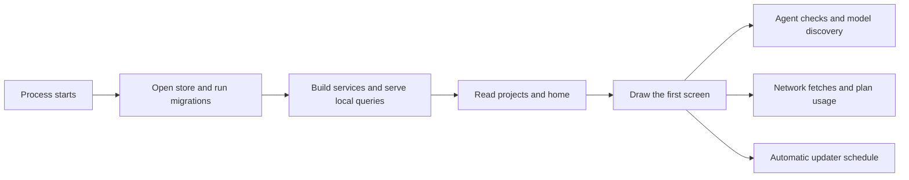

# DEV-193: startup measurements

Measured on this Mac on 5 November 2026, using development builds. Build time is excluded: elapsed times start at the Electron process starting, not at `bun run build`.

The reproduced delay was the first route's `Status` read. That read starts agent sign-in and version CLIs and waits for all of them. Opening separately started a forced status read and model discovery, producing overlapping checks. OpenCode took 24–37 seconds across the two original launches, Claude about 5–6 seconds and Copilot about 10 seconds. Store work was well below a second.

## Measurements

Two **before** launches used Run → **Althar, fresh profile**, with the real agent registry and startup instrumentation added, before removing the waits. The final three **after** launches used real CLIs on the same Mac with a disposable populated profile: **24 projects, 1,200 tasks, 1,224 threads, 48 open tasks**, a database growing from 2.90 MB to 3.20 MB. It has no signed-in host connections, chat history or real task worktrees. These are different profile shapes: the before store had to apply every migration; the after store was already migrated. The seconds removed from the route are the agent checks, not a claimed database speedup.

All values below are milliseconds. “Elapsed” is from process start; “duration” measures that step alone. Concurrent steps must not be added together.

| Step | Before 1 | Before 2 | After 1 | After 2 | After 3 |
| --- | ---: | ---: | ---: | ---: | ---: |
| Main entry, elapsed | 549 | 585 | 308 | 241 | 305 |
| Runtime fork requested, elapsed | 818 | 828 | 433 | 320 | 384 |
| First window port handed over, elapsed | 1,235 | 1,974 | 826 | 626 | 753 |
| Device check, duration | 3 | 1 | 1 | 0 | 0 |
| Store open + migrations, duration | 303 | 169 | 12 | 21 | 22 |
| Store open alone, duration | Not split | Not split | 6 | 7 | 10 |
| Migration check alone, duration | Not split | Not split | 4 | 11 | 9 |
| Runtime services, duration | 590 | 214 | 40 | 47 | 53 |
| First projects query, duration | 822 | 18 | 28 | 19 | 33 |
| First route, duration | 35,371 | 36,982 | 162 | 193 | 203 |
| `openWindow`, duration | 36,209 | 37,015 | 200 | 222 | 246 |
| `openWindow` resolved, elapsed | 37,528 | 39,044 | 1,030 | 868 | 1,058 |
| First screen drawn, elapsed | **38,630** | **40,110** | **1,472** | **1,301** | **1,503** |

An earlier batch of three populated launches reached the first screen in 1,995, 1,669 and 1,291 ms: six populated launches in total, all within two seconds. In the final batch, runtime instance reconciliation took 2–4 ms, model-facts cache initialization 1 ms, plan-usage initialization 0 ms, connections 1 ms, sessions 0–1 ms, runs 2 ms, automations 0–1 ms, coordinator 1 ms and search-index fill 0 ms. Accounts, policies, connectivity, sign-ins, models, limits and permission judging each took 0–2 ms.

Repository network fetches, model-facts refreshes, agent checks and plan-usage reads now wait until the first screen is drawn; their blocking contribution is zero. Their own durations are logged separately after that. Empty profiles did not exercise repository fetches or signed-in usage endpoints, and the manual measurement closes each app after the first screen, so it does not measure complete background refreshes. The automatic updater runs only in packaged builds; its schedule now starts after that same gate and logs each check, but a packaged update was not exercised here.

## What changed



The port can arrive before services are ready; its first query waits for the store and services. Both milestones are logged independently. The renderer no longer waits for agent status in its route loaders. Repository host details also fill in after a project opens. Status refresh joins a screen's existing cached read instead of starting a second forced check. Other tabs preload after the opening has finished.

A returning profile uses the existing quick opening. The full mark/light sequence remains for first-run welcome. A local step taking more than three seconds shows one line in the existing small secondary type: checking the computer, opening data, or reading data. Failed stores retain the existing recovery screens. Login/background startup, runtime restarts and closing the last window release background work without requiring a new screen.

## Logs and reproduction

`main.log` keeps process start, main/renderer entry, runtime fork/readiness, port handover/receipt, each initial read, `openWindow` resolution and first screen drawn. Renderer milestones carry a window id, so an edge page's port cannot be mistaken for the main window's. `runtime.log` keeps start, done/failed, epoch timestamp and duration for each startup step, plus project/task/thread counts and database size. Existing problem-report bundles already include these logs. No project names, paths, account identities or tokens are added to startup events.

Run → **Startup timings**, or from the repository root:

```sh
bun --filter @althar/desktop measure:startup
```

This builds the app and opens it three times quietly, with real agent CLIs, on a disposable populated profile. It saves `apps/desktop/test-results/startup-measurements.json` and the profile path. The profile retains its normal log files. End-to-end runs clear `test-results`, so retain measurements before running another spec.

## Validation and limits

Focused runtime tests cover building the store and answering local reads with the network gate closed, cancellation while waiting, fetching only after the gate, existing model-facts and plan-usage behavior, and agent-status failures. A route regression holds agent status indefinitely while the home renders. Electron startup tests check the populated home, startup log ordering, and the slow line in light and dark; the smoke spec makes the first project. SQLite schema, backup and held-store tests cover store instrumentation. Package checks cover desktop, runtime, persistence, UI and their CLI/site consumers.

The person's live profile, large message histories, many live worktree diffs, packaged updater delivery and Flatpak's device check were not benchmarked. The retained per-step logs and size counts make a slow case there diagnosable without repeating this investigation.
