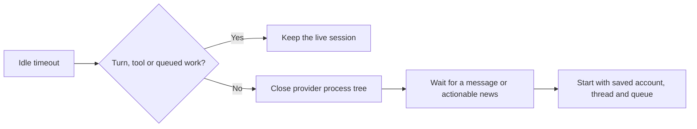

# Idle memory on macOS

An arm64 v0.9.0 release, production bundles from main (`b9e1bf2fce5a`), and the final patched build (`2dcf9c7cf`) were measured on an Apple M4 with 24 GiB RAM. The reported M2 was unavailable. Each profile was isolated. The populated fixture contained 24 projects, 1,200 settled tasks and 336,000 synthetic history entries in 1,224 threads. No agent turns started during these runs. Both final runs used the menu-bar preference and kept a sheet renderer.

The sampler summed the macOS physical footprint of the app, its descendants and each profile’s detached Crashpad handler. It tracked previously observed children across reparenting. The hour starts at the first screen, and the peak is the largest sampled value. Processes that started and exited between samples can be missed. These runs shared a working Mac, and display allocations and pressure varied across starts.

## Where the memory went

| Profile | Build | First screen | Sampled peak | After one hour | Processes at one hour |
| --- | --- | ---: | ---: | ---: | ---: |
| Empty | v0.9.0 | 863 MiB | 1,090 MiB | 507 MiB | 7 |
| Empty | Main | 855 MiB | 1,128 MiB | 542 MiB | 9 |
| Empty | Final patch | 856 MiB | 944 MiB | 655 MiB | 7 |
| Populated | v0.9.0 | 559 MiB | 981 MiB | 457 MiB | 7 |
| Populated | Main | 606 MiB | 883 MiB | 423 MiB | 9 |
| Populated | Final patch | 667 MiB | 861 MiB | 405 MiB | 7 |

The final empty profile was 113 MiB above main at one hour. Its GPU and primary renderer accounted for 90 and 47 MiB more respectively. The populated profile was 18 MiB below main at one hour and 61 MiB above it at first screen. From minute 10 onward the final empty profile ranged from 626 to 677 MiB and the populated profile ranged from 404 to 430 MiB. Within that window the memory rose and fell. These individual runs establish which processes were retained and show how much total footprint can vary across launches.

| Process footprint at one hour | Empty main | Empty final | Populated main | Populated final |
| --- | ---: | ---: | ---: | ---: |
| Desktop main | 75.7 MiB | 72.1 MiB | 78.3 MiB | 72.4 MiB |
| Runtime | 137.3 MiB | 135.7 MiB | 141.5 MiB | 138.4 MiB |
| GPU | 213.9 MiB | 303.8 MiB | 78.8 MiB | 85.8 MiB |
| Primary renderer | 58.1 MiB | 104.6 MiB | 64.2 MiB | 70.4 MiB |
| Edge renderer | 28.5 MiB | 28.7 MiB | 32.2 MiB | 28.4 MiB |
| Network | 7.2 MiB | 7.2 MiB | 7.1 MiB | 7.2 MiB |
| Crashpad | 2.7 MiB | 2.7 MiB | 2.7 MiB | 2.7 MiB |
| Audio | 6.3 MiB | absent | 6.3 MiB | absent |
| Video capture | 12.3 MiB | absent | 12.2 MiB | absent |

The final change preloads the sheet to keep its first opening responsive. A controlled menu-bar launch put the hidden sheet renderer at 32 MiB. The earlier draft (`598155287`) loaded the sheet on click and removed that renderer. It held 488 MiB empty and 359 MiB populated after an hour, with six processes in both runs. Those figures describe the earlier draft only.

In three native Electron launches per variant, the menu-bar sheet took **322–398 ms** to show when loaded on click and **2.5–4.9 ms** when preloaded. The test emitted the first tray click five seconds after tray creation and timed the handler through `BrowserWindow.show()`, checking native window visibility when it returned. The preloaded cases all showed within the click handler. These timings cover the app's response from receipt of the tray event through the native show call. Display presentation time and clicks during the initial preload were outside this measurement.

Althar now discovers microphones when dictation or its microphone menu needs them, puts off model discovery on an empty home, and shares concurrent sign-in checks and CLI version lookups. A version probe that fails can retry on the next status read. Both final runs eliminated the retained audio and video-capture helpers, which accounted for roughly 19 MiB on main. No agent or runnable server remained in any of the isolated one-hour samples.

OpenCode also caused a transient spike after launch. In the final empty run, its two processes added 325 MiB at the five-minute sample and had exited by the ten-minute sample. At the next refresh the process arguments identified OpenCode's sign-in listing, consistent with the plan-usage poll that runs every five minutes. To cut these spikes, measure how much the listing costs per account and share its result with sign-in status where possible. Accounts with a known limit and work waiting for a reset still need background refresh.

### A coordinator after use

A live project's coordinator tree held 216.8 MiB across three processes 38 minutes after its last logged turn and 215.8 MiB at 62 minutes. The cold profiles did no turns and never started a coordinator. This measures one warm coordinator on the live machine, where other tasks were present. Its footprint was nearly flat across the samples.

A project's coordinator is always available. Starting its provider process is demand-driven, on a message or actionable news. Once warm, its provider session has context-based handover but no elapsed-idle eviction. To reclaim this memory, retire quiescent provider sessions and their descendants under the per-thread lifecycle lock. Account choice and conversation must survive, active tools and pending work must keep their session, and an input arriving during retirement must wake a fresh session with the persisted queue intact. Test that race, actionable news waking a retired coordinator, and process-tree cleanup across adapters. This can reuse the existing briefing and wake paths.

### GPU

The GPU process held 304 MiB in the final empty run, the largest process in that sample. A separate main GPU sample showed 137 MiB of resident IOSurface regions. Compare a blank Electron window on the same display, scale and bounds with Althar's main window and the edge surfaces added one at a time. Repeat with each hidden and then closed. If the excess follows an Althar surface, use a Chromium memory trace to locate the backing allocations before changing window or compositing lifetimes.

### Runtime and stalls

The final empty runtime was 76 MiB at ten minutes and 136 MiB at one hour, comparable to main's 137 MiB. A fresh SQLite store still leaves the runtime's service graph and native allocations live. Quantifying the reducible share needs a utility-process baseline, V8 heap and external-memory measurements, and SQLite page-cache statistics with the store open. Repeat with the populated fixture and with periodic reads enabled and disabled to separate startup allocations from retained query results.

An OS stack sample from the live runtime caught synchronous SQLite disk reads. On the populated fixture, the home feed's events query originally scanned old thread rows and sorted them before taking 50 results. A partial index now gives it those rows directly. The first read was 2,806 ms before the index and 15 ms after. Two repeat reads were 252–261 ms before and about 0.1 ms after. The test used SQLite 3.51.0 with a 2,000 KiB page cache, and query plans confirmed the index choice. Creating and committing the index once took 2.5 seconds on a separate warmed clone of the fixture.

The final populated run still logged one end-to-end `GetHome` at 1.16 seconds, 30 slow `GetSearchDocuments` calls up to 834 ms and three slow `GetLoad` calls up to 6.28 seconds. Measure time spent on database work separately from transport and scheduling delay. A bounded runtime-side search would avoid copying and keeping the full search catalog in the renderer. To protect other calls under disk pressure, also measure whether to move the remaining large synchronous reads to a read worker. The cause of the specific stalls reported on 20 November remains unverified.

In a follow-up, the search catalog's SQL was measured separately on a newly generated fixture of the same size, with a 2,000 KiB SQLite page cache. Three first-page reads took 349–417 ms without an index on a thread's item dates and 91–106 ms with one. A `task:` page took 262–527 ms before and 15–16 ms after. SQLite 3.54.1's query plan changed from scanning each thread's items to a covering index lookup for the latest date. Building the index on this fixture took 312 ms and used 22.6 MiB on disk. These are query timings on a warm system, not end-to-end `GetSearchDocuments` timings, and they do not establish the cause of the earlier logged stalls. Search still transfers its bounded catalog to the renderer, and the reads still run on the runtime's thread.
