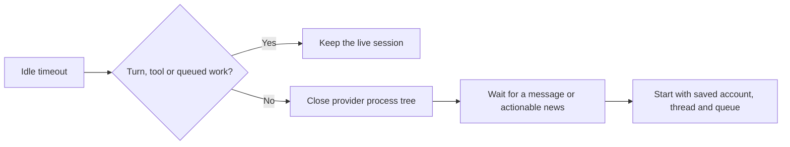

# Idle memory on macOS

An arm64 v0.9.0 release, production bundles from main (`b9e1bf2fce5a`), and the final patched build (`2dcf9c7cf`) were measured on an Apple M4 with 24 GiB RAM. The reported M2 was unavailable. Each profile was isolated. The populated fixture contained 24 projects, 1,200 settled tasks and 336,000 synthetic history entries in 1,224 threads. No agent turns started during these runs. Both final runs used the menu-bar preference and kept a sheet renderer.

The sampler summed the macOS physical footprint of the app, its descendants and each profile’s detached Crashpad handler. It tracked previously observed children across reparenting. The hour starts at the first screen, and the peak is the largest sampled value. Processes that started and exited between samples can be missed. These runs shared a working Mac, and display allocations and pressure varied across starts.

## Where the memory went

| Profile | Build | First screen | Sampled peak | After one hour | Processes at one hour |
| --- | --- | ---: | ---: | ---: | ---: |
| Empty | v0.9.0 | 863 MiB | 1,090 MiB | 507 MiB | 7 |
| Empty | Main | 855 MiB | 1,128 MiB | 542 MiB | 9 |
| Empty | Final patch | 856 MiB | 944 MiB | 655 MiB | 7 |
| Populated | v0.9.0 | 559 MiB | 981 MiB | 457 MiB | 7 |
| Populated | Main | 606 MiB | 883 MiB | 423 MiB | 9 |
| Populated | Final patch | 667 MiB | 861 MiB | 405 MiB | 7 |

The final empty profile was 113 MiB above main at one hour. Its GPU and primary renderer accounted for 90 and 47 MiB more respectively. The populated profile was 18 MiB below main at one hour and 61 MiB above it at first screen. From minute 10 onward the final empty profile ranged from 626 to 677 MiB and the populated profile ranged from 404 to 430 MiB. Within that window the memory rose and fell. These individual runs establish which processes were retained and show how much total footprint can vary across launches.

An additional short empty launch of the same main bundle used in the comparison reached 642 MiB after one minute, versus 542 MiB at one minute in the original main launch. Its GPU and primary renderer were 327 and 108 MiB, versus 263 and 67 MiB in the original. The final patch's one-minute figures were 604 MiB total, 312 MiB GPU and 108 MiB primary renderer. Thus main itself can show the larger GPU and renderer footprints: the hour's difference is not enough to attribute a regression to the patch. The short control did not run for an hour, so it cannot rule out an hour-specific difference. These are launch-to-launch observations, not a controlled isolation of which surface or Chromium allocation varies.

| Process footprint at one hour | Empty main | Empty final | Populated main | Populated final |
| --- | ---: | ---: | ---: | ---: |
| Desktop main | 75.7 MiB | 72.1 MiB | 78.3 MiB | 72.4 MiB |
| Runtime | 137.3 MiB | 135.7 MiB | 141.5 MiB | 138.4 MiB |
| GPU | 213.9 MiB | 303.8 MiB | 78.8 MiB | 85.8 MiB |
| Primary renderer | 58.1 MiB | 104.6 MiB | 64.2 MiB | 70.4 MiB |
| Edge renderer | 28.5 MiB | 28.7 MiB | 32.2 MiB | 28.4 MiB |
| Network | 7.2 MiB | 7.2 MiB | 7.1 MiB | 7.2 MiB |
| Crashpad | 2.7 MiB | 2.7 MiB | 2.7 MiB | 2.7 MiB |
| Audio | 6.3 MiB | absent | 6.3 MiB | absent |
| Video capture | 12.3 MiB | absent | 12.2 MiB | absent |

The final change preloads the sheet to keep its first opening responsive. A controlled menu-bar launch put the hidden sheet renderer at 32 MiB. The earlier draft (`598155287`) loaded the sheet on click and removed that renderer. It held 488 MiB empty and 359 MiB populated after an hour, with six processes in both runs. Those figures describe the earlier draft only.

In three native Electron launches per variant, the menu-bar sheet took **322–398 ms** to show when loaded on click and **2.5–4.9 ms** when preloaded. The test emitted the first tray click five seconds after tray creation and timed the handler through `BrowserWindow.show()`, checking native window visibility when it returned. The preloaded cases all showed within the click handler. These timings cover the app's response from receipt of the tray event through the native show call. Display presentation time and clicks during the initial preload were outside this measurement.

Althar now discovers microphones when dictation or its microphone menu needs them, puts off model discovery on an empty home, and shares concurrent sign-in checks and CLI version lookups. A version probe that fails can retry on the next status read. Both final runs eliminated the retained audio and video-capture helpers, which accounted for roughly 19 MiB on main. No agent or runnable server remained in any of the isolated one-hour samples.

OpenCode also caused a transient spike after launch. In the final empty run, its two processes added 325 MiB at the five-minute sample and had exited by the ten-minute sample. At the next refresh the process arguments identified OpenCode's sign-in listing, consistent with the plan-usage poll that runs every five minutes. To cut these spikes, measure how much the listing costs per account and share its result with sign-in status where possible. Accounts with a known limit and work waiting for a reset still need background refresh.

The follow-up keeps a successful OpenCode credential listing for background plan-usage reads until its sign-in is checked again or its connection is forgotten. An explicit refresh lists again. The timer skips an OpenCode account with no turn in progress, even before its first classification, unless a limit or a full window needs refreshing; publishing the result no longer starts a separate sign-in check for an unclassified account. Fake-account tests show zero sign-in checks, credential listings or Go reads for the first idle timer tick, then one listing and Go read when a limit is recorded. A classified idle account is also skipped, while an active or limited account is polled. Explicit and on-demand reads still run. The changed app's poll has not yet been measured for process footprint.

Concurrent OpenCode reads now discard an older classification or Go limits answer if a newer read starts or the sign-in check changes while it is in flight. Tests hold each old answer until a newer classification has been kept, then verify it cannot overwrite that result.

On the same M4, standalone OpenCode v2.3.0 commands were also run directly with a new temporary home and no sign-ins. Sampling the commands and their descendants every 50 ms found a 328.3 MiB peak for `auth list` (eight samples, 0.49 s) and 181.8 MiB for `api … experimental.usage.limits` (five samples, 0.29 s); both exited 0. These are individual command peaks, not measurements of the changed app's poll, and peaks between samples may be missed. Go's limit command therefore remains a substantial transient cost when it is polled.

An isolated runtime replay advanced both versions to their first five-minute timer tick, with a signed-in fake account and the actual OpenCode v2.3.0 listing command wired to the credential read. The command used a new temporary home with no sign-ins. The prior timer launched it once and sampled a 267.2 MiB process-tree peak over 52 samples. The new timer launched it zero times. This measures the real subprocess triggered by the runtime's timer. The release bundle and the person's signed-in account were outside the probe.

### A coordinator after use

A live project's coordinator tree held 216.8 MiB across three processes 38 minutes after its last logged turn and 215.8 MiB at 62 minutes. The cold profiles did no turns and never started a coordinator. This measures one warm coordinator on the live machine, where other tasks were present. Its footprint was nearly flat across the samples.

A project's coordinator is always available. Starting its provider process is demand-driven, on a message or actionable news. Before this follow-up, its warm provider session had context-based handover but no elapsed-idle eviction. Reclaiming this memory requires retiring quiescent provider sessions and their descendants under the per-thread lifecycle lock, preserving account choice and conversation, and waking safely for new input and news.

The follow-up retires a coordinator after 30 minutes without work, checked at most a minute later. It keeps active turns, open tools, background commands and queued work alive. Tests cover waking on news with the previous account and conversation, an input accepted while the old session is closing, and work that prevents retirement. In two fake process launch modes, a provider and an unreported child were both alive before retirement and both gone after it. A separate in-process native-agent test closes its session with a real fake MCP server and child; both processes exit. Registered process adapters share the owned-process connection path, and the native adapter closes its session's MCP tools. These are process-count checks on macOS, not an after-retirement measurement of the real 216 MiB coordinator above; individual signed-in adapters and other platforms have not all been measured here.

If the runtime exits after an idle session has completed but before its queued input wakes it, startup recovery resumes the input. Restart tests snapshot both that interval and a close already in progress after its idle stop intent and a new input were recorded. Both check delivery after reopening the profile.

The sleeping account is a preference across window starts, news and recovery. The project’s account restrictions, sign-in and rotation limits still apply. A failed background wake leaves a notice in the conversation and keeps earlier input queued for the next successful start.

Physical-footprint samples of the two test provider trees before and after retirement were 123.5 → 0 MiB and 121.0 → 0 MiB. Each included the adapter and its unreported child. These are actual test subprocesses under the runtime's retirement policy with an accelerated clock. The observed 216 MiB live coordinator above was a different provider tree. Its release-bundle footprint after retirement remains unmeasured.

### GPU

The GPU process held 304 MiB in the final empty run, the largest process in that sample. A separate main GPU sample showed 137 MiB of resident IOSurface regions. Compare a blank Electron window on the same display, scale and bounds with Althar's main window and the edge surfaces added one at a time. Repeat with each hidden and then closed. If the excess follows an Althar surface, use a Chromium memory trace to locate the backing allocations before changing window or compositing lifetimes.

### Runtime and stalls

The final empty runtime was 76 MiB at ten minutes and 136 MiB at one hour, comparable to main's 137 MiB. A fresh SQLite store still leaves the runtime's service graph and native allocations live. Quantifying the reducible share needs a utility-process baseline, V8 heap and external-memory measurements, and SQLite page-cache statistics with the store open. Repeat with the populated fixture and with periodic reads enabled and disabled to separate startup allocations from retained query results.

An OS stack sample from the live runtime caught synchronous SQLite disk reads. On the populated fixture, the home feed's events query originally scanned old thread rows and sorted them before taking 50 results. A partial index now gives it those rows directly. The first read was 2,806 ms before the index and 15 ms after. Two repeat reads were 252–261 ms before and about 0.1 ms after. The test used SQLite 3.51.0 with a 2,000 KiB page cache, and query plans confirmed the index choice. Creating and committing the index once took 2.5 seconds on a separate warmed clone of the fixture.

The final populated run still logged one end-to-end `GetHome` at 1.16 seconds, 30 slow `GetSearchDocuments` calls up to 834 ms and three slow `GetLoad` calls up to 6.28 seconds. Measure time spent on database work separately from transport and scheduling delay. A bounded runtime-side search would avoid copying and keeping the full search catalog in the renderer. To protect other calls under disk pressure, also measure whether to move the remaining large synchronous reads to a read worker. The cause of the specific stalls reported on 20 November remains unverified.

In a follow-up, the search catalog's SQL was measured separately on a newly generated fixture of the same size, with a 2,000 KiB SQLite page cache. Three first-page reads took 349–417 ms without an index on a thread's item dates and 91–106 ms with one. A `task:` page took 262–527 ms before and 15–16 ms after. SQLite 3.54.1's query plan changed from scanning each thread's items to a covering index lookup for the latest date. Building the index on this fixture took 312 ms and used 22.6 MiB on disk. These are query timings on a warm system, not end-to-end `GetSearchDocuments` timings, and they do not establish the cause of the earlier logged stalls. Search still transfers its bounded catalog to the renderer, and the reads still run on the runtime's thread.

The catalog read now asks for each document kind in ID order, stopping at the page boundary instead of materializing and sorting every kind on every page. With the date index already present in both variants, all 32 pages and 6,224 documents matched exactly on the synthetic fixture. Two paired runs, one with the new query first and one with the old first, took 1,840 and 1,826 ms in summed old SQL time versus 374 and 369 ms in summed new SQL time. The slowest old page took 147 and 119 ms; the slowest new page took 28 and 33 ms. This is SQLite 3.54.1 in a Python harness, with a 2,000 KiB cache, not a measurement of transport or the renderer. It bounds the work of each catalog page, but does not move it to another thread or make the whole catalog transfer disappear.

In a separate runtime-service test against that fixture, the first Home read took 720 ms and two subsequent reads took 18 and 21 ms. The first load sample took 526 ms, including its intentional 500 ms interval between CPU readings; two calls within its cache interval answered in under 1 ms. The new first search page took 18, 13 and 13 ms, against 205, 105 and 110 ms for the old query with the same index. In another fresh runtime over the warmed fixture, a Home read and first load sample requested together completed in 770 and 1,301 ms respectively. These are direct service calls with fake agents, not end-to-end RPC or loaded-disk measurements. They show that Home can still hold up another call and that the first load reading intentionally waits; these paths remain to be improved.

Home now yields before working out each card, so other calls can run during its first read of a large board without waiting for a whole batch of slow cards. In three fresh runtimes over the warmed fixture, concurrent first Home and load reads finished in 753–786 ms and 1,274–1,304 ms before the change. In two runs after yielding, they finished in 779–868 ms and 612–651 ms. A scheduler test also shows another callback runs before all cards are worked out; without the yield it runs only after them. The first Home read itself is still slow, and other large synchronous statements are not isolated by this change.

Each task card also checks for an unfinished setup. SQLite was searching each task's entire transcript for that kind, even where there was no setup. A partial index by thread and sequence lets it find just setup records. On the same warmed fixture, three fresh-runtime first Home reads without a simultaneous load request took 793–841 ms before the index and 534–554 ms with it. Creating the index on the 336,000-entry fixture took 2.3 seconds; the fixture contains no setup entries, so this measures the scan needed to build it but not a representative index size. The query-plan test confirms that card reads use it. This improves the first read but does not make it instantaneous: it still works out 720 settled cards, and real profiles with different task histories may differ.

When the meter is enabled, it now seeds CPU counters before the first window request. If macOS changes from `ps` to the native process reader between samples, the overall CPU counters remain comparable, but per-process shares are shown as unknown until the next sample instead of waiting or inventing zero usage. In three fresh-runtime fixture runs, with the meter enabled 100 ms before simultaneous Home and load requests, the first load read took 41–45 ms and Home took 641–708 ms. The seed itself took 2–4 ms, and process shares were unavailable on those first readings. These are direct service timings in this Mac's sandbox, not a packaged-app measurement. A request with no seed, or one arriving in the same OS CPU tick, still waits for a usable sample.

After the setup index and the meter and Home changes together, two further fresh-runtime runs with the same 100 ms seed interval returned the concurrent first load in 29–31 ms and Home in 430–435 ms; the following first search page took 12–13 ms. The fixture had 1,200 settled tasks and no Home cards to show. These are warmed-filesystem service timings, not RPC or busy-disk measurements. Home is improved but remains above the 100 ms call budget.

The current store takes SQLite's exclusive locking mode for the lifetime of its connection (`Database.ts`), which also enforces one runtime per profile. In a separate temporary WAL database with the same exclusive-lock and commit sequence, a second connection's read failed with `database is locked` and succeeded after the first connection closed. A separate read connection cannot simply be added without changing that ownership boundary. Moving reads off the runtime thread needs a design that preserves single-runtime ownership and committed snapshots, or a bounded search that avoids the full catalog; the index alone does not provide that isolation.

SQLite's shared cache is not a safe shortcut around that lock. In a temporary WAL database, Node 25.8.2 opened two `file:…?cache=shared` connections in the same process even while one held the exclusive lock. A worker then ran a 2,767 ms recursive query on one table; a simple read of a different table on the original thread waited 2,734 ms. The shared-cache mutex therefore still stalled the runtime, and the second connection could bypass the lock that distinguishes one runtime's ownership. This is a small controlled probe, not a packaged Electron or cross-platform measurement; it rules out this approach on the tested Node build, not other worker designs.

The paired probe with normal locking and private caches answered the other-table read in under 1 ms while the worker's query took 3,066 ms. A separate normal-mode WAL read transaction also blocked another connection's exclusive acquisition while allowing the writer to commit. That suggests an ownership lease may be possible, but a reader held indefinitely prevents WAL checkpoints from advancing past its snapshot, and changing from today's exclusive lock to that lease without a gap or breaking older runtimes has not been established. In a handover experiment, a shared-cache anchor retained the exclusive lock and blocked the writer on its table. These probes are not an implementation or evidence of safe profile ownership.

### Follow-up read results

Home now seeks each active project's latest 30 settled tasks by index. It checks whether a task can return to Home before building its card. A live session, unread reply, call, review or work to ship still goes through the same card logic as the board. The lookup yields between projects and card reads. Search seeks through an index of recent public passages, opening at most 128 passage records between yields, including where the latest passages are hidden or empty. Both paths used the profile's writer connection in these measurements.

Building and committing both new indexes on a copy of the populated fixture took 2.3 seconds. Together they used 14.9 MiB on disk, nearly all for the passage index.

| First concurrent RPC calls, ms | Prior branch, warm | Follow-up, warm | Prior branch, concurrent writer | Follow-up, concurrent writer |
| --- | ---: | ---: | ---: | ---: |
| `GetHome` | 362–572 | 33–76 | 405–469 | 32–45 |
| `GetLoad` | 51–97 | 24–32 | 60–103 | 20–39 |
| `GetSearchDocuments` | 17–36 | 27–70 | 20–29 | 29–41 |
| `GetSettings` | 0.5–3.0 | 0.7–4.6 | 20–28 | 4–10 |

Each range comes from three fresh runtimes per variant on the same warmed 1,200-task, 336,000-item fixture, alternating versions. The calls ran through the runtime's RPC client and server over a Node message port with fake agents. Load had a 100 ms meter seed. The disk trial added one worker overwriting a 32 MiB file in 2 MiB chunks, syncing each write at 16 ms intervals. These trials cover warm caches and one competing writer. The old packaged-app stalls and cold or saturated storage were outside this comparison.

The prior branch in this table already has the first search pagination and date-index changes. It was faster than the original search service timings of 105–205 ms for the first page. In two service comparisons with both versions using the latest indexes, all 6,224 documents matched in order. One complete traversal took 122–130 ms in the prior version and 85–190 ms with the first implementation of the smaller batches.

The final implementation seeks and formats a single passage batch in one statement. A full-catalog RPC replay compared it with the original main query at `8508a81cc` on copies of the same populated fixture. The main-query copy omitted the follow-up search indexes. Three alternating runs per version covered all 32 pages.

| Full-catalog RPC replay | Main query | Final query |
| --- | ---: | ---: |
| Slowest page per run, warm | 253–302 ms | 33–61 ms |
| Full traversal, warm | 3.50–3.71 s | 0.35–0.43 s |
| Slowest page per run, concurrent writer | 578–891 ms | 83–149 ms |
| Full traversal, concurrent writer | 4.98–8.06 s | 0.59–0.63 s |

The warm traversals returned identical hashes for all 6,224 documents in order. The writer ran as above on the shared Mac. The high end reproduces the scale of the earlier slowdown on the original query path, with timing from the runtime RPC client through decoding. These measurements cover the full-catalog request. After #1124, Finder uses query-filtered runtime search. Cached Home reads and catalog pages use the read worker, with the same bounded queries. End-to-end Finder timings and synchronous reads through the writer were outside that integration check.
