# The fast lane: what a small change's time went on, and what it cuts

Measured 6 November 2026 against `6fa8c335ec25` and read again on 7 November
from a copy of the profile's store, for [ADR-102](../decisions/102-a-small-change-is-one-step-reviewed-after-merge-and-auto-moves-to-a-lighter-model.md)
and the person's note of 6 November: a one-line fix
([#599](https://github.com/AltharIDE/althar/pull/599), one CSS width) took
41 minutes from its task's creation to its merge, which they called
ridiculous.

The full split, the per-task rows and GitHub's check times are in
[small-task-timeline.md](small-task-timeline.md). This note reads that
measurement for the fast lane: what a change of a few lines still spent its
time on after the wait for an agent's place was cut, and what this change
takes out.

## What was measured

Twelve tasks whose pull request changed at most 40 lines, 28 October to 5
November, from a copy of the profile's database (never the live file),
with CI from the pull requests' public check runs. Times are minutes; a
phase's median is over the tasks it happened in.

| Phase | In | Median | Range |
| --- | ---: | ---: | ---: |
| Plan's countdown | 10/12 | 0.4 | 0–0.8 |
| Waiting for an agent's place | 4/12 | 13.2 | 9.0–24.7 |
| Worktree and setup | 12 | 0.2 | 0.1–0.7 |
| Agent start-up | 12 | 0.2 | 0.1–0.8 |
| The lead working | 12 | 3.6 | 0.9–8.6 |
| Review | 7/12 | 1.2 | 0.3–13.4 |
| Hand-offs between steps | 4/12 | 0.2 | 0–6.7 |
| Publishing | 12 | 0.2 | 0.1–0.4 |
| **Created to pull request open** | 12 | **9.9** | 2.2–31.0 |
| Pull request open to checks passed | 12 | 12.2 | 7.1–31; one 148 |
| Checks passed to the merge queue | 8 | 0.8 | 0.3–11.6; one 279 |
| Merge queue to merged | 7 | 8.7 | 2.4–15.7 |
| **Created to merged** | 6 | **30.4** | 25.4–84.6 |

The one-line fix's own minutes, from the same record:

```mermaid
gantt
  dateFormat  m
  axisFormat  %M
  title #599, minutes from its task's creation
  section Before the pull request
  Plan's countdown           :a, 0, 1m
  Waiting for a place        :crit, b, after a, 9m
  Lead (1 min) and publish   :c, after b, 1m
  section After
  PR checks                  :d, after c, 18m
  To the merge queue         :e, after d, 1m
  Merge queue                :f, after e, 11m
```



**Where the overhead was, for a change this size:** a plan to read and hold
(up to 0.8 minutes, and a gateway between each step), a review before the
merge (1.2 minutes in the middle, 13.4 at worst, and a round-trip through
the lead to settle what it found), and CI run twice inside Althar's
gates. The lead itself worked about 3.6 minutes, and about 2.1 of that was
the checks and tests it ran by hand.

**Read again on 7 November** from a copy of the store: the same twelve
tasks, because no change of a few lines landed between. The wait for a
place is cut for tasks planned small since 6 November
([ADR-032](../decisions/032-agents-at-once-on-this-machine.md)'s
follow-up), and the plan countdown, review and hand-offs are what this
change cuts.

## What this change cuts

- **The plan's countdown, for a small change: the whole of it.** Its plan
  holds one step and starts at once; the person isn't asked to hold or
  change a plan for one line. Measured on the last twelve: 0.4 minutes in
  the middle, 0.8 at worst, and the 25 seconds the setting starts with
  unless it was changed.
- **Hand-offs between steps: one step, not three.** A plan's lead, review
  and settle steps each took a hand-off; four of the twelve took 0.2
  minutes in the middle and one 6.7. A small change's one step has none,
  and its merge starts a review that runs beside nothing the person waits
  for.
- **The review before the merge: 1.2 minutes in the middle and up to 13.4,
  no longer between the change and its merge.** It still runs, after the
  merge, as a task of its own; the person can read its findings then, and
  the change is already in.
- **The settle round that followed a review's findings**, where it had
  any: the plan's second gateway. The review's findings are a task the
  person decides on, not a round the change waits through.

**What the card adds:** nothing measurable. It is read from the task (its
plan, the first report, the pull request's snapshot and its review), so a
thread read costs one more query, and one git diff only when the change is
a single file.

## What this change does not cut, and why

| Cut | Measured gain on a small task | Why not here |
| --- | --- | --- |
| End-to-end runs for a UI kit change, or counting only the checks that gate the merge | 8–21 minutes on the pull request, 8.7 in the queue | The brief keeps CI running everything; which checks gate a merge is its own change (`small-task-timeline.md`) |
| Lighter local checks | 2.1 minutes in the middle, at most 6.6 | The leads already run targeted checks |
| Worktree and setup | 0.2 minutes | Seconds |
| Agent start-up | 0.2 minutes | Seconds |

So a change of a few lines still waits for CI, twice, as every change
does; what it no longer waits for is a plan, a review and a settle round
it doesn't need before merging.

## Measuring again

`small-task-timeline.sql`, on a copy of a profile's database, prints the
same split for the latest twelve small tasks. For the fast lane on top of
it:

```sql
-- The small changes that started, against the plans that say so: how long from
-- the plan to its start, and from the merge to the review its merge started.
SELECT t.id, t.slug, p.parameters, p.proposed_at, p.decided_at,
  (SELECT min(r.created_at) FROM runs r WHERE r.task_id = t.id) AS run_at
FROM tasks t JOIN task_plans p ON p.task_id = t.id
WHERE json_extract(p.parameters, '$.reviewAfterMerge') = 1
ORDER BY t.created_at DESC LIMIT 20;
```

A plan with `reviewAfterMerge` starts in the same second it was proposed
(`startsIn: Duration.zero`), so `decided_at` and `proposed_at` read the
same; the review's task appears under the change's pull request URL, and
its creation is the merge-to-review time.
