# Where a small task's time goes

Measured 6 November 2026, against `6fa8c335ec25`, after a one-line fix
([#599](https://github.com/AltharIDE/althar/pull/599), one CSS width) took
41 minutes from its task's creation to its merge.

**A small task's lead works for about one to five minutes. Most of the rest
is waiting: for an agent's place on the Mac before it starts, and then for
two runs of CI, the pull request's and the merge queue's.** Worktrees, setup,
agent start-up, hand-offs between steps and publishing take under a minute
together. This change takes the largest wait out of a small task's time to
its pull request: a task planned small no longer waits for a place behind
long ones ([ADR-032](../decisions/scheduling.md#how-many-agents-work-at-once),
follow-up of 6 November).

## What was measured

The last 12 tasks whose pull request changed at most 40 lines, in this
repository, 28 October to 5 November, read from a copy of the profile's
database, never the live file: their plans, step attempts, holds, agent
sessions, setup, tool calls and what Althar saw of each pull request. CI
times come from GitHub's public check runs on each pull request's head.
Nothing here names a task, a project, a path or a time of day, and no profile
data is committed. [small-task-timeline.sql](small-task-timeline.sql)
measures the same on any profile, read-only, from a copy.

Times are minutes. A phase's median is over the tasks it happened in.

| Phase | Tasks it happened in | Median | Range |
| --- | ---: | ---: | --- |
| Plan's countdown, proposed to started | 10 of 12 | 0.4 | 0–0.8 |
| **Waiting for an agent's place** | **4 of 12** | **13.2** | **9.0–24.7** |
| Making the worktree | 12 | 0.1 | 0–0.2 |
| Replaying setup (`bun install`) | 12 | 0.1 | 0.1–0.5 |
| Agent start-up, starting to active | 12 (1–5 sessions each) | 0.2 | 0.1–0.8 |
| The lead working, its step and any settling | 12 | 3.6 | 0.9–8.6 |
| …of which its own check and test runs (estimate) | 9 | 2.1 | 0–6.6 |
| Review | 7 | 1.2 | 0.3–13.4 |
| Hand-offs between steps | 4 | 0.2 | 0–6.7 |
| Publishing: push and open the pull request | 12 | 0.2 | 0.1–0.4 |
| **Task created to pull request open** | 12 | **9.9** | **2.2–31.0** |
| Pull request open to checks passed, as Althar saw it | 12 | 12.2 | 7.1–31; one 148 |
| Checks passed to the merge queue | 8 | 0.8 | 0.3–11.6; one 279 |
| Merge queue to merged | 7 | 8.7 | 2.4–15.7 |
| **Task created to merged** | 6, the same day | **30.4** | **25.4–84.6** |

Of the 144 minutes these 12 tasks took to reach their pull requests, 60
were waiting for a place (42%), 47 the lead working (33%) and 32 review
(22%). Without the wait, the median to a pull request is 6.7 minutes;
without the wait and review, 5.2.

Check and test runs are estimated from the tool calls that ran them, from
when each started to when it last changed, so they can include a little
reading around them. The leads already ran targeted checks: a package's
`vp check` and the test files they changed, one worker, as AGENTS.md asks.

### The one-line fix, #599

```mermaid
gantt
  dateFormat  m
  axisFormat  %M
  title #599, minutes from its task's creation
  section Before the pull request
  Plan's countdown           :a, 0, 1m
  Waiting for a place        :crit, b, after a, 9m
  Lead (1 min) and publish   :c, after b, 1m
  section After
  PR checks                  :d, after c, 18m
  To the merge queue         :e, after d, 1m
  Merge queue                :f, after e, 11m
```

The worktree and its setup were ready in seconds, while the plan counted
down. The lead's step then waited **9.0 minutes**, every place on the Mac
taken by long tasks. Its agent started in seconds, made the change in under
a minute, and the pull request opened at minute 10.7. Its GitHub Actions
finished 10.6 minutes later (the longest end-to-end part took 10.4), but
Cloudflare's preview build of the site started only 18.5 minutes in, so
Althar saw the checks pass at 18.4. The merge queue then ran the end-to-end
suite again: 10.6 minutes.

## CI, from GitHub

The pull requests' own checks, from their head commits' public check runs:

| Pull request | GitHub Actions done | Longest end-to-end part | Cloudflare previews started |
| ---: | ---: | ---: | ---: |
| [#599](https://github.com/AltharIDE/althar/pull/599) | 10.6 | 10.4 | 1.3, 18.5 |
| [#597](https://github.com/AltharIDE/althar/pull/597) | 10.7 | 10.4 | 1.1, 2.0 |
| [#607](https://github.com/AltharIDE/althar/pull/607) | 9.1 | 8.8 | 1.3, 2.2 |
| [#583](https://github.com/AltharIDE/althar/pull/583) | 7.5 | 6.6 | 6.5, 7.9 |
| [#572](https://github.com/AltharIDE/althar/pull/572) | 6.7 | 6.5 | 0.8, 1.7 |
| [#524](https://github.com/AltharIDE/althar/pull/524) | 13.6 | 8.3 | 0.9, 1.7 |
| [#521](https://github.com/AltharIDE/althar/pull/521) | 11.1 | none | none |
| [#391](https://github.com/AltharIDE/althar/pull/391) | 21.0 | none | 5.1, 6.0 |
| [#383](https://github.com/AltharIDE/althar/pull/383) | 10.1 | none | 1.1, 2.1 |

Althar saw each pass within about half a minute of the last check ending: it
reads a pull request every 30 seconds while its checks run. The end-to-end
suite runs for any change the desktop app builds on, the UI kit's CSS
included, and runs again in the merge queue.

## What this change cuts

- **A task planned small has a place beyond the number** (`quickLane.ts`,
  `Busy.ts`, ADR-032's follow-up). Planned small is what the plan already
  says: its lead at a light effort (`low`, or Codex's `minimal`) and no
  review to do. Its lead takes a free place of the number, else the one
  beyond it, ahead of long tasks that waited longer; a second small task
  waits for the first. **Measured gain:** the 4 waits of 9–25 minutes in 12
  small tasks, 5 minutes a small task on average; #599 would have opened
  its pull request at about minute 1.7 instead of 10.7. On this Mac, with
  its number at 4, the lane is a fifth agent for the minutes a small task
  takes.
- **The coordinator plans a change of a few lines small:** no review, its
  lead at low effort (`propose_plan`'s description, and the coordinator's
  brief). That puts it in the lane, and leaves out a review that took up to
  13 minutes on a change of a few lines.

## What is left, by what it would gain

| Cut | Measured gain on a small task | Why not here |
| --- | --- | --- |
| End-to-end runs for a UI kit change: run only the specs it reaches, or once, not on both the pull request and the queue | Up to 10 minutes per run, twice: the longest part took 6.5–10.4 on the pull request, the queue 8.7 in the middle | The brief keeps CI running everything; which specs a change reaches is a design of its own (`packages/testing/src/select.ts` doesn't pick specs) |
| Count only the checks that gate the merge as "passed", not Cloudflare's preview builds | 8 minutes on #599; none on the others | Changes what "checks passed" means for every task; worth its own change |
| Lighter local checks for small changes | Median 2.1 minutes, at most 6.6 | The leads already run targeted checks; the rest is what the change needs |
| Events instead of polls between steps and on pull requests | Under a minute per gate: hand-offs took 0 s in the middle, and checks were seen within half a minute | Too little to measure against the rest |
| Warm worktrees, or one install shared between them | 0.2 minutes in the middle, at most 0.7, for worktree and setup together | Seconds; bun's cache already makes the install about 5 seconds |
| Skipping the setup replay when its lockfile and script haven't changed | 0.1 minutes in the middle | The same |
| A quicker agent start | 0.2 minutes in the middle; small tasks already run Sonnet at low effort | The same |

## Measuring again

`small-task-timeline.sql` prints the same split for the latest 12 small
tasks of a profile: the wait for a place, the lead's steps, the review,
the time to the pull request, to checks passed, and to merged. Run it on a
copy, as its first lines say. Once this change is in the app, the wait for
a place on a task planned small reads 0, and its time to a pull request is
its lead's step and a few seconds more.
