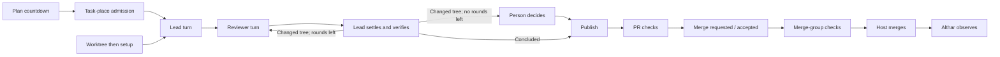

# Where task-flow time goes

Measured 4 November 2026, against `3ffcc477c66c`. Investigation only; no runtime changes.

**The large costs are local work/verification, admission queues, explicit stops for the person, and two successive CI gates. Ordinary step handoffs and dependency installation are usually seconds.** The Mac is heavily overcommitted, but these records cannot assign a defensible percentage of task time to it. Althar also has avoidable cross-task blocking in its poller and countdown dispatcher, and automatically reruns failed CI jobs before waking a lead.

## Evidence and limits

Selected the profile's **last 20 tasks in `done`, ordered by `settled_at`**, as of 21:19 UTC. This includes one anonymous research task. Its project and content are withheld; the row remains only to preserve the selected cohort and its statistics. Seventeen have merged PRs; three have no attached PR. Some were reopened or left awaiting a decision for days. Their plans end at draft/ready/none, not automatic merge (`TaskEnd`, `packages/contracts/src/Api.ts:1201`). Consequently, their median creation-to-done time, **19h48m**, includes substantial time awaiting merge action or further conversation, not just autonomous execution.

Read `~/Library/Application Support/Althar/althar.sqlite` and its WAL through temporary copies. A live `mode=ro` connection and backup both failed with `database is locked`, including outside the sandbox. This is explained by [Database.ts](../../packages/persistence-sqlite/src/Database.ts):56–75: deliberate exclusive profile ownership, **not evidence of a blocked writer or a sandbox defect**. Database/WAL sizes and nanosecond modification times were unchanged across the copy, and the copied database passed `PRAGMA integrity_check` (`ok`). Copying two live files is not an atomic SQLite backup; this remains a snapshot limitation. The source database was never written to.

The profile-derived exports are redacted for this public repository: **all task titles and project names are omitted, profile IDs are replaced with local aliases, and every event position is a whole-minute offset from its own task's creation**. No absolute profile timestamps, prompts, command arguments, credentials or tool output are included. Exact elapsed durations are retained separately so rounding event positions does not change the measured medians. Public PR links and GitHub's already-public timestamps remain; offsets can still reveal approximate timing around those public events. The anonymous research task's content is also omitted from the prose below.

- [Task totals and disjoint wall-state estimates](task-flow-latency-data/tasks.csv).
- [Plans, worktrees, setup, every attempt and turn, provider startups, attention, holds and host observations](task-flow-latency-data/phases.csv).
- [Exact elapsed samples](task-flow-latency-data/samples.csv), [extraction and summary script](task-flow-latency-data/reproduce.py), and [public PR merge timestamps](task-flow-latency-data/prs.csv).
- [GitHub check timestamps](task-flow-latency-data/checks.csv): all returned check runs on the 17 final PR heads, including retry records, plus PR #583's merge-group jobs. GitHub's REST API was read through the connected GitHub tool. Pagination was checked: every head returned fewer than 100 checks. This does **not** include every job on superseded heads or every historical merge-group attempt.

The SQLite snapshot does not store per-job CI start/end timestamps, CPU seconds per tool, or historical machine pressure. Tool intervals below are **estimates** from `thread_items.created_at` through the final `change_log.changed_at` of a terminal tool item, intersected with its task's recorded turn intervals. Status/output enrichment can extend that endpoint. A tool being open does not mean it was consuming CPU. An agent turn being open does not mean the model was computing continuously.

## What is measured

| Phase / interval | Samples | Median | Worst | Interpretation |
| --- | ---: | ---: | ---: | --- |
| Plan proposed → accepted/decided | 21 plans | 25.00 s | 3h38m | Includes manual starts and held/replaced plans; not all delay is countdown |
| Task/workspace created → worktree ready | 20 workspaces | 3.51 s | 15.77 s | Git preparation envelope |
| Recorded setup started → ended | 20 setup entries | 7.43 s | 27.77 s | Only entries with both endpoints |
| Provider starting → active | 103 successful starts | 3.84 s | 23.43 s | Excludes first-response latency and failed starts |
| Attempt admitted → started | 119 attempts | 1.27 s | 19h06m | Tail includes held/restarted attempts; not a pure startup metric |
| Implement started → ended | 43 attempts | 7m57s | 54m07s | Includes follow-up work, tools and interruptions |
| Review started → ended | 38 attempts | 3m26s | 16m53s | Reviewer work, including its tools |
| Settle started → ended | 20 attempts | 13m19s | 40m59s | Fixes and verification are substantial |
| Publish started → ended | 18 attempts | 8.76 s | 26.51 s | Includes no-change publication attempts |
| Previous attempt ended → next admitted | 99 pairs | 3.75 s | 4d21h42m | Long tail includes later conversations/reopened work |
| Same gap, restricted to 0–60 s | 71 pairs | 0.31 s | ≤60 s by selection | Descriptive subset, not a separate unbiased population |
| Turn requested → delivered | 162 completed/interrupted turns | 1 ms | 20 ms | Local dispatch acknowledgement, not model response |
| GitHub merged → Althar observed merge | 17 PRs | 18.69 s | 142.05 s | Direct host-versus-local comparison |
| Automatic CI rerun → next result on same SHA | 5 matched episodes | 7m07s | 12m51s | Seven reruns recorded across five tasks; two lack a matched later result |

**Admission waits are real.** Eleven `machine_busy` hold episodes have a median duration of **20m43s**, worst **105m42s**, until the next resume/running/terminal event. Examples: OpenCode Zen waited **105m42s**; the no-change task waited **44m40s**. This is Althar's task-place admission, not a measured OS-pressure pause. Two `agent_unavailable` holds lasted 15 s and 233 s. No checkout hold was recorded in this cohort.

### All 20 tasks

Minutes, rounded. `Tools` and `Agent` separate estimated open-tool time from the rest of recorded turns. `Attention` is an open request, not a judgment that the person caused the delay. `Admission` is the remaining admitted-to-start interval. `CI` is the **observed running-to-result envelope**, including observation delay, not exact runner execution. `Other` includes merge queues, decision time without an attention record, offline periods, follow-up conversations and uninstrumented gaps. Small setup/startup categories are in the CSV, so the displayed columns do not sum exactly to the total.

The disjoint partition gives overlapping intervals this precedence: attention → tools → remaining turn → setup → provider startup → admission → observed CI → other. It is a wall-state accounting convention, not a causal attribution of work or CPU. For example, an open attention request can overlap unrelated activity in the same task.

| Task | PR | Total | Tools | Agent | Attention | Admission | CI | Other |
| --- | ---: | ---: | ---: | ---: | ---: | ---: | ---: | ---: |
| Stuck card: real review rounds | [583](https://github.com/AltharIDE/althar/pull/583) | 28.61 | 2.38 | 8.45 | 0 | 0 | 8.22 | 9.45 |
| Bulk issue tools | [581](https://github.com/AltharIDE/althar/pull/581) | 157.87 | 36.54 | 15.49 | 84.42 | 0 | 7.93 | 13.30 |
| Read other tasks' work | [580](https://github.com/AltharIDE/althar/pull/580) | 141.87 | 34.53 | 16.64 | 70.36 | 0 | 7.94 | 12.28 |
| Conflicts/checks back to work | [568](https://github.com/AltharIDE/althar/pull/568) | 738.73 | 127.95 | 30.35 | 1.71 | 0.85 | 27.32 | 549.36 |
| Cramped usage note | [572](https://github.com/AltharIDE/althar/pull/572) | 27.55 | 4.46 | 6.77 | 0 | 0.20 | 7.09 | 8.83 |
| Anonymous research task | — | 7269.05 | 20.76 | 11.84 | 0 | 0 | 0 | 7236.00 |
| OpenCode Zen usage | — | 1410.54 | 0.98 | 1.55 | 0 | 105.59 | 0 | 1301.84 |
| Plan-card model label | [524](https://github.com/AltharIDE/althar/pull/524) | 1630.47 | 2.95 | 1.53 | 13.36 | 0.01 | 18.49 | 1593.94 |
| Local/checkout/worktree | [564](https://github.com/AltharIDE/althar/pull/564) | 1512.36 | 155.49 | 87.02 | 1109.35 | 30.06 | 14.68 | 114.57 |
| Run dropdown | [563](https://github.com/AltharIDE/althar/pull/563) | 8546.30 | 94.97 | 33.96 | 0.16 | 0 | 23.57 | 8393.28 |
| Usage week share | [565](https://github.com/AltharIDE/althar/pull/565) | 46.25 | 11.89 | 9.73 | 0 | 0 | 7.23 | 17.04 |
| No-change task outcome | [561](https://github.com/AltharIDE/althar/pull/561) | 158.35 | 31.32 | 16.51 | 0 | 44.56 | 33.30 | 32.13 |
| Rules and git | [557](https://github.com/AltharIDE/althar/pull/557) | 1254.49 | 59.88 | 29.21 | 961.02 | 96.01 | 45.19 | 62.21 |
| OpenCode Go sign-in | [559](https://github.com/AltharIDE/althar/pull/559) | 122.96 | 53.24 | 28.96 | 0 | 0 | 13.88 | 26.62 |
| Usage pricing | [558](https://github.com/AltharIDE/althar/pull/558) | 68.92 | 22.20 | 23.71 | 0 | 0 | 7.61 | 15.08 |
| Findings in Changes | [543](https://github.com/AltharIDE/althar/pull/543) | 1336.32 | 102.27 | 41.87 | 0 | 0.49 | 35.40 | 1155.72 |
| Coordinator merges | [556](https://github.com/AltharIDE/althar/pull/556) | 1392.68 | 75.60 | 40.83 | 998.10 | 20.52 | 17.42 | 239.69 |
| Coordinator stops/restarts | [548](https://github.com/AltharIDE/althar/pull/548) | 1120.61 | 51.37 | 23.95 | 0 | 78.63 | 35.77 | 930.05 |
| Long-run settings | [477](https://github.com/AltharIDE/althar/pull/477) | 4816.64 | 63.68 | 28.16 | 0 | 23.72 | 162.79 | 4537.36 |
| Live skill check | — | 2490.37 | 0.94 | 0.59 | 0 | 0 | 0 | 2488.79 |

Across tasks, median estimated tool time is **35m32s** (worst 155m29s), remaining turn time **20m11s** (worst 87m01s), observed CI envelope **14m17s** (worst 162m47s), and unclassified time **2h57m08s**. Medians of components do not add up to the median total. Classifying command text for tests/checks/builds/installs gives **21m41s median** per task, up to **109m24s**; this is a heuristic subset of tool envelopes. Some calls combine editing and verification or hide commands behind wrappers.

### Three revealing paths

**Small copy fix, #583 (`task-01`):** relative to task creation, setup and the first turn began around minute 0; implementation ended around minute 2; review ran from around minute 2 to minute 11; publication finished around minute 11. Passed checks were observed around minute 19; the queue-entry notice appeared around minute 20 (`queue_entry_notice` in the phase export); merge was observed around minute 29. GitHub merged at 21:15:38 UTC on 4 November; Althar observed it **40.361 s later**. Private event positions are rounded to minutes; elapsed samples retain the precise interval lengths.

The [PR desktop jobs](https://github.com/AltharIDE/althar/actions/runs/41911673404) show the longest E2E job taking **6m35s**, of which 4m59s was the E2E command and 1m20s its apt installation. The [merge-group jobs](https://github.com/AltharIDE/althar/actions/runs/41913074951) then ran E2E again: longest job **7m06s**, including a 6m28s E2E command. Job queue waits for those two jobs were only 2 s and 3 s. This path pays for review and two successive remote validation gates; a faster Mac cannot remove those remote minutes. The merge queue verifies the combined tree, so removing that gate would sacrifice an existing correctness guarantee.

**Bulk tools, #581, and read-other-tasks, #580:** implementation took about 34 and 33 minutes; each reviewer took about 1½ minutes; each settle took about 16 minutes. They then stopped at `round_limit`, with **zero open findings**, for **84m25s and 70m22s**, respectively, before publication. This is intentional: changed code after the last allowed review requires the person ([Runs.ts](../../packages/runtime/src/Runs.ts):3632–3653), even if findings are settled. The already-open task **“Setting: carry on when review rounds run out”** addresses this policy; do not file a duplicate. Its eventual behavior must retain an honest record of which tree was reviewed.

**Conflict/check repair, #568 (`task-04`):** implementation 54m07s, then three review/settle pairs, another review, and publication around minute 114. Conflict notice → next lead turn: **29.753 s**; that turn lasted about 13m44s. A later implement attempt waited **28 s** in `machine_busy`. Around minute 179, failed checks triggered an automatic rerun; the next failed result and notification arrived around minute 186. That is **7m16s from the first failure observation on that SHA to notification**, predominantly the rerun cycle. Checks were green around minute 203; queue entry was announced around minute 736; GitHub merged at 09:32:32 UTC on 4 November. The **8h53m green-to-queue gap** (32,001.890 s in `samples.csv`, metric `green_to_queue_notice`) belongs to time awaiting merge action, not continuous tests or a polling sleep. The records do not prove every intervening decision's cause. The queue-entry source is `thread_items.created_at`, joined through `threads.task_id`, with `kind='notice'` and the runtime title pattern `PR #<number> is in the merge queue for main.`; its text is not exported.



## Mac versus Althar

Read-only OS observations at approximately 21:20–21:25 UTC, with no processes stopped or settings changed:

- **10 CPU cores, 24 GiB RAM** (`sysctl`). Load averages **13.39 / 16.17 / 15.18**; load is not CPU utilization and does not reveal an individual task's slowdown.
- **18,993 MiB swap in use**, out of 19,456 MiB. `vm_stat`: 3,765,761 pages stored in compression represent **57.5 GiB uncompressed**; 616,828 occupied compressor pages consume **9.4 GiB physical**. These are two descriptions of compressed memory, not additive allocations. The 31.4M swapins and 40.1M swapouts are cumulative since boot, not current rates. One sample cannot prove ongoing thrashing.
- An unattributed `sh` with parent PID 1 was near **98% of one core**, with a 20-day lifetime. The Android emulator used about **48%**, WindowServer **47%**, and Althar's main renderer **22%** in the later sample. The earlier renderer sample was 32%. Thus competing work is visible; it is not all task execution. The shell's ownership was not established.

Recorded running agent PIDs were correlated with their current descendants. These **resident-memory lower bounds** omit compressed/swapped pages, reparented children and process peaks; roots were present with plausible process ages, but OS birth-time identities were not independently matched. CPU is `ps`'s point-in-time percentage, not an integrated phase cost.

| Task / session sampled | Processes | RSS | CPU, one core = 100% |
| --- | ---: | ---: | ---: |
| Other target branch: Claude lead and current children | 6 | 799 MiB | 27.4% |
| Same task: retained Codex session and MCP/tool children | 21 | 372 MiB | 0% |
| Review-round setting: Claude session | 2 | 112 MiB | 0.1% |
| Same task: OpenCode reviewer and children | 4 | 383 MiB | 5.2% |
| Homepage prototype: Claude session | 2 | 235 MiB | 1.5% |
| This investigation: Codex and tool/MCP children | 19 | 622 MiB | 14.0% |

A bare agent session in this sample costs roughly 0.1–0.4 GiB resident; sessions with tool/MCP children reach 0.6–0.8 GiB, and one task retaining both agents exceeds 1.1 GiB. These are **observed configurations, not a per-task capacity estimate**. Installs, Vitest workers, builds and Electron can add separate bursts; their historical peak CPU/memory was not recorded. Althar budgets 2.5 cores and 3 GiB per task, giving a default of **four** on this Mac ([atOnce.ts](../../packages/runtime/src/atOnce.ts):4–48). The snapshot has no `settings.agents_at_once` override; `Busy.ts:320–324` therefore selects the machine default unless a runtime test/config override is supplied. This is not a measured reservation.

**Verdict:** Mac contention plausibly inflates local tests/builds and process startup, but its exact contribution is unmeasured. It does not explain the 70–84 minute round-limit stops, deliberate admission holds, or remote CI. No controlled one-task-versus-four test was run: doing so would add heavy work to this shared, already-loaded Mac, and existing runs do not provide a matched idle baseline. Do not infer a slowdown multiplier from different suites or worker counts. Scope a later benchmark to the same commit, suite, cache state and worker count, recording wall/CPU time, swap deltas and concurrent heavy jobs during naturally quiet and busy periods.

## Architecture findings

| Question | Source-confirmed answer |
| --- | --- |
| Polls versus events | Task PRs default to **30 s**, not two/five minutes ([Changes.ts](../../packages/runtime/src/Changes.ts):370–414,884). Running CI and queued merges refresh activity, staying on the fast path (3673–3677,3840–3841,5972). Genuinely quiet PRs back off to about five minutes after ten quiet minutes. `Follow.ts`'s two-minute running-check and `followBudget.ts`'s five-minute repository-list schedules cover **other PRs**; active task URLs are excluded at [Follow.ts](../../packages/runtime/src/Follow.ts):436. Existing local wakeups should be used more; a desktop webhook receiver would require additional infrastructure. |
| Poll architecture | [Changes.ts](../../packages/runtime/src/Changes.ts):5945–5972 awaits each task sequentially under its task lock, then background repository following. Its next sleep starts after the sweep (6149–6151). Normal failed-check/comment handling can await `sessions.startLast` inside that path (3542–3557,3888). A single slow host, task lock or provider start delays unrelated PRs. Actual per-sweep cost was not persisted. Conflict sweep is separately two minutes plus its work, with local merge wakeups already present (961–974,6083–6108). |
| Failed checks | [Changes.ts](../../packages/runtime/src/Changes.ts):3707–3739 normally reruns failed jobs once before waking the lead, although CI already retries individual failing tests. The three-minute rerun-visibility guard (414,3679) is conditional, not an unconditional sleep. Genuine failures can pay another complete runner cycle. |
| One session per step | **Already avoided.** [Runs.ts](../../packages/runtime/src/Runs.ts):2337–2354,2410–2452 reuses the lead for settling; reviewer rounds reuse sessions too (2249–2278). Refresh is conditional on model/account/availability and context thresholds ([handover.ts](../../packages/runtime/src/handover.ts):43–60). Successful provider startup is seconds in this cohort; wholesale session pooling is not the first fix. |
| Worktree/install reuse | Setup is once per workspace and can overlap provider startup; the first actual delivery awaits it ([Sessions.ts](../../packages/runtime/src/Sessions.ts):1880–1882). Setups are locked per workspace and different repositories' setups fork side by side ([Setups.ts](../../packages/runtime/src/Setups.ts):469–503). Installs here were seconds. Installed Bun 1.3.5's `install --help` reports `clonefile` as the default backend and supports a cache directory; verify cache hits before adding another store. Sharing a mutable `node_modules` via symlink/hardlinks needs lifecycle-script, patch and dependency-isolation analysis; it is poor value against the measured seven-second setup median. |
| Heavy-work capacity | [Busy.ts](../../packages/runtime/src/Busy.ts):250–272 derives static task capacity; person-origin work can bypass it (44–46,556–560,747–758). It does not throttle by `MachineLoad`. No general separate test/build gate exists. **There is already an E2E cap:** [e2e.ts](../../apps/desktop/scripts/e2e.ts):8–28,58–92 uses three shared slots across worktrees and excludes simultaneous runs in one worktree, with two-second polling. Agent shell commands need a cooperative wrapper; a runtime-owned-process gate alone cannot govern them. |
| Full local suites | Command inspection found targeted suites, sometimes broad batches repeated with two or three workers. It did **not establish bare root full-suite invocations** in this cohort. Local verification remains expensive: e.g. one multi-file desktop test command's envelope was 15m11s, and several runtime batches took 6–10 minutes. Enforce the current scoped-check/one-worker guidance; leave full validation to CI. |
| Accidental serialization | [Plans.ts](../../packages/runtime/src/Plans.ts):240–258 awaits each due plan's `start`, which reaches provider connection/briefing via `Runs.ts:3357` and `Sessions.ts:2600–2604`. One slow startup can delay other due plans despite free slots. Session/task/setup lifecycle locks are keyed, not a universal semaphore. `MergeLine.ts:987–990,1024,1114` serializes projects/lines and shares a project lock with merge tools; preserve same-target landing ownership when narrowing it. |
| SQLite | Single writer and exclusive profile ownership are intentional. Worktree preparation is outside the creation transaction (`Projects.ts:663–805`). The 200 completed command receipts since 3 November have median handler duration **2 ms**, worst **307 ms** (`attention.answer`). This excludes waiting to acquire the transaction and is not evidence that all writes are fast, but provides no support for minutes spent inside those handlers. |
| Missing measurements | [MachineLoad.ts](../../packages/runtime/src/MachineLoad.ts):11–28 keeps roughly two minutes **in memory, only while a window asks**. Existing `machine.ts` task marks can attribute reparented children. There is no durable phase/load history with which to separate past model latency, tool execution, swap pressure and lock waits. |

## Ranked follow-up tasks

Savings below are conditional opportunities, not promises. S = hours, M = about a day, L = several days including tests. No issues were filed.

| Rank | Task ready to take on | Potential time saved / confidence | Scope, implementation and acceptance |
| --- | --- | --- | --- |
| 1 | Finish the existing review-round continuation setting | **70–84 min** stops observed on #580/#581; high confidence in cause, behavior depends on the person's setting. M, medium risk. | Already being worked on; coordinate with **“Setting: carry on when review rounds run out”**. `Runs.ts`, plan/review settings and round-limit tests. Retain the reviewed-tree boundary and stop/continue policy; prove changed final settles continue only under the chosen policy. Do not silently call unreviewed fixes reviewed. |
| 2 | Make local verification follow the changed files and reuse its recorded result | Minutes on affected tasks; the **21m41s median test/build command envelope is the opportunity ceiling**, not all avoidable. High confidence in cost, unmeasured savings. M, low/medium risk. | `packages/testing/src/select.ts`, lead/reviewer instructions in runtime briefing code, `DEVELOPMENT.md`. Offer the existing dependency-based selection locally, one worker, and retain command+tree+result so an unchanged settle does not repeat it blindly. Never reuse results across changed trees or skip focused regression tests. Prove selection on representative diffs and invalidation on source/config/lockfile changes. |
| 3 | Avoid whole-job reruns for known genuine test failures | Matched rerun cycles **7m07s median, 12m51s worst**; five tasks affected. Some retries recover flakes, so not all are removable. M, medium risk. | `Changes.ts`, `tests/changesChecks.test.ts`, `changesEndings.test.ts`. Let known CI retries handle tests; reserve automatic host reruns for cancellation/transient infrastructure evidence, retain manual rerun. Tests must show a genuine failed job wakes the lead once, transient failures retry once, and stale results do not start duplicate repair rounds. |
| 4 | Remove cross-task blocking from PR observation | Seconds to minutes on affected sweeps; historical sweep durations unavailable. High confidence in architecture, medium confidence in impact size. M, medium risk. | `Changes.ts`, `changesChecks.test.ts`, `changesPullRequests.test.ts`, `followedPulls.test.ts`. Bounded independent poll workers; separate unrelated-PR following; start leads after durable handoff outside the polling lock (as conflict repair already does at 4613–4626). Preserve rate budgets, deduplication and per-task ordering. Hold task A's host/startup and prove B observes checks; repeated targeted wakeups must not starve full sweeps. |
| 5 | Add a pressure-aware cooperative heavy-work gate | Could reduce test slowdown/retries and contention-driven tails; **no measured multiplier**. L, medium risk. | `Busy.ts`, `MachineLoad.ts`, `Setups.ts`, `Launches.ts`, a test/build wrapper and `apps/desktop/scripts/e2e.ts`. Separate heavy-job admission from conversational slots, preserve interactive priority, integrate rather than stack incompatible E2E locks. Gate owned processes first; agent commands opt into the wrapper. Test fairness, cancellation/release, starvation and external-load backpressure with held fake jobs. Do not raise the task limit merely to erase the observed 20–106 min admission waits. |
| 6 | Persist bounded phase and load measurements | Enables attribution; **no direct saving promised**. M, low/medium risk. Do this before tuning rank 5's policy. | `Runs.ts`, `Sessions.ts`, `Setups.ts`, `Changes.ts`, `MachineLoad.ts`, `machine.ts`, persistence migration. Record queue reason/enter/leave, provider connect/session/first event, tool phase, poll sweep/lock wait, host completion versus observation, sampled CPU/memory/pressure. Correlate by task/attempt/tree; bound retention and avoid command/env contents. Export must reconstruct a held fake workflow and distinguish overlapping work. |
| 7 | Start due plans independently | Removes a preceding provider startup, **typically seconds here**, potentially longer on failure. High confidence in code path; historical incidence unmeasured. M, medium risk. | `Plans.ts`, `Runs.ts`, `tests/countdown.test.ts`. Separate atomic acceptance from bounded asynchronous startup with per-plan idempotency and cancellation. Hold A at `beforeNewSession`; B must start while A stays held and capacity exists. |
| 8 | Evaluate opening a draft before review/settle finishes | Can overlap draft checks with agent work; benefit unknown and stale-head runs can add cost. M, medium risk. | `Runs.ts`, `Changes.ts`, publish tests, relevant workflows. Start with a timing spike: draft/unit CI versus final-ready CI, number of superseded runs, final-tree validation. Keep final review and merge-group guarantees. This will not remove #583's entire second E2E run. |

Run only each follow-up's changed-package checks and the named relevant tests, e.g. from `packages/runtime`, `bunx vitest run --maxWorkers=1 tests/changesChecks.test.ts` or `tests/countdown.test.ts`; use held providers and Effect's test clock, not real-time sleeps. No full suites are needed for this report.

**Do not prioritize** shorter global poll intervals, a shared mutable install tree, a session-pooling rewrite, removing merge-group validation, or replacing SQLite. Those either target seconds, increase host/machine load, or weaken guarantees before the larger measured costs are addressed. No hardware purchase recommendation follows from this snapshot alone.

## Rechecking the result

The committed [reproduce.py](task-flow-latency-data/reproduce.py) contains the selection, every phase query/join, tool-envelope heuristic and disjoint partition. It uses only Python's standard library, opens SQLite with `mode=ro` and `query_only=ON`, checks integrity, and writes only redacted results into a **new** output directory. Use the original private snapshot or a consistent profile backup; rerunning on a newer profile selects a different cohort. The private snapshot is not committed. Do not use `immutable=1` on a live WAL database: it can hide uncheckpointed data.

Recompute all profile-derived headline medians and worst cases directly from the committed elapsed samples, with no profile access:

```bash
python3 docs/research/task-flow-latency-data/reproduce.py --summarize docs/research/task-flow-latency-data
```

For a new cohort, regenerate `prs.csv` from the public PR endpoints for its repositories, retaining `url` and `merged_at` (the committed file describes only the original cohort). Matching uses the full URL because PR numbers can repeat across repositories. Missing rows or empty merge times produce a warning and omit only the affected merge-detection lag samples; the other exports still complete. Queue notices use the actual external links from task observations; a notice without a unique matching link retains a blank URL and produces a warning instead of a green-to-queue sample.

To independently re-extract the phases and samples from a private backup (the command never modifies that backup):

```bash
python3 docs/research/task-flow-latency-data/reproduce.py /path/to/consistent-private-backup.sqlite \
  --out /tmp/althar-latency-recheck \
  --prs docs/research/task-flow-latency-data/prs.csv
```

The public `prs.csv` input supplies host merge times for merge-detection lag. Check/job data is separate from the private extraction: `checks.csv` was fetched from `GET /repos/AltharIDE/althar/commits/{head_sha}/check-runs?filter=all&per_page=100`, with run `41913074951/jobs` added for #583's merge group. `prs.csv` records `GET /repos/AltharIDE/althar/pulls/{number}` fields. `job-steps.csv` retains the public steps for the sampled #583 jobs from runs `41911673404` and `41913074951`; job duration is completed minus started, runner queue time is started minus created, and each command/apt duration is its step's completed minus started. These durations can be recomputed without the profile. Fetch later histories with pagination if a head has 100 or more check runs.

| Phase / elapsed sample | SQLite source and calculation (implemented in the script) |
| --- | --- |
| Cohort / lifetime | `tasks.state='done' ORDER BY settled_at DESC LIMIT 20`; `settled_at - created_at` |
| Plan | `task_plans.proposed_at/decided_at`; due time recovered from ordered `record_events.payload.startsAt` for that plan |
| Worktree | `workspaces.created_at` to first `record_events.occurred_at` with the workspace ID and `type='workspace.ready'` |
| Setup | Task-thread `thread_items.kind='setup'`, JSON `content.startedAt` to `content.ended.at` |
| Attempts / handoff | `runs.task_id → workflow_executions.run_id → nodes.execution_id → node_attempts.node_id`; admission/start/end; next admission minus previous end, ordered by admission |
| Turn / dispatch | `turn_deliveries.thread_id → threads.task_id`; delivered-to-ended, and delivered minus requested |
| Provider startup | `provider_sessions.thread_id → threads.task_id`; first active event minus first starting event via `record_events.aggregate_id`; fallback to `provider_sessions.started_at` if no starting event |
| Attention / admission holds | `attention_requests.created_at/answered_at`; hold events through the attempt join, from `node_attempt.held` until next held/running/resumed/terminal event |
| Tools / heavy tools | Terminal task-thread `tool_call` items, creation to last `change_log.changed_at` for the item, intersected with delivered-to-ended turn intervals; the script contains the command classifier, which exports no command text |
| Observed CI / reruns | `observations.subject_id → external_links.id → external_links.task_id`; `checks_running` or `checks_rerun` to next `checks` on the same link and SHA |
| Queue entry / green-to-queue | Task-thread `notice` title matching the runtime queue-entry pattern above; notice `created_at` minus the most recent preceding passed `checks` observation on that PR |
| Merge detection | `observations.kind='merged'.observed_at` minus that PR's public `merged_at` |

`phases.csv` names its source fields per row. `start/end/due/started_offset_min` are rounded positions, **not inputs for precise duration arithmetic**; `duration_s` is the exact endpoint difference (attempt rows use admitted-to-ended). `samples.csv` stores exact elapsed samples, including started-to-ended attempt durations, inter-attempt gaps, dispatch delays, green-to-queue and merge lag. Its `task` aliases join the phases and totals; `reproduce.py --summarize` groups by `metric`. Counts include **748 phases**, with 23 queue-entry notices and 13 conflict notices, **119 attempts, 162 turns, 103 successful startups, 11 capacity holds**, and **538 unique GitHub checks/jobs across 17 PRs**. The additional notice rows make the narrative paths recheckable without publishing notice bodies.

Validation: snapshot integrity passed; regenerated task totals and disjoint categories match the original accounting; rounded category totals reconcile within 3 s/task. All phase counts above and headline elapsed statistics were recomputed from the redacted exports. Exact elapsed samples retain at most 1 ms rounding, so a median may differ by at most 0.5 ms from computing it before rounding. The exporter was also checked with missing PR metadata, empty merge times, and identical PR numbers in two repositories: incomplete metadata warns and skips only the affected lag samples, actual queue URLs and intervals survive, and refreshed metadata restores the full sample set. The original cohort re-extracts byte for byte. No runtime code changed and no product tests were needed. GitHub includes incomplete old check records and occasionally negative start/end ordering on **skipped** jobs: retain their source values, exclude them from duration calculations. Remaining gaps: older-head/merge-group job history, process birth identities and reparented-process attribution, matched idle-versus-loaded suite timing and first-token/tool-execution telemetry. These prevent an exact Mac-versus-Althar percentage, not the queue/round-limit/CI findings above.
