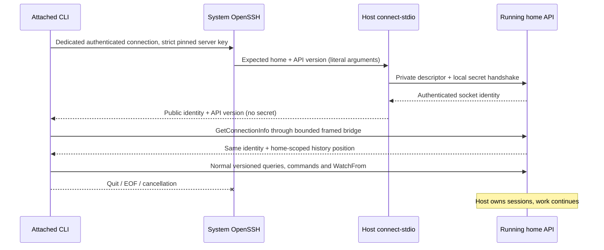

# @althar/transport-node — Architecture

Owner: repository maintainers. Depends on `@althar/contracts`, Effect and `ws`; TLS/HTTP and stream ownership use Node APIs.
Consumed by the runtime's socket compatibility exports, Linux host and CLI.
No Electron, database or provider dependency belongs here.

`streamPort` owns separate byte streams or a socket. It uses the existing
four-byte big-endian length prefix and contracts wire codec. Authentication
frames are at most 16 KiB, ordinary RPC frames at most 96 MiB, messages waiting
for a consumer at most 32 with a bounded total size, and queued writes at most
128 MiB. One allocation holds each frame regardless of fragmentation. Invalid
lengths, malformed UTF-8/wire data, EOF, stream errors and overflowing queues
close the transport. Deferred buffered delivery preserves the one-shot auth to
RPC listener handoff even when frames are coalesced.

`authentication` is shared with the existing runtime socket client. It checks
the exact API version, expected home and device, and refuses authority upgrades.
`endpoint` reads an existing private descriptor through a bounded no-follow file
handle and checks ownership/modes on POSIX. It neither repairs permissions nor
creates a profile. `apiClient` verifies the RPC identity, version and history home
again before returning any command methods.

The SSH bootstrap is one fixed shell command whose values are quoted. The SSH
process has no TTY, interactive prompts, agent forwarding or shared control
socket. Diagnostic memory is bounded and failures expose constant messages.
POSIX cleanup terminates its own process group; Windows uses the native process
tree cleanup. Connect/auth/status deadlines and keepalives bound stalled
connections. A disconnected command has an uncertain outcome: callers keep
command IDs and never automatically replay commands. Feed recovery uses a
snapshot's checked `FeedPosition`, never a cursor from a different home.

SSH proves access as the remote OS account. That account already has access to
the local private endpoint and its socket authority. This is a personal trusted
OS-user boundary, not worker isolation or a paired-device credential. The
bridge must never elevate that authority. Protected desktop enrollment,
multiplayer grants, relay transport, filesystem/preview channels and worker
leases remain separate work.

## Direct HTTPS/WSS

`https.ts` accepts canonical HTTPS origins only. Bootstrap requests are bounded
at 16 KiB, follow no redirects and have a ten-second deadline. Normal CA
validation remains available; the paired desktop instead uses the exact TLS
SPKI pin delivered out of band in the operator's code. For a private or
self-signed certificate, the agent withholds the socket from HTTP until the
key pin and validity dates pass. No pairing token or authorization header is
sent before that check. A renewal with the same key retains the pin; rotation
to a different key requires pairing again.

`pairing.ts` generates an Ed25519 software key, proves possession against the
invitation/home/name/key, and validates the returned connection-only device.
Codes are bounded, canonical base64url with explicit protocol/API versions.
Private keys remain with the caller and never reach a home. Software storage
is not proof of human approval.

`webSocket.ts` signs a fresh HTTP challenge and presents its one-use proof in
the WSS upgrade header. The runtime authenticates before upgrade, so large
RPC frames are accepted only on authenticated connections. Binary WebSocket
streams reuse the private socket's wire codec, framing and queue budgets.
Compression is off; clock-driven ping/pong detects half-open peers. The caller
checks the authenticated identity, API version and RPC identity before commands.
`untilPortCloses` releases connection-owned RPC layers and subscriptions while
admitted commands remain owned by the runtime. Commands are not replayed on
reconnect; the shared checked history positions remain required.
