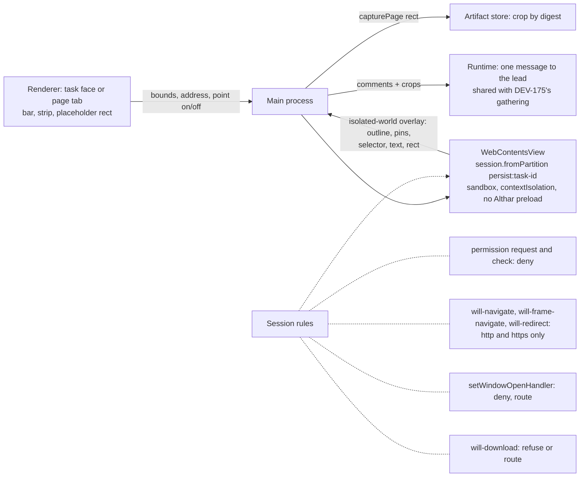

# A browser in Althar (DEV-83): five directions

A prototype, to be deleted once a direction is picked. It is the real desktop app (router, window tabs, task screen, thread, composer, kit) on the tests' fake client, in a browser, opened on althar's task **Runs on: say what each system needs**. That task changed the public site's "Runs on" band so each system names the oldest version it needs. The page inside Althar's browser is the **real Althar site**, served twice by this prototype's server: as main runs it (shown as `localhost:5320`) and as the task's branch changed it (`localhost:5321`). After the person's comments, the lead's second go lands on the task's run (`rev=2`).

An `<iframe>` stands in for Electron's `WebContentsView`. The crop each comment carries is drawn by a headless Chromium on the prototype's server (`/__crop`), as `webContents.capturePage` would draw it. The lead's evidence screenshots are drawn the same way.

From the repository's root:

```bash
cd packages/ui && ./node_modules/.bin/vp dev --config prototypes/browser/vite.config.mjs
```

Then <http://localhost:5372/>. Althar keeps it as **Browser prototype** in Run's list.

- The strip under the window switches the direction (keys 1 to 5, or `[` and `]`). Its links go to the task or the project, make the page ask for the camera, and start over. In D, they also make the lead check the page. Where the app would have sent an address to the person's browser, the strip says so on its right.
- On the task, `p` shows the Preview (B, D) or Compare (C) face, beside `c`, `o` and `g`. In E it puts the task's run beside the conversation, and again takes it away.
- `⇧⌘C` (or **Comment**) points at the page. `↑` and `↓` widen or narrow the element. Click to write a comment: Enter adds it, Shift-Enter starts a new line, Escape stops. `⌘T` opens a new page in A.
- `?d=B&face=preview` opens a direction on its face, `?d=E&side=run` with the task's run beside its conversation. `mode=swipe|onion`, `width=narrow`, `run=off` and `page=<address>|new` (A) open a state, and `bare` leaves the strip out.
- `node shoot.mjs [id…]` takes every state in `shots.json`, at 1×, into `.althar/scratch/browser/shots`.

## The five at a glance

| | Where it lives | What it shows | Comments go to | Links from threads | The product bet |
| --- | --- | --- | --- | --- | --- |
| **A · A browser tab** | A page tab after the projects' tabs in the window's bar | Any web page | The task the page came from, another task's lead, or the coordinator (picked at Send) | Open in a page tab | Althar is where you browse while you work |
| **B · The task's preview** | A **Preview** face on a task, beside Conversation, Outputs, Graph | That task's run, only: host fixed, path typed | That task's lead, as one message | As today: the person's browser. The task's own run opens its Preview | The browser is a review instrument for one task's work |
| **C · Compare the change** | A **Compare** face on a task | Main's run and the task's: side by side, swipe or onion skin, scroll-locked. What the task adds is marked, and the lead's screenshots can be laid over the live page | That task's lead (comments only on the task's side) | As B | Althar reviews UI changes visually, and leads' screenshots are taken in the same browser |
| **D · Shared with the lead** | B's Preview face | The lead using it (pointer, what it's doing, its screenshots), with Take over / Give it back | As B | As B | Agents drive the browser the person sees |
| **E · Beside the conversation** | The conversation's workbench, on its right, where documents and files open; **Open as a tab** or **Open in your browser** if the person wants | Any web page, the task's run first | The conversation it is beside: comments go in its composer, sent with what the person writes | Open beside the conversation they're in | The page and the lead's conversation are worked on together |

E came from the person's steer after the first four: the window has no sidebar now, so the right side is free; a page should open there, beside the work, and only go to a tab or the person's browser if they choose.

D is in because it can be shown honestly. It is the answer "yes" to the issue's separate question (agents driving this browser), set on B's face. It is not a fourth way to place the browser.

## Every direction has

- **Its own session.** The shield in the address field says what that means, on request: cookies and storage of its own, apart from Althar and the person's browser (and, in B to D, from other tasks). Never the camera, microphone, location or notifications. Sign-ins open in the person's browser. Its actions are **Clear its cookies and storage** and **Open in your browser**. A page asking for a permission is refused, and one line under the bar says so, with Open in your browser.
- **Refused schemes, in place.** A `file:` address stays where it was, with "Files don't open here." and **Show in folder**. `javascript:`, `data:` and any other scheme get "Only web pages open here."
- **A sign-in sent out.** In A and E, a Linear issue from the thread asks for a sign-in. Its tab (A) or panel (E) says **Opened in your browser**, why, and Close (or Back). In B to D the question never comes up: only the task's run loads, and anything else goes to the person's browser, as today.
- **Point, comment, gather, send.** The element under the pointer is outlined, with its class. A comment is written beside it and left as a numbered pin. The comments gather at the page's foot as chips, each with its crop on hover. **Send** delivers one message to the lead: the page's address and viewport, then each comment with its element's selector and text, and the crops attached in order. The thread shows that message as the person's (the real component), and the lead answers. The strip then says where the comments went, with a way to it. E differs: its comments go in the composer beside the page, not a strip (below).
- **Chrome in Althar's language.** One 44px bar: back, forward and reload as small icon buttons, then the address in mono on a well (the widest thing in the bar), then what the direction adds (width, comparing), then Comment and Open in your browser. Lines under it appear only when something was refused or asked. Gathered comments sit in a strip at the foot, never over the page.

## A · A browser tab

**The product.** Althar becomes the place you browse while you work: docs, issues, pull requests and previews in page tabs beside the projects. Comments from any page reach any lead. It competes with the person's browser for attention and habit, and will be judged as a browser: find in page, zoom, password managers, sign-ins, extensions, history.

**As shown.** Every link in a thread, a run's card, the Running pill and Outputs opens a page tab, named by its host for a run, else by its title. The tab opens where the page came from (from the task's thread, the task). The page's screen covers the window under the bar, as a project's screen does. The + menu gains **New page** (`⌘T`), which lists what runs in the project. Comments go to the task the page came from unless another task or the coordinator is picked at Send. A page opened by hand goes to the coordinator, which can start a task from it.

**Cost.** The most of the four.
- Shared core: a `WebContentsView` per page tab, its bounds kept to the screen's rect by IPC. One persistent partition (`persist:althar-browser`). The scheme, permission and download rules, with tests.
- Pages in the window's tab store: kept between launches, `⌘W`, `⌘1–9` and Ctrl-Tab across projects and pages. Every link source in the app routed through it.
- History, titles and favicons. Pop-ups as tabs. Downloads, and a place to see them. Find in page, zoom, DevTools.
- The overlay (below), and the destination picker.
- The long tail of what people expect of a browser, which never ends.
- Roughly 4 to 6 weeks for one person to a first release, then upkeep.

**The issue's questions.**
- *Sign-ins.* They have to be settled before A is any use for issues and pull requests: private GitHub and Linear pages need a sign-in in this session. With DEV-79's leaning (sign-ins in the default browser), A shows public docs and runs only, and the issues it's meant for open outside. Allowing sign-ins to non-AI services in its own persistent session is possible, never for Claude.ai, and needs the terms checked.
- *Agents driving.* Risky here: a lead in the person's general browser, with their sign-ins. Keep it separate.
- *Downloads, pop-ups, extensions.* Pop-ups (`setWindowOpenHandler`) open as page tabs, OAuth pop-ups outside. Downloads go to the Downloads folder with a line. No extensions.
- *Runs open here by default.* Yes. It reopens ADR-023's passed-over alternative in full: every address opens here, with ↗ (or a modifier-click) for the default browser.

## B · The task's preview

**The product.** The browser is a review instrument for one task's work, not a browser. A task gets a **Preview** face showing its own run (its worktree's dev server), in a session of its own. Its comments go straight to its lead, gathered like diff comments (DEV-175) and sent as one message. There is no general browsing: links that leave the run go to the person's browser, and so do docs and issue links from the thread.

**As shown.** The face takes the conversation's place under the task's header. Its bar fixes the host (`localhost:5321`) and types only the path, and has Desktop and Phone widths (390, in a well). A task whose run isn't running says what shows here and runs it in the task's folder (**Run Site**). The run's card and the Running pill open the face. The send button says **Send 3 to the lead**: there is no picker, because the lead is known.

**Placement.** The issue asks for "a tab, following the app's tabs", with no side panels. B reads "tab" as the task's own face switch: a face is how a task already shows something whole (Outputs, Graph). It keeps to "no side panels" and adds nothing to the window's bar. If the issue meant the window's tabs, B departs from it on purpose: a preview belongs to its task, as Outputs does.

**Cost.** The least.
- The shared core, with one `WebContentsView` per open Preview face, in `persist:task-<id>` (or in memory), made on showing and kept warm while the task is kept (`KeptScreens`).
- The face, and routing a run's address to it.
- The overlay and its crops, sharing DEV-175's gathering, so comments on the diff and the preview go in one message.
- Roughly 1.5 to 2 weeks.

**The issue's questions.**
- *Sign-ins.* Only the run's own (a dev app's login on localhost) happen here. Everything else is outside, so DEV-79 and DEV-75 aren't touched.
- *Agents driving.* Not needed. The lead's headless `screenshot` tool keeps working. It can later take its shots in this task's session (C, D).
- *Downloads, pop-ups, extensions.* Downloads refused or sent to the person's browser. Pop-ups outside. No extensions.
- *Runs open here by default.* A task's run opens its Preview by default. A project's run on main still opens outside. ADR-023 changes narrowly: a task's run is shown where the task is.

## C · Compare the change

**The product.** The preview is about *what changed*. A task's **Compare** face shows main's run and the task's run of the same page:
- side by side, at the same desktop width, scaled to fit;
- or swiped at full size, a handle between them;
- or as an onion skin, the task's faded over main's.

Both scroll together. What the task's page says that main's doesn't is marked in green ("3 changes", stepping through them). Comments are made on the task's side only. The lead's screenshots sit at the face's foot, and each opens laid over the live page, at the viewport and scroll it was taken at, faded between screenshot and live. That shows whether the evidence is still what the page shows: after the lead's second go, its earlier screenshot no longer matches the band. The same face could back PR reviews: a review task compares the pull request's run with main's.

**The split, and the issue.** C's two halves are one comparison of one page, like a diff's split view, not a panel beside the work. It is still a face of the task, and swipe and onion skin keep a single frame. Side by side is the default only because it reads at a glance.

**Cost.** B, then:
- A second `WebContentsView` for main's run, started on demand (ADR-044 runs on main), and scroll locked between the two over IPC.
- The text diff for the markers, and the overlay on both views.
- Swipe and onion skin can't be two live native views: a `WebContentsView` is a native layer and can't be clipped by or blended with the window's page. They'd be stills: `capturePage` of both at the same scroll, taken again when scrolling ends. Or the two pages rendered offscreen (`offscreen: true`, paint events into a canvas), which costs CPU. The evidence overlay is the same.
- Leads' screenshots taken in the task's session, at the face's viewports, so they line up.
- Roughly 3 to 4 weeks with B.

**The issue's questions.**
- *Sign-ins and downloads.* As B.
- *Agents driving.* C leans in. The lead's screenshots come from the same browser and session the person compares in, so its evidence and the person's view agree. That's a small step: point the existing screenshot tool at the task's partition and viewports.
- *Runs open here by default.* As B, and main's run starts on demand to compare.

## D · Shared with the lead

**The product.** The lead uses the same preview the person sees. It navigates, scrolls, changes the width and takes screenshots while the person watches. A line says what it's doing, with **Take over**, and a press on the page takes over too. **Give it back** lets it carry on. Its screenshots come back in the thread. In the prototype the lead checks its fix after the person's comments.

**Cost.** B, then:
- Tools for the lead (navigate, click, type, scroll, read, screenshot) acting on the task's view through the main process: `webContents.debugger` (CDP) or `sendInputEvent`.
- Who has the view, with the person's input locked out while the lead acts.
- Rules for what a lead may do in a page.
- Roughly 2 to 3 weeks more.

The issue lists agents driving as a separate decision. D is what deciding yes looks like.

## E · Beside the conversation

**The product.** A page is something you look at *with* the lead, so it opens beside the conversation, never instead of it. It goes on the conversation's **workbench**: the column on its right that already holds a lead's documents and the files it names. The kit's `Workbench` was written for this ("later a page of what runs"). The run's card, a link in the thread, the Running pill and `p` open the page there. The conversation stays on the left, narrower, with its composer. Point at the page and each comment lands in that composer as an attachment. The person adds a word or not, and sends one message, as they send anything to the lead. It's general, like A: docs, the public changelog, a pull request open beside the thread too. But a page always belongs to a conversation, its lead is known, and its session is the task's. Two ways out, when the person wants them: **Open as a tab** takes the page into a tab of its own after the projects' (A's tab, history and comments with it), and **Back beside the task** returns it; **Open in your browser** sends it out.

**As shown.**
- The panel's head is the browser's bar: back, forward, reload, the address in the task's session, Comment, Open in your browser, Open as a tab, Close (`esc` with focus in it). Under it, the page at the panel's own width: the site lays itself out for that width, and dragging the workbench's edge (double-click puts it back) is a quick responsive check.
- It starts at half the window and leaves the conversation at least 440px.
- Each task keeps its own page beside it. Another task, or the project, shows its own or none.
- From the coordinator's conversation, a page opens on its workbench too. The project goes to its Conversation view, the board stepping aside for the page. Its comments go to the coordinator.
- Comments are chips in the composer (a number, the note, the element) next to the person's own attachments; ✕ takes one off. The page keeps their numbered pins. Sent, the person's words come first, then the comments, as in the other directions.
- A sign-in opens in the person's browser, and the panel says so. `file:` and `javascript:` are refused as elsewhere.

**The issue's "no side panels".** E sets it aside on purpose, at the person's word. The case for it: the comments are written to the lead whose conversation is right there; the person reads the lead's report and checks the page without switching; the workbench already exists and already means "what opens beside the thread". It doesn't add a panel to the app, it puts one more kind of thing on the existing one. The issue's line should be updated if E is picked.

**Cost.** Between B and A.
- B's core: a `WebContentsView` per open page, in `persist:task-<id>` (and one per project for the coordinator's), the scheme, permission, pop-up and download rules, and the overlay and its crops.
- The view's bounds follow the workbench's rect as it opens, is dragged and closes (a ResizeObserver over IPC, every frame of a drag).
- The native view sits over the window's page, and the task header's right-hand menus (Run's list, ⋯) drop over the workbench. Each Althar popover that can open over it hides the view, or swaps in a `capturePage` still, while open. More of them reach it here than in B's face, which is under the header too, but the composer's menus never do.
- A new kind of composer attachment: a comment, with its crop on hover, sent with the message. This is where DEV-175's diff comments would go too: one place to gather what's sent to the lead.
- Open as a tab: A's page tab, without A's new-page and browsing extras. History and comments move with the page; the view moves rather than reloads. Roughly 1 to 1.5 weeks, and it can come later.
- Roughly 2.5 to 3 weeks without the tab.

**The issue's questions.**
- *Sign-ins.* As A, but narrower in practice: what opens beside a task is mostly its run and the links its lead gives. A sign-in goes to the person's browser, and the panel says so. Sign-ins in the task's session to non-AI services can come later, never Claude.ai.
- *Agents driving.* D's machinery fits better here than anywhere. The lead says what it's doing in the conversation, and the person watches the page beside it, with Take over.
- *Downloads, pop-ups.* Pop-ups replace the page in the panel (or open as a tab once tabs exist); OAuth pop-ups go out. Downloads go to the Downloads folder with a line. No extensions.
- *Runs open here by default.* Yes, beside the conversation they come from: a task's run beside the task, a project's run beside the coordinator. Links in threads too, with ↗ (or a modifier-click) for the person's browser. This reopens ADR-023, as A does, but where the work is rather than in a new tab.

## What the real thing would use, and where this prototype differs



- **The view.** A `WebContentsView` (Electron 44; not `<webview>`, not the deprecated `BrowserView`), added to the window's `contentView`. Its bounds follow a placeholder element in the renderer (a ResizeObserver, sent over IPC). Its `webPreferences`: `sandbox: true`, `contextIsolation: true`, `nodeIntegration: false`, and no Althar preload. A small preload of its own exposes only the overlay's messages, in an isolated world.
- **The session.** `session.fromPartition('persist:task-<id>')` for B to E (beside the coordinator, `persist:project-<id>`; one `persist:althar-browser` for A). Permissions are denied by `setPermissionRequestHandler` and `setPermissionCheckHandler`, as `screenshotWindow.ts` already does for the lead's shots. Navigations are checked on `will-navigate`, `will-frame-navigate` and `will-redirect`: only `http:` and `https:`, never `file:` or `javascript:`. Typed addresses go through the same check, and the `file:` line comes from it. `setWindowOpenHandler` denies and routes. `will-download` refuses or routes. Tests cover each rule (the issue's Done when).
- **The overlay.** The biggest difference. The view is a native layer drawn over the window's page, so Althar's DOM can't draw over it. The prototype's iframe is same-origin, so the outline, pins and comment box are drawn in the app's own DOM, with the element read straight from the page. The real overlay would be injected into the page's isolated world (`executeJavaScriptInIsolatedWorld`, a shadow root) and send the selector, text and rect back. The comment box would be drawn there too, or in Althar's strip under the view. The same applies to any Althar popover that opens over the view: the header's menus, Run's list, hover cards. Each must hide or shrink the view while open, or show a still in its place.
- **The crop.** `webContents.capturePage(rect)` of the live view, so it shows what the person saw (an open menu included), at device pixels. It's stored in the artifact store and sent by digest, as the lead's pictures are. The prototype draws it by loading the same page again in a headless Chromium at the same viewport and scroll. Anything only on screen in the moment isn't in its crops.
- **What the lead receives.** The prototype sends the real person's message: text and attached images. Built, it would share DEV-175's gathered comments, so diff lines and page spots go in one message. It could earn a block of its own in the thread, each comment beside its crop, linking back to the spot.
- **Also stand-ins:**
  - The addresses are mapped: `localhost:5320` and `5321` load this server's `/site.html?run=…`, and `althar.ai` loads main's copy.
  - Pages of the web the prototype doesn't serve show a dashed "Not in this prototype" note.
  - A's page screen is laid over the window rather than routed.
  - E's comments are the composer's file chips (a file glyph, the note, the element). Built, they'd be an attachment of their own, with the crop on hover.
  - E keeps the page while the conversation face shows. On Outputs, the page beside the evidence would be the next step (the lead's screenshots left, the live page right).
  - A permission request is set off from the strip.
  - D's lead follows a script.

## Recommendation

**Build E's placement with B's focus first, then grow it.**
- The page opens on the conversation's workbench, beside the lead it's about, in the task's own session. That's the strongest form of "point at the page, the lead gets it": the comments are written into the composer of that lead's conversation, with the person's own words. The person asked for the right side, and the workbench is already the place for what opens beside a thread.
- Start with B's scope inside it: the task's run (the run's card, the Running pill, `p`) and the run's own links open beside the task. Other links keep going to the person's browser for now, so sign-ins aren't a question yet.
- Then widen it to the thread's links (E as shown), and add **Open as a tab** when people ask to keep a page while moving between tasks.
- C's comparison comes next. Its side by side needs width, so it stays a face (or the workbench widened to the window), not a mode of the panel.
- Point the lead's screenshot tool at the task's session as part of that, and D's driving, if decided yes, plays out beside the conversation.
- Leave A's general browsing unbuilt. E keeps what was good in it (any page, and a tab when wanted) without competing with the person's browser.

**Build first:** the shared core, on the workbench:
1. A `WebContentsView` in the workbench's rect, in `persist:task-<id>`, following the drag and hidden under Althar's popovers, with the scheme, permission, pop-up and download rules and their tests (the issue's Done when).
2. A task's run address opening beside the task: its card, the Running pill, `p`. ↗ for the person's browser.
3. Point-and-comment, with `capturePage` crops, as composer attachments sent with the message (shared with DEV-175's gathering).
