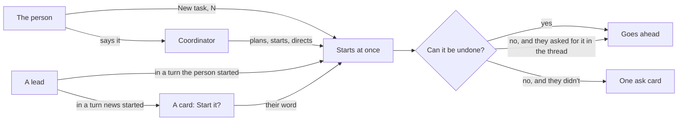

# Capable agents, optional coordinator

A prototype, to be deleted once directions are picked. It is the real desktop app (router, project screen, board, task threads, settings, kit) on the tests' fake client, in a browser, as althar stands on 6 November: five tasks at work or waiting, a task the ADR's lead started, a design review that used the person's own MCP servers, and Linear's open issues. Seams in `vite.config.mjs` swap a few imports of the real screens for this page alone; nothing in the app changes.

From the repository's root:

```bash
cd packages/ui && ./node_modules/.bin/vp dev --config prototypes/capable/vite.config.mjs
```

Then <http://localhost:5367/>. The strip under the window picks the surface (keys 1 to 6) and its direction (A, B, C, and T for today; `[` and `]` step through them). Its links go to where the surface shows, and Start over puts back what was started or answered. `?s=rules&d=B` opens on a surface and direction, `bare` leaves the strip out, and `node shoot.mjs` takes every state into `test-results/capable`.

What the person decided on 6 November, and what each surface draws from it:



## 1 · New task, without the coordinator

New task sits in the project's header beside Run, on every view, with **N**, as b steps through the views. It takes the words or Linear issues (several make a batch), a model that defaults to **Auto** (the coordinator's own routing, which says what it picked and why, with each model's usage in the picker), review, the branch it works toward and where it works. Start starts it: no plan card, no countdown, the card in Running at once. **Small change** is the first choice, not a setting: no review, a lead at low effort, so it takes the quick lane #637 built; it says so in one line. The coordinator stays the composer of the conversation, for "start the small ones from this cycle".

| Direction | Where you write it | Linear batch | Small change |
| --- | --- | --- | --- |
| A · A dialog | A dialog over whatever the project shows, Team dialog's rows | Describe it / From Linear, a checklist; Start 3 tasks | Task / Small change, at its top |
| B · The composer | The conversation's composer, switched from Coordinator to New task at its edge; the task's choices are words in its lower row | A From Linear word, a checklist menu | A Small change word in the row |
| C · On the board | A card at the top of Running you write into; Start leaves it there as the task's card | From Linear in the card | Task / Small change, at its top |

**Recommendation: A.** It works the same from every view (the board alone has no composer), it has room for a batch, and it is the shape the person already knows from changing a team. B is quickest for someone already typing, but one composer that sends to two places will send to the wrong one, and its row crowds. C is the nicest arrival (the card you wrote is the card that runs) and fits the board alone, but beside the conversation a lane is 230px: the model note and Linear's titles don't fit, and it isn't there from a task's thread. Take C's arrival into A: the new card lands in Running where the eye already is. Up next's empty state offers New task beside Talk to the coordinator in every direction.

What the runtime needs:
- A **StartTask** command from the window: words or issue keys, the lead (an agent and model, or Auto), effort, review on or off, `toward`, `worksIn`. It starts at once: a plan already started (`startsAt` null, no `startsAfter`). One task per issue for a batch, each linked to its issue and moved to In Progress as the coordinator does.
- **Auto** as a runtime function the coordinator also calls (words, issue, kind → agent, model, effort, review), with a reason line, readable before starting so the window can say "Opus 5.5 at xhigh: design work goes to Claude". The project notes (design on Claude, reviews on GPT-6.1 Sol) are its inputs.
- **Small** is a plan with no review and a low effort, which #637's quick lane already reads; nothing new beyond that.
- The task's `request` is the person's words, and its thread opens with them, as a coordinator-planned task's does; who started it is recorded (`startedBy: person`).

## 2 · A task a lead started, and the coordinator in a task

Seen on the board, in the ADR's thread (its lead split the Codex network change out), in the child's thread, and with the coordinator pushing on the person's word and passing on what they said.

| Direction | On the board | In the parent's thread | The coordinator | A turn the person didn't start |
| --- | --- | --- | --- | --- |
| A · A line of lineage | The child's card: "From ADR: agents work…" at its foot, opening the parent | Its card, under way at once, with Stop | One line per act: "Coordinator  Pushed 4 commits, on your word." | A card: Start *Reviewers… run its tests*? Not now / Start it |
| B · Under its parent | The child's card under its parent's, a line joining them; the parent's foot says "Started 1 task" | Its plan card, counting down two minutes, with Hold | A turn of its own, named Coordinator, what it said and its acts as rows | The same card |
| Today | Leads can't start tasks | | The coordinator relays to the lead (From the coordinator); it doesn't act in the thread | |

**Recommendation: A, with one rule for the countdown.** A lead's start goes ahead at once when the person's own turn led to it (their words covered the work, as they did for the ADR), and becomes a card when news woke the lead (dana's comment): the same line the rules draw for what can't be undone, by who started the turn. Under-its-parent breaks as soon as parent and child are in different lanes (the parent ready, the child running), which is most of the time. The coordinator's acts as single lines keep a task's thread the lead's; its longer words to the lead stay in today's From the coordinator bubble.

What the runtime needs:
- **`start_task` for leads**, the coordinator's own tool set (the 6 Nov note). Its task records `parent` (task id) and `startedBy` (person, lead with its task and turn, coordinator, automation); `BoardTask` and `TaskCard` carry `parent: { taskId, title }` for the card's line.
- **Who started a turn**: the person's message, or news (a comment, checks, a review). A lead's `start_task` in a news turn is a `task_ask` with a new move, `start`, holding the plan it would start; in the person's turn it starts. The same field decides asked-for tools (ADR-081).
- **The coordinator's acts in a task's thread**: a notice role (`coordinator`) with what it did and, where it acted on the person's word, the message id that said so. Today it can push, stop, hold and settle; its acts aren't written into the task's thread.

## 3 · What asks, with Allow everything the default

Seen in the project's Rules, and in the Runs task, whose lead (woken by its checks passing, not by the person) wants to merge #635 with the person's GitHub MCP server and to comment on dana's #640.

| Direction | Rules | The ask card |
| --- | --- | --- |
| A · Four kinds | "What asks": Lost work and history, Publishing and merging, Speaking for you, Secrets, each with what it catches and a word to make it Never; then "Your own" Never and Ask me commands, as the charter writes them; then today's sandbox, last 14 days, finished and limits | "Can't be undone": the action, what can't be taken back in one line, the words it would post, the server and tool; Not now / Merge #635 |
| B · The charter, shorter | Today's sentences, the first being what can't be undone; no Allow everything switch; the git kinds under Ask me, the rest goes ahead | Headed by the kind as Rules names it, the server at its right, a Rules link |
| Today | A mode, Allow everything as a switch, six kinds | `mcp__github__merge_pull_request` and its JSON, Allow once / Always / Deny |

No "Unrestricted" anywhere (16 Oct note): nothing says what is allowed, only what still asks.

**Recommendation: A, for both.** The four kinds are the plan's list word for word, so a card can be explained by the line in Rules that made it ask. There is nothing left to switch: "Allow everything" was the way out of asks that are gone. B keeps a charter whose sentences mostly say what no longer asks. On the card, the action is the button (Merge #635, Post as balazs), and there is no Always allow: what can't be undone asks every time, or the person makes it Never.

What the runtime needs:
- The rules shrink to the four kinds, each `ask` or `never`, plus the person's Never and Ask commands. `permissions` (the mode), `allowEverything` and the coordinator's judge go; the tally stays, for a kind agents keep working around.
- An **MCP call classified** before it runs: which server, from which config, and whether it reads or acts. The MCP spec's tool annotations (`readOnlyHint`, `destructiveHint`, `openWorldHint`) are the first source; a table for the servers people use (GitHub, Linear) fills in where they say nothing. A merge, a publish or a post on someone else's thread is one of the four kinds.
- The `AttentionRequest` gains what the card says: the kind, the action as a verb ("Merge #635"), what can't be taken back, the words it would post (read from the call's input), and the server and tool.
- Asked-for on the person's word (ADR-081) reaches MCP calls: a merge the person asked for in this turn goes ahead without a card.

## 4 · MCP servers and skills

Settings' Skills becomes **MCP servers and skills**. Seen there and in a design review the person's own skill ran on dana's #612: it read the pull request and an issue, took screenshots with Playwright's server, posted a review and moved the issue.

| Direction | Settings | In the thread |
| --- | --- | --- |
| A · By where found | Grouped by the config each came from (Claude Code's `~/.claude.json`, Codex's `config.toml`, OpenCode's `opencode.json`, the project's `.mcp.json`; skills from `~/.claude/skills`, a plugin, the repository, Althar's catalog); each row a switch and one word for who gets it, opening roles and projects | Each MCP row says its server; what acted stands out of the folded work as one line with Open |
| B · By role | One table: a row each, a column each for leads, reviewers and the coordinator; above, Every project or althar | What acted is a card: the server, what it did, what it said, Open |
| Today | Althar's skills, every one off until turned on; no MCP servers | `Used mcp__github__create_pull_request_review` inside the fold |

The "could see" line from #596 counts both: "Claude Code could see 6 skills and 7 MCP servers", opening by whose.

**Recommendation: A in Settings, and A's line in the thread with B's words for a post.** Where a server was found is what the person needs to change it, and a switch per row is the one thing most people do; roles are a word, set rarely. B's table gets wide and hides the source. In the thread, an act that spoke for the person (a review, a comment) shows what it said, as B does; a state change (an issue moved) is one line.

What the runtime needs:
- **Discovery** of servers from Claude Code (user and project scopes in `~/.claude.json`, `.mcp.json`), Codex (`[mcp_servers]` in `~/.codex/config.toml`), OpenCode (`mcp` in `opencode.json`), merged by name and command or URL, with each source kept. Skills from `~/.claude/skills`, plugins, `.claude/skills` and the catalog.
- **Settings per server and skill**: on or off, roles, projects; passed to every agent whatever found it (Claude without `strictMcpConfig`, Codex's and OpenCode's config without the names switched off).
- **Tool call items** carry `mcp: { server, tool, reads | acts }` and, for an act, where to see it (the review's or comment's URL from the call's result).
- #596's skills notice also lists the servers each session got.

## 5 · Sketches

- **A task's parts** as chips on its header (its worktree, #638, a review of #612) with + Add: a worktree, a pull request, a review, access. They replace Fix these and make-it-a-change; the menu says what each adds.
- **A review's header** says whether it runs the code: an outside author's is read only, with Run it; a member's runs in a worktree.
- **A push the lead made itself**, with `gh` as the person: Althar shows it once it sees it on GitHub, the commits and Compare, and that nothing held it.
- **Where a lead-started task came from**, as its thread opens: "Started by the lead of ADR: agents work…, from your words there."

What the runtime needs: the task-as-parts ADR (the plan's phase 5); a review's `outside` from the host's author association, and a Run it command that gives it a worktree; pushes seen on the host that Althar didn't make, attributed to the task by branch, as a thread item.

## 6 · Settings an agent changed

The coordinator, and leads too, tune the project's settings with Althar's own tools: works in, work toward, tracker, branch and pull request names, setup, review rounds, rules, and the MCP and skills switches. Seen in the coordinator's thread, where the person asked for two changes and news later woke it, and in Settings, where a lead had changed one row an hour before.

| Direction | The coordinator's thread | Settings |
| --- | --- | --- |
| A · A line each | A line per change under its words: the row's name, from → to, Undo | The changed row says "Changed by the coordinator, 8 min ago · Undo"; who opens the thread it was changed from |
| B · One card | A turn's changes as one card, with Settings at its head and Undo on each row | The same |
| Today | Only the person changes settings | No note |

A change that **loosens what asks** (here: let leads merge their own once checks pass and the review is clean) is a card that waits for the person, "Loosens what asks", with Keep asking and the action on its button. It waits even when the person asked for it in words: a single irreversible act asked for in the thread goes ahead, but a rule outlasts the turn. Once allowed, Rules says what goes ahead now under its kind, with who changed it, "on your word", and Undo.

**Recommendation: A.** Settings changes are small and usually asked for; a line each reads as what the coordinator did, the way its other acts read in a task's thread (surface 2), and Undo stays one click from it. B's card earns its place only when a turn changes many rows at once, so show it from three changes up. Keep the note in Settings either way: it's where the person finds a change they didn't watch happen.

What the runtime needs:
- **Settings tools** for leads and the coordinator, one per setting the window changes, writing through the same commands the window uses.
- **A change record per setting**: who (person, coordinator, a lead with its task), when, the value before, and the turn and message it came from. Settings reads the latest per row; Undo writes the value before back, as a change by the person.
- **Loosening is a kind**: a change to rules, or to switches that decide what asks (merging, posting as the person, secrets), is a `task_ask` holding the change, whoever's turn it came from; tightening goes ahead.
- Today's notice for a setup a lead re-recorded becomes one of these lines.
