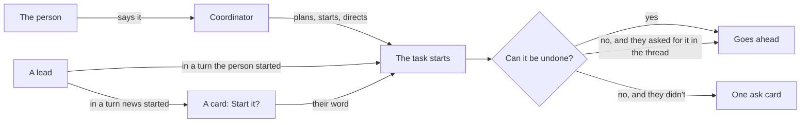
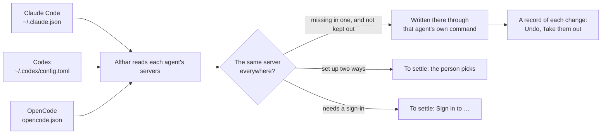

# Capable agents, optional coordinator

A prototype, to be deleted once directions are picked. It is the real desktop app (router, project screen, board, task threads, settings, kit) on the tests' fake client, in a browser, as althar stands on 6 November: five tasks at work or waiting, a task the ADR's lead started, and a design review that used the person's own MCP servers. Seams in `vite.config.mjs` swap a few imports of the real screens for this page alone; nothing in the app changes.

From the repository's root:

```bash
cd packages/ui && ./node_modules/.bin/vp dev --config prototypes/capable/vite.config.mjs
```

Then <http://localhost:5367/>. The strip under the window picks the surface (keys 1 to 6) and its direction (A to C, and T for today; `[` and `]` step through them). Its links go to where the surface shows, and Start over puts back what was answered. `?s=rules&d=B` opens on a surface and direction, `week` a week after sync was turned on, `bare` leaves the strip out, and `node shoot.mjs` takes every state into `test-results/capable`.

What the person decided on 6 November, and what each surface draws from it. Then, looking at the page:

- **New task without the coordinator: set aside.** The person starts tasks with the coordinator for now. Its code is gone from here; it is in the history up to 7274e40, and its notes are at the end.
- **What asks: A**, the four kinds in Rules. Open: whether they live in the person's own Settings instead (2 · B).
- **MCP servers and skills:** the role table, a card for each act in the thread, and **one switch** that keeps the person's agents the same. Open: how it says what it writes to their files and what it leaves alone (3 · A, B).
- **Settings an agent changed: A**, a line each.
- **A task's parts: one Parts button** just before the faces; the faces, Run and the menu never move. The rail beside the thread is out, as DESIGN.md rules out side panels. Open: how the button and what it opens look (5 · A to C).
- Not yet decided: a lead-started task (1).
- The directions not picked are gone from the code too; the history has them.

The flow, as it stands:



## 1 · A task a lead started, and the coordinator in a task

Seen on the board, in the ADR's thread (its lead split the Codex network change out), in the child's thread, and with the coordinator pushing on the person's word and passing on what they said.

| Direction | On the board | In the parent's thread | The coordinator | A turn the person didn't start |
| --- | --- | --- | --- | --- |
| A · A line of lineage | The child's card: "From ADR: agents work…" at its foot, opening the parent | Its card, under way at once, with Stop | One line per act: "Coordinator  Pushed 4 commits, on your word." | A card: Start *Reviewers… run its tests*? Not now / Start it |
| B · Under its parent | The child's card under its parent's, a line joining them; the parent's foot says "Started 1 task" | Its plan card, counting down two minutes, with Hold | A turn of its own, named Coordinator, what it said and its acts as rows | The same card |
| Today | Leads can't start tasks | | The coordinator relays to the lead (From the coordinator); it doesn't act in the thread | |

**Recommendation: A, with one rule for the countdown.** A lead's start goes ahead at once when the person's own turn led to it (their words covered the work, as they did for the ADR), and becomes a card when news woke the lead (dana's comment): the same line the rules draw for what can't be undone, by who started the turn. Under-its-parent breaks as soon as parent and child are in different lanes (the parent ready, the child running), which is most of the time. The coordinator's acts as single lines keep a task's thread the lead's; its longer words to the lead stay in today's From the coordinator bubble.

What the runtime needs:
- **`start_task` for leads**, the coordinator's own tool set (the 6 Nov note). Its task records `parent` (task id) and `startedBy` (person, lead with its task and turn, coordinator, automation); `BoardTask` and `TaskCard` carry `parent: { taskId, title }` for the card's line.
- **Who started a turn**: the person's message, or news (a comment, checks, a review). A lead's `start_task` in a news turn is a `task_ask` with a new move, `start`, holding the plan it would start; in the person's turn it starts. The same field decides asked-for tools (ADR-081).
- **The coordinator's acts in a task's thread**: a notice role (`coordinator`) with what it did and, where it acted on the person's word, the message id that said so. Today it can push, stop, hold and settle; its acts aren't written into the task's thread.

## 2 · What asks

Seen in the project's Rules, in the person's own Settings (B), and in the Runs task, whose lead (woken by its checks passing, not by the person) wants to merge #635 with the person's GitHub MCP server and to comment on dana's #640. The ask card is A's in both directions: "Can't be undone", the action, what can't be taken back in one line, the words it would post, the server and tool; Not now / Merge #635. No "Unrestricted" anywhere (16 Oct note): nothing says what is allowed, only what still asks.

| Direction | Your Settings | The project's Rules |
| --- | --- | --- |
| A · In the project (chosen) | Nothing | "What asks": Lost work and history, Publishing and merging, Speaking for you, Secrets, each with what it catches and a word to make it Never; then "Your own" Never and Ask me commands; then today's sandbox, last 14 days, finished and limits |
| B · In your Settings | A section, What asks, after Agents: the four kinds, your own Never and Ask me for every project, and "Where a project differs", a line per project with Open | One line: "The same in every project: …", Change in Settings. Then "This project's own": the branches that ask as main does (`next`, `release/*`), its Never and Ask me commands, and a kind that works differently here (Asks you / Never / Goes ahead here), only once one is added; then the same sandbox and the rest |
| Today | | A mode, Allow everything as a switch, six kinds |

**On the person's question (should limits live in the account?): yes, B.** The four kinds are about the person, not the code: their name on GitHub, their secrets, history that can't be taken back. They read the same in every project, and in A each project repeats them, so a change to one is made five times or forgotten in one. What a project has of its own is narrower and stays there: which branches count as main, commands only that repository has (`fly deploy`, `db:reset`), and now and then a kind that works differently, such as merging going ahead in a scratch repository or posting being Never in a client's. Settings lists every project that differs, so nothing hides in one project's Rules.

What the runtime needs:
- The rules shrink to the four kinds, each `ask` or `never`, plus Never and Ask commands. In B these are the person's, kept with Althar's own settings, and a project adds its protected branches, its own commands, and an exception per kind (`ask`, `never` or `allow`), which the project's Rules and Settings' list both read. `permissions` (the mode), `allowEverything` and the coordinator's judge go; the tally stays, for a kind agents keep working around.
- An **MCP call classified** before it runs: which server, from which config, and whether it reads or acts. The MCP spec's tool annotations (`readOnlyHint`, `destructiveHint`, `openWorldHint`) are the first source; a table for the servers people use (GitHub, Linear) fills in where they say nothing. A merge, a publish or a post on someone else's thread is one of the four kinds.
- The `AttentionRequest` gains what the card says: the kind, the action as a verb ("Merge #635"), what can't be taken back, the words it would post (read from the call's input), and the server and tool.
- Asked-for on the person's word (ADR-081) reaches MCP calls: a merge the person asked for in this turn goes ahead without a card.


## 3 · MCP servers and skills

Settings gets **MCP servers** as a section of its own, before **Skills** (split on 7 Nov). Each is the role table (chosen), a row each, a column each for leads, reviewers and the coordinator; above, Every project or althar. In a thread, each MCP call says its server, and what acted on the outside world is a card: the server, what it did, what it said, Open. The "could see" line from #596 counts both: "Claude Code could see 6 skills and 7 MCP servers", opening by whose. Seen there and in a design review the person's own skill ran on dana's #612.

Inside Althar nothing needs syncing: each role gets what's ticked, whichever agent's settings it was found in. Syncing is for the person's agents on their own: Claude Code, Codex and OpenCode each keep their own list, and here they disagree (github runs with npx in Claude Code and in Docker in Codex; linear, figma and sentry are only in Claude Code; context7 only in Codex; playwright only in OpenCode). The person chose **one switch**, "Keep your agents' servers the same". It writes into files that are theirs, so it has to say what it writes, to which file, and what it won't touch. Two ways to say it:

| Direction | While it's off | Turning it on | Turning it off |
| --- | --- | --- | --- |
| A · Before it starts | The switch and one line: Althar writes each server into each agent's own settings | A dialog: what it adds to each agent, by file and server; github waiting until the person picks how it runs; what it leaves alone; that it keeps a copy of each file and can take back what it added. Turn on | A dialog: Leave them in, or Take them out |
| B · On the card | All of A's dialog, on the card | It just turns on | The same choice, in the card |
| Today | Althar's skills only; none of the person's MCP servers | | |

The same in both once it's on:
- **To settle**, problems first: a file it couldn't read (OpenCode's, a week on), github's two ways (pick one, which changes the other agent's, or leave github out of syncing), and each sign-in, a button per agent.
- **Since**, a week on: "You added notion to Claude Code. Copied to Codex", with Undo; "You took context7 out of Claude Code. It stays out there", with Put it back.
- **Added**, a row per agent's file, each server a chip: pressing it takes it back out of that agent, and keeps it out. While it's off, the same chips leave a server out before it starts.
- **A server's marks** in the table open a menu: which agents have it; untick one to keep it out of that agent.

What it leaves alone, as the card says it: a server already in an agent, set up as the person set it, on or off; one they take out of an agent; sign-ins and tokens (a token goes across as the name of its variable, never its value).

**Recommendation: A.** The explanation matters once, at the moment Althar first writes to the person's files; after that the card stays short, and nobody who never turns it on reads a block of text in Settings. B is the better reference later, but "Added" and the chips give that back once it's on.

How it works:



**Can it be built reliably? Yes, for the servers here, with a few limits it shows rather than hides.**
- **Writes go through each agent's own command:** `claude mcp add-json --scope user` and `claude mcp remove`, `codex mcp add` and `codex mcp remove`, `opencode mcp add --global` (all three are on this computer: Claude Code 2.1.263, Codex 0.166.0). OpenCode has no remove, so taking a server back out edits its JSON with a comment-keeping editor. Althar never writes `~/.claude.json` by hand: Claude Code rewrites that file all the time, and a running session would write over a change made beside it.
- **Formats:** a local command (command, arguments, environment) and a plain URL carry across all three. Codex takes streamable HTTP but not SSE, so an SSE-only server can't go there; it would show as such.
- **Secrets:** a token goes across as a reference, `${VAR}` for Claude Code, `{env:VAR}` for OpenCode, `--bearer-token-env-var` for a URL in Codex. For a local command in Codex this needs checking: its `--env` takes values, not names. A token written out in a file isn't copied; it becomes something to settle, as secrets are one of the four kinds that ask.
- **Sign-ins can't be copied:** each agent keeps its own, so each needs one sign-in per server; Althar can start each from its button (`claude mcp login`, `codex mcp login`, `opencode mcp auth`).
- **Undo:** a copy of each file before Althar first writes to it, and a record of each change (file, server, before, after), so Undo and Take them out remove only what Althar added, never what the person did since.
- **Their decisions hold:** a server they take out of an agent is recorded as kept out and never added back; one turned off in an agent stays off; one set up two ways is never overwritten without their pick; nothing is removed on its own.
- **Watching:** the three files, comparing only their server lists (`~/.claude.json` changes all the time for other reasons). A file it can't read is left alone, and said so.
- **When it takes effect:** each agent reads its servers as it starts, so a change reaches a session already running on its next start.
- **The risk:** the formats change between versions, as Codex's MCP keys have. Going through each agent's own command absorbs most of that; a file in a shape Althar doesn't know is left alone.

What the runtime needs:
- **Discovery** of servers from Claude Code (user and project scopes in `~/.claude.json`, `.mcp.json`), Codex (`[mcp_servers]` in `~/.codex/config.toml`), OpenCode (`mcp` in `opencode.json`), merged by name and command or URL, with each source kept. Skills from `~/.claude/skills`, plugins, `.claude/skills` and the catalog.
- **Settings per server and skill**: on or off, roles, projects; passed to every agent whatever found it (Claude without `strictMcpConfig`, Codex's and OpenCode's config without the names switched off).
- **Tool call items** carry `mcp: { server, tool, reads | acts }` and, for an act, where to see it (the review's or comment's URL from the call's result).
- #596's skills notice also lists the servers each session got.
- **Syncing**, as above: reading each agent's servers, matching them by name, then command or URL ("differs" where the name matches and the rest doesn't), writing through each agent's own command, a record of each change for Undo, a kept-out list per agent, and watching the three files while it's on.
- **Each agent's sign-in to a remote server** (OAuth), readable per agent, and a way to start it from the window.
- **Skill sync**, as below: each agent's skill folders read, links made and removed, nothing moved.

### Skills: a switch of their own

**Worth it, and simpler than servers.** A skill is a folder with a `SKILL.md`, so there is nothing to translate and no secret or sign-in to carry: Althar links each skill into the other agents' folders, and the skill stays where it is, so a change to it reaches every agent. That's how `npx skills` already works on this computer (`~/.claude/skills/improve` links to `~/.agents/skills/improve`). The folders: Claude Code reads `~/.claude/skills`; Codex reads `~/.agents/skills`; OpenCode reads its own `~/.config/opencode/skills` and Claude Code's too.

The card says it on the card, with no dialog: it only adds links, so turning it on is cheap and turning it off takes them out. **Links** per folder, each skill a chip that leaves it out. **To settle**: one name, two versions (release-notes in Claude Code and an older one in Codex), pick one or keep both. **It leaves alone** a plugin's skills (they update with it), the repository's `.claude/skills` (the project's to change), and Althar's own (every role gets them in Althar already). One limit, said once: what only Claude Code understands in a skill, such as which tools it may use, the others ignore.

**Do others do this?** Not that I found. [Orca](https://www.onorca.dev/docs/cli/skills) installs its own skills into the skill folders of each agent it finds, and lets you register MCP endpoints in its settings, but doesn't sync the person's own between agents. Superset provisions its own skills at launch and reaches integrations through its own MCP proxy, not the person's agents' configs. So syncing the person's own is Althar's to work out.

## 4 · Settings an agent changed

The coordinator, and leads too, tune the project's settings with Althar's own tools: works in, work toward, tracker, branch and pull request names, setup, review rounds, rules, and the MCP and skills switches. Seen in the coordinator's thread, where the person asked for two changes and news later woke it, and in Settings, where a lead had changed one row an hour before.

| Direction | The coordinator's thread | Settings |
| --- | --- | --- |
| A · A line each | A line per change under its words: the row's name, from → to, Undo | The changed row says "Changed by the coordinator, 8 min ago · Undo"; who opens the thread it was changed from |
| Today | Only the person changes settings | No note |

A change that **loosens what asks** (here: let leads merge their own once checks pass and the review is clean) is a card that waits for the person, "Loosens what asks", with Keep asking and the action on its button. It waits even when the person asked for it in words: a single irreversible act asked for in the thread goes ahead, but a rule outlasts the turn. Once allowed, Rules says what goes ahead now under its kind, with who changed it, "on your word", and Undo.

**Chosen: A** (a line each). One card for a turn's changes was the other direction, now off the strip; it may still earn its place when a turn changes three rows or more. Keep the note in Settings: it's where the person finds a change they didn't watch happen. With What asks in Settings (2 · B), letting leads merge their own in althar is one of althar's exceptions.

What the runtime needs:
- **Settings tools** for leads and the coordinator, one per setting the window changes, writing through the same commands the window uses.
- **A change record per setting**: who (person, coordinator, a lead with its task), when, the value before, and the turn and message it came from. Settings reads the latest per row; Undo writes the value before back, as a change by the person.
- **Loosening is a kind**: a change to rules, or to switches that decide what asks (merging, posting as the person, secrets), is a `task_ask` holding the change, whoever's turn it came from; tightening goes ahead.
- Today's notice for a setup a lead re-recorded becomes one of these lines.

## 5 · A task's parts

A task's parts are its worktree, its pull requests, its reviews, the issues it came from, what it runs, what it made and the access it was given; Add takes on another any time (a worktree, a pull request, a review, an issue, a browser, access). They replace Fix these and make-it-a-change. The person's rule: **the faces (Conversation, Outputs), Run and the menu never move.** So the faces sit just before Run, the files button goes into the worktree part ("6 files changed"), and the parts sit just before the faces.

**Chosen (7 Nov): C, waits first.** The parts' own icons in the bar, the first four, then +6, one that waits on the person in its colour; it opens what waits on them, each with its button, then what runs, then the rest as chips. The person liked its hierarchy. A (a list by group behind "Parts 10") and B (tiles) are gone from the page; their code is in the history at 5462af1. The page shows C and Today.

### C, clicked through

The person likes C's hierarchy (7 Nov), so its popover now works:
- **A part opens in place**, with a back arrow: where it stands and what to do. The worktree: its branch, where it is, the files it changed, See the changes, Open in editor, and Remove, which says what isn't committed before it removes anything. A pull request that waits: its checks and review, Merge. One that fails: the failing check's last lines, Ask the lead to fix it, Run it again. A review draft: its findings, Post it. An issue: Take off this task. What runs: Open, Stop. Screenshots: thumbnails, See them in Outputs. Access: Take it back.
- **Merge and Post it act from the row**; See the check opens the part.
- **Add** lists what a task can take on, then a short form for the one picked: a worktree (its branch, from the task's branch or main); a pull request (open one from the branch as a draft, or attach one); a review (which pull request, by GPT-6.1 Sol, Terra or DeepSeek Flash, and that an outside author's is read only); an issue (search, pick); a browser (an address); access (one of the kinds that ask, given for this task). What's added shows at once, setting up.

## 6 · Sketches

Sketches are single states, not choices between directions: things the decisions need that are worth seeing once before anyone picks a way. Each sits where it would be, on the real screen.

- **A review's header** says whether it runs the code: an outside author's is read only, with Run it; a member's runs in a worktree.
- **A push the lead made itself**, with `gh` as the person: Althar shows it once it sees it on GitHub, the commits and Compare, and that nothing held it.
- **Where a lead-started task came from**, as its thread opens: "Started by the lead of ADR: agents work…, from your words there."
- **A small change** ("The Run menu says Strat"): one card that says what it skipped (Sonnet 5.5, no plan, reviewed after it merges), each step with its time, and Merge, which still asks; Make it a full task.
- **The first time**, in the coordinator's conversation: "Agents can do more now", a line each with where to change it. They go ahead, only the four kinds ask (What asks); your 7 servers and 9 skills load in every role (Choose which); leads start tasks; and a project the person had set to ask first still does, as they set it (Change). A close, no other buttons: the first version's Got it, What still asks, Servers and skills and "Ask as before in althar" didn't say what they did.
- **While you were away**: what agents did outside their worktrees across the project (merged, posted, moved an issue, started a task, changed a setting), by task and time, with Revert it, Delete it or Undo where it can be undone.
- **A server that fails**: the call itself, where it ran in the thread ("Move DEV-188 to In Review", Linear), and under it in red "Claude Code isn't signed in to Linear", Sign in. The lead's own words after it say what it did without it and that it moves DEV-188 once signed in. Signing in turns the call to Moved. No card: the first version's warning card read as a block apart from the thread.
- **A lead that starts several**: "Started 4 tasks from your 'split it by ADR'", started at once, with no countdown: starting a task can be undone by stopping it, so nothing asks. Each is a row that opens it, with its model and where it stands (Running, Planning, After ADR-013 merges); Stop on hover, then Start again. The first version's Hold the rest and Change one didn't say what they'd hold or change.

What the runtime needs: a small-change path (a plan of one step, a lighter model, review after); a log of acts outside worktrees across the project, each with how it is undone; a server's failure as a thread item, by agent and cause; a batch of starts as one item with one hold; a review's `outside` from the host's author association, and a Run it command that gives it a worktree; pushes seen on the host that Althar didn't make, attributed to the task by branch, as a thread item.

## Set aside: New task without the coordinator

The person keeps starting tasks with the coordinator for now (6 Nov). The three directions (a dialog, the composer, a card on the board) are gone from the page; their code is in the history up to 7274e40. If it comes back, it needs a StartTask command from the window (words or issue keys, the lead or Auto, effort, review, `toward`, `worksIn`, started at once), and Auto as routing the coordinator shares.

## Each project its own servers and skills

**Inside Althar, yes, for each project and role, without touching the person's files.** Althar starts every agent itself, so it can give each launch its own list. It already does this for its own tools (`packages/provider-adapters/src/ownTools.ts`): it switches the person's servers off by name, for Codex in `CODEX_CONFIG` (`mcp_servers.<name>.enabled = false`) and for OpenCode in `OPENCODE_CONFIG_CONTENT` (`mcp.<name>.enabled: false`). The same keys can switch servers on and off for each project. Claude Code takes `--mcp-config` with `--strict-mcp-config`. Skills one at a time: Claude Code's `skillOverrides` setting (on, off, name only), given with `--settings`; Codex's `skills.config` entries, by name or path. For OpenCode I found only a switch for all of Claude Code's skills at once (`OPENCODE_DISABLE_CLAUDE_CODE_SKILLS`); one skill at a time there is unconfirmed.

**Outside Althar, in the person's own terminal, only partly.** Sync writes to each agent's own settings, which apply in every project. A project's own list lives in the repository (`.mcp.json`, `.codex/config.toml`, `opencode.json`, `.claude/skills`), which is the project's to change, not the person's. Claude Code alone keeps a per-project list outside the repository (its `local` scope). So sync stays global, and per-project choices are Althar's.

## What else needs prototyping

The sketches in 6 draw the first state of each of these: a small change, the first time, while you were away, a server that fails, a lead that starts several. Each needs directions once one matters. Leads (1) is still open.

Not drawn yet, most important first:
1. **A Never rule an agent meets**: what the lead is told, and what the person sees afterwards.
2. **An ask that waits while the person is away**: where it reaches them (the bar, a notification, a paired phone), and what a lead does meanwhile.
3. **A lead-started task that fails or is stopped**: what its parent's lead hears, and what the parent's thread shows.
4. **Working without the coordinator**: the project's Conversation room when it's off or never used, and where Up next lives then.
5. **Two tasks changing the same files**: now that leads start tasks freely, who notices first, and what the person sees.
6. **Auto routing when plan usage runs low**: a lead moved to a lighter model, and how the person sees it.
7. **An undo that can't be done**: a merge already deployed, a post someone answered.
