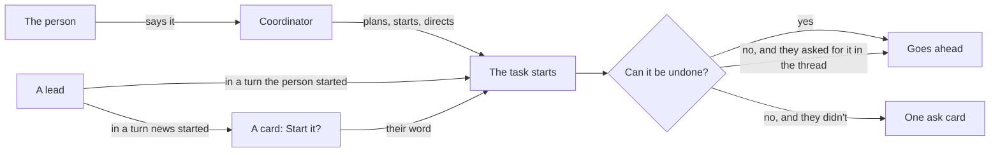

# Capable agents, optional coordinator

A prototype, to be deleted once directions are picked. It is the real desktop app (router, project screen, board, task threads, settings, kit) on the tests' fake client, in a browser, as althar stands on 6 November: five tasks at work or waiting, a task the ADR's lead started, a design review that used the person's own MCP servers, and Linear's open issues. Seams in `vite.config.mjs` swap a few imports of the real screens for this page alone; nothing in the app changes.

From the repository's root:

```bash
cd packages/ui && ./node_modules/.bin/vp dev --config prototypes/capable/vite.config.mjs
```

Then <http://localhost:5367/>. The strip under the window picks the surface (keys 1 to 6) and its direction (A to D, and T for today; `[` and `]` step through them). Its links go to where the surface shows, and Start over puts back what was started or answered. `?s=rules&d=B` opens on a surface and direction, `bare` leaves the strip out, and `node shoot.mjs` takes every state into `test-results/capable`.

What the person decided on 6 November, and what each surface draws from it. Then, looking at the page:

- **New task without the coordinator: set aside.** The person starts tasks with the coordinator for now. Its three directions are off the strip; the code stays in `directions/start`, and its notes are at the end.
- **What asks: A**, the four kinds in Rules. Open: whether they live in the person's own Settings instead (2 · B).
- **MCP servers and skills: B**, the role table, with a card for each act in the thread. Open: how to keep a server the same in each of the person's agents (3 · A, B, C).
- **Settings an agent changed: A**, a line each.
- **A task's parts:** the faces, Run and the menu never move. Open: where the parts go (5 · A to D).
- Not yet decided: a lead-started task (1).

The flow, as it stands:



## 1 · A task a lead started, and the coordinator in a task

Seen on the board, in the ADR's thread (its lead split the Codex network change out), in the child's thread, and with the coordinator pushing on the person's word and passing on what they said.

| Direction | On the board | In the parent's thread | The coordinator | A turn the person didn't start |
| --- | --- | --- | --- | --- |
| A · A line of lineage | The child's card: "From ADR: agents work…" at its foot, opening the parent | Its card, under way at once, with Stop | One line per act: "Coordinator  Pushed 4 commits, on your word." | A card: Start *Reviewers… run its tests*? Not now / Start it |
| B · Under its parent | The child's card under its parent's, a line joining them; the parent's foot says "Started 1 task" | Its plan card, counting down two minutes, with Hold | A turn of its own, named Coordinator, what it said and its acts as rows | The same card |
| Today | Leads can't start tasks | | The coordinator relays to the lead (From the coordinator); it doesn't act in the thread | |

**Recommendation: A, with one rule for the countdown.** A lead's start goes ahead at once when the person's own turn led to it (their words covered the work, as they did for the ADR), and becomes a card when news woke the lead (dana's comment): the same line the rules draw for what can't be undone, by who started the turn. Under-its-parent breaks as soon as parent and child are in different lanes (the parent ready, the child running), which is most of the time. The coordinator's acts as single lines keep a task's thread the lead's; its longer words to the lead stay in today's From the coordinator bubble.

What the runtime needs:
- **`start_task` for leads**, the coordinator's own tool set (the 6 Nov note). Its task records `parent` (task id) and `startedBy` (person, lead with its task and turn, coordinator, automation); `BoardTask` and `TaskCard` carry `parent: { taskId, title }` for the card's line.
- **Who started a turn**: the person's message, or news (a comment, checks, a review). A lead's `start_task` in a news turn is a `task_ask` with a new move, `start`, holding the plan it would start; in the person's turn it starts. The same field decides asked-for tools (ADR-081).
- **The coordinator's acts in a task's thread**: a notice role (`coordinator`) with what it did and, where it acted on the person's word, the message id that said so. Today it can push, stop, hold and settle; its acts aren't written into the task's thread.

## 2 · What asks

Seen in the project's Rules, in the person's own Settings (B), and in the Runs task, whose lead (woken by its checks passing, not by the person) wants to merge #635 with the person's GitHub MCP server and to comment on dana's #640. The ask card is A's in both directions: "Can't be undone", the action, what can't be taken back in one line, the words it would post, the server and tool; Not now / Merge #635. No "Unrestricted" anywhere (16 Oct note): nothing says what is allowed, only what still asks.

| Direction | Your Settings | The project's Rules |
| --- | --- | --- |
| A · In the project (chosen) | Nothing | "What asks": Lost work and history, Publishing and merging, Speaking for you, Secrets, each with what it catches and a word to make it Never; then "Your own" Never and Ask me commands; then today's sandbox, last 14 days, finished and limits |
| B · In your Settings | A section, What asks, after Agents: the four kinds, your own Never and Ask me for every project, and "Where a project differs", a line per project with Open | One line: "The same in every project: …", Change in Settings. Then "This project's own": the branches that ask as main does (`next`, `release/*`), its Never and Ask me commands, and a kind that works differently here (Asks you / Never / Goes ahead here), only once one is added; then the same sandbox and the rest |
| Today | | A mode, Allow everything as a switch, six kinds |

**On the person's question (should limits live in the account?): yes, B.** The four kinds are about the person, not the code: their name on GitHub, their secrets, history that can't be taken back. They read the same in every project, and in A each project repeats them, so a change to one is made five times or forgotten in one. What a project has of its own is narrower and stays there: which branches count as main, commands only that repository has (`fly deploy`, `db:reset`), and now and then a kind that works differently, such as merging going ahead in a scratch repository or posting being Never in a client's. Settings lists every project that differs, so nothing hides in one project's Rules.

What the runtime needs:
- The rules shrink to the four kinds, each `ask` or `never`, plus Never and Ask commands. In B these are the person's, kept with Althar's own settings, and a project adds its protected branches, its own commands, and an exception per kind (`ask`, `never` or `allow`), which the project's Rules and Settings' list both read. `permissions` (the mode), `allowEverything` and the coordinator's judge go; the tally stays, for a kind agents keep working around.
- An **MCP call classified** before it runs: which server, from which config, and whether it reads or acts. The MCP spec's tool annotations (`readOnlyHint`, `destructiveHint`, `openWorldHint`) are the first source; a table for the servers people use (GitHub, Linear) fills in where they say nothing. A merge, a publish or a post on someone else's thread is one of the four kinds.
- The `AttentionRequest` gains what the card says: the kind, the action as a verb ("Merge #635"), what can't be taken back, the words it would post (read from the call's input), and the server and tool.
- Asked-for on the person's word (ADR-081) reaches MCP calls: a merge the person asked for in this turn goes ahead without a card.


## 3 · MCP servers and skills

Settings' Skills becomes **MCP servers and skills**: the role table (chosen), a row each, a column each for leads, reviewers and the coordinator; above, Every project or althar. In a thread, each MCP call says its server, and what acted on the outside world is a card: the server, what it did, what it said, Open. The "could see" line from #596 counts both: "Claude Code could see 6 skills and 7 MCP servers", opening by whose. Seen there and in a design review the person's own skill ran on dana's #612.

Inside Althar nothing needs syncing: each role gets what's ticked, whichever agent's settings it was found in. Syncing is for the person's agents on their own: Claude Code, Codex and OpenCode each keep their own list, and here they disagree (github runs with npx in Claude Code and in Docker in Codex; linear, figma and sentry are only in Claude Code; context7 only in Codex; playwright only in OpenCode). Three ways to bring them together, each on the role table:

| Direction | What it adds to the table | Adding a server to an agent |
| --- | --- | --- |
| A · A column per agent | "In Althar" over the role columns, "In your agents" over a column each for Claude Code, Codex and OpenCode; a server's cell ticked where it is, Differs where it runs another way | Tick its cell; Add them all fills every gap. A server that signs in on its own (linear, sentry) then says Sign in in that cell. Differs opens how each runs it, and which to use everywhere |
| B · Marks in the row | Each server's agents as marks beside its name, faint where it's missing, ringed where it signs in or differs | Add to Codex and OpenCode, on the row you point at; Add them all over the table |
| C · One switch | "Keep your agents' servers the same", with what turning it on would add (2 to Claude Code, 4 to Codex, 5 to OpenCode); B's marks in the rows | Turned on, it adds them all, and one you add later in any agent goes to the others. What it can't do alone is a short list to settle: github's two ways, and each sign-in |
| Today | Althar's skills only, every one off until turned on; no MCP servers | |

**Recommendation: C, with B's marks and Add to … while it's off.** The person wants the same servers everywhere; that is one decision, not one per cell. C makes it once, and leaves only what needs them: a sign-in, or a server set up two ways. A's columns show the drift most plainly, but double the table's ticks, and the agent columns read as if they decided what Althar gives each role. Project servers (`.mcp.json`, which only Claude Code reads) stay out of syncing: copying one writes into the repository, a change to commit.

What the runtime needs:
- **Discovery** of servers from Claude Code (user and project scopes in `~/.claude.json`, `.mcp.json`), Codex (`[mcp_servers]` in `~/.codex/config.toml`), OpenCode (`mcp` in `opencode.json`), merged by name and command or URL, with each source kept. Skills from `~/.claude/skills`, plugins, `.claude/skills` and the catalog.
- **Settings per server and skill**: on or off, roles, projects; passed to every agent whatever found it (Claude without `strictMcpConfig`, Codex's and OpenCode's config without the names switched off).
- **Tool call items** carry `mcp: { server, tool, reads | acts }` and, for an act, where to see it (the review's or comment's URL from the call's result).
- #596's skills notice also lists the servers each session got.
- **Syncing**: writing a server into each agent's own file in its format (`~/.claude.json` JSON, `~/.codex/config.toml` TOML, `opencode.json` JSON), the same server matched across them by name, command or URL; "differs" where the name matches and the rest doesn't. With C on, watching the three files and copying a new server to the others.
- **Each agent's sign-in to a remote server** (OAuth), readable per agent, and a way to start it from the window (`claude mcp`'s and `codex mcp login`'s own flows).
- Skills could sync the same way where an agent reads them from a folder; left out here.

## 4 · Settings an agent changed

The coordinator, and leads too, tune the project's settings with Althar's own tools: works in, work toward, tracker, branch and pull request names, setup, review rounds, rules, and the MCP and skills switches. Seen in the coordinator's thread, where the person asked for two changes and news later woke it, and in Settings, where a lead had changed one row an hour before.

| Direction | The coordinator's thread | Settings |
| --- | --- | --- |
| A · A line each | A line per change under its words: the row's name, from → to, Undo | The changed row says "Changed by the coordinator, 8 min ago · Undo"; who opens the thread it was changed from |
| Today | Only the person changes settings | No note |

A change that **loosens what asks** (here: let leads merge their own once checks pass and the review is clean) is a card that waits for the person, "Loosens what asks", with Keep asking and the action on its button. It waits even when the person asked for it in words: a single irreversible act asked for in the thread goes ahead, but a rule outlasts the turn. Once allowed, Rules says what goes ahead now under its kind, with who changed it, "on your word", and Undo.

**Chosen: A** (a line each). One card for a turn's changes was the other direction, now off the strip; it may still earn its place when a turn changes three rows or more. Keep the note in Settings: it's where the person finds a change they didn't watch happen. With What asks in Settings (2 · B), letting leads merge their own in althar is one of althar's exceptions.

What the runtime needs:
- **Settings tools** for leads and the coordinator, one per setting the window changes, writing through the same commands the window uses.
- **A change record per setting**: who (person, coordinator, a lead with its task), when, the value before, and the turn and message it came from. Settings reads the latest per row; Undo writes the value before back, as a change by the person.
- **Loosening is a kind**: a change to rules, or to switches that decide what asks (merging, posting as the person, secrets), is a `task_ask` holding the change, whoever's turn it came from; tightening goes ahead.
- Today's notice for a setup a lead re-recorded becomes one of these lines.

## 5 · A task's parts

A task's parts are its worktree, its pull requests, its reviews, the issues it came from, what it runs, what it made and the access it was given; + Add takes on another any time (a worktree, a pull request, a review, an issue, a browser, access). They replace Fix these and make-it-a-change. The person's rule: **the faces (Conversation, Outputs), Run and the menu never move.** So in every direction the faces sit just before Run, the files button goes into the worktree part ("6 files changed"), and the parts go somewhere that grows without pushing them. Seen on the ADR's task (three parts), on the Runs task (ten), and on a review (two).

| Direction | Where the parts are | At ten parts |
| --- | --- | --- |
| A · After the title | Chips after the task's title, in the bar's free middle, then + | The first three, then "7 more", a menu by group |
| B · A row under the bar | A row of their own under the bar, each chip with where it stands (Open · checks pass), then Add | As many as the window has room for, then "6 more" |
| C · One button | Parts, with its count, just before the faces; a dot when one waits on you | A popover, every part by group, each with where it stands, Add at its head |
| D · Beside the thread | The same button; the parts in the free margin beside the thread, open until closed | The same list, scrolling in its column |
| Today | Files, Run and the menu; a pull request is attached from the menu | |

**Recommendation: D, folding into C's popover where the window is too narrow.** It is the only one that stays readable at ten parts and gives each room to say where it stands, which is what the person looks at a part for: a pull request's checks, a review's findings, a run's address. A wide window has 300px of empty margin beside the thread; D uses it, and below about 1200px the same button opens the same list over the thread instead. The bar gains one button, always there, so nothing beside it moves. A fights the title and runs out at three. B is the best glance at two to five parts, but costs a row on every task, a chat included, and still hides most at ten.

What the runtime needs:
- **A task's parts as one list** (the plan's phase 5, the task-as-parts ADR): each with its kind, name, where it stands in a few words, and whether it waits on the person or failed. Today these are separate fields (`worktree`, `changes`, `review`, `launches`), read by separate pieces of the window.
- **An Add command per kind**, for any task, any time: attach a worktree, open or attach a pull request (AttachPullRequest exists), add a review of a pull request, link an issue, open a browser, give access.
- The worktree part carries the files count the bar's Files button shows today.

## 6 · Sketches

- **A review's header** says whether it runs the code: an outside author's is read only, with Run it; a member's runs in a worktree.
- **A push the lead made itself**, with `gh` as the person: Althar shows it once it sees it on GitHub, the commits and Compare, and that nothing held it.
- **Where a lead-started task came from**, as its thread opens: "Started by the lead of ADR: agents work…, from your words there."

What the runtime needs: a review's `outside` from the host's author association, and a Run it command that gives it a worktree; pushes seen on the host that Althar didn't make, attributed to the task by branch, as a thread item.

## Set aside: New task without the coordinator

The person keeps starting tasks with the coordinator for now (6 Nov). The three directions (a dialog, the composer, a card on the board) are off the strip; their code stays in `directions/start` and the seams that check for `start`. If it comes back, it needs a StartTask command from the window (words or issue keys, the lead or Auto, effort, review, `toward`, `worksIn`, started at once), and Auto as routing the coordinator shares.
