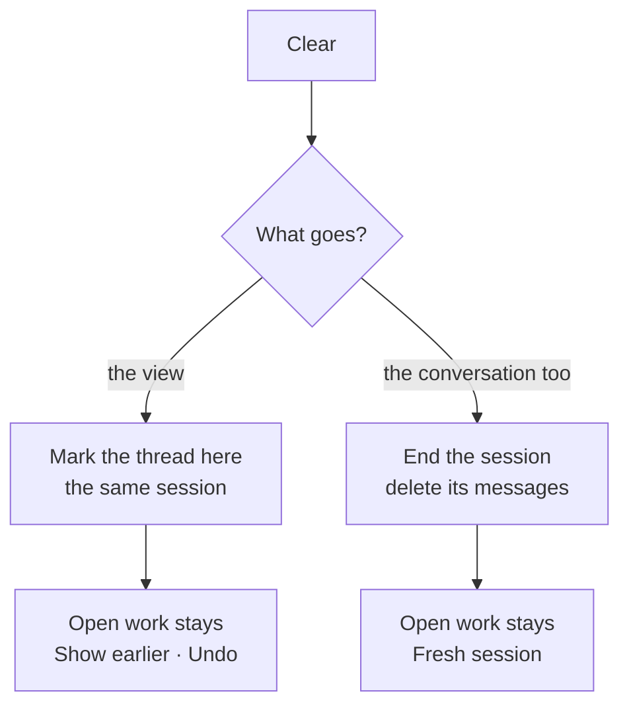

# Clearing a coordinator chat: where the button goes

A prototype, not a build. The two kinds of clear are the same in every direction; only the place the button lives changes, and the kind its question starts on.

Run it with `Clearing prototype` in Run's list, or open <http://localhost:5363/>. Keys `1`–`4` or `[` `]` switch directions; `Start over` puts the conversation back. After any clear, type `Where were we?` to see what the coordinator still knows.

## The clear, held constant

One control — `Clear`, or `Clear chat…` in the ring — opens one question with two kinds:

- **Keep what the coordinator knows** (the default in A and B). The view starts empty; the same session goes on. The divider reads `Cleared · Show earlier · Undo`. `Show earlier` reads the old conversation in the thread's place, with `Back to now` at the top. `Undo` brings the whole conversation back.
- **Forget it too**. The coordinator loses the conversation and what it learned from it; the button turns red and reads `Clear and forget`, and the option says `Can’t be undone.` The divider reads `Fresh session`; the next message starts a new session.

What stays in both kinds: running and planned tasks with their errands, pending issue drafts, open questions, and the board. What goes with the view: messages, tool calls, finished tasks and filed drafts. The coordinator says nothing after a clear; a message would refill the view it just emptied. Its first word is an answer to what you say next: from the kept conversation after a light clear, from the project's records after a wipe.

After a light clear the control stays, because the conversation is still there to forget: the light option says `The view is already clear.` and the wipe is one press away.

In C the question opens on the wipe, so it reads as a warning; the light kind is the way out from there. A and B open on the light kind.

## The three places

| | A · Composer | B · Thread head | C · Session ring |
| --- | --- | --- | --- |
| Where | the composer's lower row, after the model | a bar above the thread, naming the coordinator | the context ring's foot, beside `Compact` |
| Reach | always at hand while writing; `/clear` from the field | always at hand, at the top of the thread | hover the ring, then `Clear chat…` |
| Safety | beside the model and the send button | away from send | away from everything; the question opens on the wipe |
| Cost | one more control in the busiest row | a 38px bar that stays | invisible to anyone who doesn't open the ring |
| The wipe | the same dialog | the same dialog | the same dialog, opened on the wipe, with the light kind as the way out |
| Best for | keyboard users and fast clears | the default; the conversation's own place | ending the session, deliberately |

**A · Composer** puts the clear where a new topic starts. It is the most reachable and the least ceremonial: `/clear` opens the same question in one keypress, and the link sits beside the model picker, which is already the session's part of the composer. The risk is that the busiest row now holds one more thing, close to send; the dialog is what keeps that safe.

**B · Thread head** gives the coordinator a header and a place for its own action. `Coordinator` and `Clear` sit above the scroll, so the control stays at hand while you read, and it is not beside send. The bar is new chrome that exists for one action, but it is also the one place the coordinator is named on screen.

**C · Session ring** is the most literal: clearing is an act on the session, and the ring is where the session's numbers and `Compact` already live. The ring's foot now holds both session actions on one line: `Clear chat…` at the start, `Compact` at the end. The clear opens the question on the wipe, so the modal reads as a warning, with the light clear offered as the way out; after a wipe the ring goes with the session, which makes the wipe legible. It is still the hardest place to find the light clear: that kind is about clutter, not context, so the ring is the last place you would look.

## Recommendation

**B's bar for the light clear, C's ring for the wipe.** They are acts of different weight and belong in different places. The light clear is a view action, one press away at the top of the thread, with `Undo` and `Show earlier` right there. The wipe ends the session, so it belongs with the session's numbers, behind a question that opens on the wipe and names what stays; nobody finds it by accident, and nothing else on the screen pretends to do it. The ring's foot also gives `Compact`, which frees context, its proper neighbour: `Compact` keeps the knowledge and frees the room, the wipe frees both.

A's `/clear` can stay as the fast path for the light clear, typed rather than clicked. A alone puts both acts beside send, which is the wrong place for the irreversible one.

## What the runtime would need

**Keep the view.** Only a mark on the thread: where the cleared view begins, and whether the earlier conversation is open. The session is untouched, so `read_thread`, the handover brief (the last 12 messages) and the agent's own memory still reach the conversation before the mark. Nothing frees the context; Althar's existing `/compact` is the way to do that. The runtime needs to store the mark (the prototype treats it as the project conversation's, so every window agrees) and the thread's paging needs to start from it. No change to `Coordinator` or `Sessions`.

**Forget the conversation.** New runtime work: end the session, drop what waits in its queue, and delete its items so `transcript`, `read_thread` and the handover brief cannot reach them. The project's notes, tasks, errands, automations and board stay; the next message starts a fresh session, briefed from those records. `Sessions` has `compact` and handover but no delete, so this is the part to build. An undo would mean holding the deletion for a few seconds; the prototype offers none, and the dialog says so.

The two kinds are one control with two outcomes; the dialog is UI. The mark is UI state, the wipe is a runtime operation.

## Where the code is

- `state.ts`: the two kinds, the mark, the wipe, undo, and what the thread shows.
- `directions/Clear.tsx`: the question, the composer's link and the ring's foot.
- `directions/ThreadHead.tsx`: B's bar.
- `directions/Divider.tsx`: the cleared view's line, `Show earlier` and `Undo`.
- `seams/projectUi.tsx`: where each control is put, on the real composer, thread face and context ring.
- `seams/thread.ts`, `seams/ThreadBlocks.tsx`, `seams/useProject.ts`: the split at the mark and the model the screen reads.
- `shoot.mjs`: the screenshots. `verify.mjs`: the behaviour check, run with `node packages/ui/prototypes/clear-chat/verify.mjs` against the live page.

Delete this folder once a direction is picked; the runtime section goes into that build's plan.
