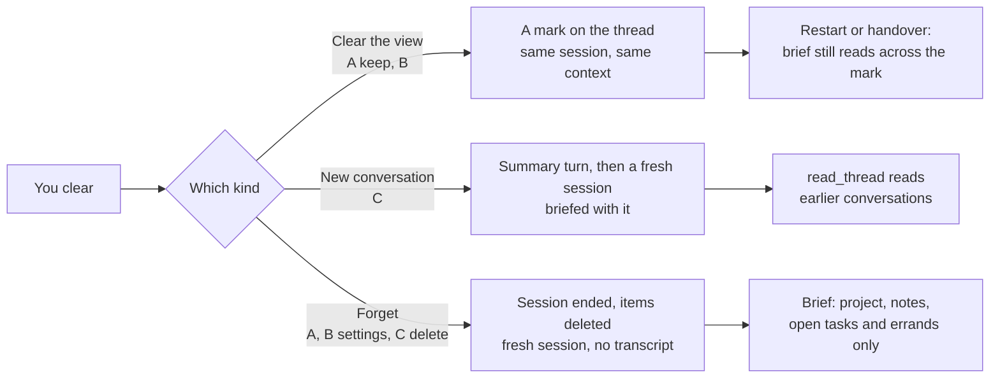

# Clearing a coordinator chat

A prototype, to be deleted once a direction is picked. It is the real desktop app (router, project screen, board, settings, kit) on the tests' fake client, in a browser, opened on althar's conversation with its coordinator beside its board: a task at work with an errand on it, one merged, an issue draft and a plan counting down to start. Seams in `vite.config.mjs` wrap the real `useProject` (what the thread shows after a clear, and the coordinator answering on the page), the kit's `ProjectHeader` and `Composer` for the project screen alone (the direction's ⋯ and undo), the thread's blocks (the divider where it was cleared) and the project's notes in its settings (B's forgetting).

From the repository's root:

```bash
cd packages/ui && ./node_modules/.bin/vp dev --config prototypes/clear-chat/vite.config.mjs
```

Then <http://localhost:5363/>. The strip under the window switches the direction (keys 1 to 4, or `[` and `]`); Start over puts the conversation back as it was. Say anything ("Where were we?") after a clear to see what the coordinator still knows. `?d=B` opens on a direction, `bare` leaves out the strip, and `node shoot.mjs` takes every state into `.althar/scratch/clear-chat`.

| Direction | Clearing the view, keeping what it knows | Forgetting it | Undo |
| --- | --- | --- | --- |
| A · One clear, two kinds | ⋯ › Clear the conversation…, a confirm with both kinds, keeping chosen. The thread starts under "Earlier conversation · Show". | The same confirm, Forget it too: the button turns to Clear and forget, in red. | Cleared. Undo / Forgotten. Undo at the composer's edge, for 10 seconds or until you write. |
| B · Light clear | ⋯ › Clear the conversation, no confirm. The thread starts under "Cleared · Undo ··· Show earlier". | Settings › Notes, at their foot: Forget the conversation…, which asks first and says it can't be undone. | Undo in the divider until you write; forgetting has none. |
| C · New conversation | ⋯ › New conversation: a fresh session, its first word a summary of the last, under "New conversation · Undo ··· Read the last one". Earlier ones are listed in ⋯. | An earlier conversation, open to read, has Delete…: the coordinator forgets it and the summary carried from it. | Undo in the divider until you write; deleting has none. |
| Today | Nothing clears the conversation. | | |

In every direction what is still open stays in view, at the top of what remains: tasks at work (their errands on their cards), plans counting down, drafts and asks waiting on you. Tasks keep running; the board doesn't change. What was finished goes with the earlier conversation. The coordinator says nothing first after a clear (it speaks when spoken to); in C its summary is its first word.

## What "keeps what it knows" can mean

Today one coordinator thread per project holds the conversation; its session lives as long as its agent does. After a restart, or once its context is 80% full (ADR-031), Althar starts it afresh, briefed from its records by `handoverRecord`: the project, its notes, open tasks and errands, and the last 12 messages word for word; anything older it reads with `read_thread`. There is no resuming a provider session.



What the runtime would need for each:

- **Clear the view, same session (A's keep, B).** A clear mark on the coordinator thread (a sequence, or a notice item), dropped again on undo. `GetCoordinator` pages from the mark, with `earlier` saying there is more and a `before` read still reaching it for Show earlier. Open cards from before the mark come with the head page, or are moved past it as `moveToEnd` moves queued inputs. The session doesn't change, and `handoverRecord` and `read_thread` read across the mark, so a restart still carries the last messages. Cheap, and true to the word "keep"; but the context isn't freed, so the coordinator is no faster or cheaper after it.
- **A summary carried into a fresh session (C).** Several conversations per project: either several coordinator threads with one current (the thread lookup by project, kind and owner becomes "the current one"), or starts within the one thread. On New conversation, a quiet turn asks the live session for a summary (a turn's wait and cost), or Althar writes one from its records without a model; it is stored as the new conversation's first item and goes in the fresh session's brief in place of the last 12 messages. `read_thread` reads earlier conversations by an argument. The context is freed; what wasn't in the summary is only reachable by reading.
- **Forget (A's forget, B's settings, C's delete).** Interrupt a running turn, end the session and never resume it, drop what waits in its queue, withdraw its open questions, and delete the thread's items (or the conversation's), so neither `read_thread` nor a brief can reach them. Open cards move into what remains. Notes, tasks, their errands and automations stay as records, so a fresh coordinator still knows them from its brief. A's 10-second undo means the deletion waits for the undo to go (or for the next message).

## Recommendation

B. Clearing the screen is what's wanted most days: one press, no question, undo right there, and the coordinator still knows everything, which is also the cheapest thing for the runtime (a mark). Forgetting is rare and deliberate, and it sits beside the notes that survive it. A asks a technical question every time someone only wants a clean screen. C is the most honest about memory and frees the context, but it costs a summary turn per clear and a model of several conversations; it is the step to take if long coordinator sessions get slow or expensive.
