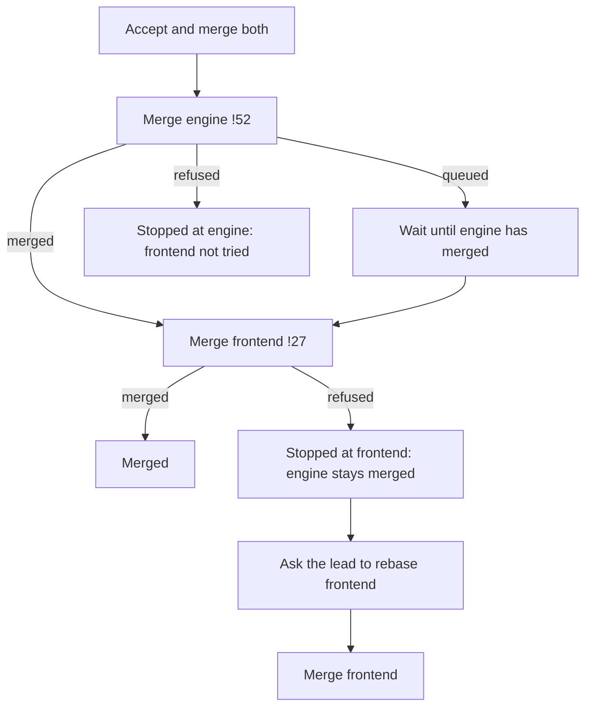

# The change, in several repositories: a prototype

The real desktop app on the tests' fake client, open on a ready task whose change spans several repositories. One seam swaps the change card in the real Outputs face (`seams/outputsUi.ts`), so each direction sits where the card does today, beside what the task made. A task of one repository keeps today's card, untouched, in every direction.

Run it with the project's **Change card prototype** run, or `cd packages/ui && ./node_modules/.bin/vp dev --config prototypes/many-repos/vite.config.mjs`, then open http://localhost:5361/.

The strip along the bottom switches the direction (1–4 or ← →), the state (↑ ↓), and the view: the task screen, or every state side by side through the real Outputs. **Narrow** makes the window 900px wide. The buttons work: mark ready, merge in order (rows say which merges and which waits), connect the host, ask the lead to fix, resolve or rebase. **Start over** resets the state. `node shoot.mjs` takes the screenshots in `shots.json` into `.althar/scratch/many-repos/shots`.

## The directions

- **A · Rows.** One change, a row per repository: its pull request, where it stands where it isn't simply open, and its own line (checks, conflict, refusal, host not connected), which opens to that repository's checks. Each row's own action shows on hover. One row of actions for the whole change: what holds it first, then *Mark both ready*, else *Accept and merge both*. Files are grouped under each repository with paths relative to it, and a repository's name opens its diff. In a wide card, each row sits on one line.
- **B · Sections.** A summary says where the whole change stands and which repository holds it (*Held by frontend*, *Stopped at frontend*, *Waiting on sdk*), with the review and the one action. Under it is a folded section per repository, the ones holding it open: its line, its files, its own action, and its diff.
- **C · Merge track.** The repositories are numbered stops on one track, in the order they merge. Merged stops fill in green, and a refused one turns red and stops the line. A split button does the next thing, and its menu holds each repository's own action (*Merge engine alone*, *Mark frontend ready*). The files have a tab per repository.
- **As built.** Today's card, the real one, fed the same states.

In every direction the review line appears once, for the whole change, because one review covered all of them.

## What I'd build

**A, with C's numbers when an order is declared.** A is the calmest. It reads like today's card with one line per repository, so two repositories feel like one change and five still fit. Each repository's state, checks and next step can be read without opening anything. B hides exactly what you scan for (which one is failing, which one is a draft) behind folds, and its summary and sections say related things twice. C makes the order unmistakable, but a track and a tab bar for two repositories is a lot of furniture. A row number, shown only when the task declares an order, carries C's useful part. From C I'd also take the split button's menu for each repository's own action, rather than hover-only buttons, which nobody finds.

## What the runtime would need

Most of it is there. Each pull request's state, draft, checks with their list, conflicts, target and queue standing are already in the snapshot (`ChangeSummary`), one per repository. Outputs sums them into one card. Rows and sections need nothing new for those.

Missing:

1. **A declared merge order.** Today, accepting is a loop in the renderer (`useTask.accept`). It merges the pull requests in the order they were opened and stops at the first one that throws. Nothing says engine must go before frontend. The lead would declare the order when it finishes (frontend after engine), the task would keep it, and the snapshot would carry it, as an order on the task or each pull request's `after`.
2. **Merges run by the runtime, in order, waiting for each to land.** As far as I can read, a merge that only queues (a GitHub merge queue, or GitLab's merge when the pipeline succeeds) returns before the PR is merged, so the next one merges straight after it, before its dependency has landed. Closing the window mid-way also ends the loop. The runtime would run the whole sequence as one job. It would hold each merge until the one before it actually merged, keep it going across a restart, and report each repository as merging, waiting or merged.
3. **A refusal kept on its pull request.** Why a host refused a merge is currently a passing error string on the card. It would be kept per pull request (what was refused, why, and when), so the card can say *Stopped at frontend* and offer *Ask the lead to rebase it*, then *Merge frontend*.
4. **A host per repository.** The snapshot has one `host` for the project. A repository on another host, and whether that host is connected, can't be told apart: today the sdk becomes a separate card offering a merge on this Mac. Each repository would carry its host and whether Althar is connected to it (DEV-212). Today's card also takes the first pull request's host for all of them, so a GitHub PR beside GitLab ones would read `sdk !14`.
5. **Marking several ready, asking about one.** *Mark both ready* can loop `MarkReady` over each URL, as it does now. *Ask the lead to fix e2e:chat* or *rebase frontend* is a message to the lead naming the repository. Conflicts are settled this way for local merges today, but not yet for a pull request's checks or a refused merge.
6. **The diff view by repository.** The diff over the window lists every repository's files as one flat list of full paths. It would group them under each repository, as the card does, with each repository merging into its own branch.

## As built, for comparison

With these states, today's card stacks one full-width *Mark … ready for review* per repository and puts one *Draft* beside the first PR. It sums every repository's checks into one line (*9 of 13 checks passed*), lists every file in one flat list of truncated paths, and offers *Accept and merge both* while *e2e:chat failed* in frontend. A repository whose host isn't connected becomes a second card offering a merge on this Mac.
