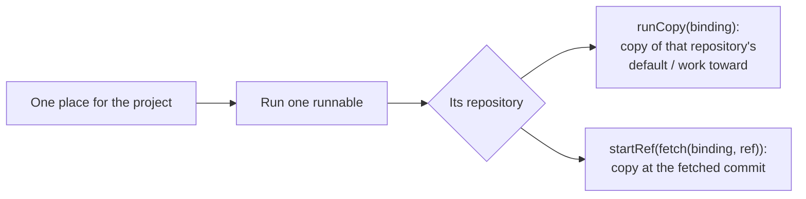
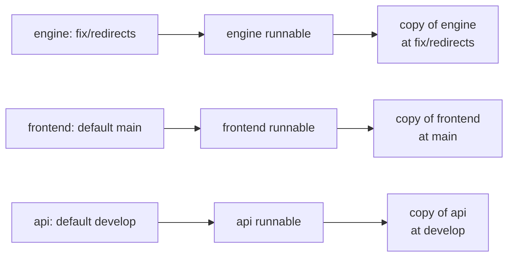

# Run’s place in a multi-repo project

Live page: **[http://localhost:5358/](http://localhost:5358/)**. The bar at the bottom switches direction (A, B, C or keys 1–3), project (mixed defaults, shared main, one repository, or keys 4–6) and host (h). Open the picker from the chip beside **Run**.

The project is `fnt`: five repositories on a self-hosted GitLab at `gitlab.fnt.example`. Three are on `main`, one on `develop`, one on `master`; the shared-main project puts all five on `main`. The page is the real `ProjectHeader`, the real `Popover`, `Button`, `Icon` and `LinkButton`, and the real picker’s own row styles (`RunPlace.module.css`). Only the shape of the answer is on trial. The data is local; nothing runs.

## The three directions

### A · Name the repositories in place

One list, as today. The top row becomes **Default branches**: it says each repository and the branch that repository would run, and a repository moved off its default stands out in violet. Branch rows say `engine · runs bun run dev`; pull requests say `engine · fix/redirects · @mira`. The top row also resets every repository to its default. This is the smallest change to the current picker, and it answers “which main is this?” directly.

### B · Group by repository

A section per repository: its name and default branch, then its default row, its pull requests and its branches. Picking in one section leaves the others alone. The chip and a summary at the top say the mix: **`engine: fix/redirects · 4 on defaults`**. This maps the picker to the data the runtime already keeps per repository, and it is the direction I would build.

### C · Run board (mine)

A wider, two-column picker. On the left, repositories expand in place to their default, branches and pull requests; tasks sit above them for “run in this task’s worktree”. On the right, **Where each run starts** lists, before anything is picked, each repository, the branch its run would copy, the command and where it would answer. This is the clearest answer to “what will Run run where”, but it is the largest departure from the picker as it is, and picking a branch takes two clicks.

## What every direction shows

- **What will run where, before picking:** branch rows name their runnable and command; C’s right column and the page’s “Where each run starts” panel make it explicit.
- **Defaults that differ and defaults that agree:** the Mixed-defaults and Shared-main projects (keys 4 and 5).
- **A host that is not connected:** the footer says `gitlab.fnt.example isn’t connected, so its merge requests aren’t here.` with **Connect GitLab…**, which opens the token dialog. Turning the host on in the switcher (or connecting it) shows each repository’s pull requests with its name.
- **Plain footer:** the old “A number, as #12, runs one still.” is gone. The only other line is `A branch picked here is also where new tasks work toward.`
- **One repository:** all three directions fall back to today’s picker — one `main`, tasks, branches, no repository names, no summary.

## Pictures

1. **A1 — A, mixed defaults, host off.** `engine` is on `fix/redirects`; the top row lists all five repositories and their defaults, with `engine` in violet, and the chip says `engine: fix/redirects · 4 on defaults`. The footer names the host.
2. **B1 — B, the same pick.** One section per repository; `engine`’s section shows its default, branches and the picked `fix/redirects`, while `frontend` starts on `main`.
3. **C1 — C, the same pick.** The board: repositories left, and right, `engine fix/redirects bun run dev localhost:4100` beside `frontend main`, `api develop`, `docs master`, `shared main`.
4. **A2 — shared main, GitLab connected.** All five defaults agree; pull requests appear under A’s flat list, each naming its repository. The chip says `frontend: !18 · 4 on defaults`.
5. **S1 — one repository.** The picker is today’s: `main`, tasks, branches; no repository names or grouping.
6. **H1 — the way to connect.** **Connect GitLab…** opens a dialog for `gitlab.fnt.example`, with the host and a token field — the DEV-212 direction, in place.

## What I recommend

**B**, with A’s default-branch line kept as the first thing in the list and C’s “Where each run starts” kept as a short footer in multi-repo projects.

B answers the question at the level the data already lives: one repository, one default (or work-toward) branch, one pick. It makes a cross-repository mix legible without a new screen, and it leaves single-repository projects exactly as they are. A alone labels the flat list but still asks the person to spot that two `fix/redirects` rows are in different repositories. C is the best overview but too heavy as the picker itself; its right column belongs in the Run list, where someone is about to press Run.

## What the runtime would need

Today, a run starts one runnable, in that runnable’s repository. On the default place, `runCopy` makes a fresh copy of that repository’s default/work-toward branch. On a branch or pull request, `startRef` fetches into the runnable’s repository and copies the commit. The copies are already per repository; the missing piece is the picker’s state and the place a run remembers.



For B, the picker keeps a place per repository, and a run resolves the place of the runnable’s repository:



Concretely:

- **`apps/desktop/src/renderer/features/runs/Runs.tsx`:** `readPlace`/`keepPlace` store one `RunPlace` per project. They need a map by repository (and a `main` place per repository, whose label is that repository’s `workToward ?? defaultBranch`). `mainOf` should stop collapsing five names to `main`; `places`, `pickOrMove`, `create` and `run` resolve by `runnable.repository`.
- **`Launch` (and `runsAt`/`placeOfLaunch`):** a run says `where` and `branch`, but not which repository. Two repositories can have a branch with the same name (`fix/redirects` is in both engine and frontend here), so “a run is at this place” has to match the repository too. Add the repository to `Launch` (the `Runnable` already carries it) or match through the runnable.
- **No new copy path:** `packages/runtime/src/Launches.ts` already resolves a binding’s `defaultBase`/`workToward` in `runCopy` (~393–420) and fetches a branch or pull request into the runnable’s binding in `startRef`. A per-repository place sends the same `RunRef.repository` it already accepts.
- **A “run everything” is a different feature:** a Run press starts one runnable. If “run a mix of branches across repositories” should start all runnables at once, that is a run group (several launches) and not something the current picker can do by changing its label.
- **The footer’s host:** `packages/runtime/src/Fetches.ts` writes the old note per repository and does not name the host. Name `repository.host.url` there (or in the picker, from `ProjectRepository.host`) and link to Settings › Connections. A project of several repositories may have more than one host; the line should count or list them.
- **The chip:** the mix needs room. At 1280px a 336px cap shows `engine: fix/redirects · 4 on defaults`; the current 240px cap cuts it after `4 …`, or the wording can be shortened to `engine: fix/redirects · +4`.
- **Single repository:** leave `RunPlacePicker` and `mainOf` as they are when `repositories.length === 1`; the same components then need no extra branches.

## Run it

```sh
cd packages/ui && ./node_modules/.bin/vp dev --config prototypes/run-place/vite.config.mjs
```

The page is also kept as **Run place prototype** in the project’s Run list. `?d=B&s=mixed&host=off&open=1&pick=engine=fix/redirects` opens a state directly; `open=1`, `host=on`, `task=t1` and comma-separated `repo=branch` (or `repo=!12`) are the others.
