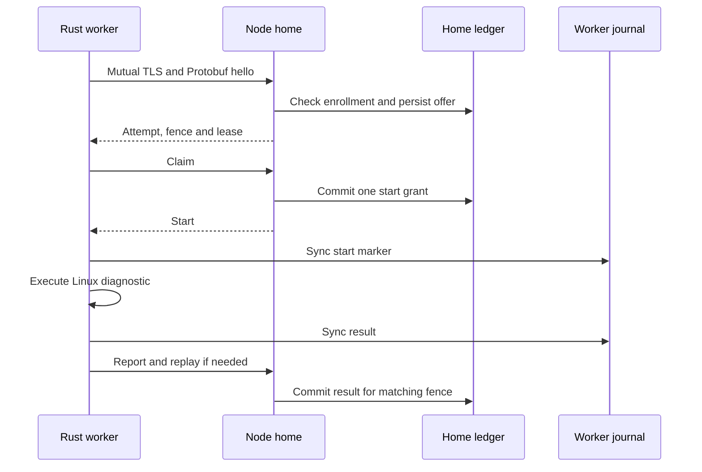

# Worker control protocol

The home owns the scheduler and chooses a protocol version. The worker opens
the control stream. The first messages bind it to its enrolled home and worker
identity and one session. The home compares the worker ID in the offer with
the identity established by transport authentication. The Rust worker checks
the response against its enrollment and the version it offered. Each side
rejects missing or malformed messages and handshakes over 4 KiB.

The opt-in gRPC listener runs in the standalone home service. Mutual TLS
authenticates both ends. The home looks up the verified client certificate in
its private SQLite ledger and compares that enrollment with the worker's
claimed identity. Older handshake-only clients still negotiate normally.

The first command is the fixed Linux diagnostic `/usr/bin/uname -s`. The
home commits one fenced start grant before sending it. The worker syncs a
start marker before spawning the process and syncs the bounded result before
reporting it. A reconnect can replay a saved result. A claimed attempt with
no recoverable result settles as `unknown` and its start grant stays spent.
The worker stops its diagnostic on disconnect or timeout.



See the [host operator guide](../../apps/host/README.md#native-worker-diagnostic)
for credential configuration and command invocation.

From the repository root, use the pinned Bun and Rust toolchains:

```sh
bun install --frozen-lockfile --ignore-scripts --filter althar --filter @althar/worker-protocol --filter @althar/host
cargo test --locked -p althar-worker
cargo build --locked -p althar-worker --bins --examples
(cd apps/host && bun run build)
cd packages/worker-protocol
bun run generate
bun run check
bun run test --maxWorkers=1
bun run test:interop
bun run test:execution
```

The gRPC integration test uses OpenSSL to create temporary certificates.

Edit the schema under `proto` and regenerate the checked-in TypeScript bindings.
Cargo generates Rust bindings during the build using the locked compiler
dependency. CI checks that regeneration produces the checked-in output.
CI compares the schema with the base revision and rejects changes that would
break existing bindings or wire compatibility.
