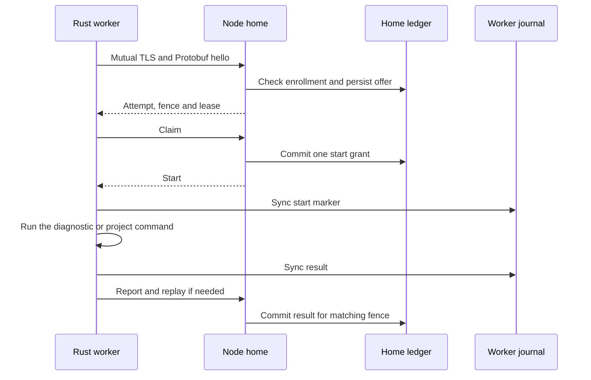

# How an Althar home talks to a worker

The home keeps track of a run. The worker starts and stops the command. This package defines the messages they exchange, so the Node home and the Rust worker can agree on who is connecting, which run they're talking about and what happened.

If you're here to try a worker, start with the downloadable demo. Use this page when you're setting up a relay or working on the protocol. [Host and worker test guide](../../apps/host/preview/README.md)

## Follow one run

1. The worker connects to the home. They both show TLS certificates. The home checks the worker certificate against its enrollment, and the worker checks the home's identity. Then they choose a protocol version and the features both sides support.
2. The home offers a run. It gives the worker an **attempt ID** for that run and a **fence**, the value the home uses to recognize messages for this attempt. The home saves one permission to start before it sends it.
3. The worker writes down that it started before launching the process. It saves the result before reporting it. If a connection drops, the worker can report that saved result when it reconnects. An attempt with a spent start grant and no saved result settles as `unknown`.



The listener is opt-in and uses gRPC with mutual TLS. The home stores enrollment in its private SQLite ledger. The worker opens the stream, and both sides check the home and worker IDs and the negotiated version. Handshake messages are capped at 4 KiB. Older handshake-only clients can still negotiate.

A diagnostic runs `/usr/bin/uname -s`. For a project run, the home sends a project ID and command name. The worker reads the checkout path, executable and arguments from its private local configuration. [Run a diagnostic](../../apps/host/README.md#native-worker-diagnostic) · [Run a project command](../../apps/host/README.md#run-a-project-command-on-a-linux-worker)

## Execution leases

A **lease** is a short permission to keep running. The worker renews it on the same authenticated connection. The home checks the worker, attempt and fence before granting more time. The worker measures the grant from when it sent the request, so time spent waiting on the network counts.

A renewable grant lasts up to two seconds at a time. The diagnostic has a three-second budget, and a project run has one minute. The worker stops when it loses the connection or the grant expires. For a project run, systemd also stops the command's detached children. The worker confirms they're stopped before reporting `cancelled`. On reconnect, the worker can report a saved result or `unknown`. Each attempt has one start. Older version 1 peers can still use the single diagnostic grant.

## Live diagnostic output

Run `althar-host worker-log --attempt-id <id> --json` while a command is running or after reconnecting. It returns the run's state and the saved output as `bytesBase64`. Decode those bytes before assembling text. To fetch only new bytes, pass the returned `nextOffset` back as `--offset`.

The home accepts contiguous chunks of up to 256 bytes on the connection holding the current grant. It keeps the received prefix across disconnects and restarts. A diagnostic keeps up to 1 KiB of stdout in 16 chunks. A project run keeps up to 64 KiB of combined stdout and stderr in 1,024 chunks. Older peers report final diagnostic output through `worker-result`.

## Outbound worker relay

Use a relay if the home and worker can both reach a gateway but the worker can't reach the home directly. Each opens a secure WebSocket to the gateway. The gateway joins the two connections for that route and passes through the encrypted worker traffic. The home and worker still verify each other's original certificates.

The HTTPS name you pass to the worker is the name on the **home** certificate. The WSS address is the **gateway**. Give the gateway its own certificate and key and give the home and worker the CA that signed it.

### Set up one test route

1. In a private directory, generate two tokens and an expiring route. Save the route ID that this prints. The gateway will store the token hashes and can serve one active tunnel on the route. Routes can last up to 24 hours.

   ```sh
   umask 077
   node --input-type=module <<'JS'
   import { createHash, randomBytes } from 'node:crypto'
   import { writeFileSync } from 'node:fs'
   const id = 'wrl_' + randomBytes(16).toString('hex')
   const home = randomBytes(32).toString('base64url')
   const worker = randomBytes(32).toString('base64url')
   const digest = (token) => createHash('sha256').update(token).digest('hex')
   const create = (file, value) => writeFileSync(file, value, { flag: 'wx', mode: 0o600 })
   create('home-token', home)
   create('worker-token', worker)
   create('routes.json', JSON.stringify([{
     id, homeDigest: digest(home), workerDigest: digest(worker),
     expiresAt: Date.now() + 3600_000,
   }]))
   process.stdout.write(id + '\n')
   JS
   ```

2. On the gateway, run this from the worker protocol package. Keep the certificate, key and routes file private.

   ```sh
   bun run start:relay 0.0.0.0 7443 /private/relay.pem /private/relay.key /private/routes.json
   ```

3. Give the home its `home-token` privately. On the home, create a mode 0600 link file with the route ID and absolute paths. Add `--worker-relay /private/home-link.json` to the usual `configure-workers` command, bind the worker listener to loopback and restart the home.

   ```json
   {
     "url": "wss://relay.example:7443/v1/worker-relay/<route-id>/home",
     "tokenFile": "/private/home-token",
     "caFile": "/private/relay-ca.pem"
   }
   ```

4. Give the worker its own `worker-token` privately. Add these flags to its usual invocation with the same route ID. Keep the original home certificate name in the worker's HTTPS argument.

   ```sh
   --relay "wss://relay.example:7443/v1/worker-relay/$ROUTE_ID/worker" \
     /private/worker-token /private/relay-ca.pem
   ```

This guide sets up a relay you operate yourself. A private direct connection is enough for the preview.

## Work on the protocol

Use the pinned Bun and Rust toolchains. Run these from the repository root. The integration tests generate temporary certificates with OpenSSL.

```sh
bun install --frozen-lockfile --ignore-scripts --filter althar --filter @althar/worker-protocol --filter @althar/host
cargo test --locked -p althar-worker
cargo build --locked -p althar-worker --bins --examples
(cd apps/host && bun run build)
cd packages/worker-protocol
bun run generate
bun run check
bun run test --maxWorkers=1
bun run test:interop
bun run test:execution
```

When you edit the schema under `proto`, regenerate the checked-in TypeScript bindings. Cargo generates the Rust bindings during the build. CI checks the generated files and compares the schema with the base revision for compatibility.
