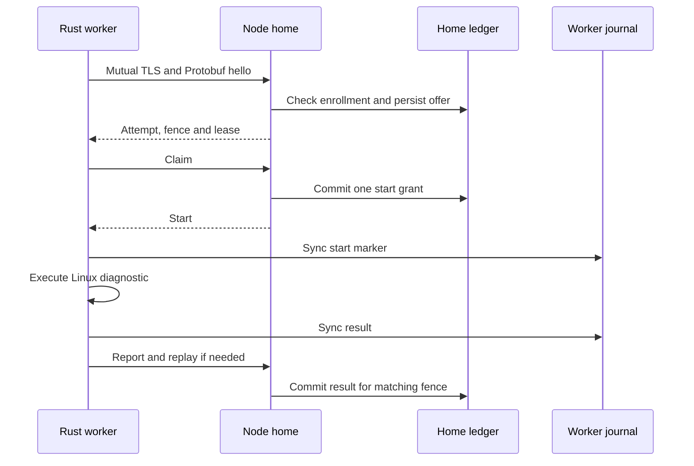

# Worker control protocol

The home owns the scheduler and chooses a protocol version. The worker opens
the control stream. The first messages bind it to its enrolled home and worker
identity and one session. The home compares the worker ID in the offer with
the identity established by transport authentication. The Rust worker checks
the response against its enrollment and the version it offered. Each side
rejects missing or malformed messages and handshakes over 4 KiB.

The opt-in gRPC listener runs in the standalone home service. Mutual TLS
authenticates both ends. The home looks up the verified client certificate in
its private SQLite ledger and compares that enrollment with the worker's
claimed identity. Older handshake-only clients still negotiate normally.

The first command is the fixed Linux diagnostic `/usr/bin/uname -s`. The
home commits one fenced start grant before sending it. The worker syncs a
start marker before spawning the process and syncs the bounded result before
reporting it. A reconnect can replay a saved result. A claimed attempt with
no recoverable result settles as `unknown` and its start grant stays spent.
The worker stops its diagnostic on disconnect or timeout.



See the [host operator guide](../../apps/host/README.md#native-worker-diagnostic)
for credential configuration and command invocation.

## Execution leases

When both endpoints advertise renewal support, a diagnostic starts with a
lease of up to two seconds. The worker can request a numbered extension
on the authenticated stream that granted the start. The home checks the
worker, attempt, fence and existing lease before committing an extension.
Only the diagnostic's fixed three-second runtime budget can be used.

The worker measures each grant from when it sent its request using its
monotonic clock, so time spent in transit counts against the grant. A lost
connection or expired grant stops the diagnostic. Reconnecting can report a
journaled result or an unknown outcome. It cannot extend the old stream's
lease or start the attempt again. Version 1 peers without the renewal
capability keep using the existing one-shot diagnostic grant.

## Live diagnostic output

Peers that support renewable leases and live logs can send stdout in
chunks of up to 256 bytes as the command runs. The home accepts each
contiguous byte offset only on the authenticated stream holding the
active grant and saves up to 1 KiB in at most 16 chunks per attempt. The received prefix
survives a disconnect or restart. The result still records whether the
command is known to have completed.

Operators can read the prefix while the attempt is running or after
reconnect using `althar-host worker-log --attempt-id <id> --json`.
The response includes the attempt state, the requested `offset`,
`nextOffset` and `bytesBase64`. Use `--offset <nextOffset>` for the next
read and decode the bytes before assembling text. Legacy peers still return
their final diagnostic output through `worker-result`.

## Outbound worker relay

Run the relay on a machine both endpoints can reach. The home and worker
each open a WSS connection. The relay pairs the two connections for a route
and forwards the existing gRPC TLS records. The worker still verifies its
home certificate, and the home still requires an enrolled worker
certificate. The identity used in the worker's HTTPS argument is the
**home certificate name**. The relay URL identifies the separately
authenticated WSS endpoint.

Provision a gateway certificate and key and give both endpoints the gateway
CA. Keep this separate from the home and worker certificate setup. As the
operator, create an expiring test route from a private directory.

```sh
umask 077
node --input-type=module <<'JS'
import { createHash, randomBytes } from 'node:crypto'
import { writeFileSync } from 'node:fs'
const id = 'wrl_' + randomBytes(16).toString('hex')
const home = randomBytes(32).toString('base64url')
const worker = randomBytes(32).toString('base64url')
const digest = (token) => createHash('sha256').update(token).digest('hex')
const create = (file, value) => writeFileSync(file, value, { flag: 'wx', mode: 0o600 })
create('home-token', home)
create('worker-token', worker)
create('routes.json', JSON.stringify([{
  id, homeDigest: digest(home), workerDigest: digest(worker),
  expiresAt: Date.now() + 3600_000,
}]))
process.stdout.write(id + '\n')
JS
```

On the gateway, start the service from this package with the TLS files
and `routes.json`. Keep them private. The route supports one active tunnel
at a time and expires within 24 hours. The gateway stores token digests.
Deliver each private token file to its role on a secure channel.

```sh
bun run start:relay 0.0.0.0 7443 /private/relay.pem /private/relay.key /private/routes.json
```

On the home, create a mode 0600 link file with absolute paths and the
route ID printed above. Configure the ordinary worker listener with
`configure-workers --worker-relay /private/home-link.json` alongside the
existing TLS options, bind it to loopback, and restart the home.

```json
{
  "url": "wss://relay.example:7443/v1/worker-relay/<route-id>/home",
  "tokenFile": "/private/home-token",
  "caFile": "/private/relay-ca.pem"
}
```

On the worker, add the following to the ordinary diagnostic invocation.
Use the same route ID and the original home certificate name in the
positional HTTPS argument.

```sh
--relay "wss://relay.example:7443/v1/worker-relay/$ROUTE_ID/worker" \
  /private/worker-token /private/relay-ca.pem
```

This operator path uses file-based route provisioning. Account linking,
pool authorization, hosted allocation and desktop-home integration are
subsequent product work.

From the repository root, use the pinned Bun and Rust toolchains:

```sh
bun install --frozen-lockfile --ignore-scripts --filter althar --filter @althar/worker-protocol --filter @althar/host
cargo test --locked -p althar-worker
cargo build --locked -p althar-worker --bins --examples
(cd apps/host && bun run build)
cd packages/worker-protocol
bun run generate
bun run check
bun run test --maxWorkers=1
bun run test:interop
bun run test:execution
```

The gRPC integration test uses OpenSSL to create temporary certificates.

Edit the schema under `proto` and regenerate the checked-in TypeScript bindings.
Cargo generates Rust bindings during the build using the locked compiler
dependency. CI checks that regeneration produces the checked-in output.
CI compares the schema with the base revision and rejects changes that would
break existing bindings or wire compatibility.
